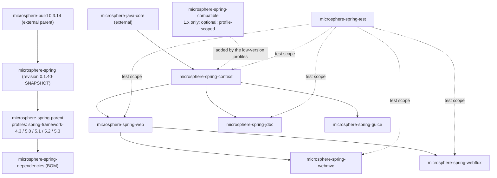

# Developer Guide — `release-1.x` branch (0.1.x)

[← Developer guide index](../README.md) · [简体中文](./zh/README.md) · [User Guide — 1.x](../../user-guide/1.x/README.md) · [Developer Guide — current](../current/README.md)

This directory documents the **0.1.x** maintenance line — the `release-1.x` branch: Java 8, `javax.*`
namespaces, Spring Framework 4.3.x – 5.3.x. Its sources are only reachable through read-only git
(`git show origin/release-1.x:<path>`); the working tree of this repository is the 0.2.x side, so every
snippet in these pages was read from the branch object store, not from the checkout.

## Version facts

| Item | Value |
|---|---|
| Branch | `release-1.x` |
| Version line | 0.1.x — latest release `0.1.39`, development `0.1.40-SNAPSHOT` |
| Java baseline | 8 |
| Namespace | `javax.*` (`javax.servlet:javax.servlet-api`, provided by the container) |
| Spring Framework verified | 4.3.30.RELEASE / 5.0.20.RELEASE / 5.1.20.RELEASE / 5.2.25.RELEASE / 5.3.39 (**5.3 is the default profile**) |
| Reactor BOM | Bismuth-SR17 (4.3 and 5.0), Californium-SR23 (5.1), Dysprosium-SR25 (5.2), 2020.0.47 (5.3) |
| Build parent | `io.github.microsphere-projects:microsphere-build:0.3.14` |
| Managed third parties | `microsphere-java` 0.3.19, `microsphere-logging` 0.2.2, Jackson 2.22.2, SnakeYAML 2.6, P6Spy 3.9.1, Tomcat 9.0.119, ZooKeeper 3.9.5, Curator 5.9.0 |

Re-read each value in
[`microsphere-spring-parent/pom.xml`](../../../microsphere-spring-parent/pom.xml) **on the branch**
(`git show origin/release-1.x:microsphere-spring-parent/pom.xml`) before quoting it — Dependabot keeps
bumping these numbers on `main`, so the 0.2.x working tree and the 0.1.x branch disagree.

## Module dependency graph



The extra node is the whole point of the 1.x line: `microsphere-spring-compatible` supplies
`org.springframework.*` shims that Spring 4.3 / early 5.x do not provide, and it is attached to
`microsphere-spring-context` as an **optional, profile-scoped** dependency — which is why it exists on
this branch and disappears on 0.2.x.

## Module documents

| Module | English | 简体中文 | What the page covers |
|---|---|---|---|
| parent | [parent.md](./parent.md) | [中文](./zh/parent.md) | the five-profile Spring matrix, `${revision}` flattening |
| dependencies | [dependencies.md](./dependencies.md) | [中文](./zh/dependencies.md) | the consumer-facing BOM for 0.1.x |
| context | [context.md](./context.md) | [中文](./zh/context.md) | property sources, relaxed binding, TTL caching, listenable Environment |
| compatible | [compatible.md](./compatible.md) | [中文](./zh/compatible.md) | the `org.springframework.*` shims, why they exist, why they are not published |
| web | [web.md](./web.md) | [中文](./zh/web.md) | endpoint metadata model, `WebEndpointMappingVisitor`, interception SPI |
| webmvc | [webmvc.md](./webmvc.md) | [中文](./zh/webmvc.md) | Servlet/MVC adapters, `ServletContainerInitializer` boot path, `ReversedProxyHandlerMapping` |
| webflux | [webflux.md](./webflux.md) | [中文](./zh/webflux.md) | reactive adapters plus the `function.server` visitor adapters |
| jdbc | [jdbc.md](./jdbc.md) | [中文](./zh/jdbc.md) | `p6spy:` URL indirection, DataSource decoration, listener fan-out |
| guice | [guice.md](./guice.md) | [中文](./zh/guice.md) | Spring ↔ Guice injection bridge |
| test | [test.md](./test.md) | [中文](./zh/test.md) | embedded Tomcat 9 / ZooKeeper / SQLite lifecycles, abstract test bases |

## Reading a 0.1.x page against a 0.2.x page

Each module page carries a divergence table, and the recurring differences are:

| Aspect | 0.1.x (`release-1.x`) | 0.2.x (`release`) |
|---|---|---|
| Java / namespace | Java 8, `javax.*` | Java 17, `jakarta.*` |
| Servlet boot integration | `META-INF/services/javax.servlet.ServletContainerInitializer` → `EnableWebMvcExtensionListener`, which sets `threadContextInheritable` and registers `RequestContextFilter` | re-expressed for `jakarta.servlet`, no `javax` service file |
| Endpoint introspection | `WebEndpointMappingVisitor` exists (interface only — no in-library implementation and no call site) | removed |
| WebFlux function support | Same `io.microsphere.spring.webflux.function.server` package on both lines (4 classes); `RequestPredicateVisitorAdapter` is an `interface … extends InvocationHandler` that probes `RequestPredicates$Visitor` reflectively and falls back to `RequestPredicateKind.acceptVisitor` | Same four classes; the adapter becomes `interface … extends RequestPredicates.Visitor` with all callbacks direct `@Override`s, plus a `version(String)` arm for Spring 7 |
| `requestContextStrategy` | Read by the WebFlux registrar (`WebFluxExtensionBeanDefinitionRegistrar.java:102`); on the Servlet side it is `EnableWebMvcExtensionListener.java:114,:116` that reads it, never the registrar | Unchanged — identical registrar and listener handling, so this is not a version-line divergence |
| CI matrix | JDK `8, 11, 17, 21, 25` × 5 Spring profiles (`.github/workflows/maven-build.yml:25-29`) | JDK `17, 21, 25` × 4 Spring profiles (`main:.github/workflows/maven-build.yml:25-29`) |
| Compatibility shims | `microsphere-spring-compatible` (15 source files: 14 `org.springframework.*` types + `package-info.java`; BOM-unmanaged, declared only by the `spring-framework-4.3` / `5.0` profiles) | module deleted |
| Build parent | `microsphere-build:0.3.14` | `microsphere-build:0.3.17` (`pom.xml:8`) |

## Building and verifying

```bash
mvn -P spring-framework-5.3 clean verify     # default profile on this branch
mvn -P spring-framework-4.3 clean test       # the oldest line; pulls in -compatible
mvn -pl microsphere-spring-webmvc -am test
```

To inspect the branch without disturbing the working tree, stay read-only:

```bash
git ls-tree -r --name-only origin/release-1.x -- microsphere-spring-context/src/main/java
git show origin/release-1.x:microsphere-spring-context/pom.xml
```

Never `git checkout` / `git switch` this branch while the 0.2.x working tree has uncommitted work.

## Conventions in these pages

- Code is quoted from `origin/release-1.x` objects; a repo-relative path still names the file, but the
  content is the 1.x version of it.
- `⚠` marks a discrepancy verified in source — for example an annotation attribute that is declared
  but never read by any registrar on this branch.
- Where a 1.x behaviour has no 0.2.x equivalent (or the reverse), the page states which branch it
  belongs to rather than describing both as current.
