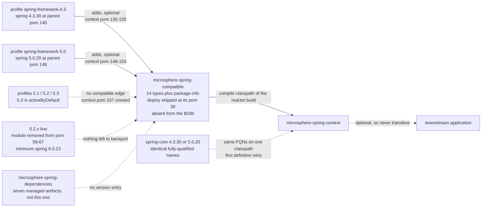
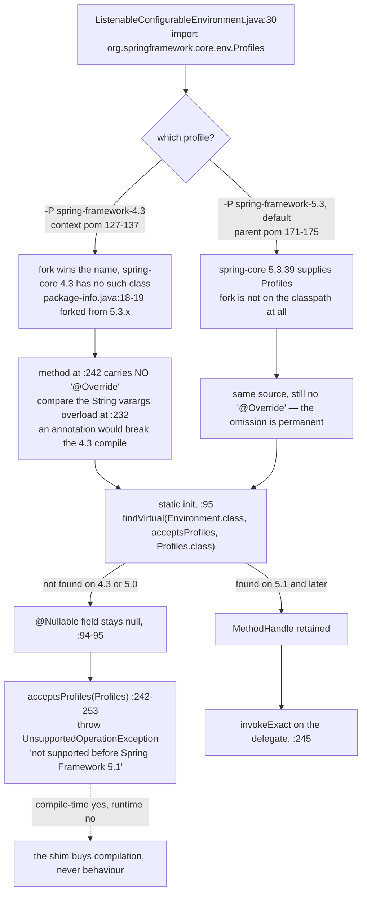

# microsphere-spring-compatible — Developer Guide (1.x only)

[← Developer guide overview](./README.md) · [简体中文](./zh/compatible.md) · [User guide](../../user-guide/1.x/compatible.md) · [0.2.x](../current/README.md)

> Every path below prefixed `origin/release-1.x:` must be read with `git show`/`git grep` against that branch — the module has **no directory** in the 0.2.x working tree. Citations without a prefix are files that exist in the current tree.

## 1. Module identity, baselines and deployment posture

| Attribute | Value | Evidence |
|---|---|---|
| Maven coordinate | `io.github.microsphere-projects:microsphere-spring-compatible:${revision}` | `origin/release-1.x:microsphere-spring-compatible/pom.xml:13-16` |
| Packaging | `jar` | `…:pom.xml:16` |
| Declared in the reactor | yes, third module listed | `origin/release-1.x:pom.xml:58-69`, entry at `:61` |
| Reactor version / last released | `0.1.40-SNAPSHOT` (`revision`); tag `0.1.39` is the newest published `0.1.x` tag | `origin/release-1.x:pom.xml:55`, `git tag --list "0.1.3*"` |
| Inherited parent | `microsphere-spring-parent:${revision}` → root parent `microsphere-build:0.3.14` | `…compatible/pom.xml:5-10`, `origin/release-1.x:pom.xml:5-9` |
| Java baseline | Java **8** is a first-class build target (`java: ['8','11','17','21','25']`) | `origin/release-1.x:.github/workflows/maven-build.yml:25` |
| Spring matrix | `4.3.30.RELEASE` / `5.0.20.RELEASE` / `5.1.20.RELEASE` / `5.2.25.RELEASE` / `5.3.39`, `5.3` `activeByDefault` | `origin/release-1.x:microsphere-spring-parent/pom.xml:136-179` — versions at `:140`, `:148`, `:156`, `:164`, `:175`; default at `:171-173` |
| Dependencies | **one**, `com.google.code.findbugs:jsr305`, `<optional>true</optional>`; **no `org.springframework:*` at all** | `…compatible/pom.xml:21-30`, specifically `:24-28`; jsr305's version arrives via the imported `microsphere-java-dependencies` BOM (`…parent/pom.xml:116-122`, `:22`) |
| **Deployment to Central is skipped** | `maven-deploy-plugin` with `<skip>true</skip>` | `…compatible/pom.xml:34-40`, the flag is **line `:38`** |
| Managed by the BOM | **no** — `microsphere-spring-dependencies` lists seven artifacts (`:26-62`) and this is not one of them | `origin/release-1.x:microsphere-spring-dependencies/pom.xml:26-62` |
| Contents | 15 source files = **14 types + `package-info.java`**, all under `org.springframework.*`; `src/test` is **absent** | `git ls-tree -r --name-only origin/release-1.x -- microsphere-spring-compatible` |
| Self-declared provenance | "forked from the Spring Framework 5.3.x(latest) … to be compatible with the lower versions" | `…src/main/java/org/springframework/package-info.java:17-23`, the sentence at `:18-19` |

The three deployment facts are mutually consistent and are the module's defining property: it is **not an artifact anyone can depend on**. Deploy is skipped (`pom.xml:38`), the BOM does not manage it (`dependencies/pom.xml:26-62`), and its only inbound edge is `<optional>true</optional>` (below). It exists to satisfy the *compiler* of one sibling module inside a local reactor build — nothing else. Note also that `package-info.java:22` says `@since 1.0.0`; as elsewhere in this repository, `@since` values are project-generation labels, not release coordinates (compare `revision` `0.1.40-SNAPSHOT`, `origin/release-1.x:pom.xml:55`).

## 2. How the module is pulled in, and why 0.2.x has none

Only **one** module ever declares it — `microsphere-spring-context`, in exactly **two** profiles, both optional (`origin/release-1.x:microsphere-spring-context/pom.xml:127-137` for `spring-framework-4.3`, dependency at `:130-135` with `<optional>` at `:134`; and `:139-155` for `spring-framework-5.0`, dependency at `:148-153`, `<optional>` at `:152`). The `5.1`/`5.2`/`5.3` profiles (`:157-166` and following) declare only `spring-context-indexer` — **no** compatible edge. `git grep -n "microsphere-spring-compatible" origin/release-1.x -- '*.xml'` returns four hits total: the module's own `artifactId`, the two profile edges above, and the reactor entry.

Read the middle of that diagram as the design's crux: the fork and real `spring-core` are **rivals on one classpath**, never a layered pair. `APP` can never receive the fork transitively because `optional` suppresses transitivity at both edges (`context/pom.xml:134`, `:152`). In 0.2.x the module is simply gone from the reactor (`pom.xml:58-67` lists nine modules, none named `compatible`), and the minimum Spring profile is `6.0.23` (`microsphere-spring-parent/pom.xml:140-142`), so the rivalry no longer arises — see §7.

## 3. Complete class inventory

`native since` is the `@since` tag of the forked file itself; "in 4.3.30 jar?" was checked against the cached `spring-core-4.3.30.RELEASE.jar` and `spring-core-5.0.20.RELEASE.jar` in the local Maven repository (`unzip -l`); the 5.1/5.2 jars are not cached, so they are not asserted. The two right-hand counts are **0.1.x files outside the fork module** that mention the FQN (`git grep -l … -- '*/src/main/java/*'` and `'*/src/test/java/*'`).

| Class (all in `org.springframework.*`) | Kind / visibility | native `@since` | in 4.3.30 jar? | 0.1.x main / test | Why it is here |
|---|---|---|---|---|---|
| `core.env.Profiles` | `@FunctionalInterface`, public | `5.1` — `Profiles.java:30`, `:32-33` | **absent** | 1 / 1 | the only shim the library genuinely needs as a *type*; `matches(Predicate<String>)` at `:42`, `of(String…)` at `:71-72` |
| `core.env.ProfilesParser` | `final class`, **package-private** | `5.1` — `ProfilesParser.java:37`, `:39` | absent (same package) | 0 / 0 | reached only from `Profiles.java:72`; cannot be relocated (see §4) |
| `lang.Nullable` | annotation | `5.0` — `Nullable.java:46`, `:53` | **absent** | 0 / 0 | required by the fork's *own* closure: 11 files inside the module import it, no library file does |
| `lang.NonNull` | annotation | `5.0` — `NonNull.java:45`, `:52` | **absent** | 0 / 0 | zero references anywhere in the reactor — dead weight kept for package symmetry |
| `util.Assert` | `abstract class` | class `1.1.2` — `:62`; **15 members** `5.0`/`5.2` | present | 9 / 0 | supplies the `Supplier<String>` overloads 4.3 lacks: `:97`, `:142`, `:228`, `:324`, `:707` |
| `util.ClassUtils` | `abstract class` | class `1.1` — `:59`; members `5.0.3`→`5.3.19` | present | 10 / 2 | newer members, e.g. `getInterfaceMethodIfPossible` `:1378`, `:1393`; owns a cache at `:149` |
| `util.CollectionUtils` | `abstract class` | class `1.1.3` — `:44`; `newHashMap`/`newLinkedHashMap` `5.3` at `:88`, `:106`; `firstElement` `5.2.3` `:374`; `lastElement` `5.0.3` `:417` | present | 5 / 0 | hosts `toMultiValueMap`, which instantiates the forked adapter at `:483` |
| `util.ConcurrentReferenceHashMap` | `class`, soft/weak `ConcurrentMap` | `3.2` — `:61`, `:63` | present | 0 / 0 | internal only: `ClassUtils.java:149`, `ReflectionUtils.java:82`, `:87` |
| `util.MultiValueMap` | `interface` | class `3.0` — `:30`; `addAll` `5.0` `:56`, `:64`; `addIfAbsent` `5.2` `:74` | present | 8 / 5 | the interface as forked carries two `addAll` and one `addIfAbsent` default method that 4.3's copy does not declare |
| `util.MultiValueMapAdapter` | `class`, `Serializable` | **`5.3`** — `:37`, class `:40` | **absent** | 0 / 0 | 4.3 has no such class; used by `CollectionUtils.java:483`, never by library code |
| `util.ObjectUtils` | `abstract class` | class `4.2`; `unwrapOptional` `5.0` `:189`; `nullSafeConciseToString` `5.3.27` `:997` | present | 14 / 1 | newest member in the fork (5.3.27 ⇒ snapshot is ≥ that patch) |
| `util.ReflectionUtils` | `abstract class` | class `1.2.2`; members `5.0`, `5.2` ×2, `5.3.2` ×2 | present | 6 / 4 | two `ConcurrentReferenceHashMap` caches at `:82`, `:87` |
| `util.StreamUtils` | `abstract class` | class `3.2.2`; one member `5.2.6` | present | 0 / 2 | test-side only |
| `util.StringUtils` | `abstract class` | class tag is a date, "`16 April 2001`" `:60`; members `5.0` `:819`, `5.0.4` `:866`, `5.2.9` `:378`, `5.3.22` `:264`, `5.3.27` `:1457`, `:1476` | present | 26 / 3 | `ProfilesParser.java:187` calls `collectionToDelimitedString`; heaviest overall import count |
| `package-info.java` | package doc | `@since 1.0.0` `:22` | — | — | the provenance statement at `:18-19` |

Two consequences of this table are worth stating explicitly. First, **0** library files import `org.springframework.lang.Nullable`, because 0.1.x code annotates with its own `io.microsphere.annotation.Nullable` (74 files, `git grep -h "^import.*Nullable" origin/release-1.x -- '*/src/main/java/*'`); the 11 importers are all inside the fork, which is why the shim exists only to keep the forked classes self-consistent. Second, `MultiValueMapAdapter` is backported from **Spring 5.3** — the class's own tag (`MultiValueMapAdapter.java:37`) — not from "5.x" generally. The module holds 15 source files: 14 types plus one `package-info.java`.

### 3.1 Member-level delta over Spring 4.3

Class presence is only half the story: for the nine classes 4.3 already has, the fork contributes members 4.3 lacks. Each row is the count of `@since 5.*` tags inside the forked file with representative declarations.

| Class | `@since` tags newer than 4.3 | Representative members |
|---|---|---|
| `util.Assert` | 13 × `5.0`, 2 × `5.2` | the `Supplier<String>` message overloads: `state :97`, `isTrue :142`, `notNull :228`, `hasText :324`, `isAssignable :707`; plus `noNullElements(Collection,String) :544` |
| `util.CollectionUtils` | 2 × `5.0.3`, 2 × `5.2.3`, 2 × `5.3` | `lastElement :420`/`:445`, `firstElement :377`/`:401`, `newHashMap :90`, `newLinkedHashMap :108` |
| `util.StringUtils` | `5.0`, `5.0.4`, `5.2.9`, `5.3.22`, 2 × `5.3.27` | `uriDecode :821`, `parseLocale :869`, `matchesCharacter :380`, `trimAllWhitespace :264`, `truncate :1457`/`:1476` |
| `util.ClassUtils` | `5.0.3`, `5.0.5`, `5.0.6`, `5.1`, `5.2.3`, `5.3.16`, `5.3.19` | `isJavaLanguageInterface :876`, `isInnerClass :888`, `isLambdaClass :902`, `hasMethod :1178`, `getInterfaceMethodIfPossible :1378`/`:1393` |
| `util.ObjectUtils` | `5.0`, `5.3.27` | `unwrapOptional :189`, `nullSafeConciseToString :997` |
| `util.ReflectionUtils` | `5.0`, 2 × `5.2`, 2 × `5.3.2` | method/field lookup variants beyond 4.3's set |
| `util.StreamUtils` | `5.2.6` | one member; the rest (`copyToString`, `copyToByteArray`) already exist in 4.3 |
| `util.MultiValueMap` | 2 × `5.0`, 1 × `5.2` | `addAll(K,List) :58`, `addAll(MultiValueMap) :66`, `addIfAbsent :74` (default method) |
| `core.env.Profiles`, `core.env.ProfilesParser`, `lang.Nullable`, `lang.NonNull`, `util.MultiValueMapAdapter` | whole types | absent from 4.3 outright — see the "in 4.3.30 jar?" column above |

The practical reading: `Assert` is the fork's biggest surface change (15 new members, all `Supplier`-based), yet no library call site uses one — it is there because `ProfilesParser` needs it. Conversely `StringUtils` is imported by 26 files, of which the fork matters for only a handful of members.

## 4. Why these classes live in `org.springframework.*`

**The package is not stylistic, it is load-bearing.** Three independent reasons, each verifiable:

1. **Source-free portability.** Library code writes ordinary Spring imports — e.g. `import org.springframework.core.env.Profiles;` at `origin/release-1.x:microsphere-spring-context/src/main/java/io/microsphere/spring/core/env/ListenableConfigurableEnvironment.java:30`. The *same* line compiles under `-P spring-framework-4.3` (type supplied by the fork) and under `-P spring-framework-5.3` (type supplied by Spring). A relocated copy (`io.microsphere.compat.Profiles`) would force a per-version source fork or reflection at every use site — the exact cost the module exists to avoid.
2. **Package-private access.** `ProfilesParser` is declared package-private (`ProfilesParser.java:39`) and is invoked from `Profiles.of` (`Profiles.java:72`), which is itself **package-private static**, not `public`. Move either type out of `org.springframework.core.env` and the call stops compiling. The fork therefore *must* sit in the real package.
3. **Fork-internal closure.** The forked code is written against Spring 5.3 idioms, so it needs 5.3-era members of its own: `ProfilesParser.java:54` calls `Assert.hasText(expression, () -> …)` and `:120` calls `Assert.isTrue(wellFormed, () -> …)` — the `Supplier` overloads that Spring 4.3 does not have (`Assert.java:324`, `:142`). That is why `Assert`, `StringUtils` and `lang.Nullable` had to be forked too: **`Profiles` drags a transitive closure, and the closure must not regress to 4.3 semantics.** Verified: the library's own 9 `Assert`-importing files never use a `Supplier` overload (`git grep -nE "Assert\.[a-zA-Z]+\([^;]*, *\(\) *->"` over 1.x main sources → no hits), and the 27 hits for `newLinkedHashMap` resolve to `io.microsphere.collection.MapUtils`, not Spring.

**The fork's own closure.** Only two edges cross from library code into the fork (`Profiles`, and ordinary `util.*` imports that Spring 4.3 already satisfies); everything else is fork-internal. This table is the evidence for reason 3 above.

| From | To | Line |
|---|---|---|
| `microsphere-spring-context` | `core.env.Profiles` | `ListenableConfigurableEnvironment.java:30`, used at `:95`, `:242` |
| `core.env.Profiles` | `core.env.ProfilesParser` | `Profiles.java:72` |
| `core.env.ProfilesParser` | `util.Assert` (Supplier forms), `util.StringUtils`, `lang.Nullable` | `ProfilesParser.java:20`, `:21`, `:19`; calls at `:45`, `:54`, `:120`, `:187` |
| `util.*` (10 files) | `lang.Nullable` | 11 imports, all inside the module |
| `util.CollectionUtils` | `util.MultiValueMapAdapter` | `CollectionUtils.java:483` (and its own use at `:498`) |
| `util.ClassUtils`, `util.ReflectionUtils` | `util.ConcurrentReferenceHashMap` | `ClassUtils.java:149`, `ReflectionUtils.java:82`, `:87` |

So `lang.NonNull`, `util.StreamUtils` and `util.MultiValueMapAdapter`'s library-facing purpose are all nil: `lang.NonNull` is referenced nowhere (`git grep -w NonNull` outside the fork matches only unrelated test method names), `StreamUtils` appears in no main source, and the adapter is reached solely from `CollectionUtils.toMultiValueMap`. They are bundled because the fork was taken as a snapshot of Spring 5.3's `core`/`util` surface, not because each file was demanded.

**Risks this trades away.** (a) *Duplicate classes*: under 4.3/5.0 the fork and `spring-core` both define `org.springframework.util.Assert`, `StringUtils`, `CollectionUtils`, `ObjectUtils`, `ClassUtils`, `ReflectionUtils`, `StreamUtils`, `MultiValueMap`, `ConcurrentReferenceHashMap` (all nine confirmed present in the 4.3.30 jar); which one a class loader defines first is classpath-order luck, not specification. (b) *Split packages*: **all 14** of the fork's types sit in packages owned by `spring-core`; there is no `src/main/resources`, hence **no `module-info.java`** and no JPMS sealing to fight — which is precisely why this survives at all on the classpath. (c) *Upgrade hazard*: a fork that wins order under 4.3 keeps winning under 5.3 if a consumer pins it manually, silently replacing Spring's implementations — including the caches at `ClassUtils.java:149` and `ReflectionUtils.java:82`, `:87`, which then exist **twice** with separate contents. (d) *Type identity*: `MethodHandle` lookups compare `Class` objects, so `findVirtual(Environment.class, "acceptsProfiles", Profiles.class)` (`ListenableConfigurableEnvironment.java:95`) is only coherent if `Profiles` is the very class Spring's own `Environment` refers to.

**Containment.** The blast radius is limited by three facts stacked: the edge is `<optional>` (`context/pom.xml:134`, `:152`); the edge exists in only two of five profiles; and the artifact cannot be published (`pom.xml:38`) or version-managed (`dependencies/pom.xml:26-62`). A consumer on 5.1+ therefore never sees these classes at all — the shims are visible only to `microsphere-spring-context`'s own compilation under the two oldest profiles, which is why CI runs all five (`maven-build.yml:26-29`).

## 5. Resolution path for one representative shim: `Profiles`

The last edge is the sentence to remember: **the fork makes 4.3 compile, and then the code politely refuses to run that path.** The fork is also the reason the method has no `@Override` at `:242` while its sibling at `:232` has one — under 4.3 there is no interface method to override, so `@Override` would be a compile error in exactly the profiles the module exists for. `matchesProfiles(String…)` (`:218`) is the same story with the 5.3.8 handle at `:101`.

## 6. Design notes and evidenced patterns

| Pattern | Where | Evidence |
|---|---|---|
| **Backport / Fork-and-own** (verbatim copy, upstream Javadoc, `@author` and Apache header retained) | all 14 types | copyright headers `Copyright 2002-2023 the original author or authors` (`Profiles.java:1-15`), upstream authors kept (`Profiles.java:28-29`), Spring's own `@since` tags preserved (`ObjectUtils.java:997` = `5.3.27`) |
| **Same-package placement for access** | `Profiles` ↔ `ProfilesParser` | `ProfilesParser.java:39` package-private; `Profiles.java:71-72` package-private static factory calling it |
| **Factory Method over an opaque parser** | `Profiles.of(String…)` | `Profiles.java:71-73` — a *package-private* entry point hiding a 190-line parser (`ProfilesParser.java`), whose internals are the `Operator` enum `:143`, the `Context` enum `:145` and the `ParsedProfiles` implementor `:147`; `@FunctionalInterface` at `Profiles.java:32` plus the single abstract method `matches(Predicate<String>)` `:42` let a lambda implement the type |
| **Adapter** (classic GoF, and Spring's own name says so) | `MultiValueMapAdapter` | wraps `Map<K,List<V>>` into the `MultiValueMap` contract — field at `:42`, constructor `:49-52`, `getFirst` reading the target at `:58-61` |
| **Capability probe with graceful degradation** (Facade over a newer API) | `ListenableConfigurableEnvironment` in `microsphere-spring-context`, not the fork | `@Nullable static final MethodHandle` fields `:89`, `:95`, `:101`; `if (HANDLE != null)` then `invokeExact` else `UnsupportedOperationException` — `:242-253` |
| **Reference-based bounded cache** | `ConcurrentReferenceHashMap` | soft/weak references by design (`:49-55`), used for reflection caches at `ReflectionUtils.java:82`, `:87` and `ClassUtils.java:149` |
| *Absent*: no activation annotation, no registrar, no `src/main/resources`, **no tests** | module-wide | `git ls-tree` shows only `pom.xml` + `src/main/java`; nothing registers itself, the fork is passive code |

## 7. Why 0.2.x removed it

Three independent confirmations from the current tree:

1. **The module is not in the reactor.** `pom.xml:58-67` lists `parent, dependencies, context, jdbc, web, webmvc, webflux, guice, test` — nine entries, no `compatible`; `grep -rn compatible pom.xml microsphere-spring-parent/pom.xml microsphere-spring-dependencies/pom.xml` returns nothing.
2. **The baseline moved past every shim.** The oldest Spring profile is now `6.0` at `6.0.23` (`microsphere-spring-parent/pom.xml:140-142`, then `6.1.21` `:148-150`, `6.2.18` `:156-158`, `7.0.9` `:164-169`) on Java 17 (`pom.xml:56`). Every type the fork supplied — `Profiles` (5.1), `lang.Nullable`/`NonNull` (4.3/5.0), `MultiValueMapAdapter` (5.3), the `Supplier` `Assert` overloads (5.0) — is native in Spring 6, so reason 3 of §4 has no work to do.
3. **The consumer shrank to one line.** 0.2.x keeps the same import (`microsphere-spring-context/src/main/java/io/microsphere/spring/core/env/ListenableConfigurableEnvironment.java:28`) but `acceptsProfiles(Profiles)` is now plain delegation (`:192-194`); the `ACCEPTS_PROFILES_METHOD_HANDLE` field and the `UnsupportedOperationException("…not supported before Spring Framework 5.1")` are gone. The import line is unchanged — only *who supplies the type* changed, which is the whole design goal of the fork having reached its natural end.

Worth noting for pattern archaeology: the probe idiom did **not** disappear, only the fork. 0.2.x still keeps one handle, `SET_ESCAPE_CHARACTER_METHOD_HANDLE` (`:61`) with `throw new UnsupportedOperationException("…not supported before Spring Framework 6.2")` (`:320`). The difference is that the current gap is a single *method* absent in a *newer* release, not a *type* absent in five older ones — a method gap is bridgeable by reflection alone and needs no rival class on the classpath.

## 8. Gotchas and testing caveats

| # | Observation | Evidence |
|---|---|---|
| 1 | ⚠ You cannot depend on it. Deploy is skipped and the BOM omits it, so `<dependency>` on `microsphere-spring-compatible` will not resolve from Central — it works only while building this repository's reactor. | `…compatible/pom.xml:34-40` (`:38`), `…dependencies/pom.xml:26-62` |
| 2 | ⚠ Duplicate-class collision with real `spring-core`. Nine of the 14 types also exist in 4.3.30; whichever appears first on the classpath defines the name, and the loser's members are simply unreachable. Expect `NoSuchMethodError` if the fork shadows Spring 5.x. | jar listings of `spring-core-4.3.30.RELEASE` vs `…compatible/src/main/java/org/springframework/util/*` |
| 3 | ⚠ Never add `@Override` to `acceptsProfiles(Profiles)`. Its absence is required for the 4.3/5.0 profiles to compile. | `ListenableConfigurableEnvironment.java:242` (1.x) vs `:232` |
| 4 | Building only `-pl microsphere-spring-context` under 4.3/5.0 fails: the fork must be in the same reactor. Use `-am`, or the three-module form (`parent`, `compatible`, `context`). | `origin/release-1.x:pom.xml:58-69`, `context/pom.xml:130-135` |
| 5 | Maven's `activeByDefault` (`5.3`) is deactivated as soon as any profile is named, so `-P spring-framework-4.3` yields exactly one `spring-framework.version` — but *only* if you do not also activate another. | `…parent/pom.xml:171-173`, `:138-142` |
| 6 | The fork ships **no tests** and no `src/main/resources`; its correctness is asserted indirectly by `microsphere-spring-context`'s suite under the two oldest profiles, five times over the JDK matrix. | `git ls-tree -r --name-only origin/release-1.x -- microsphere-spring-compatible`; `maven-build.yml:25-29`, `:49` |
| 7 | Two behaviours that are *not* parity by design: `acceptsProfiles(Profiles)` throws on 4.3/5.0 (`:253`), and `Profiles.of(...)` equivalence (`equals`/`hashCode` since 5.1.17, documented at `Profiles.java:63-66`) depends on `ParsedProfiles` being forked too (class at `ProfilesParser.java:147`, instantiated at `:50`). | as cited |
| 8 | The 5.1.20 / 5.2.25 `spring-core` jars are not in the local cache, so per-class presence claims for those two profiles are unverified here — 5.1+ is irrelevant in practice because neither profile declares the fork. | `context/pom.xml:157-166`; `~/.m2/repository/org/springframework/spring-core/` |
| 9 | jsr305 is `optional` (`…compatible/pom.xml:24-28`) yet `lang.NonNull`/`lang.Nullable` are built on `javax.annotation.Nonnull`, `TypeQualifierNickname` and `When` (`NonNull.java:19-20`, `:50-51`; `Nullable.java:51`) — annotation *retention* is `RUNTIME` (`NonNull.java:48`), so reflective reads on a classpath without jsr305 behave differently from a compile against it. | as cited |
| 10 | ⚠ `package-info.java:18` claims a "5.3.x(latest)" fork, but members tagged `5.3.27` (`ObjectUtils.java:997`, `StringUtils.java:1457`, `:1476`) and `5.3.19` (`ClassUtils.java:1393`) are present, so the snapshot is ≥ 5.3.27 and the comment is approximate — do not treat it as a pin. | as cited |
| 11 | `lang.NonNull` has zero references branch-wide (`git grep -w NonNull origin/release-1.x` outside the fork finds only test method *names*); it is package furniture, not a shim anyone needs. | `NonNull.java:52`; grep evidence §3 |
| 12 | Do not map `@since` to releases: `package-info.java:22` says `1.0.0` while the analysed line is `0.1.40-SNAPSHOT`. | `origin/release-1.x:pom.xml:55` |

**Related** — [Developer guide overview](./README.md) · [简体中文版](./zh/compatible.md) · [User guide — Compatible (1.x)](../../user-guide/1.x/compatible.md) · [1.x context module](./context.md) · [0.2.x developer guide](../current/README.md) · [parent POM profiles](./parent.md) · [dependency management](./dependencies.md)
