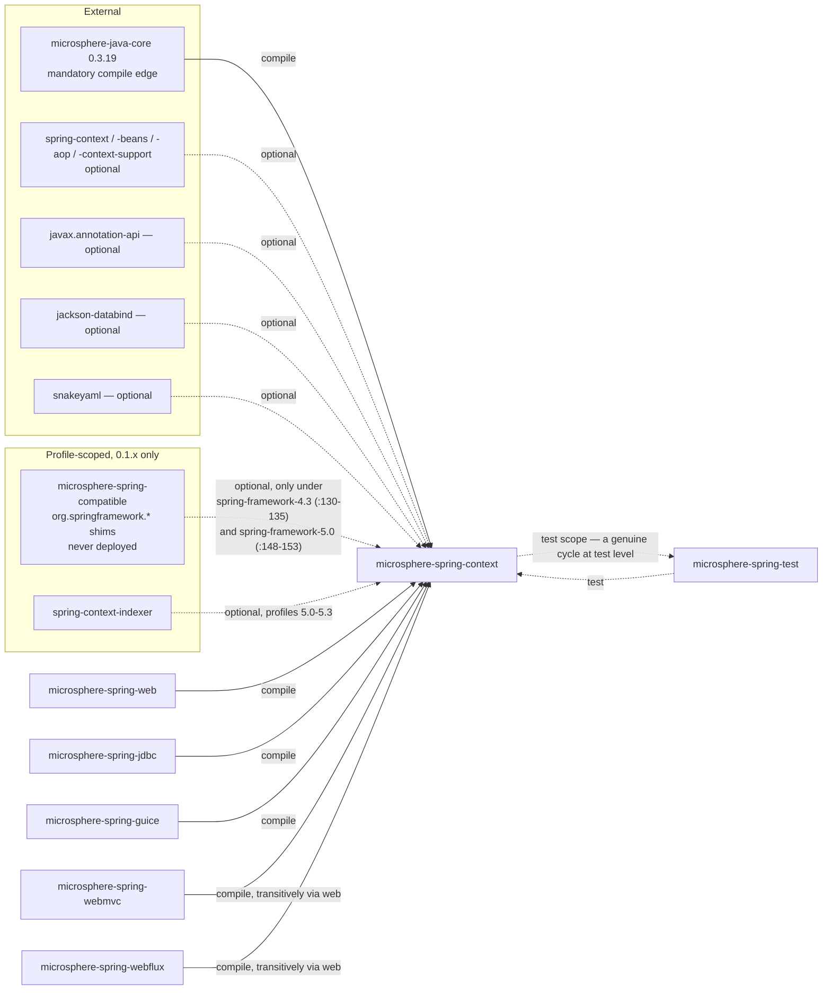
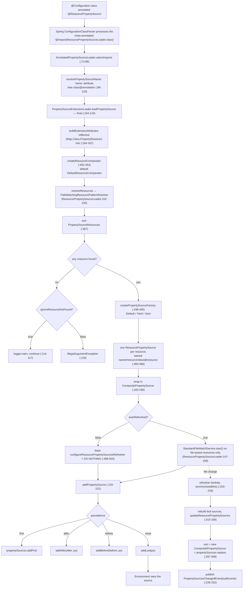
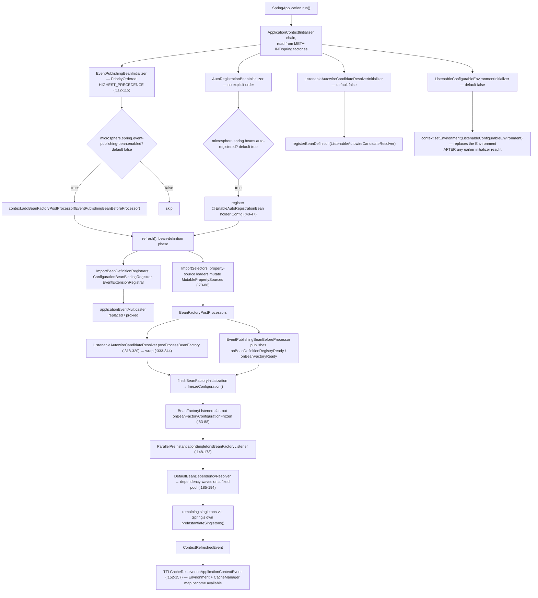

# microsphere-spring-context — Developer Guide (0.1.x)

[← Developer guide overview](./README.md) · [简体中文](./zh/context.md) · [User guide](../../user-guide/1.x/context.md) · [0.2.x](../current/context.md)

This page documents the **0.1.x** line, which exists only on the `origin/release-1.x` branch. Every
line number below was read from that branch's object store (`git show origin/release-1.x:<path>`); the
working tree of this repository is the 0.2.x line, so opening these files in the checkout shows
different content.

## 1. Module identity, baselines and dependency posture

| Attribute | Value | Evidence |
|---|---|---|
| Maven coordinate | `io.github.microsphere-projects:microsphere-spring-context:${revision}` | `origin/release-1.x:microsphere-spring-context/pom.xml:13-16` |
| Reactor version | `revision` = `0.1.40-SNAPSHOT` | `origin/release-1.x:pom.xml:54-56` |
| Last published release of the line | `0.1.39` | tag `0.1.39` (`git tag`), the next snapshot being `0.1.40-SNAPSHOT` |
| Build parent | `microsphere-build:0.3.14` | `origin/release-1.x:pom.xml:5-9` |
| Java baseline | `8` — `java.version=8`, `maven.compiler.source/target=${java.version}` | `microsphere-build-0.3.14.pom:58,89,94` (external parent, installed POM) |
| Spring baseline | profile-selected `4.3.30.RELEASE` / `5.0.20.RELEASE` / `5.1.20.RELEASE` / `5.2.25.RELEASE` / `5.3.39`; `spring-framework-5.3` is `activeByDefault` | `origin/release-1.x:microsphere-spring-parent/pom.xml:136-179`, `:169-178` |
| Project Reactor BOM | `Bismuth-SR17` (4.3, 5.0), `Californium-SR23` (5.1), `Dysprosium-SR25` (5.2), `2020.0.47` (5.3) | same file `:141,:149,:157,:165,:176` |
| Managed microsphere libs | `microsphere-java` `0.3.19`, `microsphere-logging` `0.2.2`, Jackson `2.22.2`, SnakeYAML `2.6` | `origin/release-1.x:microsphere-spring-parent/pom.xml:22-25` |
| Annotation namespace | `javax.annotation:javax.annotation-api`, **optional** | `origin/release-1.x:microsphere-spring-context/pom.xml:61-66`; the only `javax.*` import in main sources is `ResourceInjectionPointDependencyResolver.java:21` |
| Reactor modules | 10 modules, including the **0.1.x-only** `microsphere-spring-compatible` | `origin/release-1.x:pom.xml:58-69`, `:61` |
| Main / test types | 165 main classes + 1 `spring.factories`; 150 test entries | `git ls-tree -r --name-only origin/release-1.x -- microsphere-spring-context` |
| Auto-configuration entries | 2 keys, 4 classes in `META-INF/spring.factories` | quoted in §4.5 |

**Dependency posture.** The module's only mandatory compile-scope edge is `microsphere-java-core`
(`origin/release-1.x:microsphere-spring-context/pom.xml:31-34`). Everything else that the code
compiles against is `optional` and therefore non-transitive: `spring-context` (`:37-41`),
`spring-context-support` (`:43-47`), `spring-beans` (`:49-53`), `spring-aop` (`:55-59`),
`javax.annotation-api` (`:61-66`), `jackson-annotations`/`jackson-databind` (`:68-79`) and `snakeyaml`
(`:81-86`). This is deliberate — the module is a *library of extensions to Spring*, so it must not pin
a consumer's Spring version — but the practical consequence is that declaring `microsphere-spring-context`
alone gives you a classpath on which almost every public type throws `NoClassDefFoundError` on first use.
The Jackson and SnakeYAML optionality is what makes `@JsonPropertySource` and `@YamlPropertySource`
opt-in features rather than guaranteed ones (§4.2).

Unlike 0.2.x, `spring-context-indexer` is **not** a plain dependency here: it appears only inside the
`spring-framework-5.0`/`5.1`/`5.2`/`5.3` profiles (`:143-146`, `:160-164`, `:171-175`, `:182-186`) and is
absent from `spring-framework-4.3` (the artifact does not exist there).

## 2. Dependency graph



Evidence for the inbound edges: `origin/release-1.x:microsphere-spring-web/pom.xml:33-35`,
`microsphere-spring-jdbc/pom.xml:33-35`, `microsphere-spring-guice/pom.xml:37-39` each declare
`microsphere-spring-context` at compile scope with `<version>${revision}</version>`.
⚠ `microsphere-spring-test` declares **no** dependency on this module at all
(`microsphere-spring-test/pom.xml` — no `microsphere-spring-*` artifact among its dependencies); the
edge actually runs the other way, as a `test`-scope dependency of `microsphere-spring-context`
(`microsphere-spring-context/pom.xml:109-115`). The two modules form a test-scoped cycle.

The **`microsphere-spring-compatible`** edge is the single most 0.1.x-specific fact on this page. It is
declared exactly twice, both times `<optional>true</optional>`, and only in the two lowest profiles:
`spring-framework-4.3` (`microsphere-spring-context/pom.xml:127-137`, dependency block `:130-135`) and
`spring-framework-5.0` (`:139-155`, dependency block `:148-153`). Profiles `5.1`, `5.2` and `5.3`
(`:157-188`) do **not** declare it. It supplies `org.springframework.*` types Spring 4.3 / early 5.0
lack — 15 classes such as `core/env/Profiles`, `core/env/ProfilesParser`, `lang/NonNull`, `lang/Nullable`
and ten `util/*` classes (`git ls-tree -r --name-only origin/release-1.x -- microsphere-spring-compatible`).
The module is excluded from deployment by `maven-deploy-plugin` `<skip>true</skip>`
(`microsphere-spring-compatible/pom.xml:34-41`), so it is **not** on Maven Central: building under
`-P spring-framework-4.3` or `-P spring-framework-5.0` only works from the reactor. See
[compatible.md](./compatible.md) for the shim inventory.

## 3. Package map

| Package (root `io.microsphere.spring`) | Representative types | Responsibility |
|---|---|---|
| `config.context.annotation` | `PropertySourceExtension`, `PropertySourceExtensionAttributes`, `PropertySourceExtensionLoader`, `AnnotatedPropertySourceLoader`, `ResourcePropertySource(Loader)`, `ResourcePropertySources(Loader)`, `DefaultPropertiesPropertySource(Loader)`, `DefaultPropertiesPropertySources(Loader)` | the property-source subsystem (§4.2) |
| `config.env.annotation` | `YamlPropertySource`, `JsonPropertySource` | format-specific meta-annotations over `@ResourcePropertySource` |
| `config.env.support` | `YamlPropertySourceFactory`, `JsonPropertySourceFactory`, `DefaultResourceComparator` | `PropertySourceFactory` implementations |
| `config.env.config` | `ResourceYamlProcessor` | SnakeYAML bridge |
| `config.env` | `EnvironmentEnabled`, `ImmutableMapPropertySource` | Environment-driven enablement, immutable source |
| `config.env.event` | `PropertySourceChangedEvent`, `PropertySourcesChangedEvent` | auto-refresh events |
| `config` | `ConfigurationPropertyRepository`, `CollectingConfigurationPropertyListener` | runtime catalogue of `@ConfigurationProperty` metadata |
| `cache` | `TTLContext` | thread-local TTL carrier (§4.3) |
| `cache.annotation` | `EnableTTLCaching`, `TTLCacheable`, `TTLCachePut`, `TTLCachingConfiguration` | TTL cache activation |
| `cache.intereptor` ⚠ | `TTLCacheResolver` | the resolver — **package name is misspelled on this branch** |
| `cache.redis` | `TTLRedisCacheWriterWrapper`, `TTLRedisConfiguration` | **100 % commented out** (§8) |
| `beans` | `BeanUtils`, `BeanSource`, `PropertyValuesUtils` | bean lookup / naming / source discovery |
| `beans.factory` | `BeanFactoryUtils`, `BeanDependencyResolver`, `DefaultBeanDependencyResolver`, `DependencyTreeWalker`, `InjectionPointDependencyResolver(s)`, `DelegatingFactoryBean`, `ObjectProviderUtils` | dependency graph introspection |
| `beans.factory.annotation` | `AnnotatedInjectionBeanPostProcessor`, `ConfigurationBeanBinding{Registrar,PostProcessor}`, `EnableConfigurationBeanBinding(s)`, `AnnotationBeanDefinitionRegistryPostProcessor` | injection engine + relaxed-binding registration (§4.4) |
| `beans.factory.support` | `ListenableAutowireCandidateResolver(Initializer)`, alias generators, `BeanRegistrar`, `GenericBeanNameGenerator` | candidate resolution, aliasing, registration primitives |
| `beans.factory.config`, `beans.factory.filter` | `BeanDefinitionUtils`, `GenericBeanPostProcessorAdapter`, `InstantiationAwareBeanPostProcessorAdapter`, `ResolvableDependencyTypeFilter` | definition/post-processor helpers |
| `context` / `context.annotation` | `ApplicationContextUtils`, `ConfigurableApplicationContextInitializer`, `AnnotatedBeanCapableImportCandidate`/`Selector`/`BeanDefinitionRegistrar`, `BeanCapableImportCandidate`, `ImportOptional(Selector)`, `OverrideAnnotationAttributes(Strategy)`, `AutoRegistrationBean*` | the annotation → registrar/loader model (§4.1) |
| `context.config` | `AutoRegistrationBean`, `ConfigurationBeanBinder`, `DefaultConfigurationBeanBinder`, `ConfigurationBeanCustomizer` | binding and self-registering beans |
| `context.event` | `BeanFactoryListener(s)`, `BeanListener(s)`, `EventPublishingBean*`, `ParallelPreInstantiationSingletonsBeanFactoryListener`, `DependencyAnalysisBeanFactoryListener`, `EnableEventExtension`, `EventExtensionRegistrar`, `InterceptingApplicationEvent*`, `DeferredApplicationEventPublisher`, `BeanTimeStatistics` | lifecycle events, parallel startup, interception (§4.6, §4.7) |
| `context.lifecycle` | `AbstractSmartLifecycle`, `LoggingSmartLifecycle` | `SmartLifecycle` scaffolding |
| `core.env` | `ListenableConfigurableEnvironment(Initializer)`, `EnvironmentUtils`, `PropertySourcesUtils`, `PropertyResolverUtils`, `EnvironmentListener`/`ProfileListener`/`PropertyResolverListener`/`LoggingEnvironmentListener` | listenable Environment (§4.5) |
| `core.annotation`, `core.convert`, `core.io`, `core` | `AnnotationUtils`, `GenericAnnotationAttributes`, `ResolvablePlaceholderAnnotationAttributes`, `ConversionServiceUtils`, `SpringConverterAdapter`, `ResourceLoaderUtils`, `ResourceUtils`, `PropertiesUtils`, `SpringFactoriesLoaderUtils`, `MethodParameterUtils`, `SpringVersion` | primitives everything else stands on |
| `net` | `SpringProtocolURLStreamHandler`, `Spring*URLConnectionFactory`/`Adapter`, `AbstractSpringResourceURLConnection` | the `spring:` URL protocol (§4.8) |
| `constants`, `util` | `PropertyConstants`, `MimeTypeUtils`, `FilterMode`, `SpringVersionUtils` | property-name constants, utilities |

## 4. Architecture design

### 4.1 The annotation → candidate model

Every `@Enable*` / `@*PropertySource` / `@ImportOptional` entry point in this module resolves to one of
three Spring extension interfaces, all of which funnel into a single abstract base class:

```
BeanCapableImportCandidate                     (aware: BeanClassLoader, BeanFactory, Environment, ResourceLoader)
   ├── AnnotatedBeanCapableImportCandidate<A>   binds a generic annotation type A, adds isEnabled()  (:97-117)
   │      ├── AnnotatedBeanCapableImportSelector<A>        implements ImportSelector      (:69-77)
   │      │      └── AnnotatedPropertySourceLoader<A>      property-source loaders        (:67-88)
   │      └── AnnotatedBeanCapableImportBeanDefinitionRegistrar<A>   implements ImportBeanDefinitionRegistrar (:63-114)
```

`AnnotatedBeanCapableImportSelector.selectImports(AnnotationMetadata)` is `final`
(`context/annotation/AnnotatedBeanCapableImportSelector.java:73-77`) and delegates to the protected
three-arg overload; `AnnotatedBeanCapableImportBeanDefinitionRegistrar.registerBeanDefinitions` is
likewise `final` and gated by `isEnabled(metadata)` before handing the subclass a
`ResolvablePlaceholderAnnotationAttributes<A>`
(`context/annotation/AnnotatedBeanCapableImportBeanDefinitionRegistrar.java:70-81,114`). The gate is
property-driven (`AnnotatedBeanCapableImportCandidate.java:180-187`), which is why attribute-free
`@Enable*` annotations in this library are still switchable:

* per importing class: `microsphere.spring.<importing-class>@<annotation-FQCN>.enabled` (`:204-207`)
* globally per annotation: `microsphere.spring.<annotation-FQCN>.enabled` (`:222-224`)

Annotation *attributes* — not just the on/off switch — can be overridden from the Environment via
`@OverrideAnnotationAttributes` + `ConfigurationPropertyOverrideAnnotationAttributesStrategy`
(`context/annotation/OverrideAnnotationAttributes.java:75-`, `...Strategy.java:108,129,189,212,245`),
whose prefixes are `microsphere.spring.prefix.<annotation-FQCN>` and the default
`microsphere.spring.@<SimpleName>.` (`:268,289`; prefix constants in
`constants/PropertyConstants.java:41`). Placeholders inside attributes resolve against the Environment
because every attribute map is wrapped in `ResolvablePlaceholderAnnotationAttributes`
(`core/annotation/ResolvablePlaceholderAnnotationAttributes.java`).

### 4.2 Property-source subsystem

`@PropertySourceExtension` (`config/context/annotation/PropertySourceExtension.java:144-245`) is a
`@Target(ANNOTATION_TYPE)` meta-annotation with ten attributes: `name`, `autoRefreshed`, `first`,
`before`, `after`, `value`, `resourceComparator`, `ignoreResourceNotFound`, `encoding`, `factory`. It is
never used directly; it is meta-annotated onto `@ResourcePropertySource`
(`ResourcePropertySource.java:127-134`), which in turn carries
`@Import(ResourcePropertySourceLoader.class)` (`:133`). `@YamlPropertySource` and `@JsonPropertySource`
are third-level annotations that simply pin the factory:
`@ResourcePropertySource(factory = YamlPropertySourceFactory.class)`
(`config/env/annotation/YamlPropertySource.java:111`) and
`@ResourcePropertySource(factory = JsonPropertySourceFactory.class)`
(`.../JsonPropertySource.java:116`). Neither declares an `@Import` of its own — the import arrives via
the `@ResourcePropertySource` meta-annotation, which is the mechanism Spring's
`ConfigurationClassParser` follows when it processes the annotations in
`processImports`/`retrievePropertySources` order.

Loading happens inside `selectImports`, not in a registrar:
`AnnotatedPropertySourceLoader.selectImports` (`AnnotatedPropertySourceLoader.java:73-88`) resolves the
property-source name (`:98-104`, falling back to `<importing-class>@<annotation-FQCN>` at `:129-133`),
pulls `getEnvironment().getPropertySources()` and calls the abstract `loadPropertySource`
(`:145-146`), wrapping any `Throwable` in `BeanCreationException` (`:82-86`).
`PropertySourceExtensionLoader` implements that hook as a `final` template method
(`PropertySourceExtensionLoader.java:104-124`): build `PropertySourceExtensionAttributes` reflectively
via the `(Map, Class, PropertyResolver)` constructor (`:164-167`), load one
`CompositePropertySource` (`:169-201`), and on a `null` result either log a warning
(`ignoreResourceNotFound`) or throw `IllegalArgumentException` (`:112-120`).

Insertion order is decided by `addPropertySource` (`:133-152`) with a strict precedence:
`first` → `addFirst`; else `after` → `addAfter`; else `before` → `addBefore`; else `addLast`. Note the
documented claim in `PropertySourceExtension#first()` that `before`/`after` are ignored when `first` is
set is exactly what the code does — `before`/`after` are never consulted in that branch.
Within one annotation, multiple `value` locations are resolved per-location (`:392-423`), wrapped in a
comparable `PropertySourceResource` (`:525-551`) and sorted with the user-supplied
`resourceComparator` (`:452-454`, default `DefaultResourceComparator` — a filename comparison,
`config/env/support/DefaultResourceComparator.java:45-48`). Each leaf source is named
`<propertySourceName>#<resourceValue>@<resource.toString()>` (`:460-463`).

Auto-refresh: when `autoRefreshed() == true` the loader builds a `ResourcePropertySourcesRefresher`
lambda guarded by `synchronized (this)` (`:203-226`) and hands it to the overridable
`configureResourcePropertySourcesRefresher`, whose base implementation is literally `// DO NOTHING`
(`:499-503`). Only `ResourcePropertySourceLoader` does work: it starts a
`StandardFileWatchService` (from `microsphere-java-core`) and registers only *file-based* resources
(`ResourcePropertySourceLoader.java:147-169`, filtered by `isFileBasedResource` at `:160`), so a
classpath resource inside a JAR is silently unwatched. A refresh rebuilds and
`propertySources.replace(name, newComposite)` (`PropertySourceExtensionLoader.java:297-308`) and emits
`PropertySourceChangedEvent`s (`added`/`replaced`/`removed`, `:279-339`) grouped into one
`PropertySourcesChangedEvent` published on the context (`:228-232`).

`@DefaultPropertiesPropertySource` (`DefaultPropertiesPropertySourceLoader.java:46,78,87-91`) is a
different animal: it merges into Spring's `defaultProperties` source
(`PropertySourcesUtils.DEFAULT_PROPERTIES_PROPERTY_SOURCE_NAME`, `core/env/PropertySourcesUtils.java:53`)
rather than adding a new one, so it always sits at the very bottom of the chain.

YAML and JSON differ in the `PropertySource` they produce: `YamlPropertySourceFactory` returns an
**`ImmutableMapPropertySource`** built through `ResourceYamlProcessor`
(`config/env/support/YamlPropertySourceFactory.java:54-56`,
`config/env/config/ResourceYamlProcessor.java:74,89-92`), while `JsonPropertySourceFactory` returns a
plain mutable-backed `MapPropertySource` over a `LinkedHashMap`
(`.../JsonPropertySourceFactory.java:72-76`). `ResourceYamlProcessor.createYaml`
(`:96-104`) configures SnakeYAML 2.x `LoaderOptions` with `setAllowDuplicateKeys(false)` and
`setMaxAliasesForCollections(Integer.MAX_VALUE)`, the latter being an anchor-expansion DoS guard the
library chooses to disable.

### 4.3 TTL cache subsystem

`TTLContext` (`cache/TTLContext.java:53-164`) is a plain `ThreadLocal<Duration>` holder
(`:55`) with `setTTL`/`getTTL`/`clearTTL` and two `doWithTTL` overloads whose `Function` variant
clears the thread-local in a `finally` (`:98-105`); the effective TTL is
`defaultIfNull(getTTL(), defaultTTL)` (`:107-110`), i.e. an explicitly set TTL always beats the
annotation's.

`@EnableTTLCaching` (`cache/annotation/EnableTTLCaching.java:68-73`) is `@EnableCaching` +
`@Import(TTLCachingConfiguration.class)` with three `@AliasFor`-aliased attributes
(`proxyTargetClass`, `mode`, `order` at `:86,99,107`). `TTLCachingConfiguration` is a
**package-private class without `@Configuration`** (`cache/annotation/TTLCachingConfiguration.java:30`)
whose single `@Bean(name = "ttlCacheResolver")` method registers the resolver in "lite" mode (`:32-35`).

`@TTLCacheable` and `@TTLCachePut` are `@Cacheable`/`@CachePut` meta-annotations that hard-wire
`cacheResolver = TTLCacheResolver.BEAN_NAME` (`TTLCacheable.java:64`, `TTLCachePut.java:66`).

`TTLCacheResolver` (`cache/intereptor/TTLCacheResolver.java:58`) is unusual: it is simultaneously a
`CacheResolver` and an `OnceApplicationContextEventListener<ContextRefreshedEvent>`, and it only
obtains its `Environment` and its `Map<String, CacheManager>` inside the event callback (`:152-157`).
`resolveCaches` (`:72-117`) maps `CacheOperation` class → TTL annotation type through a two-entry
static table (`:62-65`), reads `expire` + `timeUnit` and publishes the resulting `Duration` into
`TTLContext` (`:119-122`), then fans the Cartesian product of `cacheNames × cacheManagers` into
`Cache` instances. The `cacheManagers` attribute **is** read (`:97-106`): empty means "all
`CacheManager` beans in the context".

⚠ Nothing on this branch *consumes* the TTL that `TTLContext` carries. `TTLContext.setTTL` is written
at `TTLCacheResolver.java:121`, and the only reader — `TTLRedisCacheWriterWrapper.doWithTTL` — lives in
a fully commented-out file (§8). There is no `spring-data-redis` dependency in
`microsphere-spring-context/pom.xml` at all. On 0.1.x, `@TTLCacheable` therefore behaves as an ordinary
`@Cacheable` unless the application wires its own TTL-aware `CacheWriter`.

### 4.4 Relaxed binding and alias generators

`@EnableConfigurationBeanBinding` (`beans/factory/annotation/EnableConfigurationBeanBinding.java:70-138`)
carries `prefix` (required), `type` (required), `multiple`, `ignoreUnknownFields`, `ignoreInvalidFields`
and is `@Repeatable(EnableConfigurationBeanBindings.class)` + `@Import(ConfigurationBeanBindingRegistrar.class)`.

The registrar (`ConfigurationBeanBindingRegistrar.java:94`) resolves the sub-property map with
`PropertySourcesUtils.getSubProperties(environment.getPropertySources(), environment, prefix)`
(`:124`), whose algorithm is the whole "relaxed binding" story on this branch
(`core/env/PropertySourcesUtils.java:246-273`): normalise the prefix so it ends in `.` (`:217-219`),
iterate `PropertySources` **in Environment order**, and for each name starting with the prefix strip the
prefix and `if (!subProperties.containsKey(subName))` — an explicit *take first one* rule (`:259`) —
then resolve `${...}` placeholders on `String` values (`:261-265`). There is **no** camel-case ↔
kebab-case ↔ upper-snake equivalence table anywhere in this method: `my.camelCase` and `my.camel-case`
are different keys. "Relaxed" here means only "prefix-relative, first-source-wins, placeholder-resolved",
which is much weaker than Spring Boot's `CanonicalPropertyName` handling.

The registrar then registers one bean definition per name (single, or `multiple` with a second
`getSubProperties(normalizePrefix(beanName))` pass, `:168-179`), stashes the metadata as bean-definition
*attributes* (`initBeanMetadataAttributes`, `ConfigurationBeanBindingPostProcessor.java:233-237`) and
registers the `PriorityOrdered` post-processor as an infrastructure bean (`:185-187`, `BEAN_NAME` at
`ConfigurationBeanBindingPostProcessor.java:90`).

Alias generation is an SPI: for each registered configuration bean the registrar calls
`loadFactories(beanFactory, ConfigurationBeanAliasGenerator.class)` and `registry.registerAlias`
(`ConfigurationBeanBindingRegistrar.java:139-146`). Implementations:
`DefaultConfigurationBeanAliasGenerator` (returns `null`, so registers nothing —
`beans/factory/support/DefaultConfigurationBeanAliasGenerator.java:19-21`),
`JoinAliasGenerator` (abstract, `delimiter()` hook, `:21-32`), `HyphenAliasGenerator` (`-`,
`:25-28`) and `UnderScoreJoinAliasGenerator` (`_`, `:18-21`). Because discovery is
`SpringFactoriesLoaderUtils.loadFactories`, consumers add aliases by contributing a
`META-INF/spring.factories` entry, not by configuring the annotation.

### 4.5 Listable `Environment` / `AutowireCandidateResolver` and their property gates

`src/main/resources/META-INF/spring.factories` — verbatim, the complete file:

```properties
# InjectionPointDependencyResolver
io.microsphere.spring.beans.factory.InjectionPointDependencyResolver=\
io.microsphere.spring.beans.factory.ConstructionInjectionPointDependencyResolver,\
io.microsphere.spring.beans.factory.annotation.AutowiredInjectionPointDependencyResolver,\
io.microsphere.spring.beans.factory.annotation.ResourceInjectionPointDependencyResolver

# ApplicationContextInitializer
org.springframework.context.ApplicationContextInitializer=\
io.microsphere.spring.context.annotation.AutoRegistrationBeanInitializer,\
io.microsphere.spring.context.event.EventPublishingBeanInitializer,\
io.microsphere.spring.beans.factory.support.ListenableAutowireCandidateResolverInitializer,\
io.microsphere.spring.core.env.ListenableConfigurableEnvironmentInitializer
```

⚠ This file has **no** `EnableAutoConfiguration`, no `AutoConfiguration.imports` equivalent and no
`EnvironmentPostProcessor` key. The four initializers are picked up by Spring Boot's
`ConfigDataApplicationContextInitializer` chain *only if a Boot application is present*; in a plain
`ClassPathXmlApplicationContext` or `AnnotationConfigApplicationContext` nothing runs automatically —
you must register the initializers yourself.

All four extend `ConfigurableApplicationContextInitializer`
(`context/ConfigurableApplicationContextInitializer.java:62`), whose `initialize` is `final` (`:70-82`)
and does three things: consult the property gate, check `isRegistered(context)` (`:146-148`), then run
the subclass hook and `registerSelf(context)` (`:155-158`) — the initializer becomes a singleton in the
bean factory under its generated bean name. The gate comes from `EnvironmentEnabled`
(`config/env/EnvironmentEnabled.java:38-130`):
`environment.getProperty(getEnabledPropertyName(), boolean.class, getDefaultEnabled())` (`:67-69`).

| Initializer | Property gate | Default | What it does |
|---|---|---|---|
| `AutoRegistrationBeanInitializer` | `microsphere.spring.beans.auto-registered` (`EnableAutoRegistrationBean.java:62`, constant name is misspelled `..._PROEPRTY_NAME`) | `true` (`PropertyConstants.java:64,69`) | registers a package-private `@EnableAutoRegistrationBean` holder class (`AutoRegistrationBeanInitializer.java:40-47`) |
| `EventPublishingBeanInitializer` | `microsphere.spring.event-publishing-bean.enabled` (`context/event/EventPublishingBeanInitializer.java:84,96`) | **`false`** (`:86,101`) | `context.addBeanFactoryPostProcessor(new EventPublishingBeanBeforeProcessor())`; order `HIGHEST_PRECEDENCE` (`:112-115`) |
| `ListenableAutowireCandidateResolverInitializer` | `microsphere.spring.listenable-autowire-candidate-resolver.enabled` (`beans/factory/support/ListenableAutowireCandidateResolverInitializer.java:77,89`) | **`false`** (`:79,94`) | `registerBeanDefinition(beanFactory, ListenableAutowireCandidateResolver.class)` (`:96-100`) |
| `ListenableConfigurableEnvironmentInitializer` | `microsphere.spring.listenable-environment.enabled` (`core/env/ListenableConfigurableEnvironmentInitializer.java:73,85`) | **`false`** (`:75,90`) | `context.setEnvironment(new ListenableConfigurableEnvironment(context))` (`:92-95`) |

Two of the four are therefore **dead by default**: `AutoRegistrationBeanInitializer` and
`EventPublishingBeanInitializer` are the only ones that can fire without configuration, and even they
inherit the base default (`ConfigurableApplicationContextInitializer.java:121-123` returns `true`; the
three others override `getDefaultEnabled()` to `false`).

`ListenableConfigurableEnvironment` (`core/env/ListenableConfigurableEnvironment.java:59`) implements the
whole `ConfigurableEnvironment` interface by delegation, holding three listener lists
(`:105-109`) loaded from Spring SPI + beans, and — because one artifact must serve Spring 4.3 through
5.3 — it reaches version-specific methods through `MethodHandle`s resolved once at class-initialisation
time: `PropertyResolver.getPropertyAsClass` (`:89`), `Environment.acceptsProfiles(Profiles)` (`:95`, the
Spring 5.1 signature that deprecates the varargs form) and `Environment.matchesProfiles` (`:101`,
Spring 5.2.7+). Each call site null-checks the handle and falls back to the older API.

`ListenableAutowireCandidateResolver` (`beans/factory/support/ListenableAutowireCandidateResolver.java:73`)
uses the identical technique — `IS_REQUIRED_METHOD_HANDLE` (`:83`, "Spring Framework 5.0"),
`HAS_QUALIFIER_METHOD_HANDLE` (`:90`, "5.1"), `CLONE_IF_NECESSARY_METHOD_HANDLE` (`:97`, "5.2.7") —
with `descriptor.isRequired()`, `false`, and `instantiateClass(delegate.getClass())` as fallbacks
(`:185-298`). It is *both* a bean definition and a `BeanFactoryPostProcessor`
(`:318-320` → `wrap(beanFactory)`, `:333-344`): `wrap` reads the factory's current resolver, stores it as
`delegate`, installs a `CompositeAutowireCandidateResolvingListener` built from
`AutowireCandidateResolvingListener.loadListeners(beanFactory)` (`:77-86`, Spring SPI **plus** sorted
beans), and calls `dbf.setAutowireCandidateResolver(this)`. Only `getSuggestedValue` (`:241-245`) and
`getLazyResolutionProxyIfNecessary` (`:270-274`) actually notify listeners; `isAutowireCandidate`
(`:176-178`) is a silent pass-through.

### 4.6 Bean-factory listeners and parallel pre-instantiation

`BeanFactoryListener` (`context/event/BeanFactoryListener.java:61`) adds three callbacks to the plain
`ApplicationListener` contract — `onBeanDefinitionRegistryReady` (`:68`), `onBeanFactoryReady` (`:75`),
`onBeanFactoryConfigurationFrozen` (`:84`) — with `BeanFactoryListenerAdapter` (`:36-47`) supplying
no-op defaults. `BeanListener` (`BeanListener.java:68`) is far richer: 11 hooks from
`onBeanDefinitionReady` through the three `onBeforeBeanInstantiate` overloads to `onAfterBeanDestroy`
(`:84-170`), gated by `supports(String beanName)`. Package-private composites
`BeanFactoryListeners` (`:50`) and `BeanListeners` (`:54`) fan out to all matching beans and register
themselves as infrastructure beans via `registerBean` (`:110` / `:183`).

The publishers are `EventPublishingBeanBeforeProcessor` (a `BeanFactoryPostProcessor` added by
`EventPublishingBeanInitializer`) and `EventPublishingBeanAfterProcessor`, which install the
`InstantiationAwareBeanPostProcessorAdapter`/`GenericBeanPostProcessorAdapter`-based hooks that raise
the `BeanListener` events; `DependencyAnalysisBeanFactoryListener` and `LoggingBeanFactoryListener` are
the two shipped `BeanFactoryListenerAdapter` consumers, and `BeanTimeStatistics` is the per-bean timing
record.

`ParallelPreInstantiationSingletonsBeanFactoryListener`
(`context/event/ParallelPreInstantiationSingletonsBeanFactoryListener.java:109`) is the startup-time
feature. It hooks `onBeanFactoryConfigurationFrozen` (`:148-173`) — the last point at which Spring's own
`preInstantiateSingletons()` has not yet run — builds a dependency map with
`DefaultBeanDependencyResolver` (`:185-194`), and then instantiates in dependency-safe waves on a fixed
thread pool (`:196+`). Configuration is Environment-driven and read per startup
(`:175-183`): `microsphere.spring.pre-instantiation.singletons.threads` (default = available processors;
**any value `< 1` disables the feature entirely** because `newExecutorService()` returns `null` and the
caller checks for it, `:161`) and
`microsphere.spring.pre-instantiation.singletons.thread.name-prefix`
(default `Parallel-Pre-Instantiation-Singletons-Thread-`, `:115,125,130,140`). It is registered as an
ordinary bean — nothing in `spring.factories` wires it.

### 4.7 Event interception

`@EnableEventExtension` (`context/event/EnableEventExtension.java:57-62`) is
`@OverrideAnnotationAttributes` + `@Import(EventExtensionRegistrar.class)` with three attributes:
`intercepted` (default `true`, `:79`), `executorForListener` (default `"N/E"`, the sentinel
`NO_EXECUTOR` at `:67`), and `sources()` — the bean-discovery set for interceptors, defaulting to
`{BEAN_FACTORY, SPRING_FACTORIES, JAVA_SERVICE_PROVIDER}` (`:102`).

The package-private `EventExtensionRegistrar` (`:55`) replaces Spring's
`applicationEventMulticaster` bean definition (`:69-118`). Three cases, all evidenced:

* `!intercepted && !associatedExecutorBean` → log and **return without registering** (`:81-90`);
* no existing definition → build a `RootBeanDefinition` of `InterceptingApplicationEventMulticaster`
  (or `SimpleApplicationEventMulticaster` when only an executor is wanted) and stamp the
  `intercepted` / `executorForListener` / `@className` attributes on it (`:151-158`);
* an existing definition → if the attributes match, skip (`:100-105,120-128`); otherwise **remove** it,
  re-register it under a reset bean name derived from the Environment
  (`getResetBeanName(super.environment)`, `:139-141`) and substitute
  `InterceptingApplicationEventMulticasterProxy` (`:143`).

`InterceptingApplicationEventMulticaster` (`:42`) makes `multicastEvent` (`:48-55`) and `invokeListener`
(`:65-69`) `final` and routes them through `DefaultApplicationEventInterceptorChain` /
`DefaultApplicationListenerInterceptorChain`, whose terminal nodes are the `protected`
`doMulticastEvent`/`doInvokeListener` (`:71-77`). Interceptor lists are collected once in
`setBeanFactory` via `getSortedBeans` (`:79-85`). `getTaskExecutor()` is overridden to fall back to
`Runnable::run` (`:87-94`) — so the whole multicast runs *inline* on the publishing thread unless an
executor bean is named. `ApplicationEventInterceptor` (`:52`) and `ApplicationListenerInterceptor`
extend `Ordered` with a `getOrder()` default (`:90`), and the chain contract is
`intercept(event, type, chain)` (`:87`).

### 4.8 The `spring:` URL protocol

`SpringProtocolURLStreamHandler` (`net/SpringProtocolURLStreamHandler.java:60`) extends
`microsphere-java-core`'s `ExtendableProtocolURLStreamHandler` with `PROTOCOL = "spring"` (`:62`) and
registers itself as a JVM-wide handler in `afterPropertiesSet()` → `super.init()` (`:76-80`). Its URL
grammar is `spring:{sub-protocol}:{ext-1}:...://{authority}{path}`; a missing sub-protocol is a hard
`MalformedURLException` (`:95-103`). Three factories are installed in a fixed order (`:88-93`):

| Sub-protocol | Factory | Dispatch |
|---|---|---|
| `resource` | `SpringResourceURLConnectionFactory` (`net/SpringResourceURLConnectionFactory.java:40`) | second segment becomes the Spring resource scheme (`:72-80`), e.g. `spring:resource:classpath://…` |
| `env` | `SpringEnvironmentURLConnectionFactory` (`:44`) | type at index 1: `property-sources` (`:46`) or `profiles` (`:48`), `TYPE_INDEX = 1` (`:50`) |
| *any* | `SpringDelegatingBeanProtocolURLConnectionFactory` (`:36`) | looks up all `SubProtocolURLConnectionFactory` **beans** and delegates (`:45,67`), which is how downstream modules (e.g. `microsphere-spring-jdbc`'s `p6spy:`) join |

`supports(...)` on the shared base is `final` and compares only the *first* resolved sub-protocol with
`getSubProtocol()` (`net/SpringSubProtocolURLConnectionFactory.java:37-42`). The handler is a bean, not
a static initializer: nothing registers `spring:` unless `@EnableEventExtension`,
`@EnableP6DataSource` or an equivalent `@Import` pulls it in.

## 5. Two complex flows

### 5.1 `@ResourcePropertySource` registration and auto-refresh



### 5.2 Initializer and startup ordering



⚠ The ordering above is *not* declared: only `EventPublishingBeanInitializer` implements `Ordered`
(`:79,112-115`). The other three rely on `spring.factories` listing order and Spring Boot's default
sorting, so `ListenableConfigurableEnvironmentInitializer` calling `context.setEnvironment(...)`
(`ListenableConfigurableEnvironmentInitializer.java:94`) can run after initializers that already cached
the old `Environment`.

## 6. Design patterns evidenced

| Pattern | Class(es) | Evidence |
|---|---|---|
| Template Method (frozen steps) | `AnnotatedPropertySourceLoader` → `PropertySourceExtensionLoader` → `ResourcePropertySourceLoader` | `selectImports` final `:73`; `loadPropertySource` final `:104`; abstract `resolveResources` `:515`, `isResourcePattern` `:92`, overridable `configureResourcePropertySourcesRefresher` `:499` |
| Template Method | `ConfigurableApplicationContextInitializer.initialize` final + abstract 2-arg overload | `:70-82` / `:90` |
| Strategy | `OverrideAnnotationAttributesStrategy` + `ConfigurationPropertyOverrideAnnotationAttributesStrategy`; `InjectionPointDependencyResolver` + three implementations; `ConfigurationBeanAliasGenerator` + four implementations | strategy selection at `BeanCapableImportCandidate#getOverriddenAnnotationAttributes`; `spring.factories` §4.5; `ConfigurationBeanBindingRegistrar.java:139-146` |
| Registry | `BeanDefinitionRegistry` wrappers in `BeanRegistrar`; `ConfigurationPropertyRepository` (`config/ConfigurationPropertyRepository.java:78`, `BEAN_NAME` `:80`, bounded by `…config-property-repository.max-size`, default `99999`, `:84,100`) | — |
| Decorator / Proxy | `ListenableConfigurableEnvironment` (wraps `ConfigurableEnvironment`, `getDelegate()` `:390`), `ListenableAutowireCandidateResolver` (`wrap` `:333-344`), `InterceptingApplicationEventMulticasterProxy`, `DelegatingFactoryBean` | — |
| Chain of Responsibility | `ApplicationEventInterceptorChain` / `DefaultApplicationEventInterceptorChain`, `ApplicationListenerInterceptorChain` / `DefaultApplicationListenerInterceptorChain` | terminal nodes `InterceptingApplicationEventMulticaster.java:52,67` |
| Composite | `CompositeAutowireCandidateResolvingListener`, `BeanFactoryListeners`, `BeanListeners`, `InjectionPointDependencyResolvers`, and `CompositePropertySource` produced by every loader | `InjectionPointDependencyResolvers.java:59-85`; `PropertySourceExtensionLoader.java:183` |
| Observer | `AutowireCandidateResolvingListener`, `EnvironmentListener`/`ProfileListener`/`PropertyResolverListener`, `BeanListener`, `BeanFactoryListener`, `FileChangedListener` (`ResourcePropertySourceLoader.ListenerAdapter`) | `AutowireCandidateResolvingListener.java:94,105` |
| Null Object | `DefaultConfigurationBeanAliasGenerator.generateAlias` → `null`; base `configureResourcePropertySourcesRefresher` no-op | `DefaultConfigurationBeanAliasGenerator.java:21`; `PropertySourceExtensionLoader.java:499-503` |
| Flyweight / thread-local context | `TTLContext` static `ThreadLocal` | `cache/TTLContext.java:55` |
| Adapter (cross-version) | `MethodHandle` guards in `ListenableConfigurableEnvironment` and `ListenableAutowireCandidateResolver`; `SpringConverterAdapter`; `GenericApplicationListenerAdapter`; `SpringProfilesURLConnectionAdapter` | `:89,95,101` and `:83,90,97` |
| Marker / enable annotation | `EnableTTLCaching`, `EnableEventExtension`, `EnableConfigurationBeanBinding`, `EnableAutoRegistrationBean`, `@ImportOptional` | each `@Import`s exactly one candidate |

## 7. 0.1.x vs 0.2.x divergence for this module

The file **sets** are almost identical — 165 main classes on `origin/release-1.x` versus 161 on the
working tree, with 4 files present only on 0.1.x and none only on 0.2.x
(`comm -23/-13` over `git ls-tree -r --name-only` of each side). The divergence is therefore in
*content*, not in inventory.

| Aspect | 0.1.x (`origin/release-1.x`) | 0.2.x (working tree) | Evidence |
|---|---|---|---|
| Java baseline | `8` | `17` (property declared in the reactor root) | `microsphere-build-0.3.14.pom:89` vs `pom.xml:56` |
| Reactor version | `0.1.40-SNAPSHOT`, last release `0.1.39` | `0.2.40-SNAPSHOT` | `origin/release-1.x:pom.xml:55` vs `pom.xml:55` |
| Build parent | `microsphere-build:0.3.14` | `microsphere-build:0.3.17` | `origin/release-1.x:pom.xml:5-9` vs `pom.xml:5-9` |
| Spring matrix | 4.3.30 / 5.0.20 / 5.1.20 / 5.2.25 / 5.3.39, default `5.3` | 6.0 / 6.1 / 6.2 / 7.0, default `7.0` | `origin/release-1.x:microsphere-spring-parent/pom.xml:136-179` vs `microsphere-spring-parent/pom.xml:138-173` |
| Extra reactor module | `microsphere-spring-compatible` (15 `org.springframework.*` shims, never deployed) | module deleted from the reactor | `origin/release-1.x:pom.xml:61`; absent from `pom.xml:58-69` |
| `spring-context-indexer` | profile-scoped, absent under `4.3` | unconditional optional dependency | `origin/release-1.x:microsphere-spring-context/pom.xml:143-186` vs `microsphere-spring-context/pom.xml:61-65` |
| Test framework | JUnit **4** (`junit:junit`) | JUnit 5 (`org.junit.jupiter:junit-jupiter`) | `origin/release-1.x:microsphere-spring-context/pom.xml:89-93` vs `microsphere-spring-context/pom.xml:94-99` |
| Cross-version API shims | `MethodHandle` guards for `isRequired`/`hasQualifier`/`cloneIfNecessary`/`acceptsProfiles(Profiles)`/`matchesProfiles`/`getPropertyAsClass` | all replaced by direct `@Override` delegation (`delegate.isRequired(descriptor)`, `delegate.hasQualifier(...)`, `delegate.matchesProfiles(...)`); 0.2.x instead adds a `setEscapeCharacter` handle | `git diff origin/release-1.x HEAD -- .../ListenableAutowireCandidateResolver.java` (−72 lines), `.../ListenableConfigurableEnvironment.java` (±100) |
| `…Initializer.ENABLED_PROPERTY_NAME` constants | present on `ListenableConfigurableEnvironment` itself (`core/env/ListenableConfigurableEnvironment.java:66-83`) | removed from that class | same diff |
| Types deleted on 0.2.x | `beans/factory/ObjectProviderUtils` (333 lines), `beans/factory/config/InstantiationAwareBeanPostProcessorAdapter` (132), `beans/factory/support/BeanDefinitionBuilderUtils` (87), `context/event/DeferredApplicationEventPublisher` (198) | absent | `git ls-tree` set difference; `git diff --stat origin/release-1.x HEAD -- microsphere-spring-context/src/main` |
| Heavily rewritten on 0.2.x | `core/SpringVersion.java` (enum of every Spring release since 3.2, 402-line diff), `beans/factory/config/BeanDefinitionUtils.java` (−312), `beans/BeanUtils.java` (±98), `context/event/InterceptingApplicationEventMulticasterProxy.java` (±39) | slimmed | same diff stat |
| `javax.*` vs `jakarta.*` | ⚠ **No difference in this module.** Both branches import `javax.annotation.Resource` at `ResourceInjectionPointDependencyResolver.java:21` and both declare `javax.annotation:javax.annotation-api` as optional. The `jakarta.jakartaee-bom 11.0.0` import is new on 0.2.x (`microsphere-spring-parent/pom.xml:24,51-58`) but `microsphere-spring-context` does not consume it. | — | `git grep -n "^import javax\." origin/release-1.x -- microsphere-spring-context/src/main/java` and the same against `HEAD` |
| `META-INF/spring.factories` | byte-identical content (2 keys, 4 initializers) | identical | both files quoted in §4.5 |
| TTL redis layer | present but fully commented out | same, still commented | `cache/redis/*.java` on both sides |

## 8. Gotchas, dead code and unwired attributes

| # | Observation | Evidence |
|---|---|---|
| 1 | **`DefaultConfigurationBeanBinder.bind` swaps its two flags**: `dataBinder.setIgnoreInvalidFields(ignoreUnknownFields)` then `dataBinder.setIgnoreUnknownFields(ignoreInvalidFields)`. Setting `ignoreUnknownFields = false` therefore actually relaxes *invalid* fields, and vice-versa. The `@ConfigurationBeanBindingPostProcessor` attribute plumbing is correct, so the bug is invisible until binding fails. | `context/config/DefaultConfigurationBeanBinder.java:42-55` (lines `:46-47`); attribute names `ConfigurationBeanBindingPostProcessor.java:94-96,233-237` |
| 2 | `io.microsphere.spring.cache.intereptor` is misspelled in main sources. The test tree uses **both** spellings: `cache/intereptor/TTLCacheResolverTest.java:17` matches production, while `cache/interceptor/TTLCacheableOperation.java` sits in a correctly spelled package. Renaming either side is a breaking change for anything that references the misspelled package by name. | `git ls-tree` listing; `cache/intereptor/TTLCacheResolver.java:17` |
| 3 | `cache/redis/TTLRedisCacheWriterWrapper.java` and `cache/redis/TTLRedisConfiguration.java` are **100 % commented out** — every line from the `package` declaration down is a `//` comment. They are compiled as empty compilation units, contribute nothing, and are the only designed consumers of `TTLContext`. Consequently `@TTLCacheable`/`@TTLCachePut` never apply a TTL by themselves. There is no `spring-data-redis` dependency to un-comment them against. | `cache/redis/TTLRedisCacheWriterWrapper.java:17-99`, `cache/redis/TTLRedisConfiguration.java:17-71`; `microsphere-spring-context/pom.xml:21-123` |
| 4 | `TTLCacheResolver.getTTL` does `(Long) attributes.get("expire")` with no `null` guard, and `getTTLAnnotationAttributes` returns `null` for any `CacheOperation` other than `CacheableOperation`/`CachePutOperation` **and** whenever the TTL annotation is not found on the method or the target class. Since `@TTLCacheable`'s `cacheResolver` is fixed at the *annotation* level, mixing it with `@CacheEvict`/`@Caching` on the same method reaches `setTTL(null)` → NPE. `resolveCaches` also NPEs on `namedCacheManagersMap.size()` (`:82`) if it is invoked before `ContextRefreshedEvent` — which is normal, because Spring builds the operation metadata during proxy creation. | `cache/intereptor/TTLCacheResolver.java:81-85,91-93,119-122,124-143,145-150` |
| 5 | `TTLCachingConfiguration` is package-private **and** carries no `@Configuration`. It works (`@Bean` in "lite" mode) but the bean name is the method name and the class cannot be imported by user code; `@EnableTTLCaching` is the only entry point. | `cache/annotation/TTLCachingConfiguration.java:30-35` |
| 6 | Constant name typo: `BEANS_AUTO_REGISTERED_PROEPRTY_NAME` (`"microsphere.spring.beans.auto-registered"`) is referenced from `AutoRegistrationBeanInitializer.java:113`. The property key itself is spelled correctly; only the Java identifier is wrong, so any rename is source-compatible but binary-breaking. | `context/annotation/EnableAutoRegistrationBean.java:62` |
| 7 | Three of the four `spring.factories` initializers default to `false` **and** are listed. Out of the box only `AutoRegistrationBeanInitializer` runs. `ListenableConfigurableEnvironmentInitializer` replaces the `Environment` late in the initializer chain with no declared order — see the warning under §5.2. | `EventPublishingBeanInitializer.java:86,101`; `ListenableAutowireCandidateResolverInitializer.java:79,94`; `ListenableConfigurableEnvironmentInitializer.java:75,90` |
| 8 | `ListenableAutowireCandidateResolver` never notifies listeners for `isAutowireCandidate` (`:176-178`), `isRequired` (`:185-198`) or `hasQualifier` (`:205-217`), even though `AutowireCandidateResolvingListener` is documented as covering "the resolving processing". Only two of the five seams fire events. | `AutowireCandidateResolvingListener.java:35-40,94,105` |
| 9 | `PropertySourceExtensionLoader.handleSourceName` calls `substring(0, lastIndexOf("@"))` unconditionally, so a resource-property-source name without an `@` (i.e. `lastIndexOf` = `-1`) yields `"..."`-truncated or exception-prone comparisons during refresh. The `@` is only guaranteed because `createResourcePropertySourceName` (`:460-463`) injects one. | `PropertySourceExtensionLoader.java:341-344,460-463` |
| 10 | Auto-refresh watches **files only**: `isFileBasedResource` filters out `ClasspathResource`s backed by a JAR (`ResourcePropertySourceLoader.java:160`), and `configureResourcePropertySourcesRefresher` creates a *new* `StandardFileWatchService` per loader instance (`:152`) — one watcher thread group per annotated source, with no dedup. `ignoreResourceNotFound = true` combined with a wildcard that matches nothing produces only a warning. | as cited |
| 11 | `@YamlPropertySource.encoding()` defaults to the literal `"UTF-8"` (`config/env/annotation/YamlPropertySource.java:207`) and `@JsonPropertySource.encoding()` likewise (`.../JsonPropertySource.java:211`), whereas `@PropertySourceExtension.encoding()` defaults to the placeholder `"${file.encoding:UTF-8}"` (`PropertySourceExtension.java:235`). The two YAML/JSON annotations therefore **do not** honour `file.encoding`, unlike the base annotation. | as cited |
| 12 | `YamlPropertySourceFactory` and `JsonPropertySourceFactory` both call `new ImmutableMapPropertySource(name, …)` / `new MapPropertySource(name, …)` with the `name` passed in — which is `null` when either factory is used through plain Spring `@PropertySource` instead of through these annotations. Nothing rejects `null`. | `config/env/support/YamlPropertySourceFactory.java:54-56`, `.../JsonPropertySourceFactory.java:72-76` |
| 13 | "Relaxed binding" here is only prefix-relative first-wins extraction (§4.4): there is no camel/kebab/underscore equivalence. `PropertySourcesUtils.getSubProperties` cannot see a property whose *name* differs in case style from the field. Placeholder resolution inside sub-values does happen (`:261-265`). | `core/env/PropertySourcesUtils.java:246-273` |
| 14 | `InterceptingApplicationEventMulticaster.getTaskExecutor()` returns `Runnable::run` when no executor is configured (`:87-94`), which makes event delivery synchronous *including the interceptor chain*. `@EnableEventExtension(executorForListener = "N/E")` is the default, so the "asynchronous listening" advertised by the attribute (`EnableEventExtension.java:81-87`) is off unless you name a bean. | as cited |
| 15 | `EventExtensionRegistrar` mutates the `applicationEventMulticaster` bean definition in place and, on a second `@EnableEventExtension` with different attributes, *removes and re-registers* the original under a reset name (`:130-149`). Two contexts in one JVM are fine, but two `@EnableEventExtension` annotations with conflicting attributes in one context silently produce a proxy chain. | as cited |
| 16 | The `spring:` URL protocol is registered **JVM-globally** from `afterPropertiesSet` (`net/SpringProtocolURLStreamHandler.java:76-80` → `super.init()`), and `URL.setURLStreamHandlerFactory` may only be called once per JVM. A second Spring context importing the handler, or an application that already installed its own factory, will fail here. Also, nothing registers it by default — it arrives only through `@Import`. | as cited |
| 17 | `microsphere-spring-compatible` is `<skip>true</skip>` for deployment (`microsphere-spring-compatible/pom.xml:34-41`) yet it is a reactor module (`pom.xml:61`) and an *optional compile* dependency of this module under two profiles. Consumers on Spring 4.3/5.0 cannot resolve it from a repository; they must re-add the shim classes themselves. | as cited |
| 18 | `@since 1.0.0` appears on essentially every type of this module (`PropertySourceExtension.java:142`, `TTLContext.java:51`, …) while the analysed reactor version is `0.1.40-SNAPSHOT`. Do not use `@since` for release mapping on this branch. | `origin/release-1.x:pom.xml:55` |

## 9. Build and verification

| Task | Command / fact |
|---|---|
| Build + test the module on the branch | `mvn -pl microsphere-spring-context -am test` (default profile is `spring-framework-5.3`) |
| Exercise the compatibility shims | `mvn -pl microsphere-spring-context -am test --activate-profiles spring-framework-4.3` — the only two profiles that add `microsphere-spring-compatible` |
| Inspect the branch without touching the working tree | `git show origin/release-1.x:microsphere-spring-context/pom.xml`, `git grep -n <symbol> origin/release-1.x -- microsphere-spring-context` |
| Test inventory | 150 test entries under `src/test/java` and `src/test/resources`, including SPI fixtures `META-INF/services/io.microsphere.spring.context.event.ApplicationEventInterceptor` and `META-INF/spring.factories`, and YAML/JSON fixtures under `META-INF/test/` |

---

**Cross-links** — [Developer guide overview](./README.md) · [简体中文](./zh/context.md) ·
[User guide — context (1.x)](../../user-guide/1.x/context.md) ·
[0.2.x developer guide](../current/context.md) ·
[1.x parent POM](./parent.md) · [1.x dependency management](./dependencies.md) ·
[1.x compatible shims](./compatible.md) ·
[0.2.x jdbc](../current/jdbc.md) · [0.2.x guice](../current/guice.md)
