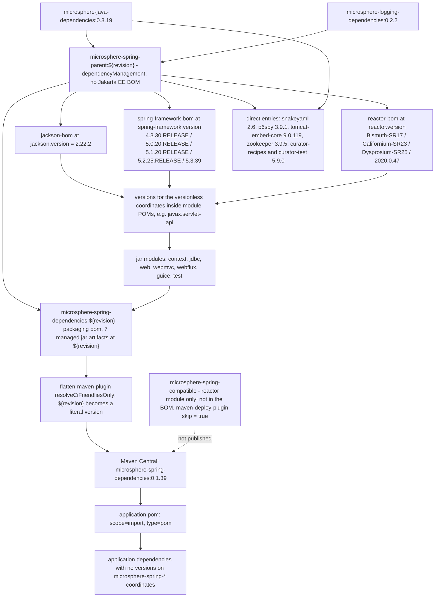

# microsphere-spring-dependencies — Developer Guide (0.1.x / `release-1.x`)

[← Developer guide overview](./README.md) · [简体中文](./zh/dependencies.md) · [User guide](../../user-guide/1.x/dependencies.md)

**Who needs this document.** Application teams need it: this POM is the published BOM (`scope=import`) that lets them
depend on any 0.1.x `microsphere-spring-*` module without stating a version — the contract for Spring 4.3.x–5.3.x and
`javax.servlet` consumers. Library maintainers need it for the stricter duty behind it: keeping the managed list in sync
with the module list, and knowing that on this line one reactor module is deliberately **outside** that list.

## 1. Version information

| Item | Value |
|------|-------|
| Branch | `release-1.x` |
| Docs directory | `docs/**/1.x/` |
| Version line | **0.1.x** |
| Development version (root `<revision>`) | `0.1.40-SNAPSHOT` |
| Latest released version | `0.1.39` |
| Parent | `io.github.microsphere-projects:microsphere-spring-parent:${revision}` (`../microsphere-spring-parent/pom.xml`) |
| Build baseline parent | `io.github.microsphere-projects:microsphere-build:0.3.14` (inherited through the parent chain) |
| Java baseline | Java 8 (the 1.x root POM declares no `<java.version>`; `microsphere-build` defaults it to `8`) |
| Coordinates / packaging | `io.github.microsphere-projects:microsphere-spring-dependencies:${revision}`, `packaging=pom` |

## 2. What the module is

`microsphere-spring-dependencies` is the reactor's outward-facing contract. On this branch `git ls-tree -r --name-only
origin/release-1.x -- microsphere-spring-dependencies` returns exactly one path, `microsphere-spring-dependencies/pom.xml`
— no `src/`, no other file — and its only content is a `<dependencyManagement>` block over the published library
artifacts:

```xml
<parent>
    <groupId>io.github.microsphere-projects</groupId>
    <artifactId>microsphere-spring-parent</artifactId>
    <version>${revision}</version>
    <relativePath>../microsphere-spring-parent/pom.xml</relativePath>
</parent>

<groupId>io.github.microsphere-projects</groupId>
<artifactId>microsphere-spring-dependencies</artifactId>
<version>${revision}</version>
<packaging>pom</packaging>

<name>Microsphere :: Spring :: Dependencies</name>
<description>Microsphere Spring Dependencies</description>
```

It inherits from `microsphere-spring-parent` rather than from the reactor root, which is what pulls the Spring 4.3–5.3
profile machinery and the third-party BOM imports into this POM's effective model.

## 3. `<dependencyManagement>` contents, verbatim

The BOM declares **seven** entries, all in group `io.github.microsphere-projects`, all at version `${revision}`
(plain jar coordinates: no `<type>`, no `<scope>`, no exclusions):

| # | groupId | artifactId | version |
|---|---------|------------|---------|
| 1 | `io.github.microsphere-projects` | `microsphere-spring-context` | `${revision}` |
| 2 | `io.github.microsphere-projects` | `microsphere-spring-guice` | `${revision}` |
| 3 | `io.github.microsphere-projects` | `microsphere-spring-jdbc` | `${revision}` |
| 4 | `io.github.microsphere-projects` | `microsphere-spring-web` | `${revision}` |
| 5 | `io.github.microsphere-projects` | `microsphere-spring-webmvc` | `${revision}` |
| 6 | `io.github.microsphere-projects` | `microsphere-spring-webflux` | `${revision}` |
| 7 | `io.github.microsphere-projects` | `microsphere-spring-test` | `${revision}` |

Nothing else is declared: no `<properties>`, no `<profiles>`, no `<build>`, no `<repositories>`, no `<pluginManagement>`,
no dependencies of its own. The list is byte-for-byte the one published on `release` (0.2.x) — the same seven artifacts,
in the same order, even though this reactor has one more module.

### `microsphere-spring-compatible` is not managed here — verified

- `microsphere-spring-compatible` is a reactor module on `release-1.x` (root `<modules>` lists it) but appears **nowhere**
  in this BOM: the table above is the complete list.
- It is also never published: `microsphere-spring-compatible/pom.xml` configures `maven-deploy-plugin` with
  `<skip>true</skip>`, so the artifact does not reach Maven Central.
- Consequence for consumers: no version-free `<dependency>` on `microsphere-spring-compatible` is possible, and none is
  needed. The module exists to back-fill Spring 4.3/5.0-era classes (`org.springframework.lang.NonNull`,
  `org.springframework.util.Assert`, `org.springframework.core.env.Profiles`, …) and is wired in as an
  `<optional>true</optional>` dependency by the `spring-framework-4.3` and `spring-framework-5.0` profiles of
  `microsphere-spring-context` — see [./parent.md §7](./parent.md). Because it is optional, it is never transitive.

### Inherited management

Because the parent is inherited, the *effective* `dependencyManagement` of this POM also covers everything
`microsphere-spring-parent` manages on this line:

| Source | Managed content |
|--------|-----------------|
| imported BOMs | `com.fasterxml.jackson:jackson-bom:${jackson.version}` (`2.22.2`), `org.springframework:spring-framework-bom:${spring-framework.version}`, `io.projectreactor:reactor-bom:${reactor.version}`, `io.github.microsphere-projects:microsphere-java-dependencies:0.3.19`, `io.github.microsphere-projects:microsphere-logging-dependencies:0.2.2` — **no** `jakarta.platform:jakarta.jakartaee-bom` on this line |
| direct entries | `org.yaml:snakeyaml:2.6`, `p6spy:p6spy:3.9.1`, `org.apache.tomcat.embed:tomcat-embed-core:9.0.119`, `org.apache.zookeeper:zookeeper:3.9.5`, `org.apache.curator:curator-recipes:5.9.0` and `curator-test:5.9.0` (both excluding `org.apache.zookeeper:zookeeper`) |

An application that imports this BOM inherits only the seven declared entries — `<scope>import</scope>` pulls the
importing POM's own `<dependencyManagement>` declarations, not the transitive management of its parent chain. That is
why the library modules declare Spring, Jackson and Servlet APIs as `<optional>` in their own POMs.

## 4. How consumers import it

```xml
<dependencyManagement>
    <dependencies>
        <dependency>
            <groupId>io.github.microsphere-projects</groupId>
            <artifactId>microsphere-spring-dependencies</artifactId>
            <version>0.1.39</version>
            <type>pom</type>
            <scope>import</scope>
        </dependency>
    </dependencies>
</dependencyManagement>

<dependencies>
    <dependency>
        <groupId>io.github.microsphere-projects</groupId>
        <artifactId>microsphere-spring-context</artifactId>
    </dependency>
</dependencies>
```

Rules that follow from the BOM's shape:

- The version must be a released version; `${revision}` never reaches a consumer because `flatten-maven-plugin`
  (`flattenMode=resolveCiFriendliesOnly`, `updatePomFile=true`) deploys a POM whose managed versions are literals — the
  published `0.1.39` BOM lists `microsphere-spring-context:0.1.39`, and so on.
- `spring-framework.version` is not part of the contract: it is chosen at *this* repository's build time by
  `spring-framework-4.3` … `spring-framework-5.3`, so one published artifact serves the whole 4.3.x–5.3.x range and the
  application aligns Spring itself with `spring-framework-bom`.
- An application that needs a different module version states it explicitly; a direct `<dependency><version>` always
  beats imported management.

## 5. Reactor coverage

| Reactor module (`release-1.x` root `<modules>`) | Managed by this BOM | Published to Central |
|--------------------------------------------------|---------------------|----------------------|
| `microsphere-spring-parent` | no (internal parent) | yes, as a `pom` parent to inherit |
| `microsphere-spring-dependencies` | n/a (it is the BOM) | yes |
| `microsphere-spring-compatible` | **no** | **no** — `maven-deploy-plugin` `<skip>true</skip>` |
| `microsphere-spring-context` | yes | yes |
| `microsphere-spring-jdbc` | yes | yes |
| `microsphere-spring-web` | yes | yes |
| `microsphere-spring-webmvc` | yes | yes |
| `microsphere-spring-webflux` | yes | yes |
| `microsphere-spring-guice` | yes | yes |
| `microsphere-spring-test` | yes | yes |

Unlike `release`, this line breaks the "managed set == publishable set" invariant on purpose: the invariant is
"managed set == *public* set", and `microsphere-spring-compatible` is an internal compatibility shim. Do not add it to
the BOM unless its `skip` deployment configuration is removed at the same time.

Verification commands:

```bash
git ls-tree -r --name-only origin/release-1.x -- microsphere-spring-dependencies   # pom.xml only
git show origin/release-1.x:microsphere-spring-dependencies/pom.xml | grep -c artifactId
mvn -P spring-framework-4.3 help:effective-pom -pl microsphere-spring-dependencies | grep microsphere-spring-
```

## 6. BOM import chain



Related documents: [./README.md](./README.md) · [./parent.md](./parent.md) · [./context.md](./context.md) ·
[./web.md](./web.md) · [./test.md](./test.md) · [./compatible.md](./compatible.md) ·
[../current/dependencies.md](../current/dependencies.md)
