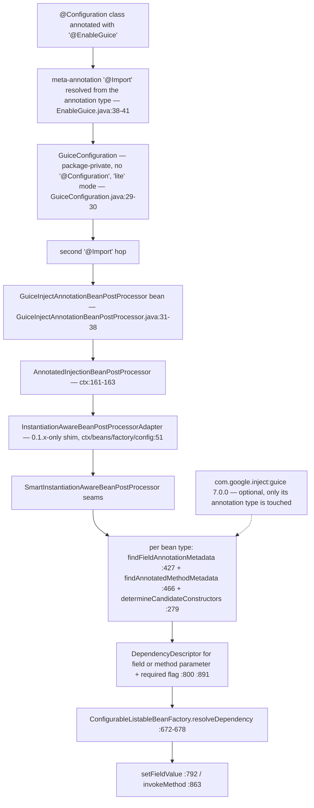
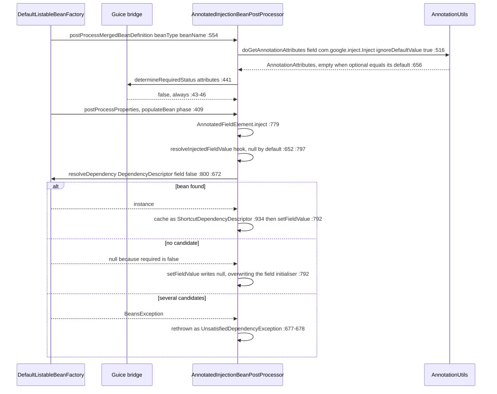

# microsphere-spring-guice — Developer Guide (0.1.x / `release-1.x`)

[← Developer guide overview](./README.md) · [简体中文](./zh/guice.md) · [User guide](../../user-guide/1.x/guice.md) · [0.2.x](../current/guice.md)

This page documents the **0.1.x maintenance line**, which exists only on `origin/release-1.x` (the working tree is 0.2.x). Every quoted line was
read from the branch object store with `git show origin/release-1.x:<path>`. Citation convention: POM and root paths are written in full behind
the `origin/release-1.x:` prefix; Java sources are abbreviated — `…/guice/` = `microsphere-spring-guice/src/main/java/io/microsphere/spring/guice/`,
`…/ctx/` = `microsphere-spring-context/src/main/java/io/microsphere/spring/`.

## 1. Module identity, baselines and dependency posture

| Attribute | Value | Evidence |
|---|---|---|
| Maven coordinate | `io.github.microsphere-projects:microsphere-spring-guice:${revision}` | `origin/release-1.x:microsphere-spring-guice/pom.xml:13-16` |
| Reactor version | `revision` = `0.1.40-SNAPSHOT`; last release of the line `0.1.39` | `origin/release-1.x:pom.xml:55`, tag `0.1.39` |
| Parent | `microsphere-spring-parent:${revision}`; reactor parent `microsphere-build:0.3.14` | `origin/release-1.x:microsphere-spring-guice/pom.xml:5-10`, `origin/release-1.x:pom.xml:5-9` |
| Java baseline | **`8`** — the 0.1.x root POM declares **no** `<java.version>`; `microsphere-build` supplies `java.version=8` plus `maven.compiler.source/target=${java.version}` | `microsphere-build-0.3.14.pom:58,89,94`; contrast `pom.xml:56` (0.2.x, `17`) |
| Spring baseline | profile-selected `4.3.30.RELEASE` / `5.0.20.RELEASE` / `5.1.20.RELEASE` / `5.2.25.RELEASE` / `5.3.39`; `spring-framework-5.3` is `activeByDefault` | `origin/release-1.x:microsphere-spring-parent/pom.xml:136-178`, `:170-173` |
| Annotation namespace | `javax.*` line — the parent manages **no** `jakarta.jakartaee-bom`, and this module imports neither `javax.inject` nor `jakarta.inject` | absence in `origin/release-1.x:microsphere-spring-parent/pom.xml:30-135`; `…/guice/annotation/GuiceInjectAnnotationBeanPostProcessor.java:19-23` |
| Guice | `com.google.inject:guice` **`7.0.0`**, `optional`, version pinned **inside the module** by its own `<guice.version>` property | `origin/release-1.x:microsphere-spring-guice/pom.xml:21-23,41-47` |
| Guice management | ⚠ **not managed** by the parent or the reactor BOM on this line either — `com.google.inject` occurs zero times in `microsphere-spring-parent` and only as this module's own artifact in the BOM | `origin/release-1.x:microsphere-spring-parent/pom.xml:30-135`, `origin/release-1.x:microsphere-spring-dependencies/pom.xml:30-34` |
| `microsphere-spring-context` | compile, **not** optional — the only mandatory in-reactor edge | `origin/release-1.x:microsphere-spring-guice/pom.xml:34-39` |
| `org.springframework:spring-context` | optional | `origin/release-1.x:microsphere-spring-guice/pom.xml:27-32` |
| `microsphere-annotation-processor` | **absent on this line** (it is an optional dependency only on 0.2.x) | whole-file listing of `origin/release-1.x:microsphere-spring-guice/pom.xml` vs `microsphere-spring-guice/pom.xml:27-39` |
| Test dependencies | `junit:junit` (**JUnit 4**), `spring-test`, `logback-classic` — all `test` scope; **no `microsphere-spring-test` edge** | `origin/release-1.x:microsphere-spring-guice/pom.xml:49-66` |
| Namespace root / types | `io.microsphere.spring.guice.annotation`; 3 main classes + 1 test class, file set identical to 0.2.x | `git ls-tree -r --name-only origin/release-1.x -- microsphere-spring-guice` |
| `src/main/resources` | **absent** — no `spring.factories`, no `AutoConfiguration.imports`, no `module-info.java` | same listing (5 entries total) |

Dependency posture, precisely: Guice is `optional` (`origin/release-1.x:microsphere-spring-guice/pom.xml:46`), so `com.google.inject:guice` is *not*
transitive to a consumer and the application must declare it. The single mandatory in-reactor edge is `microsphere-spring-context` (`:34-39`), which
itself contributes `microsphere-java-core` as mandatory (`origin/release-1.x:microsphere-spring-context/pom.xml:31-34`). ⚠ The 0.1.x line adds a third
constraint the 0.2.x line does not have: Guice `7.0.0` requires **Java 11+**, while this line compiles to and is CI-tested on **Java 8**
(`microsphere-build-0.3.14.pom:89`, `.github/workflows/maven-build.yml:25`). The module still *compiles* (it only reads one annotation type), but a
JDK 8 runtime cannot load Guice 7's class files — see §7 and [user-guide/1.x/guice.md:13-19](../../user-guide/1.x/guice.md).

```mermaid
flowchart LR
    subgraph IN["Inbound edges"]
        BOM["microsphere-spring-dependencies<br/>BOM version entry only — deps/pom.xml:30-34"]
    end
    GU["microsphere-spring-guice<br/>0.1.40-SNAPSHOT"] --> BOM
    subgraph OUT["Outbound edges — guice/pom.xml"]
        GU -->|"compile, mandatory :34-39"| CTX["microsphere-spring-context"]
        CTX -->|"compile, mandatory ctx/pom.xml:31-34"| JCO["microsphere-java-core"]
        GU -.optional, ":27-32".-> SC["org.springframework:spring-context 4.3–5.3"]
        GU -.optional, ":41-47".-> GUI["com.google.inject:guice 7.0.0<br/>⚠ needs Java 11+"]
        GU -.test, ":49-54".-> J4["junit:junit (JUnit 4)"]
        GU -.test, ":56-60".-> ST["spring-test"]
        GU -.test, ":62-66".-> LB["logback-classic"]
    end
    APP["consumer application on JDK 8"] -.->|"must declare guice itself;<br/>on JDK 8 the class cannot even load"| GUI
```

No reactor module depends on `microsphere-spring-guice`; outside the module the only source references are `origin/release-1.x:pom.xml:67` (module
list) and `origin/release-1.x:microsphere-spring-dependencies/pom.xml:32` (BOM). ⚠ There is **no** `microsphere-spring-test` edge on this line —
the guice POM declares no microsphere-spring-test dependency at all (`origin/release-1.x:microsphere-spring-guice/pom.xml:25-68`), exactly as on
0.2.x; see [the overview graph](./README.md), which draws test-scope edges for the other five modules only.

## 2. Package map

| Package | Types (visibility) | Responsibility |
|---|---|---|
| `io.microsphere.spring.guice.annotation` | `EnableGuice` (public, `…/annotation/EnableGuice.java:41`), `GuiceConfiguration` (package-private, `GuiceConfiguration.java:30`), `GuiceInjectAnnotationBeanPostProcessor` (package-private, `GuiceInjectAnnotationBeanPostProcessor.java:31`) | activation annotation + the `@Import` carrier + the required-ness override |

| External type | Home on 0.1.x | Why this module needs it |
|---|---|---|
| `io.microsphere.spring.beans.factory.annotation.AnnotatedInjectionBeanPostProcessor` | **`microsphere-spring-context`** | super-class (`GuiceInjectAnnotationBeanPostProcessor.java:20,31`); it owns all scanning, resolving and caching |
| `io.microsphere.spring.beans.factory.config.InstantiationAwareBeanPostProcessorAdapter` | `microsphere-spring-context` — a **0.1.x-only shim** (131 lines, class at `…/ctx/beans/factory/config/InstantiationAwareBeanPostProcessorAdapter.java:51`) | the transitive super-class of the base (`…/ctx/beans/factory/annotation/AnnotatedInjectionBeanPostProcessor.java:22,161`); needed because Spring's own adapter is deprecated in 5.x and absent from 4.3's `SmartInstantiationAwareBeanPostProcessor` defaults |
| `io.microsphere.spring.core.annotation.AnnotationUtils`, `AnnotatedInjectionBeanPostProcessor.AnnotationInjectedElement` | `microsphere-spring-context` | attribute extraction called by the base (`AnnotatedInjectionBeanPostProcessor.java:516-517` → `AnnotationUtils.java:463-485`) and the public injection-point model (`:740-762`) |
| `org.springframework.context.annotation.Import` | Spring 4.3–5.3 | the only activation mechanism (`EnableGuice.java:38-41`, `GuiceConfiguration.java:29`) |
| `com.google.inject.Inject` | Guice 7.0.0 (optional) | the single annotation type bound by the bridge (`GuiceInjectAnnotationBeanPostProcessor.java:19,33`) |
| `org.springframework.core.annotation.AnnotationAttributes` | Spring | the parameter type of the one overridden hook (`:21,42`) |

## 3. Architecture

⚠ This module has **no `ImportBeanDefinitionRegistrar`, no `ApplicationContextInitializer`, no `Injector`, no `Module` and no `Provider`**. Its
description is literally "Microsphere Spring Bridge Guice" (`origin/release-1.x:microsphere-spring-guice/pom.xml:19`), and the bridge is one-way:
Guice-annotated members of *Spring* beans are satisfied by *Spring*. Guice participates as an annotation type only. Activation is a two-hop `@Import`
with no registrar in between.



`@EnableGuice` (`EnableGuice.java:41`) declares no attributes, so there is nothing to configure and no Environment-level switch. The intermediate
`GuiceConfiguration` carries no `@Configuration` and no `@Bean` method (`GuiceConfiguration.java:29-30`); it exists purely as an `@Import` carrier, and
as a side effect both imported classes become ordinary bean definitions — the module's own test proves it by injecting them
(`…/guice/annotation/EnableGuiceTest.java:45-46`, asserted non-null at `:57`).

## 4. Source analysis

### 4.1 The bridge class

```java
class GuiceInjectAnnotationBeanPostProcessor extends AnnotatedInjectionBeanPostProcessor {  // :31
    private static final Class<? extends Annotation> ANNOTATION_TYPE = Inject.class;        // :33
    private static final String OPTIONAL_ATTRIBUTE_NAME = "optional";                       // :35
    public GuiceInjectAnnotationBeanPostProcessor() { super(ANNOTATION_TYPE); }             // :37-39
    @Override
    protected boolean determineRequiredStatus(AnnotationAttributes attributes) {            // :41-47
        if (!attributes.containsKey(OPTIONAL_ATTRIBUTE_NAME)) { return false; }             // :43-44
        return Boolean.FALSE.equals(attributes.getBoolean(OPTIONAL_ATTRIBUTE_NAME));        // :46
    }
}
```

The whole module is one constant plus one overridden hook; the file is byte-for-byte the 0.2.x class (`GuiceInjectAnnotationBeanPostProcessor.java:17-47`).
Fixing the annotation type in a `static final` field also explains why a missing Guice dependency fails at *link* time: initialising the class requires
`com.google.inject.Inject` (`:19,33`), so creating the post-processor bean throws `NoClassDefFoundError`.

### 4.2 Inherited machinery and its fixed points

The base class is a self-contained injection engine whose steps are frozen: `postProcessProperties`, `postProcessPropertyValues`,
`postProcessMergedBeanDefinition`, `determineCandidateConstructors`, `setBeanFactory`, `setEnvironment`, `setBeanClassLoader`, `getOrder` and
`getAnnotationTypes` are all `final` (`AnnotatedInjectionBeanPostProcessor.java:279,388,409,554,562,567,572,714,719`), so a subclass cannot change *when*
or *how often* it runs. The overridable surface is exactly three protected hooks — `determineRequiredStatus` (`:456-458`, default `true`),
`resolveInjectedFieldValue` (`:652-655`, returns `null`), `resolveInjectedMethodArguments` (`:667-669`, returns `null`) — and the Guice subclass
overrides one. Two constructor defaults decide the semantics below: `setOrder(LOWEST_PRECEDENCE - 3)` (`:247`) and `setIgnoreDefaultValue(true)` +
`setTryMergedAnnotation(true)` (`:250-251`). ⚠ The field comment at `:202-204` claims the order exists to be "higher priority than
`AutowiredAnnotationBeanPostProcessor`", yet `LOWEST_PRECEDENCE - 3` sits at the bottom of the `Ordered` scale, so that relative ordering is not
established by the value.

The 0.1.x-specific part is the supertype chain: `AnnotatedInjectionBeanPostProcessor extends InstantiationAwareBeanPostProcessorAdapter implements
MergedBeanDefinitionPostProcessor, PriorityOrdered, …` (`…/ctx/beans/factory/annotation/AnnotatedInjectionBeanPostProcessor.java:161-163`, import at
`:22`), and that adapter is the reactor's own `io.microsphere.spring.beans.factory.config.InstantiationAwareBeanPostProcessorAdapter`
(`…/ctx/beans/factory/config/InstantiationAwareBeanPostProcessorAdapter.java:51`), which hand-declares both `postProcessPropertyValues` (deprecated as of
Spring 5.1, `:103`) and `postProcessProperties` (`:113`) so one class works from Spring 4.3 through 5.3. On 0.2.x the shim was deleted and the base class
implements `SmartInstantiationAwareBeanPostProcessor` directly.

### 4.3 Required vs optional — the exact resolution on this line

`determineRequiredStatus` reads only the `optional` key, but that key's *presence* is decided upstream. The chain, end to end:

1. `doGetAnnotationAttributes(member, Inject.class)` passes `ignoreDefaultValue = true` and `tryMergedAnnotation = true` (`AnnotatedInjectionBeanPostProcessor.java:516-517`).
2. Both branches of `AnnotationUtils.getAnnotationAttributes(...)` (`AnnotationUtils.java:463-485`: merged at `:474-477`, plain fallback at `:479-482`) funnel into `filterAnnotationAttributes` (`:643-670`).
3. That method **removes** any attribute whose value equals the annotation's declared default — `if (ignoreDefaultValue && nullSafeEquals(attributeValue, getDefaultValue(annotation, attributeName))) continue;` (`:656-658`), `getDefaultValue` being Spring's own, statically imported at `:34`.
4. Guice declares `boolean optional() default false`, and a Java annotation proxy reports `false` for an undeclared element, so the synthesised map holds `optional=false` in both the bare and the explicit-`false` case — and step 3 deletes it.

The consequence is arithmetic, not opinion: `containsKey("optional")` is `true` only when the value differs from `false`, i.e. is `true`, and then
`Boolean.FALSE.equals(true)` is `false`. **`determineRequiredStatus` can never return `true` through `@EnableGuice`** — every Guice injection point on
the 0.1.x line is non-required.

| Guice declaration | `optional` value | key survives the default filter? | `determineRequiredStatus` | runtime effect, evidenced |
|---|---|---|---|---|
| `@Inject` | `false` (default) | no | `false` (`GuiceInjectAnnotationBeanPostProcessor.java:43-45`) | missing candidate → field set to `null`, no exception (`resolveFieldValue:796-806`) |
| `@Inject(optional = false)` | `false` (default) | **no — identical to the row above** | `false` | ⚠ the source cannot reach `true` for any spelling of this attribute |
| `@Inject(optional = true)` | `true` | yes | `false` (`:46`) | missing candidate → `null`; asserted by `EnableGuiceTest.java:51-52,59` |

`required` reaches Spring as the second argument of `DependencyDescriptor` (`:800` fields, `:891` method parameters); on the constructor path it is
consumed directly at `:324` and gates `requiredConstructor` at `:325-333`. Absence is
tolerated; **ambiguity is not** — `resolveDependency` catches every `BeansException` and rethrows `UnsatisfiedDependencyException` (`:672-678`), so two
candidates fail an `@Inject(optional = true)` field exactly like a required one. The switch that would restore Guice semantics,
`setIgnoreDefaultValue(false)` (`:607-609`), is unreachable through `@EnableGuice`: the subclass never calls it and is package-private (`:31`), so user
code can neither subclass nor configure it.

### 4.4 Injection-point edge cases (all inherited)

- **Static fields** are dropped with a `warn` (`:435-440`); **zero-parameter methods** are only warned about (`:484-488`) and still registered (`:491`), then invoked with an empty argument array (`:885-887`, `:862-864`) — the bridge turns them into init-like callbacks, where Guice itself rejects both.
- **Bridge and overridden methods** are de-duplicated: bridge pairs are resolved (`:471-474`) and only the most specific declaration is kept (`:477`).
- **Constructors**: an `@Inject` constructor is detected at `:305` (`findInjectionAnnotationAttributes`), but since `required` is always `false` the `requiredConstructor` path never fires (`:324-333`); if the class also declares a no-arg constructor, that one is appended as a fallback (`:341-343`), and an unannotated single constructor with parameters is still selected (`:354`).
- **Explicit property values win for setters**: `checkPropertySkipping(pvs)` returns early (`:847-849`), so a `@Inject` setter supplied by XML or `PropertyValues` is skipped — relevant on this line, where `microsphere-spring-context` still ships `META-INF/spring.factories` and XML `applicationContext.xml` fixtures are common. Fields have no such guard: `inject` always writes, `null` included (`:779-793`).

## 5. One injection request



Those three branches are the complete contract of the module: *found → inject, absent → `null`, ambiguous → fail*. There is no fourth step that consults
Guice; an `Injector` created in your own code is never reached.

## 6. Design patterns

| Pattern | Class(es) | Evidence |
|---|---|---|
| Configuration activation ("Enable*") with two-hop import indirection | `EnableGuice`, `GuiceConfiguration` | `EnableGuice.java:35-42` (attribute-free marker whose payload is a meta-`@Import`); `GuiceConfiguration.java:29-30` — a package-private "lite" class carrying the second hop and itself injectable (`EnableGuiceTest.java:45-46`) |
| Template Method | `AnnotatedInjectionBeanPostProcessor` + `GuiceInjectAnnotationBeanPostProcessor` | frozen steps `:279,409,554`, hooks `:456,652,667`; the only override at `GuiceInjectAnnotationBeanPostProcessor.java:41-47` |
| Bridge / Adapter (annotation-semantics mapping) | `GuiceInjectAnnotationBeanPostProcessor` | `:33,35` map `com.google.inject.Inject.optional` onto Spring's `required`; module description "Microsphere Spring Bridge Guice" (`origin/release-1.x:microsphere-spring-guice/pom.xml:19`) |
| Adapter (version compatibility — **0.1.x only**) | `io.microsphere.spring.beans.factory.config.InstantiationAwareBeanPostProcessorAdapter` | `…/ctx/beans/factory/config/InstantiationAwareBeanPostProcessorAdapter.java:51,103,113` declares both the deprecated and the modern seam so Spring 4.3–5.3 all link |
| Factory (instantiation-aware) | `determineCandidateConstructors`, `ShortcutDependencyDescriptor.resolveShortcut` | `AnnotatedInjectionBeanPostProcessor.java:279-368`, `:934+` |
| Registry / cache | `candidateConstructorsCache`, `injectionMetadataCache` | `:192-194`, `:629-630`, writes at `:364,543`, cleared only in `destroy()` (`:634-637`) |
| Null Object | `resolveInjectedFieldValue`, `resolveInjectedMethodArguments` | `:652-655`, `:667-669` — `null` means "no custom value, fall through to Spring" |
| Strategy | `annotationTypes` set + `order` | `:190,237-239,714-716`, `:581,719-721` |
| *No* Observer, Decorator or Composite | — | neither this module nor the inherited path wraps or fans out |

## 7. 0.1.x versus 0.2.x for this module

The file **set** is identical — 3 main classes, 1 test class, 1 POM on both sides (`git ls-tree -r --name-only origin/release-1.x -- microsphere-spring-guice`
vs the same against `HEAD`), and `git diff` shows the three main sources are unchanged. Every divergence therefore comes from the *line*, not the module.

| Aspect | 0.1.x (`origin/release-1.x`) | 0.2.x (working tree) | Evidence |
|---|---|---|---|
| Main/test source files | `EnableGuice`, `GuiceConfiguration`, `GuiceInjectAnnotationBeanPostProcessor` + `EnableGuiceTest` — same five entries | identical | both `git ls-tree` listings |
| Java baseline | `8`, inherited from `microsphere-build` because the root POM omits `java.version` | `17`, declared in the reactor root | `microsphere-build-0.3.14.pom:89` vs `pom.xml:56` |
| **Guice 7.0.0 vs Java 8** | ⚠ pinned `7.0.0` on a Java 8 line — Guice 7 needs Java 11+, so JDK 8 runtimes fail to load it; CI still tests JDK 8 | `7.0.0` on Java 17, consistent | `origin/release-1.x:microsphere-spring-guice/pom.xml:21-23` + `microsphere-build-0.3.14.pom:89` vs `microsphere-spring-guice/pom.xml:21-23` + `pom.xml:56`; [user-guide/1.x/guice.md:13-19](../../user-guide/1.x/guice.md) |
| Guice management | not managed by the parent or the reactor BOM | likewise **not** managed | `origin/release-1.x:microsphere-spring-parent/pom.xml:30-135` and `microsphere-spring-parent/pom.xml:30-136` (zero `com.google.inject` occurrences on both) |
| Annotation namespace of the line | `javax.*`; no `jakarta.jakartaee-bom` import in the parent | `jakarta.*`, BOM `jakartaee 11.0.0` imported by the parent | `microsphere-spring-parent/pom.xml:24,51-58` (0.2.x only) |
| Inject annotations bound | only `com.google.inject.Inject`; `javax.inject.Inject` and `jakarta.inject.Inject` are equally invisible | identical | `GuiceInjectAnnotationBeanPostProcessor.java:33` on both sides |
| Test framework | **JUnit 4** — `junit:junit` `test` scope, `@RunWith(SpringRunner.class)` at `EnableGuiceTest.java:35`, `org.junit.Test` at `:20` | `org.junit.jupiter:junit-jupiter` (`microsphere-spring-guice/pom.xml:58-59`) | `origin/release-1.x:microsphere-spring-guice/pom.xml:49-54` vs `microsphere-spring-guice/pom.xml:56-63` |
| `microsphere-annotation-processor` | not declared | optional dependency, version-less, resolved to `0.3.19` via `microsphere-java-dependencies` | absence in the branch POM vs `microsphere-spring-guice/pom.xml:27-39` |
| Spring matrix the bridge is exercised against | 4.3.30 / 5.0.20 / 5.1.20 / 5.2.25 / 5.3.39 (default 5.3) | 6.0.23 / 6.1.21 / 6.2.18 / 7.0.9 (default 7.0) | `origin/release-1.x:microsphere-spring-parent/pom.xml:136-178` vs `microsphere-spring-parent/pom.xml:138-173` |
| Super-class of the base processor | reactor's own `InstantiationAwareBeanPostProcessorAdapter` shim | implements `SmartInstantiationAwareBeanPostProcessor` directly; shim deleted | `…/ctx/beans/factory/annotation/AnnotatedInjectionBeanPostProcessor.java:22,161` (branch) vs `:160` (working tree) |
| Base-class line offset | +1 versus 0.2.x from the class declaration down (950 vs 949 lines) | — | `git show … \| wc -l` both sides |
| `microsphere-spring-test` edge | absent | absent — guice declares only `junit`, `spring-test`, `logback-classic` at test scope | `origin/release-1.x:microsphere-spring-guice/pom.xml:25-68`, [1.x/README.md](./README.md) |

## 8. Build and verification

| Task | Command / fact |
|---|---|
| Build and test this module | `mvn -pl microsphere-spring-guice -am test --activate-profiles test,coverage,spring-framework-5.3` — CI adds `-Drevision=0.0.1-SNAPSHOT` (`origin/release-1.x:.github/workflows/maven-build.yml:43-49`) |
| Spring matrix / JDK matrix | `spring-framework-4.3 / 5.0 / 5.1 / 5.2 / 5.3`, `5.3` `activeByDefault` (`origin/release-1.x:microsphere-spring-parent/pom.xml:170-173`); JDK `8`, `11`, `17`, `21`, `25` (`origin/release-1.x:.github/workflows/maven-build.yml:25`) |
| Branch CI triggers | push to `dev-1.x`; PRs to `dev-1.x` or `release-1.x` (same file `:14-18`) |
| Build parent | `microsphere-build:0.3.14` (`origin/release-1.x:pom.xml:5-9`) |
| Test inventory | `EnableGuiceTest` — the test class is also the bean under test (`EnableGuiceTest.java:40`); 4 injection sites (`:42-52`), one `@Test` with 4 assertions (`:54-60`) |
| What the tests do **not** cover | constructor or setter `@Inject`, any required-failure path, and every use of `Injector`, `Module`, `Provider` or `Scope` — Guice participates only as an annotation type |
| Optional-dependency behaviour | the module's own compile classpath does see Guice (optional suppresses transitivity, not local use), which is why the test compiles without extra declarations; consumers still must provide it (`origin/release-1.x:microsphere-spring-guice/pom.xml:41-47`) |

## 9. Gotchas

| # | Observation | Evidence |
|---|---|---|
| 1 | ⚠ **Guice 7.0.0 on a Java 8 line.** The module pins `7.0.0` while the reactor compiles and CI-tests for JDK 8, so `@EnableGuice` is only usable on this line if you either run on JDK 11+ or downgrade Guice in your own `<dependencyManagement>`. | `origin/release-1.x:microsphere-spring-guice/pom.xml:21-23`; `microsphere-build-0.3.14.pom:89`; `.github/workflows/maven-build.yml:25` |
| 2 | Guice is optional and never transitive; a consumer without `com.google.inject:guice` fails when the bridge class is initialised, not when its own code compiles. | `origin/release-1.x:microsphere-spring-guice/pom.xml:46`; `GuiceInjectAnnotationBeanPostProcessor.java:19,33` |
| 3 | ⚠ There is no `Injector`/`Module`/`Provider`/`Scope` integration and the direction is Guice-annotations → Spring only; "Spring ↔ Guice" wording overstates it. | `…/guice/` (3 classes) |
| 4 | ⚠ `@Inject(optional = false)` is **not** required — the default-valued attribute is filtered before `determineRequiredStatus` sees it — so bare `@Inject` and explicit `false` are identical and both optional, unlike Guice's own required default. | `AnnotatedInjectionBeanPostProcessor.java:250`; `AnnotationUtils.java:656-658`; `GuiceInjectAnnotationBeanPostProcessor.java:43-46` |
| 5 | `optional = true` tolerates absence but not duplicate candidates. | `AnnotatedInjectionBeanPostProcessor.java:799-803,672-678` |
| 6 | The field write is unconditional, so `@Inject` on a field with an initialiser erases that initialiser with `null` when no bean matches. | `:779-793` |
| 7 | Both concrete types are package-private; user code can only extend the public base class or intervene via `instanceof AnnotatedInjectionBeanPostProcessor` from another post-processor. | `GuiceInjectAnnotationBeanPostProcessor.java:31`; `AnnotatedInjectionBeanPostProcessor.java:161` |
| 8 | No Environment-level kill switch: unlike other `@Enable*` entry points in the reactor this one imports a plain class instead of an `AnnotatedBeanCapableImportBeanDefinitionRegistrar`, so `microsphere.spring...enabled=false` does nothing here. | `EnableGuice.java:38-41` |
| 9 | `microsphere.spring.injection.metadata.cache.size` is read once from **system properties** at class initialisation (`-D…`), not from the Spring `Environment`, and the two caches never evict — the name promises a bound the code does not implement. | `AnnotatedInjectionBeanPostProcessor.java:168,186,364,543,634-637` |
| 10 | Only `com.google.inject.Inject` is bound. On this `javax.*` line that is the only inject annotation your beans are likely to carry, but `javax.inject.Inject` is still ignored — Spring's own `AutowiredAnnotationBeanPostProcessor` handles it, so the bridge adds nothing for it and cannot be asked to. | `GuiceInjectAnnotationBeanPostProcessor.java:33` |
| 11 | Spring 4.3 and 5.0/5.1 need the shim: the whole bridge reaches `postProcessProperties` only through `io.microsphere.spring.beans.factory.config.InstantiationAwareBeanPostProcessorAdapter`. Under the `spring-framework-4.3` profile `microsphere-spring-compatible` is additionally attached to `microsphere-spring-context`, so dropping it breaks the injection path. | `…/ctx/beans/factory/config/InstantiationAwareBeanPostProcessorAdapter.java:51,113`; `origin/release-1.x:microsphere-spring-context/pom.xml:127-137` |
| 12 | The bridge runs in the same `populateBean` phase as `@Autowired` and at the low end of the `Ordered` band, so annotating one field with both annotations yields two independent resolutions. | `AnnotatedInjectionBeanPostProcessor.java:409,247,202-204` |
| 13 | ⚠ `@since 1.0.0` on all four types conflicts with the analysed `0.1.40-SNAPSHOT` and with 0.2.x carrying the same tag; do not use `@since` for release mapping. | `EnableGuice.java:33`, `origin/release-1.x:pom.xml:55` |

**Related** — [Developer guide overview](./README.md) · [简体中文版](./zh/guice.md) · [User guide — Guice (1.x)](../../user-guide/1.x/guice.md) · [0.2.x developer guide](../current/guice.md) · [1.x parent POM profiles](./parent.md) · [1.x dependency management](./dependencies.md) · [1.x context module](./context.md)
