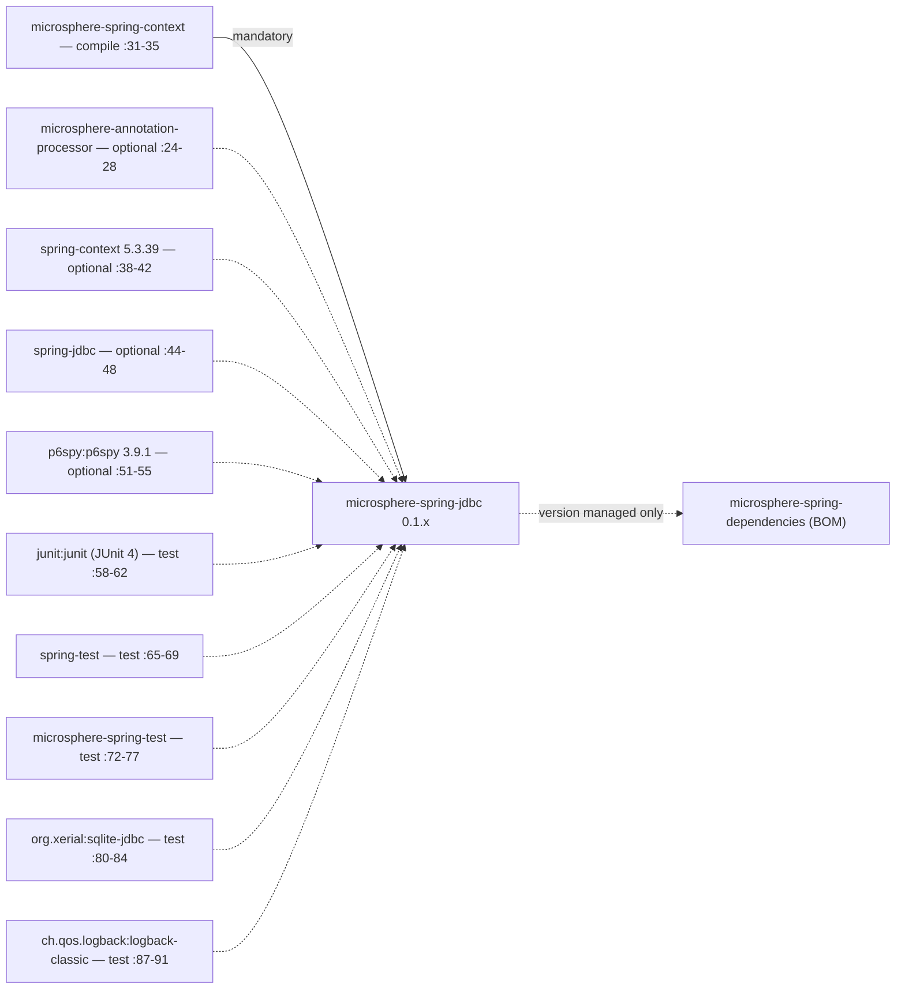
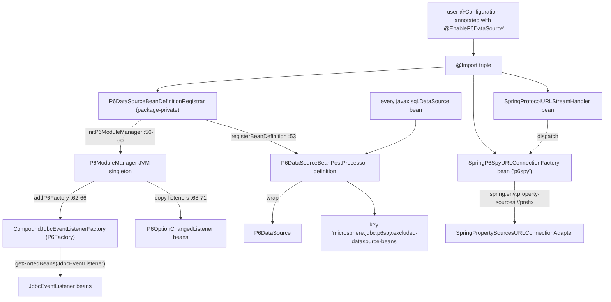
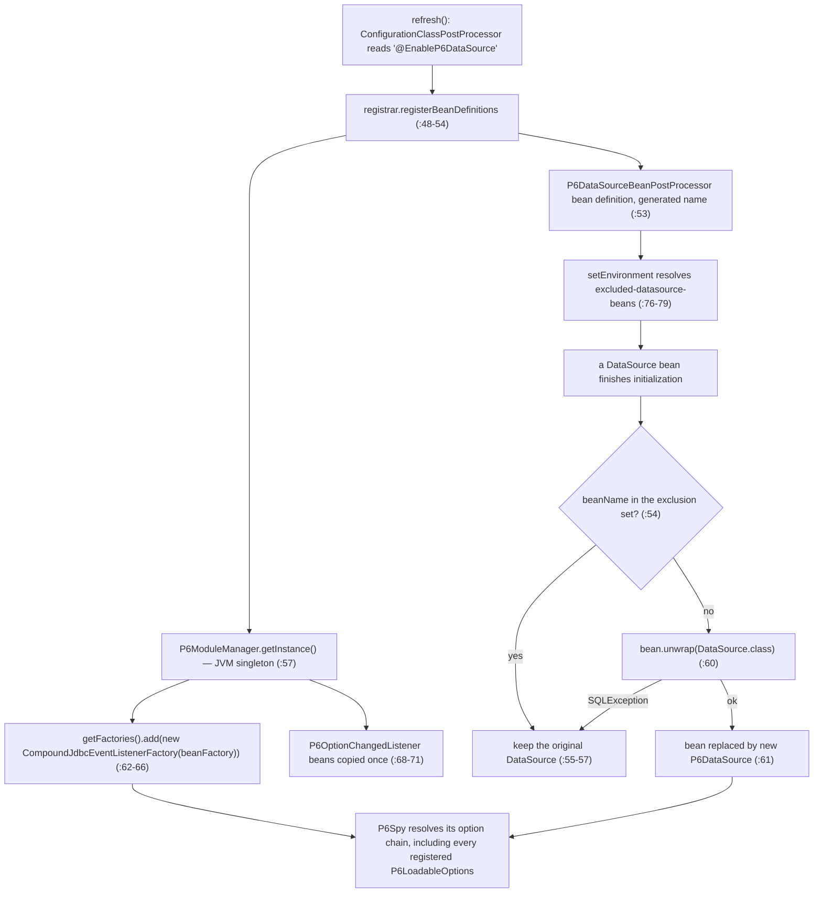
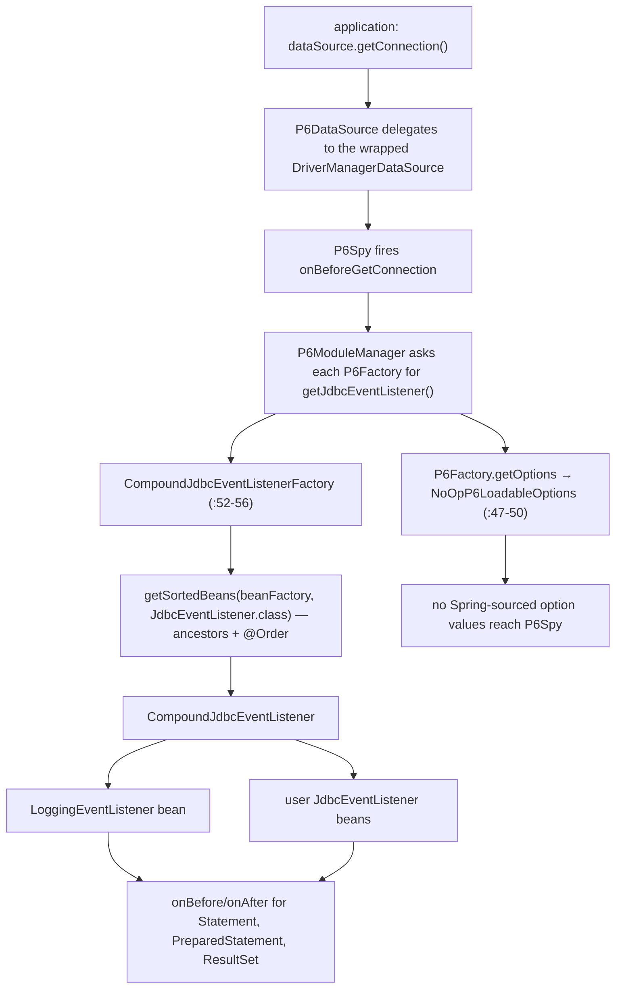

# microsphere-spring-jdbc — Developer Guide (0.1.x)

[← Developer guide overview](./README.md) · [简体中文](./zh/jdbc.md) · [User guide](../../user-guide/1.x/jdbc.md) · [0.2.x](../current/jdbc.md)

This page documents the **0.1.x** line, reachable only through `git show origin/release-1.x:<path>`; the working tree is 0.2.x. Bare
`path:NN` citations refer to branch objects unless marked "working tree". The seven main sources are byte-identical on both lines —
the divergence is the POM and the two test classes (§8).

## 1. Module identity, baselines and dependency posture

| Attribute | Value | Evidence |
|---|---|---|
| Maven coordinate | `io.github.microsphere-projects:microsphere-spring-jdbc:${revision}` | `microsphere-spring-jdbc/pom.xml:13-16` |
| Reactor version | `revision` = `0.1.40-SNAPSHOT` | `pom.xml:55` |
| Module parent | `microsphere-spring-parent:${revision}` | `microsphere-spring-jdbc/pom.xml:5-10` |
| Build parent | `microsphere-build:0.3.14` (external parent POM) | `pom.xml:5-9` |
| Java baseline | `8` — `java.version=8`, `maven.compiler.source/target=${java.version}`; the 0.1.x root POM declares no `java.version`, so the module inherits 8 | `microsphere-build-0.3.14.pom:58,89,94`; `pom.xml:54-56` |
| Spring baseline | profile-selected `4.3.30.RELEASE` / `5.0.20.RELEASE` / `5.1.20.RELEASE` / `5.2.25.RELEASE` / `5.3.39`; `spring-framework-5.3` is `activeByDefault` | `microsphere-spring-parent/pom.xml:136-179`, `:169-178` |
| Namespace | `javax.*` — no `jakarta.jakartaee-bom` is imported on this line | `microsphere-spring-parent/pom.xml:32-134` |
| P6Spy | `p6spy:p6spy` **`3.9.1`**, managed by the parent, declared **optional** by the module | `microsphere-spring-parent/pom.xml:26`, `:51-56`; `microsphere-spring-jdbc/pom.xml:51-55` |
| Namespace root / types | `io.microsphere.spring.jdbc.p6spy` — 7 main classes, 2 test classes, no `src/main/resources` | `git ls-tree -r --name-only origin/release-1.x -- microsphere-spring-jdbc` |

Dependency posture: everything this module compiles against is `optional` — `spring-context` (`microsphere-spring-jdbc/pom.xml:38-42`),
`spring-jdbc` (`:44-48`), `p6spy` (`:51-55`), `microsphere-annotation-processor` (`:24-28`) — so nothing reaches a consumer's classpath
transitively; the only mandatory reactor edge is `microsphere-spring-context` (`:31-35`). Adding the module alone therefore gives
`NoClassDefFoundError` at the first use of `@EnableP6DataSource` unless `p6spy:p6spy` is declared, and test scope needs an explicit
`junit:junit` (`:58-62`) because `microsphere-spring-test` declares JUnit 4 (`microsphere-spring-test/pom.xml:172-177`) and JUnit 5
(`:179-184`) both as `optional`. No reactor module depends on this one —
`microsphere-spring-dependencies/pom.xml:36-40` manages its version only.



## 2. Package map

| Package | Types (visibility) | Responsibility |
|---|---|---|
| `io.microsphere.spring.jdbc.p6spy` | `NoOpP6LoadableOptions`, `PropertySourcesP6LoadableOptionsAdapter` | `com.p6spy.engine.spy.P6LoadableOptions` implementations |
| `io.microsphere.spring.jdbc.p6spy.annotation` | `EnableP6DataSource` (public), `P6DataSourceBeanDefinitionRegistrar` (package-private) | annotation-driven activation |
| `io.microsphere.spring.jdbc.p6spy.beans.factory` | `CompoundJdbcEventListenerFactory` | `P6Factory` bridging Spring beans into the P6Spy event pipeline |
| `io.microsphere.spring.jdbc.p6spy.beans.factory.config` | `P6DataSourceBeanPostProcessor` | `DataSource` → `P6DataSource` decoration |
| `io.microsphere.spring.jdbc.p6spy.net` | `SpringP6SpyURLConnectionFactory` | `p6spy:` URL sub-protocol indirection |

External types the module builds on (branch line numbers):

| Type | Home | Why this module needs it |
|---|---|---|
| `SpringProtocolURLStreamHandler` | `microsphere-spring-context`, `io.microsphere.spring.net` | registers the `spring:` handler (`:60`, `:76-80`), dispatches sub-protocols (`:88-93`, `:95-100`) |
| `SpringSubProtocolURLConnectionFactory` | `microsphere-spring-context` | super-class; `supports(...)` is `final` and compares sub-protocol index 0 (`:32`, `:34`, `:36-42`, `:49`) |
| `SpringEnvironmentURLConnectionFactory` + `SpringPropertySourcesURLConnectionAdapter` + `SpringDelegatingBeanProtocolURLConnectionFactory` | `microsphere-spring-context` | serve `spring:env:property-sources://` (`:44`, `:46`, `:50`, `:67-74`; adapter `:50`, `:70-84`, `:113-115`) and discover this module's factory as a bean (`:36`, `:76`) |
| `AnnotatedBeanCapableImportBeanDefinitionRegistrar`, `GenericBeanPostProcessorAdapter`, `BeanUtils`, `BeanRegistrar` | `microsphere-spring-context` | registrar super-class (`:63-64`, `:70-82`, `:114-116`), type-filtered post-processor (`:42`, `:58-60`, `:125-132`), `getSortedBeans` (`:603-608`), `registerBeanDefinition` (`:199-201`, `:233-235`, `:565-568`) |
| `P6DataSource`, `P6ModuleManager`, `P6Factory`, `P6LoadableOptions`, `CompoundJdbcEventListener`, `JdbcEventListener`, `P6OptionChangedListener` | P6Spy 3.9.1 | decorated type and extension contracts |

## 3. Architecture



Two structural seams: Spring's `@Import` → `ImportBeanDefinitionRegistrar` → `BeanPostProcessor` chain, and P6Spy's
`P6ModuleManager` registry — a JVM-wide singleton mutated from `registerBeanDefinitions` at
`annotation/P6DataSourceBeanDefinitionRegistrar.java:48-60`. The URL seam is latent: nothing here opens a `spring:p6spy:` URL (§10 #8).

## 4. Source analysis

### 4.1 `@EnableP6DataSource` — attribute-free activation

`annotation/EnableP6DataSource.java:38-46` declares no attributes and imports three types: the package-private registrar (`:42`,
class at `:46` — the annotation is therefore the only supported entry point), `SpringProtocolURLStreamHandler` (`:43`) and
`SpringP6SpyURLConnectionFactory` (`:44`); the latter two become ordinary bean definitions while Spring *executes* the registrar.

### 4.2 The registrar: what it mutates at startup

```java
protected void registerBeanDefinitions(AnnotationMetadata metadata, BeanDefinitionRegistry registry,
        BeanNameGenerator importBeanNameGenerator,
        ResolvablePlaceholderAnnotationAttributes<EnableP6DataSource> annotationAttributes) {
    initP6ModuleManager(getBeanFactory());                                 // :52
    registerBeanDefinition(registry, P6DataSourceBeanPostProcessor.class); // :53
}                                                                          // :48-54
```

`initP6ModuleManager` (`:56-60`) appends a `CompoundJdbcEventListenerFactory` holding the `ConfigurableListableBeanFactory` to
`p6ModuleManager.getFactories()` (`:62-66`) and copies every `P6OptionChangedListener` bean through
`p6ModuleManager::registerOptionChangedListener` (`:68-71`); both lookups use `BeanUtils.getSortedBeans`, which includes ancestor
contexts and sorts with `AnnotationAwareOrderComparator`. The super-class `registerBeanDefinitions` is `final` and gated by
`isEnabled(metadata)` (`AnnotatedBeanCapableImportBeanDefinitionRegistrar.java:70-76`), so activation stays switchable through
Environment properties despite the attribute-free annotation (§7); the two-argument overload re-enters that gate with
`AnnotationBeanNameGenerator.INSTANCE` (`:78-82`) and the abstract hook implemented above sits at `:114-116`. One 0.1.x-specific
artifact sits right above the gate: the `final` method carries a **commented-out `@Override`**, annotated as such because the
three-argument overload only exists in `ImportBeanDefinitionRegistrar` since Spring 5.2 (`:68-69`) — the price of compiling against
4.3/5.0/5.1, the versions the `microsphere-spring-compatible` shims exist for (§9). Finally, the post-processor is registered through
`registerBeanDefinition(registry, Class)`, which passes `beanName = null` and lets `generateBeanName(beanDefinition, registry)` mint
the name (`BeanRegistrar.java:199-201`, `:233-235`, `:568`); it is not marked as an infrastructure bean.

### 4.3 `p6spy:` indirection into `spring:env:property-sources://`

`net/SpringP6SpyURLConnectionFactory.java:40-55`: `getSubProtocol()` returns `"p6spy"` (`:40-43`); `create(...)` computes
`prefix = getPrefix(url)` and re-opens `new URL("spring:env:property-sources://" + prefix)` (`:45-50`); `getPrefix` returns the URL
authority, falling back to `microsphere.jdbc.p6spy` when it is blank (`:52-55`). This resolves only because the same annotation
imports `SpringProtocolURLStreamHandler`, whose `afterPropertiesSet()` → `super.init()` installs the `spring` handler
(`SpringProtocolURLStreamHandler.java:76-80`). On the target side `SpringEnvironmentURLConnectionFactory.create` matches type index
1 = `property-sources` and returns `SpringPropertySourcesURLConnectionAdapter` (`:67-74`), whose `getInputStream()` collects
`getSubProperties(propertySources, prefix)` and converts `Map` → `Properties` → `text` → `InputStream` through the bean factory's
`ConfigurableConversionService` (`:70-84`); the prefix comes from `resolveAuthority(url.getAuthority())` (`:113-115`) and a blank
path means the media type defaults to `text/properties` (`:50`, `:122-130`).

### 4.4 DataSource decoration

`beans/factory/config/P6DataSourceBeanPostProcessor.java:41` extends `GenericBeanPostProcessorAdapter<DataSource>` and implements
`EnvironmentAware`; the exclusion key constant is at `:45`. The adapter resolves the type argument once from the subclass
declaration (`:58-60`) and makes `postProcessAfterInitialization` `final`, delegating only when
`beanType.isAssignableFrom(ultimateTargetClass(bean))` (`:125-132`). Only the *after* hook is overridden (`:50-74`): names in the
exclusion set are traced and returned unchanged (`:54-57`), otherwise `bean.unwrap(DataSource.class)` is wrapped in
`new P6DataSource(datasource)` (`:59-61`), a `SQLException` degrading to "no wrapping" at `trace` level (`:62-66`). Exclusions are
read once in `setEnvironment` via `environment.getProperty(KEY, Set.class, emptySet())` (`:76-79`) as **exact bean names**, not
patterns. `DataSource` here is `javax.sql.DataSource` (`:27`) — a JDK type, so the `javax`→`jakarta` reshaping of other modules
never reached this one.

### 4.5 Listener aggregation and options

`beans/factory/CompoundJdbcEventListenerFactory.java:39-56` implements `P6Factory` over a held
`ConfigurableListableBeanFactory` (`:41-45`): `getOptions(...)` returns `new NoOpP6LoadableOptions()` (`:47-50`) and
`getJdbcEventListener()` returns `new CompoundJdbcEventListener(getSortedBeans(beanFactory, JdbcEventListener.class))` (`:52-56`).
`NoOpP6LoadableOptions` contributes nothing — empty `load(Map)`, `getDefaults()` = `emptyMap()` (`:33-41`).
`PropertySourcesP6LoadableOptionsAdapter` inverts that: `load` is empty (`:45-48`) while `getDefaults()` returns
`getSubProperties(propertySources, "microsphere.jdbc.p6spy.options")` (`:37`, `:50-55`), via an unchecked raw-`Map` return of a
`Map<String,Object>`. It is **never instantiated on this branch** — `git grep -n PropertySourcesP6LoadableOptionsAdapter origin/release-1.x`
yields only its declaration (`:35`) and constructor (`:41`).

## 5. Complex flows

### 5.1 (a) DataSource decoration at startup



### 5.2 (b) A SQL statement passing through the P6Spy listener fan-out



The fan-out is recomputed on every call, so a `JdbcEventListener` registered after startup takes effect on the next event — whereas
`P6OptionChangedListener` beans are copied once, at registrar time (§4.2). `EnableP6DataSourceTest` exploits exactly this: the test
class *is* a `LoggingEventListener` bean (`EnableP6DataSourceTest.java:51`) and asserts in `onBeforeGetConnection` that
`connectionInformation.getDataSource()` is `dataSource.unwrap(DataSource.class)` (`:66-73`). For completeness, the URL route reaches
this module only after `SpringProtocolURLStreamHandler.openConnection` resolves the sub-protocols (`:95-100`) and walks `resource` →
`env` → bean-delegating (`:88-93`), at which point the factory matches (§4.3).

## 6. Design patterns

| Pattern | Class(es) | Rationale | Spring seam used |
|---|---|---|---|
| Configuration activation ("Enable*") | `EnableP6DataSource` | zero-attribute marker, all behaviour is `@Import`-driven | `@Import` |
| Registrar | `P6DataSourceBeanDefinitionRegistrar` (package-private) | registers a post-processor and mutates a non-Spring registry during the bean-definition phase | `ImportBeanDefinitionRegistrar` |
| Template method, framework-gated | `AnnotatedBeanCapableImportBeanDefinitionRegistrar` (`:70-82`, `:114-116`) | `final` entries force the `isEnabled` gate on every `Enable*` registrar | `ImportBeanDefinitionRegistrar` |
| Decorator via generic type-filtered template | `P6DataSourceBeanPostProcessor` over `GenericBeanPostProcessorAdapter<DataSource>` | `final` hook dispatches on the resolved type argument, then replaces the bean with `P6DataSource` | `BeanPostProcessor` |
| Composite + Observer | `CompoundJdbcEventListenerFactory` → `CompoundJdbcEventListener` | aggregates all `JdbcEventListener` beans into one P6Spy listener | `BeanFactory` lookup |
| Factory / SPI + null object | `CompoundJdbcEventListenerFactory implements P6Factory`, `NoOpP6LoadableOptions` | P6Spy's own SPI; `getOptions()` deliberately contributes nothing | none (P6Spy SPI) |
| Adapter | `PropertySourcesP6LoadableOptionsAdapter`, `SpringP6SpyURLConnectionFactory` | maps `Environment`/`PropertySources` onto `P6LoadableOptions` / a `URLConnection` view | `Environment`, `ConfigurableConversionService` |
| Strategy (URL) | `SpringP6SpyURLConnectionFactory` selected by `supports(...)` | sub-protocol dispatch among `SubProtocolURLConnectionFactory` beans | bean discovery via the delegating factory |

## 7. Extension points

| Extension point | Contract | Registered by | Notes |
|---|---|---|---|
| `JdbcEventListener` beans | `com.p6spy.engine.event.JdbcEventListener` | ordinary Spring bean | re-aggregated on every `getJdbcEventListener()`, order-sensitive (`CompoundJdbcEventListenerFactory.java:52-56`) |
| `P6OptionChangedListener` beans | `com.p6spy.engine.spy.option.P6OptionChangedListener` | copied into `P6ModuleManager` once | `P6DataSourceBeanDefinitionRegistrar.java:68-71` |
| `P6LoadableOptions` implementations | `NoOpP6LoadableOptions`, `PropertySourcesP6LoadableOptionsAdapter` (prefix `microsphere.jdbc.p6spy.options`) | user-supplied `P6Factory` | this module wires only the no-op variant |
| `SubProtocolURLConnectionFactory` beans | any sub-protocol; `p6spy` is contributed here | `@Import` in `@EnableP6DataSource` | found by the context module's delegating factory |
| `microsphere.jdbc.p6spy.excluded-datasource-beans` | `Set<String>` of exact `DataSource` bean names | `Environment` | read once in `setEnvironment` (`:45`, `:76-79`) |
| Kill switch for the annotation | `microsphere.spring.io.microsphere.spring.jdbc.p6spy.annotation.EnableP6DataSource.enabled=false`, or `microsphere.spring.<importing-class>@<annotation>.enabled` | inherited from `AnnotatedBeanCapableImportCandidate` | format at `AnnotatedBeanCapableImportCandidate.java:161-162,193,213` |
| `META-INF/spring.factories` | **none** | — | no `src/main/resources` on this branch; `@Import` is the only discovery mechanism |

## 8. 0.1.x vs 0.2.x divergence for this module

`git ls-tree -r --name-only origin/release-1.x -- microsphere-spring-jdbc` and the same listing for `HEAD` are identical (1 POM + 7
main + 2 test), and `git diff --stat origin/release-1.x HEAD -- microsphere-spring-jdbc` reports only `pom.xml` plus the two test
classes. **The production code of this module is the same on both lines**; divergence lives in the build/test envelope and baselines:

| Aspect | 0.1.x (`origin/release-1.x`) | 0.2.x (working tree) | Evidence |
|---|---|---|---|
| Main sources | 7 classes, byte-identical to 0.2.x | same | `git diff --stat` of the module lists no main source |
| Test framework | JUnit 4: `junit:junit` + `@RunWith(SpringRunner.class)` | JUnit 5: `org.junit.jupiter:junit-jupiter` + `@ExtendWith(SpringExtension.class)` | same POM block, `microsphere-spring-jdbc/pom.xml:58-62`; `EnableP6DataSourceTest.java:23-29,45` vs working tree `:24-29,44` |
| Log-level control and test shape | `@ClassRule LoggingLevelsRule.levels("TRACE","INFO","ERROR")` from `io.microsphere.logging.test.junit4`; test classes `public`, no extra logging annotation | `@LoggingLevelsClass(loggingClasses = P6DataSourceBeanPostProcessor.class, ...)` from `io.microsphere.logging.test.jupiter`, `@SpringLoggingTest` added to `P6DataSourceBeanPostProcessorTest`, test classes package-private | branch `EnableP6DataSourceTest.java:21,51,53-54` vs working tree `:21,50-54`; branch `P6DataSourceBeanPostProcessorTest.java:40-45` vs working tree `:25-31` |
| Java baseline | 8, inherited — the root POM declares only `revision` | 17, pinned by `java.version` | `microsphere-build-0.3.14.pom:89`, `pom.xml:54-56` vs working-tree `pom.xml:55-56` |
| Spring matrix | 4.3.30 / 5.0.20 / 5.1.20 / 5.2.25 / 5.3.39, default `5.3` | 6.0.23 / 6.1.21 / 6.2.18 / 7.0.9, default `7.0` | `microsphere-spring-parent/pom.xml:136-179` vs working-tree `:138-172` |
| Registrar `@Override` | commented out to compile against Spring < 5.2 | normal `@Override` | `AnnotatedBeanCapableImportBeanDefinitionRegistrar.java:68-71` vs working tree `:67` |
| P6Spy | `p6spy.version = 3.9.1` | 3.9.1 — **the P6Spy version does not diverge**, contrary to what the differing baselines suggest | `microsphere-spring-parent/pom.xml:26` vs working-tree `:27` |
| Co-managed third parties | Tomcat `9.0.119` managed (`:27`, `:58-63`), no Jakarta EE BOM | Jakarta EE 11 BOM, no Tomcat 9 entry | parent `:32-134` vs working-tree `:24`, `:51-58` |
| Build parent | `microsphere-build:0.3.14` | Dependabot-moving (`0.3.17` at writing time) | `pom.xml:7-8` both sides |
| CI | triggers `dev-1.x`/`release-1.x`, JDK `8,11,17,21,25`, Spring `4.3…5.3` | triggers `main`/`dev`, JDK `17,21,25`, Spring `6.0…7.0` | `.github/workflows/maven-build.yml:16-18,25,26-29` vs working tree `:16,25,26-28` |
| Reactor shape | 10 modules incl. `microsphere-spring-compatible` | 9 modules, `compatible` deleted | `pom.xml:58-69` vs working tree `:59-69` |
| 0.1.x-only content in this module | none — no class, attribute or package exists here that 0.2.x lacks, and vice versa | — | file-listing and diff comparison above |

## 9. Build and verification

| Task | Command / fact |
|---|---|
| Build + test (default Spring) | `mvn -pl microsphere-spring-jdbc -am test --activate-profiles test,coverage,spring-framework-5.3` |
| Oldest line | the same command with `spring-framework-4.3`; that profile adds `microsphere-spring-compatible` to `microsphere-spring-context` as an optional dependency (`microsphere-spring-context/pom.xml:128-136`) — a 0.1.x-only arrangement |
| Spring profiles | `spring-framework-4.3`, `-5.0`, `-5.1`, `-5.2`, `-5.3` (`activeByDefault`) — `microsphere-spring-parent/pom.xml:136-179` |
| JDK matrix / CI pin | `8`, `11`, `17`, `21`, `25`; CI runs the build with `-Drevision=0.0.1-SNAPSHOT` (`.github/workflows/maven-build.yml:25,43-49`) |
| Surefire selection | includes `**/*Tests.java`, `**/*Test.java`, excludes `**/Abstract*.java` (`microsphere-build-0.3.14.pom:217-223`) |
| Tests | `EnableP6DataSourceTest` (`:45-73`); `P6DataSourceBeanPostProcessorTest` (`:40-60`), which registers two `@EnableEmbeddedDatabase(dataSource = ...)` beans and excludes one of them by name |
| From `microsphere-spring-test` | `@EnableEmbeddedDatabase` — default type `SQLITE`, mandatory `dataSource()` attribute (`microsphere-spring-test/src/main/java/io/microsphere/spring/test/jdbc/embedded/EnableEmbeddedDatabase.java:42-66`) |
| Single test | `mvn -pl microsphere-spring-jdbc test -Dtest=P6DataSourceBeanPostProcessorTest -Drevision=0.1.40-SNAPSHOT` |

## 10. Gotchas and pitfalls

| # | Observation | Evidence |
|---|---|---|
| 1 | P6Spy is `optional` and the module cannot supply it; activation touches `P6ModuleManager` and `P6DataSource` directly, so a missing `p6spy:p6spy` breaks `@EnableP6DataSource` at class-loading time. `spring-context`/`spring-jdbc` are optional as well, while `microsphere-spring-context` is mandatory — the transitive footprint is context-only. | `microsphere-spring-jdbc/pom.xml:31-55`; `P6DataSourceBeanDefinitionRegistrar.java:19-21`; `P6DataSourceBeanPostProcessor.java:19,61` |
| 2 | `PropertySourcesP6LoadableOptionsAdapter` is dead code: `microsphere.jdbc.p6spy.options.*` is never fed to P6Spy by default, and `getDefaults()` returns a raw `Map` of `Object` values typed as `Map<String,String>`. | `git grep` on the branch → `:35`, `:41`; `PropertySourcesP6LoadableOptionsAdapter.java:51-54` |
| 3 | The registrar mutates the JVM-global `P6ModuleManager.getInstance()` factory list on every processing of `@EnableP6DataSource`; a second context appends a second `CompoundJdbcEventListenerFactory` and nothing removes it. | `P6DataSourceBeanDefinitionRegistrar.java:56-66` |
| 4 | Neither `P6DataSourceBeanPostProcessor` nor `GenericBeanPostProcessorAdapter` implements `Ordered`/`PriorityOrdered`, so wrapping runs in the unordered post-processor phase and later post-processors see a different bean type. | `P6DataSourceBeanPostProcessor.java:41`; `GenericBeanPostProcessorAdapter.java:42` |
| 5 | Exclusion is an exact-bean-name set resolved once: renaming a `DataSource` bean silently makes it wrapped again, and setting the property after refresh has no effect. | `P6DataSourceBeanPostProcessor.java:54-57,76-79` |
| 6 | A blank authority falls back to the prefix `microsphere.jdbc.p6spy`, the same prefix that holds `excluded-datasource-beans`, so dumping `spring:p6spy://` exposes that key as P6Spy option input. | `SpringP6SpyURLConnectionFactory.java:52-55`; `P6DataSourceBeanPostProcessor.java:45` |
| 7 | `SpringP6SpyURLConnectionFactory` relies on `SpringProtocolURLStreamHandler.afterPropertiesSet()` having registered the `spring` protocol already; the two are independent `@Import` entries with no declared ordering. | `EnableP6DataSource.java:41-45`; `SpringProtocolURLStreamHandler.java:76-80` |
| 8 | No test on this branch opens a `spring:p6spy:` URL or asserts `CompoundJdbcEventListenerFactory`, so the URL indirection and option mapping are untested here; and 0.1.x tests raise `TRACE` globally through `@ClassRule`, with none of the 0.2.x `loggingClasses` targeting. | `git ls-tree ... -- microsphere-spring-jdbc/src/test` (2 classes); `EnableP6DataSourceTest.java:53-54` |
| 9 | Bytecode compatibility is the real reason to choose this line: identical classes, but 0.1.x ships Java 8 bytecode while 0.2.x ships Java 17, so a Spring 5.3 / Java 8 application cannot consume `0.2.x`. Note also that `@since 1.0.0` on every type is a version stamp, not a release mapping — 0.2.x carries the same stamps. | `microsphere-build-0.3.14.pom:89,94`; `EnableP6DataSource.java:36`; §1 |

---

Cross-links: [developer guide overview (1.x)](./README.md) · [简体中文](./zh/jdbc.md) · [0.2.x developer guide](../current/jdbc.md) · [1.x user guide](../../user-guide/1.x/jdbc.md) · [1.x context module](./context.md) · [BOM](./dependencies.md) · [parent POM profiles](./parent.md)
