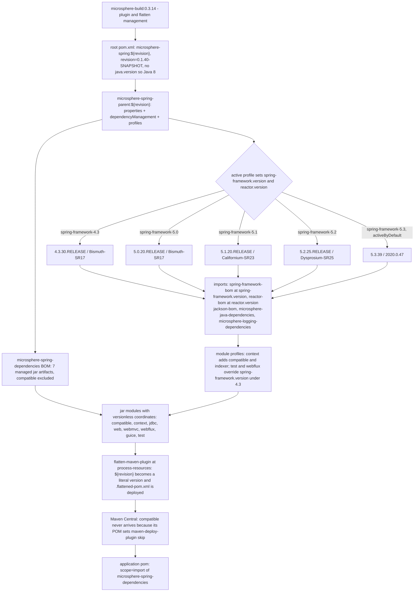

# microsphere-spring-parent — Developer Guide (0.1.x / `release-1.x`)

[← Developer guide overview](./README.md) · [简体中文](./zh/parent.md) · [User guide](../../user-guide/1.x/parent.md)

**Who needs this document.** Library maintainers need it: this POM pins the 0.1.x Spring 4.3–5.3 compatibility matrix and
is the only line where a profile also changes a module's dependency set, so every change here must be validated across
five Spring versions. Application teams on `javax.servlet` and Spring 4.3.x–5.3.x consume the published
[`microsphere-spring-dependencies`](./dependencies.md) BOM and read this file only to reproduce a version decision or to
learn why `microsphere-spring-compatible` is absent from Central.

## 1. Version information

| Item | Value |
|------|-------|
| Branch | `release-1.x` |
| Docs directory | `docs/**/1.x/` |
| Version line | **0.1.x** |
| Development version (root `<revision>`) | `0.1.40-SNAPSHOT` |
| Latest released version | `0.1.39` |
| Build baseline parent | `io.github.microsphere-projects:microsphere-build:0.3.14` |
| Java baseline | **Java 8** — the 1.x root POM declares no `<java.version>`; `microsphere-build` defaults it to `8` |
| Servlet namespace | `javax.*` (`javax.servlet:javax.servlet-api`, no Jakarta EE BOM imported) |
| Coordinates / packaging | `io.github.microsphere-projects:microsphere-spring-parent:${revision}`, `packaging=pom` |

## 2. Role of the parent inside the reactor

`microsphere-spring-parent` is a build-only module: it packages no classes, publishes a `pom` artifact, and exists to be
inherited. Its own parent is the reactor root `microsphere-spring` (`<relativePath>../pom.xml</relativePath>`), and the
root's parent is the external `microsphere-build:0.3.14`, which supplies all plugin management.

| Module | Declared parent | Packaging |
|--------|-----------------|-----------|
| `pom.xml` (root, aggregator) | `microsphere-build:0.3.14` | `pom` |
| `microsphere-spring-parent` | `microsphere-spring` (`../pom.xml`) | `pom` |
| `microsphere-spring-dependencies` | `microsphere-spring-parent` | `pom` |
| `microsphere-spring-compatible` | `microsphere-spring-parent` | `jar`, **not deployed** |
| `microsphere-spring-context`, `-jdbc`, `-web`, `-webmvc`, `-webflux`, `-guice`, `-test` | `microsphere-spring-parent` | `jar` |

The parent carries `<dependencyManagement>` and `<profiles>` and nothing else — no `<build>`, no `<pluginManagement>`,
no `<repositories>`. All nine inheriting modules point at `../microsphere-spring-parent/pom.xml`, so a version added here
applies to the whole reactor in one build; the parent is itself a published `pom` artifact external projects may inherit.

## 3. `${revision}` + `flatten-maven-plugin` versioning

Every POM in the reactor declares the same version expression, and only the root POM gives it a value:

```xml
<version>${revision}</version>   <!-- root properties: <revision>0.1.40-SNAPSHOT</revision> -->
```

This is the Maven "CI-friendly versions" scheme: the version is not duplicated across eleven POMs, and a release is
produced by passing a property instead of editing files — `mvn -Drevision=0.1.40 deploy -P publish,ci`, which is what
`maven-publish.yml` runs (its input is described as "The version to publish for Spring Framework 4.3+"). The scheme only
works once the POM leaving the machine no longer contains `${revision}`; that is the job of
`org.codehaus.mojo:flatten-maven-plugin:1.7.3`, configured identically in `microsphere-build:0.3.14` and `0.3.17`:

| Setting | Value | Effect on the published POM |
|---------|-------|-----------------------------|
| execution `flatten` | phase `process-resources`, goal `flatten` | runs in every module, before `package` / `install` / `deploy` |
| `flattenMode` | `resolveCiFriendliesOnly` | rewrites `${revision}`, `${sha1}`, `${changelist}` and the parent version only; structure is kept |
| `updatePomFile` | `true` | the generated `.flattened-pom.xml` (git-ignored, never hand-edited, never committed) is the POM installed and deployed |
| `pomElements.parent` | `expand` | the parent block is written with a concrete version (`microsphere-spring:0.1.39`) |
| `pomElements.properties` | `keep` | properties such as `microsphere-java.version` survive, so BOM imports stay resolvable |
| `pomElements.dependencyManagement` / `dependencies` | `interpolate` / `resolve` | managed versions are resolved where interpolable; module dependency versions become literals |
| `pomElements.scm` / `url` / `developers` | `resolve` | expressions such as `${project.scm.url}` are expanded |
| `pomElements.distributionManagement` / `repositories` | `remove` | internal repository details never reach Central |
| `flattenDependencyMode` / `embedBuildProfileDependencies` | `all` / `false` | full dependency set considered; profile-conditional dependencies are **not** baked in |

**Why `flatten` matters for consumers.** A deployed POM that still said `<version>${revision}</version>` would send the
consumer's Maven up the `microsphere-spring-parent` parent chain looking for a `revision` property that exists only in this
reactor's root POM; absent from the published model, resolution fails with an unresolvable-parent / bad-version error.
Flatten substitutes a literal (`0.1.39`). Two effects are specific to this line: `embedBuildProfileDependencies=false`
keeps the profile-conditional `microsphere-spring-compatible` and `spring-context-indexer` dependencies of
`microsphere-spring-context` ([§7](#7-profile--versions-parent-pom-vs-profile--extra-dependencies-module-pom)) out of the
published POM, and the flattened BOM states managed modules as literals, for example
`io.github.microsphere-projects:microsphere-spring-context:0.1.39`.

## 4. Profile matrix

Five properties-only profiles in `microsphere-spring-parent/pom.xml`:

| Profile id | `${spring-framework.version}` | `${reactor.version}` | Activation |
|-------------|-------------------------------|----------------------|------------|
| `spring-framework-4.3` | `4.3.30.RELEASE` | `Bismuth-SR17` | explicit |
| `spring-framework-5.0` | `5.0.20.RELEASE` | `Bismuth-SR17` | explicit |
| `spring-framework-5.1` | `5.1.20.RELEASE` | `Californium-SR23` | explicit |
| `spring-framework-5.2` | `5.2.25.RELEASE` | `Dysprosium-SR25` | explicit |
| `spring-framework-5.3` | `5.3.39` | `2020.0.47` | **`activeByDefault`** |

## 5. How `${spring-framework.version}` and `${reactor.version}` are consumed

Each property is referenced exactly once in the parent's `<dependencyManagement>`, as a BOM import version:

```xml
<dependency>
    <groupId>org.springframework</groupId>
    <artifactId>spring-framework-bom</artifactId>
    <version>${spring-framework.version}</version>
    <type>pom</type>
    <scope>import</scope>
</dependency>

<dependency>
    <groupId>io.projectreactor</groupId>
    <artifactId>reactor-bom</artifactId>
    <version>${reactor.version}</version>
    <type>pom</type>
    <scope>import</scope>
</dependency>
```

Chain: a profile sets a property → the property instantiates a BOM import → the BOM supplies versions → module POMs
declare versionless coordinates such as `org.springframework:spring-context` and `io.projectreactor:reactor-core`. On this
line `${reactor.version}` is a Reactor *release-train* name (`Bismuth-SR17`, `Californium-SR23`, `Dysprosium-SR25`,
`2020.0.47`) rather than a numeric version; `reactor-bom` accepts both forms. Import order is load-bearing (the first
declaration wins for a duplicate coordinate): `jackson-bom`, `org.yaml:snakeyaml`, `p6spy:p6spy`, `tomcat-embed-core`,
`org.apache.zookeeper:zookeeper`, `org.apache.curator:curator-recipes`, `org.apache.curator:curator-test`,
`spring-framework-bom`, `reactor-bom`, `microsphere-java-dependencies`, `microsphere-logging-dependencies`.

## 6. Managed third-party versions

| Property | Value on `release-1.x` | Managed artifact(s) |
|----------|------------------------|---------------------|
| `microsphere-java.version` | `0.3.19` | import `io.github.microsphere-projects:microsphere-java-dependencies` |
| `microsphere-logging.version` | `0.2.2` | import `io.github.microsphere-projects:microsphere-logging-dependencies` |
| `jakartaee.version` | **absent on this line** | no `jakarta.platform:jakarta.jakartaee-bom` import; the `javax.servlet:javax.servlet-api` and `javax.annotation:javax.annotation-api` coordinates in module POMs are versionless and resolve through the imported `microsphere-java-dependencies` chain |
| `jackson.version` | `2.22.2` | import `com.fasterxml.jackson:jackson-bom` |
| `snakeyaml.version` | `2.6` | direct `org.yaml:snakeyaml` |
| `p6spy.version` | `3.9.1` | direct `p6spy:p6spy` |
| `tomcat.version` | `9.0.119` | direct `org.apache.tomcat.embed:tomcat-embed-core` — a 1.x-only entry, because no Jakarta EE BOM supplies it here |
| `zookeeper.version` | `3.9.5` | direct `org.apache.zookeeper:zookeeper` |
| `curator.version` | `5.9.0` | direct `org.apache.curator:curator-recipes` and `curator-test`, both excluding `org.apache.zookeeper:zookeeper` so the explicit `zookeeper` entry controls the version |

Other coordinates are versionless in module POMs but are **not** managed here; they resolve through the imported
`microsphere-java` / `microsphere-logging` / Spring / Reactor BOMs: `ch.qos.logback:logback-classic`, JUnit, `org.mockito:mockito-core`,
`org.hamcrest:hamcrest`, `org.skyscreamer:jsonassert`, `com.google.code.findbugs:jsr305`, `com.h2database:h2`, `org.xerial:sqlite-jdbc`.
`microsphere-spring-guice` pins `com.google.inject:guice:7.0.0` through a `guice.version` property in its own module POM, identical on both lines.

## 7. Profile → versions (parent POM) vs profile → extra dependencies (module POM)

Two different questions are answered by two different files, and on this line both are actually used:

| Question | Answered in | Mechanism |
|----------|-------------|-----------|
| "Which *versions* are used on this Spring line?" | `microsphere-spring-parent/pom.xml` | properties in a profile, feeding BOM imports ([§4](#4-profile-matrix)) |
| "Which *extra dependencies* does a Spring line need?" | module POM, e.g. `microsphere-spring-context/pom.xml` | `<dependencies>` inside a profile of the same id |

Module-level profile blocks on `release-1.x`:

| Module | Profile | What the profile adds |
|--------|---------|-----------------------|
| `microsphere-spring-context` | `spring-framework-4.3` | `io.github.microsphere-projects:microsphere-spring-compatible:${revision}` (`<optional>true</optional>`) — and nothing else |
| `microsphere-spring-context` | `spring-framework-5.0` | `org.springframework:spring-context-indexer` (optional) **and** `microsphere-spring-compatible:${revision}` (optional) |
| `microsphere-spring-context` | `spring-framework-5.1`, `spring-framework-5.2`, `spring-framework-5.3` | `org.springframework:spring-context-indexer` (optional) only |
| `microsphere-spring-test` | `spring-framework-4.3` | no dependency; overrides `<spring-framework.version>5.0.20.RELEASE</spring-framework.version>` for this module |
| `microsphere-spring-webflux` | `spring-framework-4.3` | no dependency; overrides `<spring-framework.version>5.0.20.RELEASE</spring-framework.version>` for this module |

Two consequences. `spring-context-indexer` is *profile-provided* here — a `spring-framework-4.3` build never sees it — whereas on
0.2.x it is a plain optional dependency. And `spring-framework-4.3` deliberately yields a mixed reactor: `microsphere-spring-test`
and `microsphere-spring-webflux` build against `5.0.20.RELEASE` while every other module stays on `4.3.30.RELEASE`, because WebFlux
support does not exist in Spring 4.3. No other module declares a profile.

## 8. Building and testing against a specific Spring line

```bash
./mvnw clean test   -P spring-framework-4.3     # oldest supported line
./mvnw clean verify -P spring-framework-5.1
./mvnw clean install -P spring-framework-5.3    # equals the activeByDefault build

# the exact CI invocation, repeated per Spring line
mvn --batch-mode --update-snapshots --file pom.xml -Drevision=0.0.1-SNAPSHOT test \
    --activate-profiles test,coverage,spring-framework-5.0
```

`.github/workflows/maven-build.yml` on this branch runs Java `8` × `11` × `17` × `21` × `25` against all five Spring
profiles. Maven drops an `activeByDefault` profile as soon as any other profile is activated, so `-P spring-framework-4.3`
replaces `5.3` — never rely on the default in scripts. Check
`./mvnw -P spring-framework-4.3 help:evaluate -Dexpression=spring-framework.version -q -DforceStdout` (add
`-pl microsphere-spring-webflux` to see the `5.0.20.RELEASE` override) and
`./mvnw -P spring-framework-4.3 -pl microsphere-spring-context dependency:tree -Dincludes=io.github.microsphere-projects:*`.
A new Spring line needs one profile block in the parent **and** a matching block in every module with
profile-conditional dependencies.

## 9. Versioning and profile flow



## 10. Divergence from `release` (0.2.x)

| Aspect | `release-1.x` / 0.1.x (this document) | `release` / 0.2.x |
|--------|----------------------------------------|--------------------|
| `microsphere-build` parent | `0.3.14` | `0.3.17` |
| Java baseline | inherited `8` from `microsphere-build`; root POM sets nothing | `17`, set explicitly in the root POM |
| Reactor modules | 10, including `microsphere-spring-compatible` | 9, no compatible module |
| Profiles | `4.3` / `5.0` / `5.1` / `5.2` / `5.3`, default `5.3` | `6.0` / `6.1` / `6.2` / `7.0`, default `7.0` |
| Reactor version style | release-train names (`Bismuth-SR17`, `Californium-SR23`, `Dysprosium-SR25`, `2020.0.47`) | numeric train versions (`2022.0.22` … `2025.0.7`) |
| Servlet namespace | `javax.servlet:javax.servlet-api`, no Jakarta EE BOM | `jakarta.platform:jakarta.jakartaee-bom:11.0.0` imported |
| Extra managed artifact | `tomcat-embed-core` via `tomcat.version` = `9.0.119` | — |
| `jackson` / `snakeyaml` / `zookeeper` | `2.22.2` / `2.6` / `3.9.5` | `2.22.3` / `2.7` / `3.9.6` |
| `microsphere-java` / `microsphere-logging` / `p6spy` / `curator` | `0.3.19` / `0.2.2` / `3.9.1` / `5.9.0` | identical: `0.3.19` / `0.2.2` / `3.9.1` / `5.9.0` |
| Profile-conditional module dependencies | yes — `microsphere-spring-compatible`, `spring-context-indexer`, per-module `spring-framework.version` overrides | none; all profiles are properties-only |
| CI Java matrix | `8` / `11` / `17` / `21` / `25` | `17` / `21` / `25` |

Related documents: [./README.md](./README.md) · [./dependencies.md](./dependencies.md) · [./context.md](./context.md) ·
[./web.md](./web.md) · [./test.md](./test.md) · [./compatible.md](./compatible.md) · [../current/parent.md](../current/parent.md)
