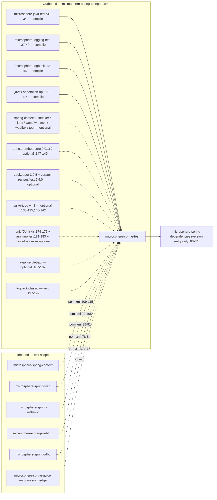
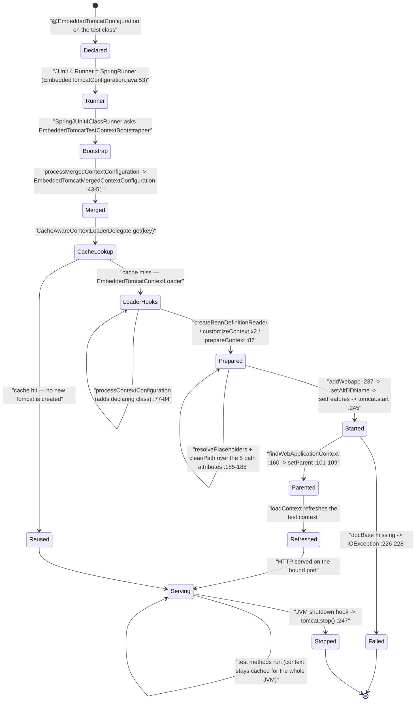

# microsphere-spring-test — Developer Guide (0.1.x / `release-1.x`)

[← Developer guide overview](./README.md) · [简体中文](./zh/test.md) · [User guide](../../user-guide/1.x/test.md) · [0.2.x](../current/test.md)

This page documents the **0.1.x maintenance line**, which exists only on `origin/release-1.x` (the working tree is 0.2.x). Every quoted line was read from the branch object store with `git show origin/release-1.x:<path>`. Citation convention: POM paths appear in full behind the `origin/release-1.x:` prefix; Java sources are abbreviated — `…/` = `microsphere-spring-test/src/main/java/io/microsphere/spring/test/`.

## 1. Module identity, baselines and dependency posture

| Attribute | Value | Evidence |
|---|---|---|
| Maven coordinate / name | `io.github.microsphere-projects:microsphere-spring-test:${revision}`, "Microsphere :: Spring :: Test" | `origin/release-1.x:microsphere-spring-test/pom.xml:13-19` |
| Reactor version / parent | `revision` = `0.1.40-SNAPSHOT` (last release `0.1.39`); `microsphere-spring-parent:${revision}`, external build parent `microsphere-build:0.3.14` | `origin/release-1.x:pom.xml:55`, `origin/release-1.x:microsphere-spring-test/pom.xml:5-10`, `origin/release-1.x:pom.xml:5-9` |
| Java baseline | **`8`** — the 0.1.x root POM declares no `<java.version>`; `microsphere-build` supplies `java.version=8` | `microsphere-build-0.3.14.pom:58,89,94`; contrast `pom.xml:56` (0.2.x, `17`) |
| Spring baseline | profile-selected `4.3.30.RELEASE` / `5.0.20.RELEASE` / `5.1.20.RELEASE` / `5.2.25.RELEASE` / `5.3.39`, `spring-framework-5.3` `activeByDefault` | `origin/release-1.x:microsphere-spring-parent/pom.xml:136-178`, `:170-173` |
| Servlet namespace | **`javax.servlet`** — `javax.servlet:javax.servlet-api` optional; SPI fixture is `META-INF/services/javax.servlet.ServletContainerInitializer`; the `web.xml` fixtures are `version="3.1"` on `xmlns.jcp.org` | `origin/release-1.x:microsphere-spring-test/pom.xml:107-109`, `src/test/resources/webapp/WEB-INF/web.xml:2-5` |
| Embedded Tomcat | `tomcat-embed-core` **`9.0.119`**, optional — pinned by a `tomcat.version` property **declared in the 0.1.x parent** | `origin/release-1.x:microsphere-spring-parent/pom.xml:27,59-63`; `origin/release-1.x:microsphere-spring-test/pom.xml:147-149` |
| ZooKeeper / Curator | `zookeeper` **`3.9.5`**, `curator-recipes` / `curator-test` **`5.9.0`**; both Curator entries exclude `org.apache.zookeeper:zookeeper` | `origin/release-1.x:microsphere-spring-parent/pom.xml:28-29,65-95` |
| Embedded databases | `org.xerial:sqlite-jdbc`, `com.h2database:h2` — optional and **version-less**: no `<h2.version>`/`<sqlite.version>` exists on this line | `origin/release-1.x:microsphere-spring-test/pom.xml:133-135,140-142`; absence in `microsphere-spring-parent/pom.xml:21-29` |
| JUnit | **both** `junit:junit` (JUnit 4) and `org.junit.jupiter:junit-jupiter` declared, both `optional`, both version-less | `origin/release-1.x:microsphere-spring-test/pom.xml:173-177,180-184` |
| Mandatory artifacts | `microsphere-java-test`, `microsphere-logging-test`, `microsphere-logback`, **`javax.annotation:javax.annotation-api`** | `origin/release-1.x:microsphere-spring-test/pom.xml:31-34,37-40,43-46,113-116` |
| Types | `io.microsphere.spring.test`; **33 main types**, 26 `*Test` classes + 1 non-test helper (`TestServletContainerInitializer`) out of 27 test java files | `git ls-tree -r --name-only origin/release-1.x -- microsphere-spring-test` |
| Resources | **no `src/main/resources`** at all; 8 `src/test/resources` files: 3 webapps (`webapp`, `webapps/empty-app`, `webapps/context-loader-app`), `config/test.properties`, the servlet SPI file | same listing |

**Leaf-module posture.** The module declares **no intra-reactor `microsphere-spring-*` dependency at all** — not even `microsphere-spring-context` (`origin/release-1.x:microsphere-spring-test/pom.xml:21-202`). Its mandatory artifacts come only from sibling microsphere repositories (`microsphere-java-test` `:31-34`, `microsphere-logging-test` `:37-40`, `microsphere-logback` `:43-46`) plus `javax.annotation-api` (`:113-116`, the one mandatory Java-EE artifact of this `javax.*` line). Every framework, container and test-library artifact is `<optional>` (`:51-191`), so nothing reaches a consumer transitively — which is what lets five sibling modules consume it in `test` scope without a cycle and without dragging Tomcat, ZooKeeper or SQLite into production builds.



Inbound edges measured on the branch: `origin/release-1.x:microsphere-spring-context/pom.xml:109-115`, `…microsphere-spring-web/pom.xml:99-105`, `…microsphere-spring-webmvc/pom.xml:85-91`, `…microsphere-spring-webflux/pom.xml:78-84`, `…microsphere-spring-jdbc/pom.xml:71-77` — the same direction as on 0.2.x (the edge runs **from** those modules **to** `microsphere-spring-test`). ⚠ `microsphere-spring-guice` has **no** edge here on this line either (`origin/release-1.x:microsphere-spring-guice/pom.xml:49-66` declares only `junit`, `spring-test`, `logback-classic`), exactly as on 0.2.x. Version management only: `origin/release-1.x:microsphere-spring-dependencies/pom.xml:60-64`.

Because everything is optional, **each consumer re-declares what it actually uses**: `microsphere-spring-webmvc/pom.xml:94-98` adds `tomcat-embed-core` in `test` scope for `@EmbeddedTomcatConfiguration`, `microsphere-spring-jdbc/pom.xml:80-84` adds `org.xerial:sqlite-jdbc` for `@EnableEmbeddedDatabase`, and `microsphere-spring-webmvc/pom.xml:72-76` adds `junit:junit` — required on this line because `@EmbeddedTomcatConfiguration` is JUnit 4-annotated (§4.2).

## 2. Package map

| Package (`io.microsphere.spring.test.`) | Types (visibility) | Responsibility |
|---|---|---|
| `jdbc.embedded` | `EnableEmbeddedDatabase`, `EnableEmbeddedDatabases`, `EmbeddedDatabaseType` (public), `EmbeddedDataBaseBeanDefinitionRegistrar` (package-private, `…/jdbc/embedded/EmbeddedDataBaseBeanDefinitionRegistrar.java:47`), `EmbeddedDataBaseBeanDefinitionsRegistrar` (package-private, `…:37`) | annotation-driven `DriverManagerDataSource` registration for SQLite / H2 |
| `tomcat.embedded` | `EmbeddedTomcatConfiguration` (public, nested `enum Feature`), `EmbeddedTomcatTestContextBootstrapper` (package-private, `:35`), `EmbeddedTomcatMergedContextConfiguration` (package-private, `:35`), `EmbeddedTomcatContextLoader` (package-private, `:73`) | a real embedded Tomcat as the Spring Test `ContextLoader` |
| `zookeeper.embedded` | `EmbeddedZookeeperServer` (public), `EmbeddedZookeeperServerTestExecutionListener` (package-private, `:45`) | Curator `TestingServer` bound to the test-class lifecycle |
| `junit.jupiter` | `SpringLoggingTest` (public annotation) | composes `@LoggingLevelsClass({"TRACE","INFO","ERROR"})` (`…/junit/jupiter/SpringLoggingTest.java:40`) |
| `webmvc` | `AbstractWebMvcTest` (public abstract, `…/webmvc/AbstractWebMvcTest.java:60`), `SimpleUrlHandlerMappingTestConfig` (public) — **only these two files** | annotated WebMVC fixture + `MockMvc` base — **JUnit 4** |
| `webflux` | `AbstractWebFluxTest` (public abstract, `…/webflux/AbstractWebFluxTest.java:52`), `PersonHandler`, `RouterFunctionTestConfig`, `SimpleUrlHandlerMappingTestConfig` | the WebFlux mirror — **JUnit 5** |
| `web` / `web.controller` / `web.servlet` / `web.context.request` | `WebTestUtils` (public, `:42`); `TestController` (public, `@Controller @RequestMapping("/test")`, `:43-45`); `TestServletContext`, `TestServlet`, `TestFilter`, `TestServletRegistration`, `TestFilterRegistration`, `TestServletContextListener` (public); `MockServletWebRequest` (public, `:36`) | `MockServerWebExchange`/`Mono` helpers, the endpoint fixture shared by both stacks, a `javax.servlet` `ServletContext` that really honours `addServlet`/`addFilter`/`addListener`, and a `ServletWebRequest` exposing the mock pair |
| `util` | `SpringTestUtils`, `ServletTestUtils`, `SpringTestWebUtils` (public abstract, private ctor) | ad-hoc container, servlet registration and `NativeWebRequest` builders |
| `context.annotation` | `AnnotatedTypeMetadataTestFactory` (public, `:36`), `TestConditionContext` (public, `:41`) | `AnnotatedTypeMetadata` / `ConditionContext` test doubles |
| `domain` | `User` (public JavaBean with `equals`/`hashCode`/`toString`) | payload fixture for JSON round-trips |

## 3. Architecture design

The module implements one idea: **an embedded resource becomes either a bean definition, part of the context-loader triple, or a `TestExecutionListener`** — chosen by whether the resource must exist *before* `refresh()`.


* Path A runs during bean-definition registration, so `@Autowired DataSource` needs no ordering care.
* Path B exists because Tomcat must be **started before the test context refreshes** — the deployed webapp's own `ContextLoaderListener`/`DispatcherServlet` build a `WebApplicationContext` that the test context then adopts as its parent (`…/tomcat/embedded/EmbeddedTomcatContextLoader.java:87-99`).
* Path C is for resources *outside* the context, so the test-class lifecycle is the right home.

**Spring lifecycle events actually hooked:** none. No type in `src/main/java` implements `Lifecycle`, `SmartLifecycle`, `ApplicationListener` or consumes `ContextClosedEvent`. The seams are `ImportBeanDefinitionRegistrar.registerBeanDefinitions`, the `ContextLoader` template methods, `AbstractTestExecutionListener.beforeTestClass`/`afterTestClass`, plus `ShutdownHookUtils.addShutdownHookCallback` (`…/tomcat/embedded/EmbeddedTomcatContextLoader.java:247`).

**Caching.** Only Spring's own `CacheAwareContextLoaderDelegate` caches contexts, keyed by `MergedContextConfiguration`. `EmbeddedTomcatMergedContextConfiguration` stores port/contextPath/basedir/alternativeWebXml/features as fields (`…/tomcat/embedded/EmbeddedTomcatMergedContextConfiguration.java:37-45`) but overrides **only `toString()`** (`:102-112`) — they play no part in `equals`/`hashCode`.

## 4. Source analysis

### 4.1 `@EnableEmbeddedDatabase` and its two registrars

```java
@Target({TYPE, ANNOTATION_TYPE}) @Retention(RUNTIME) @Documented
@Import(EmbeddedDataBaseBeanDefinitionRegistrar.class)                 // …/jdbc/embedded/EnableEmbeddedDatabase.java:42
@Repeatable(EnableEmbeddedDatabases.class)                             // :43
public @interface EnableEmbeddedDatabase {                             // :44
    EmbeddedDatabaseType type() default SQLITE;  int port() default -1;   // :49 :56
    String dataSource();                        boolean primary() default false;  // :61 :66
    String[] properties() default {};                                    // :71
}
```

`@EnableEmbeddedDatabase` is **not** `@Inherited`, while its container `@EnableEmbeddedDatabases` **is** (`…/jdbc/embedded/EnableEmbeddedDatabases.java:41`) and imports the *plural* registrar (`:42`). The singular registrar is a package-private plain `ImportBeanDefinitionRegistrar` (`:47`) whose body is name-guard + type switch (`:57-68`). `registerDataSourceBeanDefinition` builds a `DriverManagerDataSource` with two **constructor** args (JDBC URL and the resolved `Properties`), applies `setPrimary(primary)` and registers under the annotation's `dataSource` name (`:95-109`). `resolveProperties` casts the registry to `ConfigurableBeanFactory`, pushes each `properties` entry through `resolveEmbeddedValue` (so `${…}` from the Environment works), joins them with `LINE_SEPARATOR` and feeds the result to `Properties.load` (`:111-122`). Repeatability is handled by the **second** registrar — note the extra `s` — which reads `attributes.getAnnotationArray("value")` and delegates each element to a fresh singular registrar (`EmbeddedDataBaseBeanDefinitionsRegistrar.java:44-47`). One occurrence ⇒ singular registrar once; two or more ⇒ Spring exposes the container and the plural registrar loops.

### 4.2 `EmbeddedTomcatConfiguration` — the JUnit 4 half of this line

The annotation carries the full Spring Test stack (`…/tomcat/embedded/EmbeddedTomcatConfiguration.java:49-56`): `@Target(TYPE)`, `@Inherited`, **`@RunWith(SpringRunner.class)` at `:53`** (`import org.junit.runner.RunWith` at `:23`), `@BootstrapWith(EmbeddedTomcatTestContextBootstrapper.class)` (`:54`), `@ContextConfiguration` (`:55`), `@WebAppConfiguration` (`:56`). ⚠ There is **no** `@ExtendWith(SpringExtension.class)` on this line — that is the 0.2.x form. Consequently every consumer of `@EmbeddedTomcatConfiguration` needs **JUnit 4** on its test classpath, exactly what `microsphere-spring-webmvc/pom.xml:72-76` provides.

Six attributes are plain Tomcat knobs (`port` `:64`, `contextPath` `:72`, `basedir` `:88`, `docBase` `:106-107`, `alternativeWebXml` `:128`, `features` `:135`); five are `@AliasFor` mirrors onto `@ContextConfiguration` (`classes`/`locations`/`initializers`/`inheritLocations`/`inheritInitializers`, `:142-177`) and `docBase` aliases `WebAppConfiguration#value`. `enum Feature` (`:182-226`) is a pure enum-as-feature-flag with one applier each, resolved in `setFeatures` (`EmbeddedTomcatContextLoader.java:265-287`):

| `Feature` | Applied as | Effect |
|---|---|---|
| `NAMING` | `tomcat.enableNaming()` (`:270`) | JNDI |
| `DEFAULT_WEB_XML` | `tomcat.setAddDefaultWebXmlToWebapp(true)` (`:273`) | reverses the `false` forced at `:196` |
| `WEB_APP_DEFAULTS` | `initWebappDefaults(context)` (`:276`) | default + JSP servlets, 30-min session, MIME map, welcome files |
| `USE_TEST_CLASSPATH` | `context.setParentClassLoader(config.getTestClass().getClassLoader())` (`:279-280`) | webapp sees test dependencies |
| `SILENT` | `tomcat.setSilent(true)` (`:283`) | suppresses Tomcat's internal logging |

### 4.3 The package-private Tomcat trio

Both `EmbeddedTomcatTestContextBootstrapper` (`:35`) and `EmbeddedTomcatContextLoader` (`:73`) are declared with **no access modifier**; only same-package tests can reach them (`src/test/java/…/tomcat/embedded/EmbeddedTomcatContextLoaderTest.java`). The bootstrapper forces the loader class (`:37-40`) and wraps the `WebMergedContextConfiguration` returned by `super.processMergedContextConfiguration` into the Tomcat-aware subclass, reading the annotation via `findMergedAnnotation(testClass, …)` (`:42-56`). The loader extends `AbstractGenericContextLoader` and overrides six template methods:

| Override | Line | Behaviour |
|---|---|---|
| `processContextConfiguration` | `:77-84` | if no `classes` were declared, injects `configAttributes.getDeclaringClass()` — a bare `@EmbeddedTomcatConfiguration` still configures the annotated test class |
| `prepareContext` | `:86-99` | casts to `EmbeddedTomcatMergedContextConfiguration`, calls `deployContext(...)`, then `setParent(...)` (`:101-109`) |
| `createBeanDefinitionReader` | `:111-115` | `XmlBeanDefinitionReader` over the `DefaultListableBeanFactory` (so `locations` are XML) |
| `customizeContext(GenericApplicationContext)` | `:117-121` | registers resolvable dependencies (`:138`) — deliberately **not** calling `super` |
| `customizeContext(ConfigurableApplicationContext, MergedContextConfiguration)` | `:123-127` | calls `super`, then registers `classes` through an `AnnotatedBeanDefinitionReader` (`:129-136`) |
| `getResourceSuffix` | `:293-296` | `"-context.xml"`, so `WEB-INF/<name>-context.xml` is auto-detected |

`deployContext` (`:179-250`) is the resource-lifecycle core: resolve the five path-ish attributes via `environment.resolvePlaceholders` + `cleanPath` (`:185-188`, `:252-255`) → `new Tomcat()`, `setAddDefaultWebXmlToWebapp(false)`, `setPort`, `setBaseDir` when present (`:195-201`) → if `alternativeWebXml` resolves to a real file its **parent directory becomes the docBase** and `resourceBasePath` is discarded (`:206-220`) → missing docBase ⇒ `IOException("The Context's docBase directory can't be found on the path : '…'")` (`:226-228`) → `addWebapp` → `setAltDDName` → `setFeatures` → `start()` → `addShutdownHookCallback(() -> execute(tomcat::stop))` (`:237-249`).

### 4.4 `@EmbeddedZookeeperServer`

A public marker annotation (`…/zookeeper/embedded/EmbeddedZookeeperServer.java:50`) carrying `@Inherited` (`:44`), **`@RunWith(SpringRunner.class)`** (`:45`) and `@TestExecutionListeners(listeners = …, mergeMode = MERGE_WITH_DEFAULTS)` (`:46-49`). Attributes: `port()` = `2181` (`:57`), `dataDir()` = `"${java.io.tmpdir}/test-zookeeper-${port}"` (`:71`), `tickTime()` = `2000L` (`:78`). It also imports `org.apache.catalina.Context` purely for a stray `@see Context` in its Javadoc (`:20`, `:38`) — which ties the ZooKeeper package to `tomcat-embed-core`; a copy-paste leftover from the Tomcat annotation.

The listener is package-private (`EmbeddedZookeeperServerTestExecutionListener.java:45`) and `getOrder()` returns `HIGHEST_PRECEDENCE + 5` (`:71-74`), so the server starts before the Spring context is prepared and stops after every other listener finishes. It stores the `TestingServer` under `microsphere:zookeeper-server` (`:47`), builds the spec with `new InstanceSpec(dataDirectory, port, -1, -1, true, -1, tickTime, -1, null, null)` (`:90-92`) and resolves `dataDir` against a **fresh `StandardEnvironment`** seeded with a `MapPropertySource("_")` containing only `port` (`:76-88`) — the test's own `ApplicationContext` `Environment` is never consulted, so `@TestPropertySource` values never reach `dataDir`.

### 4.5 Abstract test bases — one JUnit 4, one JUnit 5

The sharpest 0.1.x-specific asymmetry in the module, and a direct consequence of `junit` and `junit-jupiter` both being declared (§1).

| | `AbstractWebMvcTest` (`…/webmvc/AbstractWebMvcTest.java`) | `AbstractWebFluxTest` (`…/webflux/AbstractWebFluxTest.java`) |
|---|---|---|
| Disable marker | `@Ignore` `:53` (JUnit 4) | `@Disabled` `:45` (JUnit 5) |
| Bootstrapping | `@RunWith(SpringRunner.class)` `:54` | `@SpringJUnitConfig` `:46` |
| Config | `@WebAppConfiguration` `:55`, `@ContextConfiguration(classes = {TestController.class})` `:56-58`, `@EnableWebMvc` `:59` | `@ContextConfiguration(classes = …)` `:47-50`, `@EnableWebFlux` `:51` |
| Setup hook | `@Before public void setUp()` `:70-73` | `@BeforeEach final void init()` `:64-66` (package-private, non-overridable) |
| `TestController` field | `@Autowired protected` `:65-66` | `@Autowired protected` `:59-60` |
| Smoke methods | **`public`** ×7: `testWebEndpoints` `:84`, `testHelloWorld` `:97`, `testGreeting` `:108`, `testUser` `:121`, `testError` `:139`, `testResponseEntity` `:149`, `testView` `:160` | **`protected`** ×7: `testHelloWorld` `:72` … `testView` `:141`, `testUpdatePerson` `:151` — and **no** `testWebEndpoints` |
| Extra hook | — | `buildWebTestClient(context)` `:158` |

⚠ On 0.1.x the WebMVC base wires **only** `TestController`: `PersonHandler` and `RouterFunctionTestConfig` do not exist in the `webmvc` package at all (2 files there versus 4 in `webflux`), so `testWebEndpoints` covers five endpoints and there is no `POST /test/person` coverage. A JUnit 5-only project therefore cannot use `AbstractWebMvcTest`, `@EmbeddedTomcatConfiguration` or `@EmbeddedZookeeperServer` on this line without the Vintage engine, and a JUnit 4-only project cannot use `AbstractWebFluxTest` at all.

## 5. Embedded Tomcat lifecycle



Two facts are load-bearing: the context (and therefore the server) is **never** stopped between test classes — only at JVM exit — and the `Tomcat` reference is captured solely by the shutdown-hook lambda, so no API publishes the actually bound port when `port = 0`.

**Ordering when a class combines resources.** `beforeTestClass` starts ZooKeeper first (listener order `HIGHEST_PRECEDENCE + 5`, `…/zookeeper/embedded/EmbeddedZookeeperServerTestExecutionListener.java:71-74`); the `MergedContextConfiguration` and the cached context are then built as in the diagram above; `ImportBeanDefinitionRegistrar`s — including the embedded-database one — only run inside `refresh()`, so `@EnableEmbeddedDatabase` beans always appear *after* ZooKeeper is up; `afterTestClass` stops ZooKeeper (`:68`) while the embedded DB is destroyed only with the context, i.e. never explicitly.

## 6. Design patterns

| Pattern | Class(es) | Evidence |
|---|---|---|
| Registrar (`@Enable*`) | `EmbeddedDataBaseBeanDefinitionRegistrar`, `EmbeddedDataBaseBeanDefinitionsRegistrar` | `@Import` targets, both package-private (`:47`, `:37`) |
| Composite / chain-of-registrars (repeatable dispatch) | the plural registrar delegates to a `new EmbeddedDataBaseBeanDefinitionRegistrar()` per element | `EmbeddedDataBaseBeanDefinitionsRegistrar.java:44-47` |
| Builder (fluent bean-definition construction) | `genericBeanDefinition(DriverManagerDataSource.class).addConstructorArgValue(...)` | `EmbeddedDataBaseBeanDefinitionRegistrar.java:102-108` |
| Enum-as-feature-flag + command dispatch | `EmbeddedTomcatConfiguration.Feature` consumed by a `switch` in `setFeatures` | `EmbeddedTomcatConfiguration.java:182-226`; `EmbeddedTomcatContextLoader.java:265-287` |
| Decorator / value-object enrichment | `EmbeddedTomcatMergedContextConfiguration` wraps a `WebMergedContextConfiguration` and adds five fields | `EmbeddedTomcatMergedContextConfiguration.java:35-48` |
| Template Method | `EmbeddedTomcatContextLoader` overrides 6 `AbstractGenericContextLoader` hooks; `AbstractWebFluxTest.buildWebTestClient` is the base-class hook | `EmbeddedTomcatContextLoader.java:77-135,293-296`; `AbstractWebFluxTest.java:158` |
| Strategy (test-double selection) | `EmbeddedDatabaseType {SQLITE, H2}` selects `processSQLite`/`processH2` | `EmbeddedDataBaseBeanDefinitionRegistrar.java:59-67`; `EmbeddedDatabaseType.java:26-37` |
| Factory Method | `AnnotatedTypeMetadataTestFactory.createMethodAnnotatedTypeMetadata()`, `WebTestUtils.mockServerWebExchange()`, `SpringTestWebUtils.createWebRequest(...)` | `AnnotatedTypeMetadataTestFactory.java:40-43`; `WebTestUtils.java:82-98`; `SpringTestWebUtils.java:66-98` |
| Static-facility (non-instantiable utility) | `SpringTestUtils`, `ServletTestUtils`, `SpringTestWebUtils` are `abstract` with `private` constructors | `SpringTestUtils.java:33,109`; `ServletTestUtils.java:41,96`; `SpringTestWebUtils.java:49,303` |
| Adapter (test doubles) | `TestServletContext` over `MockServletContext`, `TestConditionContext` over an `ApplicationContext`, `MockServletWebRequest` over the mock pair | `TestServletContext.java:49+`; `TestConditionContext.java:41-73`; `MockServletWebRequest.java:36-51` |
| Observer (test lifecycle, not application events) | `EmbeddedZookeeperServerTestExecutionListener extends AbstractTestExecutionListener` | `EmbeddedZookeeperServerTestExecutionListener.java:45-74` |
| **Absent:** Lifecycle / SmartLifecycle, `ApplicationListener`, singleton-holder caching | — | zero matches in `src/main/java` |

## 7. 0.1.x versus 0.2.x for this module

Comparing `git ls-tree -r --name-only origin/release-1.x -- microsphere-spring-test` with the same listing from the working tree: **33 main types on 0.1.x vs 35 on 0.2.x; nothing exists only on 0.1.x, and 0.2.x adds exactly two main types.** Test sources go the other way: 27 test java files on 0.1.x vs 31 on 0.2.x.

| Aspect | 0.1.x (`origin/release-1.x`) | 0.2.x (working tree) | Evidence |
|---|---|---|---|
| Servlet / Java-EE namespace | `javax.servlet:javax.servlet-api` (`:107-109`) + mandatory `javax.annotation:javax.annotation-api` (`:113-116`) | `jakarta.servlet:jakarta.servlet-api`, `jakarta.websocket{,-client}-api`; parent imports `jakarta.jakartaee-bom 11.0.0` | `origin/release-1.x:microsphere-spring-test/pom.xml:107-116` vs `microsphere-spring-test/pom.xml:50-62,126-131`; `microsphere-spring-parent/pom.xml:24,51-58` |
| SPI fixture | `META-INF/services/javax.servlet.ServletContainerInitializer` | renamed to `jakarta.servlet.ServletContainerInitializer` | both `src/test/resources` listings |
| Embedded Tomcat version | **`9.0.119`**, pinned by a `tomcat.version` property **in the 0.1.x parent** and managed there (`:59-63`) | `tomcat-embed-core` is **version-less**: the 0.2.x parent declares no `tomcat.version` at all (0 occurrences) and the artifact is not managed locally | `origin/release-1.x:microsphere-spring-parent/pom.xml:27,59-63` vs `microsphere-spring-parent/pom.xml:21-136` |
| ZooKeeper / Curator | `3.9.5` / Curator `5.9.0` (both exclude `zookeeper`) | `3.9.6` / Curator `5.9.0`, same exclusions | `origin/release-1.x:microsphere-spring-parent/pom.xml:28-29,74-95` vs `microsphere-spring-parent/pom.xml:28-29` |
| Test frameworks declared | **`junit:junit` AND `junit-jupiter`**, both optional (`:173-177,180-184`) | only `junit-jupiter` (`microsphere-spring-test/pom.xml:189-193`); `junit:junit` removed; `hamcrest` added optional | both POM listings; `microsphere-spring-test/pom.xml:71-76` |
| `@EmbeddedTomcatConfiguration` | `@RunWith(SpringRunner.class)` (`:53`) | `@ExtendWith(SpringExtension.class)` | `origin/release-1.x:…/EmbeddedTomcatConfiguration.java:49-56` vs `…/EmbeddedTomcatConfiguration.java:49-56` |
| `@EmbeddedZookeeperServer` | `@RunWith(SpringRunner.class)` (`:45`) | `@ExtendWith(SpringExtension.class)` (`:45`) | `origin/release-1.x:…/EmbeddedZookeeperServer.java:41-50` |
| `AbstractWebMvcTest` | JUnit 4: `@Ignore` + `@RunWith(SpringRunner.class)` + `@Before`, **`public`** smoke methods, fixture = `TestController` only | JUnit 5: `@Disabled` + `@SpringJUnitConfig` + `@BeforeEach protected`, `protected` smoke methods, `private TestController`, fixture = `TestController` + `RouterFunctionTestConfig` | `…/webmvc/AbstractWebMvcTest.java:53-73` (branch) vs `microsphere-spring-test/…/webmvc/AbstractWebMvcTest.java:50-70` |
| Main types absent on 0.1.x | — | `webmvc/PersonHandler.java`, `webmvc/RouterFunctionTestConfig.java` are **0.2.x additions** | `comm -13` over the two `git ls-tree` listings |
| Test classes absent on 0.1.x | — | `webflux/PersonHandlerTest`, `webflux/SimpleUrlHandlerMappingTestConfigTest`, `webflux/WebFluxTest`, `webmvc/PersonHandlerTest` — the branch has **no `src/test/…/webflux/**` at all** | `comm -13` over the two test-tree listings |
| Module-local Spring profile | declares `spring-framework-4.3` but **sets it to `5.0.20.RELEASE`** (`:204-211`) | no `<profiles>` block in the module | `origin/release-1.x:microsphere-spring-test/pom.xml:204-211` |
| Java baseline / JDK and Spring matrices | `8`; CI `8, 11, 17, 21, 25`; Spring 4.3/5.0/5.1/5.2/5.3 | `17`; CI `17, 21, 25`; Spring 6.0/6.1/6.2/7.0 | `microsphere-build-0.3.14.pom:89`, `origin/release-1.x:.github/workflows/maven-build.yml:25-29`, `origin/release-1.x:microsphere-spring-parent/pom.xml:136-178` vs `pom.xml:56`, `.github/workflows/maven-build.yml:25-29`, `microsphere-spring-parent/pom.xml:138-173` |

## 8. Build and verification

| Task | Command / fact |
|---|---|
| Build + test the module | `mvn -pl microsphere-spring-test -am test --activate-profiles test,coverage,spring-framework-5.3` — CI adds `-Drevision=0.0.1-SNAPSHOT`; triggers are push to `dev-1.x` and PRs to `dev-1.x`/`release-1.x` (`origin/release-1.x:.github/workflows/maven-build.yml:14-18,43-49`) |
| Single test | `mvn -pl microsphere-spring-test test -Dtest=EmbeddedTomcatConfigurationFullTest -Drevision=0.1.40-SNAPSHOT` |
| Surefire selection | `**/*Test.java` / `**/*Tests.java` included, `**/Abstract*.java` excluded (`microsphere-build`) — this is why `AbstractWebMvcTest`/`AbstractWebFluxTest` are not themselves run |
| JUnit flavour of the module's own tests | 26 of 27 test files import JUnit 4; the only exception is `web/WebTestUtilsTest.java` (Jupiter) |
| Test inventory (26 classes) | Tomcat: `EmbeddedTomcatConfigurationTest`, `…ContextLoaderWebAppTest`, `…EmptyWebAppTest`, `…FullTest`, `EmbeddedTomcatContextLoaderTest`; JDBC: `EnableEmbeddedDatabaseTest`, `EnableEmbeddedDatabasesTest`, `EmbeddedDataBaseBeanDefinitionRegistrarTest`; ZooKeeper: `EmbeddedZookeeperServerTest`; util: `ServletTestUtilsTest`, `SpringTestUtilsTest`, `SpringTestWebUtilsTest`; web: `WebTestUtilsTest`, `MockServletWebRequestTest`, `TestControllerTest`, `TestFilter{,Registration}Test`, `TestServlet{,Registration}Test`, `TestServletContext{,Listener}Test`; webmvc: `WebMvcTest`, `SimpleUrlHandlerMappingTestConfigTest`; plus `context.annotation` ×2 and `domain/UserTest` |
| Test resources that matter | `src/test/resources/webapp/WEB-INF/web.xml` declares `ContextLoaderListener` (`:7-9`) + `DispatcherServlet` mapped `/*` (`:11-24`) with an empty `contextConfigLocation` (`:14-17`); `webapps/empty-app` and `webapps/context-loader-app` supply the two alternative-descriptor scenarios |

## 9. Gotchas and pitfalls

| # | Observation | Evidence |
|---|---|---|
| 1 | ⚠ **The `spring-framework-4.3` profile is broken in this module.** It re-declares `spring-framework.version` as `5.0.20.RELEASE`, so `-P spring-framework-4.3` compiles and tests `microsphere-spring-test` against Spring 5.0 while the rest of the reactor uses 4.3.30. | `origin/release-1.x:microsphere-spring-test/pom.xml:204-211`; parent's correct value `origin/release-1.x:microsphere-spring-parent/pom.xml:138-142` |
| 2 | ⚠ **JUnit 4 and JUnit 5 coexist and are not interchangeable.** `@EmbeddedTomcatConfiguration`, `@EmbeddedZookeeperServer` and `AbstractWebMvcTest` are JUnit 4 (`@RunWith`/`@Ignore`/`@Before`); `AbstractWebFluxTest` and `WebTestUtilsTest` are Jupiter. A JUnit-5-only consumer needs the Vintage engine; a JUnit-4-only consumer loses WebFlux. | `…/tomcat/embedded/EmbeddedTomcatConfiguration.java:23,53`; `…/zookeeper/embedded/EmbeddedZookeeperServer.java:21,45`; `…/webmvc/AbstractWebMvcTest.java:23-25,53-54,70`; `…/webflux/AbstractWebFluxTest.java:22-23,45,64` |
| 3 | Both JUnit artifacts are **optional**, so nothing pulls a test framework into your build; the consumer must declare whichever it uses. | `origin/release-1.x:microsphere-spring-test/pom.xml:173-184`; `microsphere-spring-webmvc/pom.xml:72-76` |
| 4 | **Port allocation is not managed.** `port = 0` means "ask the OS", but the loader holds no `Tomcat` reference besides the shutdown-hook lambda, so nothing publishes the bound port. | `EmbeddedTomcatContextLoader.java:195,245-249` |
| 5 | Two `Feature`s are **not** independent toggles: `DEFAULT_WEB_XML` only re-enables what `deployContext` force-disables first (`:196`), and `USE_TEST_CLASSPATH` overwrites parent-classloader state. Both are applied after `addWebapp` but before `start()`, so ordering is fixed. | `EmbeddedTomcatContextLoader.java:196,237-245,265-287` |
| 6 | **Context-cache key ignores Tomcat settings.** Different `port`/`contextPath`/`basedir`/`alternativeWebXml`/`features` with identical `classes`+`locations` map to the same `MergedContextConfiguration`, so the second test class silently reuses the first server. | `EmbeddedTomcatMergedContextConfiguration.java:35-112` (only `toString` overridden) |
| 7 | The embedded server is never shut down between classes; it survives until JVM exit, so port collisions depend on surefire fork reuse. | `EmbeddedTomcatContextLoader.java:247` |
| 8 | `jdbc:sqlite::memory:` / `jdbc:h2:mem:` combined with `DriverManagerDataSource` (no pooling) means every `getConnection()` is a fresh connection — for SQLite a new in-memory DB per connection, for H2 an unnamed `mem:` database destroyed with its last connection. Schema created in one connection is invisible in the next. | `EmbeddedDataBaseBeanDefinitionRegistrar.java:87,92,102-104` |
| 9 | Duplicate bean names throw `BeanCreationException` from the **bean-definition phase**, message `"The duplicated BeanDefinition with name : <name>"`. | `EmbeddedDataBaseBeanDefinitionRegistrar.java:70-75` |
| 10 | `@EnableEmbeddedDatabase.port` is declared but never read by either registrar; the JDBC URLs are hard-coded. `@Inherited` is also asymmetric — the container annotation has it, the singular one does not. | `EnableEmbeddedDatabase.java:39-43,56`; `EnableEmbeddedDatabases.java:41`; `EmbeddedDataBaseBeanDefinitionRegistrar.java:57-68` |
| 11 | `resolveProperties` casts `BeanDefinitionRegistry` to `ConfigurableBeanFactory` with no `instanceof` guard, and swallows `Properties.load` failures through `ThrowableAction.execute`. | `EmbeddedDataBaseBeanDefinitionRegistrar.java:112,120` |
| 12 | ZooKeeper cleanup is unguarded: `afterTestClass` casts the attribute and calls `stop()` with no null check, so a failed `beforeTestClass` yields an `NPE` that masks the real cause; `close()` is never called. | `EmbeddedZookeeperServerTestExecutionListener.java:64-69` |
| 13 | `beforeTestClass` uses `testClass.getAnnotation(EmbeddedZookeeperServer.class)` (direct, `@Inherited` only), **not** `findMergedAnnotation` — so `@EmbeddedZookeeperServer` cannot be used as a meta-annotation on a composed annotation; it would `NPE` at `:54`. | `EmbeddedZookeeperServerTestExecutionListener.java:50-54` |
| 14 | `@EmbeddedTomcatConfiguration` and `@EmbeddedZookeeperServer` both compose `@RunWith(SpringRunner.class)`; combining them is harmless under JUnit 4 (same runner), but the Tomcat one also carries `@BootstrapWith`, so a subclass cannot override the bootstrapper without losing the ZooKeeper listener merge. | `EmbeddedTomcatConfiguration.java:53-54`; `EmbeddedZookeeperServer.java:45-49` |
| 15 | The ZooKeeper annotation imports `org.apache.catalina.Context` for nothing but a `@see` tag, so `tomcat-embed-core` is a compile-time requirement of the ZooKeeper package too. | `EmbeddedZookeeperServer.java:20,38` |
| 16 | `SpringTestUtils.testInSpringContainer` only calls `context.close()` on the success path; a throwing consumer escapes as `RuntimeException` before `close()`, leaking the container. | `SpringTestUtils.java:95-107` |
| 17 | `AnnotatedTypeMetadataTestFactory` hard-codes `stackTraces[3]` and carries a live `// TODO be refactored by StackWalker API` (`StackWalker` is Java 9+, unavailable on this Java 8 line); any added delegation frame breaks it. | `AnnotatedTypeMetadataTestFactory.java:36,45-53` |
| 18 | Several optional artifacts are referenced by neither `src/main` nor `src/test`: `jsonassert`, `mockito-core`, `curator-recipes`, `spring-context-indexer`, `jackson-annotations`; `javax.annotation-api` is the odd one out as mandatory-but-unused-by-main-imports. | `origin/release-1.x:microsphere-spring-test/pom.xml:51-55,113-116,160-164,187-191` |
| 19 | The two abstract bases cannot be customised the same way: WebMVC smoke methods are `public` and `setUp()` is overridable, WebFlux smoke methods are `protected` and `init()` is `final` + package-private. | `AbstractWebMvcTest.java:70-71,84-160`; `AbstractWebFluxTest.java:64-65,72-151` |
| 20 | Every `Feature`/`EmbeddedDatabaseType` `switch` is exhaustive without a `default`, so adding an enum constant breaks compilation of the registrar/loader rather than failing at runtime — deliberate, but the enums are non-extensible. | `EmbeddedDataBaseBeanDefinitionRegistrar.java:60-67`; `EmbeddedTomcatContextLoader.java:267-286` |
| 21 | ⚠ `@since 1.0.0` on every type conflicts with the analysed `0.1.40-SNAPSHOT` and with 0.2.x carrying the same tag; treat `@since` as unreliable for release mapping. | `EnableEmbeddedDatabase.java:37`; `origin/release-1.x:pom.xml:55` |

Related documents: [./README.md](./README.md) · [./parent.md](./parent.md) · [./dependencies.md](./dependencies.md) · [./context.md](./context.md) · [./webmvc.md](./webmvc.md) · [./jdbc.md](./jdbc.md) · [./guice.md](./guice.md) · [User guide — test (1.x)](../../user-guide/1.x/test.md) · [简体中文](./zh/test.md) · [0.2.x developer guide](../current/test.md)
