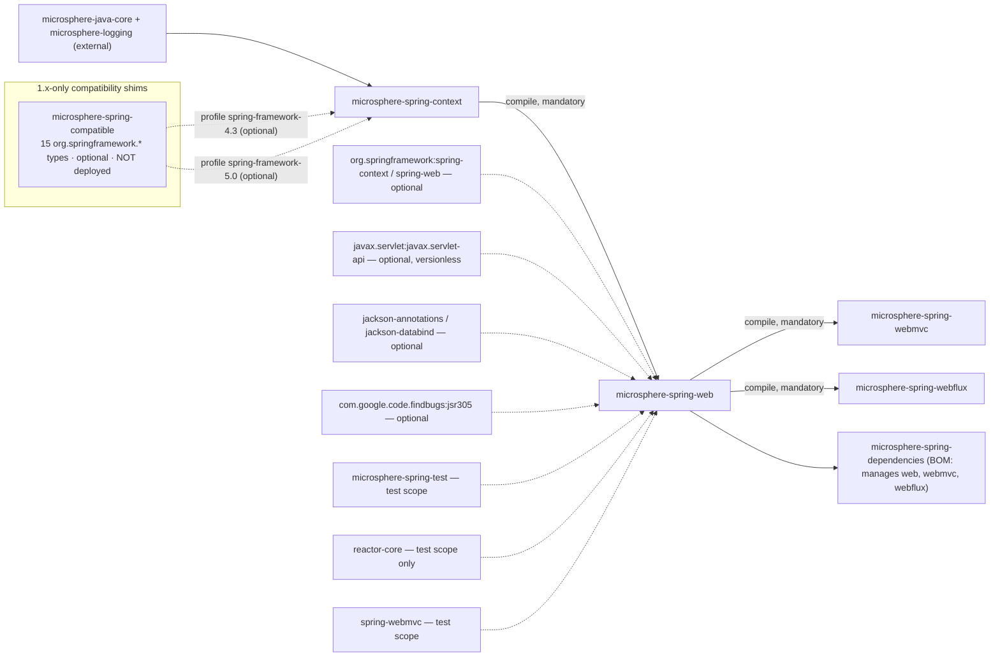
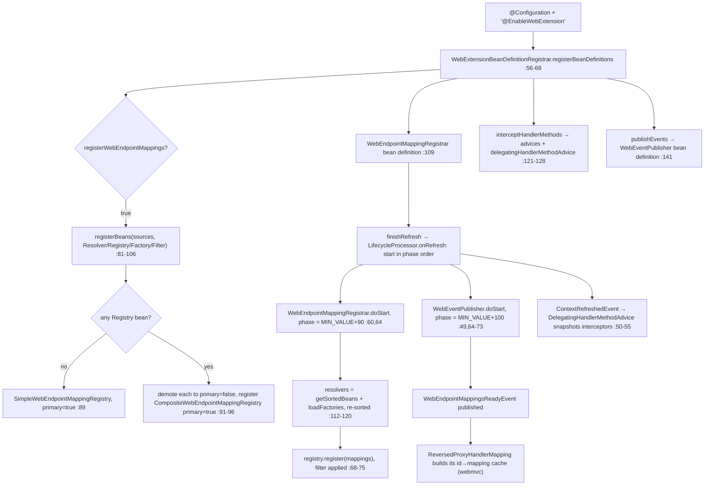
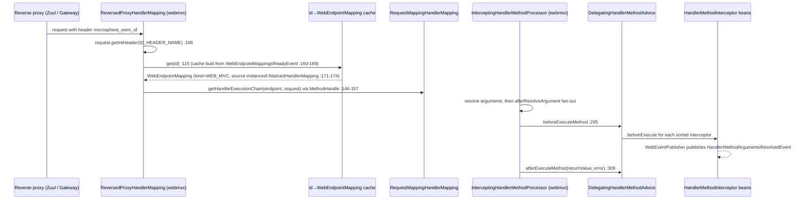

# microsphere-spring-web — Developer Guide (0.1.x / `release-1.x`)

[← Developer guide overview](./README.md) · [简体中文](./zh/web.md) · [User guide](../../user-guide/1.x/web.md) · [0.2.x](../current/web.md)

This page documents the **0.1.x maintenance line**, which exists only on `origin/release-1.x` (the working tree is 0.2.x). Every quoted
line was read from the branch object store with `git show origin/release-1.x:<path>`. Citation convention: POM and resource paths are written
in full behind the `origin/release-1.x:` prefix; Java sources are abbreviated — `…/web/` = `microsphere-spring-web/src/main/java/io/microsphere/spring/web/`,
`…/webmvc/` = `microsphere-spring-webmvc/src/main/java/io/microsphere/spring/`, `…/ctx/` = `microsphere-spring-context/src/main/java/io/microsphere/spring/`.

## 1. Module identity, baselines and dependency posture

| Attribute | Value | Evidence |
|---|---|---|
| Maven coordinate | `io.github.microsphere-projects:microsphere-spring-web:${revision}`, `packaging=jar` | `origin/release-1.x:microsphere-spring-web/pom.xml:13-16` |
| Parent | `microsphere-spring-parent:${revision}` (`../microsphere-spring-parent/pom.xml`) | `origin/release-1.x:microsphere-spring-web/pom.xml:5-10` |
| Reactor version / last release | `0.1.40-SNAPSHOT` (`revision`); tag `0.1.39` is the newest published 0.1.x | `origin/release-1.x:pom.xml:55`, `git tag --list` |
| Build / Java baseline | `microsphere-build:0.3.14` (external parent, supplies all plugin management) and **Java 8** — the 1.x root POM declares no `java.version` property, so the baseline is inherited from that POM (`<java.version>8</java.version>`, line 89) | `origin/release-1.x:pom.xml:5-9`, `:54-56` |
| Spring / Reactor baseline | profile-selected `4.3.30.RELEASE`+`Bismuth-SR17`, `5.0.20.RELEASE`+`Bismuth-SR17`, `5.1.20.RELEASE`+`Californium-SR23`, `5.2.25.RELEASE`+`Dysprosium-SR25`, `5.3.39`+`2020.0.47`; `spring-framework-5.3` is `activeByDefault` | `origin/release-1.x:microsphere-spring-parent/pom.xml:137-178` |
| Servlet namespace | `javax.servlet:javax.servlet-api`, **versionless and `optional`** — no Jakarta EE BOM is imported on this line | `origin/release-1.x:microsphere-spring-web/pom.xml:38-42`; absence of `jakartaee.version` in `…/microsphere-spring-parent/pom.xml:21-30` |
| Optional compile deps | `com.google.code.findbugs:jsr305` (`:24-28`), `org.springframework:spring-context` (`:45-49`), `org.springframework:spring-web` (`:52-56`), `jackson-annotations` + `jackson-databind` (`:59-69`) | `origin/release-1.x:microsphere-spring-web/pom.xml` |
| Mandatory in-reactor dep | `microsphere-spring-context:${revision}` — the only non-optional dependency | `origin/release-1.x:microsphere-spring-web/pom.xml:31-35` |
| Test deps | JUnit **4** (`junit:junit` `:72-76`), `mockito-core` (`:79-83`), `reactor-core` (`:86-90`), `spring-test` (`:93-97`), `microsphere-spring-test` (`:100-105`), `spring-webmvc` (`:108-112`), `logback-classic` (`:115-119`) | `origin/release-1.x:microsphere-spring-web/pom.xml` |
| `src/main/resources` | one file: `META-INF/spring.factories` with two keys — `WebEndpointMappingFactory=Jackson2WebEndpointMappingFactory` and `SpringWebHelper=UnknownSpringWebHelper` | `origin/release-1.x:microsphere-spring-web/src/main/resources/META-INF/spring.factories:1-5` |
| Source volume | 58 main Java types, 61 test types, 2 test resources | `git ls-tree -r --name-only origin/release-1.x -- microsphere-spring-web/src` |

**Dependency posture.** The module has exactly one mandatory edge (`microsphere-spring-context`, which itself contributes
`microsphere-java-core`), so a consumer's transitive footprint is Microsphere-only: nothing from Spring, Servlet, Jackson or Reactor arrives
transitively — all of it is `optional` or `test`. A missing Jackson does not break activation, because
`Jackson2WebEndpointMappingFactory` gates itself on `ClassUtils.isPresent("com.fasterxml.jackson.databind.ObjectMapper", …)`
(`…/web/metadata/Jackson2WebEndpointMappingFactory.java:31-40`). Two asymmetries are worth remembering: `reactor-core` is **test-scope only**
(`:86-90`), so this module never compiles against WebFlux even though its Javadoc documents `WEB_FLUX` mappings; and the sibling
`microsphere-spring-webmvc` declares the same Servlet artifact as `provided`, not `optional` (`origin/release-1.x:microsphere-spring-webmvc/pom.xml:37-42`).



⚠ The BOM check is load-bearing for this page: on 0.1.x `microsphere-spring-dependencies/pom.xml` manages exactly seven artifacts —
`context`, `guice`, `jdbc`, `web`, `webmvc`, `webflux`, `test` (`origin/release-1.x:microsphere-spring-dependencies/pom.xml:24-64`) — and
**`microsphere-spring-compatible` is not one of them**, even though it is a reactor module (`origin/release-1.x:pom.xml:61`) and a profile-scoped
dependency of `microsphere-spring-context` (`…/microsphere-spring-context/pom.xml:127-137`, `:139-155`). Its own POM also skips deployment
(`…/microsphere-spring-compatible/pom.xml:32-42`), so consumers can never import it by version; it only ever reaches the build that produced the
artifact. Inbound edges to `microsphere-spring-web` come solely from `…/microsphere-spring-webmvc/pom.xml:30-35`, `…/microsphere-spring-webflux/pom.xml:30-35`
and the BOM entry `:44`.

## 2. Package map of `io.microsphere.spring.web.*` (0.1.x)

| Package | Representative types | Responsibility |
|---|---|---|
| `…web.annotation` | `EnableWebExtension` (5 attributes, `:79-135`), `WebExtensionBeanDefinitionRegistrar` (`:54`) | activation + bean-definition wiring |
| `…web.constants` | `PropertyConstants` — a single constant `MICROSPHERE_SPRING_WEB_PROPERTY_NAME_PREFIX = "microsphere.spring.web."` (`:32`) | property-name prefix |
| `…web.event` | `WebEventPublisher` (`:45`), `WebEndpointMappingsReadyEvent` (`:34`), `HandlerMethodArgumentsResolvedEvent` (`:20`) | readiness + invocation events |
| `…web.metadata` | model: `WebEndpointMapping` (+ nested `Kind`, `Builder`), `HandlerMetadata`, `HandlerMethodMetadata`; SPI: `WebEndpointMappingResolver`, `…Registry`, `…Factory`, `…Filter`, `SmartWebEndpointMappingFactory`, `WebEndpointMappingVisitor` (1.x only); impls: `SimpleWebEndpointMappingRegistry`, `FilteringWebEndpointMappingRegistry`, `CompositeWebEndpointMappingRegistry`, `ServletWebEndpointMappingResolver`, `AbstractWebEndpointMappingFactory`, `RegistrationWebEndpointMappingFactory`, `Servlet/FilterRegistrationWebEndpointMappingFactory`, `Jackson2WebEndpointMappingFactory`, `WebEndpointMappingRegistrar` | the endpoint metadata model and its registry pipeline |
| `…web.method.support` | `HandlerMethodAdvice` (`:33`), `DelegatingHandlerMethodAdvice` (`:40`), `HandlerMethodInterceptor` (`:27`), `HandlerMethodArgumentInterceptor` (`:31`) | controller-method interception SPI |
| `…web.rule` | `WebRequestRule` + `AbstractWebRequestRule`, `CompositeWebRequestRule`, `WebRequest{Pattens,Methods,Params,Headers,Consumes,Produces}Rule`, `NameValueExpression`/`MediaTypeExpression` hierarchies (18 types) | condition-matching engine — see §11 #1, no production consumer on this branch |
| `…web.util` | `WebRequestUtils`, `RequestAttributesUtils`, `WebUtils`, `HttpUtils`, `SpringWebHelper` (interface), `UnknownSpringWebHelper` (`:36`), `SpringWebType`, `WebType`, `WebScope`, `WebSource`, `WebTarget`, `RequestContextStrategy` (`:30`) | request abstraction and web-type detection |

External types this module is built on (all from `microsphere-spring-context` unless noted):

| Type | Home | Why this module needs it |
|---|---|---|
| `AnnotatedBeanCapableImportBeanDefinitionRegistrar` | `…/ctx/context/annotation/…java` | super-class of the registrar (`…/web/annotation/WebExtensionBeanDefinitionRegistrar.java:54`); supplies the `…enabled=false` kill switch |
| `BeanSource` + `BeanSource.registerBeans(registry, sources, beanTypes…)` | `…/ctx/beans/BeanSource.java:55-382` | the three discovery channels (`BEAN_FACTORY`, `SPRING_FACTORIES`, `JAVA_SERVICE_PROVIDER`) used by the registrar |
| `AbstractSmartLifecycle` | `…/ctx/context/lifecycle/AbstractSmartLifecycle.java:70-140` | base of `WebEndpointMappingRegistrar` and `WebEventPublisher`; `EARLIEST_PHASE = MIN_VALUE` `:75`, `DEFAULT_PHASE = LATEST_PHASE` `:87`, `isAutoStartup() = true` `:115-117`, `start()`/`stop()`/`getPhase()` `final` `:94-128` |
| `OnceApplicationContextEventListener` | `…/ctx/context/event/…` | base of `DelegatingHandlerMethodAdvice` (`…/web/method/support/…java:40`) |
| `BeanRegistrar.registerBeanDefinition(…)`, `BeanUtils.getSortedBeans`, `SpringFactoriesLoaderUtils.loadFactories` | `…/ctx/beans/factory/support/BeanRegistrar.java:199,233,421` | definition registration — the 3-arg `boolean primary` overload `:421` is what the registrar uses for registries — plus resolver/factory/filter discovery (`…/web/metadata/WebEndpointMappingRegistrar.java:116-117`) |
| `io.microsphere.annotation.Nonnull/Nullable`, `io.microsphere.json.JSONUtils`, `io.microsphere.filter.Filter`/`FilterOperator`, `io.microsphere.util.Assert` | **microsphere-java-core** (`0.3.19`, `origin/release-1.x:microsphere-spring-parent/pom.xml:22`) | nullability, `toJSON()` output, filter composition, argument guards |
| `javax.servlet.*`, `HandlerMethod`, `MethodParameter`, `NativeWebRequest`, `HttpMethod`, `MediaType` | `javax.servlet-api` / `spring-web` (both optional) | the Servlet-facing resolver, the interception signatures, the mapping vocabulary |

⚠ Split package: `io.microsphere.spring.web.servlet.*` (`ContentCachingFilter`, `EnableWebMvcExtensionListener`, `WebUtils`) is contributed by
**`microsphere-spring-webmvc`**, not by this module (`origin/release-1.x:microsphere-spring-webmvc/src/main/java/io/microsphere/spring/web/servlet/…`),
so the `io.microsphere.spring.web` namespace is owned by two artifacts on this line — relevant for JPMS-style tooling and for
`META-INF/services/javax.servlet.ServletContainerInitializer`, which also lives in the webmvc module.

## 3. Endpoint metadata model

`WebEndpointMapping<E>` is a `public class` with **private constructors only** (`…/web/metadata/WebEndpointMapping.java:129,1261,1289`); `E` is the
endpoint type (a `Servlet`/`Filter` registration name, a `HandlerMethod`, a `RouterFunction`, …). Constants: `ID_HEADER_NAME = "microsphere_wem_id"` (`:134`),
`UNKNOWN_SOURCE` (`:139`), `ALL_METHODS` built from `HttpMethod.values()` (`:144`). Fields are `final` except the cached `hashCode` (`:178`), the mutable
`attributes` map (`:181`) and the `transient` `endpoint`/`source` (`:150,176`).

| Member | Line | Note |
|---|---|---|
| `enum Kind { SERVLET, FILTER, WEB_MVC, WEB_FLUX, CUSTOMIZED }` | `:186-213` | the discriminator used by `Builder` factories and by `ReversedProxyHandlerMapping` |
| `class Builder<E>` | `:215` | private ctor `:252`; reached only through `servlet()` `:1770`, `filter()` `:1782`, `webmvc()` `:1794`, `webflux()` `:1806`, `customized()` `:1818`, `of(Kind)` `:1831` |
| condition chaining | `:300-1020` | `pattern`/`patterns` (`:300,332,355,378`), `method`/`methods` (`:404,428,460,483,508,526`), `param(s)` (`:552,576,607,629`), `header(s)` (`:656,685,717,739`), `consume(s)`/`produce(s)` (`:765,789,817,844,866,892,916,944,973,995`), `negate()` `:1020`, `source()` `:1043` |
| `nestPatterns`/`nestMethods`/`nestParams`/`nestHeaders`/`nestConsumes`/`nestProduces` | `:1067-1193` | merge another builder's values; `nestPatterns` resolves relative patterns through `URLUtils.buildURI` (`:1072`) |
| `build()` | `:1236-1258` | requires non-null `endpoint` and non-empty `patterns`; an empty `methods` set is silently replaced by `ALL_METHODS` (`:1242-1244`) |
| `getId()` | `:1275,1344` | ⚠ `this.id = Objects.hashCode(endpoint)` — the ID is the **endpoint object's** hash code, not a digest of patterns or conditions |
| `equals` / `hashCode` | `:1547-1559` / `:1575-1598` | compare `kind`, `negated` and the six condition arrays only — `id`, `endpoint`, `source` and `attributes` are excluded; `hashCode` is cached and `0` means "not computed yet" |
| `setAttribute` / `getAttribute` | `:1495-1527` | a lazily created `Map` — the value object is mutable after construction through these two methods |
| `toJSON()` | `:1645-1658` | hand-rolled via `io.microsphere.json.JSONUtils.append` (`:1735-1753`), **not** Jackson; emits `id, kind, negated, patterns, methods, params, headers, consumes, produces` |
| `toExpression()` | `:1730`, helpers `:1921-1975` | folds each condition group with ` \|\| ` inside parentheses, joins groups with `&&`, prefixes `!` when negated (`:1942-1944`) |

The private no-arg constructor at `:1289` (comment `:1286-1288`, "For serialization") exists solely so Jackson can instantiate the type when
`Jackson2WebEndpointMappingFactory` deserializes a JSON descriptor (`…/web/metadata/Jackson2WebEndpointMappingFactory.java:43-47`); the branch's own
fixtures are `microsphere-spring-web/src/test/resources/META-INF/web-mapping-descriptor.json` (11 keys) consumed at `WebEndpointMappingTest.java:644`
and `SmartWebEndpointMappingFactoryTest.java:50`.

## 4. Registry, resolver, factory and filter SPI

| Contract | Kind | Key behaviour | Evidence |
|---|---|---|---|
| `WebEndpointMappingResolver` | 1-method interface, `ApplicationContext → Collection<WebEndpointMapping>` | the only pull point for endpoint metadata at startup | `…/web/metadata/WebEndpointMappingResolver.java:32-41` |
| `ServletWebEndpointMappingResolver` | built-in Servlet implementation | returns empty for non-`WebApplicationContext` (`:93-99`) and for `getMajorVersion() < 3` (`:52`); `new`s its two factories per call rather than using beans (`:71,85`) | `…/web/metadata/ServletWebEndpointMappingResolver.java:43-99` |
| `WebEndpointMappingFactory<E>` | `@FunctionalInterface`; `supports` default `true`, `create → Optional`, `getSourceType` via `ResolvableType` | the source-object → mapping conversion seam | `…/web/metadata/WebEndpointMappingFactory.java:32-74` |
| `AbstractWebEndpointMappingFactory<E>` | `create` is `final`, delegates to `doCreate`, swallows every `Throwable` | a failing factory logs at `error` and contributes nothing | `…/web/metadata/AbstractWebEndpointMappingFactory.java:38-52` |
| `SmartWebEndpointMappingFactory` | dispatch hub keyed by `getSourceType()` | loads `spring.factories` + bean factories once at construction; `doCreate` iterates every candidate and keeps the **last** present result | `…/web/metadata/SmartWebEndpointMappingFactory.java:40-102` |
| `RegistrationWebEndpointMappingFactory<R extends Registration>` | Servlet `Registration` template (`supports`/`doCreate` both `final`) | abstract hooks `getKind`, `getMethods`, `getPatterns`, `getRegistration`, `contribute` | `…/web/metadata/RegistrationWebEndpointMappingFactory.java:40-110` |
| `ServletRegistrationWebEndpointMappingFactory` / `FilterRegistrationWebEndpointMappingFactory` | concrete | derive HTTP methods from the presence of `doGet`/`doPost`/… on the class (`:82-103`); the filter factory unions its own URL patterns with those of the servlets it is mapped to (`:47-94`) | same package |
| `Jackson2WebEndpointMappingFactory` | `spring.factories`-registered | `supports` reports ObjectMapper presence, ignoring the argument | `…/web/metadata/Jackson2WebEndpointMappingFactory.java:29-48` |
| `WebEndpointMappingRegistry` | `register(single/varargs/Iterable)` + `getWebEndpointMappings()` | default `register(...)` methods count successes | `…/web/metadata/WebEndpointMappingRegistry.java:34-84` |
| `FilteringWebEndpointMappingRegistry` | abstract, `BeanFactoryAware`; `register` `final` | applies a `Filter<WebEndpointMapping>` built from all sorted `WebEndpointMappingFilter` beans, OR-combined; default filter accepts everything | `…/web/metadata/FilteringWebEndpointMappingRegistry.java:40-109` |
| `SimpleWebEndpointMappingRegistry` | the default store | `Map<Integer, WebEndpointMapping>` keyed by `getId()` — a duplicate ID is rejected | `…/web/metadata/SimpleWebEndpointMappingRegistry.java:33-38` |
| `CompositeWebEndpointMappingRegistry` | fan-out store, `SmartInitializingSingleton` | collects every other registry at `afterSingletonsInstantiated` (`:57-65`) and registers into each (`:42-48`) | same package |
| `WebEndpointMappingFilter` | marker `extends io.microsphere.filter.Filter<WebEndpointMapping>` | a predicate applied at registration time, not at resolution time | `…/web/metadata/WebEndpointMappingFilter.java:29` |
| `WebEndpointMappingRegistrar` | `AbstractSmartLifecycle` | drives resolvers → registry at lifecycle start, one phase before the publisher | `…/web/metadata/WebEndpointMappingRegistrar.java:50-125` |

The enabling registrar (`…/web/annotation/WebExtensionBeanDefinitionRegistrar.java:56-143`) reads exactly four attributes — `sources` (`:61`),
`registerWebEndpointMappings` (`:71`), `interceptHandlerMethods` (`:113`), `publishEvents` (`:139`) — and never reads `requestContextStrategy`,
although the annotation declares it (`…/web/annotation/EnableWebExtension.java:135`). ⚠ On this branch the attribute is consumed only by the sibling
modules: `…/webmvc/webflux/annotation/WebFluxExtensionBeanDefinitionRegistrar.java:102-123` and
`…/webmvc/web/servlet/listener/EnableWebMvcExtensionListener.java:110-114`, the latter reading the `@EnableWebMvcExtension` annotation instance rather
than the `@EnableWebExtension` meta-attributes. Registry wiring has a distinct rule: discovered registries are demoted with
`beanDefinition.setPrimary(false)` and a `CompositeWebEndpointMappingRegistry` is registered as primary (`:91-96`), but when nothing was discovered the
plain `SimpleWebEndpointMappingRegistry` is registered as primary instead (`:87-89`).

## 5. Handler-method interception SPI

`HandlerMethodAdvice` (`…/web/method/support/HandlerMethodAdvice.java:33-88`) is the four-hook facade (`beforeResolveArgument` `:43`, `afterResolveArgument`
`:57`, `beforeExecuteMethod` `:71`, `afterExecuteMethod` `:85`); `HandlerMethodArgumentInterceptor` (`:31-58`) and `HandlerMethodInterceptor` (`:27-56`) are the
two per-concern subsets, every method `default` and no-op. `DelegatingHandlerMethodAdvice` (`:40-104`) is the only implementation in the reactor: it is a
`OnceApplicationContextEventListener<ContextRefreshedEvent>` (`:40`) that snapshots sorted interceptor lists at `:50-55` and fans out in list order (`:65-94`),
under the fixed bean name `delegatingHandlerMethodAdvice` (`:43`, referenced by the registrar at `:127`).

⚠ Nothing in this module *weaves* the advice: the only drivers are `…/webmvc/webmvc/method/support/InterceptingHandlerMethodProcessor.java:85,201-202` and
`…/webmvc/webflux/method/InterceptingHandlerMethodProcessor.java:93,210-211`, both of which resolve `HandlerMethodAdvice` beans from the context. Consequences:
`@EnableWebExtension` **alone** registers advice and interceptor beans that no request path invokes, and `WebEventPublisher` — which implements
`HandlerMethodInterceptor` (`…/web/event/WebEventPublisher.java:45,59-61`) — publishes `HandlerMethodArgumentsResolvedEvent` per invocation only when a
module-level annotation has installed the intercepting processor.

## 6. Lifecycle at startup and at request time



Spring's `AbstractApplicationContext.finishRefresh()` runs the lifecycle processor's `onRefresh()` **before** publishing `ContextRefreshedEvent`, so on this line
endpoint registration and the ready event precede interceptor snapshotting — the phase gap of ten between `WebEndpointMappingRegistrar` (`…/web/metadata/WebEndpointMappingRegistrar.java:60`)
and `WebEventPublisher` (`…/web/event/WebEventPublisher.java:49,55`) is what orders the two lifecycle beans.



The web module itself performs **no** matching at request time: `…/web/rule/*` is unused in production (§11 #1), and the request-time path is entirely a webmvc/webflux concern reading the mappings this module registered.

## 7. Design patterns evidenced

| Pattern | Class(es) | Evidence |
|---|---|---|
| Configuration activation ("Enable*") | `EnableWebExtension` → `WebExtensionBeanDefinitionRegistrar` | `@Import` at `…/web/annotation/EnableWebExtension.java:62`; registrar `:54` |
| Builder (private ctor + kind-selected factories) | `WebEndpointMapping.Builder` | `…/web/metadata/WebEndpointMapping.java:215,252,1770-1831,1236` |
| Immutable value object with escape hatches | `WebEndpointMapping` | final fields `:146-176` vs mutable `attributes` `:1495-1503` |
| Registry | `WebEndpointMappingRegistry`, `SimpleWebEndpointMappingRegistry`, `CompositeWebEndpointMappingRegistry` | `…/web/metadata/SimpleWebEndpointMappingRegistry.java:33-38`, `CompositeWebEndpointMappingRegistry.java:42-65` |
| Composite + Filter (predicate chain) | `FilteringWebEndpointMappingRegistry`, `WebEndpointMappingFilter`, `FilterOperator.OR` | `…/web/metadata/FilteringWebEndpointMappingRegistry.java:42-76,94-99` |
| Strategy selection by source type | `SmartWebEndpointMappingFactory` | `…/web/metadata/SmartWebEndpointMappingFactory.java:72-76,85-86` |
| Template Method (frozen `create`, open hooks) | `AbstractWebEndpointMappingFactory`, `RegistrationWebEndpointMappingFactory` | `…/Abstract…:39-52`, `…/Registration…:49-54,70-110` |
| Null Object | `UnknownSpringWebHelper` (`INSTANCE` `:38`, every method returns `null`/no-op), `DEFAULT_FILTER = e -> true` | `…/web/util/UnknownSpringWebHelper.java:36-80`, `…/metadata/FilteringWebEndpointMappingRegistry.java:42` |
| Observer / event publication | `WebEventPublisher`, `WebEndpointMappingsReadyEvent`, `HandlerMethodArgumentsResolvedEvent` | `…/web/event/WebEventPublisher.java:59-73` |
| Phase-ordered lifecycle | `AbstractSmartLifecycle` subclasses | `…/metadata/WebEndpointMappingRegistrar.java:60`, `…/event/WebEventPublisher.java:49-55` |
| Facade + Delegate | `HandlerMethodAdvice` over the two interceptor SPIs | `…/web/method/support/DelegatingHandlerMethodAdvice.java:65-94` |
| Adapter to a foreign cache | `ReversedProxyHandlerMapping` (`MethodHandle` on `getHandlerExecutionChain`) | `…/webmvc/webmvc/handler/ReversedProxyHandlerMapping.java:85-98,146-157` |
| *No* Visitor implementation | `WebEndpointMappingVisitor` | see §8 — declared, never driven |

## 8. The 1.x-only `WebEndpointMappingVisitor`

`…/web/metadata/WebEndpointMappingVisitor.java:27` declares twelve notification methods — `method(String[])` `:34`, `path(String)` `:41`,
`header(String,String)` `:49`, `queryParam(String,String)` `:57`, `startAnd`/`and`/`endAnd` `:65-78`, `startOr`/`or`/`endOr` `:86-99`,
`startNegate`/`endNegate` `:107-113` — shaped to mirror Spring WebFlux's `RequestPredicates.Visitor`, whose Javadoc wording it reuses.

Verified status on `origin/release-1.x`, with the command recorded for reproducibility:

```
$ git grep -n "WebEndpointMappingVisitor" origin/release-1.x
…/web/metadata/WebEndpointMappingVisitor.java:27:public interface WebEndpointMappingVisitor {
$ git grep -n "Visitor" origin/release-1.x -- microsphere-spring-web/src
…/web/metadata/WebEndpointMappingVisitor.java:27:public interface WebEndpointMappingVisitor {
```

**Exactly one hit in the entire branch tree: its own type declaration.** There is no implementation (the sibling `…/webflux/webflux/function/server/RequestPredicateVisitorAdapter.java:48`
and `RouterFunctionVisitorAdapter.java:41` implement *Spring's* `RequestPredicates.Visitor` / `RouterFunctions.Visitor` and never reference this interface), no
`accept`/`traverse`/`setVisitor` method on `WebEndpointMapping` (grep for `Visitor` inside `…/web/metadata/WebEndpointMapping.java` returns nothing), no registration in
`META-INF/spring.factories` (`origin/release-1.x:microsphere-spring-web/src/main/resources/META-INF/spring.factories:1-5` lists only `WebEndpointMappingFactory` and
`SpringWebHelper`), and no test fixture. It is therefore an unreachable extension point: a consumer must both implement it and write the traversal that calls it.
On `main` (0.2.x) the file does not exist at all — `git diff --stat origin/release-1.x main -- microsphere-spring-web/src/main` reports `WebEndpointMappingVisitor.java | 114 -------`.

## 9. 0.1.x versus 0.2.x

| Aspect | 0.1.x / `release-1.x` (this page) | 0.2.x / `main` (working tree) | Evidence |
|---|---|---|---|
| Servlet namespace | `javax.servlet.*` throughout (`ServletRegistration`, `FilterRegistration`, `HttpServletRequest`) | `jakarta.servlet.*` | `origin/release-1.x:microsphere-spring-web/pom.xml:38-42` vs `microsphere-spring-web/pom.xml:44-49` |
| Servlet spec | `javax.servlet-api` versionless via the `microsphere-java-dependencies` chain; the resolver only guarantees Servlet 3+ | `jakarta.servlet-api` from `jakarta.jakartaee-bom:11.0.0` → Servlet 6.0 | `origin/release-1.x:microsphere-spring-parent/pom.xml:115-122` vs `microsphere-spring-parent/pom.xml:24,53-55`; `…/web/metadata/ServletWebEndpointMappingResolver.java:52` |
| Java baseline | 8, inherited (`microsphere-build:0.3.14` sets `java.version=8`) | 17, declared explicitly | `origin/release-1.x:pom.xml:54-56` vs `pom.xml:55-56` |
| Spring matrix | 4.3 / 5.0 / 5.1 / 5.2 / 5.3, default 5.3 | 6.0 / 6.1 / 6.2 / 7.0, default 7.0 | `origin/release-1.x:microsphere-spring-parent/pom.xml:137-178` |
| Compatibility shims | `microsphere-spring-compatible` (15 `org.springframework.*` types: `Profiles`, `NonNull`, `Nullable`, `Assert`, `ClassUtils`, `CollectionUtils`, `MultiValueMap`, `ObjectUtils`, `StreamUtils`, …), pulled in only by profiles `spring-framework-4.3` and `spring-framework-5.0`, `optional`, not BOM-managed, not deployed | module deleted | `origin/release-1.x:microsphere-spring-context/pom.xml:127-155`, `…/microsphere-spring-dependencies/pom.xml:24-64`, `…/microsphere-spring-compatible/pom.xml:32-42` |
| API present on one side only | 1.x-only: `WebEndpointMappingVisitor`, present as an interface with no implementation; test stub `src/test/java/org/springframework/http/server/reactive/ServerHttpRequest.java` | 0.2.x-only: `…/web/util/MediaTypeUtils.java` (+ `MediaTypeUtilsTest`) | `git diff --stat origin/release-1.x main -- microsphere-spring-web/src` (visitor: `114 -------`, see §8) plus `git ls-tree -r --name-only <ref> -- microsphere-spring-web/src` on both refs |
| Spring-version workaround inside the module | `WebRequestProducesRule` keeps `BEFORE_SPRING_505` and `MEDIA_TYPE_ALL_LIST` and substitutes `[MediaType.ALL]` when `ContentNegotiationManager.resolveMediaTypes` returns empty | constants and fallback removed (Spring 6 always returns them) | `…/web/rule/WebRequestProducesRule.java:62,69,146-148` |
| Source-level API drift | `EnableWebExtension` is byte-identical (same 5 attributes); `WebEndpointMapping` differs only in `javax`→`jakarta` Javadoc/`@see` text (32 diff lines); the registrar differs only by an `Entry` import/loop-variable rename | same public API | `…/web/annotation/EnableWebExtension.java:79-135`, `git diff origin/release-1.x main -- …/web/metadata/WebEndpointMapping.java`, `git diff` on `WebExtensionBeanDefinitionRegistrar.java:89` |
| Build/test dependencies | `reactor-core` test-scope only, JUnit 4 + mockito, no annotation processor | same WebFlux scope, but JUnit 5 with `microsphere-annotation-processor` (optional) and `hamcrest` added | `origin/release-1.x:microsphere-spring-web/pom.xml:72-90` vs `microsphere-spring-web/pom.xml:23-28,79-83,121-126` |
| Servlet boot integration around this module | `io.microsphere.spring.web.servlet.*` split package + `META-INF/services/javax.servlet.ServletContainerInitializer` live in webmvc | re-expressed for `jakarta.servlet` | `origin/release-1.x:microsphere-spring-webmvc/src/main/resources/META-INF/services/javax.servlet.ServletContainerInitializer` |

## 10. Build and verification

| Task | Command / fact |
|---|---|
| CI matrix | Java `8`/`11`/`17`/`21`/`25` × the five Spring profiles: `origin/release-1.x:.github/workflows/maven-build.yml:25-29`; the build line adds `-Drevision=0.0.1-SNAPSHOT test --activate-profiles test,coverage,<profile>` (`:43-49`) |
| Build / pin a Spring line | this module alone: `mvn -pl microsphere-spring-web -am test --activate-profiles test,spring-framework-5.3 -Drevision=0.1.40-SNAPSHOT`; note that `-P spring-framework-4.3` also swaps `microsphere-spring-context`'s dependency set — but **not** this module's, which declares no profiles of its own |
| Test inventory | JUnit 4 context tests `EnableWebExtensionTest` (MockMvc against `TestController` from `microsphere-spring-test`, `…/src/test/java/…/annotation/EnableWebExtensionTest.java:20,43-68`), `WebExtensionBeanDefinitionRegistrarTest`; unit tests per SPI (`*RegistryTest`, `*FactoryTest`, `WebEndpointMappingTest`); rule tests for every `…/web/rule` type; `…/src/test/java/org/springframework/http/server/reactive/ServerHttpRequest.java` — a 1.x-only test stub declared inside Spring's own package |
| Fixture factories | `NoOpWebEndpointMappingResolver`, `NullWebEndpointMappingFactory`, `ThrowableWebEndpointMappingFactory`, `UnsupportedWebEndpointMappingFactory`, plus `src/test/resources/META-INF/spring.factories:1-7` that registers three of them for `WebEndpointMappingFactory` and a `SpringWebHelper` |

## 11. Gotchas, dead code and defects

| # | Observation | Evidence |
|---|---|---|
| 1 | The whole `…/web/rule` package — 18 production types — has **no consumer outside its own package and tests**: `git grep -n "WebRequestRule" origin/release-1.x` matches only files under `microsphere-spring-web/src`, and none in webmvc/webflux. Treat it as an unused, still-tested library of condition matchers. | grep results, §2 |
| 2 | `WebEndpointMappingVisitor` is declared and never implemented or invoked (§8) — documentation that describes it as "traverses the mapping's condition tree" describes code that does not exist. | `…/web/metadata/WebEndpointMappingVisitor.java:27` |
| 3 | Every resolver is invoked **twice**: `resolveWebEndpointMappings()` calls `resolver.resolve(context)` in the `isNotEmpty` test and again in `addAll` (`:97-101`), doubling HandlerMapping traversal and factory work per context start. | `…/web/metadata/WebEndpointMappingRegistrar.java:93-104` |
| 4 | `id` is `Objects.hashCode(endpoint)` (`:1275`) while `SimpleWebEndpointMappingRegistry` keys its map by `getId()` and returns `false` when the key is occupied (`:37`) — two mappings for the same endpoint object (e.g. one with `negate()`) collide silently, and the `microsphere_wem_id` header value is only reproducible within one JVM run for endpoints whose `hashCode` is identity-based. | `…/web/metadata/WebEndpointMapping.java:1275`, `…/metadata/SimpleWebEndpointMappingRegistry.java:33-38` |
| 5 | `equals`/`hashCode` ignore `id`, `endpoint` and `source` (`:1547-1598`) — two mappings for different `HandlerMethod`s with identical conditions are equal, which is why the composite registry can double-register. | same lines |
| 6 | `requestContextStrategy` is declared on `@EnableWebExtension` but never read by this module's registrar; only the webmvc listener and the webflux registrar honour it, and the listener inspects `@EnableWebMvcExtension` itself. | §4 grep evidence |
| 7 | Commented-out code survives on the branch: `// private static final List<ProduceMediaTypeExpression> MEDIA_TYPE_ALL_LIST = …` — a name clash with the live constant two lines above. | `…/web/rule/WebRequestProducesRule.java:74` |
| 8 | `// FIXME : WebFlux` marks `matches(NativeWebRequest)` as MVC-only, and the `@Deprecated` `WebRequestPattensRule(String[], PathMatcher, boolean)` constructor is retained; the class name itself carries the misspelling `Pattens`. | `…/web/rule/WebRequestPattensRule.java:102-105,162` |
| 9 | `SmartWebEndpointMappingFactory.doCreate` does not break on the first hit: the **last** factory whose `create` returns a value wins (`:91-101`), and `AnnotationAwareOrderComparator` order therefore means "lowest priority first". | `…/web/metadata/SmartWebEndpointMappingFactory.java:91-101` |
| 10 | A factory expressed as a lambda resolves `getSourceType()` to `null` (`ResolvableType` cannot recover the type argument of a lambda class), so `initDelegates` files it under a `null` key (`:72-76`) and `doCreate`, which looks up `delegates.get(endpoint.getClass())` (`:86`), never selects it. Implement the interface (or `AbstractWebEndpointMappingFactory`) instead. | `…/web/metadata/WebEndpointMappingFactory.java:72-74`, `…/metadata/SmartWebEndpointMappingFactory.java:72-86` |
| 11 | `AbstractWebEndpointMappingFactory.create` is `final` and converts every `Throwable` into an `error` log plus an empty `Optional` (`:38-49`) — a mapping silently missing from the registry is diagnosed only in the log. | `…/web/metadata/AbstractWebEndpointMappingFactory.java:38-49` |
| 12 | `ServletWebEndpointMappingResolver` instantiates its factories with `new` (`:71,85`), so user-supplied `Servlet/FilterRegistrationWebEndpointMappingFactory` beans are bypassed on the Servlet path, and a non-Web `ApplicationContext` or a Servlet 2.x container yields zero mappings (`:52,94`). | `…/web/metadata/ServletWebEndpointMappingResolver.java:52-99` |
| 13 | With `registerWebEndpointMappings = false` there is no registry at all, and `WebEventPublisher.doStart` only logs a `warn` and returns — consumers waiting for `WebEndpointMappingsReadyEvent` never get it. | `…/web/event/WebEventPublisher.java:64-74` |
| 14 | `DelegatingHandlerMethodAdvice` snapshots interceptors once at `ContextRefreshedEvent` (`:50-55`); interceptors or advice registered later (or in a child context refreshed afterwards) are invisible to it until restart. | `…/web/method/support/DelegatingHandlerMethodAdvice.java:40-55` |
| 15 | Doc defects to avoid quoting: `@lin WebEndpointMapping` in the ready-event constructor Javadoc, malformed author tags `Mercy<a/>`, and `@since 1.0.0` on every type although this line is `0.1.39`/`0.1.40-SNAPSHOT` — `@since` is unusable for release mapping here. | `…/web/event/WebEndpointMappingsReadyEvent.java:43`, `…/web/constants/PropertyConstants.java:24`, `…/web/metadata/WebEndpointMappingVisitor.java:25` |

**Related** — [Developer guide overview](./README.md) · [简体中文](./zh/web.md) ·
[User guide — web (1.x)](../../user-guide/1.x/web.md) · [User guide 简体中文](../../user-guide/1.x/zh/web.md) ·
[0.2.x developer guide](../current/web.md) · [parent POM profiles](./parent.md) ·
[dependency management](./dependencies.md) · [webmvc (1.x)](./webmvc.md) · [webflux (1.x)](./webflux.md) ·
[context (1.x)](./context.md) · [compatible (1.x)](./compatible.md)
