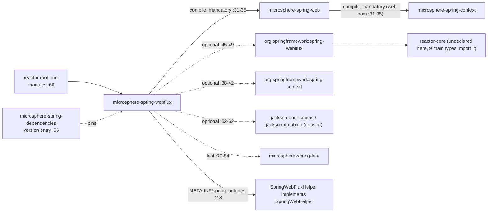
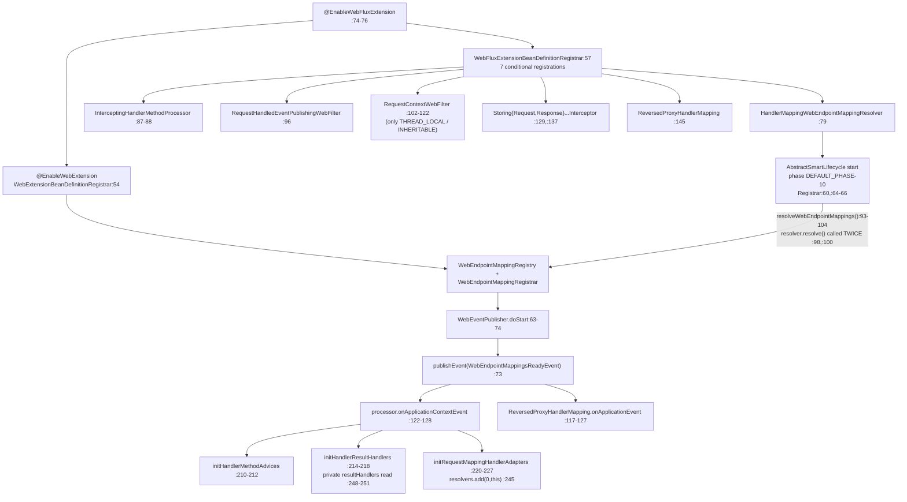
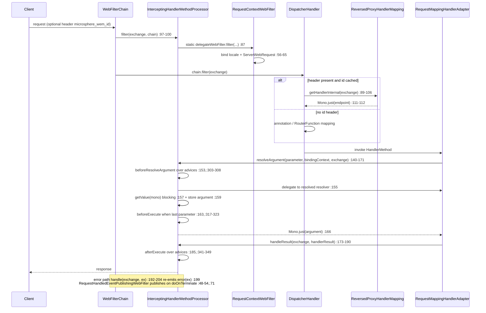

# microsphere-spring-webflux — Developer Guide (0.1.x / `release-1.x`)

[← Developer guide overview](./README.md) · [简体中文](./zh/webflux.md) · [User guide](../../user-guide/1.x/webflux.md) ·
[0.2.x](../current/webflux.md)

Every line number below was read from the branch object store (`git show origin/release-1.x:<path>`), never from the 0.2.x working tree, so an unqualified `path:line` citation means **`origin/release-1.x`**; only section 7 cites the working tree, and it does so with an explicit `main:` prefix. Abbreviations: `…/webflux/…` = `microsphere-spring-webflux/src/main/java/io/microsphere/spring/webflux/…`, `…/web/…` = `microsphere-spring-web/src/main/java/io/microsphere/spring/web/…`.

## 1. Module identity, baselines and dependency posture

| Attribute | Value | Evidence |
|---|---|---|
| Maven coordinate | `io.github.microsphere-projects:microsphere-spring-webflux:${revision}` | `microsphere-spring-webflux/pom.xml:13-16` |
| Parent | `microsphere-spring-parent:${revision}`, `relativePath ../microsphere-spring-parent/pom.xml` | `microsphere-spring-webflux/pom.xml:5-10` |
| Version line | branch property `revision` = `0.1.40-SNAPSHOT`; parent chain `microsphere-build:0.3.14` → root → parent | `pom.xml:55`, `pom.xml:5-9` |
| Java baseline | **not declared in this repository** — no `java.version` property and no compiler-plugin configuration in any 0.1.x POM (the only `java.version` substring hits are the unrelated `microsphere-java.version` / `microsphere-logging.version`, `microsphere-spring-parent/pom.xml:22-23`); CI compiles on JDK **8, 11, 17, 21, 25** and publishing pins JDK 8, so the level comes from the external `microsphere-build:0.3.14` parent | `.github/workflows/maven-build.yml:25`, `.github/workflows/maven-publish.yml:41` |
| Spring Framework baseline | profile-selected `4.3.30.RELEASE` / `5.0.20.RELEASE` / `5.1.20.RELEASE` / `5.2.25.RELEASE` / `5.3.39` through the `spring-framework-bom` import; `spring-framework-5.3` is `activeByDefault` | `microsphere-spring-parent/pom.xml:97-104`, `:136-179`, `:171-173` |
| Reactor baseline | release-train names, not versions: `Bismuth-SR17` (4.3 + 5.0), `Californium-SR23`, `Dysprosium-SR25`, `2020.0.47`, imported through `reactor-bom` | `microsphere-spring-parent/pom.xml:106-113`, `:141`, `:149`, `:157`, `:165`, `:176` |
| Namespace | the module's **main sources import neither `javax.*` nor `jakarta.*`** — `git grep -c 'javax\.'` and `git grep -c 'jakarta\.'` over `…/webflux/src/main/java` both return **0**; a pure reactive module with no Servlet API footprint | `git grep` on `origin/release-1.x` |
| In-reactor edge (mandatory) | `microsphere-spring-web` — compile scope, **not** optional; it makes `microsphere-spring-context` mandatory in turn, and does **not** depend on `microsphere-spring-webmvc` (its only `webmvc` string is the test-scoped `spring-webmvc`) | `microsphere-spring-webflux/pom.xml:31-35`, `microsphere-spring-web/pom.xml:31-35`, `:107-112` |
| Optional deps | `microsphere-annotation-processor` `:24-28`, `spring-context` `:38-42`, `spring-webflux` `:45-49`, `jackson-annotations` `:52-56`, `jackson-databind` `:58-62` | `microsphere-spring-webflux/pom.xml` |
| Test deps | `junit-jupiter` `:65-69`, `spring-test` `:72-76`, `microsphere-spring-test` `:79-84`, `mockito-core` `:87-91`, `jsonassert` `:94-98`, `logback-classic` `:101-105` | `microsphere-spring-webflux/pom.xml` |
| Module-local profile | `<profile><id>spring-framework-4.3</id>` re-pins `spring-framework.version` to `5.0.20.RELEASE` — otherwise the POM is dependency-only, and this is the file's **only** `<profiles>` block (POM ends at line 119) | `microsphere-spring-webflux/pom.xml:109-116` |
| Source counts | **24** main types, **22** test types, **1** main resource (`META-INF/spring.factories`), **0** test resources | `git ls-tree -r --name-only origin/release-1.x -- microsphere-spring-webflux/src` |

Dependency posture: the published POM commits a consumer to nothing except itself — `microsphere-spring-web` is the single
mandatory edge (`:31-35`), everything Spring- or Jackson-shaped is `optional` (`:38-62`) and there is no `provided` entry at
all. Optional dependencies *are* on this module's own compile classpath, which is why nine main types import `reactor.core.*`
(`…/web/util/MonoUtils.java:21`, `…/webflux/server/filter/CompositeWebFilter.java:25` and seven others) although
`io.projectreactor:reactor-core` is never declared here; consumers must supply Spring WebFlux and Reactor themselves.
⚠ Two declared optionals are dead weight — `git grep -c jackson` over `microsphere-spring-webflux/src` returns **0** matches
across main *and* test sources, so `jackson-annotations` and `jackson-databind` are unused, exactly as on 0.2.x.

## 2. Inbound and outbound dependency edges

Nothing in the reactor builds **on** this module: outside its own directory the artifact id appears only in the root module
list (`pom.xml:66`) and the BOM version entry (`microsphere-spring-dependencies/pom.xml:56`), so it is a leaf. Its one real
outbound compile edge is `microsphere-spring-web`, which supplies every kernel type it implements; the test-scoped
`microsphere-spring-test` supplies `AbstractWebFluxTest` (`…/webflux/annotation/AbstractEnableWebFluxExtensionTest.java:20`)
and `WebTestUtils.mockServerWebExchange` (`…/web/util/WebServerScopeTest.java:24-27`). The one *runtime* outbound contribution
is the `SpringWebHelper` SPI entry: `src/main/resources/META-INF/spring.factories:2-3` maps
`io.microsphere.spring.web.util.SpringWebHelper` to `io.microsphere.spring.webflux.util.SpringWebFluxHelper`, which the kernel
loads through `SpringFactoriesLoader.loadFactories(...)` into an `EnumMap` keyed by `SpringWebHelper#getType()`
(`…/web/util/WebRequestUtils.java:355-361`) and selects per request with `SpringWebType.valueOf(NativeWebRequest)`
(`…/web/util/SpringWebType.java:74-82`, `WEB_FLUX` `:33`). `webmvc` and `webflux` never reference each other: the two
transports are mutually exclusive adapters of the same kernel, and the same-named `ReversedProxyHandlerMapping` in each module
is not shared code (section 4.5).

## 3. Package map of `io.microsphere.spring.webflux.*` on 0.1.x

| Package | Types | Responsibility |
|---|---|---|
| `io.microsphere.spring.webflux.annotation` | `EnableWebFluxExtension` (public, `:77`), `WebFluxExtensionBeanDefinitionRegistrar` (**package-private**, `:54`) | activation annotation (8 attributes) + seven conditional registrations |
| `io.microsphere.spring.webflux.context.request` | `ServerWebRequest` | `NativeWebRequest` adapter over `ServerWebExchange` (`:65`) |
| `io.microsphere.spring.webflux.context.event` | `ServerRequestHandledEvent` | `RequestHandledEvent` subtype carrying the exchange (`:35`) |
| `io.microsphere.spring.webflux.server.filter` | `RequestContextWebFilter`, `RequestHandledEventPublishingWebFilter`, `CompositeWebFilter`, `DelegatingWebFilter` | the `WebFilter` seam: context binding, event publishing, composition |
| `io.microsphere.spring.webflux.method` | `InterceptingHandlerMethodProcessor`, `StoringRequestBodyArgumentInterceptor`, `StoringResponseBodyReturnValueInterceptor` | reactive implementation of the kernel interception SPI |
| `io.microsphere.spring.webflux.metadata` | `HandlerMappingWebEndpointMappingResolver`, `HandlerMappingWebEndpointMappingFactory` (abstract), `HandlerMetadataWebEndpointMappingFactory`, `RequestMappingMetadataWebEndpointMappingFactory` | harvest `WebEndpointMapping` from the three WebFlux `HandlerMapping` families |
| `io.microsphere.spring.webflux.function.server` | `RouterFunctionVisitorAdapter`, `RequestPredicateVisitorAdapter`, `RequestPredicateKind` (11 constants), `ConsumingWebEndpointMappingAdapter` | `RouterFunction` / `RequestPredicate` traversal, cross-version |
| `io.microsphere.spring.webflux.handler` | `ReversedProxyHandlerMapping` | header-driven handler shortcut for gateway-forwarded traffic |
| `io.microsphere.spring.webflux.util` | `SpringWebFluxHelper` | `SpringWebHelper` SPI entry for `SpringWebType.WEB_FLUX` (`:52`, `:282-284`) |
| `io.microsphere.spring.web.util` (**kernel package!**) | `MonoUtils`, `WebServerScope`, `WebServerUtils` | blocking `Mono` reader, exchange/session attribute scopes, session/principal accessors |

Three classes deliberately live in the kernel's `io.microsphere.spring.web.util` package rather than the module's own, which is why the module has two namespace roots.

⚠ **The 0.1.x and 0.2.x package sets are identical — do not repeat the claim that 0.1.x carries an extra
`function.server` package.** `git ls-tree -r --name-only origin/release-1.x -- microsphere-spring-webflux` and the same command
against `main` each return **48** paths (1 POM, 24 main, 1 main resource, 22 test), byte-for-byte the same list;
`git diff --name-status origin/release-1.x main -- microsphere-spring-webflux` yields **zero `A`, zero `D`, eleven `M`** — one
POM (`14` insertions / `10` deletions), one main type (`…/function/server/RequestPredicateVisitorAdapter.java`, `27`/`69`
toward `main`) and nine test types. `io.microsphere.spring.webflux.function.server` exists on **both** sides with the same four
classes (`RouterFunctionVisitorAdapter.java:41`, `RequestPredicateVisitorAdapter.java:48`, `RequestPredicateKind.java:93`,
`ConsumingWebEndpointMappingAdapter.java:76`), and three of the four are byte-identical — they do not appear in
`git diff --name-status` at all. No class exists on only one side of this module. The real asymmetry is in the **sibling**
`microsphere-spring-webmvc`, where `git diff --name-status … -- microsphere-spring-webmvc/src/main/java` reports **3 `A`**
(`io/microsphere/spring/web/servlet/function/{ConsumingWebEndpointMappingAdapter,RequestPredicateVisitorAdapter,RouterFunctionVisitorAdapter}.java`
— 0.2.x back-ported the visitor machinery to the servlet side), **1 `D`**
(`io/microsphere/spring/webmvc/config/WebMvcConfigurerAdapter.java`) and **20 `M`**.

## 4. Architecture design

### 4.1 `@EnableWebFluxExtension` and its registrar

| Attribute | Declared | Default | Bridged to `EnableWebExtension` | Bean it gates (registrar line) |
|---|---|---|---|---|
| `registerWebEndpointMappings` | `…/annotation/EnableWebFluxExtension.java:91` | `true` | `@AliasFor` `:90` | `HandlerMappingWebEndpointMappingResolver` (`…Registrar.java:79`) |
| `interceptHandlerMethods` | `:103` | `true` | `@AliasFor` `:102` | `InterceptingHandlerMethodProcessor` under `BEAN_NAME` (`:87-88`) |
| `publishEvents` | `:122` | `true` | `@AliasFor` `:121` | `RequestHandledEventPublishingWebFilter` (`:96`) |
| `sources` | `:143` | `{BEAN_FACTORY, SPRING_FACTORIES, JAVA_SERVICE_PROVIDER}` | `@AliasFor` `:142` | **none here** — consumed by the kernel registrar only |
| `requestContextStrategy` | `:155` | `RequestContextStrategy.DEFAULT` | `@AliasFor` `:154` | `requestContextWebFilter`, only for `THREAD_LOCAL` / `INHERITABLE_THREAD_LOCAL` (`:102-122`) |
| `storeRequestBodyArgument` | `:165` | `false` | not bridged | `StoringRequestBodyArgumentInterceptor` (`:129`) |
| `storeResponseBodyReturnValue` | `:174` | `false` | not bridged | `StoringResponseBodyReturnValueInterceptor` (`:137`) |
| `reversedProxyHandlerMapping` | `:182` | `false` | not bridged | `ReversedProxyHandlerMapping` (`:145`) |

1. **Three meta-annotations** — `:74` `@EnableWebExtension` (which imports the kernel registrar `…/web/annotation/WebExtensionBeanDefinitionRegistrar.java:54`), `:75` `@OverrideAnnotationAttributes` **with no explicit members**, `:76` `@Import(WebFluxExtensionBeanDefinitionRegistrar.class)`. The annotation type declares eight attributes and no methods, as tabulated above.
2. **Attribute externalisation** — `@OverrideAnnotationAttributes` defaults to `ConfigurationPropertyOverrideAnnotationAttributesStrategy` (`…/context/annotation/OverrideAnnotationAttributes.java:89`), which builds one property key per attribute as *prefix + attribute name* (`…/ConfigurationPropertyOverrideAnnotationAttributesStrategy.java:212-214`) with default prefix `microsphere.spring.@<AnnotationSimpleName>.` (`:289-291`) — so `microsphere.spring.@EnableWebFluxExtension.publishEvents=false` overrides the annotation — and a custom prefix may be installed through `microsphere.spring.prefix.<FQN of the annotation>` (`:246-248`, `:268-270`). `OverrideAnnotationAttributes.java:36-37` requires the imported registrar to be an `ImportBeanDefinitionRegistrar` extending `BeanCapableImportCandidate` or a subtype, which `…Registrar.java:54` satisfies through `AnnotatedBeanCapableImportBeanDefinitionRegistrar`.
3. **Seven conditional registrations, in order** — `registerBeanDefinitions(AnnotationMetadata, BeanDefinitionRegistry, BeanNameGenerator, ResolvablePlaceholderAnnotationAttributes<EnableWebFluxExtension>)` (`:57-59`) calls `registerWebEndpointMappingResolver` (`:61`), `registerInterceptingHandlerMethodProcessor` (`:63`), `registerEventPublishingProcessor` (`:65`), `registerRequestContextWebFilter` (`:67`), `registerStoringRequestBodyArgumentInterceptor` (`:69`), `registerStoringResponseBodyReturnValueInterceptor` (`:71`) and `registerReversedProxyHandlerMapping` (`:73`). Each reads **exactly one** attribute — six `getBoolean(...)` and one `getEnum(...)` (`:77`, `:85`, `:94`, `:102`, `:127`, `:135`, `:143`); `git grep` finds no read of `sources` — and each logs its decision through a private `log(...)` guarded by `logger.isTraceEnabled()` (`:150-154`).
4. **Two registration mechanics** — six use `BeanRegistrar.registerBeanDefinition(registry, Class)` (`…/beans/factory/support/BeanRegistrar.java:199`); one uses the named overload with `InterceptingHandlerMethodProcessor.BEAN_NAME` (`:87-88`, name declared at `…/method/InterceptingHandlerMethodProcessor.java:85`); and the `RequestContextWebFilter` path bypasses both to hand-build a `genericBeanDefinition` (`:117`), set `threadContextInheritable` (`:119`) and register under `uncapitalize(simpleName)` (`:120-121`).
5. **⚠ The `DEFAULT` strategy registers nothing** — the `switch` at `:104-114` maps `THREAD_LOCAL` to `false`, `INHERITABLE_THREAD_LOCAL` to `true` and every other value (i.e. `DEFAULT`) to `null`, and the registration is wrapped in `if (threadContextInheritable != null)` (`:115`). Under the *declared default* `DEFAULT` (`:155`) no standalone `RequestContextWebFilter` bean exists; the request context is bound only if `interceptHandlerMethods` is on, through the processor's own `filter()` (section 4.2). Turning both off leaves `RequestContextHolder` unpopulated.
6. **No environment or classpath guards** — ⚠ unlike `microsphere-spring-webmvc`'s registrar, this registrar has no `isWebApplicationConfigured()` / `hasServlet6()` / `hasDispatcherServletClass()` style checks: the only conditions are the seven annotation attributes. The 0.1.x and 0.2.x registrar files are **identical** (absent from `git diff --name-status`), so a "seven guards versus five" reading is wrong in both directions — the seven *registrations* are the same on both lines and there are no guards on either.

### 4.2 `InterceptingHandlerMethodProcessor` (WebFlux variant)

`…/webflux/method/InterceptingHandlerMethodProcessor.java:81-83` declares `public class InterceptingHandlerMethodProcessor extends OnceApplicationContextEventListener<WebEndpointMappingsReadyEvent> implements WebFilter, HandlerAdapter, HandlerMethodArgumentResolver, HandlerResultHandler, WebExceptionHandler, Ordered` — six WebFlux extension points on one bean, so the container picks it up whichever role it asks for. State: `BEAN_NAME = "interceptingHandlerMethodProcessor"` (`:85`), `private static final RequestContextWebFilter delegateWebFilter = new RequestContextWebFilter()` (`:87`), two `newHashMap(256)` caches keyed by `MethodParameter` (`:89` `parameterContextsCache`, `:91` `returnTypeContextsCache` — the return-type map is keyed by `handlerMethod.getReturnType()`, which *is* a `MethodParameter` in reactive Spring), and two lists seeded `emptyList()` (`:93` `handlerMethodAdvices`, `:95` `handlerResultHandlers`).

1. **Composite over the filter, not inheritance** — `filter(exchange, chain)` (`:97-100`) is a one-line delegation to the static `delegateWebFilter`, which is *not* the bean the registrar may create (section 4.1 item 5): one `RequestContextWebFilter` instance is shared by every processor instance in every context.
2. **`HandlerAdapter` is a decoy** — `supports(Object)` (`:102-110`) returns `false` unconditionally (`:109`), after firing `beforeExecute` for argument-less handler methods by casting `getRequestAttributes()` to `ServerWebRequest` (`:106`); `handle(exchange, handler)` (`:112-115`) returns `null` under the comment "No access in the normal way." A `null` from `HandlerAdapter.handle` would be a contract violation, and `supports` returning `false` is what keeps that unreachable.
3. **One-shot wiring** — `getOrder()` returns `HIGHEST_PRECEDENCE` (`:117-120`); `onApplicationContextEvent` is `final` in the kernel base and runs the override only when `isOriginalEventSource(event)` matches the aware context (`…/context/event/OnceApplicationContextEventListener.java:77-81`, `:96-100`), so a child context re-publishing the event is ignored; the override (`:122-128`) is not `synchronized` and calls the three `init*` methods.
4. **Advice collection and resolver grafting** — `initHandlerMethodAdvices` (`:210-212`) uses `getSortedBeans(context, HandlerMethodAdvice.class)`, i.e. `Ordered`-sorted beans including ancestors; `initHandlerResultHandlers` (`:214-218`) reads the **private** `resultHandlers` list out of `DispatcherHandler` (`:248-251`, `getFieldValue(true, dispatcherHandler, "resultHandlers")` at `:250`), removes `this` and re-inserts it at index 0 (`:216-217`); `initRequestMappingHandlerAdapters` (`:220-227`) iterates every `RequestMappingHandlerAdapter` bean (`:222`), and `initRequestMappingHandlerAdapter` (`:229-246`) keeps only `HandlerMethod` endpoints (`:233`), primes both caches per parameter and per return type (`:240`, `:242`) and inserts `this` at index 0 of the private `methodResolver` → `requestMappingResolvers` list (`:253-256`, `resolvers.add(0, this)` at `:245`).
5. **The `i = 1` loops are deliberate** — `resolveArgumentResolver` (`:351-368`) and `resolveHandlerResultHandler` (`:370-389`) start their scan at `i = 1` (`:354`, `:374`) precisely because index 0 was just filled with `this` (`:217`, `:245`): the skip excludes the processor from its own resolution and returns the *first real* handler. Not an off-by-one defect, but a hand-written resolver at index 0 of either list would be invisible.
6. **Resolution, interception and error legs** — `supportsParameter` (`:130-133`) and `supports(HandlerResult)` (`:135-138`) are pure cache probes; `resolveArgument` (`:140-171`) wraps the exchange in `new ServerWebRequest(exchange)` (`:146`), calls `beforeResolveArgument` (`:153`), delegates to the resolved resolver (`:155`), **blocks** on the returned `Mono` via `MonoUtils.getValue(...)` (`:157`, `…/web/util/MonoUtils.java:43`), stores the argument in the request attributes (`:159`), fires `afterResolveArgument` (`:161`) and, only for the last parameter (`:317-323`, test at `:320`), `beforeExecute` (`:163`), then rebuilds the result as `just(argument)` (`:166`); any `Exception` becomes `error(e)` (`:167-168`). `handleResult` (`:173-190`) delegates and then fires `afterExecute` with the return value (`:185`); `handle(exchange, Throwable)` (`:192-204`) resolves the handler from `BEST_MATCHING_HANDLER_ATTRIBUTE` (`:206-208`), fires `afterExecute` with the error and **re-emits the original exception** (`:199` `result = error(ex)`) — it does not swallow failures, though a throwing `afterExecute` does replace the error (`:200-202`). `getReturnTypeContext` (`:286-301`) is a lazy on-demand fallback for parameters the startup priming missed.

### 4.3 Adapting the servlet-shaped kernel SPI to reactive types

The kernel SPI is servlet-shaped (`NativeWebRequest`, `HandlerMethodArgumentInterceptor`, `HandlerMethodInterceptor`), so this module's job is to make a `ServerWebExchange` look like a request context.

1. `ServerWebRequest implements NativeWebRequest` (`…/context/request/ServerWebRequest.java:65`), constructed from the exchange (`:109`); `getNativeRequest()` / `getNativeResponse()` return the reactive request/response (`:116`, `:122`) while the typed overloads return `null` on a mismatch (`:128-133`, `:138-143`); headers and query parameters come from `ServerHttpRequest` (`:148-204`), with `getHeaderValues` (`:155`) and `getParameterValues` (`:179`) the only multi-valued reads; `isUserInRole` and `isSecure` are hard `false` (`:232-238`); attributes delegate to `WebServerScope` (`:279-284`, `:295-296`) and `getSession()` blocks on `exchange.getSession()` through `MonoUtils.getValue` (`:392-393`).
2. `WebServerScope` (`…/web/util/WebServerScope.java:43`) is an enum of `REQUEST` (`:50`) and `SESSION` (`:62`) mapping the servlet scope integers onto exchange/session attribute access (`:98`, `:114`, `:129`, `:147`, `:176`, `valueOf(int)` `:194`); `WebServerUtils` adds the session/principal accessors (`…/web/util/WebServerUtils.java:37-53`).
3. `RequestContextWebFilter implements WebFilter, Ordered` (`…/server/filter/RequestContextWebFilter.java:49`) binds locale and request attributes on the way in and resets them in `chain.filter(exchange).doOnTerminate(...)` (`:56-65`), exposes the `threadContextInheritable` switch the registrar sets (`:53` default `false`, setters/getters `:79-81`, `:89-91`), orders at `HIGHEST_PRECEDENCE + 1` (`:93-96`) and reads the locale from `Accept-Language` (`:107-111`).
4. `SpringWebFluxHelper implements SpringWebHelper` (`…/util/SpringWebFluxHelper.java:52`) is the per-request helper the kernel picks: `getMethod` (`:68`), `setHeader` (`:88`), `addHeader` (`:108`), `getCookieValue` (`:129`), `addCookie` (`:151`), `getBestMatchingHandler` (`:174`), `getPathWithinHandlerMapping` (`:191`), `getBestMatchingPattern` (`:209`), `getUriTemplateVariables` (`:229`), `getMatrixVariables` (`:248`), `getProducibleMediaTypes` (`:266`), `getType() → SpringWebType.WEB_FLUX` (`:282-284`); `SpringWebType` itself is `WEB_MVC, WEB_FLUX, UNKNOWN` (`…/web/util/SpringWebType.java:31-35`).
5. `ServerRequestHandledEvent extends RequestHandledEvent` (`…/context/event/ServerRequestHandledEvent.java:35`) keeps the exchange (`:37`, `:66`) so servlet-flavoured listeners can read reactive state, and the two optional storing interceptors are pure attribute writers: `StoringRequestBodyArgumentInterceptor` (`…/method/…:45`) writes only for `@RequestBody` parameters (`:50-51`), `StoringResponseBodyReturnValueInterceptor` (`…/method/…:44`) only for `@ResponseBody` methods with a non-null return value (`:48-49`).

### 4.4 Functional-endpoint discovery and metadata harvesting

`HandlerMappingWebEndpointMappingResolver implements WebEndpointMappingResolver` (`…/metadata/HandlerMappingWebEndpointMappingResolver.java:55`) is the bean the registrar registers when `registerWebEndpointMappings` is on, and it is the only place a `RouterFunction` tree becomes a `WebEndpointMapping`.

1. `resolve(ApplicationContext)` (`:57-69`) collects **all** `HandlerMapping` beans with `beansOfTypeIncludingAncestors` (`:60`) and applies three arms per mapping (`:63-67`): `AbstractUrlHandlerMapping` (`:71-79`, handler map re-keyed from `PathPattern` to pattern string at `:103-111`), `RequestMappingInfoHandlerMapping` (`:81-91`) and `RouterFunctionMapping` (`:93-101`).
2. The functional arm is two lines — `routerFunction.accept(new ConsumingWebEndpointMappingAdapter(webEndpointMappings::add, routerFunctionMapping))` (`:96-99`) — so the `RouterFunction` traversal **is** the discovery mechanism, no annotation needed.
3. `ConsumingWebEndpointMappingAdapter implements RequestPredicateVisitorAdapter, RouterFunctionVisitorAdapter` (`:76`) keeps a `ThreadLocal<LinkedList<Entry<RequestPredicate, Builder<?>>>>` nesting stack (`:78`), pushes a fresh entry whose `Builder` comes from the kernel factory method `webflux()` for every predicate it enters (`:147-152`, `:174-177`, static import `:38`), and pops with an assertion that the popped predicate is the expected one (`:154-160`). The arms are `method(Set<HttpMethod>)` (`:93-99`), `path(String)` (`:101-107`), `header(String,String)` (`:109-115`) and `queryParam(String,String)` (`:117-123`), each funnelled through `doInBuilderStack(...)` (`:179-192`), which additionally copies the parent builder's state into the child via `nestMethods` / `nestPatterns` / `nestHeaders` / `nestParams` so nested predicates inherit the enclosing constraints. `startNested` (`:125-129`) pushes *and* re-visits; `endNested` (`:131-137`) pops and releases the `ThreadLocal` when the stack empties; `route` (`:139-145`) pushes, visits, pops and calls `buildAndConsumeWebEndpointMapping` (`:162-168`), which sets `.source(source).endpoint(handlerFunction)` and hands the built mapping to the consumer — with `Kind.WEB_FLUX` fixed by the `webflux()` builder (`…/web/metadata/WebEndpointMapping.java:1806`, `Kind` enum `:186`, `WEB_FLUX` `:206`).
4. Annotation-driven endpoints go through the factory trio instead: `HandlerMappingWebEndpointMappingFactory` (`…/metadata/…:41`) is the template whose `final doCreate(...)` (`:49-63`) assembles `webflux().endpoint(handler).patterns(patterns).methods(methods).source(handlerMapping)` (`:56`) and calls the `contribute(...)` hook (`:101-104`); `RequestMappingMetadataWebEndpointMappingFactory` (`:51`) resolves the bean-backed handler (`createWithResolvedBean()` `:60`), reads methods from `getMethodsCondition()` (`:64-67`) and patterns from `getPatternsCondition()` (`:91-98`) and fills params/headers/consumes/produces in `contribute` (`:74-89`); `HandlerMetadataWebEndpointMappingFactory` (`:34`) is the `AbstractUrlHandlerMapping` arm, reporting `ALL_HTTP_METHODS` (`:41-43`) with the map key as the single pattern (`:45-48`).
5. **The cross-version seam** — `RouterFunctionVisitorAdapter extends RouterFunctions.Visitor` (`…/function/server/…:41`) default-implements `startNested` (`:44`), `endNested` (`:48`), `route` (`:52`), `resources` (`:56`), `unknown` (`:68`) and adds `attributes(Map<String,Object>)` (`:64`) documented "Compatible with Spring Framework 5.3.x and earlier versions" (`:59-65`) — an `@Override` on Spring 5.3+ but absent from 4.3/5.0, which is why it carries no `@Override`.
6. `RequestPredicateVisitorAdapter` (`…:48`) is the 1.x-only trick: `public interface RequestPredicateVisitorAdapter extends InvocationHandler`, i.e. the visitor interface *is* a JDK `InvocationHandler`. Its constants resolve the API reflectively — `VISITOR_CLASS = resolveClass("org.springframework.web.reactive.function.server.RequestPredicates$Visitor", RequestPredicates.class.getClassLoader())` (`:56-58`, Javadoc `@since Spring Framework 5.1` at `:54`) and `ACCEPT_METHOD = findMethod(RequestPredicate.class, "accept", VISITOR_CLASS)` (`:65-66`) — and `isVisitorSupported()` is `VISITOR_CLASS != null` (`:210-212`). `visit(RequestPredicate)` (`:241-248`) therefore has two legs: supported → `invokeMethod(true, predicate, ACCEPT_METHOD, visitor)` (`:244`) with the proxy from `newProxyInstance(getClassLoader(getClass()), ofArray(VISITOR_CLASS), this)` (`:219-222`); unsupported (Spring 4.3 / 5.0, where `RequestPredicates.Visitor` does not exist) → the in-module `acceptVisitor(predicate, this)` fallback (`:246`). `invoke` (`:224-230`) forwards a proxy call to the same-named default method on the adapter, and the 14 arms (`method` `:75`, `path` `:85`, `pathExtension` `:95`, `header` `:108`, `queryParam` `:119`, `startAnd` `:130`, `and` `:140`, `endAnd` `:149`, `startOr` `:160`, `or` `:170`, `endOr` `:179`, `startNegate` `:190`, `endNegate` `:199`, `unknown` `:207`) are all `default {}` no-ops.
7. `RequestPredicateKind` (`…:93`) is the fallback classifier: 11 constants `AND :99`, `OR :156`, `NEGATE :213`, `METHOD :258`, `PATH :304`, `PATH_EXTENSION :338`, `QUERY_PARAM :379`, `ACCEPT :433`, `CONTENT_TYPE :482`, `HEADERS :532`, `UNKNOWN :561`, each implementing `accept` (`:591-593` default), two `matches` overloads, `predicate(String)` and `expression(RequestPredicate)` (`toExpression` `:735-738`); `acceptVisitor` (`:655-658`) classifies then dispatches, and `valueOf(RequestPredicate)` (`:748-755`) matches by **implementation class name** captured from freshly built prototype predicates (`matches(predicate, implementationClassName)` `:645-646`). Composing kinds reach their operands through reflective reads of Spring's private fields — `getFieldValue(true, predicate, "left"/"right")` (`:143-149` for `AND`, `:201-207` for `OR`) and `arg$1` then `delegate` for `NEGATE` (`:248-251`). A `ThreadLocal<List<RequestPredicate>>` operand stack backs the classification (`:583`).

### 4.5 `ReversedProxyHandlerMapping` (WebFlux variant)

⚠ **A class with this exact simple name exists in *both* sibling modules and they are *not* shared code**: the reactive one is `…/webflux/handler/ReversedProxyHandlerMapping.java` (132 lines, unchanged between the version lines) and the servlet one is `…/webmvc/handler/ReversedProxyHandlerMapping.java` (174 lines on the branch). They agree on order and purpose, and diverge on everything else.

- **Contract**: `extends AbstractHandlerMapping implements ApplicationListener<WebEndpointMappingsReadyEvent>` (`:76`) — the servlet variant declares the same pair at `…/webmvc/handler/ReversedProxyHandlerMapping.java:76`.
- **Order**: `DEFAULT_ORDER = Ordered.HIGHEST_PRECEDENCE + 1` (`:80`) applied in the public constructor (`:84-86`) so a subclass can re-order it; the servlet variant uses the identical value at `:80`.
- **Header**: `WebEndpointMapping.ID_HEADER_NAME` (`…/web/metadata/WebEndpointMapping.java:134`, value `"microsphere_wem_id"`, static-imported at `:42`) read as a **String** through `request.getHeaders().getFirst(ID_HEADER_NAME)` (`:91`), blank → `Mono.empty()` (`:92-97`), cache miss → `Mono.empty()` (`:98-104`). The servlet variant reads an **int** with `request.getIntHeader(ID_HEADER_NAME)` (`…/webmvc/…:108`).
- **Cache**: `Map<String, WebEndpointMapping> webEndpointMappingsCache` (`:82`) keyed by `valueOf(mapping.getId())` (`:124`) because the kernel id is an `int` (`…/web/metadata/WebEndpointMapping.java:1344`); the servlet variant keys `Map<Integer, WebEndpointMapping>` (`…/webmvc/…:100`, `put(mapping.getId(), …)` `:166`).
- **Lifecycle**: there is no `clearCache()`/`initCache()` here — `onApplicationEvent` (`:117-127`) builds a fresh `newFixedHashMap(size)` (`:121`), fills it through `isAbstractHandlerMapping` (`:122-124`, gate at `:129-132`, which requires `Kind.WEB_FLUX` **and** `getSource() instanceof AbstractHandlerMapping`) and **replaces the whole reference** (`:126`), so a stale entry can only survive if the event is never re-published. The servlet variant's gate checks the source type only (`…/webmvc/…:130`, `:173`) — it does **not** filter by `Kind`.
- **Resolution**: `getHandlerInternal(ServerWebExchange)` (`:88-106`) hands the cached mapping to the protected overload (`:108-115`), which re-checks the source type and returns `Mono.just(webEndpointMapping.getEndpoint())` (`:111-112`) — the endpoint, not a handler chain. The servlet variant instead bridges through a `MethodHandle` of `AbstractHandlerMapping#getHandlerExecutionChain` resolved in a static block (`…/webmvc/…:91-97`) to cover the Servlet 5/6 `getHeader(int)` signature gap; the reactive variant needs no such seam.

## 5. Startup and request-time flows

The event is published at **smart-lifecycle start**, not at context refresh: `WebEventPublisher` is an `AbstractSmartLifecycle` at phase `EARLIEST_PHASE + 100` (`…/web/event/WebEventPublisher.java:45`, `:49`, `setPhase` `:55`) and the kernel's `WebEndpointMappingRegistrar` runs ten phases earlier (`…/web/metadata/WebEndpointMappingRegistrar.java:60`), which is what guarantees a populated registry before the event carries it. ⚠ Consequence: `DispatcherHandler` and `RequestMappingHandlerAdapter` are already initialised when the grafting happens, so an adapter created *after* that phase — a child context, or an actuator-style secondary context — never sees this module's resolver, and `OnceApplicationContextEventListener` (`:77-81`) will not re-run for it.

⚠ The `alt` branch is real precedence, not a guess: `ReversedProxyHandlerMapping` sits at `HIGHEST_PRECEDENCE + 1` (`:80`) among the `HandlerMapping` beans, so a forwarded request carrying the id header short-circuits annotation and `RouterFunction` matching entirely. The processor's own `HandlerAdapter` role never wins because `supports` returns `false` (`:109`), and its `WebExceptionHandler` role runs first among exception handlers (`Ordered.HIGHEST_PRECEDENCE` at `:119`), so `afterExecute` sees failures before any other handler formats them.

## 6. Design patterns actually evidenced

| Pattern | Evidence |
|---|---|
| Extension / activation facade | `EnableWebFluxExtension.java:74-76` — meta-annotated `@EnableWebExtension` plus `@Import` of the package-private registrar |
| Attribute alias bridging | `@AliasFor(annotation = EnableWebExtension.class)` on five attributes (`:90`, `:102`, `:121`, `:142`, `:154`), three attributes left module-local (`:165`, `:174`, `:182`) |
| Externally overridable annotation | `@OverrideAnnotationAttributes` `:75` + `ConfigurationPropertyOverrideAnnotationAttributesStrategy.java:212-214,289-291` |
| Declarative conditional registration | `WebFluxExtensionBeanDefinitionRegistrar.java:61-73` — seven one-attribute guards, seven `log(...)` traces |
| Template method with a final skeleton | `HandlerMappingWebEndpointMappingFactory.java:49-63` (`doCreate` `final`, builder chain from `:56`) with `getMethods`/`getPatterns` abstract (`:81`, `:91`) and `contribute` hook (`:101-104`) |
| Composite-over-inheritance | `InterceptingHandlerMethodProcessor.java:87` static `RequestContextWebFilter` delegate, `filter()` pass-through `:97-100` |
| Multi-role extension-point collector | the same class declaring `WebFilter, HandlerAdapter, HandlerMethodArgumentResolver, HandlerResultHandler, WebExceptionHandler, Ordered` `:81-83` |
| One-shot lifecycle-driven listener | `extends OnceApplicationContextEventListener<WebEndpointMappingsReadyEvent>` `:81`; base-class final gate `…/OnceApplicationContextEventListener.java:77-81` |
| Private-state grafting | `getFieldValue(true, dispatcherHandler, "resultHandlers")` `:250`, `methodResolver` → `requestMappingResolvers` `:254-255`, then `add(0, this)` `:217`, `:245` |
| Visitor with default no-op arms | `RouterFunctionVisitorAdapter.java:41,44-69`, `RequestPredicateVisitorAdapter.java:75-208` (14 empty defaults) |
| Dynamic proxy standing in for a missing interface | `RequestPredicateVisitorAdapter.java:48` (`interface … extends InvocationHandler`), `:56-58`, `:219-222`, `:241-248` |
| Enum-as-dispatch-table + reflective field reads | `RequestPredicateKind.java:93-561` eleven arms, `acceptVisitor` `:655-658`, class-name matching `:645-646`, `"left"`/`"right"`/`"arg$1"` reads `:143-149`, `:201-207`, `:248-251` |
| Stack-machine visitor (`ThreadLocal` scoped) | `ConsumingWebEndpointMappingAdapter.java:78`, push/pop `:147-160`, `doInBuilderStack` `:179-192` |
| Registry / reverse-lookup index | `ReversedProxyHandlerMapping.java:82`, built `:117-127` (`newFixedHashMap` `:121`), consulted `:98`, gated `:129-132` |
| SPI contribution through `spring.factories` | `src/main/resources/META-INF/spring.factories:2-3`, consumed by `…/web/util/WebRequestUtils.java:355-361` |

## 7. 0.1.x versus 0.2.x divergence

Every 0.2.x cell below was read from the current working tree with the `main:` prefix; the module's own source list is **identical** on both lines, so only these aspects actually differ.

| Aspect | 0.1.x / `release-1.x` | 0.2.x / working tree |
|---|---|---|
| Reactor revision | `revision` = `0.1.40-SNAPSHOT` (`pom.xml:55`) | `revision` = `0.2.40-SNAPSHOT` (`main:pom.xml:55`) |
| Java baseline source | nothing in-repo; JDK 8–25 matrix, publish pinned to 8 (section 1) | `<java.version>17</java.version>` declared in the root POM (`main:pom.xml:56`) |
| Spring / Reactor matrix | 4.3.30 / 5.0.20 / 5.1.20 / 5.2.25 / 5.3.39 with `Bismuth`→`2020.0.47` (`microsphere-spring-parent/pom.xml:136-179`) | 6.0.23 / 6.1.21 / 6.2.18 / 7.0.9 with `2022.0.22`→`2025.0.7` (`main:microsphere-spring-parent/pom.xml:138-173`) |
| Module POM extras | `<profiles>` block forcing `spring-framework.version=5.0.20.RELEASE` under `spring-framework-4.3` (`microsphere-spring-webflux/pom.xml:109-116`), 119 lines total | no `<profiles>` element; two extra **test** deps `jakarta.websocket-client-api` / `jakarta.websocket-api` (`main:microsphere-spring-webflux/pom.xml:94-105`), 123 lines total |
| `RequestPredicateVisitorAdapter` | `extends InvocationHandler`, reflective `VISITOR_CLASS` / `ACCEPT_METHOD` probe, `isVisitorSupported()` + `getProxy()` + `invoke()` fallback (`:48`, `:56-66`, `:210-248`) | `extends RequestPredicates.Visitor` directly (`main:…:38`), no reflection, and `visit()` is the one-liner `predicate.accept(this)` (`main:…:204-205`); gains a `version(String)` arm for Spring 7 (`main:…:104`) |
| Rest of the module | 24 main types, 22 test types, 1 main resource | **same 48 paths: 1 main source modified, 9 test sources modified, 0 added, 0 deleted** |
| Servlet sibling | `microsphere-spring-webmvc` with its own `ReversedProxyHandlerMapping` (`…webmvc/handler/…:76`) | that sibling gained the three `io/microsphere/spring/web/servlet/function/*` types and lost `WebMvcConfigurerAdapter` (`git diff --name-status`: 3 `A`, 1 `D`, 20 `M`) |
| `microsphere-spring-compatible` | a reactor module (`pom.xml:61`) but never a dependency of this module | removed from the reactor (`main:pom.xml:60-68` has no such entry) |
| CI matrix | JDK `8, 11, 17, 21, 25` × 5 Spring profiles (`origin/release-1.x:.github/workflows/maven-build.yml:25-29`) | JDK `17, 21, 25` × 4 Spring profiles (`main:.github/workflows/maven-build.yml:25-29`) |
| Namespace of this module's sources | neither `javax.` nor `jakarta.` (0 grep hits in main) | unchanged — still neither; only the *test* POM gained Jakarta artefacts |

## 8. Build and verification

| Command | What it proves |
|---|---|
| `mvn --batch-mode --update-snapshots --file pom.xml -Drevision=0.0.1-SNAPSHOT test --activate-profiles test,coverage,spring-framework-5.3` | the exact CI invocation (`origin/release-1.x:.github/workflows/maven-build.yml:43-49`); `spring-framework-5.3` is the `activeByDefault` profile |
| `mvn --activate-profiles spring-framework-4.3 test -pl microsphere-spring-webflux` | exercises the module-local override at `microsphere-spring-webflux/pom.xml:109-116`; the `test` and `coverage` profile ids exist **only** in the external `microsphere-build` parent (`git grep -n '<id>test</id>\|<id>coverage</id>'` over branch POMs → no match) |
| `mvn -f microsphere-spring-webflux/pom.xml -am test` | builds the module plus its upstream reactor projects (`microsphere-spring-web`, `microsphere-spring-context`) |
| `git show origin/release-1.x:microsphere-spring-webflux/src/main/java/…/RequestPredicateVisitorAdapter.java \| head -70` | reads the 1.x-only proxy seam without checking out the branch — the only main file that differs from `main` |
| `git diff --name-status origin/release-1.x main -- microsphere-spring-webflux` | the 11 `M` / 0 `A` / 0 `D` evidence behind sections 3 and 7 |
| `git ls-tree -r --name-only origin/release-1.x -- microsphere-spring-webflux/src/main/resources` | exactly one resource, `META-INF/spring.factories` — no `AutoConfiguration.imports`, no `module-info.java` on 0.1.x |

Test inventory on the branch: 22 test types, the five largest being `RequestPredicateKindTest` (753 lines),
`SpringWebFluxHelperTest` (357), `ServerWebRequestTest` (311), `RequestPredicateVisitorAdapterTest` (293) and
`WebServerScopeTest` (178); the activation matrix is `EnableWebFluxExtensionTest` (`:57-58` all defaults),
`EnableWebFluxExtensionAllEnabledTest` (`:62`), `EnableWebFluxExtensionAllDisabledTest` (`:55`) and
`EnableWebFluxExtensionInterceptorsTest` (`:62`, `requestContextStrategy = THREAD_LOCAL`), all four extending the `@Disabled`
base `AbstractEnableWebFluxExtensionTest` (`:50-52`) whose `testRegisteredBeans()` asserts bean presence per attribute
(`:84-103`) — including the derived flag `requestContextWebFilterRegistered = DEFAULT != this.requestContextStrategy` (`:77`),
consulted only inside `if (requestContextWebFilterRegistered)` (`:96-100`). ⚠ Not verified by running a build (no build output
was produced for this page): whether a **child** POM's profile property actually wins over the `spring-framework-bom` version
imported in the parent's `dependencyManagement` — Maven documents no ordering for that, and CI passing the
`spring-framework-4.3` leg is only indirect evidence; check with
`mvn -Pspring-framework-4.3 -pl microsphere-spring-webflux help:evaluate -Dexpression=spring-webflux.version`. Likewise
unverified is *why* the override exists: the POM carries no comment at `:109-116`, so "Spring 4.3 has no `spring-webflux`
artefact" is an inference from the module importing `org.springframework:spring-webflux` (`:45-49`) while the 4.3 profile pins
the BOM to `4.3.30.RELEASE` (`microsphere-spring-parent/pom.xml:140`), which would leave that coordinate unresolved.

## 9. Gotchas, dead code and defects

| Issue | Evidence and impact |
|---|---|
| ⚠ Every `WebEndpointMappingResolver` runs **twice** per startup | `…/web/metadata/WebEndpointMappingRegistrar.java:93-104` — `:98` calls `resolver.resolve(context)`, `:99` only tests the result, `:100` calls `resolver.resolve(context)` **again** and adds the second result; this module's `HandlerMappingWebEndpointMappingResolver` therefore walks every `HandlerMapping` and every `RouterFunction` tree twice. The defect exists on both version lines (`main:…WebEndpointMappingRegistrar.java:98,100`) |
| ⚠ `DEFAULT` request-context strategy registers no filter | `…Registrar.java:104-115` — see section 4.1 item 5; with `interceptHandlerMethods = false` nothing binds `RequestContextHolder`. The tests cannot catch the omission: `AbstractEnableWebFluxExtensionTest.java:77` derives `requestContextWebFilterRegistered = DEFAULT != requestContextStrategy` and only asserts presence inside `if (requestContextWebFilterRegistered)` (`:96-100`), so the `DEFAULT` path is never checked at all |
| ⚠ Blocking reads on the reactive path | `MonoUtils.getValue(Mono)` (`…/web/util/MonoUtils.java:43`) is called from `resolveArgument` (`…method/…:157`) and `ServerWebRequest.getSession()` (`…context/request/…:392-393`) — a `Mono` that never completes blocks a Netty worker, and `RequestContextWebFilter.filter` binds that context to the *thread* (`:56-65`) even though WebFlux may hop threads mid-request |
| ⚠ `DelegatingWebFilter` is dead code | `git grep -n DelegatingWebFilter origin/release-1.x -- …/src/main/java` → **1** match, its own declaration (`…/server/filter/DelegatingWebFilter.java:39`); `CompositeWebFilter` gets **6**, 5 inside its own file (`:41`, `:47`, `:51`, `:108`, `:111`) plus the field at `DelegatingWebFilter.java:41`. Neither is referenced by the registrar (`:61-73`) nor by any main class, so both are reachable only from `DelegatingWebFilterTest` / `CompositeWebFilterTest` |
| ⚠ Two unused optional dependencies | `jackson-annotations` and `jackson-databind` declared at `pom.xml:52-62`, **0** `jackson` matches anywhere under `microsphere-spring-webflux/src` — pure POM noise |
| `HandlerAdapter` half of the processor is inert | `supports(Object)` returns `false` (`:109`) and `handle(exchange, handler)` returns `null` (`:114`); dropping the `HandlerAdapter` interface from `:82` would not change behaviour, but its presence is what lets `DispatcherHandler` consider the bean at all |
| Visitor arms are all no-ops | `RequestPredicateVisitorAdapter.java:75-208` — 14 empty `default` methods; a subclass that forgets to override silently discovers nothing instead of failing |
| ⚠ Path predicates are classified but never matched | `RequestPredicateKind.PATH.matches(String)` returns `false` unconditionally (`…/function/server/RequestPredicateKind.java:319-322`) and `buildRequestPredicate` falls through to `PATH.predicate(expression)` for any unrecognized expression (`:757-769`), so round-tripping `expression → predicate` for a path relies on the fallback, not on the matcher |
| ⚠ Reflective reads of private internals | `getFieldValue(true, predicate, "left"/"right")` (`:143-149`, `:201-207`), `"arg$1"` (`:249`), `resultHandlers` (`…method/…:250`), `methodResolver`/`requestMappingResolvers` (`…method/…:254-255`) — each breaks under a Spring internal rename, and on Java 17+ they need the `--add-opens` flags that the external `microsphere-build:0.3.14` parent is expected to add (not verifiable in this repository) |
| Dynamic-proxy dispatch is name-based | `RequestPredicateVisitorAdapter.invoke` (`:224-230`) resolves the delegate with `findMethod(RequestPredicateVisitorAdapter.class, methodName, parameterTypes)`; a visitor method added in a newer Spring — e.g. `version(String)`, which 0.2.x declares at `main:…:104` — has no 1.x counterpart and would return `null` → NPE instead of a clean skip |
| ⚠ Kernel id type mismatch across the two mappings | `WebEndpointMapping.getId()` is an `int` (`…/web/metadata/WebEndpointMapping.java:1344`), so the reactive map keys on `valueOf(id)` (`…handler/…:124`) while the servlet map keys on the `Integer` itself (`…webmvc/handler/…:100`, `:166`); a gateway forwarding `microsphere_wem_id` between transports must not assume the same header parsing, since one side reads `getFirst(...)` and the other `getIntHeader(...)` (`:91` vs `…webmvc/…:108`) |
| `sources` is inert for this module | `EnableWebFluxExtension.java:143` is bridged (`:142`) but never read by this registrar (seven attributes read only); the value affects kernel-side collection alone (`…/web/annotation/WebExtensionBeanDefinitionRegistrar.java:63-77`) |
| Two `RequestContextWebFilter` instances may coexist | the processor's static delegate (`…method/…:87`) is a different object from the bean the registrar builds (`…Registrar.java:117-121`); they share the class but not the `threadContextInheritable` value, so `THREAD_LOCAL`/`INHERITABLE_THREAD_LOCAL` configures only the bean while the processor's copy keeps its field default `false` (`…filter/RequestContextWebFilter.java:53`) |
| `ServerWebRequest` lies to servlet-shaped callers | `isUserInRole` and `isSecure` always `false` (`:232-238`), typed `getNativeRequest(Class)` returns `null` on mismatch (`:128-133`), `getHeaderValues`/`getParameterValues` are the only multi-valued reads (`:155`, `:179`) — code that branches on `isSecure()` silently takes the insecure path |
| ⚠ No classpath guards at all | `…Registrar.java:57-74` registers purely from annotation attributes; nothing checks that `DispatcherHandler`, `RouterFunctionMapping` or `spring-webflux` is present, so a servlet-only application that puts `@EnableWebFluxExtension` on a `@Configuration` registers all seven beans and fails later — visibly only when `getSortedBeans(context, RequestMappingHandlerAdapter.class)` (`…method/…:222`) finds nothing to graft |

Related — [`web`](./web.md) (the kernel SPI this module implements, and the double-resolve defect it owns), [`webmvc`](./webmvc.md) (the servlet twin with the same `ReversedProxyHandlerMapping` name and the module whose package layout actually changes between the version lines) and the 0.2.x page [../current/webflux.md](../current/webflux.md).
