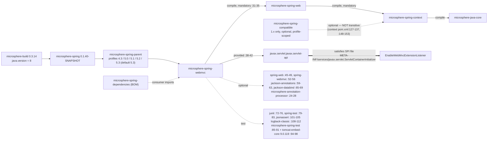
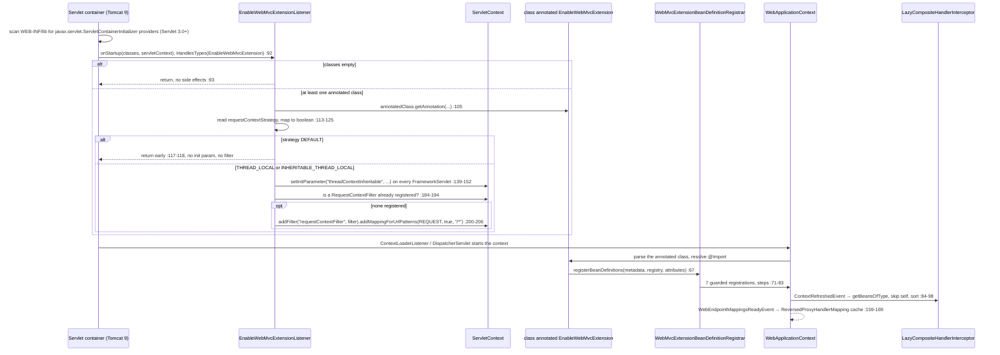
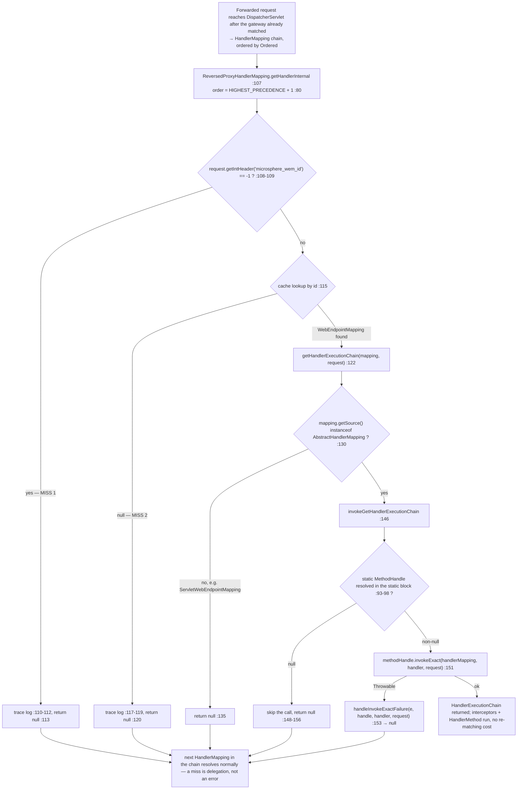

# microsphere-spring-webmvc — Developer Guide (0.1.x / `release-1.x`)

[← Developer guide overview](./README.md) · [简体中文](./zh/webmvc.md) · [User guide](../../user-guide/1.x/webmvc.md) · [0.2.x](../current/webmvc.md)

Every code line and POM coordinate below was read from the branch object store (`git show origin/release-1.x:<path>`),
never from this 0.2.x working tree. The module is the servlet-side adapter of the reactor: it turns the generic
`microsphere-spring-web` endpoint/interception model into Spring WebMVC plus `javax.servlet` artefacts, and it owns the
project's only container-level boot hook (`EnableWebMvcExtensionListener`).

## 1. Module identity, baselines and dependency posture

| Attribute | Value | Evidence (branch POM) |
|---|---|---|
| Maven coordinate / revision | `io.github.microsphere-projects:microsphere-spring-webmvc:${revision}`; line revision `0.1.40-SNAPSHOT`, last release `0.1.39` | `microsphere-spring-webmvc/pom.xml:13-16`, `pom.xml:55` |
| Parent | `microsphere-spring-parent:${revision}`, `relativePath ../microsphere-spring-parent/pom.xml`; build-parent chain root `microsphere-build:0.3.14`, which sets `java.version=8` | `microsphere-spring-webmvc/pom.xml:5-10`, `pom.xml:5-9`, [parent.md](./parent.md) |
| Spring baseline | profile-selected `4.3.30.RELEASE` / `5.0.20.RELEASE` / `5.1.20.RELEASE` / `5.2.25.RELEASE` / `5.3.39`, `spring-framework-5.3` `activeByDefault` | `microsphere-spring-parent/pom.xml:137-178` |
| Namespace and Servlet API | `javax.*` — every servlet import here is `javax.servlet.*`, from `javax.servlet:javax.servlet-api` in **`provided`** scope (container-owned, versionless in this POM, resolved through the `microsphere-java-dependencies` import, `microsphere-java` 0.3.19); there is **no** `jakarta.*` coordinate on the branch | `microsphere-spring-webmvc/pom.xml:39-40`, `:38-42`, `microsphere-spring-parent/pom.xml:22,115-122`, `EnableWebMvcExtensionListener.java:29-35` |
| In-reactor edges | `microsphere-spring-web` (compile, **not** optional) is the only mandatory one; `microsphere-spring-context` follows transitively because `web` declares it compile (`microsphere-spring-web/pom.xml:31-35`), with `microsphere-java-core` behind it | `microsphere-spring-webmvc/pom.xml:31-35` |
| Optional / test-scope deps | optional: `spring-web` `:45-49`, `spring-webmvc` `:52-56`, `jackson-annotations` `:59-63`, `jackson-databind` `:65-69`, `microsphere-annotation-processor` `:24-28`; test: `junit` (JUnit 4) `:72-76`, `spring-test` `:79-83`, `microsphere-spring-test` `:85-91`, `tomcat-embed-core` `:94-98` (Tomcat 9.0.119, `microsphere-spring-parent/pom.xml:27`), `jsonassert` `:101-105`, `logback-classic` `:108-112` | `microsphere-spring-webmvc/pom.xml` |
| Resources / size | `src/main/resources` **present**: `META-INF/services/javax.servlet.ServletContainerInitializer:1`, `META-INF/spring.factories:1-2`; 33 main classes over 13 packages, 34 test classes | `git ls-tree -r origin/release-1.x -- microsphere-spring-webmvc` |

⚠ **`microsphere-spring-compatible` is 1.x-only, but this module never sees it.** The shim module exists on the branch
(`pom.xml:61`) and is attached to `microsphere-spring-context` only under the two lowest Spring profiles and only as
`<optional>true</optional>` (`microsphere-spring-context/pom.xml:127-137`, `:148-153`). Optional dependencies are not
transitive, so no graph path leads from `webmvc` to `compatible` — the shims reach an application only if it declares
them itself; the BOM has no `compatible` entry either, so nothing downstream can pin it.

Dependency posture in one sentence: **everything Spring- or Jackson-shaped is `optional`, the servlet API is `provided`,
only `microsphere-spring-web` is mandatory** — the published POM therefore obliges the consumer to supply Spring WebMVC
and a container itself, and `spring-webmvc` is genuinely required at runtime because every public type here extends or
implements an `org.springframework.web.servlet.*` type.

No reactor module depends on `microsphere-spring-webmvc` — `webflux` depends on `web`, not on `webmvc`
(`microsphere-spring-webflux/pom.xml:33`) — so it is a leaf; its only external consumers are the BOM entry
(`microsphere-spring-dependencies/pom.xml:50-51`) and the reactor module list (`pom.xml:65`).

## 2. Package map of `io.microsphere.spring.webmvc.*` on 0.1.x

| Package | Types | Responsibility |
|---|---|---|
| `…webmvc.annotation` | `EnableWebMvcExtension` (`:84`), `WebMvcExtensionBeanDefinitionRegistrar` (package-private, `:62`), `WebMvcExtensionConfiguration` (`:37`) | activation annotation, the registrar that reads its attributes, the `WebMvcConfigurer` that installs composite interceptors |
| `…webmvc.handler` | `ReversedProxyHandlerMapping` (`:76`) | header-driven handler lookup for gateway/proxy forwarding |
| `…webmvc.interceptor` | `MethodHandlerInterceptor` (`:18`), `AnnotatedMethodHandlerInterceptor` (`:22`), `AbstractPageRenderContextHandlerInterceptor` (`:20`), `LazyCompositeHandlerInterceptor` (`:47`), `LoggingMethodHandlerInterceptor` (`:36`), `LoggingPageRenderContextHandlerInterceptor` (`:35`) | narrowing `Object handler` to `HandlerMethod`, page-render filtering, lazy fan-out composite |
| `…webmvc.config` | `WebMvcConfigurerAdapter` (`:48`, **1.x only**), `ConfigurableContentNegotiationManagerWebMvcConfigurer` (`:36`) | Java-8 default-method adapter, environment-driven content negotiation |
| `…webmvc.advice` | `RequestBodyAdviceAdapter` (`:17`), `ResponseBodyAdviceAdapter` (`:17`), `StoringRequestBodyArgumentAdvice` (`:24`), `StoringResponseBodyReturnValueAdvice` (`:25`) | no-op advice bases + the two body/return-value storing advice beans |
| `…webmvc.metadata` | `HandlerMappingWebEndpointMappingResolver` (`:50`), `HandlerMappingWebEndpointMappingFactory` (`:41`), `HandlerMetadataWebEndpointMappingFactory` (`:33`), `RequestMappingMetadataWebEndpointMappingFactory` (`:53`), `RequestMappingMetadata` (`:32`) | harvest `WebEndpointMapping`s out of `HandlerMapping`s |
| `…webmvc.method.support` | `InterceptingHandlerMethodProcessor` (`:76`), `HandlerMethodArgumentResolverAdvice` (`:33`), `LoggingHandlerMethodArgumentResolverAdvice` (`:35`) | argument/return-value interception around `HandlerMethod` |
| `…webmvc.context` / `…webmvc.constants` / `…webmvc.util` | `ExclusiveViewResolverApplicationListener` (`:34`) / `PropertyConstants` (`:27`) / `WebMvcUtils`, `ViewUtils`, `ViewResolverUtils`, `SpringWebMvcHelper` | force one `ViewResolver` to be exclusive / the `microsphere.spring.webmvc.` and `…view-resolver.` prefixes / static accessors plus the `SpringWebHelper` SPI implementation |
| `io.microsphere.spring.web.servlet.*` (note the package root) | `EnableWebMvcExtensionListener`, `ContentCachingFilter`, `WebUtils` | the container-facing half of the module — `SCI`, response caching, registration queries |

⚠ The package root splits: the container-facing types (`EnableWebMvcExtensionListener`, `ContentCachingFilter`, `WebUtils`)
live under `io.microsphere.spring.web.servlet.*`, everything MVC-specific under `io.microsphere.spring.webmvc.*` — a scan
of the latter alone misses the former three.

## 3. Architecture design

### 3.1 `@EnableWebMvcExtension` + registrar

`EnableWebMvcExtension.java:78-84` stacks `@Retention(RUNTIME)`, `@Target(TYPE)`, `@Documented`, `@EnableWebExtension`,
`@OverrideAnnotationAttributes` and `@Import(WebMvcExtensionBeanDefinitionRegistrar.class)`. Ten attributes exist
(`:98-212`): five `@AliasFor`-bridged onto `@EnableWebExtension` (`registerWebEndpointMappings :97-98`,
`interceptHandlerMethods :109-110`, `publishEvents :124-125`, `requestContextStrategy :138-139`, `sources :181-182`), five
MVC-local (`registerHandlerInterceptors :149`, `handlerInterceptors :161`, `storeRequestBodyArgument :194`,
`storeResponseBodyReturnValue :204`, `reversedProxyHandlerMapping :212`).

`WebMvcExtensionBeanDefinitionRegistrar` (`:62`) extends
`AnnotatedBeanCapableImportBeanDefinitionRegistrar<EnableWebMvcExtension>` from `microsphere-spring-context`, so attribute
resolution (including `${…}` placeholders via `ResolvablePlaceholderAnnotationAttributes`) is inherited. Its
`registerBeanDefinitions` (`:71-83`) is a fixed seven-step sequence — configuration → endpoint-mapping resolvers →
intercepting processor → handler interceptors → request-body advice → response-body advice → reversed-proxy mapping — and
each guarded step logs its decision at `trace` (`:96`, `:105`, `:152`, `:160`, `:168`), the only way to see why a bean is
absent.

### 3.2 Interceptor auto-registration

Two independent mechanisms, frequently confused:

1. **Bean registration** (registrar `:108-145`). `resolveHandlerInterceptorClasses` (`:116-125`) turns
   `registerHandlerInterceptors=true` into the sentinel `ALL_HANDLER_INTERCEPTOR_CLASSES = {HandlerInterceptor.class}`
   (`:64`), otherwise the explicit `handlerInterceptors()` array. If non-empty, `LazyCompositeHandlerInterceptor` is
   registered under the fixed name `lazyCompositeHandlerInterceptor` (`:127-132`, `LazyCompositeHandlerInterceptor.java:52`)
   with the class array as constructor argument, then each *explicit* interceptor class is registered as a bean too —
   `registerInterceptors` (`:134-141`) returns early for the sentinel, so `registerHandlerInterceptors=true` registers
   the composite only.
2. **MVC registration** (`WebMvcExtensionConfiguration.java:47-64`), which injects
   `ObjectProvider<LazyCompositeHandlerInterceptor[]>` (`:41-45`) — note the array type, it collects *all* beans of that
   type including user-declared ones — and adds every available composite to the `InterceptorRegistry`. The composite is
   lazy in the literal sense: it extends `OnceApplicationContextEventListener<ContextRefreshedEvent>` (`:47`) and resolves
   `getBeansOfType(interceptorClass)` only at context refresh (`:88`), skipping `this` and any
   `InterceptingHandlerMethodProcessor` (`:90`) before `AnnotationAwareOrderComparator.sort` (`:96`); its `preHandle`
   short-circuits on the first `false`, rethrows `Exception` as-is and wraps other `Throwable`s in `RuntimeException`
   (`:107-126`).

### 3.3 The Servlet 3.0+ boot path — the branch's only container hook

| Artefact | Content |
|---|---|
| `src/main/resources/META-INF/services/javax.servlet.ServletContainerInitializer` | one line (`:1`): `io.microsphere.spring.web.servlet.listener.EnableWebMvcExtensionListener` |
| `io.microsphere.spring.web.servlet.listener.EnableWebMvcExtensionListener` | `@HandlesTypes(EnableWebMvcExtension.class)` (`:57`), `implements ServletContainerInitializer` (`:58`) |
| `src/main/resources/META-INF/spring.factories` | `:1-2`: key `io.microsphere.spring.web.util.SpringWebHelper` → value `io.microsphere.spring.webmvc.util.SpringWebMvcHelper` (the `SpringWebHelper` SPI implementation, `SpringWebMvcHelper.java:54`) |

⚠ "Servlet 3.5" is not a published version: the SPI is `ServletContainerInitializer` (**Servlet 3.0**), this branch's test
`web.xml` declares `version="3.1"` (`src/test/resources/webapp/WEB-INF/web.xml:2-5`, `javax/web-app_3_1.xsd`) and the test
container is Tomcat 9.0.119 (Servlet 4.0). The coordinate is versionless, resolving via
`microsphere-java-dependencies:0.3.19`; `WebUtils.isRunningBelowServlet3Container` (`WebUtils.java:36-38`) guards the floor.

Listener flow: `onStartup` (`:92-96`) ignores an empty `Set`, `processAnnotatedClasses` (`:98-102`) reads each annotation
reflectively (`:104-107`), and `processRequestContextStrategy` (`:113-128`) maps the enum to a single
`boolean threadContextInheritable` (`DEFAULT` returns immediately at `:117-118`). Then two writes:
`processFrameworkServlet` (`:139-153`) sets the **init parameter** `threadContextInheritable` on every
`ServletRegistration` whose class is a `FrameworkServlet` (fast path: exact `DispatcherServlet` class name at `:156`), and
`processRequestContextFilter` (`:177-182`) registers a programmatic `RequestContextFilter` named `requestContextFilter`
(`uncapitalize` of the simple name, `:79`), mapped `/*` for `DispatcherType.REQUEST` only (`:84`, `:89`, `:205`), and only
when no `RequestContextFilter` is already registered (`:184-194`).

### 3.4 `WebMvcConfigurerAdapter` — a 1.x-only compatibility type

`config/WebMvcConfigurerAdapter.java:48` is an interface extending `WebMvcConfigurer` that supplies a Java 8 `default`
no-op for all 18 hook methods (`:55-194`; `getValidator`/`getMessageCodesResolver` return `null` at `:183`, `:192`). Its
Javadoc states the motive exactly — it "replaces `org.springframework.web.servlet.config.annotation.WebMvcConfigurerAdapter`
… using Java 8 default methods" (`:41-42`) — i.e. it restores single-inheritance ergonomics after Spring 5.0 deprecated
and later removed that class, without waiting for the host Spring line. Three main types implement it,
`WebMvcExtensionConfiguration` (`:37`), `InterceptingHandlerMethodProcessor` (`:77`) and
`ConfigurableContentNegotiationManagerWebMvcConfigurer` (`:36`); all three implement `WebMvcConfigurer` directly on 0.2.x.

### 3.5 `ReversedProxyHandlerMapping`

`handler/ReversedProxyHandlerMapping.java:76` extends `AbstractHandlerMapping` and listens for `WebEndpointMappingsReadyEvent` (`:159-169`).

- **Header key**: `WebEndpointMapping.ID_HEADER_NAME`, `"microsphere_wem_id"` (`microsphere-spring-web/.../WebEndpointMapping.java:134`), read with `request.getIntHeader` (`:108`).
- **Order constant**: `public static final int DEFAULT_ORDER = HIGHEST_PRECEDENCE + 1` (`:80`), applied in the no-arg
  constructor `setOrder(DEFAULT_ORDER)` (`:102-104`). Deliberately *not* `HIGHEST_PRECEDENCE`, leaving room for a user
  mapping to outrank it.
- **Reflective/MethodHandle seam**: the static block (`:93-98`) resolves
  `AbstractHandlerMapping.getHandlerExecutionChain(Object, HttpServletRequest)` — a `protected` method this module cannot
  call because it is not a subclass of the *other* mapping — into a `@Nullable MethodHandle` field (`:91`) via
  `io.microsphere.invoke.MethodHandleUtils.findVirtual`. `invokeGetHandlerExecutionChain` (`:146-157`) then `invokeExact`s
  it and routes any `Throwable` through `handleInvokeExactFailure` (`:153`), leaving the result `null`.
- **Miss branches (two, both `return null`)**: header absent → `getIntHeader` yields `-1` → `null` (`:109-114`); header
  present but id unknown in the cache → `null` (`:116-121`). `AbstractHandlerMapping#getHandler` falls through to the next
  mapping, so a miss is normal delegation, not an error.
- **Cache population**: `onApplicationEvent` rebuilds an immutable-size `newFixedHashMap` (`:163`) filtered by
  `isAbstractHandlerMapping` (`:171-174`) = `Kind.WEB_MVC` **and** `source instanceof AbstractHandlerMapping`; the
  non-`volatile` field is reassigned wholesale (`:100`, `:168`).
- ⚠ On 0.1.x `getHandlerExecutionChain` re-tests `source instanceof AbstractHandlerMapping` itself (`:129-131`) instead of
  reusing `isAbstractHandlerMapping`, and the endpoint set is WebMVC-only:
  `HandlerMappingWebEndpointMappingResolver` resolves just `AbstractUrlHandlerMapping` + `RequestMappingInfoHandlerMapping`
  (`:65-86`), never `RouterFunctionMapping`. Its own Javadoc says so: "For now … only supports to get the handlers from
  `RequestMappingHandlerMapping`" (`:63-65`).

A **second** MethodHandle seam in the same module is the real reason the 4.3→5.3 matrix compiles:
`RequestMappingMetadataWebEndpointMappingFactory.java:60,67` resolve `RequestMappingInfo.getPatternValues()` (added in
Spring 5.3) and `getPatterns` (`:107-125`) falls back to `PatternsRequestCondition.getPatterns()` when the handle is
`NOT_FOUND_METHOD_HANDLE` or the call fails; 0.2.x deletes both and calls `source.getPatternValues()` directly (`:88-90`).

### 3.6 Does the registrar honour `requestContextStrategy`? No — on either branch

- `WebMvcExtensionBeanDefinitionRegistrar.java:66-169` never mentions the attribute, and `git diff
  origin/release-1.x main` on that file is **empty**: both branches carry byte-identical registrars — same seven steps,
  same silence.
- The only MVC consumer on both branches is the container hook, `EnableWebMvcExtensionListener.java:114` on each line; the
  two listeners differ only in imports (`javax.servlet.*` → `jakarta.servlet.*`), bodies identical.
- The attribute *is* honoured by a registrar on both lines, but the **WebFlux** one:
  `microsphere-spring-webflux/.../WebFluxExtensionBeanDefinitionRegistrar.java:102-123` calls
  `annotationAttributes.getEnum("requestContextStrategy")` — so the asymmetry is MVC-vs-WebFlux, **not** 0.1.x-vs-0.2.x.

### 3.7 Web-app boot: `ServletContainerInitializer` → context initialisation

Ordering matters: `onStartup` runs *before* servlets and filters are initialised, which is the only reason the
`setInitParameter` write at `:147` still takes effect on an already-registered `DispatcherServlet`.

### 3.8 Reversed-proxy dispatch flow, including the miss branch

## 4. Design patterns evidenced

| Pattern | Class(es) | Evidence |
|---|---|---|
| Configuration activation ("Enable\*") + `ImportBeanDefinitionRegistrar`, with meta-annotation aliasing | `EnableWebMvcExtension`, `WebMvcExtensionBeanDefinitionRegistrar` | `EnableWebMvcExtension.java:83`; `@AliasFor(annotation = EnableWebExtension.class)` ×5 at `:97,:109,:124,:138,:181`; `@OverrideAnnotationAttributes` `:82`; registrar `:62,:71-83` |
| Chain of Responsibility + Composite + Lazy Initialisation | `ReversedProxyHandlerMapping` inside the `HandlerMapping` chain; `LazyCompositeHandlerInterceptor` over `HandlerInterceptor`s | `:80,:102-104`; `LazyCompositeHandlerInterceptor.java:47,:54-60,:84-98,:107-126` |
| Adapter via default methods + Null Object | `WebMvcConfigurerAdapter`, `RequestBodyAdviceAdapter`, `ResponseBodyAdviceAdapter`, `AbstractPageRenderContextHandlerInterceptor`; `ViewUtils`/`WebMvcUtils` return `null`/empty instead of throwing | `WebMvcConfigurerAdapter.java:48,:55-194`; `RequestBodyAdviceAdapter.java:17`; `AbstractPageRenderContextHandlerInterceptor.java:20`; `ViewUtils.java:50` |
| Template Method | `MethodHandlerInterceptor` (`preHandle`/`postHandle`/`afterCompletion` `final`), `AnnotatedMethodHandlerInterceptor`, `HandlerMappingWebEndpointMappingFactory` | `MethodHandlerInterceptor.java:21,34,46,:57`; `AnnotatedMethodHandlerInterceptor.java:36,51,65`; `HandlerMappingWebEndpointMappingFactory.java:57,88,97,107` |
| Observer / event-driven wiring + Decorator (handler-chain rewiring) | `ReversedProxyHandlerMapping`, `InterceptingHandlerMethodProcessor`, `ExclusiveViewResolverApplicationListener`, `LazyCompositeHandlerInterceptor`; `initRequestMappingHandlerAdapter` prepends `this` to the resolver and handler lists | `:159`; `InterceptingHandlerMethodProcessor.java:76,123-128,:214-244` esp. `:232-243`; `ExclusiveViewResolverApplicationListener.java:48-51` |
| Strategy | `RequestContextStrategy` consumed by the listener; `sources()` (`BeanSource`) selects bean origins | `EnableWebMvcExtensionListener.java:113-128`; `EnableWebMvcExtension.java:182` |
| Service Provider / plugin | `META-INF/services/javax.servlet.ServletContainerInitializer`, `META-INF/spring.factories` → `SpringWebMvcHelper` | both resource files, cited in §3.3 |
| Reflection / `MethodHandle` indirection + cache-aside with wholesale replacement | `ReversedProxyHandlerMapping` (`webEndpointMappingsCache`), `RequestMappingMetadataWebEndpointMappingFactory`, `ConfigurableContentNegotiationManagerWebMvcConfigurer`, `InterceptingHandlerMethodProcessor` (`parameterContextsCache`/`returnTypeContextsCache`) | `ReversedProxyHandlerMapping.java:93-98,:100,:163-168`; `RequestMappingMetadataWebEndpointMappingFactory.java:67,:107-125`; `ConfigurableContentNegotiationManagerWebMvcConfigurer.java:48-66`; `InterceptingHandlerMethodProcessor.java:81-83` |

## 5. Divergence 0.1.x (`release-1.x`) vs 0.2.x (`release`)

| Aspect | 0.1.x | 0.2.x | Evidence |
|---|---|---|---|
| Java baseline | 8 (`microsphere-build:0.3.14` → `java.version=8`) | 17 (`microsphere-build:0.3.17`) | `pom.xml:5-9` both lines |
| Servlet namespace and coordinate | `javax.servlet:javax.servlet-api`, `provided`, versionless | `jakarta.servlet:jakarta.servlet-api`, `provided`, resolves to 6.1.0 | `microsphere-spring-webmvc/pom.xml:38-42` vs `:39-40`; `.flattened-pom.xml:57-60` |
| Boot mechanism | `META-INF/services/**javax**.servlet.ServletContainerInitializer` | `META-INF/services/**jakarta**.servlet.ServletContainerInitializer` — file *renamed*, content byte-identical (`R100`) | `git diff --name-status origin/release-1.x main` |
| `threadContextInheritable` / `RequestContextFilter` handling | identical logic, only imports differ; the `SCI` is the *sole* consumer | identical | 1.x listener `:113-206` ≡ 0.2.x listener `:113-206` |
| `requestContextStrategy` and the MVC registrar | ignored by the registrar; honoured only by the container hook | **same** — the registrar file is byte-identical across branches | `WebMvcExtensionBeanDefinitionRegistrar.java` both branches (empty diff) |
| Visitor APIs | `WebEndpointMappingVisitor` exists in `microsphere-spring-web` (`…/web/metadata/WebEndpointMappingVisitor.java`), interface only, **never used by webmvc**; no function-model visitors here | `WebEndpointMappingVisitor` removed; webmvc gains `io.microsphere.spring.web.servlet.function.{RouterFunctionVisitorAdapter,RequestPredicateVisitorAdapter,ConsumingWebEndpointMappingAdapter}` over the Spring 6 visitor API | `git grep WebEndpointMappingVisitor` per branch |
| Function endpoints in WebMVC | not resolved: `HandlerMappingWebEndpointMappingResolver` handles `AbstractUrlHandlerMapping` + `RequestMappingInfoHandlerMapping` only (`:65-86`) | adds `resolveFromRouterFunctionMapping` (`:90-98`), so `ReversedProxyHandlerMapping` can also serve `RouterFunction` | diff of that file, +13 lines |
| Classes removed / absent on 0.2.x | `io.microsphere.spring.webmvc.config.WebMvcConfigurerAdapter` (195 lines, implemented by 3 classes); `AbstractPageRenderContextHandlerInterceptor extends HandlerInterceptorAdapter` (`:20`, a Spring-5-only superclass) | adapter deleted — `WebMvcExtensionConfiguration.java:36` implements `WebMvcConfigurer` — and the interceptor `implements HandlerInterceptor` (`:18`); `HandlerInterceptorAdapter` is gone from Spring 6 | `git diff --stat`: `WebMvcConfigurerAdapter.java \| 195 ------`; 0.2.x interceptor file `:18` |
| Method signature and casting style | `ViewUtils.getResponseStatus` returns `HttpStatus` (`ViewUtils.java:50`); explicit `if (x instanceof T) { T t = (T) x; }` everywhere (`MethodHandlerInterceptor.java:21-31`) | returns `HttpStatusCode` (Spring 6 widening); Java 16 pattern matching for `instanceof` | diff of `ViewUtils.java`; same interceptor file on `main` |
| `RequestMappingInfo` pattern access | `MethodHandle` + `PatternsRequestCondition` fallback (Spring 4.3/5.0 compatible) | direct `getPatternValues()` | `RequestMappingMetadataWebEndpointMappingFactory.java:107-125` vs `:88-90` |
| Test stack | JUnit 4 (`junit`), `SpringRunner`, 34 test classes; `dispatcherServlet-servlet.xml` present | JUnit 5 (`junit-jupiter`) + `hamcrest`, `web.xml` at Servlet 6.0 | `pom.xml:72-76` vs `:73-75`, `:107-111` (new); test-resource listing |
| `microsphere-spring-compatible` | module exists (`pom.xml:61`), optional + profile-scoped under `context` | module deleted from the reactor | `pom.xml:58-69` both branches |

## 6. Gotchas, dead and commented-out code

| # | Observation | Evidence |
|---|---|---|
| 1 | ⚠ Four public types are **never** registered by `@EnableWebMvcExtension` — `ContentCachingFilter`, `ConfigurableContentNegotiationManagerWebMvcConfigurer`, `ExclusiveViewResolverApplicationListener`, `ViewUtils`. `git grep` over all 1.x `src/main/java` finds no reference to them outside their own files; declaring them yourself (`@Bean`, `new`) is mandatory. | `WebMvcExtensionBeanDefinitionRegistrar.java:71-83` (7 steps, none of them these) |
| 2 | ⚠ The listener reads the annotation **reflectively**, not through Spring's merged annotations: `annotatedClass.getAnnotation(EnableWebMvcExtension.class).requestContextStrategy()` (`:105,:114`). `@AliasFor` (`:138`) is invisible to a raw JDK annotation proxy, so `requestContextStrategy` must be written literally on `@EnableWebMvcExtension` — setting it only on `@EnableWebExtension` is silently ignored; all three branch tests use the literal form (`EnableWebMvcExtensionListenerThreadLocalStrategyTest.java:33`). With `strategy = DEFAULT` the listener then does **nothing at all** (`:117-118`), so `requestContextFilter` is not registered by default either — `EnableWebMvcExtensionListenerTest.java:67-68,:82-83` asserts exactly that emptiness. | `EnableWebMvcExtensionListener.java:104-125` |
| 3 | ⚠ `setInitParameter` on a `ServletRegistration` only works because SCIs run before initialisation; if the application declared `threadContextInheritable` in `web.xml`, this write silently overwrites it. | `:147` vs `src/test/resources/webapp/WEB-INF/web.xml:11-15` |
| 4 | `initMethodParameterContextsCache`/`initReturnTypeContextsCache` register nothing when the delegate resolver/handler is not found (`:249-255`, `:260-267`), so `supportsParameter`/`supportsReturnType` (`:136-143`) are pure cache lookups — an unhandled parameter is skipped with no log line. | `InterceptingHandlerMethodProcessor.java:136-143,:246-268` |
| 5 | `addInterceptors` adds `this` to the registry (`:131-133`), and the processor is an `InterceptorRegistry` participant *and* an argument resolver *and* a return-value handler (`:77`) — one bean in four roles. A user interceptor returning `false` from `preHandle` therefore also short-circuits argument interception. | `:76-77,:131-133` |
| 6 | `webEndpointMappingsCache` has no `null` guard on the request path: a request carrying the header before `WebEndpointMappingsReadyEvent` fires throws `NullPointerException` at `:115`, not the intended trace-logged miss. | `:100,:115,:159-169` |
| 7 | `WebUtils.getServletContext(request)` uses `request.getSession()` — the `true` overload, which **creates** an `HttpSession` on a session-less request. | `WebUtils.java:47-49` |
| 8 | `ConfigurableContentNegotiationManagerWebMvcConfigurer` reaches into a private field of Spring's `ContentNegotiationConfigurer` by reflection (`doWithFields` + `setAccessible(true)`, `:49-61`) and binds arbitrary Environment sub-properties into `ContentNegotiationManagerFactoryBean` through `DataBinder` (`:79-94`). Only `contentNegotiationManager` and `servletContext` are disallowed (`:83`), so a bad `microsphere.spring.webmvc.content-negotiation.*` key fails at request time, not at startup. | `:41,:48-66,:79-94` |
| 9 | Dead-ish code: `getHandlerExecutionChainMethodName` (`:85`) is a mutable (non-`final`) `private static String` used exactly once, inside its own static block (`:94`). | `ReversedProxyHandlerMapping.java:85,:93-98` |
| 10 | Commented-out test code on the branch: `ReversedProxyHandlerMappingTest.java:156-161` disables `testInvokeGetHandlerExecutionChainOnFailed` — the `handleInvokeExactFailure` path at `ReversedProxyHandlerMapping.java:153` has **no** executing test on 0.1.x. | 1.x test file |
| 11 | Cosmetic inconsistencies: license headers are applied unevenly — 12 of the 33 main files start directly at the `package` line (all four `advice/*`, `config/ConfigurableContentNegotiationManagerWebMvcConfigurer.java:1`, `context/ExclusiveViewResolverApplicationListener.java:1`, `interceptor/{MethodHandlerInterceptor,AnnotatedMethodHandlerInterceptor,AbstractPageRenderContextHandlerInterceptor}.java:1`, `util/WebMvcUtils.java:1`, `web/servlet/{util/WebUtils,filter/ContentCachingFilter}.java:1`) while `EnableWebMvcExtension.java:1-16` and `config/WebMvcConfigurerAdapter.java:1-17` carry the full Apache header; and `@since 1.0.0` on every type conflicts with the analysed `0.1.40-SNAPSHOT`, so `@since` is useless for release mapping on this line. | `git show origin/release-1.x:<file>` first line; `EnableWebMvcExtension.java:76`, `pom.xml:55` |
| 12 | `ViewResolverUtils` Javadoc-references `org.thymeleaf.spring5.view.ThymeleafViewResolver` (`:62-66`) and `…view.velocity.VelocityViewResolver` (`:55-59`) although neither artifact is on this module's classpath — compile-time references would fail, so the constants are name-only contracts with the host application's view stack. | `ViewResolverUtils.java:52-80` |

## 7. Build and verification

| Task | Command / fact |
|---|---|
| Build/test this module from the branch, and the matrix it must survive | `mvn -pl microsphere-spring-webmvc -am test -P spring-framework-5.3` over profiles `4.3 / 5.0 / 5.1 / 5.2 / 5.3`, `5.3` activeByDefault (`microsphere-spring-parent/pom.xml:137-178`) — this is why two `MethodHandle` seams exist (§3.5) |
| Inspect without touching the tree | `git show origin/release-1.x:microsphere-spring-webmvc/pom.xml`, `git grep -n <symbol> origin/release-1.x -- microsphere-spring-webmvc` |
| Test harness | `@RunWith(SpringRunner.class)` + `@EmbeddedTomcatConfiguration` from `microsphere-spring-test` (`AbstractEnableWebMvcExtensionListenerTest.java:20,:51-53,:80-92`); Tomcat 9.0.119 |

**Related** — [Developer guide overview](./README.md) · [简体中文版](./zh/webmvc.md) · [User guide — WebMVC 1.x](../../user-guide/1.x/webmvc.md) · [0.2.x developer guide](../current/webmvc.md) · [web, its mandatory upstream](./web.md) · [context](./context.md) · [compatible](./compatible.md) · [parent POM profiles](./parent.md) · [dependency management](./dependencies.md) · [0.2.x webflux guide](../current/webflux.md)
