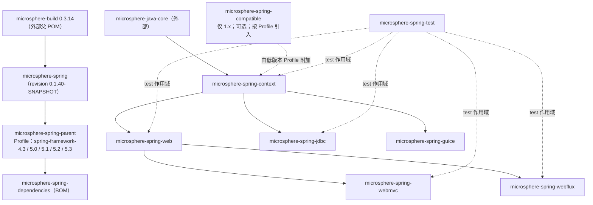

# 开发者文档 —— `release-1.x` 分支（0.1.x）

[← 开发者文档索引](../../zh/README.md) · [English](../README.md) · [用户文档 — 1.x](../../../user-guide/1.x/zh/README.md) ·
[开发者文档 — current](../../current/zh/README.md)

本目录文档面向 **0.1.x** 维护线，即 `release-1.x` 分支：Java 8、`javax.*` 命名空间、Spring Framework 4.3.x – 5.3.x。
它的源码只能通过只读 git 访问（`git show origin/release-1.x:<路径>`）；本仓库的工作区属于 0.2.x 一侧，
因此文中每段代码都是从分支对象库读取，而非来自检出的工作树。

## 版本信息

| 项目 | 值 |
|---|---|
| 分支 | `release-1.x` |
| 版本线 | 0.1.x —— 已发布 `0.1.39`，开发中 `0.1.40-SNAPSHOT` |
| Java 基线 | 8 |
| 命名空间 | `javax.*`（`javax.servlet:javax.servlet-api`，由容器提供） |
| 已验证的 Spring Framework | 4.3.30.RELEASE / 5.0.20.RELEASE / 5.1.20.RELEASE / 5.2.25.RELEASE / 5.3.39（**5.3 为默认 Profile**） |
| Reactor BOM | Bismuth-SR17（4.3 与 5.0）、Californium-SR23（5.1）、Dysprosium-SR25（5.2）、2020.0.47（5.3） |
| 构建父 POM | `io.github.microsphere-projects:microsphere-build:0.3.14` |
| 受管第三方版本 | `microsphere-java` 0.3.19、`microsphere-logging` 0.2.2、Jackson 2.22.2、SnakeYAML 2.6、P6Spy 3.9.1、Tomcat 9.0.119、ZooKeeper 3.9.5、Curator 5.9.0 |

引用这些数值前，请在**分支上**重新核对
[`microsphere-spring-parent/pom.xml`](../../../../microsphere-spring-parent/pom.xml)
（`git show origin/release-1.x:microsphere-spring-parent/pom.xml`）—— Dependabot 会持续在 `main` 上提升版本号，
因此 0.2.x 工作区与 0.1.x 分支的取值并不一致。

## 模块依赖关系图



多出来的那个节点正是 0.1.x 版本线存在的意义：`microsphere-spring-compatible` 提供 Spring 4.3 / 早期 5.x
尚未提供的 `org.springframework.*` 垫片，并以**可选、按 Profile 生效**的依赖挂在 `microsphere-spring-context` 上 ——
这就是它只存在于本分支、并在 0.2.x 上被整体删除的原因。

## 模块文档

| 模块 | English | 简体中文 | 内容 |
|---|---|---|---|
| parent | [parent.md](../parent.md) | [中文](./parent.md) | 五档 Spring Profile 矩阵、`${revision}` 扁平化 |
| dependencies | [dependencies.md](../dependencies.md) | [中文](./dependencies.md) | 面向 0.1.x 使用者的 BOM |
| context | [context.md](../context.md) | [中文](./context.md) | 属性源、宽松绑定、TTL 缓存、可监听 Environment |
| compatible | [compatible.md](../compatible.md) | [中文](./compatible.md) | `org.springframework.*` 垫片：为何存在、为何不发布 |
| web | [web.md](../web.md) | [中文](./web.md) | 端点元数据模型、`WebEndpointMappingVisitor`、拦截 SPI |
| webmvc | [webmvc.md](../webmvc.md) | [中文](./webmvc.md) | Servlet/MVC 适配、`ServletContainerInitializer` 启动路径、`ReversedProxyHandlerMapping` |
| webflux | [webflux.md](../webflux.md) | [中文](./webflux.md) | 响应式适配以及 `function.server` 访问者适配 |
| jdbc | [jdbc.md](../jdbc.md) | [中文](./jdbc.md) | `p6spy:` URL 间接层、DataSource 包装、监听器分发 |
| guice | [guice.md](../guice.md) | [中文](./guice.md) | Spring ↔ Guice 注入桥接 |
| test | [test.md](../test.md) | [中文](./test.md) | 内嵌 Tomcat 9 / ZooKeeper / SQLite 生命周期、抽象测试基类 |

## 将 0.1.x 页面与 0.2.x 页面对读

每篇模块文档都带有差异对照表，反复出现的差异如下：

| 方面 | 0.1.x（`release-1.x`） | 0.2.x（`release`） |
|---|---|---|
| Java / 命名空间 | Java 8，`javax.*` | Java 17，`jakarta.*` |
| Servlet 启动集成 | `META-INF/services/javax.servlet.ServletContainerInitializer` → `EnableWebMvcExtensionListener`，设置 `threadContextInheritable` 并注册 `RequestContextFilter` | 以 `jakarta.servlet` 重写，不再有 `javax` 服务文件 |
| 端点自省 | 存在 `WebEndpointMappingVisitor`（仅接口 —— 无库内实现、无调用点） | 已移除 |
| WebFlux 函数式支持 | `io.microsphere.spring.webflux.function.server` 在两条线上都存在（同样 4 个类）；`RequestPredicateVisitorAdapter` 是 `interface … extends InvocationHandler`，通过反射探测 `RequestPredicates$Visitor`，并回落到 `RequestPredicateKind.acceptVisitor` | 同样 4 个类；该 adapter 改为 `interface … extends RequestPredicates.Visitor`，所有回调直接 `@Override`，并为 Spring 7 新增 `version(String)` 分支 |
| `requestContextStrategy` | 由 WebFlux 注册器读取（`WebFluxExtensionBeanDefinitionRegistrar.java:102`）；Servlet 侧则是 `EnableWebMvcExtensionListener.java:114,:116` 读取，注册器两条线都不读 | 未变 —— 注册器与监听器的处理完全相同，因此这并不构成版本线差异 |
| CI 矩阵 | JDK `8, 11, 17, 21, 25` × 5 个 Spring profile（`.github/workflows/maven-build.yml:25-29`） | JDK `17, 21, 25` × 4 个 Spring profile（`main:.github/workflows/maven-build.yml:25-29`） |
| 兼容垫片 | `microsphere-spring-compatible`（15 个源文件：14 个 `org.springframework.*` 类型 + `package-info.java`；不由 BOM 管理，仅 `spring-framework-4.3` / `5.0` profile 声明） | 模块已删除 |
| 构建父 POM | `microsphere-build:0.3.14` | `microsphere-build:0.3.17`（`pom.xml:8`） |

## 构建与验证

```bash
mvn -P spring-framework-5.3 clean verify     # 本分支默认 Profile
mvn -P spring-framework-4.3 clean test       # 最旧的版本线；会引入 -compatible
mvn -pl microsphere-spring-webmvc -am test
```

在不影响工作区的前提下查看分支内容，请保持只读：

```bash
git ls-tree -r --name-only origin/release-1.x -- microsphere-spring-context/src/main/java
git show origin/release-1.x:microsphere-spring-context/pom.xml
```

当 0.2.x 工作区存在未提交改动时，切勿对该分支执行 `git checkout` / `git switch`。

## 本目录文档的约定

- 代码取自 `origin/release-1.x` 对象；文中仍使用仓库相对路径命名文件，但内容是它的 1.x 版本。
- `⚠` 标记已在源码中核实的偏差，例如某属性在本分支上被声明却没有任何注册器读取。
- 若某个行为只存在于 1.x（或只存在于 0.2.x），页面会明确归属分支，而不会把两者都当作现状描述。
