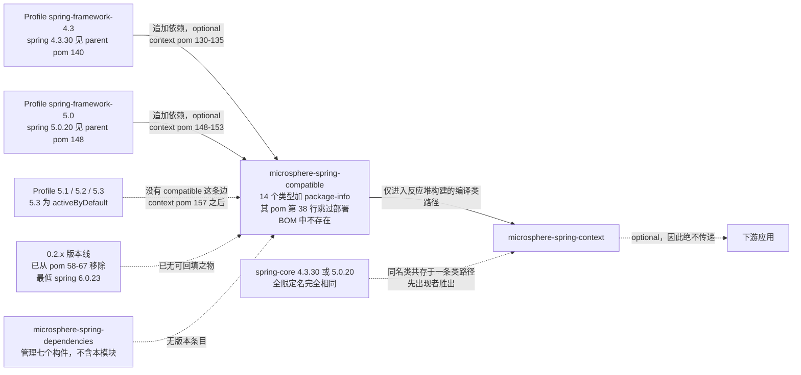
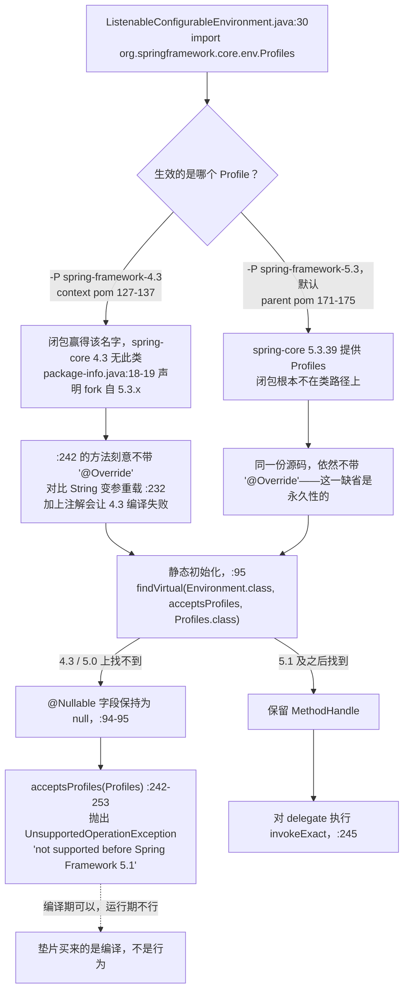

# microsphere-spring-compatible — 开发者指南（仅 1.x）

[← 开发者文档总览](./README.md) · [English](../compatible.md) · [用户文档](../../../user-guide/1.x/zh/compatible.md) · [0.2.x](../../current/zh/README.md)

> 下文所有以 `origin/release-1.x:` 开头的路径，都必须用 `git show` / `git grep` 在该分支上读取——该模块在 0.2.x 工作树中**没有对应目录**。未带分支前缀的引用，指当前工作树中确实存在的文件。

## 1. 模块标识、版本基线与发布姿态

| 属性 | 取值 | 证据 |
|---|---|---|
| Maven 坐标 | `io.github.microsphere-projects:microsphere-spring-compatible:${revision}` | `origin/release-1.x:microsphere-spring-compatible/pom.xml:13-16` |
| 打包方式 | `jar` | `…:pom.xml:16` |
| 是否声明在聚合反应堆中 | 是，模块列表第三个 | `origin/release-1.x:pom.xml:58-69`，条目在 `:61` |
| 反应堆版本 / 最后发布版 | `0.1.40-SNAPSHOT`（`revision`）；`0.1.39` 是最新的 `0.1.x` 发布标签 | `origin/release-1.x:pom.xml:55`，`git tag --list "0.1.3*"` |
| 继承的父 POM | `microsphere-spring-parent:${revision}` → 根父 POM `microsphere-build:0.3.14` | `…compatible/pom.xml:5-10`，`origin/release-1.x:pom.xml:5-9` |
| Java 基线 | Java **8** 是一等公民构建目标（`java: ['8','11','17','21','25']`） | `origin/release-1.x:.github/workflows/maven-build.yml:25` |
| Spring 版本矩阵 | `4.3.30.RELEASE` / `5.0.20.RELEASE` / `5.1.20.RELEASE` / `5.2.25.RELEASE` / `5.3.39`，其中 `5.3` 为 `activeByDefault` | `origin/release-1.x:microsphere-spring-parent/pom.xml:136-179` — 版本号见 `:140`、`:148`、`:156`、`:164`、`:175`；默认激活见 `:171-173` |
| 依赖 | **仅一个**：`com.google.code.findbugs:jsr305`，且 `<optional>true</optional>`；**完全没有** `org.springframework:*` | `…compatible/pom.xml:21-30`，具体为 `:24-28`；jsr305 的版本由导入的 `microsphere-java-dependencies` BOM 提供（`…parent/pom.xml:116-122`、`:22`） |
| **部署到 Maven Central 已被跳过** | `maven-deploy-plugin` 配置了 `<skip>true</skip>` | `…compatible/pom.xml:34-40`，该开关正是**第 `:38` 行** |
| 是否被 BOM 管理 | **否** — `microsphere-spring-dependencies` 列出七个构件（`:26-62`），其中不含本模块 | `origin/release-1.x:microsphere-spring-dependencies/pom.xml:26-62` |
| 内容 | 15 个源文件 = **14 个类型 + 1 个 `package-info.java`**，全部位于 `org.springframework.*` 之下；`src/test` **不存在** | `git ls-tree -r --name-only origin/release-1.x -- microsphere-spring-compatible` |
| 自我声明的出处 | “forked from the Spring Framework 5.3.x(latest) … to be compatible with the lower versions” | `…src/main/java/org/springframework/package-info.java:17-23`，该句在 `:18-19` |

上述三个与发布有关的事实彼此完全自洽，并且构成本模块的定义性特征：它**不是一个任何人都可以依赖的构件**。部署被跳过（`pom.xml:38`），BOM 不管理它（`dependencies/pom.xml:26-62`），而它唯一的入边还带着 `<optional>true</optional>`（见下节）。它存在的意义是满足*同一个本地反应堆*中某个兄弟模块的编译需求，仅此而已。另需注意 `package-info.java:22` 写着 `@since 1.0.0`；与仓库中其他位置一样，`@since` 取值是项目世代标签而非发布坐标（对照 `revision` = `0.1.40-SNAPSHOT`，`origin/release-1.x:pom.xml:55`）。

## 2. 模块如何被引入，以及 0.2.x 为何没有它

**只有一个**模块声明它——`microsphere-spring-context`，且恰好只出现在**两个** Profile 中，两者都是 optional（`origin/release-1.x:microsphere-spring-context/pom.xml:127-137` 对应 `spring-framework-4.3`，依赖声明在 `:130-135`，`<optional>` 在 `:134`；`:139-155` 对应 `spring-framework-5.0`，依赖在 `:148-153`，`<optional>` 在 `:152`）。`5.1`/`5.2`/`5.3` 三个 Profile（`:157-166` 及其后）只声明 `spring-context-indexer`，**没有** compatible 这条边。`git grep -n "microsphere-spring-compatible" origin/release-1.x -- '*.xml'` 总共返回四处命中：本模块自身的 `artifactId`、上述两条 Profile 边，以及聚合反应堆条目。

请把这张图的中部读作设计要害：垫片与真实 `spring-core` 是**同一条类路径上的竞争者**，从来不是分层叠加关系。`APP` 永远无法传递地获得该垫片，因为 `optional` 在两条入边上都压制了传递性（`context/pom.xml:134`、`:152`）。在 0.2.x 中该模块直接从反应堆消失（`pom.xml:58-67` 列出九个模块，无一名为 `compatible`），且最低 Spring Profile 是 `6.0.23`（`microsphere-spring-parent/pom.xml:140-142`），于是这种竞争根本不会再发生——见第 7 节。

## 3. 完整类清单

`原生 since` 取自被 fork 文件自身的 `@since` 标签；“4.3.30 jar 中存在？”一列是本地 Maven 仓库里缓存的 `spring-core-4.3.30.RELEASE.jar` 与 `spring-core-5.0.20.RELEASE.jar`（`unzip -l`）核对结果；5.1/5.2 的 jar 未缓存，故不作断言。右侧两个计数是**反应堆内该模块之外**提及该全限定名的 0.1.x 文件数（`git grep -l … -- '*/src/main/java/*'` 与 `'*/src/test/java/*'`）。

| 类（均在 `org.springframework.*`） | 种类 / 可见性 | 原生 `@since` | 4.3.30 jar 中存在？ | 0.1.x main / test | 为何出现在这里 |
|---|---|---|---|---|---|
| `core.env.Profiles` | `@FunctionalInterface`，public | `5.1` — `Profiles.java:30`、`:32-33` | **不存在** | 1 / 1 | 库真正需要其“类型”身份的唯一点位；`matches(Predicate<String>)` 见 `:42`，`of(String…)` 见 `:71-72` |
| `core.env.ProfilesParser` | `final class`，**包级私有** | `5.1` — `ProfilesParser.java:37`、`:39` | 不存在（同包） | 0 / 0 | 仅由 `Profiles.java:72` 调用；不可搬迁（见第 4 节） |
| `lang.Nullable` | 注解 | `5.0` — `Nullable.java:46`、`:53` | **不存在** | 0 / 0 | 由垫片*自身*闭包需要：模块内 11 个文件导入它，库文件一个都没有 |
| `lang.NonNull` | 注解 | `5.0` — `NonNull.java:45`、`:52` | **不存在** | 0 / 0 | 全分支零引用——为包完整性保留的冗余文件 |
| `util.Assert` | `abstract class` | 类 `1.1.2` — `:62`；**15 个成员** 为 `5.0`/`5.2` | 存在 | 9 / 0 | 补上 4.3 缺失的 `Supplier<String>` 重载：`:97`、`:142`、`:228`、`:324`、`:707` |
| `util.ClassUtils` | `abstract class` | 类 `1.1` — `:59`；成员 `5.0.3`→`5.3.19` | 存在 | 10 / 2 | 新成员如 `getInterfaceMethodIfPossible` `:1378`、`:1393`；`:149` 持有缓存 |
| `util.CollectionUtils` | `abstract class` | 类 `1.1.3` — `:44`；`newHashMap`/`newLinkedHashMap` 为 `5.3`（`:88`、`:106`）；`firstElement` `5.2.3`（`:374`）；`lastElement` `5.0.3`（`:417`） | 存在 | 5 / 0 | 其 `toMultiValueMap` 在 `:483` 实例化了被 fork 的适配器 |
| `util.ConcurrentReferenceHashMap` | `class`，软/弱引用 `ConcurrentMap` | `3.2` — `:61`、`:63` | 存在 | 0 / 0 | 仅内部使用：`ClassUtils.java:149`、`ReflectionUtils.java:82`、`:87` |
| `util.MultiValueMap` | 接口 | 类 `3.0` — `:30`；`addAll` `5.0`（`:56`、`:64`）；`addIfAbsent` `5.2`（`:74`） | 存在 | 8 / 5 | 被 fork 的接口带有两个 `addAll` 声明与一个 `addIfAbsent` 默认方法，4.3 的那份并未声明 |
| `util.MultiValueMapAdapter` | `class`，`Serializable` | **`5.3`** — `:37`，类声明 `:40` | **不存在** | 0 / 0 | 4.3 无此类；仅由 `CollectionUtils.java:483` 使用，库代码从不触碰 |
| `util.ObjectUtils` | `abstract class` | 类 `4.2`；`unwrapOptional` `5.0`（`:189`）；`nullSafeConciseToString` `5.3.27`（`:997`） | 存在 | 14 / 1 | 闭包中最新的成员（5.3.27 ⇒ 快照不低于该补丁版） |
| `util.ReflectionUtils` | `abstract class` | 类 `1.2.2`；成员 `5.0`、`5.2` ×2、`5.3.2` ×2 | 存在 | 6 / 4 | 两处 `ConcurrentReferenceHashMap` 缓存见 `:82`、`:87` |
| `util.StreamUtils` | `abstract class` | 类 `3.2.2`；一个成员 `5.2.6` | 存在 | 0 / 2 | 仅测试侧引用 |
| `util.StringUtils` | `abstract class` | 类标签是日期“`16 April 2001`”`:60`；成员 `5.0`(`:819`)、`5.0.4`(`:866`)、`5.2.9`(`:378`)、`5.3.22`(`:264`)、`5.3.27`(`:1457`、`:1476`) | 存在 | 26 / 3 | `ProfilesParser.java:187` 调用 `collectionToDelimitedString`；导入量最大 |
| `package-info.java` | 包文档 | `@since 1.0.0` `:22` | — | — | 出处声明见 `:18-19` |

由这张表可直接得出两点结论。其一，**0** 个库文件导入 `org.springframework.lang.Nullable`，因为 0.1.x 代码统一使用自己的 `io.microsphere.annotation.Nullable`（74 个文件，`git grep -h "^import.*Nullable" origin/release-1.x -- '*/src/main/java/*'`）；那 11 个导入者全在垫片内部，这正是该垫片只为让被 fork 的类自洽存在的原因。其二，`MultiValueMapAdapter` 回填自 **Spring 5.3**（该类自身的 `@since` 标签，`MultiValueMapAdapter.java:37`），而非笼统的“5.x”。本模块共 15 个源文件：14 个类型加 1 个 `package-info.java`。

### 3.1 相对 Spring 4.3 的成员级增量

类的存在性只说了一半：对 4.3 已有的九个类，垫片提供了 4.3 没有的成员。下行为各被 fork 文件中 `@since 5.*` 标签的计数与代表性声明。

| 类 | 晚于 4.3 的 `@since` 标签 | 代表性成员 |
|---|---|---|
| `util.Assert` | 13 × `5.0`，2 × `5.2` | `Supplier<String>` 消息重载：`state :97`、`isTrue :142`、`notNull :228`、`hasText :324`、`isAssignable :707`；另有 `noNullElements(Collection,String) :544` |
| `util.CollectionUtils` | 2 × `5.0.3`，2 × `5.2.3`，2 × `5.3` | `lastElement :420`/`:445`、`firstElement :377`/`:401`、`newHashMap :90`、`newLinkedHashMap :108` |
| `util.StringUtils` | `5.0`、`5.0.4`、`5.2.9`、`5.3.22`、2 × `5.3.27` | `uriDecode :821`、`parseLocale :869`、`matchesCharacter :380`、`trimAllWhitespace :264`、`truncate :1457`/`:1476` |
| `util.ClassUtils` | `5.0.3`、`5.0.5`、`5.0.6`、`5.1`、`5.2.3`、`5.3.16`、`5.3.19` | `isJavaLanguageInterface :876`、`isInnerClass :888`、`isLambdaClass :902`、`hasMethod :1178`、`getInterfaceMethodIfPossible :1378`/`:1393` |
| `util.ObjectUtils` | `5.0`、`5.3.27` | `unwrapOptional :189`、`nullSafeConciseToString :997` |
| `util.ReflectionUtils` | `5.0`、2 × `5.2`、2 × `5.3.2` | 4.3 集合之外的方法/字段查找变体 |
| `util.StreamUtils` | `5.2.6` | 仅一个成员；其余（`copyToString`、`copyToByteArray`）4.3 已有 |
| `util.MultiValueMap` | 2 × `5.0`，1 × `5.2` | `addAll(K,List) :58`、`addAll(MultiValueMap) :66`、`addIfAbsent :74`（默认方法） |
| `core.env.Profiles`、`core.env.ProfilesParser`、`lang.Nullable`、`lang.NonNull`、`util.MultiValueMapAdapter` | 整个类型 | 4.3 中根本不存在——见上表“4.3.30 jar 中存在？”列 |

实务解读：`Assert` 是闭包中表面变化最大的一个（15 个新成员，全部基于 `Supplier`），但库的调用点一个都不用——它之所以在此，是因为 `ProfilesParser` 需要它。反之 `StringUtils` 被 26 个文件导入，其中真正依赖闭包的只有寥寥数个成员。

## 4. 为什么这些类位于 `org.springframework.*` 包下

**这个包名不是风格问题，而是承重结构。** 三条互相独立的理由，均可验证：

1. **源码零改动的可移植性。** 库代码写的就是普通的 Spring 导入——例如 `import org.springframework.core.env.Profiles;`，位于 `origin/release-1.x:microsphere-spring-context/src/main/java/io/microsphere/spring/core/env/ListenableConfigurableEnvironment.java:30`。*同一行*在 `-P spring-framework-4.3` 下（类型由闭包提供）与 `-P spring-framework-5.3` 下（类型由 Spring 提供）都能编译。若搬迁为 `io.microsphere.compat.Profiles`，则每个使用点都要按版本分叉源码或改用反射——而这正是该模块要消灭的成本。
2. **包级私有访问。** `ProfilesParser` 声明为包级私有（`ProfilesParser.java:39`），并由 `Profiles.of` 调用（`Profiles.java:72`），而 `of` 自身也是**包级私有静态方法**而非 `public`。把其中任一个类型搬出 `org.springframework.core.env`，调用立刻编译不过。因此闭包*必须*落在真实包里。
3. **闭包内部依赖。** 被 fork 的代码是按 Spring 5.3 的写法编写的，因而需要 5.3 时代的自身成员：`ProfilesParser.java:54` 调用 `Assert.hasText(expression, () -> …)`、`:120` 调用 `Assert.isTrue(wellFormed, () -> …)`——而 Spring 4.3 并没有这些 `Supplier` 重载（`Assert.java:324`、`:142`）。这正是 `Assert`、`StringUtils`、`lang.Nullable` 也必须一并 fork 的原因：**`Profiles` 拖出一条传递闭包，而闭包不能退化到 4.3 语义。** 已验证：库自身那 9 个导入 `Assert` 的文件从未使用 `Supplier` 重载（对 1.x main 源码执行 `git grep -nE "Assert\.[a-zA-Z]+\([^;]*, *\(\) *->"` → 无命中），而 `newLinkedHashMap` 的 27 处命中解析为 `io.microsphere.collection.MapUtils`，与 Spring 无关。

**闭包自身的依赖图。** 从库代码跨越进入闭包的边只有两条（`Profiles`，以及 4.3 本可满足的普通 `util.*` 导入），其余全是闭包内部边。下表即第 3 条理由的证据。

| 从 | 到 | 行号 |
|---|---|---|
| `microsphere-spring-context` | `core.env.Profiles` | `ListenableConfigurableEnvironment.java:30`，用于 `:95`、`:242` |
| `core.env.Profiles` | `core.env.ProfilesParser` | `Profiles.java:72` |
| `core.env.ProfilesParser` | `util.Assert`（Supplier 形式）、`util.StringUtils`、`lang.Nullable` | `ProfilesParser.java:20`、`:21`、`:19`；调用见 `:45`、`:54`、`:120`、`:187` |
| `util.*`（10 个文件） | `lang.Nullable` | 11 处导入，全部在模块内部 |
| `util.CollectionUtils` | `util.MultiValueMapAdapter` | `CollectionUtils.java:483`（其在 `:498` 的自用法） |
| `util.ClassUtils`、`util.ReflectionUtils` | `util.ConcurrentReferenceHashMap` | `ClassUtils.java:149`、`ReflectionUtils.java:82`、`:87` |

于是 `lang.NonNull`、`util.StreamUtils` 与 `util.MultiValueMapAdapter` 对外的价值均为零：`lang.NonNull` 无人引用（fork 之外 `git grep -w NonNull` 只命中无关的测试方法名），`StreamUtils` 不出现在任何 main 源码，适配器也只被 `CollectionUtils.toMultiValueMap` 触及。它们被打包进来，是因为这份 fork 取的是 Spring 5.3 的 `core`/`util` 快照，而非逐个文件按需裁剪。

**为此付出的代价。** (a) *重复类*：在 4.3/5.0 下，闭包与 `spring-core` 都定义了 `org.springframework.util.Assert`、`StringUtils`、`CollectionUtils`、`ObjectUtils`、`ClassUtils`、`ReflectionUtils`、`StreamUtils`、`MultiValueMap`、`ConcurrentReferenceHashMap`（九个均已确认存在于 4.3.30 jar）；类加载器先定义哪一个取决于类路径顺序，而非规范。(b) *split package*：闭包的 **全部 14 个**类型都位于 `spring-core` 拥有的包中；由于没有 `src/main/resources`，也就**没有 `module-info.java`**、没有 JPMS 封装约束要去对抗——这恰恰是它能在 classpath 上存活的原因。(c) *升级隐患*：若消费者手工固定这份闭包，则在 4.3 下胜出顺序的那份会在 5.3 下继续胜出，悄然替换 Spring 的实现——包括 `ClassUtils.java:149` 与 `ReflectionUtils.java:82`、`:87` 的缓存，届时它们会**存在两份**且内容互不相通。(d) *类型同一性*：`MethodHandle` 查找比较的是 `Class` 对象，因此 `findVirtual(Environment.class, "acceptsProfiles", Profiles.class)`（`ListenableConfigurableEnvironment.java:95`）只有当 `Profiles` 正是 Spring 自己的 `Environment` 所指的那个类时才成立。

**收敛手段。** 影响半径被三重事实叠加限制：该边是 `<optional>`（`context/pom.xml:134`、`:152`）；该边只存在于五个 Profile 中的两个；构件既不能被发布（`pom.xml:38`）也不能被版本管理（`dependencies/pom.xml:26-62`）。因此 5.1+ 的消费者永远看不到这些类——它们只对 `microsphere-spring-context` 在两个最旧 Profile 下的编译可见，这也是 CI 要跑满五个 Profile 的原因（`maven-build.yml:26-29`）。

## 5. 一个代表性垫片的解析路径：`Profiles`

最后那条边是必须记住的一句：**闭包让 4.3 编译通过，随后代码礼貌地拒绝运行该路径。** 闭包也解释了为什么 `:242` 没有 `@Override` 而其兄弟 `:232` 有——在 4.3 下没有可覆盖的接口方法，`@Override` 恰好会在“该模块为之存在”的两个 Profile 下变成编译错误。`matchesProfiles(String…)`（`:218`）同理，对应 `:101` 的 5.3.8 句柄。

## 6. 设计说明与已被证实的模式

| 模式 | 所在位置 | 证据 |
|---|---|---|
| **Backport / Fork-and-own**（逐字复制，保留上游 Javadoc、`@author` 与 Apache 头） | 全部 14 个类型 | 版权头 `Copyright 2002-2023 the original author or authors`（`Profiles.java:1-15`）、上游作者保留（`:28-29`）、Spring 自身的 `@since` 标签照搬（`ObjectUtils.java:997` = `5.3.27`） |
| **为访问权而占据同包**（Package-private access） | `Profiles` ↔ `ProfilesParser` | `ProfilesParser.java:39` 包级私有；`Profiles.java:71-72` 包级私有静态工厂调用它 |
| **Factory Method 封装不透明解析器** | `Profiles.of(String…)` | `Profiles.java:71-73`——一个*包级私有*的入口，藏起 190 行解析器（`ProfilesParser.java`），其内部结构为 `Operator` 枚举 `:143`、`Context` 枚举 `:145` 与实现类 `ParsedProfiles` `:147`；`Profiles.java:32` 的 `@FunctionalInterface` 加上唯一抽象方法 `matches(Predicate<String>)`（`:42`）使其可用 lambda 实现 |
| **Adapter**（经典 GoF，Spring 的命名本身就说明了） | `MultiValueMapAdapter` | 把 `Map<K,List<V>>` 适配为 `MultiValueMap` 契约——字段 `:42`、构造器 `:49-52`、读取目标 map 的 `getFirst` `:58-61` |
| **能力探测 + 优雅降级**（对较新 API 的 Facade） | `microsphere-spring-context` 的 `ListenableConfigurableEnvironment`，而非闭包本身 | `@Nullable static final MethodHandle` 字段 `:89`、`:95`、`:101`；先 `if (HANDLE != null)` 再 `invokeExact`，否则 `UnsupportedOperationException`——`:242-253` |
| **基于引用的受限缓存**（Reference cache） | `ConcurrentReferenceHashMap` | 设计上即为软/弱引用（`:49-55`），被 `ReflectionUtils.java:82`、`:87` 与 `ClassUtils.java:149` 的反射缓存使用 |
| *不存在*：无激活注解、无 registrar、无 `src/main/resources`、**无测试** | 模块整体 | `git ls-tree` 只显示 `pom.xml` + `src/main/java`；它不注册任何东西，是一份被动代码 |

## 7. 0.2.x 为何移除它

来自当前工作树的三条互相独立的确认：

1. **模块已不在反应堆中。** `pom.xml:58-67` 列出 `parent, dependencies, context, jdbc, web, webmvc, webflux, guice, test`——九项，无 `compatible`；`grep -rn compatible pom.xml microsphere-spring-parent/pom.xml microsphere-spring-dependencies/pom.xml` 无任何输出。
2. **基线已越过全部垫片。** 最旧的 Spring Profile 现在是 `6.0` 的 `6.0.23`（`microsphere-spring-parent/pom.xml:140-142`，其后 `6.1.21` 见 `:148-150`、`6.2.18` 见 `:156-158`、`7.0.9` 见 `:164-169`），Java 为 17（`pom.xml:56`）。闭包提供的每一个类型——`Profiles`（5.1）、`lang.Nullable`/`NonNull`（4.3/5.0）、`MultiValueMapAdapter`（5.3）、`Assert` 的 `Supplier` 重载（5.0）——在 Spring 6 中皆为原生，于是第 4 节第 3 条的闭包论证再无用武之地。
3. **消费点缩成一行。** 0.2.x 保留同一行导入（`microsphere-spring-context/src/main/java/io/microsphere/spring/core/env/ListenableConfigurableEnvironment.java:28`），但 `acceptsProfiles(Profiles)` 现在是纯粹委托（`:192-194`）；`ACCEPTS_PROFILES_METHOD_HANDLE` 字段与那句 `UnsupportedOperationException("…not supported before Spring Framework 5.1")` 均已删除。导入行一字未改——变的只是*由谁提供该类型*，而这正是闭包设计目标的自然终结。

供模式考古的一点补充：探测这一写法并未消失，消失的只是闭包。0.2.x 仍保留一个句柄 `SET_ESCAPE_CHARACTER_METHOD_HANDLE`（`:61`）以及 `throw new UnsupportedOperationException("…not supported before Spring Framework 6.2")`（`:320`）。区别在于：当前的缺口是*更新*版本里缺一个**方法**，而非五个旧版本里缺一个**类型**——方法级缺口仅靠反射即可跨越，无需在类路径上安放竞争类。

## 8. 注意事项与测试限制

| # | 观察 | 证据 |
|---|---|---|
| 1 | ⚠ 你无法依赖它。部署被跳过且 BOM 不含它，因此对 `microsphere-spring-compatible` 的 `<dependency>` 不可能从 Central 解析——它只在本仓库的反应堆构建内生效。 | `…compatible/pom.xml:34-40`（`:38`）、`…dependencies/pom.xml:26-62` |
| 2 | ⚠ 与真实 `spring-core` 的重复类冲突。14 个类型中有九个在 4.3.30 中同名存在；谁先出现在类路径上谁定义该名字，落败者的成员直接不可达。若闭包遮蔽了 Spring 5.x，会出现 `NoSuchMethodError`。 | `spring-core-4.3.30.RELEASE` jar 清单 vs `…compatible/src/main/java/org/springframework/util/*` |
| 3 | ⚠ 永远不要给 `acceptsProfiles(Profiles)` 加 `@Override`。它的缺失是 4.3/5.0 Profile 能够编译的前提。 | `ListenableConfigurableEnvironment.java:242`（1.x），对照 `:232` |
| 4 | 在 4.3/5.0 下只构建 `-pl microsphere-spring-context` 会失败：闭包必须在同一反应堆内。请加 `-am`，或显式列出三模块（`parent`、`compatible`、`context`）。 | `origin/release-1.x:pom.xml:58-69`，`context/pom.xml:130-135` |
| 5 | Maven 的 `activeByDefault`（`5.3`）一旦有任何 Profile 被点名即失效，所以 `-P spring-framework-4.3` 恰好只给出一个 `spring-framework.version`——前提是你没有同时激活另一个。 | `…parent/pom.xml:171-173`、`:138-142` |
| 6 | 闭包**不带测试**，也无 `src/main/resources`；其正确性是在两个最旧 Profile 下由 `microsphere-spring-context` 的测试套件间接断言的，并叠加 JDK 矩阵跑五遍。 | `git ls-tree -r --name-only origin/release-1.x -- microsphere-spring-compatible`；`maven-build.yml:25-29`、`:49` |
| 7 | 两处“有意不等价”的行为：`acceptsProfiles(Profiles)` 在 4.3/5.0 抛异常（`:253`）；`Profiles.of(...)` 的等价性（`equals`/`hashCode`，自 5.1.17，文档见 `Profiles.java:63-66`）依赖 `ParsedProfiles` 也被一并 fork（类声明在 `ProfilesParser.java:147`，实例化在 `:50`）。 | 如所引 |
| 8 | 本地未缓存 5.1.20 / 5.2.25 的 `spring-core` jar，因此这两个 Profile 下的逐类存在性在此未经验证——实际也无所谓，因为两者都不声明闭包。 | `context/pom.xml:157-166`；`~/.m2/repository/org/springframework/spring-core/` |
| 9 | jsr305 是 `optional`（`…compatible/pom.xml:24-28`），而 `lang.NonNull`/`lang.Nullable` 恰恰建立在 `javax.annotation.Nonnull`、`TypeQualifierNickname`、`When` 之上（`NonNull.java:19-20`、`:50-51`；`Nullable.java:51`）；注解保留级别为 `RUNTIME`（`NonNull.java:48`），因此在没有 jsr305 的类路径上做反射读取，行为与编译期可用时不同。 | 如所引 |
| 10 | ⚠ `package-info.java:18` 宣称 fork 自“5.3.x(latest)”，但其中含有标记 `5.3.27`（`ObjectUtils.java:997`、`StringUtils.java:1457`、`:1476`）与 `5.3.19`（`ClassUtils.java:1393`）的成员，说明快照不低于 5.3.27，注释只是近似——不要当成版本锁定。 | 如所引 |
| 11 | `lang.NonNull` 全分支零引用（fork 之外 `git grep -w NonNull` 只命中测试方法名）；它是包内装饰，不是谁需要的垫片。 | `NonNull.java:52`；第 3 节的 grep 证据 |
| 12 | 不要把 `@since` 当作发布版本：`package-info.java:22` 写 `1.0.0`，而被分析的版本线是 `0.1.40-SNAPSHOT`。 | `origin/release-1.x:pom.xml:55` |

**相关文档** — [开发者文档总览](./README.md) · [英文版](../compatible.md) · [用户文档 — Compatible（1.x）](../../../user-guide/1.x/zh/compatible.md) · [1.x context 模块](./context.md) · [0.2.x 开发者文档](../../current/zh/README.md) · [父 POM 与 Profile](./parent.md) · [依赖管理](./dependencies.md)
