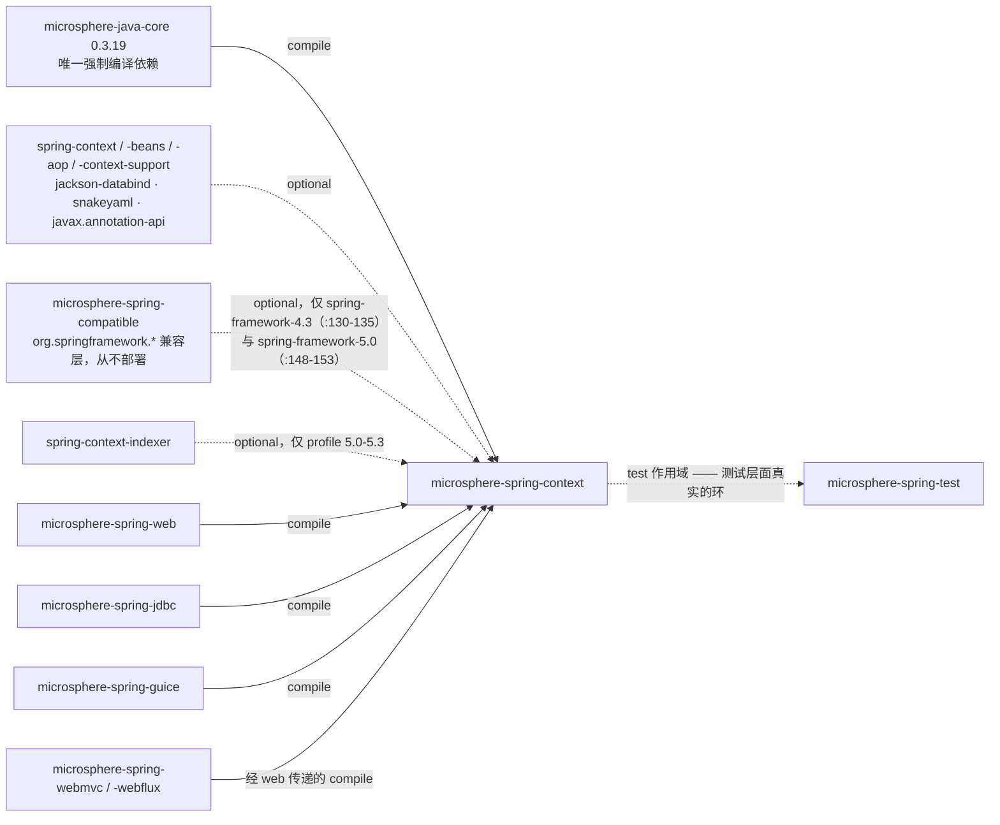
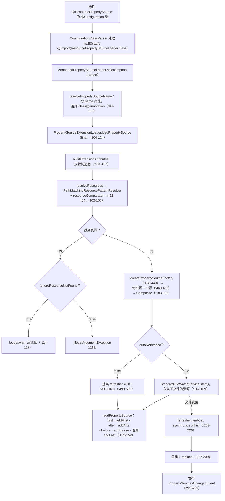
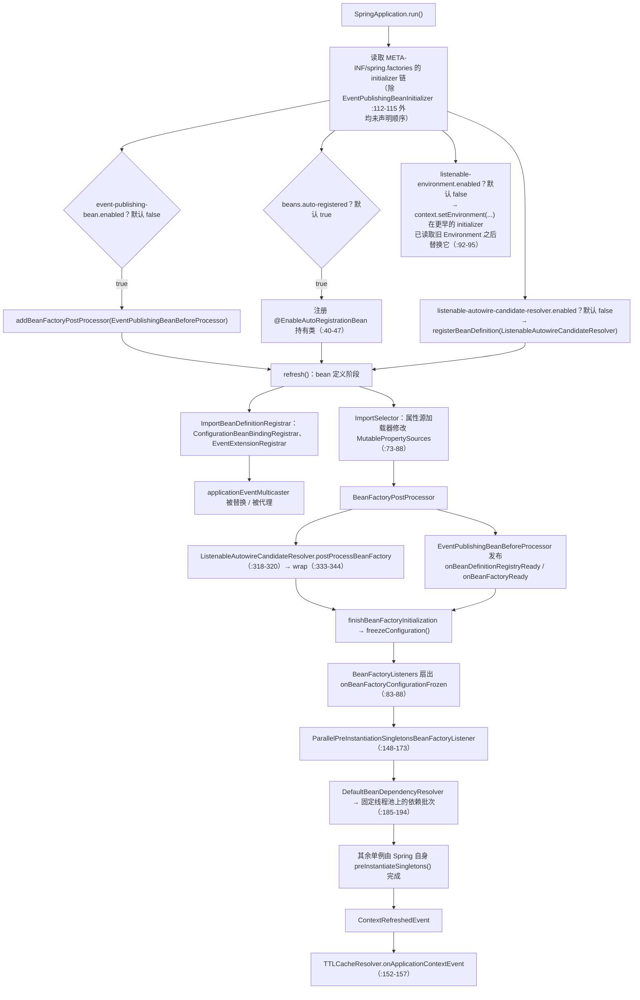

# microsphere-spring-context — 开发者文档（0.1.x）

[← 开发者文档总览](./README.md) · [English](../context.md) · [用户文档](../../../user-guide/1.x/zh/context.md) · [0.2.x](../../current/zh/context.md)

本页描述 **0.1.x** 线，它只存在于 `origin/release-1.x` 分支。下面每一个行号都读自该分支的对象库（`git show origin/release-1.x:<path>`、`git grep -n <symbol> origin/release-1.x -- microsphere-spring-context`）；本仓库的工作区是 0.2.x 线，因此在检出目录中打开这些文件会看到不同的内容。

## 1. 模块身份、版本基线与依赖姿态

| 属性 | 取值 | 证据 |
|---|---|---|
| Maven 坐标 | `io.github.microsphere-projects:microsphere-spring-context:${revision}` | `origin/release-1.x:microsphere-spring-context/pom.xml:13-16` |
| 反应堆版本 | `revision` = `0.1.40-SNAPSHOT`；该线最后发布版 `0.1.39` | `origin/release-1.x:pom.xml:54-56`，标签 `0.1.39` |
| 构建父 POM | `microsphere-build:0.3.14`（外部父 POM，已安装） | `origin/release-1.x:pom.xml:5-9` |
| Java 基线 | `8` —— `java.version=8`，`maven.compiler.source/target=${java.version}` | `microsphere-build-0.3.14.pom:58,89,94` |
| Spring 基线 | 由 profile 选择 `4.3.30.RELEASE` / `5.0.20.RELEASE` / `5.1.20.RELEASE` / `5.2.25.RELEASE` / `5.3.39`；`spring-framework-5.3` 为 `activeByDefault` | `origin/release-1.x:microsphere-spring-parent/pom.xml:136-179`、`:169-178` |
| 各 profile 的 Reactor BOM | `Bismuth-SR17`（4.3、5.0）、`Californium-SR23`（5.1）、`Dysprosium-SR25`（5.2）、`2020.0.47`（5.3） | 同文件 `:141,:149,:157,:165,:176` |
| 受管的 microsphere 依赖 | `microsphere-java` `0.3.19`、`microsphere-logging` `0.2.2`、Jackson `2.22.2`、SnakeYAML `2.6` | 同文件 `:22-25` |
| 注解命名空间 | `javax.annotation:javax.annotation-api`，**optional** | `...:microsphere-spring-context/pom.xml:61-66`；主源码中唯一的 `javax.*` 导入是 `ResourceInjectionPointDependencyResolver.java:21` |
| 反应堆模块 | 10 个，含 **0.1.x 独有**的 `microsphere-spring-compatible` | `origin/release-1.x:pom.xml:58-69`、`:61` |
| 主/测试条目 | 165 个主类 + 1 个 `spring.factories`；150 个测试条目（含 `META-INF/services` 下的 SPI 夹具、`META-INF/spring.factories`，以及 `META-INF/test/` 下的 YAML/JSON 夹具） | `git ls-tree -r --name-only origin/release-1.x -- microsphere-spring-context` |
| 自动装配条目 | `META-INF/spring.factories` 共 2 个键、4 个类 | §4.5 逐字引用 |

**依赖姿态。** 唯一的强制编译依赖是 `microsphere-java-core`（`origin/release-1.x:microsphere-spring-context/pom.xml:31-34`）；源码编译所依赖的其余一切都被声明为 `optional`，因而不具传递性：`spring-context`（`:37-41`）、`spring-context-support`（`:43-47`）、`spring-beans`（`:49-53`）、`spring-aop`（`:55-59`）、`javax.annotation-api`（`:61-66`）、`jackson-annotations`/`jackson-databind`（`:68-79`）与 `snakeyaml`（`:81-86`）。这是刻意为之——本模块是*一组对 Spring 的扩展库*，绝不能钉死消费者的 Spring 版本——但后果是：只声明 `microsphere-spring-context` 所得到的类路径上，几乎每个公开类型首次使用时都会抛 `NoClassDefFoundError`。Jackson/SnakeYAML 的 optional 属性正是 `@JsonPropertySource` 与 `@YamlPropertySource` 属于"按需启用"而非"必然可用"特性的原因（§4.2）。与 0.2.x 不同，`spring-context-indexer` 在这里也不是普通依赖：它只出现在 `5.0`/`5.1`/`5.2`/`5.3` profile 中（`:143-146`、`:160-164`、`:171-175`、`:182-186`），而在 `4.3` 里缺席——该 artifact 在 4.3 上并不存在。默认 profile 下构建并测试本模块：`mvn -pl microsphere-spring-context -am test`；演练兼容层垫片则用 `--activate-profiles spring-framework-4.3`（只有两个 profile 会引入 `microsphere-spring-compatible`）。

## 2. 依赖图



入边证据：`origin/release-1.x:microsphere-spring-web/pom.xml:33-35`、`microsphere-spring-jdbc/pom.xml:33-35`、`microsphere-spring-guice/pom.xml:37-39` 都以 compile 作用域、`<version>${revision}</version>` 声明本模块；`webmvc` 与 `webflux` 经 `microsphere-spring-web` 传递获得（`microsphere-spring-webmvc/pom.xml:33`、`microsphere-spring-webflux/pom.xml:33`）。⚠ `microsphere-spring-test` **完全没有**依赖本模块；真实的边方向是反的——它是*本模块的* `test` 作用域依赖（`microsphere-spring-context/pom.xml:109-115`），两个模块构成一个测试作用域的环。

**`microsphere-spring-compatible`** 这条边是本页最具 0.1.x 特征的事实。它只被声明两次，两次都是 `<optional>true</optional>`，且只在最低的两个 profile 中：`spring-framework-4.3`（`microsphere-spring-context/pom.xml:127-137`，依赖块 `:130-135`）与 `spring-framework-5.0`（`:139-155`，依赖块 `:148-153`）；profile `5.1`、`5.2`、`5.3`（`:157-188`）**不**声明它。它提供 Spring 4.3 / 早期 5.0 所缺的 `org.springframework.*` 类型——共 15 个类，如 `core/env/Profiles`、`core/env/ProfilesParser`、`lang/NonNull`、`lang/Nullable` 以及十个 `util/*` 类。该模块通过 `maven-deploy-plugin <skip>true</skip>` 被排除在部署之外（`microsphere-spring-compatible/pom.xml:34-41`），所以它**不在** Maven Central 上：`-P spring-framework-4.3` 只有从反应堆内构建才可解析。兼容层清单见 [compatible.md](./compatible.md)。

## 3. 包结构地图

| 包（根 `io.microsphere.spring`） | 代表类型 | 职责 |
|---|---|---|
| `config.context.annotation` | `PropertySourceExtension`、`PropertySourceExtensionAttributes`、`PropertySourceExtensionLoader`、`AnnotatedPropertySourceLoader`、`ResourcePropertySource(Loader)`、`ResourcePropertySources(Loader)`、`DefaultPropertiesPropertySource(Loader)` | 属性源子系统（§4.2） |
| `config.env.annotation`、`config.env.support`、`config.env.config` | `YamlPropertySource`、`JsonPropertySource`、`YamlPropertySourceFactory`、`JsonPropertySourceFactory`、`DefaultResourceComparator`、`ResourceYamlProcessor` | 叠加在 `@ResourcePropertySource` 之上的格式元注解、其 `PropertySourceFactory` 实现、SnakeYAML 桥接 |
| `config.env`、`config.env.event`、`config` | `EnvironmentEnabled`、`ImmutableMapPropertySource`、`PropertySourceChangedEvent`、`PropertySourcesChangedEvent`、`ConfigurationPropertyRepository` | 基于 Environment 的启用开关、不可变属性源、自动刷新事件、`@ConfigurationProperty` 元数据的运行期目录 |
| `cache`、`cache.annotation` | `TTLContext`、`EnableTTLCaching`、`TTLCacheable`、`TTLCachePut`、`TTLCachingConfiguration` | 线程本地 TTL 载体与 TTL 缓存激活（§4.3） |
| `cache.intereptor` ⚠、`cache.redis` | `TTLCacheResolver`；`TTLRedisCacheWriterWrapper`、`TTLRedisConfiguration` | 解析器——**该分支上包名拼写错误**；redis 层**整体被注释掉**（§8） |
| `beans`、`beans.factory` | `BeanUtils`、`BeanSource`、`PropertyValuesUtils`、`BeanFactoryUtils`、`BeanDependencyResolver`、`DefaultBeanDependencyResolver`、`DependencyTreeWalker`、`InjectionPointDependencyResolver(s)`、`DelegatingFactoryBean`、`ObjectProviderUtils` | bean 查找/命名与依赖图自省 |
| `beans.factory.annotation` | `AnnotatedInjectionBeanPostProcessor`、`ConfigurationBeanBinding{Registrar,PostProcessor}`、`EnableConfigurationBeanBinding(s)`、`AnnotationBeanDefinitionRegistryPostProcessor` | 注入引擎 + 宽松绑定注册（§4.4） |
| `beans.factory.support`、`.config`、`.filter` | `ListenableAutowireCandidateResolver(Initializer)`、四个 `ConfigurationBeanAliasGenerator` 类型、`BeanRegistrar`、`GenericBeanNameGenerator`、`BeanDefinitionUtils`、`InstantiationAwareBeanPostProcessorAdapter`、`ResolvableDependencyTypeFilter` | 候选解析、别名、注册原语与 bean 定义工具 |
| `context`、`context.annotation` | `ApplicationContextUtils`、`ConfigurableApplicationContextInitializer`、`BeanCapableImportCandidate`、`AnnotatedBeanCapableImportCandidate`/`Selector`/`BeanDefinitionRegistrar`、`ImportOptional(Selector)`、`OverrideAnnotationAttributes(Strategy)`、`AutoRegistrationBean*` | 注解 → 注册器/加载器模型（§4.1） |
| `context.config` | `AutoRegistrationBean`、`ConfigurationBeanBinder`、`DefaultConfigurationBeanBinder`、`ConfigurationBeanCustomizer` | 绑定与自注册 bean |
| `context.event`、`context.lifecycle` | `BeanFactoryListener(s)`、`BeanListener(s)`、`EventPublishingBean*`、`ParallelPreInstantiationSingletonsBeanFactoryListener`、`DependencyAnalysisBeanFactoryListener`、`EnableEventExtension`、`EventExtensionRegistrar`、`InterceptingApplicationEvent*`、`DeferredApplicationEventPublisher`、`BeanTimeStatistics`、`AbstractSmartLifecycle` | 生命周期事件、并行启动、事件拦截（§4.6、§4.7） |
| `core.env` | `ListenableConfigurableEnvironment(Initializer)`、`EnvironmentUtils`、`PropertySourcesUtils`、`PropertyResolverUtils`、`EnvironmentListener`/`ProfileListener`/`PropertyResolverListener`/`LoggingEnvironmentListener` | 可监听的 `Environment`（§4.5） |
| `core`、`core.annotation`、`core.convert`、`core.io` | `AnnotationUtils`、`GenericAnnotationAttributes`、`ResolvablePlaceholderAnnotationAttributes`、`ConversionServiceUtils`、`SpringConverterAdapter`、`ResourceLoaderUtils`、`ResourceUtils`、`SpringFactoriesLoaderUtils`、`MethodParameterUtils`、`SpringVersion` | 其余一切所依赖的基础原语 |
| `net`、`constants`、`util` | `SpringProtocolURLStreamHandler`、`Spring*URLConnectionFactory`/`Adapter`、`PropertyConstants`、`MimeTypeUtils`、`FilterMode`、`SpringVersionUtils` | `spring:` URL 协议（§4.8）、属性名常量、工具类 |

## 4. 架构设计

### 4.1 注解 → 候选者模型

本模块每个 `@Enable*` / `@*PropertySource` / `@ImportOptional` 入口都归结为三个 Spring 扩展点之一，而三者共享同一个抽象基类：

```
BeanCapableImportCandidate                  （aware：BeanClassLoader、BeanFactory、Environment、ResourceLoader）— :140-141
   ├── AnnotatedBeanCapableImportCandidate<A>   绑定泛型注解类型 A，增加 isEnabled()                 （:97-117）
   │      ├── AnnotatedBeanCapableImportSelector<A>            实现 ImportSelector                 （:69-77）
   │      │      └── AnnotatedPropertySourceLoader<A>          属性源加载器                          （:67-88）
   │      └── AnnotatedBeanCapableImportBeanDefinitionRegistrar<A>  实现 ImportBeanDefinitionRegistrar（:63-114）
```

`selectImports(AnnotationMetadata)` 是 `final`（`context/annotation/AnnotatedBeanCapableImportSelector.java:73-77`），委托给受保护的三参重载；`registerBeanDefinitions` 同样是 `final`，先由 `isEnabled(metadata)` 把关，再把 `ResolvablePlaceholderAnnotationAttributes<A>` 交给子类（`AnnotatedBeanCapableImportBeanDefinitionRegistrar.java:70-81,114`）。开关是属性驱动的（`AnnotatedBeanCapableImportCandidate.java:180-187`），这就是本库中无属性的 `@Enable*` 注解依然可关的原因：按导入类 `microsphere.spring.<导入类>@<注解 FQCN>.enabled`（`:204-207`），或按注解全局 `microsphere.spring.<注解 FQCN>.enabled`（`:222-224`）。注解**属性**（不只是开关）也能从 Environment 覆盖，机制是 `@OverrideAnnotationAttributes` + `ConfigurationPropertyOverrideAnnotationAttributesStrategy`（`context/annotation/OverrideAnnotationAttributes.java:75-`、`...Strategy.java:108,129,189,212,245`），其前缀为 `microsphere.spring.prefix.<注解 FQCN>`、默认前缀 `microsphere.spring.@<SimpleName>.`（`:268,289`；常量见 `constants/PropertyConstants.java:41`）；属性中的占位符之所以可解析，是因为每个属性映射都被 `ResolvablePlaceholderAnnotationAttributes` 包装。

### 4.2 属性源子系统

`@PropertySourceExtension`（`config/context/annotation/PropertySourceExtension.java:144-245`）是 `@Target(ANNOTATION_TYPE)` 的元注解，含十个属性：`name`、`autoRefreshed`、`first`、`before`、`after`、`value`、`resourceComparator`、`ignoreResourceNotFound`、`encoding`、`factory`。它从不直接使用，而是元标注在 `@ResourcePropertySource`（`ResourcePropertySource.java:127-134`）上，后者携带 `@Import(ResourcePropertySourceLoader.class)`（`:133`）。`@YamlPropertySource` 与 `@JsonPropertySource` 是第三层注解，只钉死工厂——`@ResourcePropertySource(factory = YamlPropertySourceFactory.class)`（`config/env/annotation/YamlPropertySource.java:111`）与 `@ResourcePropertySource(factory = JsonPropertySourceFactory.class)`（`.../JsonPropertySource.java:116`）——两者都不自带 `@Import`；导入经由 `@ResourcePropertySource` 元注解到达，这正是 Spring `ConfigurationClassParser` 遵循的路径。

加载发生在 `selectImports` 中而非注册器里：`AnnotatedPropertySourceLoader.selectImports`（`:73-88`）先解析属性源名（`:98-104`，回退到 `<导入类>@<注解 FQCN>`，`:129-133`），取 `getEnvironment().getPropertySources()`，再调用抽象的 `loadPropertySource`（`:145-146`），任何 `Throwable` 都被包成 `BeanCreationException`（`:82-86`）。`PropertySourceExtensionLoader` 将该钩子实现为 `final` 模板方法（`:104-124`）：通过 `(Map, Class, PropertyResolver)` 构造器反射构造 `PropertySourceExtensionAttributes`（`:164-167`），加载一个 `CompositePropertySource`（`:169-201`）；结果为 `null` 时，按 `ignoreResourceNotFound` 决定告警（`:114-117`）还是抛 `IllegalArgumentException`（`:119`）。

插入顺序由 `addPropertySource`（`:133-152`）以严格优先级决定：`first` → `addFirst`；否则 `after` → `addAfter`；否则 `before` → `addBefore`；否则 `addLast`。`PropertySourceExtension#first()` 的文档声称设置了 `first` 时 `before`/`after` 被忽略——代码确实如此，该分支从不读取这两个属性。同一注解的多个 `value` 位置逐个解析（`:392-423`），包装为可比较的 `PropertySourceResource`（`:525-551`），并用用户提供的 `resourceComparator` 排序（`:452-454`；默认 `DefaultResourceComparator` 按文件名比较，`config/env/support/DefaultResourceComparator.java:45-48`），每个叶子源命名为 `<属性源名>#<resourceValue>@<resource.toString()>`（`:460-463`）。

自动刷新：当 `autoRefreshed() == true`，加载器构造一个以 `synchronized (this)` 保护的 `ResourcePropertySourcesRefresher` lambda（`:203-226`），交给可覆写的 `configureResourcePropertySourcesRefresher`，其基实现就是一行 `// DO NOTHING`（`:499-503`）。只有 `ResourcePropertySourceLoader` 真正做事：它启动 `StandardFileWatchService`（来自 `microsphere-java-core`），且只注册*基于文件*的资源（`ResourcePropertySourceLoader.java:147-169`，由 `:160` 的 `isFileBasedResource` 过滤），因此 JAR 内的 classpath 资源会被静默跳过监视。刷新会重建并 `propertySources.replace(name, newComposite)`（`:297-308`），产出 `PropertySourceChangedEvent`（`added`/`replaced`/`removed`，`:279-339`）并归并为一个 `PropertySourcesChangedEvent` 发布到容器（`:228-232`）。`@DefaultPropertiesPropertySource`（`DefaultPropertiesPropertySourceLoader.java:46,78,87-91`）是另一类：它*合并*进 Spring 的 `defaultProperties` 源（`PropertySourcesUtils.DEFAULT_PROPERTIES_PROPERTY_SOURCE_NAME`，`core/env/PropertySourcesUtils.java:53`）而不是新增一个，因此永远位于链底。

YAML 与 JSON 产出的 `PropertySource` 类型不同：`YamlPropertySourceFactory` 经 `ResourceYamlProcessor` 返回**不可变的** `ImmutableMapPropertySource`（`config/env/support/YamlPropertySourceFactory.java:54-56`、`config/env/config/ResourceYamlProcessor.java:74,89-92`），而 `JsonPropertySourceFactory` 返回基于 `LinkedHashMap` 的普通 `MapPropertySource`（`.../JsonPropertySourceFactory.java:72-76`）。`ResourceYamlProcessor.createYaml`（`:96-104`）为 SnakeYAML 2.x 配置 `LoaderOptions`，`setAllowDuplicateKeys(false)`、`setMaxAliasesForCollections(Integer.MAX_VALUE)`——后者是锚点展开 DoS 防护，本库主动将其关闭。

### 4.3 TTL 缓存子系统

`TTLContext`（`cache/TTLContext.java:53-164`）是一个朴素的 `ThreadLocal<Duration>` 持有器（`:55`），提供 `setTTL`/`getTTL`/`clearTTL` 与两个 `doWithTTL` 重载，其中 `Function` 版本在 `finally` 中清理线程本地（`:98-105`）；有效 TTL 为 `defaultIfNull(getTTL(), defaultTTL)`（`:107-110`），即显式设置的 TTL 总是优先于注解值。`@EnableTTLCaching`（`cache/annotation/EnableTTLCaching.java:68-73`）= `@EnableCaching` + `@Import(TTLCachingConfiguration.class)`，并有三个 `@AliasFor` 别名属性（`proxyTargetClass`、`mode`、`order`，`:86,99,107`）；`TTLCachingConfiguration` 是一个**没有 `@Configuration` 的 package-private 类**（`:30`），其唯一 `@Bean(name = "ttlCacheResolver")` 方法以 "lite" 模式注册解析器（`:32-35`）。`@TTLCacheable`/`@TTLCachePut` 把 `cacheResolver = TTLCacheResolver.BEAN_NAME` 硬编进 `@Cacheable`/`@CachePut` 元注解（`TTLCacheable.java:64`、`TTLCachePut.java:66`）。

`TTLCacheResolver`（`cache/intereptor/TTLCacheResolver.java:58`）同时是 `CacheResolver` 与 `OnceApplicationContextEventListener<ContextRefreshedEvent>`，且只在事件回调里取得 `Environment` 与 `Map<String, CacheManager>`（`:152-157`）。`resolveCaches`（`:72-117`）用一张两项的静态表（`:62-65`）把 `CacheOperation` 类映射到 TTL 注解类型，读取 `expire` + `timeUnit`，把得到的 `Duration` 写入 `TTLContext`（`:119-122`），随后把 `cacheNames × cacheManagers` 的笛卡尔积展开为 `Cache` 实例；`cacheManagers` 属性**确实被读取**（`:97-106`），为空表示"容器中全部 `CacheManager` bean"。⚠ 该分支上没有任何代码*消费*这个 TTL：写入点在 `TTLCacheResolver.java:121`，而唯一读者 `TTLRedisCacheWriterWrapper.doWithTTL` 位于一个整体被注释掉的文件中（§8），并且 `pom.xml` 根本没有 `spring-data-redis` 依赖——所以在 0.1.x 上，除非应用自己装配支持 TTL 的 `CacheWriter`，`@TTLCacheable` 的行为等同于普通 `@Cacheable`。

### 4.4 宽松绑定与别名生成器

`@EnableConfigurationBeanBinding`（`beans/factory/annotation/EnableConfigurationBeanBinding.java:70-138`）携带 `prefix`（必填）、`type`（必填）、`multiple`、`ignoreUnknownFields`、`ignoreInvalidFields`，并标注 `@Repeatable(EnableConfigurationBeanBindings.class)` + `@Import(ConfigurationBeanBindingRegistrar.class)`。注册器（`ConfigurationBeanBindingRegistrar.java:94`）用 `PropertySourcesUtils.getSubProperties(environment.getPropertySources(), environment, prefix)`（`:124`）取子属性映射，而该算法*就是*本分支"宽松绑定"的全部内涵（`core/env/PropertySourcesUtils.java:246-273`）：把前缀规范化为以 `.` 结尾（`:217-219`），**按 Environment 顺序**遍历 `PropertySources`，对每个以前缀开头的名字剥掉前缀并 `if (!subProperties.containsKey(subName))`——一条显式的"取先出现者"规则（`:259`）——随后对 `String` 值解析 `${...}` 占位符（`:261-265`）。该方法里**没有**任何 camelCase ↔ kebab-case ↔ 大写下划线的等价表：`my.camelCase` 与 `my.camel-case` 是两个不同键，所以这里的"宽松"仅指"相对前缀、首个来源优先、可解析占位符"，比 Spring Boot 的 `CanonicalPropertyName` 弱得多。注册器随后为每个名字注册一个 bean 定义（单个，或 `multiple` 时再做一次 `getSubProperties(normalizePrefix(beanName))`，`:168-179`），把元数据存为 bean 定义*属性*（`ConfigurationBeanBindingPostProcessor.java:233-237`），并把 `PriorityOrdered` 的后置处理器注册为基础设施 bean（`:185-187`，`BEAN_NAME` 见 `ConfigurationBeanBindingPostProcessor.java:90`）。

别名生成是一个 SPI：对**每个**注册出的 bean 名，注册器调用 `loadFactories(beanFactory, ConfigurationBeanAliasGenerator.class)`（`:140`），随后无条件执行 `registry.registerAlias(beanName, alias)`——对别名没有 `null` 校验（`ConfigurationBeanBindingRegistrar.java:133,139-146`）。实现有：`DefaultConfigurationBeanAliasGenerator` 返回 `getSimpleName(configClass) + capitalize(beanName)`（无分隔符拼接，`beans/factory/support/DefaultConfigurationBeanAliasGenerator.java:21-23`）；`JoinAliasGenerator` 把 `prefix` 按 `.` 切分、将首段之后的每段首字母大写后拼接，再接 `delimiter() + beanName`（`:23-30`，`delimiter()` 为抽象方法 `:32`），具体变体为 `HyphenAliasGenerator`（`-`，`:25-28`）与 `UnderScoreJoinAliasGenerator`（`_`，`:18-21`）。由于发现机制是 `SpringFactoriesLoaderUtils.loadFactories`，而本模块自身的 `META-INF/spring.factories`（§4.5）**没有** `ConfigurationBeanAliasGenerator` 键，默认情形下工厂列表为空、根本不会注册任何别名：消费者要通过贡献一条 `spring.factories` 记录来启用，而不是配置注解——并且返回 `null` 的生成器不会被跳过，它会导致容器启动失败。

### 4.5 可监听的 `Environment` / `AutowireCandidateResolver` 及其属性闸门

`src/main/resources/META-INF/spring.factories`——逐字引用，完整内容：

```properties
# InjectionPointDependencyResolver
io.microsphere.spring.beans.factory.InjectionPointDependencyResolver=\
io.microsphere.spring.beans.factory.ConstructionInjectionPointDependencyResolver,\
io.microsphere.spring.beans.factory.annotation.AutowiredInjectionPointDependencyResolver,\
io.microsphere.spring.beans.factory.annotation.ResourceInjectionPointDependencyResolver

# ApplicationContextInitializer
org.springframework.context.ApplicationContextInitializer=\
io.microsphere.spring.context.annotation.AutoRegistrationBeanInitializer,\
io.microsphere.spring.context.event.EventPublishingBeanInitializer,\
io.microsphere.spring.beans.factory.support.ListenableAutowireCandidateResolverInitializer,\
io.microsphere.spring.core.env.ListenableConfigurableEnvironmentInitializer
```

⚠ 该文件**没有** `EnableAutoConfiguration`、没有 `AutoConfiguration.imports` 等价物、也没有 `EnvironmentPostProcessor` 键：这四个 initializer 只有在存在 Boot 应用时才会被 Spring Boot 的 initializer 链挑中，在裸的 `ClassPathXmlApplicationContext` / `AnnotationConfigApplicationContext` 中什么都不会自动执行。四者都继承 `ConfigurableApplicationContextInitializer`（`context/ConfigurableApplicationContextInitializer.java:62`），其 `initialize` 是 `final`（`:70-82`），做三件事——查属性闸门、检查 `isRegistered(context)`（`:146-148`）、执行子类钩子并 `registerSelf(context)`（`:155-158`），从而把 initializer 自身以生成的 bean 名变成 bean 工厂里的单例。闸门来自 `EnvironmentEnabled`（`config/env/EnvironmentEnabled.java:38-130`）：`environment.getProperty(getEnabledPropertyName(), boolean.class, getDefaultEnabled())`（`:67-69`）。

| Initializer | 属性闸门 | 默认值 | 作用 |
|---|---|---|---|
| `AutoRegistrationBeanInitializer` | `microsphere.spring.beans.auto-registered`（`EnableAutoRegistrationBean.java:62`，常量名拼错为 `..._PROEPRTY_NAME`） | `true`（`PropertyConstants.java:64,69`） | 注册一个 package-private 的 `@EnableAutoRegistrationBean` 持有类（`AutoRegistrationBeanInitializer.java:40-47`） |
| `EventPublishingBeanInitializer` | `microsphere.spring.event-publishing-bean.enabled`（`context/event/EventPublishingBeanInitializer.java:84,96`） | **`false`**（`:86,101`） | `context.addBeanFactoryPostProcessor(new EventPublishingBeanBeforeProcessor())`；order 为 `HIGHEST_PRECEDENCE`（`:112-115`） |
| `ListenableAutowireCandidateResolverInitializer` | `microsphere.spring.listenable-autowire-candidate-resolver.enabled`（`beans/factory/support/ListenableAutowireCandidateResolverInitializer.java:77,89`） | **`false`**（`:79,94`） | `registerBeanDefinition(beanFactory, ListenableAutowireCandidateResolver.class)`（`:96-100`） |
| `ListenableConfigurableEnvironmentInitializer` | `microsphere.spring.listenable-environment.enabled`（`core/env/ListenableConfigurableEnvironmentInitializer.java:73,85`） | **`false`**（`:75,90`） | `context.setEnvironment(new ListenableConfigurableEnvironment(context))`（`:92-95`） |

因此四个 initializer 中有三个**默认即为死代码**：开箱只有 `AutoRegistrationBeanInitializer` 会运行，因为基类默认值是 `true`（`ConfigurableApplicationContextInitializer.java:121-123`），而 `EventPublishingBeanInitializer`、`ListenableAutowireCandidateResolverInitializer` 与 `ListenableConfigurableEnvironmentInitializer` 三者都把 `getDefaultEnabled()` 覆盖为 `false`。

`ListenableConfigurableEnvironment`（`core/env/ListenableConfigurableEnvironment.java:59`）以委托方式实现整个 `ConfigurableEnvironment` 接口，持有三个监听器列表（`:105-109`，来自 Spring SPI 加 bean），并且——因为同一个构件要同时服务 Spring 4.3 到 5.3——它在类初始化时一次性解析 `MethodHandle` 以获得版本相关方法：`PropertyResolver.getPropertyAsClass`（`:89`）、`Environment.acceptsProfiles(Profiles)`（`:95`，Spring 5.1 使变参形式过期的签名）与 `Environment.matchesProfiles`（`:101`，Spring 5.2.7+）；每个调用点都对句柄判空并回退到旧 API。`ListenableAutowireCandidateResolver`（`beans/factory/support/ListenableAutowireCandidateResolver.java:73`）使用同一技术——`IS_REQUIRED_METHOD_HANDLE`（`:83`，"Spring Framework 5.0"）、`HAS_QUALIFIER_METHOD_HANDLE`（`:90`，"5.1"）、`CLONE_IF_NECESSARY_METHOD_HANDLE`（`:97`，"5.2.7"）——回退分别为 `descriptor.isRequired()`、`false`、`instantiateClass(delegate.getClass())`（`:185-298`）。它*既是* bean 定义*又是* `BeanFactoryPostProcessor`（`:318-320` → `wrap(beanFactory)`，`:333-344`）：`wrap` 读取工厂当前的解析器、存为 `delegate`、用 `AutowireCandidateResolvingListener.loadListeners(beanFactory)`（`:77-86`，Spring SPI **加**排序后的 bean）构造 `CompositeAutowireCandidateResolvingListener`，最后调用 `dbf.setAutowireCandidateResolver(this)`。五个接缝中只有 `getSuggestedValue`（`:241-245`）与 `getLazyResolutionProxyIfNecessary`（`:270-274`）真正通知监听器；`isAutowireCandidate`（`:176-178`）是静默透传。

### 4.6 bean 工厂监听器与并行预实例化

`BeanFactoryListener`（`context/event/BeanFactoryListener.java:61`）在朴素的 `ApplicationListener` 契约上增加三个回调——`onBeanDefinitionRegistryReady`（`:68`）、`onBeanFactoryReady`（`:75`）、`onBeanFactoryConfigurationFrozen`（`:84`）——`BeanFactoryListenerAdapter`（`:36-47`）提供空实现默认值。`BeanListener`（`BeanListener.java:68`）丰富得多：从 `onBeanDefinitionReady` 经三个 `onBeforeBeanInstantiate` 重载到 `onAfterBeanDestroy` 共 11 个钩子（`:84-170`），由 `supports(String beanName)` 把关。package-private 的组合体 `BeanFactoryListeners`（`:50`）与 `BeanListeners`（`:54`）向所有匹配的 bean 扇出（`:78-88` / `:97`），并通过 `registerBean` 把自己注册为基础设施 bean（`:110` / `:183`）。事件发布者是由上述 initializer 安装的 `EventPublishingBeanBeforeProcessor` 与 `EventPublishingBeanAfterProcessor`，它们挂载基于 `InstantiationAwareBeanPostProcessorAdapter`/`GenericBeanPostProcessorAdapter` 的钩子来触发 `BeanListener` 事件；随包发布的两个 `BeanFactoryListenerAdapter` 消费者是 `DependencyAnalysisBeanFactoryListener` 与 `LoggingBeanFactoryListener`，`BeanTimeStatistics` 则是逐 bean 的耗时记录。

`ParallelPreInstantiationSingletonsBeanFactoryListener`（`context/event/ParallelPreInstantiationSingletonsBeanFactoryListener.java:109`）挂在 `onBeanFactoryConfigurationFrozen`（`:148-173`）——Spring 自身的 `preInstantiateSingletons()` 尚未运行的最后时点——用 `DefaultBeanDependencyResolver` 构造依赖图（`:185-194`），随后在固定线程池上按依赖安全批次实例化（`:196+`）。配置由 Environment 驱动且每次启动读取（`:175-183`）：`microsphere.spring.pre-instantiation.singletons.threads`（默认可用处理器数；**任何 `< 1` 的值会彻底关闭该特性**，因为 `newExecutorService()` 返回 `null` 而调用方在 `:161` 判空）与 `microsphere.spring.pre-instantiation.singletons.thread.name-prefix`（默认 `Parallel-Pre-Instantiation-Singletons-Thread-`；`:115,125,130,140`）。它以普通 bean 方式注册——`spring.factories` 中没有条目接线它。

### 4.7 事件拦截

`@EnableEventExtension`（`context/event/EnableEventExtension.java:57-62`）= `@OverrideAnnotationAttributes` + `@Import(EventExtensionRegistrar.class)`，三个属性：`intercepted`（默认 `true`，`:79`）、`executorForListener`（默认 `"N/E"`，即哨兵常量 `NO_EXECUTOR`，`:67`）、`sources()`——拦截器的 bean 发现集合，默认 `{BEAN_FACTORY, SPRING_FACTORIES, JAVA_SERVICE_PROVIDER}`（`:102`）。package-private 的 `EventExtensionRegistrar`（`:55`）替换 Spring 的 `applicationEventMulticaster` bean 定义（`:69-118`），三种情形均有证据：`!intercepted && !associatedExecutorBean` → 记日志并**不注册即返回**（`:81-90`）；原本没有定义 → 构造 `InterceptingApplicationEventMulticaster` 的 `RootBeanDefinition`（若只想要执行器则用 `SimpleApplicationEventMulticaster`），并盖上 `intercepted` / `executorForListener` / `@className` 属性（`:151-158`）；已有定义 → 属性一致则跳过（`:100-105,120-128`），否则**移除**它、用由 Environment 派生的重置名重新注册（`getResetBeanName(super.environment)`，`:139-141`），并替换为 `InterceptingApplicationEventMulticasterProxy`（`:143`）。

`InterceptingApplicationEventMulticaster`（`:42`）把 `multicastEvent`（`:48-55`）与 `invokeListener`（`:65-69`）设为 `final`，路由过 `DefaultApplicationEventInterceptorChain` / `DefaultApplicationListenerInterceptorChain`，链的终端节点是受保护的 `doMulticastEvent`/`doInvokeListener`（`:71-77`）；拦截器列表在 `setBeanFactory` 中通过 `getSortedBeans` 一次性收集（`:79-85`）。`getTaskExecutor()` 被覆写为回退到 `Runnable::run`（`:87-94`），因此在未命名执行器 bean 时整个多播*内联*运行在发布线程上。`ApplicationEventInterceptor`（`:52`）与 `ApplicationListenerInterceptor` 继承 `Ordered` 并带 `getOrder()` 默认值（`:90`），链契约是 `intercept(event, type, chain)`（`:87`）。

### 4.8 `spring:` URL 协议

`SpringProtocolURLStreamHandler`（`net/SpringProtocolURLStreamHandler.java:60`）继承 `microsphere-java-core` 的 `ExtendableProtocolURLStreamHandler`，`PROTOCOL = "spring"`（`:62`），并在 `afterPropertiesSet()` → `super.init()` 中把自己注册为 **JVM 级**处理器（`:76-80`）。其语法为 `spring:{sub-protocol}:{ext-1}:...://{authority}{path}`；缺少子协议是硬失败的 `MalformedURLException`（`:95-103`）。三个工厂按固定顺序安装（`:88-93`）：

| 子协议 | 工厂 | 分派方式 |
|---|---|---|
| `resource` | `SpringResourceURLConnectionFactory`（`net/SpringResourceURLConnectionFactory.java:40`） | 第二段作为 Spring 资源 scheme（`:72-77`），如 `spring:resource:classpath://…` |
| `env` | `SpringEnvironmentURLConnectionFactory`（`:44`） | 索引 1 处取类型：`property-sources`（`:46`）或 `profiles`（`:48`），`TYPE_INDEX = 1`（`:50`） |
| *任意* | `SpringDelegatingBeanProtocolURLConnectionFactory`（`:36`） | 查找所有 `SubProtocolURLConnectionFactory` **bean** 并委托（`:45,67`），下游模块（如 `microsphere-spring-jdbc` 的 `p6spy:`）由此接入 |

共享基类上的 `supports(...)` 是 `final`，只把*首个*解析出的子协议与 `getSubProtocol()` 比较（`net/SpringSubProtocolURLConnectionFactory.java:37-42`）。该处理器是一个 bean，而非静态初始化块：若没有 `@EnableEventExtension`、`@EnableP6DataSource` 或等价的 `@Import` 把它拉进来，`spring:` 不会被注册。

## 5. 两条复杂流程

### 5.1 `@ResourcePropertySource` 的注册与自动刷新



### 5.2 initializer 与启动顺序



⚠ 上述顺序**并未声明**：只有 `EventPublishingBeanInitializer` 实现 `Ordered`（`:79,112-115`）。另外三个依赖 `spring.factories` 的列出顺序与 Spring Boot 的默认排序，因此 `ListenableConfigurableEnvironmentInitializer` 的 `context.setEnvironment(...)`（`ListenableConfigurableEnvironmentInitializer.java:94`）可能跑在已经缓存了旧 `Environment` 的 initializer 之后。

## 6. 有证据支撑的设计模式

| 模式 | 类 | 证据 |
|---|---|---|
| 模板方法（步骤冻结） | `AnnotatedPropertySourceLoader` → `PropertySourceExtensionLoader` → `ResourcePropertySourceLoader` | `selectImports` final `:73`；`loadPropertySource` final `:104`；抽象 `resolveResources` `:515`、`isResourcePattern` `:92`、可覆写 `configureResourcePropertySourcesRefresher` `:499` |
| 模板方法 | `ConfigurableApplicationContextInitializer.initialize` final + 抽象二参重载 | `:70-82` / `:90` |
| 策略 | `OverrideAnnotationAttributesStrategy` + `ConfigurationPropertyOverrideAnnotationAttributesStrategy`；`InjectionPointDependencyResolver` + 三个实现；`ConfigurationBeanAliasGenerator` + 四个实现 | 选择点在 `BeanCapableImportCandidate#getOverriddenAnnotationAttributes`；`spring.factories` 见 §4.5；`ConfigurationBeanBindingRegistrar.java:139-146` |
| 注册表 | `BeanRegistrar` 中的 `BeanDefinitionRegistry` 包装；`ConfigurationPropertyRepository`（`config/ConfigurationPropertyRepository.java:78`、`BEAN_NAME` `:80`，容量由 `…config-property-repository.max-size` 限定，默认 `99999`，`:84,100`） | — |
| 装饰器 / 代理 | `ListenableConfigurableEnvironment`（包装 `ConfigurableEnvironment`，`getDelegate()` `:390`）、`ListenableAutowireCandidateResolver`（`wrap` `:333-344`）、`InterceptingApplicationEventMulticasterProxy`、`DelegatingFactoryBean` | — |
| 责任链 | `ApplicationEventInterceptorChain` / `DefaultApplicationEventInterceptorChain`、`ApplicationListenerInterceptorChain` / `DefaultApplicationListenerInterceptorChain` | 终端节点 `InterceptingApplicationEventMulticaster.java:52,67` |
| 组合 | `CompositeAutowireCandidateResolvingListener`、`BeanFactoryListeners`、`BeanListeners`、`InjectionPointDependencyResolvers`，以及每个加载器产出的 `CompositePropertySource` | `InjectionPointDependencyResolvers.java:59-85`；`PropertySourceExtensionLoader.java:183` |
| 观察者 | `AutowireCandidateResolvingListener`、`EnvironmentListener`/`ProfileListener`/`PropertyResolverListener`、`BeanListener`、`BeanFactoryListener`、`FileChangedListener`（`ResourcePropertySourceLoader.ListenerAdapter`） | `AutowireCandidateResolvingListener.java:94,105` |
| Null Object | 基类 `configureResourcePropertySourcesRefresher`（`// DO NOTHING`）、`BeanFactoryListenerAdapter` / `BeanListenerAdapter` 的空实现默认值 | `PropertySourceExtensionLoader.java:499-503`；`BeanFactoryListenerAdapter.java:39-47`；`BeanListenerAdapter.java:36,39` |
| 线程本地上下文 | `TTLContext` 静态 `ThreadLocal` | `cache/TTLContext.java:55` |
| 适配器（跨版本） | `ListenableConfigurableEnvironment` 与 `ListenableAutowireCandidateResolver` 中的 `MethodHandle` 守卫、`SpringConverterAdapter`、`GenericApplicationListenerAdapter`、`SpringProfilesURLConnectionAdapter` | `:89,95,101` 与 `:83,90,97` |
| 标记 / 启用注解 | `EnableTTLCaching`、`EnableEventExtension`、`EnableConfigurationBeanBinding`、`EnableAutoRegistrationBean`、`@ImportOptional` | 每个恰好 `@Import` 一个候选者 |

## 7. 本模块 0.1.x 与 0.2.x 的差异

文件**集合**几乎一致——`origin/release-1.x` 上 165 个主类，工作区 161 个，4 个文件仅存在于 0.1.x，没有文件仅存在于 0.2.x（对两侧 `git ls-tree -r --name-only` 做 `comm -23/-13`），因此差异在*内容*而非清单。

| 维度 | 0.1.x（`origin/release-1.x`） | 0.2.x（工作区） | 证据 |
|---|---|---|---|
| Java 基线 | `8` | `17`（属性在反应堆根声明） | `microsphere-build-0.3.14.pom:89` 对比 `pom.xml:56` |
| 反应堆版本 | `0.1.40-SNAPSHOT`，最后发布 `0.1.39` | `0.2.40-SNAPSHOT` | `origin/release-1.x:pom.xml:55` 对比 `pom.xml:55` |
| 构建父 POM | `microsphere-build:0.3.14` | `microsphere-build:0.3.17` | `origin/release-1.x:pom.xml:5-9` 对比 `pom.xml:5-9` |
| Spring 矩阵 | 4.3.30 / 5.0.20 / 5.1.20 / 5.2.25 / 5.3.39，默认 `5.3` | 6.0 / 6.1 / 6.2 / 7.0，默认 `7.0` | `origin/release-1.x:microsphere-spring-parent/pom.xml:136-179` 对比 `microsphere-spring-parent/pom.xml:138-173` |
| 额外反应堆模块 | `microsphere-spring-compatible`（15 个 `org.springframework.*` 兼容类，从不部署） | 模块从反应堆删除 | `origin/release-1.x:pom.xml:61`；`pom.xml:58-69` 中不存在 |
| `spring-context-indexer` | profile 作用域，`4.3` 下缺失 | 无条件的 optional 依赖 | `origin/release-1.x:microsphere-spring-context/pom.xml:143-186` 对比 `microsphere-spring-context/pom.xml:61-65` |
| 测试框架 | JUnit **4**（`junit:junit`） | JUnit 5（`org.junit.jupiter:junit-jupiter`） | `origin/release-1.x:microsphere-spring-context/pom.xml:89-93` 对比 `microsphere-spring-context/pom.xml:94-99` |
| 跨版本 API 垫片 | 为 `isRequired`/`hasQualifier`/`cloneIfNecessary`/`acceptsProfiles(Profiles)`/`matchesProfiles`/`getPropertyAsClass` 使用 `MethodHandle` 守卫 | 全部改为直接 `@Override` 委托（`delegate.isRequired(descriptor)`、`delegate.hasQualifier(...)`、`delegate.matchesProfiles(...)`）；0.2.x 另加一个 `setEscapeCharacter` 句柄 | `git diff origin/release-1.x HEAD -- .../ListenableAutowireCandidateResolver.java`（−72 行）、`.../ListenableConfigurableEnvironment.java`（±100） |
| `ENABLED_PROPERTY_NAME` 常量 | 声明在 `ListenableConfigurableEnvironment` 自身上（`core/env/ListenableConfigurableEnvironment.java:66-83`） | 从该类移除 | 同上 diff |
| 0.2.x 删除的类型 | `beans/factory/ObjectProviderUtils`（333 行）、`beans/factory/config/InstantiationAwareBeanPostProcessorAdapter`（132）、`beans/factory/support/BeanDefinitionBuilderUtils`（87）、`context/event/DeferredApplicationEventPublisher`（198） | 不存在 | `git ls-tree` 集合差；`git diff --stat origin/release-1.x HEAD -- microsphere-spring-context/src/main` |
| 0.2.x 大幅重写 | `core/SpringVersion.java`（自 3.2 起每个 Spring 发布版的枚举，402 行 diff）、`beans/factory/config/BeanDefinitionUtils.java`（−312）、`beans/BeanUtils.java`（±98）、`context/event/InterceptingApplicationEventMulticasterProxy.java`（±39） | 精简 | 同上 diff stat |
| `javax.*` 与 `jakarta.*` | ⚠ **本模块无差异**：两个分支都在 `ResourceInjectionPointDependencyResolver.java:21` 导入 `javax.annotation.Resource`，都把 `javax.annotation:javax.annotation-api` 声明为 optional。`jakarta.jakartaee-bom 11.0.0` 的导入是 0.2.x 新增（`microsphere-spring-parent/pom.xml:24,51-58`），但本模块并未消费它。 | — | `git grep -n "^import javax\." origin/release-1.x -- microsphere-spring-context/src/main/java`，以及对 `HEAD` 的同样检索 |
| `META-INF/spring.factories` | 内容逐字节相同（2 键、4 个 initializer） | 相同 | 两侧原文见 §4.5 |
| TTL redis 层 | 存在但整体注释掉 | 同样仍是注释状态 | 两侧 `cache/redis/*.java` |

## 8. 坑、死代码与未接线的属性

| # | 观察 | 证据 |
|---|---|---|
| 1 | **`DefaultConfigurationBeanBinder.bind` 交换了两个开关**：`dataBinder.setIgnoreInvalidFields(ignoreUnknownFields)` 然后 `dataBinder.setIgnoreUnknownFields(ignoreInvalidFields)`。于是把 `ignoreUnknownFields` 设为 `false` 实际放宽的是*无效字段*，反之亦然。后置处理器的属性管线是正确的，因此该 bug 直到绑定失败才暴露。 | `context/config/DefaultConfigurationBeanBinder.java:42-55`（具体 `:46-47`）；`ConfigurationBeanBindingPostProcessor.java:94-96,233-237` |
| 2 | 主源码中包名 `io.microsphere.spring.cache.intereptor` 拼写错误，而测试树**两种拼写并存**：`cache/intereptor/TTLCacheResolverTest.java:17` 与生产一致，`cache/interceptor/TTLCacheableOperation.java` 位于拼写正确的包中。任何一侧改名都会破坏按名字引用错误包的外部代码。 | `git ls-tree` 列表；`cache/intereptor/TTLCacheResolver.java:17` |
| 3 | `cache/redis/TTLRedisCacheWriterWrapper.java` 与 `cache/redis/TTLRedisConfiguration.java` **整体被注释**——从 `package` 声明往下每一行都是 `//` 注释。它们被编译成空编译单元、不产生任何东西，而它们恰是 `TTLContext` 设计上唯一的消费者；因此 `@TTLCacheable`/`@TTLCachePut` 自身从不施加任何 TTL，而且也没有 `spring-data-redis` 依赖可供取消注释。 | `cache/redis/TTLRedisCacheWriterWrapper.java:17-99`、`cache/redis/TTLRedisConfiguration.java:17-71`；`microsphere-spring-context/pom.xml:21-123` |
| 4 | `TTLCacheResolver.getTTL` 直接 `(Long) attributes.get("expire")` 且无判空；除 `CacheableOperation`/`CachePutOperation` 之外的任何 `CacheOperation`，以及方法与其目标类上找不到 TTL 注解时，`getTTLAnnotationAttributes` 返回 `null`。由于 `@TTLCacheable` 的 `cacheResolver` 钉死在*注解*层，同一方法上混用 `@CacheEvict`/`@Caching` 会走到 `setTTL(null)` → NPE。若在 `ContextRefreshedEvent` 之前调用 `resolveCaches`，`namedCacheManagersMap.size()`（`:82`）也会 NPE——而这是常态，因为 Spring 在代理创建期就构建操作元数据。 | `cache/intereptor/TTLCacheResolver.java:81-85,91-93,119-122,124-143,145-150` |
| 5 | `TTLCachingConfiguration` 既是 package-private **又**没有 `@Configuration`。它能工作（"lite" 模式的 `@Bean`），但 bean 名即方法名，且用户代码无法导入该类；`@EnableTTLCaching` 是唯一入口。 | `cache/annotation/TTLCachingConfiguration.java:30-35` |
| 6 | 常量名拼写错误：`BEANS_AUTO_REGISTERED_PROEPRTY_NAME`（值为正确的 `"microsphere.spring.beans.auto-registered"`）被 `AutoRegistrationBeanInitializer.java:113` 引用。错的只是 Java 标识符，因此重命名源码兼容但二进制不兼容。 | `context/annotation/EnableAutoRegistrationBean.java:62` |
| 7 | 四个 `spring.factories` initializer 中三个默认 `false` **却**都被列出：开箱只有 `AutoRegistrationBeanInitializer` 会运行，而 `ListenableConfigurableEnvironmentInitializer` 在没有声明顺序的情况下于 initializer 链后段替换 `Environment`——见 §5.2 下的警告。 | `EventPublishingBeanInitializer.java:86,101`；`ListenableAutowireCandidateResolverInitializer.java:79,94`；`ListenableConfigurableEnvironmentInitializer.java:75,90` |
| 8 | `ListenableAutowireCandidateResolver` 对 `isAutowireCandidate`（`:176-178`）、`isRequired`（`:185-198`）、`hasQualifier`（`:205-217`）从不通知监听器，尽管 `AutowireCandidateResolvingListener` 的文档声称覆盖"整个解析过程"——五个接缝只有两个会发事件。 | `AutowireCandidateResolvingListener.java:35-40,94,105` |
| 9 | `PropertySourceExtensionLoader.handleSourceName` 无条件调用 `substring(0, lastIndexOf("@"))`，因此不含 `@` 的资源属性源名（`lastIndexOf` 为 `-1`）会在刷新期产生被截断或易出错的比较；`@` 之所以总存在，仅仅是因为 `createResourcePropertySourceName`（`:460-463`）会注入一个。 | `PropertySourceExtensionLoader.java:341-344,460-463` |
| 10 | 自动刷新只监视**文件**：`isFileBasedResource` 过滤掉由 JAR 承载的 `ClasspathResource`（`:160`），并且每个加载器实例都新建一个 `StandardFileWatchService`（`:152`）——每个被注解的源一组监视线程，没有去重。`ignoreResourceNotFound = true` 配上匹配不到任何东西的通配符，只会留下一条告警。 | `ResourcePropertySourceLoader.java:147-169`；`PropertySourceExtensionLoader.java:114-117` |
| 11 | 编码默认值不一致：`@YamlPropertySource.encoding()` 是字面量 `"UTF-8"`（`:207`）、`@JsonPropertySource.encoding()` 同样（`:211`），而 `@PropertySourceExtension.encoding()` 是占位符 `"${file.encoding:UTF-8}"`（`PropertySourceExtension.java:235`）——因此这两个格式注解**不**遵循 `file.encoding`，与基础注解不一致。 | `config/env/annotation/YamlPropertySource.java:207`、`.../JsonPropertySource.java:211` |
| 12 | `YamlPropertySourceFactory` 与 `JsonPropertySourceFactory` 都用传入的 `name` 构造 `new ImmutableMapPropertySource(name, …)` / `new MapPropertySource(name, …)`——当经由朴素 Spring `@PropertySource`（而非本库注解）使用工厂时该 `name` 为 `null`，而没有任何代码拒绝 `null`。 | `config/env/support/YamlPropertySourceFactory.java:54-56`、`.../JsonPropertySourceFactory.java:72-76` |
| 13 | 本处的"宽松绑定"只是相对前缀的首个来源优先抽取（§4.4）——没有 camel/kebab/下划线等价，所以 `getSubProperties` 看不到*名字*大小写风格与字段不同的属性。子值内部的占位符解析确实会发生（`:261-265`）。 | `core/env/PropertySourcesUtils.java:246-273` |
| 14 | 未配置执行器时 `InterceptingApplicationEventMulticaster.getTaskExecutor()` 返回 `Runnable::run`（`:87-94`），使事件投递（含整条拦截器链）全部同步；`@EnableEventExtension(executorForListener = "N/E")` 是默认值，所以该属性宣称的"异步监听"（`:81-87`）除非点名一个 bean 否则是关闭的。相关地，`EventExtensionRegistrar` 就地修改 `applicationEventMulticaster` 定义，带不同属性第二次 `@EnableEventExtension` 时它会*移除并按重置名重注册*原定义（`:130-149`）——同一容器中两个属性冲突的注解会静默产生一条代理链。 | `InterceptingApplicationEventMulticaster.java:87-94`；`EnableEventExtension.java:67,81-87`；`EventExtensionRegistrar.java:130-149` |
| 15 | `spring:` URL 协议在 `afterPropertiesSet` 中**JVM 全局**注册（`net/SpringProtocolURLStreamHandler.java:76-80`），而 `URL.setURLStreamHandlerFactory` 每个 JVM 只能调用一次：第二个导入该处理器的容器，或已安装自有工厂的应用都会在此失败；另外默认无人注册它——只有 `@Import` 才会引入。 | 见 §4.8 引用 |
| 16 | `microsphere-spring-compatible` 对部署是 `<skip>true</skip>`（`microsphere-spring-compatible/pom.xml:34-41`），却既是反应堆模块（`pom.xml:61`）又是本模块两个 profile 下的 *optional compile* 依赖：使用 Spring 4.3/5.0 的消费者无法从仓库解析它，只能自行重新引入这些兼容类。 | 见 §2 引用 |
| 17 | 别名 SPI 既无兜底也无缓存：`registerConfigurationBeanAlias` 在 bean 名循环**内部**（`ConfigurationBeanBindingRegistrar.java:133`），每个 bean 都重新 `loadFactories`，并把结果直接交给 `registry.registerAlias`（`:143`）。结合 §4.4，返回 `null` 的实现会导致容器启动失败，而随包发布的默认配置根本不产生任何别名。 | `ConfigurationBeanBindingRegistrar.java:133,139-146`；`beans/factory/support/DefaultConfigurationBeanAliasGenerator.java:21-23` |
| 18 | 本模块几乎所有类型的 `@since` 都写着 `1.0.0`（`PropertySourceExtension.java:142`、`TTLContext.java:51` 等），而被分析的反应堆版本是 `0.1.40-SNAPSHOT`。在该分支上不要用 `@since` 推断发布归属。 | `origin/release-1.x:pom.xml:55` |

---

**交叉链接** — [开发者文档总览](./README.md) · [English](../context.md) · [用户文档 — context（1.x）](../../../user-guide/1.x/zh/context.md) · [0.2.x 开发者文档](../../current/zh/context.md) · [1.x parent POM](./parent.md) · [1.x 依赖管理](./dependencies.md) · [1.x 兼容层](./compatible.md) · [0.2.x jdbc](../../current/zh/jdbc.md) · [0.2.x guice](../../current/zh/guice.md)
