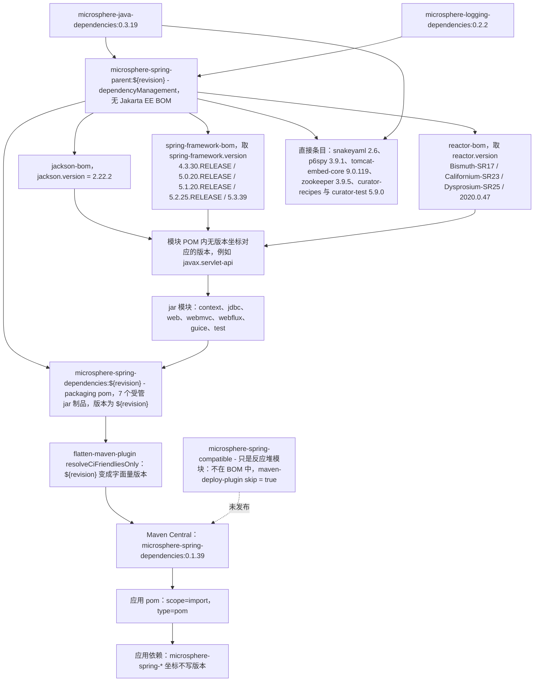

# microsphere-spring-dependencies — 开发者文档（0.1.x / `release-1.x`）

[← 开发者文档总览](./README.md) · [English](../dependencies.md) · [用户文档](../../../user-guide/1.x/zh/dependencies.md)

**谁需要这份文档。** 应用团队需要它：本 POM 就是那份已发布的 BOM（`scope=import`），让团队依赖任何一个 0.1.x 的
`microsphere-spring-*` 模块都不用写出版本 —— 它就是面向 Spring 4.3.x–5.3.x 与 `javax.servlet` 消费方的契约。库维护者
需要它，是为了背后那份更严格职责：让受管清单与模块清单保持同步，并且清楚本线上有一个反应堆模块是**刻意落在**这份清单
之外的。

## 1. 版本信息

| 项目 | 值 |
|------|-------|
| 分支 | `release-1.x` |
| 文档目录 | `docs/**/1.x/` |
| 版本线 | **0.1.x** |
| 开发版本（根 `<revision>`） | `0.1.40-SNAPSHOT` |
| 最近发布版本 | `0.1.39` |
| parent | `io.github.microsphere-projects:microsphere-spring-parent:${revision}`（`../microsphere-spring-parent/pom.xml`） |
| 构建基线父 POM | `io.github.microsphere-projects:microsphere-build:0.3.14`（经由 parent 链继承而来） |
| Java 基线 | Java 8（1.x 根 POM 没有声明 `<java.version>`；`microsphere-build` 把它默认成 `8`） |
| 坐标 / 打包方式 | `io.github.microsphere-projects:microsphere-spring-dependencies:${revision}`，`packaging=pom` |

## 2. 这个模块是什么

`microsphere-spring-dependencies` 是反应堆对外的那份契约。在本分支上，
`git ls-tree -r --name-only origin/release-1.x -- microsphere-spring-dependencies` 恰好返回一个路径，
`microsphere-spring-dependencies/pom.xml` —— 没有 `src/`，没有其他文件 —— 而它唯一的内容，就是一个覆盖在已发布库制品
之上的 `<dependencyManagement>` 块：

```xml
<parent>
    <groupId>io.github.microsphere-projects</groupId>
    <artifactId>microsphere-spring-parent</artifactId>
    <version>${revision}</version>
    <relativePath>../microsphere-spring-parent/pom.xml</relativePath>
</parent>

<groupId>io.github.microsphere-projects</groupId>
<artifactId>microsphere-spring-dependencies</artifactId>
<version>${revision}</version>
<packaging>pom</packaging>

<name>Microsphere :: Spring :: Dependencies</name>
<description>Microsphere Spring Dependencies</description>
```

它继承自 `microsphere-spring-parent` 而不是继承自反应堆根，正是这一点把 Spring 4.3–5.3 的 profile 机制与第三方 BOM
导入拉进了本 POM 的 effective model。

## 3. `<dependencyManagement>` 的内容（逐字照录）

该 BOM 声明了**七个**条目，全部属于 group `io.github.microsphere-projects`，全部使用版本 `${revision}`
（普通 jar 坐标：没有 `<type>`，没有 `<scope>`，没有排除项）：

| # | groupId | artifactId | version |
|---|---------|------------|---------|
| 1 | `io.github.microsphere-projects` | `microsphere-spring-context` | `${revision}` |
| 2 | `io.github.microsphere-projects` | `microsphere-spring-guice` | `${revision}` |
| 3 | `io.github.microsphere-projects` | `microsphere-spring-jdbc` | `${revision}` |
| 4 | `io.github.microsphere-projects` | `microsphere-spring-web` | `${revision}` |
| 5 | `io.github.microsphere-projects` | `microsphere-spring-webmvc` | `${revision}` |
| 6 | `io.github.microsphere-projects` | `microsphere-spring-webflux` | `${revision}` |
| 7 | `io.github.microsphere-projects` | `microsphere-spring-test` | `${revision}` |

其他什么都不声明：没有 `<properties>`，没有 `<profiles>`，没有 `<build>`，没有 `<repositories>`，没有 `<pluginManagement>`，
也没有自己的依赖。这份清单与 `release` (0.2.x) 上发布的那份逐字节相同 —— 同样是那七个制品，同样的顺序，尽管本反应堆多出一个模块。

### `microsphere-spring-compatible` 不在这里受管 —— 已核实

- `microsphere-spring-compatible` 在 `release-1.x` 上是一个反应堆模块（根 `<modules>` 列了它），但在这份 BOM 中
  **何处都不见**：上表就是完整清单。
- 它也从未被发布：`microsphere-spring-compatible/pom.xml` 用 `maven-deploy-plugin` 配置了
  `<skip>true</skip>`，所以该制品不会到达 Maven Central。
- 对消费方的后果：不可能写出一个不带版本的 `microsphere-spring-compatible` `<dependency>`，而这也并不需要。该模块存在的
  意义是回填 Spring 4.3/5.0 时代的类（`org.springframework.lang.NonNull`、`org.springframework.util.Assert`、
  `org.springframework.core.env.Profiles`，……），并且由 `microsphere-spring-context` 的 `spring-framework-4.3` 与
  `spring-framework-5.0` profile 以 `<optional>true</optional>` 依赖的形式接进来 —— 见
  [../parent.md §7](../parent.md)。因为它是 optional，所以它永远不会是传递依赖。

### 继承而来的受管内容

由于 parent 被继承，本 POM 的*effective* `dependencyManagement` 同样覆盖了 `microsphere-spring-parent` 在本线管理的
一切：

| 来源 | 受管内容 |
|--------|-----------------|
| 导入的 BOM | `com.fasterxml.jackson:jackson-bom:${jackson.version}`（`2.22.2`）、`org.springframework:spring-framework-bom:${spring-framework.version}`、`io.projectreactor:reactor-bom:${reactor.version}`、`io.github.microsphere-projects:microsphere-java-dependencies:0.3.19`、`io.github.microsphere-projects:microsphere-logging-dependencies:0.2.2` —— 本线上**没有** `jakarta.platform:jakarta.jakartaee-bom` |
| 直接条目 | `org.yaml:snakeyaml:2.6`、`p6spy:p6spy:3.9.1`、`org.apache.tomcat.embed:tomcat-embed-core:9.0.119`、`org.apache.zookeeper:zookeeper:3.9.5`、`org.apache.curator:curator-recipes:5.9.0` 与 `curator-test:5.9.0`（两者都排除 `org.apache.zookeeper:zookeeper`） |

导入这份 BOM 的应用只继承那七个已声明的条目 —— `<scope>import</scope>` 拉进来的是被导入 POM 自己的
`<dependencyManagement>` 声明，而不是它 parent 链上的传递受管内容。这就是库模块在自己的 POM 里把 Spring、Jackson 与
Servlet API 声明成 `<optional>` 的原因。

## 4. 消费方如何导入它

```xml
<dependencyManagement>
    <dependencies>
        <dependency>
            <groupId>io.github.microsphere-projects</groupId>
            <artifactId>microsphere-spring-dependencies</artifactId>
            <version>0.1.39</version>
            <type>pom</type>
            <scope>import</scope>
        </dependency>
    </dependencies>
</dependencyManagement>

<dependencies>
    <dependency>
        <groupId>io.github.microsphere-projects</groupId>
        <artifactId>microsphere-spring-context</artifactId>
    </dependency>
</dependencies>
```

由 BOM 的形态得出的规则：

- 版本必须是已发布的版本；`${revision}` 永远到不了消费方那里，因为 `flatten-maven-plugin`
  （`flattenMode=resolveCiFriendliesOnly`、`updatePomFile=true`）部署出去的 POM，其受管版本都是字面量 ——
  已发布的 `0.1.39` BOM 列的是 `microsphere-spring-context:0.1.39`，其余依此类推。
- `spring-framework.version` 不是契约的一部分：它是在*本*仓库构建时由 `spring-framework-4.3` …
  `spring-framework-5.3` 选定的，所以一份已发布的制品服务于整个 4.3.x–5.3.x 区间，而应用自己用
  `spring-framework-bom` 去对齐 Spring。
- 需要不同模块版本的应用要显式写出来；直接的 `<dependency><version>` 永远压过导入来的受管版本。

## 5. 反应堆覆盖情况

| 反应堆模块（`release-1.x` 根 `<modules>`） | 是否由本 BOM 受管 | 是否发布到 Central |
|--------------------------------------------------|---------------------|----------------------|
| `microsphere-spring-parent` | 否（内部 parent） | 是，作为供继承的 `pom` parent |
| `microsphere-spring-dependencies` | 不适用（它就是那份 BOM） | 是 |
| `microsphere-spring-compatible` | **否** | **否** —— `maven-deploy-plugin` `<skip>true</skip>` |
| `microsphere-spring-context` | 是 | 是 |
| `microsphere-spring-jdbc` | 是 | 是 |
| `microsphere-spring-web` | 是 | 是 |
| `microsphere-spring-webmvc` | 是 | 是 |
| `microsphere-spring-webflux` | 是 | 是 |
| `microsphere-spring-guice` | 是 | 是 |
| `microsphere-spring-test` | 是 | 是 |

与 `release` 不同，本线是有意打破“受管集合 == 可发布集合”这条不变式的：不变式是“受管集合 == *公开*集合”，
而 `microsphere-spring-compatible` 是一个内部兼容垫片。除非同时移除它的 `skip` 部署配置，否则不要把它加进 BOM。

验证命令：

```bash
git ls-tree -r --name-only origin/release-1.x -- microsphere-spring-dependencies   # 只有 pom.xml
git show origin/release-1.x:microsphere-spring-dependencies/pom.xml | grep -c artifactId
mvn -P spring-framework-4.3 help:effective-pom -pl microsphere-spring-dependencies | grep microsphere-spring-
```

## 6. BOM 导入链



相关文档：[./README.md](../README.md) · [./parent.md](../parent.md) · [./context.md](../context.md) ·
[./web.md](../web.md) · [./test.md](../test.md) · [./compatible.md](../compatible.md) ·
[../current/dependencies.md](../../current/dependencies.md)
