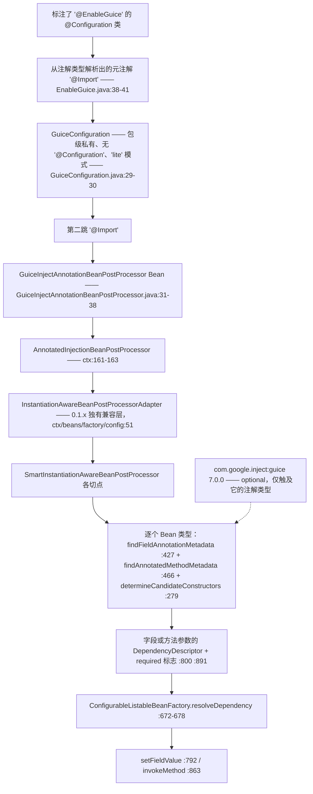
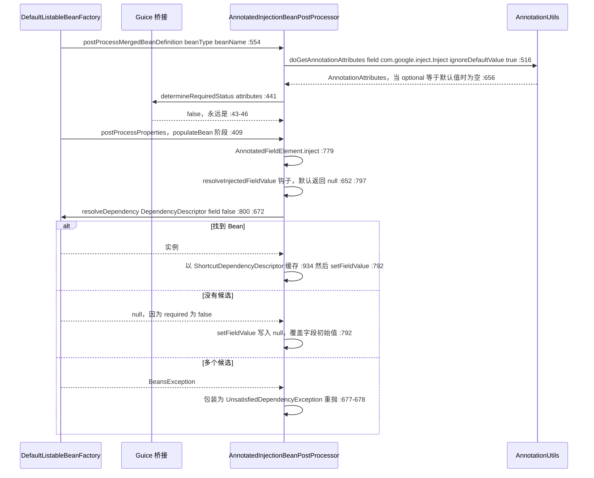

# microsphere-spring-guice — 开发者文档（0.1.x / `release-1.x`）

[← 开发者文档总览](./README.md) · [English](../guice.md) · [用户文档](../../../user-guide/1.x/zh/guice.md) · [0.2.x](../../current/zh/guice.md)

本页描述 **0.1.x 维护线**，它只存在于 `origin/release-1.x` 分支（工作树是 0.2.x）。文中每一个行号都读自该分支的对象库
（`git show origin/release-1.x:<path>`）。引用约定：POM 与根路径完整写在 `origin/release-1.x:` 前缀之后；Java 源码使用缩写——
`…/guice/` = `microsphere-spring-guice/src/main/java/io/microsphere/spring/guice/`，
`…/ctx/` = `microsphere-spring-context/src/main/java/io/microsphere/spring/`。

## 1. 模块身份、版本基线与依赖姿态

| 属性 | 取值 | 证据 |
|---|---|---|
| Maven 坐标 | `io.github.microsphere-projects:microsphere-spring-guice:${revision}` | `origin/release-1.x:microsphere-spring-guice/pom.xml:13-16` |
| 反应堆版本 | `revision` = `0.1.40-SNAPSHOT`；该线最后发布版 `0.1.39` | `origin/release-1.x:pom.xml:55`，标签 `0.1.39` |
| 父 POM | `microsphere-spring-parent:${revision}`；反应堆之上的外部父 `microsphere-build:0.3.14` | `origin/release-1.x:microsphere-spring-guice/pom.xml:5-10`、`origin/release-1.x:pom.xml:5-9` |
| Java 基线 | **`8`** —— 0.1.x 根 POM **不**声明 `<java.version>`；由 `microsphere-build` 提供 `java.version=8` 与 `maven.compiler.source/target=${java.version}` | `microsphere-build-0.3.14.pom:58,89,94`；对比 `pom.xml:56`（0.2.x 为 `17`） |
| Spring 基线 | 按 profile 选择 `4.3.30.RELEASE` / `5.0.20.RELEASE` / `5.1.20.RELEASE` / `5.2.25.RELEASE` / `5.3.39`；`spring-framework-5.3` 为 `activeByDefault` | `origin/release-1.x:microsphere-spring-parent/pom.xml:136-178`、`:170-173` |
| 注解命名空间 | `javax.*` 线 —— 父 POM **不**导入 `jakarta.jakartaee-bom`，本模块既不导入 `javax.inject` 也不导入 `jakarta.inject` | `origin/release-1.x:microsphere-spring-parent/pom.xml:30-135` 中不存在该导入；`…/guice/annotation/GuiceInjectAnnotationBeanPostProcessor.java:19-23` |
| Guice | `com.google.inject:guice` **`7.0.0`**，`optional`，版本由模块自身的 `<guice.version>` 属性就地钉死 | `origin/release-1.x:microsphere-spring-guice/pom.xml:21-23,41-47` |
| Guice 是否被托管 | ⚠ 本线上同样**不**被父 POM 或反应堆 BOM 托管——`com.google.inject` 在 `microsphere-spring-parent` 中出现 0 次，BOM 里只有本模块自己的构件条目 | `origin/release-1.x:microsphere-spring-parent/pom.xml:30-135`、`origin/release-1.x:microsphere-spring-dependencies/pom.xml:30-34` |
| `microsphere-spring-context` | compile，**非** optional —— 唯一强制的反应堆内入边 | `origin/release-1.x:microsphere-spring-guice/pom.xml:34-39` |
| `org.springframework:spring-context` | optional | `origin/release-1.x:microsphere-spring-guice/pom.xml:27-32` |
| `microsphere-annotation-processor` | **本线上不存在**（它只是 0.2.x 上的 optional 依赖） | 分支 POM 全文列举，对比 `microsphere-spring-guice/pom.xml:27-39` |
| 测试依赖 | `junit:junit`（**JUnit 4**）、`spring-test`、`logback-classic` —— 全部 `test` 作用域；**没有 `microsphere-spring-test` 入边** | `origin/release-1.x:microsphere-spring-guice/pom.xml:49-66` |
| 包根 / 类型 | `io.microsphere.spring.guice.annotation`；3 个主类 + 1 个测试类，文件集合与 0.2.x 完全一致 | `git ls-tree -r --name-only origin/release-1.x -- microsphere-spring-guice` |
| `src/main/resources` | **不存在** —— 没有 `spring.factories`、没有 `AutoConfiguration.imports`、没有 `module-info.java` | 同一列举（共 5 条目） |

依赖姿态精确表述：Guice 是 `optional`（`origin/release-1.x:microsphere-spring-guice/pom.xml:46`），因此 `com.google.inject:guice` **不会**传递给消费者，
应用必须自己声明它。唯一强制的反应堆内入边是 `microsphere-spring-context`（`:34-39`），而它自己又把 `microsphere-java-core` 作为强制依赖传递出来
（`origin/release-1.x:microsphere-spring-context/pom.xml:31-34`）。⚠ 0.1.x 线还多出一条 0.2.x 没有的约束：Guice `7.0.0` 要求 **Java 11+**，而本线编译到
**Java 8** 并在 JDK 8 上做 CI 测试（`microsphere-build-0.3.14.pom:89`、`.github/workflows/maven-build.yml:25`）。模块仍能*编译*（它只读取一个注解类型），
但 JDK 8 运行时无法加载 Guice 7 的 class 文件——见 §7 与[用户文档 1.x Guice:13-19](../../../user-guide/1.x/zh/guice.md)。

```mermaid
flowchart LR
    subgraph IN["入边"]
        BOM["microsphere-spring-dependencies<br/>仅有版本托管条目 —— deps/pom.xml:30-34"]
    end
    GU["microsphere-spring-guice<br/>0.1.40-SNAPSHOT"] --> BOM
    subgraph OUT["出边 —— guice/pom.xml"]
        GU -->|"compile，强制 :34-39"| CTX["microsphere-spring-context"]
        CTX -->|"compile，强制 ctx/pom.xml:31-34"| JCO["microsphere-java-core"]
        GU -.optional, ":27-32".-> SC["org.springframework:spring-context 4.3–5.3"]
        GU -.optional, ":41-47".-> GUI["com.google.inject:guice 7.0.0<br/>⚠ 需要 Java 11+"]
        GU -.test, ":49-54".-> J4["junit:junit（JUnit 4）"]
        GU -.test, ":56-60".-> ST["spring-test"]
        GU -.test, ":62-66".-> LB["logback-classic"]
    end
    APP["JDK 8 上的消费者应用"] -.->|"必须自己声明 guice；<br/>在 JDK 8 上该类根本无法加载"| GUI
```

没有任何反应堆模块依赖 `microsphere-spring-guice`；模块之外唯一的源码引用是 `origin/release-1.x:pom.xml:67`（模块清单）与
`origin/release-1.x:microsphere-spring-dependencies/pom.xml:32`（BOM）。⚠ 本线上**没有** `microsphere-spring-test → guice` 的 test 作用域边——guice 的 POM 完全没有声明 microsphere-spring-test
（`origin/release-1.x:microsphere-spring-guice/pom.xml:25-68`），这一点与 0.2.x 一致；[总览依赖图](./README.md)只为其余五个模块画出 test 作用域边。

## 2. 包结构地图

| 包 | 类型（可见性） | 职责 |
|---|---|---|
| `io.microsphere.spring.guice.annotation` | `EnableGuice`（public，`…/annotation/EnableGuice.java:41`）、`GuiceConfiguration`（包级私有，`GuiceConfiguration.java:30`）、`GuiceInjectAnnotationBeanPostProcessor`（包级私有，`GuiceInjectAnnotationBeanPostProcessor.java:31`） | 激活注解 + `@Import` 载体 + required 语义覆写 |

| 外部类型 | 在 0.1.x 上的归属 | 本模块为何需要它 |
|---|---|---|
| `io.microsphere.spring.beans.factory.annotation.AnnotatedInjectionBeanPostProcessor` | **`microsphere-spring-context`** | 父类（`GuiceInjectAnnotationBeanPostProcessor.java:20,31`）；扫描、解析、缓存全部由它完成 |
| `io.microsphere.spring.beans.factory.config.InstantiationAwareBeanPostProcessorAdapter` | `microsphere-spring-context` —— **0.1.x 独有的兼容层**（131 行，类声明在 `…/ctx/beans/factory/config/InstantiationAwareBeanPostProcessorAdapter.java:51`） | 基类的传递性父类（`…/ctx/beans/factory/annotation/AnnotatedInjectionBeanPostProcessor.java:22,161`）；因为 Spring 自带的 adapter 在 5.x 已被废弃，而 4.3 的 `SmartInstantiationAwareBeanPostProcessor` 没有默认实现 |
| `io.microsphere.spring.core.annotation.AnnotationUtils`、`AnnotatedInjectionBeanPostProcessor.AnnotationInjectedElement` | `microsphere-spring-context` | 基类调用的属性抽取（`AnnotatedInjectionBeanPostProcessor.java:516-517` → `AnnotationUtils.java:463-485`）以及公开的注入点模型（`:740-762`） |
| `org.springframework.context.annotation.Import` | Spring 4.3–5.3 | 唯一的激活机制（`EnableGuice.java:38-41`、`GuiceConfiguration.java:29`） |
| `com.google.inject.Inject` | Guice 7.0.0（optional） | 桥接所绑定的唯一注解类型（`GuiceInjectAnnotationBeanPostProcessor.java:19,33`） |
| `org.springframework.core.annotation.AnnotationAttributes` | Spring | 唯一被覆写钩子的参数类型（`:21,42`） |

## 3. 架构设计

⚠ 本模块**没有 `ImportBeanDefinitionRegistrar`、没有 `ApplicationContextInitializer`、没有 `Injector`、没有 `Module`、也没有 `Provider`**。它的描述文字
就是 "Microsphere Spring Bridge Guice"（`origin/release-1.x:microsphere-spring-guice/pom.xml:19`），而且桥接是单向的：*Spring* Bean 上带 Guice 注解的成员
由 *Spring* 来满足。Guice 只以一个注解类型的身份参与。激活方式是两跳 `@Import`，中间没有任何 registrar。



`@EnableGuice`（`EnableGuice.java:41`）没有声明任何属性，因此无处可配，也没有 Environment 级别的开关。中间的 `GuiceConfiguration` 既不带
`@Configuration` 也没有 `@Bean` 方法（`GuiceConfiguration.java:29-30`）；它纯粹是一个 `@Import` 载体，副作用是被导入的两个类都成了普通 Bean 定义——
模块自己的测试正是靠注入它们来证明这一点（`…/guice/annotation/EnableGuiceTest.java:45-46`，在 `:57` 断言非空）。

## 4. 源码分析

### 4.1 桥接类

```java
class GuiceInjectAnnotationBeanPostProcessor extends AnnotatedInjectionBeanPostProcessor {  // :31
    private static final Class<? extends Annotation> ANNOTATION_TYPE = Inject.class;        // :33
    private static final String OPTIONAL_ATTRIBUTE_NAME = "optional";                       // :35
    public GuiceInjectAnnotationBeanPostProcessor() { super(ANNOTATION_TYPE); }             // :37-39
    @Override
    protected boolean determineRequiredStatus(AnnotationAttributes attributes) {            // :41-47
        if (!attributes.containsKey(OPTIONAL_ATTRIBUTE_NAME)) { return false; }             // :43-44
        return Boolean.FALSE.equals(attributes.getBoolean(OPTIONAL_ATTRIBUTE_NAME));        // :46
    }
}
```

整个模块就是一个常量加一个被覆写的钩子；这个文件与 0.2.x 逐字节相同（`GuiceInjectAnnotationBeanPostProcessor.java:17-47`）。
把注解类型固定写进 `static final` 字段，也解释了为什么缺失 Guice 依赖会在*链接*期失败：初始化该类需要 `com.google.inject.Inject`（`:19,33`），
于是创建这个后置处理器 Bean 时抛出 `NoClassDefFoundError`。

### 4.2 继承而来的机器与其固定点

基类是一台步骤被冻结的自足注入引擎：`postProcessProperties`、`postProcessPropertyValues`、`postProcessMergedBeanDefinition`、
`determineCandidateConstructors`、`setBeanFactory`、`setEnvironment`、`setBeanClassLoader`、`getOrder`、`getAnnotationTypes` 全部是 `final`
（`AnnotatedInjectionBeanPostProcessor.java:279,388,409,554,562,567,572,714,719`），子类无法改变它*何时*、*多频繁*运行。可覆写的表面恰好是三个
protected 钩子——`determineRequiredStatus`（`:456-458`，默认 `true`）、`resolveInjectedFieldValue`（`:652-655`，返回 `null`）、
`resolveInjectedMethodArguments`（`:667-669`，返回 `null`）——Guice 子类覆写了其中之一。两个构造器默认值决定了下文语义：
`setOrder(LOWEST_PRECEDENCE - 3)`（`:247`）与 `setIgnoreDefaultValue(true)` + `setTryMergedAnnotation(true)`（`:250-251`）。⚠ `:202-204` 的字段注释声称
该 order 是为了"比 `AutowiredAnnotationBeanPostProcessor` 优先级更高"，可 `LOWEST_PRECEDENCE - 3` 位于 `Ordered` 标尺的最底端，因此这个数值并不能建立
它与 Spring 自家处理器之间的相对顺序。

0.1.x 特有的部分是父类链：`AnnotatedInjectionBeanPostProcessor extends InstantiationAwareBeanPostProcessorAdapter implements
MergedBeanDefinitionPostProcessor, PriorityOrdered, …`（`…/ctx/beans/factory/annotation/AnnotatedInjectionBeanPostProcessor.java:161-163`，导入在 `:22`），
而该 adapter 正是反应堆自己的 `io.microsphere.spring.beans.factory.config.InstantiationAwareBeanPostProcessorAdapter`
（`…/ctx/beans/factory/config/InstantiationAwareBeanPostProcessorAdapter.java:51`），它手工同时声明了已废弃的 `postProcessPropertyValues`（Spring 5.1 起废弃，
`:103`）与现代的 `postProcessProperties`（`:113`），从而让同一个类在 Spring 4.3 一直到 5.3 上都能链接。0.2.x 删掉了这个兼容层，基类直接实现
`SmartInstantiationAwareBeanPostProcessor`。

### 4.3 required 与 optional —— 本线上的精确解析

`determineRequiredStatus` 只读 `optional` 这个键，但该键的*存在性*是在上游决定的。完整链条：

1. `doGetAnnotationAttributes(member, Inject.class)` 传入 `ignoreDefaultValue = true` 与 `tryMergedAnnotation = true`（`AnnotatedInjectionBeanPostProcessor.java:516-517`）。
2. `AnnotationUtils.getAnnotationAttributes(...)` 的两个分支（`AnnotationUtils.java:463-485`：合并注解在 `:474-477`，普通回退在 `:479-482`）都汇入 `filterAnnotationAttributes`（`:643-670`）。
3. 该方法会**移除**任何取值等于注解默认声明值的属性——`if (ignoreDefaultValue && nullSafeEquals(attributeValue, getDefaultValue(annotation, attributeName))) continue;`（`:656-658`），其中 `getDefaultValue` 是 Spring 自带的，在 `:34` 静态导入。
4. Guice 声明 `boolean optional() default false`，而 Java 注解代理对未声明的元素也报告 `false`，于是合成出来的映射在"裸写"和"显式 `false`"两种情况下都持有 `optional=false`——第 3 步把它删掉了。

结论是算术而非观点：`containsKey("optional")` 为 `true` 的唯一可能是取值不同于 `false`，即为 `true`，此时 `Boolean.FALSE.equals(true)` 是 `false`。
**通过 `@EnableGuice`，`determineRequiredStatus` 永远不可能返回 `true`**——0.1.x 线上每一个 Guice 注入点都是非必需的。

| Guice 声明 | `optional` 取值 | 该键能否穿过默认值过滤？ | `determineRequiredStatus` | 运行时效果与证据 |
|---|---|---|---|---|
| `@Inject` | `false`（默认） | 否 | `false`（`GuiceInjectAnnotationBeanPostProcessor.java:43-45`） | 找不到候选 → 字段被置为 `null`，不抛异常（`resolveFieldValue:796-806`） |
| `@Inject(optional = false)` | `false`（默认） | **否 —— 与上一行完全相同** | `false` | ⚠ 该属性的任何写法都无法到达 `true` |
| `@Inject(optional = true)` | `true` | 能 | `false`（`:46`） | 找不到候选 → `null`；由 `EnableGuiceTest.java:51-52,59` 断言 |

`required` 以 `DependencyDescriptor` 第二个参数的形式传给 Spring（`:800` 字段、`:891` 方法参数）；在构造器路径上它直接在 `:324` 被消费，并在 `:325-333`
决定 `requiredConstructor`。**缺失是被容忍的；歧义不是** —— `resolveDependency` 捕获所有 `BeansException` 并重新抛出 `UnsatisfiedDependencyException`
（`:672-678`），所以两个候选会让一个 `@Inject(optional = true)` 字段像必需的那样失败。原本可以恢复 Guice 语义的开关 `setIgnoreDefaultValue(false)`
（`:607-609`）经由 `@EnableGuice` 不可达：子类从不调用它，而且子类是包级私有的（`:31`），用户代码既不能继承它也不能配置它。

### 4.4 注入点边界情形（全部继承而来）

- **静态字段**被丢弃并打一条 `warn`（`:435-440`）；**零参方法**只被 `warn`（`:484-488`）但仍被注册（`:491`），随后以空参数数组被调用（`:885-887`、`:862-864`）——桥接把它们变成了类似初始化回调的东西，而 Guice 自己两种都拒绝。
- **桥接方法与覆写方法**会被去重：桥接对被解析（`:471-474`），只保留最具体的声明（`:477`）。
- **构造器**：带 `@Inject` 的构造器在 `:305` 被识别（`findInjectionAnnotationAttributes`），但由于 `required` 恒为 `false`，`requiredConstructor` 分支永不触发（`:324-333`）；若该类还声明了无参构造器，它会被追加为回退（`:341-343`）；而唯一一个未标注却带参的构造器仍会被选中（`:354`）。
- **显式属性值对 setter 优先**：`checkPropertySkipping(pvs)` 提前返回（`:847-849`），因此由 XML 或 `PropertyValues` 提供的 `@Inject` setter 会被跳过——这在本线尤其相关，因为 `microsphere-spring-context` 仍然发布 `META-INF/spring.factories`，而 XML `applicationContext.xml` 夹具很常见。字段没有这类保护：`inject` 总是写入，`null` 也写（`:779-793`）。

## 5. 一次注入请求



这三个分支就是本模块的完整契约：*找到 → 注入，缺失 → `null`，歧义 → 失败*。不存在第四步去咨询 Guice；你在自己代码里创建的 `Injector` 永远不会被触及。

## 6. 有证据支撑的设计模式

| 模式 | 类 | 证据 |
|---|---|---|
| 配置激活（"Enable*"）+ 两跳导入间接层 | `EnableGuice`、`GuiceConfiguration` | `EnableGuice.java:35-42`（无属性的标记注解，其载荷是元 `@Import`）；`GuiceConfiguration.java:29-30` —— 承载第二跳的包级私有 "lite" 类，且自身可被注入（`EnableGuiceTest.java:45-46`） |
| 模板方法 | `AnnotatedInjectionBeanPostProcessor` + `GuiceInjectAnnotationBeanPostProcessor` | 固定步骤 `:279,409,554`，钩子 `:456,652,667`；唯一覆写在 `GuiceInjectAnnotationBeanPostProcessor.java:41-47` |
| 桥接 / 适配器（注解语义映射） | `GuiceInjectAnnotationBeanPostProcessor` | `:33,35` 把 `com.google.inject.Inject.optional` 映射到 Spring 的 `required`；模块描述 "Microsphere Spring Bridge Guice"（`origin/release-1.x:microsphere-spring-guice/pom.xml:19`） |
| 适配器（版本兼容 —— **仅 0.1.x**） | `io.microsphere.spring.beans.factory.config.InstantiationAwareBeanPostProcessorAdapter` | `…/ctx/beans/factory/config/InstantiationAwareBeanPostProcessorAdapter.java:51,103,113` 同时声明废弃与现代两个切点，使 Spring 4.3–5.3 全部可链接 |
| 工厂（实例化感知） | `determineCandidateConstructors`、`ShortcutDependencyDescriptor.resolveShortcut` | `AnnotatedInjectionBeanPostProcessor.java:279-368`、`:934+` |
| 注册表 / 缓存 | `candidateConstructorsCache`、`injectionMetadataCache` | `:192-194`、`:629-630`，写入在 `:364,543`，仅在 `destroy()` 中清空（`:634-637`） |
| 空对象 | `resolveInjectedFieldValue`、`resolveInjectedMethodArguments` | `:652-655`、`:667-669` —— `null` 表示"无自定义值，交回 Spring" |
| 策略 | `annotationTypes` 集合 + `order` | `:190,237-239,714-716`、`:581,719-721` |
| **没有**观察者、装饰器、组合 | — | 本模块与继承路径都不做包装也不做扇出 |

## 7. 本模块 0.1.x 与 0.2.x 的差异

文件**集合**完全一致——两侧都是 3 个主类、1 个测试类、1 个 POM（`git ls-tree -r --name-only origin/release-1.x -- microsphere-spring-guice` 与对 `HEAD`
的同一条命令），且 `git diff` 显示三个主源码未改动。因此所有差异都来自*版本线*，而非模块本身。

| 维度 | 0.1.x（`origin/release-1.x`） | 0.2.x（工作树） | 证据 |
|---|---|---|---|
| 主/测试源码文件 | `EnableGuice`、`GuiceConfiguration`、`GuiceInjectAnnotationBeanPostProcessor` + `EnableGuiceTest`——同样 5 条目 | 完全相同 | 两侧 `git ls-tree` 列举 |
| Java 基线 | `8`，因根 POM 省略 `java.version` 而继承自 `microsphere-build` | `17`，在反应堆根显式声明 | `microsphere-build-0.3.14.pom:89` 对比 `pom.xml:56` |
| **Guice 7.0.0 对上 Java 8** | ⚠ 在 Java 8 线上钉死 `7.0.0`——Guice 7 需要 Java 11+，JDK 8 运行时加载不了；CI 仍在 JDK 8 上测试 | `7.0.0` 配 Java 17，自洽 | `origin/release-1.x:microsphere-spring-guice/pom.xml:21-23` + `microsphere-build-0.3.14.pom:89` 对比 `microsphere-spring-guice/pom.xml:21-23` + `pom.xml:56`；[用户文档 1.x Guice:13-19](../../../user-guide/1.x/zh/guice.md) |
| Guice 是否被托管 | 父 POM 与反应堆 BOM 都不托管 | 同样**不**托管 | `origin/release-1.x:microsphere-spring-parent/pom.xml:30-135` 与 `microsphere-spring-parent/pom.xml:30-136`（两侧 `com.google.inject` 均为 0 次） |
| 所在线的注解命名空间 | `javax.*`；父 POM 不导入 `jakarta.jakartaee-bom` | `jakarta.*`，父 POM 导入 BOM `jakartaee 11.0.0` | `microsphere-spring-parent/pom.xml:24,51-58`（仅 0.2.x） |
| 被绑定的 Inject 注解 | 只有 `com.google.inject.Inject`；`javax.inject.Inject` 与 `jakarta.inject.Inject` 同样不可见 | 相同 | 两侧 `GuiceInjectAnnotationBeanPostProcessor.java:33` |
| 测试框架 | **JUnit 4** —— `junit:junit` `test` 作用域，`@RunWith(SpringRunner.class)` 在 `EnableGuiceTest.java:35`，`org.junit.Test` 在 `:20` | `org.junit.jupiter:junit-jupiter`（`microsphere-spring-guice/pom.xml:58-59`） | `origin/release-1.x:microsphere-spring-guice/pom.xml:49-54` 对比 `microsphere-spring-guice/pom.xml:56-63` |
| `microsphere-annotation-processor` | 未声明 | optional 依赖，无版本号，经 `microsphere-java-dependencies` 解析为 `0.3.19` | 分支 POM 中不存在，对比 `microsphere-spring-guice/pom.xml:27-39` |
| 桥接被测试于的 Spring 矩阵 | 4.3.30 / 5.0.20 / 5.1.20 / 5.2.25 / 5.3.39（默认 5.3） | 6.0.23 / 6.1.21 / 6.2.18 / 7.0.9（默认 7.0） | `origin/release-1.x:microsphere-spring-parent/pom.xml:136-178` 对比 `microsphere-spring-parent/pom.xml:138-173` |
| 基类处理器的父类 | 反应堆自己的 `InstantiationAwareBeanPostProcessorAdapter` 兼容层 | 直接实现 `SmartInstantiationAwareBeanPostProcessor`；兼容层已删除 | `…/ctx/beans/factory/annotation/AnnotatedInjectionBeanPostProcessor.java:22,161`（分支）对比 `:160`（工作树） |
| 基类行号偏移 | 自类声明起整体 +1（950 行 vs 949 行） | — | 两侧 `git show … \| wc -l` |
| `microsphere-spring-test` 入边 | 不存在 | 也不存在——README 图中的 guice 边在两条线上都是错的 | `origin/release-1.x:microsphere-spring-guice/pom.xml:25-68`、[1.x/README.md:48](./README.md) |

## 8. 构建与验证

| 任务 | 命令 / 事实 |
|---|---|
| 构建并测试本模块 | `mvn -pl microsphere-spring-guice -am test --activate-profiles test,coverage,spring-framework-5.3` —— CI 会追加 `-Drevision=0.0.1-SNAPSHOT`（`origin/release-1.x:.github/workflows/maven-build.yml:43-49`） |
| Spring 矩阵 / JDK 矩阵 | `spring-framework-4.3 / 5.0 / 5.1 / 5.2 / 5.3`，`5.3` 为 `activeByDefault`（`origin/release-1.x:microsphere-spring-parent/pom.xml:170-173`）；JDK `8`、`11`、`17`、`21`、`25`（`origin/release-1.x:.github/workflows/maven-build.yml:25`） |
| 分支 CI 触发条件 | 推送到 `dev-1.x`；针对 `dev-1.x` 或 `release-1.x` 的 PR（同文件 `:14-18`） |
| 构建父 POM | `microsphere-build:0.3.14`（`origin/release-1.x:pom.xml:5-9`） |
| 测试清单 | `EnableGuiceTest` —— 测试类本身也是被测 Bean（`EnableGuiceTest.java:40`）；4 个注入点（`:42-52`），1 个 `@Test` 含 4 条断言（`:54-60`） |
| 测试**未**覆盖之处 | 构造器或 setter 上的 `@Inject`、任何 required 失败路径，以及 `Injector`、`Module`、`Provider`、`Scope` 的一切用法——Guice 只作为注解类型参与 |
| optional 依赖的行为 | 模块自身的编译类路径确实看得见 Guice（optional 抑制的是传递性而非本地使用），这就是测试无需额外声明即可编译的原因；消费者仍必须自己提供（`origin/release-1.x:microsphere-spring-guice/pom.xml:41-47`） |

## 9. 坑与陷阱

| # | 观察 | 证据 |
|---|---|---|
| 1 | ⚠ **Guice 7.0.0 位于 Java 8 线上。** 模块钉死 `7.0.0`，而反应堆编译并 CI 测试于 JDK 8，所以本线上的 `@EnableGuice` 只有在你的应用跑在 JDK 11+、或你在自己的 `<dependencyManagement>` 里把 Guice 降级时才可用。 | `origin/release-1.x:microsphere-spring-guice/pom.xml:21-23`；`microsphere-build-0.3.14.pom:89`；`.github/workflows/maven-build.yml:25` |
| 2 | Guice 是 optional 且永不传递；没有 `com.google.inject:guice` 的消费者会在桥接类初始化时失败，而不是在自己的代码编译时失败。 | `origin/release-1.x:microsphere-spring-guice/pom.xml:46`；`GuiceInjectAnnotationBeanPostProcessor.java:19,33` |
| 3 | ⚠ 没有任何 `Injector`/`Module`/`Provider`/`Scope` 集成，方向只是 Guice 注解 → Spring；"Spring ↔ Guice" 的说法夸大了它。 | `…/guice/`（3 个类） |
| 4 | ⚠ `@Inject(optional = false)` 并**不**是 required —— 默认值属性在 `determineRequiredStatus` 看到它之前就被过滤掉了 —— 因此裸 `@Inject` 与显式 `false` 完全等价且都是 optional，这与 Guice 自身的 required 默认相反。 | `AnnotatedInjectionBeanPostProcessor.java:250`；`AnnotationUtils.java:656-658`；`GuiceInjectAnnotationBeanPostProcessor.java:43-46` |
| 5 | `optional = true` 容忍缺失，但不容忍重复候选。 | `AnnotatedInjectionBeanPostProcessor.java:799-803,672-678` |
| 6 | 字段写入是无条件的，因此当没有匹配的 Bean 时，带初始值字段上的 `@Inject` 会用 `null` 抹掉该初始值。 | `:779-793` |
| 7 | 两个具体类型都是包级私有；用户代码只能继承公开基类，或在另一个后置处理器里用 `instanceof AnnotatedInjectionBeanPostProcessor` 介入。 | `GuiceInjectAnnotationBeanPostProcessor.java:31`；`AnnotatedInjectionBeanPostProcessor.java:161` |
| 8 | 没有 Environment 级熔断开关：与反应堆里其他 `@Enable*` 入口不同，这一个导入的是普通类而不是 `AnnotatedBeanCapableImportBeanDefinitionRegistrar`，所以 `microsphere.spring...enabled=false` 在这里毫无作用。 | `EnableGuice.java:38-41` |
| 9 | `microsphere.spring.injection.metadata.cache.size` 只在类初始化时从**系统属性**（`-D…`）读取一次，而不是从 Spring `Environment` 读取，两个缓存也从不淘汰——这个属性名承诺了一个代码并未实现的上限。 | `AnnotatedInjectionBeanPostProcessor.java:168,186,364,543,634-637` |
| 10 | 只绑定 `com.google.inject.Inject`。在这条 `javax.*` 线上它几乎就是你 Bean 上唯一的 inject 注解，但 `javax.inject.Inject` 依然被忽略——它由 Spring 自己的 `AutowiredAnnotationBeanPostProcessor` 处理，桥接对它既无增益也无法被配置成处理它。 | `GuiceInjectAnnotationBeanPostProcessor.java:33` |
| 11 | Spring 4.3 与 5.0/5.1 依赖这个兼容层：整座桥到达 `postProcessProperties` 的唯一途径就是 `io.microsphere.spring.beans.factory.config.InstantiationAwareBeanPostProcessorAdapter`。在 `spring-framework-4.3` profile 下 `microsphere-spring-compatible` 还会被额外挂到 `microsphere-spring-context` 上，抽掉它会破坏注入路径。 | `…/ctx/beans/factory/config/InstantiationAwareBeanPostProcessorAdapter.java:51,113`；`origin/release-1.x:microsphere-spring-context/pom.xml:127-137` |
| 12 | 桥接与 `@Autowired` 跑在同一个 `populateBean` 阶段，且位于 `Ordered` 区间的低端，所以同一个字段同时标注两个注解会得到两次独立解析。 | `AnnotatedInjectionBeanPostProcessor.java:409,247,202-204` |
| 13 | ⚠ 四个类型上的 `@since 1.0.0` 与被分析的 `0.1.40-SNAPSHOT` 相矛盾，而 0.2.x 上还是同一个标签；不要用 `@since` 做版本映射。 | `EnableGuice.java:33`、`origin/release-1.x:pom.xml:55` |

**相关文档** —— [开发者文档总览](./README.md) · [英文版](../guice.md) · [用户文档 —— Guice（1.x）](../../../user-guide/1.x/zh/guice.md) · [0.2.x 开发者文档](../../current/zh/guice.md) · [1.x 父 POM profile](./parent.md) · [1.x 依赖管理](./dependencies.md) · [1.x context 模块](./context.md)
