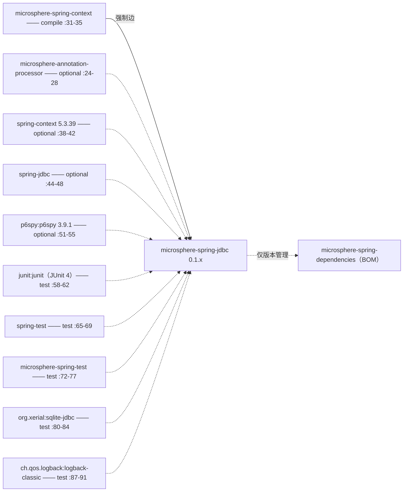
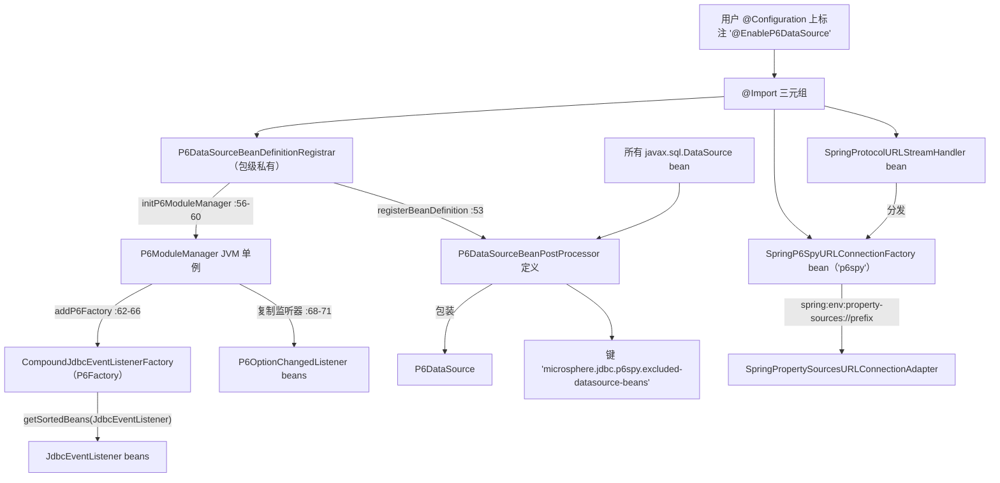
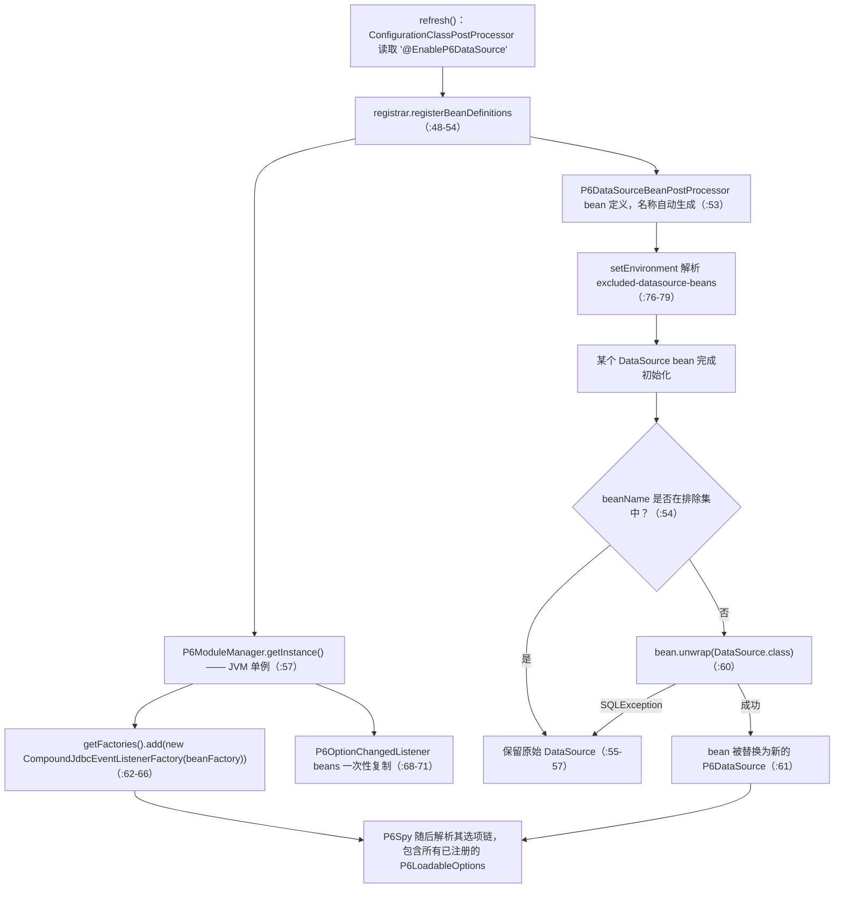
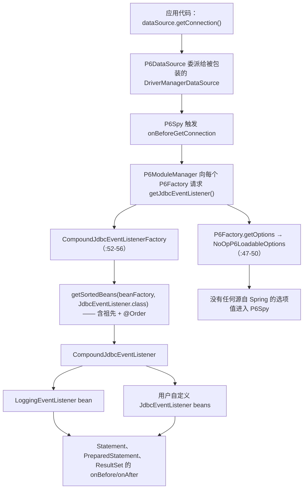

# microsphere-spring-jdbc — 开发者指南（0.1.x）

[← 开发者文档总览](./README.md) · [English](../jdbc.md) · [用户文档](../../../user-guide/1.x/zh/jdbc.md) · [0.2.x](../../current/zh/jdbc.md)

本页记录 **0.1.x** 线，只能通过 `git show origin/release-1.x:<path>` 读取；工作区是 0.2.x。除非标注“工作区”，否则裸写的
`path:NN` 引用均指向分支对象。七个主源码在两条线上逐字节相同——差异只在 POM 与两个测试类（见 §8）。

## 1. 模块标识、版本基线与依赖姿态

| 属性 | 值 | 证据 |
|---|---|---|
| Maven 坐标 | `io.github.microsphere-projects:microsphere-spring-jdbc:${revision}` | `microsphere-spring-jdbc/pom.xml:13-16` |
| 聚合版本 | `revision` = `0.1.40-SNAPSHOT` | `pom.xml:55` |
| 模块父 POM | `microsphere-spring-parent:${revision}` | `microsphere-spring-jdbc/pom.xml:5-10` |
| 构建父 POM | `microsphere-build:0.3.14`（外部父 POM） | `pom.xml:5-9` |
| Java 基线 | `8` —— `java.version=8`、`maven.compiler.source/target=${java.version}`；0.1.x 根 POM 未声明 `java.version`，故模块继承 8 | `microsphere-build-0.3.14.pom:58,89,94`；`pom.xml:54-56` |
| Spring 基线 | 按 profile 选择 `4.3.30.RELEASE` / `5.0.20.RELEASE` / `5.1.20.RELEASE` / `5.2.25.RELEASE` / `5.3.39`；`spring-framework-5.3` 为 `activeByDefault` | `microsphere-spring-parent/pom.xml:136-179`、`:169-178` |
| 命名空间 | `javax.*` —— 本行未导入 `jakarta.jakartaee-bom` | `microsphere-spring-parent/pom.xml:32-134` |
| P6Spy | `p6spy:p6spy` **`3.9.1`**，由父 POM 管理，模块以 **optional** 声明 | `microsphere-spring-parent/pom.xml:26`、`:51-56`；`microsphere-spring-jdbc/pom.xml:51-55` |
| 包名根 / 类型数 | `io.microsphere.spring.jdbc.p6spy` —— 7 个主类、2 个测试类、无 `src/main/resources` | `git ls-tree -r --name-only origin/release-1.x -- microsphere-spring-jdbc` |

依赖姿态：本模块编译所依赖的构件全部是 `optional` —— `spring-context`（`microsphere-spring-jdbc/pom.xml:38-42`）、
`spring-jdbc`（`:44-48`）、`p6spy`（`:51-55`）、`microsphere-annotation-processor`（`:24-28`）—— 因此不会传递到消费者的
classpath；聚合内唯一的强制编译边是 `microsphere-spring-context`（`:31-35`）。所以只引入本模块时，首次使用
`@EnableP6DataSource` 就会抛出 `NoClassDefFoundError`，除非显式声明 `p6spy:p6spy`；测试作用域同样需要显式
`junit:junit`（`:58-62`），因为 `microsphere-spring-test` 把 JUnit 4（`microsphere-spring-test/pom.xml:172-177`）与 JUnit 5
（`:179-184`）都声明为 `optional`。聚合内没有任何模块依赖本模块（`microsphere-spring-dependencies/pom.xml:36-40` 仅管理版本）。



## 2. 包结构地图

| 包 | 类型（可见性） | 职责 |
|---|---|---|
| `io.microsphere.spring.jdbc.p6spy` | `NoOpP6LoadableOptions`、`PropertySourcesP6LoadableOptionsAdapter` | `com.p6spy.engine.spy.P6LoadableOptions` 实现 |
| `io.microsphere.spring.jdbc.p6spy.annotation` | `EnableP6DataSource`（public）、`P6DataSourceBeanDefinitionRegistrar`（包级私有） | 注解驱动的启用入口 |
| `io.microsphere.spring.jdbc.p6spy.beans.factory` | `CompoundJdbcEventListenerFactory` | 把 Spring bean 桥接进 P6Spy 事件流水线的 `P6Factory` |
| `io.microsphere.spring.jdbc.p6spy.beans.factory.config` | `P6DataSourceBeanPostProcessor` | `DataSource` → `P6DataSource` 装饰 |
| `io.microsphere.spring.jdbc.p6spy.net` | `SpringP6SpyURLConnectionFactory` | `p6spy:` URL 子协议间接层 |

本模块构建所依赖的外部类型（分支行号）：

| 类型 | 所属 | 本模块为何需要 |
|---|---|---|
| `SpringProtocolURLStreamHandler` | `microsphere-spring-context`，`io.microsphere.spring.net` | 注册 `spring:` 协议处理器（`:60`、`:76-80`），分发子协议（`:88-93`、`:95-100`） |
| `SpringSubProtocolURLConnectionFactory` | `microsphere-spring-context` | 父类；`supports(...)` 为 `final`，比较子协议索引 0（`:32`、`:34`、`:36-42`、`:49`） |
| `SpringEnvironmentURLConnectionFactory` + `SpringPropertySourcesURLConnectionAdapter` + `SpringDelegatingBeanProtocolURLConnectionFactory` | `microsphere-spring-context` | 承载 `spring:env:property-sources://`（`:44`、`:46`、`:50`、`:67-74`；适配器 `:50`、`:70-84`、`:113-115`），并以 bean 方式发现本模块的工厂（`:36`、`:76`） |
| `AnnotatedBeanCapableImportBeanDefinitionRegistrar`、`GenericBeanPostProcessorAdapter`、`BeanUtils`、`BeanRegistrar` | `microsphere-spring-context` | 注册器父类（`:63-64`、`:70-82`、`:114-116`）、按类型过滤的后处理器（`:42`、`:58-60`、`:125-132`）、`getSortedBeans`（`:603-608`）、`registerBeanDefinition`（`:199-201`、`:233-235`、`:565-568`） |
| `P6DataSource`、`P6ModuleManager`、`P6Factory`、`P6LoadableOptions`、`CompoundJdbcEventListener`、`JdbcEventListener`、`P6OptionChangedListener` | P6Spy 3.9.1 | 被装饰类型与扩展契约 |

## 3. 架构



两条结构性缝隙：Spring 的 `@Import` → `ImportBeanDefinitionRegistrar` → `BeanPostProcessor` 链路，以及 P6Spy 的
`P6ModuleManager` 注册表 —— 一个在 `registerBeanDefinitions` 期间被改写的 JVM 级单例
（`annotation/P6DataSourceBeanDefinitionRegistrar.java:48-60`）。URL 缝隙处于潜伏状态：本模块没有任何代码打开
`spring:p6spy:` URL（§10 第 8 条）。

## 4. 源码分析

### 4.1 `@EnableP6DataSource` —— 无属性的启用注解

`annotation/EnableP6DataSource.java:38-46` 不声明任何属性，只导入三个类型：包级私有的注册器（`:42`，类声明在 `:46` ——
因此该注解是唯一受支持的入口）、`SpringProtocolURLStreamHandler`（`:43`）与 `SpringP6SpyURLConnectionFactory`（`:44`）；
后两者成为普通 bean 定义，而注册器是被 Spring *执行* 的。

### 4.2 注册器：启动阶段改写了什么

```java
protected void registerBeanDefinitions(AnnotationMetadata metadata, BeanDefinitionRegistry registry,
        BeanNameGenerator importBeanNameGenerator,
        ResolvablePlaceholderAnnotationAttributes<EnableP6DataSource> annotationAttributes) {
    initP6ModuleManager(getBeanFactory());                                 // :52
    registerBeanDefinition(registry, P6DataSourceBeanPostProcessor.class); // :53
}                                                                          // :48-54
```

`initP6ModuleManager`（`:56-60`）把一个持有 `ConfigurableListableBeanFactory` 的 `CompoundJdbcEventListenerFactory` 追加到
`p6ModuleManager.getFactories()`（`:62-66`），并通过 `p6ModuleManager::registerOptionChangedListener` 把所有
`P6OptionChangedListener` bean 复制进 P6Spy（`:68-71`）；两处查找都走 `BeanUtils.getSortedBeans`，它包含祖先容器并按
`AnnotationAwareOrderComparator` 排序。父类 `registerBeanDefinitions` 是 `final` 且由 `isEnabled(metadata)` 门控
（`AnnotatedBeanCapableImportBeanDefinitionRegistrar.java:70-76`），因此即使注解没有属性也能通过 Environment 属性关闭启用
（见 §7）；两参数重载用 `AnnotationBeanNameGenerator.INSTANCE` 再次进入该门（`:78-82`），上面实现的抽象钩子位于 `:114-116`。
该门上方还留有一处 0.1.x 特有痕迹：这个 `final` 方法的 **`@Override` 被注释掉了**，并注明三参数重载自 Spring 5.2 才存在于
`ImportBeanDefinitionRegistrar`（`:68-69`）—— 这是为 4.3/5.0/5.1 编译付出的代价，也正是
`microsphere-spring-compatible` 兼容层存在的原因（§9）。最后，后处理器通过 `registerBeanDefinition(registry, Class)` 注册，
该重载传入 `beanName = null`，由 `generateBeanName(beanDefinition, registry)` 生成名称
（`BeanRegistrar.java:199-201`、`:233-235`、`:568`），且未被标记为 infrastructure bean。

### 4.3 `p6spy:` 间接层通向 `spring:env:property-sources://`

`net/SpringP6SpyURLConnectionFactory.java:40-55`：`getSubProtocol()` 返回 `"p6spy"`（`:40-43`）；`create(...)` 计算
`prefix = getPrefix(url)` 并重新打开 `new URL("spring:env:property-sources://" + prefix)`（`:45-50`）；`getPrefix` 返回 URL 的
authority，为空白时回落到 `microsphere.jdbc.p6spy`（`:52-55`）。之所以能解析，是因为同一个注解还导入了
`SpringProtocolURLStreamHandler`，其在 `afterPropertiesSet()` → `super.init()` 中安装 `spring` 处理器
（`SpringProtocolURLStreamHandler.java:76-80`）。目标侧 `SpringEnvironmentURLConnectionFactory.create` 匹配类型索引 1 =
`property-sources` 并返回 `SpringPropertySourcesURLConnectionAdapter`（`:67-74`），其 `getInputStream()` 收集
`getSubProperties(propertySources, prefix)`，并借助 bean 工厂的 `ConfigurableConversionService` 完成 `Map` → `Properties` →
`text` → `InputStream` 转换（`:70-84`）；前缀取自 `resolveAuthority(url.getAuthority())`（`:113-115`），路径为空时媒体类型默认
`text/properties`（`:50`、`:122-130`）。

### 4.4 DataSource 装饰

`beans/factory/config/P6DataSourceBeanPostProcessor.java:41` 继承 `GenericBeanPostProcessorAdapter<DataSource>` 并实现
`EnvironmentAware`；排除键常量在 `:45`。父适配器依据子类声明一次性解析类型参数（`:58-60`），把
`postProcessAfterInitialization` 设为 `final`，仅在 `beanType.isAssignableFrom(ultimateTargetClass(bean))` 时委派（`:125-132`）。
本模块只覆写 *after* 钩子（`:50-74`）：命中排除集的名称输出 trace 并原样返回（`:54-57`），否则
`bean.unwrap(DataSource.class)` 被包装为 `new P6DataSource(datasource)`（`:59-61`），`SQLException` 则降级为“不包装”且只记
`trace`（`:62-66`）。排除项在 `setEnvironment` 中一次性读取：`environment.getProperty(KEY, Set.class, emptySet())`（`:76-79`），
它是**精确 bean 名称**集合而非模式匹配。这里的 `DataSource` 是 `javax.sql.DataSource`（`:27`），属 JDK 类型，因此其他模块经历的
`javax`→`jakarta` 迁移从未触及本模块。

### 4.5 监听器聚合与选项

`beans/factory/CompoundJdbcEventListenerFactory.java:39-56` 基于持有的 `ConfigurableListableBeanFactory`（`:41-45`）实现
`P6Factory`：`getOptions(...)` 返回 `new NoOpP6LoadableOptions()`（`:47-50`），`getJdbcEventListener()` 返回
`new CompoundJdbcEventListener(getSortedBeans(beanFactory, JdbcEventListener.class))`（`:52-56`）。`NoOpP6LoadableOptions`
毫无贡献 —— 空的 `load(Map)`、`getDefaults()` 返回 `emptyMap()`（`:33-41`）。`PropertySourcesP6LoadableOptionsAdapter` 恰好相反：
`load` 为空（`:45-48`），而 `getDefaults()` 返回
`getSubProperties(propertySources, "microsphere.jdbc.p6spy.options")`（`:37`、`:50-55`），并以未检查的裸 `Map` 返回
`Map<String,Object>`。它**在本分支从未被实例化** —— `git grep -n PropertySourcesP6LoadableOptionsAdapter origin/release-1.x`
只命中其声明（`:35`）与构造器（`:41`）。

## 5. 复杂流程

### 5.1 （a）启动期的 DataSource 装饰



### 5.2 （b）SQL 语句穿过 P6Spy 监听器分发



分发每次调用都会重算，因此启动后注册的 `JdbcEventListener` 在下一次事件即生效 —— 而 `P6OptionChangedListener` bean 只在注册阶段
复制一次（§4.2）。`EnableP6DataSourceTest` 正是利用这一点：测试类本身就是一个 `LoggingEventListener` bean
（`EnableP6DataSourceTest.java:51`），并在 `onBeforeGetConnection` 中断言 `connectionInformation.getDataSource()` 与
`dataSource.unwrap(DataSource.class)` 同一（`:66-73`）。至于 URL 路径，只有当
`SpringProtocolURLStreamHandler.openConnection` 解析出子协议（`:95-100`）并依次走完 `resource` → `env` → bean 委派链（`:88-93`）
之后，本模块的工厂才会匹配（§4.3）。

## 6. 设计模式

| 模式 | 类 | 动机 | 使用的 Spring 缝隙 |
|---|---|---|---|
| 配置启用（Enable*） | `EnableP6DataSource` | 零属性标记，全部行为由 `@Import` 驱动 | `@Import` |
| 注册器 | `P6DataSourceBeanDefinitionRegistrar`（包级私有） | 在 bean 定义阶段注册后处理器并改写非 Spring 注册表 | `ImportBeanDefinitionRegistrar` |
| 受框架门控的模板方法 | `AnnotatedBeanCapableImportBeanDefinitionRegistrar`（`:70-82`、`:114-116`） | `final` 入口强制每个 `Enable*` 注册器经过 `isEnabled` 门 | `ImportBeanDefinitionRegistrar` |
| 基于泛型类型过滤模板的装饰器 | `P6DataSourceBeanPostProcessor` 配合 `GenericBeanPostProcessorAdapter<DataSource>` | `final` 钩子按已解析类型参数分发，随后用 `P6DataSource` 替换 bean | `BeanPostProcessor` |
| 组合 + 观察者 | `CompoundJdbcEventListenerFactory` → `CompoundJdbcEventListener` | 把所有 `JdbcEventListener` bean 聚合为单个 P6Spy 监听器 | `BeanFactory` 查找 |
| 工厂 / SPI + 空对象 | `CompoundJdbcEventListenerFactory implements P6Factory`、`NoOpP6LoadableOptions` | P6Spy 自身 SPI；`getOptions()` 刻意不贡献任何选项 | 无（P6Spy SPI） |
| 适配器 | `PropertySourcesP6LoadableOptionsAdapter`、`SpringP6SpyURLConnectionFactory` | 把 `Environment`/`PropertySources` 映射为 `P6LoadableOptions` / `URLConnection` 视图 | `Environment`、`ConfigurableConversionService` |
| 策略（URL） | 由 `supports(...)` 选中的 `SpringP6SpyURLConnectionFactory` | 在多个 `SubProtocolURLConnectionFactory` bean 之间按子协议分发 | 由 bean 委派工厂发现 |

## 7. 扩展点

| 扩展点 | 契约 | 注册方式 | 说明 |
|---|---|---|---|
| `JdbcEventListener` bean | `com.p6spy.engine.event.JdbcEventListener` | 普通 Spring bean | 每次 `getJdbcEventListener()` 都重新聚合，顺序敏感（`CompoundJdbcEventListenerFactory.java:52-56`） |
| `P6OptionChangedListener` bean | `com.p6spy.engine.spy.option.P6OptionChangedListener` | 注册阶段一次性复制进 `P6ModuleManager` | `P6DataSourceBeanDefinitionRegistrar.java:68-71` |
| `P6LoadableOptions` 实现 | `NoOpP6LoadableOptions`、`PropertySourcesP6LoadableOptionsAdapter`（前缀 `microsphere.jdbc.p6spy.options`） | 由用户自备 `P6Factory` | 模块自身只装配 no-op 变体 |
| `SubProtocolURLConnectionFactory` bean | 任意子协议，本模块提供 `p6spy` | `@EnableP6DataSource` 中的 `@Import` | 由 context 模块的委派工厂发现 |
| `microsphere.jdbc.p6spy.excluded-datasource-beans` | 精确 `DataSource` bean 名的 `Set<String>` | `Environment` | 在 `setEnvironment` 中读取一次（`:45`、`:76-79`） |
| 注解全局开关 | `microsphere.spring.io.microsphere.spring.jdbc.p6spy.annotation.EnableP6DataSource.enabled=false`，或 `microsphere.spring.<importing-class>@<annotation>.enabled` | 继承自 `AnnotatedBeanCapableImportCandidate` | 属性名格式见 `AnnotatedBeanCapableImportCandidate.java:161-162,193,213` |
| `META-INF/spring.factories` | **无** | — | 本分支没有 `src/main/resources` 目录；`@Import` 是唯一发现机制 |

## 8. 0.1.x 与本模块 0.2.x 的差异

`git ls-tree -r --name-only origin/release-1.x -- microsphere-spring-jdbc` 与 `HEAD` 的同一清单完全一致（1 个 POM + 7 主类 + 2 测试类），
而 `git diff --stat origin/release-1.x HEAD -- microsphere-spring-jdbc` 只报告 `pom.xml` 与两个测试类。**本模块的生产代码在两条线上相同**；
差异集中在构建/测试外壳与版本基线：

| 方面 | 0.1.x（`origin/release-1.x`） | 0.2.x（工作区） | 证据 |
|---|---|---|---|
| 主源码 | 7 个类，与 0.2.x 逐字节相同 | 同 | 模块 diff 未列出任何主源码 |
| 测试框架 | JUnit 4：`junit:junit` + `@RunWith(SpringRunner.class)` | JUnit 5：`org.junit.jupiter:junit-jupiter` + `@ExtendWith(SpringExtension.class)` | 同一段落 `microsphere-spring-jdbc/pom.xml:58-62`；`EnableP6DataSourceTest.java:23-29,45` 对比工作区 `:24-29,44` |
| 日志级别控制与测试形态 | `io.microsphere.logging.test.junit4` 的 `@ClassRule LoggingLevelsRule.levels("TRACE","INFO","ERROR")`；测试类 `public`，无额外日志注解 | `io.microsphere.logging.test.jupiter` 的 `@LoggingLevelsClass(loggingClasses = P6DataSourceBeanPostProcessor.class, ...)`；`P6DataSourceBeanPostProcessorTest` 增加 `@SpringLoggingTest`；测试类包级私有 | 分支 `EnableP6DataSourceTest.java:21,51,53-54` 对比工作区 `:21,50-54`；分支 `P6DataSourceBeanPostProcessorTest.java:40-45` 对比工作区 `:25-31` |
| Java 基线 | 8，继承而来 —— 根 POM 只声明 `revision` | 17，由 `java.version` 钉住 | `microsphere-build-0.3.14.pom:89`、`pom.xml:54-56` 对比工作区 `pom.xml:55-56` |
| Spring 矩阵 | 4.3.30 / 5.0.20 / 5.1.20 / 5.2.25 / 5.3.39，默认 `5.3` | 6.0.23 / 6.1.21 / 6.2.18 / 7.0.9，默认 `7.0` | `microsphere-spring-parent/pom.xml:136-179` 对比工作区 `:138-172` |
| 注册器 `@Override` | 为在 Spring < 5.2 上编译而注释掉 | 正常 `@Override` | `AnnotatedBeanCapableImportBeanDefinitionRegistrar.java:68-71` 对比工作区 `:67` |
| P6Spy | `p6spy.version = 3.9.1` | 3.9.1 —— **P6Spy 版本并不差异**，尽管周围基线完全不同 | `microsphere-spring-parent/pom.xml:26` 对比工作区 `:27` |
| 一同管理的第三方 | 管理 Tomcat `9.0.119`（`:27`、`:58-63`），无 Jakarta EE BOM | 引入 Jakarta EE 11 BOM，无 Tomcat 9 条目 | 父 POM `:32-134` 对比工作区 `:24`、`:51-58` |
| 构建父 POM | `microsphere-build:0.3.14` | 随 Dependabot 变动（写作时为 `0.3.17`） | 两侧均为 `pom.xml:7-8` |
| CI | 触发分支 `dev-1.x`/`release-1.x`，JDK `8,11,17,21,25`，Spring `4.3…5.3` | 触发分支 `main`/`dev`，JDK `17,21,25`，Spring `6.0…7.0` | `.github/workflows/maven-build.yml:16-18,25,26-29` 对比工作区 `:16,25,26-28` |
| 聚合形态 | 10 个模块，含 `microsphere-spring-compatible` | 9 个模块，`compatible` 已删除 | `pom.xml:58-69` 对比工作区 `:59-69` |
| 本模块中 0.1.x 独有内容 | 无 —— 本模块没有任何 0.2.x 缺失（或多出）的类、属性或包 | — | 上文清单与 diff 对比 |

## 9. 构建与验证

| 任务 | 命令 / 事实 |
|---|---|
| 构建并测试（默认 Spring） | `mvn -pl microsphere-spring-jdbc -am test --activate-profiles test,coverage,spring-framework-5.3` |
| 最老的支持线 | 同一命令改用 `spring-framework-4.3`；该 profile 会把 `microsphere-spring-compatible` 作为 optional 依赖加到 `microsphere-spring-context`（`microsphere-spring-context/pom.xml:128-136`）—— 0.1.x 独有的安排 |
| Spring profiles | `spring-framework-4.3`、`-5.0`、`-5.1`、`-5.2`、`-5.3`（`activeByDefault`）—— `microsphere-spring-parent/pom.xml:136-179` |
| JDK 矩阵 / CI 版本钉定 | `8`、`11`、`17`、`21`、`25`；CI 以 `-Drevision=0.0.1-SNAPSHOT` 构建（`.github/workflows/maven-build.yml:25,43-49`） |
| Surefire 选择规则 | 包含 `**/*Tests.java`、`**/*Test.java`，排除 `**/Abstract*.java`（`microsphere-build-0.3.14.pom:217-223`） |
| 测试清单 | `EnableP6DataSourceTest`（`:45-73`）；`P6DataSourceBeanPostProcessorTest`（`:40-60`），它注册两个 `@EnableEmbeddedDatabase(dataSource = ...)` bean 并按名称排除其中一个 |
| 从 `microsphere-spring-test` 获得什么 | `@EnableEmbeddedDatabase` —— 默认类型 `SQLITE`，`dataSource()` 为必填属性（`microsphere-spring-test/src/main/java/io/microsphere/spring/test/jdbc/embedded/EnableEmbeddedDatabase.java:42-66`） |
| 运行单个测试 | `mvn -pl microsphere-spring-jdbc test -Dtest=P6DataSourceBeanPostProcessorTest -Drevision=0.1.40-SNAPSHOT` |

## 10. 注意事项与陷阱

| # | 观察结论 | 证据 |
|---|---|---|
| 1 | P6Spy 是 `optional` 且模块无法提供它；启用流程直接触及 `P6ModuleManager` 与 `P6DataSource`，缺少 `p6spy:p6spy` 会在类加载阶段就破坏 `@EnableP6DataSource`。`spring-context`/`spring-jdbc` 同为 optional，而 `microsphere-spring-context` 是强制依赖 —— 传递足迹仅有 context。 | `microsphere-spring-jdbc/pom.xml:31-55`；`P6DataSourceBeanDefinitionRegistrar.java:19-21`；`P6DataSourceBeanPostProcessor.java:19,61` |
| 2 | `PropertySourcesP6LoadableOptionsAdapter` 是死代码：`microsphere.jdbc.p6spy.options.*` 默认不会送入 P6Spy，且 `getDefaults()` 以裸 `Map` 返回 `Object` 值却声明为 `Map<String,String>`。 | 分支 `git grep` → 仅 `:35`、`:41`；`PropertySourcesP6LoadableOptionsAdapter.java:51-54` |
| 3 | 注册器每处理一次 `@EnableP6DataSource` 就改写 JVM 全局的 `P6ModuleManager.getInstance()` 工厂列表；第二个容器会再追加一个 `CompoundJdbcEventListenerFactory`，且没有任何代码移除它。 | `P6DataSourceBeanDefinitionRegistrar.java:56-66` |
| 4 | `P6DataSourceBeanPostProcessor` 与 `GenericBeanPostProcessorAdapter` 都未实现 `Ordered`/`PriorityOrdered`，因此包装发生在无序后处理器阶段，后续后处理器看到的 bean 类型已改变。 | `P6DataSourceBeanPostProcessor.java:41`；`GenericBeanPostProcessorAdapter.java:42` |
| 5 | 排除机制是精确 bean 名集合并只解析一次：重命名 `DataSource` bean 会被悄悄重新包装，refresh 之后再设置属性也不生效。 | `P6DataSourceBeanPostProcessor.java:54-57,76-79` |
| 6 | authority 为空白时回落到前缀 `microsphere.jdbc.p6spy`，而该前缀正是 `excluded-datasource-beans` 所在位置，因此 dump `spring:p6spy://` 会把该键暴露为 P6Spy 选项输入。 | `SpringP6SpyURLConnectionFactory.java:52-55`；`P6DataSourceBeanPostProcessor.java:45` |
| 7 | `SpringP6SpyURLConnectionFactory` 依赖 `SpringProtocolURLStreamHandler.afterPropertiesSet()` 已完成 `spring` 协议注册；两者是同一注解中彼此独立的 `@Import` 项，之间没有声明顺序。 | `EnableP6DataSource.java:41-45`；`SpringProtocolURLStreamHandler.java:76-80` |
| 8 | 本分支没有任何测试打开 `spring:p6spy:` URL，也没有断言 `CompoundJdbcEventListenerFactory`，URL 间接层与选项映射在此未被测试覆盖；而且 0.1.x 测试通过 `@ClassRule` 全局把级别设为 `TRACE`，没有 0.2.x 的 `loggingClasses` 精确按类定向。 | `git ls-tree ... -- microsphere-spring-jdbc/src/test`（2 个测试类）；`EnableP6DataSourceTest.java:53-54` |
| 9 | 选择 0.1.x 的真正理由是字节码兼容性：类完全相同，但 0.1.x 产出 Java 8 字节码而 0.2.x 产出 Java 17，因此 Spring 5.3 / Java 8 应用无法使用 `0.2.x`。另外所有类型上的 `@since 1.0.0` 只是版本标记而非发布映射 —— 0.2.x 带着同样的标记。 | `microsphere-build-0.3.14.pom:89,94`；`EnableP6DataSource.java:36`；§1 |

---

交叉链接：[开发者文档总览（1.x）](./README.md) · [English](../jdbc.md) · [0.2.x 开发者指南](../../current/zh/jdbc.md) · [1.x 用户文档](../../../user-guide/1.x/zh/jdbc.md) · [1.x context 模块](./context.md) · [依赖 BOM](./dependencies.md) · [父 POM profiles](./parent.md)
