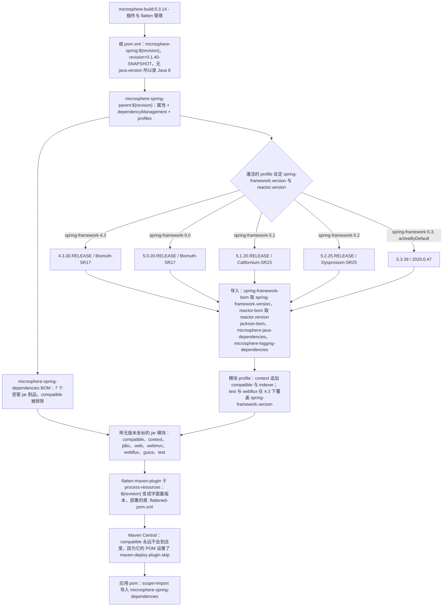

# microsphere-spring-parent — 开发者文档（0.1.x / `release-1.x`）

[← 开发者文档总览](./README.md) · [English](../parent.md) · [用户文档](../../../user-guide/1.x/zh/parent.md)

**谁需要这份文档。** 库维护者需要它：本 POM 钉住了 0.1.x 的 Spring 4.3–5.3 兼容矩阵，而且它是唯一一条 profile 也会改变
一个模块依赖集合的版本线，所以这里的每一次改动都必须在五个 Spring 版本上验证。使用 `javax.servlet` 与 Spring 4.3.x–5.3.x
的应用团队消费已发布的 [`microsphere-spring-dependencies`](../dependencies.md) BOM，只有在需要复现某个版本决策、
或者想弄清 `microsphere-spring-compatible` 为何不在 Central 上时，才会读这份文件。

## 1. 版本信息

| 项目 | 值 |
|------|-------|
| 分支 | `release-1.x` |
| 文档目录 | `docs/**/1.x/` |
| 版本线 | **0.1.x** |
| 开发版本（根 `<revision>`） | `0.1.40-SNAPSHOT` |
| 最近发布版本 | `0.1.39` |
| 构建基线父 POM | `io.github.microsphere-projects:microsphere-build:0.3.14` |
| Java 基线 | **Java 8** —— 1.x 根 POM 没有声明 `<java.version>`；`microsphere-build` 把它默认成 `8` |
| Servlet 命名空间 | `javax.*`（`javax.servlet:javax.servlet-api`，没有导入任何 Jakarta EE BOM） |
| 坐标 / 打包方式 | `io.github.microsphere-projects:microsphere-spring-parent:${revision}`，`packaging=pom` |

## 2. parent 在反应堆中的角色

`microsphere-spring-parent` 是一个只服务于构建的模块：它不打包任何类，发布的是一个 `pom` 制品，存在的意义就是被继承。
它自己的 parent 是反应堆根 `microsphere-spring`（`<relativePath>../pom.xml</relativePath>`），而根 POM 的 parent
是外部的 `microsphere-build:0.3.14`，全部插件管理都由它提供。

| 模块 | 声明的 parent | 打包方式 |
|--------|-----------------|-----------|
| `pom.xml`（根，聚合器） | `microsphere-build:0.3.14` | `pom` |
| `microsphere-spring-parent` | `microsphere-spring`（`../pom.xml`） | `pom` |
| `microsphere-spring-dependencies` | `microsphere-spring-parent` | `pom` |
| `microsphere-spring-compatible` | `microsphere-spring-parent` | `jar`，**不部署** |
| `microsphere-spring-context`、`-jdbc`、`-web`、`-webmvc`、`-webflux`、`-guice`、`-test` | `microsphere-spring-parent` | `jar` |

这个 parent 只承载 `<dependencyManagement>` 与 `<profiles>`，别无其他 —— 没有 `<build>`，没有 `<pluginManagement>`，
没有 `<repositories>`。九个继承它的模块都指向 `../microsphere-spring-parent/pom.xml`，所以在这里加上一个版本，
一次构建就作用于整个反应堆；而该 parent 本身也是一个已发布的 `pom` 制品，外部项目可以继承它。

## 3. `${revision}` + `flatten-maven-plugin` 版本管理

反应堆里的每个 POM 都声明同一个版本表达式，而只有根 POM 为它赋值：

```xml
<version>${revision}</version>   <!-- 根 POM properties：<revision>0.1.40-SNAPSHOT</revision> -->
```

这就是 Maven 的“CI-friendly versions”方案：版本不在十一个 POM 中重复出现，发布靠传入一个属性来产出，而不去改文件 ——
`mvn -Drevision=0.1.40 deploy -P publish,ci`，`maven-publish.yml` 跑的就是它（它的输入被描述为
“The version to publish for Spring Framework 4.3+”）。该方案只有在离开本机的 POM 不再包含 `${revision}` 之后才成立；
这就是 `org.codehaus.mojo:flatten-maven-plugin:1.7.3` 的职责，它在 `microsphere-build:0.3.14` 与 `0.3.17` 中配置完全一致：

| 设置 | 值 | 对已发布 POM 的影响 |
|---------|-------|-----------------------------|
| execution `flatten` | phase `process-resources`，goal `flatten` | 在每个模块中都执行，早于 `package` / `install` / `deploy` |
| `flattenMode` | `resolveCiFriendliesOnly` | 只重写 `${revision}`、`${sha1}`、`${changelist}` 以及 parent 版本；结构保持不变 |
| `updatePomFile` | `true` | 生成的 `.flattened-pom.xml`（被 git 忽略、从不手改、从不提交）就是被安装与被部署的那份 POM |
| `pomElements.parent` | `expand` | parent 块以具体版本写出（`microsphere-spring:0.1.39`） |
| `pomElements.properties` | `keep` | `microsphere-java.version` 之类的属性得以保留，因此 BOM 导入仍可解析 |
| `pomElements.dependencyManagement` / `dependencies` | `interpolate` / `resolve` | 可插值处的受管版本被解析掉；模块依赖的版本变成字面量 |
| `pomElements.scm` / `url` / `developers` | `resolve` | `${project.scm.url}` 这类表达式被展开 |
| `pomElements.distributionManagement` / `repositories` | `remove` | 内部仓库细节永远不会到达 Central |
| `flattenDependencyMode` / `embedBuildProfileDependencies` | `all` / `false` | 考虑完整的依赖集合；profile 条件依赖**不会**被烘焙进 POM |

**为什么 `flatten` 对消费方很重要。** 一份仍然写着 `<version>${revision}</version>` 的已部署 POM，会让消费方的 Maven
沿着 `microsphere-spring-parent` 的 parent 链向上去找一个 `revision` 属性，而它只存在于本反应堆根 POM 中；发布模型里没有它，
解析就会以 unresolvable-parent / bad-version 错误失败。Flatten 会换成一个字面量（`0.1.39`）。有两个影响是本线特有的：
`embedBuildProfileDependencies=false` 把 `microsphere-spring-context` 中 profile 条件的 `microsphere-spring-compatible`
与 `spring-context-indexer` 依赖（[§7](#7-profile--版本-parent-pom-vs-profile--额外依赖-模块-pom)）挡在已发布 POM 之外，
而扁平化后的 BOM 以字面量陈述受管模块，例如 `io.github.microsphere-projects:microsphere-spring-context:0.1.39`。

## 4. Profile 矩阵

`microsphere-spring-parent/pom.xml` 中有五个只含属性的 profile：

| Profile id | `${spring-framework.version}` | `${reactor.version}` | 激活方式 |
|-------------|-------------------------------|----------------------|------------|
| `spring-framework-4.3` | `4.3.30.RELEASE` | `Bismuth-SR17` | 显式 |
| `spring-framework-5.0` | `5.0.20.RELEASE` | `Bismuth-SR17` | 显式 |
| `spring-framework-5.1` | `5.1.20.RELEASE` | `Californium-SR23` | 显式 |
| `spring-framework-5.2` | `5.2.25.RELEASE` | `Dysprosium-SR25` | 显式 |
| `spring-framework-5.3` | `5.3.39` | `2020.0.47` | **`activeByDefault`** |

## 5. `${spring-framework.version}` 与 `${reactor.version}` 如何被消费

每个属性在 parent 的 `<dependencyManagement>` 中恰好被引用一次，用作 BOM 导入的版本：

```xml
<dependency>
    <groupId>org.springframework</groupId>
    <artifactId>spring-framework-bom</artifactId>
    <version>${spring-framework.version}</version>
    <type>pom</type>
    <scope>import</scope>
</dependency>

<dependency>
    <groupId>io.projectreactor</groupId>
    <artifactId>reactor-bom</artifactId>
    <version>${reactor.version}</version>
    <type>pom</type>
    <scope>import</scope>
</dependency>
```

链路是这样的：profile 设置一个属性 → 属性实例化一次 BOM 导入 → BOM 提供版本 → 模块 POM 声明无版本坐标，例如
`org.springframework:spring-context` 与 `io.projectreactor:reactor-core`。在本线上 `${reactor.version}` 是 Reactor 的
*发布列车*名称（`Bismuth-SR17`、`Californium-SR23`、`Dysprosium-SR25`、`2020.0.47`）而不是数字版本；`reactor-bom` 两种形式都接受。
导入顺序是承重的（坐标重复时以第一个声明为准）：`jackson-bom`、`org.yaml:snakeyaml`、`p6spy:p6spy`、`tomcat-embed-core`、
`org.apache.zookeeper:zookeeper`、`org.apache.curator:curator-recipes`、`org.apache.curator:curator-test`、
`spring-framework-bom`、`reactor-bom`、`microsphere-java-dependencies`、`microsphere-logging-dependencies`。

## 6. 受管的第三方版本

| 属性 | `release-1.x` 上的值 | 受管制品 |
|----------|------------------------|---------------------|
| `microsphere-java.version` | `0.3.19` | 导入 `io.github.microsphere-projects:microsphere-java-dependencies` |
| `microsphere-logging.version` | `0.2.2` | 导入 `io.github.microsphere-projects:microsphere-logging-dependencies` |
| `jakartaee.version` | **本线上不存在** | 没有 `jakarta.platform:jakarta.jakartaee-bom` 导入；模块 POM 里的 `javax.servlet:javax.servlet-api` 与 `javax.annotation:javax.annotation-api` 坐标不带版本，通过导入的 `microsphere-java-dependencies` 链解析 |
| `jackson.version` | `2.22.2` | 导入 `com.fasterxml.jackson:jackson-bom` |
| `snakeyaml.version` | `2.6` | 直接条目 `org.yaml:snakeyaml` |
| `p6spy.version` | `3.9.1` | 直接条目 `p6spy:p6spy` |
| `tomcat.version` | `9.0.119` | 直接条目 `org.apache.tomcat.embed:tomcat-embed-core` —— 1.x 独有的一项，因为本线没有 Jakarta EE BOM 来提供它 |
| `zookeeper.version` | `3.9.5` | 直接条目 `org.apache.zookeeper:zookeeper` |
| `curator.version` | `5.9.0` | 直接条目 `org.apache.curator:curator-recipes` 与 `curator-test`，两者都排除 `org.apache.zookeeper:zookeeper`，从而让显式的 `zookeeper` 条目决定版本 |

其他一些坐标在模块 POM 中不带版本，但**并不**在这里受管；它们通过导入的
`microsphere-java` / `microsphere-logging` / Spring / Reactor BOM 解析：`ch.qos.logback:logback-classic`、JUnit、`org.mockito:mockito-core`、
`org.hamcrest:hamcrest`、`org.skyscreamer:jsonassert`、`com.google.code.findbugs:jsr305`、`com.h2database:h2`、`org.xerial:sqlite-jdbc`。
`microsphere-spring-guice` 通过自身模块 POM 里的 `guice.version` 属性钉住 `com.google.inject:guice:7.0.0`，两条版本线上取值相同。

## 7. Profile → 版本 (parent POM) vs Profile → 额外依赖 (模块 POM)

两个不同的问题由两个不同的文件回答，而在本线上两者确实都被用到了：

| 问题 | 由谁回答 | 机制 |
|----------|-------------|-----------|
| “这条 Spring 版本线上用的是哪些*版本*？” | `microsphere-spring-parent/pom.xml` | profile 中的属性，喂给 BOM 导入（[§4](#4-profile-矩阵)） |
| “一条 Spring 版本线需要哪些*额外依赖*？” | 模块 POM，例如 `microsphere-spring-context/pom.xml` | 同一个 id 的 profile 内的 `<dependencies>` |

`release-1.x` 上的模块级 profile 块：

| 模块 | Profile | 该 profile 加入的内容 |
|--------|---------|-----------------------|
| `microsphere-spring-context` | `spring-framework-4.3` | `io.github.microsphere-projects:microsphere-spring-compatible:${revision}`（`<optional>true</optional>`）—— 此外别无他物 |
| `microsphere-spring-context` | `spring-framework-5.0` | `org.springframework:spring-context-indexer`（optional）**以及** `microsphere-spring-compatible:${revision}`（optional） |
| `microsphere-spring-context` | `spring-framework-5.1`、`spring-framework-5.2`、`spring-framework-5.3` | 只有 `org.springframework:spring-context-indexer`（optional） |
| `microsphere-spring-test` | `spring-framework-4.3` | 无依赖；为本模块覆盖 `<spring-framework.version>5.0.20.RELEASE</spring-framework.version>` |
| `microsphere-spring-webflux` | `spring-framework-4.3` | 无依赖；为本模块覆盖 `<spring-framework.version>5.0.20.RELEASE</spring-framework.version>` |

有两个后果。`spring-context-indexer` 在这里是*由 profile 提供*的 —— `spring-framework-4.3` 构建永远看不到它 —— 而在
0.2.x 上它只是一个普通的 optional 依赖。并且 `spring-framework-4.3` 刻意产出一个混合反应堆：`microsphere-spring-test`
与 `microsphere-spring-webflux` 针对 `5.0.20.RELEASE` 构建，其余每个模块都留在 `4.3.30.RELEASE`，因为 Spring 4.3 中并不存在
WebFlux 支持。没有其他模块声明 profile。

## 8. 针对某个具体的 Spring 版本线构建与测试

```bash
./mvnw clean test   -P spring-framework-4.3     # 最旧的受支持版本线
./mvnw clean verify -P spring-framework-5.1
./mvnw clean install -P spring-framework-5.3    # 等同于 activeByDefault 的构建

# CI 的确切调用方式，对每条 Spring 版本线重复一遍
mvn --batch-mode --update-snapshots --file pom.xml -Drevision=0.0.1-SNAPSHOT test \
    --activate-profiles test,coverage,spring-framework-5.0
```

本分支上的 `.github/workflows/maven-build.yml` 用 Java `8` × `11` × `17` × `21` × `25` 去打全部五个 Spring
profile。只要有其他 profile 被激活，Maven 就会丢弃 `activeByDefault` 的 profile，所以 `-P spring-framework-4.3`
替换掉的是 `5.3` —— 在脚本里绝不要依赖默认值。检查
`./mvnw -P spring-framework-4.3 help:evaluate -Dexpression=spring-framework.version -q -DforceStdout`（加上
`-pl microsphere-spring-webflux` 就能看到 `5.0.20.RELEASE` 覆盖）以及
`./mvnw -P spring-framework-4.3 -pl microsphere-spring-context dependency:tree -Dincludes=io.github.microsphere-projects:*`。
新增一条 Spring 版本线，需要在 parent 里加一个 profile 块，**并且**在每个有 profile 条件依赖的模块里加一个对应的块。

## 9. 版本管理与 profile 流转



## 10. 与 `release` (0.2.x) 的差异

| 方面 | `release-1.x` / 0.1.x（本文档） | `release` / 0.2.x |
|--------|----------------------------------------|--------------------|
| `microsphere-build` parent | `0.3.14` | `0.3.17` |
| Java 基线 | 从 `microsphere-build` 继承 `8`；根 POM 不设 | `17`，在根 POM 中显式设置 |
| 反应堆模块 | 10 个，含 `microsphere-spring-compatible` | 9 个，无 compatible 模块 |
| Profiles | `4.3` / `5.0` / `5.1` / `5.2` / `5.3`，默认 `5.3` | `6.0` / `6.1` / `6.2` / `7.0`，默认 `7.0` |
| Reactor 版本风格 | 发布列车名称（`Bismuth-SR17`、`Californium-SR23`、`Dysprosium-SR25`、`2020.0.47`） | 数字列车版本（`2022.0.22` … `2025.0.7`） |
| Servlet 命名空间 | `javax.servlet:javax.servlet-api`，无 Jakarta EE BOM | 导入 `jakarta.platform:jakarta.jakartaee-bom:11.0.0` |
| 额外受管制品 | 经 `tomcat.version` = `9.0.119` 的 `tomcat-embed-core` | — |
| `jackson` / `snakeyaml` / `zookeeper` | `2.22.2` / `2.6` / `3.9.5` | `2.22.3` / `2.7` / `3.9.6` |
| `microsphere-java` / `microsphere-logging` / `p6spy` / `curator` | `0.3.19` / `0.2.2` / `3.9.1` / `5.9.0` | 相同：`0.3.19` / `0.2.2` / `3.9.1` / `5.9.0` |
| profile 条件的模块依赖 | 有 —— `microsphere-spring-compatible`、`spring-context-indexer`、按模块的 `spring-framework.version` 覆盖 | 无；所有 profile 都只含属性 |
| CI Java 矩阵 | `8` / `11` / `17` / `21` / `25` | `17` / `21` / `25` |

相关文档：[./README.md](../README.md) · [./dependencies.md](../dependencies.md) · [./context.md](../context.md) ·
[./web.md](../web.md) · [./test.md](../test.md) · [./compatible.md](../compatible.md) · [../current/parent.md](../../current/parent.md)
