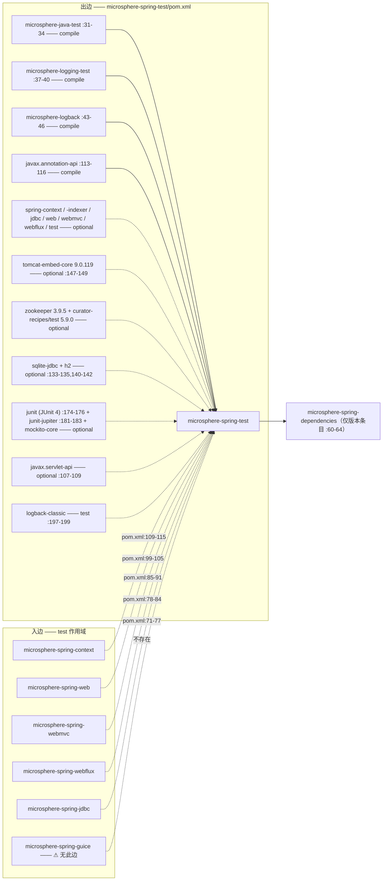
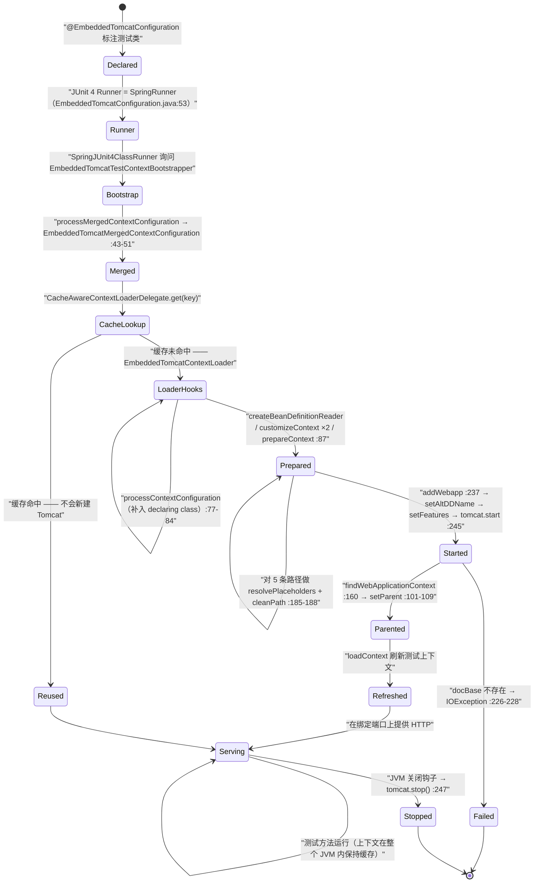

# microsphere-spring-test — 开发者文档（0.1.x / `release-1.x`）

[← 开发者文档总览](./README.md) · [English](../test.md) · [用户文档](../../../user-guide/1.x/zh/test.md) · [0.2.x](../../current/zh/test.md)

本页描述 **0.1.x 维护线**，它只存在于 `origin/release-1.x` 分支（工作树是 0.2.x）。文中每一个行号都读自该分支的对象库（`git show origin/release-1.x:<path>`）。引用约定：POM 路径完整写在 `origin/release-1.x:` 前缀之后；Java 源码使用缩写——`…/` = `microsphere-spring-test/src/main/java/io/microsphere/spring/test/`。

## 1. 模块身份、版本基线与依赖姿态

| 属性 | 取值 | 证据 |
|---|---|---|
| Maven 坐标 / 名称 | `io.github.microsphere-projects:microsphere-spring-test:${revision}`，"Microsphere :: Spring :: Test" | `origin/release-1.x:microsphere-spring-test/pom.xml:13-19` |
| 反应堆版本 / 父 POM | `revision` = `0.1.40-SNAPSHOT`（最后一个发布版 `0.1.39`）；`microsphere-spring-parent:${revision}`，外部构建父 POM `microsphere-build:0.3.14` | `origin/release-1.x:pom.xml:55`、`origin/release-1.x:microsphere-spring-test/pom.xml:5-10`、`origin/release-1.x:pom.xml:5-9` |
| Java 基线 | **`8`** —— 0.1.x 根 POM 未声明 `<java.version>`，由 `microsphere-build` 提供 `java.version=8` | `microsphere-build-0.3.14.pom:58,89,94`；对比 `pom.xml:56`（0.2.x，`17`） |
| Spring 基线 | 由 profile 选定的 `4.3.30.RELEASE` / `5.0.20.RELEASE` / `5.1.20.RELEASE` / `5.2.25.RELEASE` / `5.3.39`，`spring-framework-5.3` 为 `activeByDefault` | `origin/release-1.x:microsphere-spring-parent/pom.xml:136-178`、`:170-173` |
| Servlet 命名空间 | **`javax.servlet`** —— `javax.servlet:javax.servlet-api` 为 optional；SPI 测试夹具是 `META-INF/services/javax.servlet.ServletContainerInitializer`；`web.xml` 夹具为 `xmlns.jcp.org` 上的 `version="3.1"` | `origin/release-1.x:microsphere-spring-test/pom.xml:107-109`、`src/test/resources/webapp/WEB-INF/web.xml:2-5` |
| 内嵌 Tomcat | `tomcat-embed-core` **`9.0.119`**，optional —— 由 **0.1.x 父 POM 中声明的** `tomcat.version` 属性锁定 | `origin/release-1.x:microsphere-spring-parent/pom.xml:27,59-63`；`origin/release-1.x:microsphere-spring-test/pom.xml:147-149` |
| ZooKeeper / Curator | `zookeeper` **`3.9.5`**，`curator-recipes` / `curator-test` **`5.9.0`**；两个 Curator 条目都排除 `org.apache.zookeeper:zookeeper` | `origin/release-1.x:microsphere-spring-parent/pom.xml:28-29,65-95` |
| 内嵌数据库 | `org.xerial:sqlite-jdbc`、`com.h2database:h2` —— 均为 optional 且**不带版本号**：本条线上不存在 `<h2.version>`/`<sqlite.version>` | `origin/release-1.x:microsphere-spring-test/pom.xml:133-135,140-142`；`microsphere-spring-parent/pom.xml:21-29` 中的缺失 |
| JUnit | **同时**声明 `junit:junit`（JUnit 4）与 `org.junit.jupiter:junit-jupiter`，两者都 optional、都不带版本号 | `origin/release-1.x:microsphere-spring-test/pom.xml:173-177,180-184` |
| 强制（非 optional）构件 | `microsphere-java-test`、`microsphere-logging-test`、`microsphere-logback`、**`javax.annotation:javax.annotation-api`** | `origin/release-1.x:microsphere-spring-test/pom.xml:31-34,37-40,43-46,113-116` |
| 类型数量 | `io.microsphere.spring.test`；**33 个主源码类型**，27 个测试 java 文件中有 26 个 `*Test` + 1 个非测试辅助类（`TestServletContainerInitializer`） | `git ls-tree -r --name-only origin/release-1.x -- microsphere-spring-test` |
| 资源 | **完全没有 `src/main/resources`**；`src/test/resources` 共 8 个文件：3 个 webapp（`webapp`、`webapps/empty-app`、`webapps/context-loader-app`）、`config/test.properties`、servlet SPI 文件 | 同一份清单 |

**叶子模块姿态。** 本模块**不声明任何反应堆内的 `microsphere-spring-*` 依赖**——连 `microsphere-spring-context` 都没有（`origin/release-1.x:microsphere-spring-test/pom.xml:21-202`）。它的强制构件只来自兄弟 microsphere 仓库（`microsphere-java-test` `:31-34`、`microsphere-logging-test` `:37-40`、`microsphere-logback` `:43-46`）以及 `javax.annotation-api`（`:113-116`，这条 `javax.*` 线上唯一强制的 Java-EE 构件）。所有框架、容器与测试库构件都是 `<optional>`（`:51-191`），因此不会传递到任何消费者——正是这一点让另外五个兄弟模块能在 `test` 作用域里使用它而不构成环，也不会把 Tomcat、ZooKeeper、SQLite 拖进生产构建。



在分支上实测到的入边：`origin/release-1.x:microsphere-spring-context/pom.xml:109-115`、`…microsphere-spring-web/pom.xml:99-105`、`…microsphere-spring-webmvc/pom.xml:85-91`、`…microsphere-spring-webflux/pom.xml:78-84`、`…microsphere-spring-jdbc/pom.xml:71-77` —— 方向与 0.2.x 一致（边**从**这些模块**指向** `microsphere-spring-test`）。⚠ `microsphere-spring-guice` 在这条线上同样**没有**这条边（`origin/release-1.x:microsphere-spring-guice/pom.xml:49-66` 只声明了 `junit`、`spring-test`、`logback-classic`），与 0.2.x 一致。仅版本管理：`origin/release-1.x:microsphere-spring-dependencies/pom.xml:60-64`。

由于一切都是 optional，**每个消费者会重新声明自己真正用到的东西**：`microsphere-spring-webmvc/pom.xml:94-98` 为 `@EmbeddedTomcatConfiguration` 在 `test` 作用域补上 `tomcat-embed-core`，`microsphere-spring-jdbc/pom.xml:80-84` 为 `@EnableEmbeddedDatabase` 补上 `org.xerial:sqlite-jdbc`，`microsphere-spring-webmvc/pom.xml:72-76` 补上 `junit:junit` —— 在这条线上这是必需的，因为 `@EmbeddedTomcatConfiguration` 是 JUnit 4 注解（见 §4.2）。

## 2. 包结构地图

| 包（`io.microsphere.spring.test.`） | 类型（可见性） | 职责 |
|---|---|---|
| `jdbc.embedded` | `EnableEmbeddedDatabase`、`EnableEmbeddedDatabases`、`EmbeddedDatabaseType`（public），`EmbeddedDataBaseBeanDefinitionRegistrar`（包级私有，`…/jdbc/embedded/EmbeddedDataBaseBeanDefinitionRegistrar.java:47`），`EmbeddedDataBaseBeanDefinitionsRegistrar`（包级私有，`…:37`） | 注解驱动的 SQLite / H2 `DriverManagerDataSource` 注册 |
| `tomcat.embedded` | `EmbeddedTomcatConfiguration`（public，内含 `enum Feature`）、`EmbeddedTomcatTestContextBootstrapper`（包级私有，`:35`）、`EmbeddedTomcatMergedContextConfiguration`（包级私有，`:35`）、`EmbeddedTomcatContextLoader`（包级私有，`:73`） | 把真实的内嵌 Tomcat 充当 Spring Test 的 `ContextLoader` |
| `zookeeper.embedded` | `EmbeddedZookeeperServer`（public）、`EmbeddedZookeeperServerTestExecutionListener`（包级私有，`:45`） | 绑定到测试类生命周期的 Curator `TestingServer` |
| `junit.jupiter` | `SpringLoggingTest`（public 注解） | 组合 `@LoggingLevelsClass({"TRACE","INFO","ERROR"})`（`…/junit/jupiter/SpringLoggingTest.java:40`） |
| `webmvc` | `AbstractWebMvcTest`（public 抽象，`…/webmvc/AbstractWebMvcTest.java:60`）、`SimpleUrlHandlerMappingTestConfig`（public）——**只有这两个文件** | 注解式 WebMVC 夹具 + `MockMvc` 基类 —— **JUnit 4** |
| `webflux` | `AbstractWebFluxTest`（public 抽象，`…/webflux/AbstractWebFluxTest.java:52`）、`PersonHandler`、`RouterFunctionTestConfig`、`SimpleUrlHandlerMappingTestConfig` | WebFlux 侧的镜像 —— **JUnit 5** |
| `web` / `web.controller` / `web.servlet` / `web.context.request` | `WebTestUtils`（public，`:42`）；`TestController`（public，`@Controller @RequestMapping("/test")`，`:43-45`）；`TestServletContext`、`TestServlet`、`TestFilter`、`TestServletRegistration`、`TestFilterRegistration`、`TestServletContextListener`（public）；`MockServletWebRequest`（public，`:36`） | `MockServerWebExchange`/`Mono` 辅助方法、两套栈共用的端点夹具、真正会响应 `addServlet`/`addFilter`/`addListener` 的 `javax.servlet` `ServletContext`、暴露 mock 请求/响应对的 `ServletWebRequest` |
| `util` | `SpringTestUtils`、`ServletTestUtils`、`SpringTestWebUtils`（public abstract，私有构造器） | 临时容器、servlet 注册、`NativeWebRequest` 构造器 |
| `context.annotation` | `AnnotatedTypeMetadataTestFactory`（public，`:36`）、`TestConditionContext`（public，`:41`） | `AnnotatedTypeMetadata` / `ConditionContext` 测试替身 |
| `domain` | `User`（带 `equals`/`hashCode`/`toString` 的 public JavaBean） | JSON 往返测试的载荷对象 |

## 3. 架构设计

整个模块只实现一个思想：**内嵌资源要么成为 Bean 定义，要么成为 context-loader 三件套的一部分，要么成为 `TestExecutionListener`** —— 判断依据是该资源是否必须在 `refresh()` *之前*就存在。

```mermaid
flowchart TD
    subgraph A["路径 A —— Bean 定义阶段"]
        ANN["@EnableEmbeddedDatabase（@Repeatable）"] -->|"@Import，单次出现"| REG1["EmbeddedDataBaseBeanDefinitionRegistrar :47"]
        ANN -->|"容器注解 @EnableEmbeddedDatabases，≥2 次"| REG2["EmbeddedDataBaseBeanDefinitionsRegistrar :37"]
        REG2 -->|"遍历 getAnnotationArray('value') :45"| REG1
        REG1 -->|"switch EmbeddedDatabaseType :60"| JDBC["jdbc:sqlite::memory: :87 / jdbc:h2:mem: :92"]
        JDBC --> BDS["BeanDefinition(DriverManagerDataSource) + setPrimary :107"]
    end
    subgraph B["路径 B —— context-loader 三件套"]
        ETC["@EmbeddedTomcatConfiguration"] -->|"@BootstrapWith :54"| BST["EmbeddedTomcatTestContextBootstrapper"]
        ETC -->|"@RunWith(SpringRunner) :53 —— JUnit 4"| J4["Spring 4.3–5.3 + JUnit 4 运行时"]
        BST -->|processMergedContextConfiguration :43| MCC["EmbeddedTomcatMergedContextConfiguration"]
        BST -->|getDefaultContextLoaderClass :38| TCL["EmbeddedTomcatContextLoader"]
        TCL -->|prepareContext :87 → deployContext :179| TOM["Tomcat.addWebapp :237 + tomcat.start :245"]
        TOM -->|关闭钩子 :247| STOP["tomcat.stop()"]
    end
    subgraph C["路径 C —— test-execution 监听器"]
        EZ["@EmbeddedZookeeperServer"] -->|"@TestExecutionListeners MERGE_WITH_DEFAULTS :46-49"| TEL["EmbeddedZookeeperServerTestExecutionListener"]
        TEL -->|beforeTestClass :50| TS["new TestingServer(instanceSpec, true) :59"]
        TEL -->|afterTestClass :65| TSS["testingServer.stop() :68"]
    end
```



* 路径 A 在 Bean 定义注册阶段运行，因此 `@Autowired DataSource` 无需关心顺序。
* 路径 B 之所以存在，是因为 Tomcat 必须**在测试上下文刷新之前就已启动** —— 被部署的 webapp 自身的 `ContextLoaderListener`/`DispatcherServlet` 会创建一个 `WebApplicationContext`，测试上下文随后把它 adopt 为父上下文（`…/tomcat/embedded/EmbeddedTomcatContextLoader.java:87-99`）。
* 路径 C 面向*位于上下文之外*的资源，因此测试类生命周期才是它的归属。

**实际挂接的 Spring 生命周期事件：**没有。`src/main/java` 中没有任何类型实现 `Lifecycle`、`SmartLifecycle`、`ApplicationListener` 或消费 `ContextClosedEvent`。挂接点是 `ImportBeanDefinitionRegistrar.registerBeanDefinitions`、`ContextLoader` 的模板方法、`AbstractTestExecutionListener.beforeTestClass`/`afterTestClass`，外加 `ShutdownHookUtils.addShutdownHookCallback`（`…/tomcat/embedded/EmbeddedTomcatContextLoader.java:247`）。

**缓存。** 只有 Spring 自身的 `CacheAwareContextLoaderDelegate` 会缓存上下文，键为 `MergedContextConfiguration`。`EmbeddedTomcatMergedContextConfiguration` 把 port/contextPath/basedir/alternativeWebXml/features 存成字段（`…/tomcat/embedded/EmbeddedTomcatMergedContextConfiguration.java:37-45`），但**只覆写了 `toString()`**（`:102-112`）—— 它们完全不参与 `equals`/`hashCode`。

## 4. 源码解析

### 4.1 `@EnableEmbeddedDatabase` 与它的两个 registrar

```java
@Target({TYPE, ANNOTATION_TYPE}) @Retention(RUNTIME) @Documented
@Import(EmbeddedDataBaseBeanDefinitionRegistrar.class)                 // …/jdbc/embedded/EnableEmbeddedDatabase.java:42
@Repeatable(EnableEmbeddedDatabases.class)                             // :43
public @interface EnableEmbeddedDatabase {                             // :44
    EmbeddedDatabaseType type() default SQLITE;  int port() default -1;   // :49 :56
    String dataSource();                        boolean primary() default false;  // :61 :66
    String[] properties() default {};                                    // :71
}
```

`@EnableEmbeddedDatabase` **不是** `@Inherited`，而它的容器注解 `@EnableEmbeddedDatabases` **是**（`…/jdbc/embedded/EnableEmbeddedDatabases.java:41`），并且导入的是*复数* registrar（`:42`）。单数 registrar 是一个包级私有的普通 `ImportBeanDefinitionRegistrar`（`:47`），方法体是名称守卫 + 类型分支（`:57-68`）。`registerDataSourceBeanDefinition` 用**两个构造器参数**（JDBC URL 与解析后的 `Properties`）构建 `DriverManagerDataSource`，调用 `setPrimary(primary)`，并以注解的 `dataSource` 名称注册（`:95-109`）。`resolveProperties` 把 registry 强转为 `ConfigurableBeanFactory`，将每个 `properties` 条目通过 `resolveEmbeddedValue` 解析（因此 Environment 中的 `${…}` 可用），用 `LINE_SEPARATOR` 拼接后交给 `Properties.load`（`:111-122`）。可重复性由**第二个** registrar（注意多出的那个 `s`）处理——它读取 `attributes.getAnnotationArray("value")`，并把每个元素委派给一个新的单数 registrar（`EmbeddedDataBaseBeanDefinitionsRegistrar.java:44-47`）。因此：出现一次 ⇒ 单数 registrar 运行一次；出现两次及以上 ⇒ Spring 暴露容器注解，由复数 registrar 循环。

### 4.2 `EmbeddedTomcatConfiguration` —— 这条线上的 JUnit 4 那一半

该注解携带完整的 Spring Test 栈（`…/tomcat/embedded/EmbeddedTomcatConfiguration.java:49-56`）：`@Target(TYPE)`、`@Inherited`、**`:53` 处的 `@RunWith(SpringRunner.class)`**（`import org.junit.runner.RunWith` 在 `:23`）、`@BootstrapWith(EmbeddedTomcatTestContextBootstrapper.class)`（`:54`）、`@ContextConfiguration`（`:55`）、`@WebAppConfiguration`（`:56`）。⚠ 这条线上**没有** `@ExtendWith(SpringExtension.class)` —— 那是 0.2.x 的写法。实际后果是：`@EmbeddedTomcatConfiguration` 的每个消费者都需要测试类路径上有 **JUnit 4**，而 `microsphere-spring-webmvc/pom.xml:72-76` 提供的正是它。

六个属性是纯粹的 Tomcat 旋钮（`port` `:64`、`contextPath` `:72`、`basedir` `:88`、`docBase` `:106-107`、`alternativeWebXml` `:128`、`features` `:135`）；五个是通过 `@AliasFor` 映射到 `@ContextConfiguration` 的镜像（`classes`/`locations`/`initializers`/`inheritLocations`/`inheritInitializers`，`:142-177`），其中 `docBase` 别名指向 `WebAppConfiguration#value`。`enum Feature`（`:182-226`）是纯粹的"枚举即特性开关"，每个特性恰好一个施加者，在 `setFeatures`（`EmbeddedTomcatContextLoader.java:265-287`）中解析：

| `Feature` | 施加方式 | 效果 |
|---|---|---|
| `NAMING` | `tomcat.enableNaming()`（`:270`） | JNDI |
| `DEFAULT_WEB_XML` | `tomcat.setAddDefaultWebXmlToWebapp(true)`（`:273`） | 反转 `:196` 强制设下的 `false` |
| `WEB_APP_DEFAULTS` | `initWebappDefaults(context)`（`:276`） | default 与 JSP servlet、30 分钟会话、MIME 映射、welcome 文件 |
| `USE_TEST_CLASSPATH` | `context.setParentClassLoader(config.getTestClass().getClassLoader())`（`:279-280`） | webapp 能看到测试依赖 |
| `SILENT` | `tomcat.setSilent(true)`（`:283`） | 抑制 Tomcat 内部日志 |

### 4.3 包级私有的 Tomcat 三件套

`EmbeddedTomcatTestContextBootstrapper`（`:35`）与 `EmbeddedTomcatContextLoader`（`:73`）都声明为**无访问修饰符**；只有同包测试能触达它们（`src/test/java/…/tomcat/embedded/EmbeddedTomcatContextLoaderTest.java`）。bootstrapper 强制指定 loader 类（`:37-40`），并把 `super.processMergedContextConfiguration` 返回的 `WebMergedContextConfiguration` 包装成 Tomcat 感知的子类，注解通过 `findMergedAnnotation(testClass, …)` 读取（`:42-56`）。loader 继承 `AbstractGenericContextLoader`，覆写六个模板方法：

| 覆写 | 行号 | 行为 |
|---|---|---|
| `processContextConfiguration` | `:77-84` | 若未声明 `classes`，则注入 `configAttributes.getDeclaringClass()` —— 裸写 `@EmbeddedTomcatConfiguration` 也能把被标注的测试类当配置 |
| `prepareContext` | `:86-99` | 强转为 `EmbeddedTomcatMergedContextConfiguration`，调用 `deployContext(...)`，再 `setParent(...)`（`:101-109`） |
| `createBeanDefinitionReader` | `:111-115` | 返回基于 `DefaultListableBeanFactory` 的 `XmlBeanDefinitionReader`（因此 `locations` 是 XML） |
| `customizeContext(GenericApplicationContext)` | `:117-121` | 通过 `registerResolvableDependency` 注册可解析依赖（`:138`）—— 故意**不**调用 `super` |
| `customizeContext(ConfigurableApplicationContext, MergedContextConfiguration)` | `:123-127` | 先调用 `super`，再通过 `AnnotatedBeanDefinitionReader` 注册 `classes`（`:129-136`） |
| `getResourceSuffix` | `:293-296` | `"-context.xml"`，于是 `WEB-INF/<name>-context.xml` 会被自动探测 |

`deployContext`（`:179-250`）是资源生命周期的核心：五个路径类属性先经 `environment.resolvePlaceholders` + `cleanPath`（`:185-188`、`:252-255`）→ `new Tomcat()`、`setAddDefaultWebXmlToWebapp(false)`、`setPort`、存在时 `setBaseDir`（`:195-201`）→ 若 `alternativeWebXml` 解析到真实文件，则其**父目录成为 docBase**，`resourceBasePath` 被丢弃（`:206-220`）→ docBase 缺失 ⇒ `IOException("The Context's docBase directory can't be found on the path : '…'")`（`:226-228`）→ `addWebapp` → `setAltDDName` → `setFeatures` → `start()` → `addShutdownHookCallback(() -> execute(tomcat::stop))`（`:237-249`）。

### 4.4 `@EmbeddedZookeeperServer`

一个 public 标记注解（`…/zookeeper/embedded/EmbeddedZookeeperServer.java:50`），带 `@Inherited`（`:44`）、**`@RunWith(SpringRunner.class)`**（`:45`）与 `@TestExecutionListeners(listeners = …, mergeMode = MERGE_WITH_DEFAULTS)`（`:46-49`）。属性：`port()` = `2181`（`:57`）、`dataDir()` = `"${java.io.tmpdir}/test-zookeeper-${port}"`（`:71`）、`tickTime()` = `2000L`（`:78`）。它还 `import org.apache.catalina.Context`，只为 Javadoc 里一句多余的 `@see Context`（`:20`、`:38`）—— 结果把 ZooKeeper 包与 `tomcat-embed-core` 绑在了一起；这是从 Tomcat 注解复制粘贴留下的残余。

监听器是包级私有（`EmbeddedZookeeperServerTestExecutionListener.java:45`），`getOrder()` 返回 `HIGHEST_PRECEDENCE + 5`（`:71-74`），因此服务器在 Spring 上下文准备之前启动、在所有其他监听器结束之后停止。它把 `TestingServer` 存在键 `microsphere:zookeeper-server`（`:47`）下，用 `new InstanceSpec(dataDirectory, port, -1, -1, true, -1, tickTime, -1, null, null)` 构造 spec（`:90-92`），并在一个**全新的 `StandardEnvironment`** 上解析 `dataDir` —— 该 Environment 只被塞进一个仅含 `port` 的 `MapPropertySource("_")`（`:76-88`）；测试自己的 `ApplicationContext` `Environment` 从不被查询，所以 `@TestPropertySource` 的值永远到不了 `dataDir`。

### 4.5 抽象测试基类 —— 一个 JUnit 4，一个 JUnit 5

这是本模块中 0.1.x 特征最鲜明的不对称，也是 `junit` 与 `junit-jupiter` 同时被声明（§1）的直接后果。

| | `AbstractWebMvcTest`（`…/webmvc/AbstractWebMvcTest.java`） | `AbstractWebFluxTest`（`…/webflux/AbstractWebFluxTest.java`） |
|---|---|---|
| 禁用标记 | `@Ignore` `:53`（JUnit 4） | `@Disabled` `:45`（JUnit 5） |
| 引导方式 | `@RunWith(SpringRunner.class)` `:54` | `@SpringJUnitConfig` `:46` |
| 配置 | `@WebAppConfiguration` `:55`、`@ContextConfiguration(classes = {TestController.class})` `:56-58`、`@EnableWebMvc` `:59` | `@ContextConfiguration(classes = …)` `:47-50`、`@EnableWebFlux` `:51` |
| 初始化钩子 | `@Before public void setUp()` `:70-73` | `@BeforeEach final void init()` `:64-66`（包级私有、不可覆写） |
| `TestController` 字段 | `@Autowired protected` `:65-66` | `@Autowired protected` `:59-60` |
| 冒烟方法 | **`public`** ×7：`testWebEndpoints` `:84`、`testHelloWorld` `:97`、`testGreeting` `:108`、`testUser` `:121`、`testError` `:139`、`testResponseEntity` `:149`、`testView` `:160` | **`protected`** ×7：`testHelloWorld` `:72` 至 `testView` `:141`、`testUpdatePerson` `:151` —— 并且**没有** `testWebEndpoints` |
| 额外钩子 | —— | `buildWebTestClient(context)` `:158` |

⚠ 在 0.1.x 上，WebMVC 基类**只**装配 `TestController`：`webmvc` 包里根本不存在 `PersonHandler` 与 `RouterFunctionTestConfig`（该包只有 2 个文件，`webflux` 有 4 个），所以 `testWebEndpoints` 覆盖五个端点，也没有 `POST /test/person` 的覆盖。因此在 0.1.x 上，只用 JUnit 5 的项目若不引入 Vintage 引擎就无法使用 `AbstractWebMvcTest`、`@EmbeddedTomcatConfiguration`、`@EmbeddedZookeeperServer`；只用 JUnit 4 的项目则完全无法使用 `AbstractWebFluxTest`。

## 5. 内嵌 Tomcat 生命周期



两个事实是承重的：上下文（因而也包括服务器）在测试类之间**从不**停止 —— 只在 JVM 退出时；而 `Tomcat` 引用只被那个关闭钩子 lambda 持有，所以当 `port = 0` 时没有任何 API 公布真正绑定到的端口。

**同一个类组合多种资源时的顺序。** `beforeTestClass` 先启动 ZooKeeper（监听器 order 为 `HIGHEST_PRECEDENCE + 5`，`…/zookeeper/embedded/EmbeddedZookeeperServerTestExecutionListener.java:71-74`）；随后如上图构建 `MergedContextConfiguration` 与缓存上下文；`ImportBeanDefinitionRegistrar`（含内嵌数据库那个）只在 `refresh()` 内部运行，所以 `@EnableEmbeddedDatabase` 的 Bean 总是出现*在* ZooKeeper 就绪*之后*；`afterTestClass` 停止 ZooKeeper（`:68`），而内嵌数据库只随上下文一起销毁，也就是从不显式销毁。

## 6. 设计模式

| 模式 | 类 | 证据 |
|---|---|---|
| 注册器（`@Enable*`） | `EmbeddedDataBaseBeanDefinitionRegistrar`、`EmbeddedDataBaseBeanDefinitionsRegistrar` | `@Import` 目标，两者均为包级私有（`:47`、`:37`） |
| 组合 / 注册器链（可重复注解分派） | 复数 registrar 对每个元素委派给 `new EmbeddedDataBaseBeanDefinitionRegistrar()` | `EmbeddedDataBaseBeanDefinitionsRegistrar.java:44-47` |
| 建造者（流式 Bean 定义构建） | `genericBeanDefinition(DriverManagerDataSource.class).addConstructorArgValue(...)` | `EmbeddedDataBaseBeanDefinitionRegistrar.java:102-108` |
| 枚举即特性开关 + 命令分派 | `EmbeddedTomcatConfiguration.Feature` 由 `setFeatures` 中的 `switch` 消费 | `EmbeddedTomcatConfiguration.java:182-226`；`EmbeddedTomcatContextLoader.java:265-287` |
| 装饰器 / 值对象增强 | `EmbeddedTomcatMergedContextConfiguration` 包装 `WebMergedContextConfiguration` 并新增五个字段 | `EmbeddedTomcatMergedContextConfiguration.java:35-48` |
| 模板方法 | `EmbeddedTomcatContextLoader` 覆写 `AbstractGenericContextLoader` 的 6 个钩子；`AbstractWebFluxTest.buildWebTestClient` 是基类钩子 | `EmbeddedTomcatContextLoader.java:77-135,293-296`；`AbstractWebFluxTest.java:158` |
| 策略（测试替身选择） | `EmbeddedDatabaseType {SQLITE, H2}` 选择 `processSQLite`/`processH2` | `EmbeddedDataBaseBeanDefinitionRegistrar.java:59-67`；`EmbeddedDatabaseType.java:26-37` |
| 工厂方法 | `AnnotatedTypeMetadataTestFactory.createMethodAnnotatedTypeMetadata()`、`WebTestUtils.mockServerWebExchange()`、`SpringTestWebUtils.createWebRequest(...)` | `AnnotatedTypeMetadataTestFactory.java:40-43`；`WebTestUtils.java:82-98`；`SpringTestWebUtils.java:66-98` |
| 静态设施（不可实例化工具类） | `SpringTestUtils`、`ServletTestUtils`、`SpringTestWebUtils` 为 `abstract` 且构造器 `private` | `SpringTestUtils.java:33,109`；`ServletTestUtils.java:41,96`；`SpringTestWebUtils.java:49,303` |
| 适配器（测试替身） | `TestServletContext` 适配 `MockServletContext`、`TestConditionContext` 适配 `ApplicationContext`、`MockServletWebRequest` 适配 mock 请求/响应对 | `TestServletContext.java:49+`；`TestConditionContext.java:41-73`；`MockServletWebRequest.java:36-51` |
| 观察者（测试生命周期，而非应用事件） | `EmbeddedZookeeperServerTestExecutionListener extends AbstractTestExecutionListener` | `EmbeddedZookeeperServerTestExecutionListener.java:45-74` |
| **缺失：** Lifecycle / SmartLifecycle、`ApplicationListener`、单例持有者式缓存 | —— | `src/main/java` 中零匹配 |

## 7. 本模块的 0.1.x 与 0.2.x 差异

把 `git ls-tree -r --name-only origin/release-1.x -- microsphere-spring-test` 与工作树的同名清单对比：**0.1.x 有 33 个主源码类型，0.2.x 有 35 个；没有任何类型只存在于 0.1.x，0.2.x 恰好新增 2 个主类型。** 测试源码方向相反：0.1.x 有 27 个测试 java 文件，0.2.x 有 31 个。

| 维度 | 0.1.x（`origin/release-1.x`） | 0.2.x（工作树） | 证据 |
|---|---|---|---|
| Servlet / Java-EE 命名空间 | `javax.servlet:javax.servlet-api`（`:107-109`）+ 强制的 `javax.annotation:javax.annotation-api`（`:113-116`） | `jakarta.servlet:jakarta.servlet-api`、`jakarta.websocket{,-client}-api`；父 POM 导入 `jakarta.jakartaee-bom 11.0.0` | `origin/release-1.x:microsphere-spring-test/pom.xml:107-116` 对 `microsphere-spring-test/pom.xml:50-62,126-131`；`microsphere-spring-parent/pom.xml:24,51-58` |
| SPI 夹具 | `META-INF/services/javax.servlet.ServletContainerInitializer` | 更名为 `jakarta.servlet.ServletContainerInitializer` | 两份 `src/test/resources` 清单 |
| 内嵌 Tomcat 版本 | **`9.0.119`**，由 **0.1.x 父 POM 里的** `tomcat.version` 属性锁定并在该处管理（`:59-63`） | `tomcat-embed-core` **不带版本**：0.2.x 父 POM 完全没有 `tomcat.version`（0 次出现），该构件也未在本地管理 | `origin/release-1.x:microsphere-spring-parent/pom.xml:27,59-63` 对 `microsphere-spring-parent/pom.xml:21-136` |
| ZooKeeper / Curator | `3.9.5` / Curator `5.9.0`（两者都排除 `zookeeper`） | `3.9.6` / Curator `5.9.0`，排除项相同 | `origin/release-1.x:microsphere-spring-parent/pom.xml:28-29,74-95` 对 `microsphere-spring-parent/pom.xml:28-29` |
| 声明的测试框架 | **`junit:junit` 与 `junit-jupiter` 并存**，都 optional（`:173-177,180-184`） | 仅 `junit-jupiter`（`microsphere-spring-test/pom.xml:189-193`）；`junit:junit` 已移除；新增 optional 的 `hamcrest` | 两份 POM 清单；`microsphere-spring-test/pom.xml:71-76` |
| `@EmbeddedTomcatConfiguration` | `@RunWith(SpringRunner.class)`（`:53`） | `@ExtendWith(SpringExtension.class)` | `origin/release-1.x:…/EmbeddedTomcatConfiguration.java:49-56` 对 `…/EmbeddedTomcatConfiguration.java:49-56` |
| `@EmbeddedZookeeperServer` | `@RunWith(SpringRunner.class)`（`:45`） | `@ExtendWith(SpringExtension.class)`（`:45`） | `origin/release-1.x:…/EmbeddedZookeeperServer.java:41-50` |
| `AbstractWebMvcTest` | JUnit 4：`@Ignore` + `@RunWith(SpringRunner.class)` + `@Before`，冒烟方法 **`public`**，夹具只有 `TestController` | JUnit 5：`@Disabled` + `@SpringJUnitConfig` + `@BeforeEach protected`，冒烟方法 `protected`，`private TestController`，夹具为 `TestController` + `RouterFunctionTestConfig` | `…/webmvc/AbstractWebMvcTest.java:53-73`（分支）对 `microsphere-spring-test/…/webmvc/AbstractWebMvcTest.java:50-70` |
| 0.1.x 上缺失的主类型 | —— | `webmvc/PersonHandler.java`、`webmvc/RouterFunctionTestConfig.java` 是 **0.2.x 新增** | 两份 `git ls-tree` 清单做 `comm -13` |
| 0.1.x 上缺失的测试类 | —— | `webflux/PersonHandlerTest`、`webflux/SimpleUrlHandlerMappingTestConfigTest`、`webflux/WebFluxTest`、`webmvc/PersonHandlerTest` —— 分支上**完全没有 `src/test/…/webflux/**`** | 两份测试树清单做 `comm -13` |
| 模块本地 Spring profile | 声明了 `spring-framework-4.3`，但**把值设成 `5.0.20.RELEASE`**（`:204-211`） | 模块内没有 `<profiles>` 块 | `origin/release-1.x:microsphere-spring-test/pom.xml:204-211` |
| Java 基线 / JDK 与 Spring 矩阵 | `8`；CI `8, 11, 17, 21, 25`；Spring 4.3/5.0/5.1/5.2/5.3 | `17`；CI `17, 21, 25`；Spring 6.0/6.1/6.2/7.0 | `microsphere-build-0.3.14.pom:89`、`origin/release-1.x:.github/workflows/maven-build.yml:25-29`、`origin/release-1.x:microsphere-spring-parent/pom.xml:136-178` 对 `pom.xml:56`、`.github/workflows/maven-build.yml:25-29`、`microsphere-spring-parent/pom.xml:138-173` |

## 8. 构建与验证

| 任务 | 命令 / 事实 |
|---|---|
| 构建并测试该模块 | `mvn -pl microsphere-spring-test -am test --activate-profiles test,coverage,spring-framework-5.3` —— CI 会附加 `-Drevision=0.0.1-SNAPSHOT`；触发条件是推送到 `dev-1.x`、PR 目标为 `dev-1.x`/`release-1.x`（`origin/release-1.x:.github/workflows/maven-build.yml:14-18,43-49`） |
| 运行单个测试 | `mvn -pl microsphere-spring-test test -Dtest=EmbeddedTomcatConfigurationFullTest -Drevision=0.1.40-SNAPSHOT` |
| Surefire 选取规则 | 包含 `**/*Test.java` / `**/*Tests.java`，排除 `**/Abstract*.java`（`microsphere-build`）—— 这就是 `AbstractWebMvcTest`/`AbstractWebFluxTest` 自身不会被执行的原因 |
| 模块自测的 JUnit 口味 | 27 个测试文件中有 26 个 import JUnit 4；唯一例外是 `web/WebTestUtilsTest.java`（Jupiter） |
| 测试清单（26 个类） | Tomcat：`EmbeddedTomcatConfigurationTest`、`…ContextLoaderWebAppTest`、`…EmptyWebAppTest`、`…FullTest`、`EmbeddedTomcatContextLoaderTest`；JDBC：`EnableEmbeddedDatabaseTest`、`EnableEmbeddedDatabasesTest`、`EmbeddedDataBaseBeanDefinitionRegistrarTest`；ZooKeeper：`EmbeddedZookeeperServerTest`；util：`ServletTestUtilsTest`、`SpringTestUtilsTest`、`SpringTestWebUtilsTest`；web：`WebTestUtilsTest`、`MockServletWebRequestTest`、`TestControllerTest`、`TestFilter{,Registration}Test`、`TestServlet{,Registration}Test`、`TestServletContext{,Listener}Test`；webmvc：`WebMvcTest`、`SimpleUrlHandlerMappingTestConfigTest`；另有 `context.annotation` ×2 与 `domain/UserTest` |
| 关键测试资源 | `src/test/resources/webapp/WEB-INF/web.xml` 声明了 `ContextLoaderListener`（`:7-9`）与映射到 `/*` 的 `DispatcherServlet`（`:11-24`），且 `contextConfigLocation` 为空（`:14-17`）；`webapps/empty-app` 与 `webapps/context-loader-app` 提供两种替代描述符场景 |

## 9. 坑与陷阱

| # | 观察 | 证据 |
|---|---|---|
| 1 | ⚠ **本模块的 `spring-framework-4.3` profile 是坏的。** 它把 `spring-framework.version` 重新声明为 `5.0.20.RELEASE`，于是 `-P spring-framework-4.3` 会用 Spring 5.0 编译和测试 `microsphere-spring-test`，而反应堆其余部分用的是 4.3.30。 | `origin/release-1.x:microsphere-spring-test/pom.xml:204-211`；父 POM 的正确值 `origin/release-1.x:microsphere-spring-parent/pom.xml:138-142` |
| 2 | ⚠ **JUnit 4 与 JUnit 5 并存且不可互换。** `@EmbeddedTomcatConfiguration`、`@EmbeddedZookeeperServer`、`AbstractWebMvcTest` 是 JUnit 4（`@RunWith`/`@Ignore`/`@Before`）；`AbstractWebFluxTest` 与 `WebTestUtilsTest` 是 Jupiter。只用 JUnit 5 的消费者需要 Vintage 引擎；只用 JUnit 4 的消费者直接失去 WebFlux。 | `…/tomcat/embedded/EmbeddedTomcatConfiguration.java:23,53`；`…/zookeeper/embedded/EmbeddedZookeeperServer.java:21,45`；`…/webmvc/AbstractWebMvcTest.java:23-25,53-54,70`；`…/webflux/AbstractWebFluxTest.java:22-23,45,64` |
| 3 | 两个 JUnit 构件都是 **optional**，所以没有任何测试框架会被自动带进你的构建；消费者必须自己声明所用那一个。 | `origin/release-1.x:microsphere-spring-test/pom.xml:173-184`；`microsphere-spring-webmvc/pom.xml:72-76` |
| 4 | **端口分配无人管理。** `port = 0` 含义是"问操作系统"，但 loader 除了关闭钩子 lambda 之外不持有 `Tomcat` 引用，因此没有任何地方公布实际绑定的端口。 | `EmbeddedTomcatContextLoader.java:195,245-249` |
| 5 | 有两个 `Feature` **并非**独立开关：`DEFAULT_WEB_XML` 只是重新打开 `deployContext` 先前强制关闭的东西（`:196`），`USE_TEST_CLASSPATH` 会覆写父类加载器状态。两者都在 `addWebapp` 之后、`start()` 之前施加，顺序固定。 | `EmbeddedTomcatContextLoader.java:196,237-245,265-287` |
| 6 | **上下文缓存键忽略 Tomcat 配置。** `classes`+`locations` 相同而 `port`/`contextPath`/`basedir`/`alternativeWebXml`/`features` 不同时，映射到同一个 `MergedContextConfiguration`，于是第二个测试类会悄无声息地复用第一台服务器。 | `EmbeddedTomcatMergedContextConfiguration.java:35-112`（只覆写 `toString`） |
| 7 | 内嵌服务器不会在测试类之间关闭，它存活到 JVM 退出，因此端口冲突取决于 surefire 是否复用 fork。 | `EmbeddedTomcatContextLoader.java:247` |
| 8 | `jdbc:sqlite::memory:` / `jdbc:h2:mem:` 配上 `DriverManagerDataSource`（无连接池）意味着每次 `getConnection()` 都是全新连接 —— SQLite 每次都是一个新内存库，H2 是一个无名 `mem:` 库且随最后一个连接销毁。在一个连接里建好的模式在下一个连接中不可见。 | `EmbeddedDataBaseBeanDefinitionRegistrar.java:87,92,102-104` |
| 9 | 重复的 Bean 名称会在 **Bean 定义阶段**抛出 `BeanCreationException`，消息为 `"The duplicated BeanDefinition with name : <name>"`。 | `EmbeddedDataBaseBeanDefinitionRegistrar.java:70-75` |
| 10 | `@EnableEmbeddedDatabase.port` 被声明但两个 registrar 都从不读取它；JDBC URL 是硬编码的。`@Inherited` 也是不对称的 —— 容器注解有，单数注解没有。 | `EnableEmbeddedDatabase.java:39-43,56`；`EnableEmbeddedDatabases.java:41`；`EmbeddedDataBaseBeanDefinitionRegistrar.java:57-68` |
| 11 | `resolveProperties` 把 `BeanDefinitionRegistry` 强转为 `ConfigurableBeanFactory` 且没有 `instanceof` 守卫，并通过 `ThrowableAction.execute` 吞掉 `Properties.load` 的失败。 | `EmbeddedDataBaseBeanDefinitionRegistrar.java:112,120` |
| 12 | ZooKeeper 的清理毫无保护：`afterTestClass` 直接强转属性并调用 `stop()`，没有 null 检查，因此 `beforeTestClass` 失败时会抛出一个掩盖真实原因的 `NPE`；`close()` 从不被调用。 | `EmbeddedZookeeperServerTestExecutionListener.java:64-69` |
| 13 | `beforeTestClass` 使用的是 `testClass.getAnnotation(EmbeddedZookeeperServer.class)`（直接读取，仅靠 `@Inherited`），**不是** `findMergedAnnotation` —— 所以 `@EmbeddedZookeeperServer` 无法作为元注解出现在组合注解上，那样会在 `:54` 抛 `NPE`。 | `EmbeddedZookeeperServerTestExecutionListener.java:50-54` |
| 14 | `@EmbeddedTomcatConfiguration` 与 `@EmbeddedZookeeperServer` 都组合了 `@RunWith(SpringRunner.class)`；在 JUnit 4 下同时使用无害（runner 相同），但 Tomcat 那个还带 `@BootstrapWith`，因此子类若想覆写 bootstrapper 就会丢掉 ZooKeeper 监听器的合并。 | `EmbeddedTomcatConfiguration.java:53-54`；`EmbeddedZookeeperServer.java:45-49` |
| 15 | ZooKeeper 注解仅为一个 `@see` 标签就 import 了 `org.apache.catalina.Context`，于是 `tomcat-embed-core` 也成了 ZooKeeper 包的编译期依赖。 | `EmbeddedZookeeperServer.java:20,38` |
| 16 | `SpringTestUtils.testInSpringContainer` 只在成功路径上调用 `context.close()`；若消费者抛异常，会以 `RuntimeException` 逃逸并绕过 `close()`，容器泄漏。 | `SpringTestUtils.java:95-107` |
| 17 | `AnnotatedTypeMetadataTestFactory` 硬编码 `stackTraces[3]`，并留有一条生效中的 `// TODO be refactored by StackWalker API`（`StackWalker` 是 Java 9+，在这条 Java 8 线上不可用）；任何新增的调用栈帧都会打破它。 | `AnnotatedTypeMetadataTestFactory.java:36,45-53` |
| 18 | 若干 optional 构件在 `src/main` 与 `src/test` 中都未被引用：`jsonassert`、`mockito-core`、`curator-recipes`、`spring-context-indexer`、`jackson-annotations`；而 `javax.annotation-api` 是另一个方向的怪例——强制但主源码未 import。 | `origin/release-1.x:microsphere-spring-test/pom.xml:51-55,113-116,160-164,187-191` |
| 19 | 两个抽象基类无法以同样方式定制：WebMVC 的冒烟方法是 `public` 且 `setUp()` 可覆写，WebFlux 的冒烟方法是 `protected` 且 `init()` 是 `final` + 包级私有。 | `AbstractWebMvcTest.java:70-71,84-160`；`AbstractWebFluxTest.java:64-65,72-151` |
| 20 | 每个 `Feature`/`EmbeddedDatabaseType` 的 `switch` 都是穷尽且无 `default`，因此新增枚举常量会导致 registrar/loader 编译失败而不是运行期失败 —— 这是刻意的，但也使这些枚举不可扩展。 | `EmbeddedDataBaseBeanDefinitionRegistrar.java:60-67`；`EmbeddedTomcatContextLoader.java:267-286` |
| 21 | ⚠ 每个类型上的 `@since 1.0.0` 与被分析的 `0.1.40-SNAPSHOT` 相矛盾，0.2.x 上还是同一个标签；不要把 `@since` 用于版本映射。 | `EnableEmbeddedDatabase.java:37`；`origin/release-1.x:pom.xml:55` |

**相关文档** —— [开发者文档总览](./README.md) · [英文版](../test.md) · [用户文档 —— test（1.x）](../../../user-guide/1.x/zh/test.md) · [0.2.x 开发者文档](../../current/zh/test.md) · [1.x 父 POM profile](./parent.md) · [1.x 依赖管理](./dependencies.md) · [1.x context 模块](./context.md) · [1.x webmvc 模块](./webmvc.md) · [1.x jdbc 模块](./jdbc.md) · [1.x guice 模块](./guice.md)
