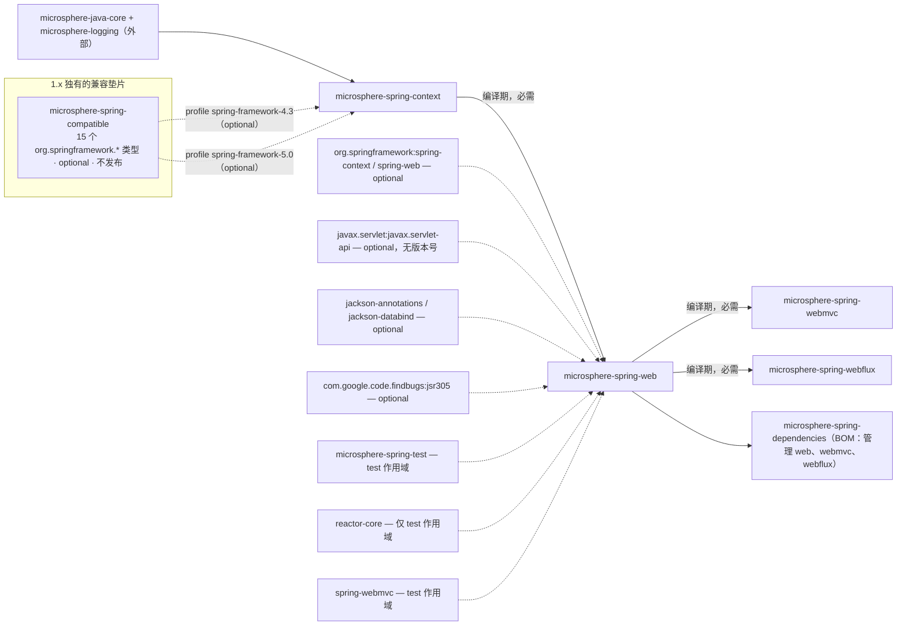
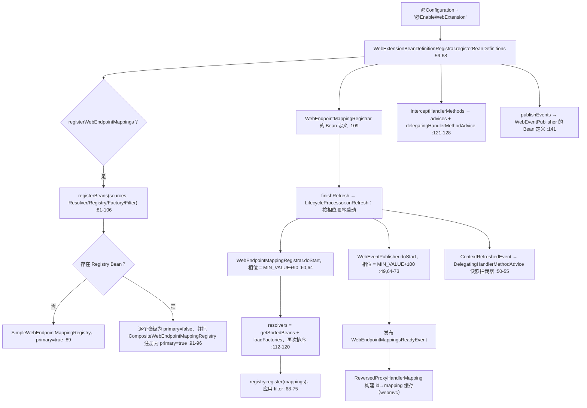
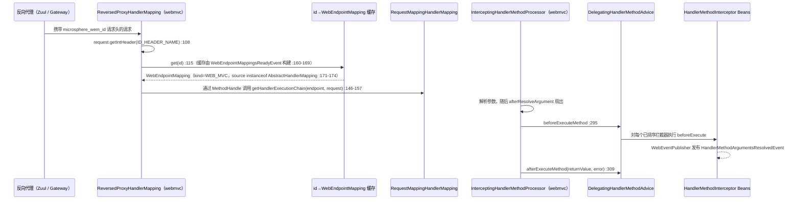

# microsphere-spring-web — 开发者文档（0.1.x / `release-1.x`）

[← 开发者文档总览](./README.md) · [English](../web.md) · [用户文档](../../../user-guide/1.x/zh/web.md) · [0.2.x](../../current/zh/web.md)

本页描述 **0.1.x 维护线**，它只存在于 `origin/release-1.x` 分支（工作树是 0.2.x）。文中每一个行号都读自该分支的对象库
（`git show origin/release-1.x:<path>`）。引用约定：POM 与资源文件路径完整写在 `origin/release-1.x:` 前缀之后；Java 源码使用缩写——
`…/web/` = `microsphere-spring-web/src/main/java/io/microsphere/spring/web/`，`…/webmvc/` = `microsphere-spring-webmvc/src/main/java/io/microsphere/spring/`，
`…/ctx/` = `microsphere-spring-context/src/main/java/io/microsphere/spring/`。

## 1. 模块身份、版本基线与依赖姿态

| 属性 | 取值 | 证据 |
|---|---|---|
| Maven 坐标 | `io.github.microsphere-projects:microsphere-spring-web:${revision}`，`packaging=jar` | `origin/release-1.x:microsphere-spring-web/pom.xml:13-16` |
| 父 POM | `microsphere-spring-parent:${revision}`（`../microsphere-spring-parent/pom.xml`） | `origin/release-1.x:microsphere-spring-web/pom.xml:5-10` |
| 反应堆版本 / 最近发布 | `0.1.40-SNAPSHOT`（`revision`）；标签 `0.1.39` 是已发布的最新 0.1.x | `origin/release-1.x:pom.xml:55`，`git tag --list` |
| 构建 / Java 基线 | `microsphere-build:0.3.14`（外部父 POM，提供全部插件管理）与 **Java 8**——1.x 根 POM 未声明 `java.version` 属性，故该基线继承自该 POM（`<java.version>8</java.version>`，第 89 行） | `origin/release-1.x:pom.xml:5-9`，`:54-56` |
| Spring / Reactor 基线 | 按 profile 选择 `4.3.30.RELEASE`+`Bismuth-SR17`、`5.0.20.RELEASE`+`Bismuth-SR17`、`5.1.20.RELEASE`+`Californium-SR23`、`5.2.25.RELEASE`+`Dysprosium-SR25`、`5.3.39`+`2020.0.47`；`spring-framework-5.3` 为 `activeByDefault` | `origin/release-1.x:microsphere-spring-parent/pom.xml:137-178` |
| Servlet 命名空间 | `javax.servlet:javax.servlet-api`，**无版本号且 `optional`**——本线上没有导入任何 Jakarta EE BOM | `origin/release-1.x:microsphere-spring-web/pom.xml:38-42`；`…/microsphere-spring-parent/pom.xml:21-30` 中不存在 `jakartaee.version` |
| 可选编译依赖 | `com.google.code.findbugs:jsr305`（`:24-28`）、`org.springframework:spring-context`（`:45-49`）、`org.springframework:spring-web`（`:52-56`）、`jackson-annotations` + `jackson-databind`（`:59-69`） | `origin/release-1.x:microsphere-spring-web/pom.xml` |
| 唯一的反应堆内必需依赖 | `microsphere-spring-context:${revision}`——唯一非 optional 的依赖 | `origin/release-1.x:microsphere-spring-web/pom.xml:31-35` |
| 测试依赖 | JUnit **4**（`junit:junit` `:72-76`）、`mockito-core`（`:79-83`）、`reactor-core`（`:86-90`）、`spring-test`（`:93-97`）、`microsphere-spring-test`（`:100-105`）、`spring-webmvc`（`:108-112`）、`logback-classic`（`:115-119`） | `origin/release-1.x:microsphere-spring-web/pom.xml` |
| `src/main/resources` | 只有一个文件：`META-INF/spring.factories`，含两个键——`WebEndpointMappingFactory=Jackson2WebEndpointMappingFactory` 与 `SpringWebHelper=UnknownSpringWebHelper` | `origin/release-1.x:microsphere-spring-web/src/main/resources/META-INF/spring.factories:1-5` |
| 源码规模 | 58 个 main Java 类型、61 个测试类型、2 个测试资源 | `git ls-tree -r --name-only origin/release-1.x -- microsphere-spring-web/src` |

**依赖姿态。** 本模块只有一条必需边（`microsphere-spring-context`，它自身带入 `microsphere-java-core`），因此消费者的传递依赖足迹只有
Microsphere 自身：Spring、Servlet、Jackson、Reactor 什么都不会传递进来——它们全部是 `optional` 或 `test`。缺少 Jackson 也不会让开关失效，因为
`Jackson2WebEndpointMappingFactory` 用 `ClassUtils.isPresent("com.fasterxml.jackson.databind.ObjectMapper", …)` 自我门控
（`…/web/metadata/Jackson2WebEndpointMappingFactory.java:31-40`）。有两处不对称值得记住：`reactor-core` **仅为 test 作用域**
（`:86-90`），所以即便 Javadoc 大谈 `WEB_FLUX` 映射，本模块也从未针对 WebFlux 编译过；以及兄弟模块
`microsphere-spring-webmvc` 把同一个 Servlet 构件声明为 `provided` 而非 `optional`（`origin/release-1.x:microsphere-spring-webmvc/pom.xml:37-42`）。



⚠ BOM 核对是本页的关键结论：0.1.x 的 `microsphere-spring-dependencies/pom.xml` 恰好管理七个构件——`context`、`guice`、`jdbc`、`web`、
`webmvc`、`webflux`、`test`（`origin/release-1.x:microsphere-spring-dependencies/pom.xml:24-64`）——而 **`microsphere-spring-compatible` 不在其中**，
尽管它是反应堆模块（`origin/release-1.x:pom.xml:61`）并且是 `microsphere-spring-context` 的 profile 限定依赖（`…/microsphere-spring-context/pom.xml:127-137`、`:139-155`）。
它的 POM 还跳过部署（`…/microsphere-spring-compatible/pom.xml:32-42`），所以消费者永远无法按版本导入它；它只抵达产出该构件的那次构建。
指向 `microsphere-spring-web` 的入边只来自 `…/microsphere-spring-webmvc/pom.xml:30-35`、`…/microsphere-spring-webflux/pom.xml:30-35`
以及 BOM 中的条目 `:44`。

## 2. `io.microsphere.spring.web.*` 包地图（0.1.x）

| 包 | 代表类型 | 职责 |
|---|---|---|
| `…web.annotation` | `EnableWebExtension`（5 个属性，`:79-135`）、`WebExtensionBeanDefinitionRegistrar`（`:54`） | 开关激活 + Bean 定义装配 |
| `…web.constants` | `PropertyConstants`——只有一个常量 `MICROSPHERE_SPRING_WEB_PROPERTY_NAME_PREFIX = "microsphere.spring.web."`（`:32`） | 配置属性前缀 |
| `…web.event` | `WebEventPublisher`（`:45`）、`WebEndpointMappingsReadyEvent`（`:34`）、`HandlerMethodArgumentsResolvedEvent`（`:20`） | 就绪事件 + 调用事件 |
| `…web.metadata` | 模型：`WebEndpointMapping`（含内嵌 `Kind`、`Builder`）、`HandlerMetadata`、`HandlerMethodMetadata`；SPI：`WebEndpointMappingResolver`、`…Registry`、`…Factory`、`…Filter`、`SmartWebEndpointMappingFactory`、`WebEndpointMappingVisitor`（仅 1.x）；实现：`SimpleWebEndpointMappingRegistry`、`FilteringWebEndpointMappingRegistry`、`CompositeWebEndpointMappingRegistry`、`ServletWebEndpointMappingResolver`、`AbstractWebEndpointMappingFactory`、`RegistrationWebEndpointMappingFactory`、`Servlet/FilterRegistrationWebEndpointMappingFactory`、`Jackson2WebEndpointMappingFactory`、`WebEndpointMappingRegistrar` | 端点元数据模型及其注册流水线 |
| `…web.method.support` | `HandlerMethodAdvice`（`:33`）、`DelegatingHandlerMethodAdvice`（`:40`）、`HandlerMethodInterceptor`（`:27`）、`HandlerMethodArgumentInterceptor`（`:31`） | 控制器方法拦截 SPI |
| `…web.rule` | `WebRequestRule` + `AbstractWebRequestRule`、`CompositeWebRequestRule`、`WebRequest{Pattens,Methods,Params,Headers,Consumes,Produces}Rule`、`NameValueExpression`/`MediaTypeExpression` 体系（18 个类型） | 条件匹配引擎——见 §11 第 1 条，本分支上没有生产消费者 |
| `…web.util` | `WebRequestUtils`、`RequestAttributesUtils`、`WebUtils`、`HttpUtils`、`SpringWebHelper`（接口）、`UnknownSpringWebHelper`（`:36`）、`SpringWebType`、`WebType`、`WebScope`、`WebSource`、`WebTarget`、`RequestContextStrategy`（`:30`） | 请求抽象与 Web 类型探测 |

本模块构建所依赖的外部类型（除特别注明外均来自 `microsphere-spring-context`）：

| 类型 | 出处 | 本模块为何需要它 |
|---|---|---|
| `AnnotatedBeanCapableImportBeanDefinitionRegistrar` | `…/ctx/context/annotation/…java` | 注册器的父类（`…/web/annotation/WebExtensionBeanDefinitionRegistrar.java:54`）；提供 `…enabled=false` 总开关 |
| `BeanSource` + `BeanSource.registerBeans(registry, sources, beanTypes…)` | `…/ctx/beans/BeanSource.java:55-382` | 注册器使用的三条发现通道（`BEAN_FACTORY`、`SPRING_FACTORIES`、`JAVA_SERVICE_PROVIDER`） |
| `AbstractSmartLifecycle` | `…/ctx/context/lifecycle/AbstractSmartLifecycle.java:70-140` | `WebEndpointMappingRegistrar` 与 `WebEventPublisher` 的基类；`EARLIEST_PHASE = MIN_VALUE` `:75`、`DEFAULT_PHASE = LATEST_PHASE` `:87`、`isAutoStartup() = true` `:115-117`、`start()`/`stop()`/`getPhase()` 为 `final` `:94-128` |
| `OnceApplicationContextEventListener` | `…/ctx/context/event/…` | `DelegatingHandlerMethodAdvice` 的基类（`…/web/method/support/…java:40`） |
| `BeanRegistrar.registerBeanDefinition(…)`、`BeanUtils.getSortedBeans`、`SpringFactoriesLoaderUtils.loadFactories` | `…/ctx/beans/factory/support/BeanRegistrar.java:199,233,421` | 注册 Bean 定义——注册器对 registry 用的正是三参数 `boolean primary` 重载 `:421`——以及 resolver/factory/filter 的发现（`…/web/metadata/WebEndpointMappingRegistrar.java:116-117`） |
| `io.microsphere.annotation.Nonnull/Nullable`、`io.microsphere.json.JSONUtils`、`io.microsphere.filter.Filter`/`FilterOperator`、`io.microsphere.util.Assert` | **microsphere-java-core**（`0.3.19`，`origin/release-1.x:microsphere-spring-parent/pom.xml:22`） | 可空性标注、`toJSON()` 输出、过滤器组合、参数断言 |
| `javax.servlet.*`、`HandlerMethod`、`MethodParameter`、`NativeWebRequest`、`HttpMethod`、`MediaType` | `javax.servlet-api` / `spring-web`（二者皆 optional） | 面向 Servlet 的 resolver、拦截签名、映射词汇表 |

⚠ 分包（split package）：`io.microsphere.spring.web.servlet.*`（`ContentCachingFilter`、`EnableWebMvcExtensionListener`、`WebUtils`）由
**`microsphere-spring-webmvc`** 提供，而不是本模块（`origin/release-1.x:microsphere-spring-webmvc/src/main/java/io/microsphere/spring/web/servlet/…`），
因此在这条线上 `io.microsphere.spring.web` 命名空间被两个构件共同占有——对 JPMS 风格的工具链、以及对同样位于 webmvc 模块里的
`META-INF/services/javax.servlet.ServletContainerInitializer` 都不利。

## 3. 端点元数据模型

`WebEndpointMapping<E>` 是一个**只有私有构造器**的 `public class`（`…/web/metadata/WebEndpointMapping.java:129,1261,1289`）；`E` 是端点类型
（`Servlet`/`Filter` 的注册名、`HandlerMethod`、`RouterFunction` 等）。常量：`ID_HEADER_NAME = "microsphere_wem_id"`（`:134`）、
`UNKNOWN_SOURCE`（`:139`）、由 `HttpMethod.values()` 构成的 `ALL_METHODS`（`:144`）。除缓存的 `hashCode`（`:178`）、可变的 `attributes`
映射（`:181`）以及 `transient` 的 `endpoint`/`source`（`:150,176`）之外，字段都是 `final`。

| 成员 | 行号 | 说明 |
|---|---|---|
| `enum Kind { SERVLET, FILTER, WEB_MVC, WEB_FLUX, CUSTOMIZED }` | `:186-213` | `Builder` 工厂与 `ReversedProxyHandlerMapping` 共同使用的判别标志 |
| `class Builder<E>` | `:215` | 私有构造器 `:252`；只能通过 `servlet()` `:1770`、`filter()` `:1782`、`webmvc()` `:1794`、`webflux()` `:1806`、`customized()` `:1818`、`of(Kind)` `:1831` 获得 |
| 条件链式方法 | `:300-1020` | `pattern`/`patterns`（`:300,332,355,378`）、`method`/`methods`（`:404,428,460,483,508,526`）、`param(s)`（`:552,576,607,629`）、`header(s)`（`:656,685,717,739`）、`consume(s)`/`produce(s)`（`:765,789,817,844,866,892,916,944,973,995`）、`negate()` `:1020`、`source()` `:1043` |
| `nestPatterns`/`nestMethods`/`nestParams`/`nestHeaders`/`nestConsumes`/`nestProduces` | `:1067-1193` | 合并另一个 builder 的值；`nestPatterns` 通过 `URLUtils.buildURI` 解析相对模式（`:1072`） |
| `build()` | `:1236-1258` | 要求 `endpoint` 非空且 `patterns` 非空；空的 `methods` 集合会被静默替换为 `ALL_METHODS`（`:1242-1244`） |
| `getId()` | `:1275,1344` | ⚠ `this.id = Objects.hashCode(endpoint)`——ID 是**端点对象**的哈希码，并非模式/条件摘要 |
| `equals` / `hashCode` | `:1547-1559` / `:1575-1598` | 只比较 `kind`、`negated` 与六个条件数组——`id`、`endpoint`、`source`、`attributes` 均被排除；`hashCode` 有缓存，`0` 表示"尚未计算" |
| `setAttribute` / `getAttribute` | `:1495-1527` | 懒创建的 `Map`——构造完成后仍可经这两个方法修改这个值对象 |
| `toJSON()` | `:1645-1658` | 用 `io.microsphere.json.JSONUtils.append` 手写拼接（`:1735-1753`），**不是** Jackson；输出 `id, kind, negated, patterns, methods, params, headers, consumes, produces` |
| `toExpression()` | `:1730`，辅助方法 `:1921-1975` | 每组条件在括号内用 ` \|\| ` 折叠，组之间用 `&&` 连接，取反时整体加 `!` 前缀（`:1942-1944`） |

`:1289` 处的私有无参构造器（注释在 `:1286-1288`，写着"For serialization"）只是为了让 Jackson 在
`Jackson2WebEndpointMappingFactory` 反序列化 JSON 描述符时能实例化该类型（`…/web/metadata/Jackson2WebEndpointMappingFactory.java:43-47`）；
分支自带的夹具是 `microsphere-spring-web/src/test/resources/META-INF/web-mapping-descriptor.json`（11 个键），在
`WebEndpointMappingTest.java:644` 与 `SmartWebEndpointMappingFactoryTest.java:50` 中被消费。

## 4. Registry、Resolver、Factory 与 Filter SPI

| 契约 | 性质 | 关键行为 | 证据 |
|---|---|---|---|
| `WebEndpointMappingResolver` | 单方法接口，`ApplicationContext → Collection<WebEndpointMapping>` | 启动期拉取端点元数据唯一的入口 | `…/web/metadata/WebEndpointMappingResolver.java:32-41` |
| `ServletWebEndpointMappingResolver` | 内置的 Servlet 实现 | 非 `WebApplicationContext`（`:93-99`）以及 `getMajorVersion() < 3`（`:52`）时返回空；每次调用都 `new` 出它的两个工厂而不使用 Bean（`:71,85`） | `…/web/metadata/ServletWebEndpointMappingResolver.java:43-99` |
| `WebEndpointMappingFactory<E>` | `@FunctionalInterface`；`supports` 默认为 `true`，`create → Optional`，`getSourceType` 由 `ResolvableType` 推导 | 源对象 → 映射的转换缝隙 | `…/web/metadata/WebEndpointMappingFactory.java:32-74` |
| `AbstractWebEndpointMappingFactory<E>` | `create` 为 `final`，委托给 `doCreate`，吞掉一切 `Throwable` | 失败的工厂只打一条 `error` 日志，不产出任何东西 | `…/web/metadata/AbstractWebEndpointMappingFactory.java:38-52` |
| `SmartWebEndpointMappingFactory` | 以 `getSourceType()` 为键的分发中枢 | 构造时一次性加载 `spring.factories` + 容器中的工厂；`doCreate` 遍历所有候选并保留**最后一个**有结果的值 | `…/web/metadata/SmartWebEndpointMappingFactory.java:40-102` |
| `RegistrationWebEndpointMappingFactory<R extends Registration>` | Servlet `Registration` 模板（`supports`/`doCreate` 都是 `final`） | 抽象钩子 `getKind`、`getMethods`、`getPatterns`、`getRegistration`、`contribute` | `…/web/metadata/RegistrationWebEndpointMappingFactory.java:40-110` |
| `ServletRegistrationWebEndpointMappingFactory` / `FilterRegistrationWebEndpointMappingFactory` | 具体实现 | 依据类上是否存在 `doGet`/`doPost`/… 推导 HTTP 方法（`:82-103`）；Filter 工厂把自身的 URL 模式与其所映射的 Servlet 的模式求并集（`:47-94`） | 同包 |
| `Jackson2WebEndpointMappingFactory` | 由 `spring.factories` 注册 | `supports` 只报告 ObjectMapper 是否存在，忽略入参 | `…/web/metadata/Jackson2WebEndpointMappingFactory.java:29-48` |
| `WebEndpointMappingRegistry` | `register（单个/可变参数/Iterable）` + `getWebEndpointMappings()` | 默认的 `register(...)` 方法统计成功数量 | `…/web/metadata/WebEndpointMappingRegistry.java:34-84` |
| `FilteringWebEndpointMappingRegistry` | 抽象类，`BeanFactoryAware`；`register` 为 `final` | 应用由全部已排序的 `WebEndpointMappingFilter` Bean 以 OR 组合出的 `Filter<WebEndpointMapping>`；缺省过滤器放行一切 | `…/web/metadata/FilteringWebEndpointMappingRegistry.java:40-109` |
| `SimpleWebEndpointMappingRegistry` | 默认存储 | 以 `getId()` 为键的 `Map<Integer, WebEndpointMapping>`——重复 ID 会被拒绝 | `…/web/metadata/SimpleWebEndpointMappingRegistry.java:33-38` |
| `CompositeWebEndpointMappingRegistry` | 扇出存储，`SmartInitializingSingleton` | 在 `afterSingletonsInstantiated` 收集其他所有 registry（`:57-65`）并逐个注册（`:42-48`） | 同包 |
| `WebEndpointMappingFilter` | 标记接口，`extends io.microsphere.filter.Filter<WebEndpointMapping>` | 在注册时刻生效的断言，而不是在解析时刻 | `…/web/metadata/WebEndpointMappingFilter.java:29` |
| `WebEndpointMappingRegistrar` | `AbstractSmartLifecycle` | 在生命周期启动时驱动 resolver → registry，比事件发布器早一个相位 | `…/web/metadata/WebEndpointMappingRegistrar.java:50-125` |

开关注册器（`…/web/annotation/WebExtensionBeanDefinitionRegistrar.java:56-143`）只读取四个属性——`sources`（`:61`）、
`registerWebEndpointMappings`（`:71`）、`interceptHandlerMethods`（`:113`）、`publishEvents`（`:139`）——从不读取 `requestContextStrategy`，
尽管注解声明了它（`…/web/annotation/EnableWebExtension.java:135`）。⚠ 在本分支上该属性只被兄弟模块消费：
`…/webmvc/webflux/annotation/WebFluxExtensionBeanDefinitionRegistrar.java:102-123` 与
`…/webmvc/web/servlet/listener/EnableWebMvcExtensionListener.java:110-114`，后者读取的是 `@EnableWebMvcExtension` 注解实例本身而不是
`@EnableWebExtension` 的元属性。Registry 的装配另有一条规则：发现的 registry 会被 `beanDefinition.setPrimary(false)` 降级，
然后把 `CompositeWebEndpointMappingRegistry` 注册为 primary（`:91-96`）；但若什么都没发现，则改把普通的
`SimpleWebEndpointMappingRegistry` 注册为 primary（`:87-89`）。

## 5. 处理器方法拦截 SPI

`HandlerMethodAdvice`（`…/web/method/support/HandlerMethodAdvice.java:33-88`）是四钩子门面（`beforeResolveArgument` `:43`、`afterResolveArgument`
`:57`、`beforeExecuteMethod` `:71`、`afterExecuteMethod` `:85`）；`HandlerMethodArgumentInterceptor`（`:31-58`）与 `HandlerMethodInterceptor`（`:27-56`）
是按关注点拆出的两个子集，每个方法都是 `default` 且为空实现。`DelegatingHandlerMethodAdvice`（`:40-104`）是整个反应堆里唯一的实现：它是一个
`OnceApplicationContextEventListener<ContextRefreshedEvent>`（`:40`），在 `:50-55` 对已排序的拦截器列表做快照，并按列表顺序扇出（`:65-94`），
固定 Bean 名为 `delegatingHandlerMethodAdvice`（`:43`，注册器在 `:127` 引用它）。

⚠ 本模块中没有任何东西真正把该 advice **织入**执行链：唯一的驱动者是
`…/webmvc/webmvc/method/support/InterceptingHandlerMethodProcessor.java:85,201-202` 与
`…/webmvc/webflux/method/InterceptingHandlerMethodProcessor.java:93,210-211`，二者都从容器中解析 `HandlerMethodAdvice` Bean。后果是：
单独使用 `@EnableWebExtension` **只会**注册一批没有任何请求路径会调用的 advice 与拦截器 Bean；而实现了
`HandlerMethodInterceptor` 的 `WebEventPublisher`（`…/web/event/WebEventPublisher.java:45,59-61`）只有在某个模块级注解装好拦截式处理器之后，
才会在每次调用时发布 `HandlerMethodArgumentsResolvedEvent`。

## 6. 启动期与请求期的生命周期



Spring 的 `AbstractApplicationContext.finishRefresh()` 会**在**发布 `ContextRefreshedEvent` **之前**执行生命周期处理器的 `onRefresh()`，
所以在这条线上端点注册与就绪事件都早于拦截器快照——真正决定这两个生命周期 Bean 先后顺序的，是
`WebEndpointMappingRegistrar`（`…/web/metadata/WebEndpointMappingRegistrar.java:60`）与 `WebEventPublisher`
（`…/web/event/WebEventPublisher.java:49,55`）之间那 10 个相位的差值。



web 模块自身在请求期**不做**任何匹配：`…/web/rule/*` 在生产代码中无人使用（§11 第 1 条），请求期路径完全是 webmvc/webflux 读取本模块注册好的映射的事。

## 7. 有据可查的设计模式

| 模式 | 类 | 证据 |
|---|---|---|
| 配置开关（"Enable*"） | `EnableWebExtension` → `WebExtensionBeanDefinitionRegistrar` | `…/web/annotation/EnableWebExtension.java:62` 处的 `@Import`；注册器 `:54` |
| 构建器（私有构造器 + 按 Kind 选取工厂） | `WebEndpointMapping.Builder` | `…/web/metadata/WebEndpointMapping.java:215,252,1770-1831,1236` |
| 带逃逸口的不可变值对象 | `WebEndpointMapping` | `final` 字段 `:146-176` vs 可变的 `attributes` `:1495-1503` |
| 注册表 | `WebEndpointMappingRegistry`、`SimpleWebEndpointMappingRegistry`、`CompositeWebEndpointMappingRegistry` | `…/web/metadata/SimpleWebEndpointMappingRegistry.java:33-38`、`CompositeWebEndpointMappingRegistry.java:42-65` |
| 组合 + 过滤（断言链） | `FilteringWebEndpointMappingRegistry`、`WebEndpointMappingFilter`、`FilterOperator.OR` | `…/web/metadata/FilteringWebEndpointMappingRegistry.java:42-76,94-99` |
| 按源类型选择策略 | `SmartWebEndpointMappingFactory` | `…/web/metadata/SmartWebEndpointMappingFactory.java:72-76,85-86` |
| 模板方法（冻结 `create`，开放钩子） | `AbstractWebEndpointMappingFactory`、`RegistrationWebEndpointMappingFactory` | `…/Abstract…:39-52`、`…/Registration…:49-54,70-110` |
| 空对象 | `UnknownSpringWebHelper`（`INSTANCE` `:38`，每个方法返回 `null`/空操作）、`DEFAULT_FILTER = e -> true` | `…/web/util/UnknownSpringWebHelper.java:36-80`、`…/metadata/FilteringWebEndpointMappingRegistry.java:42` |
| 观察者 / 事件发布 | `WebEventPublisher`、`WebEndpointMappingsReadyEvent`、`HandlerMethodArgumentsResolvedEvent` | `…/web/event/WebEventPublisher.java:59-73` |
| 相位排序的生命周期 | `AbstractSmartLifecycle` 的子类 | `…/metadata/WebEndpointMappingRegistrar.java:60`、`…/event/WebEventPublisher.java:49-55` |
| 门面 + 委托 | `HandlerMethodAdvice` 覆盖两个拦截器 SPI | `…/web/method/support/DelegatingHandlerMethodAdvice.java:65-94` |
| 适配外部缓存 | `ReversedProxyHandlerMapping`（用 `MethodHandle` 调 `getHandlerExecutionChain`） | `…/webmvc/webmvc/handler/ReversedProxyHandlerMapping.java:85-98,146-157` |
| **没有**访问者实现 | `WebEndpointMappingVisitor` | 见 §8——只有声明，从未被驱动 |

## 8. 仅存在于 1.x 的 `WebEndpointMappingVisitor`

`…/web/metadata/WebEndpointMappingVisitor.java:27` 声明了十二个通知方法——`method(String[])` `:34`、`path(String)` `:41`、
`header(String,String)` `:49`、`queryParam(String,String)` `:57`、`startAnd`/`and`/`endAnd` `:65-78`、`startOr`/`or`/`endOr` `:86-99`、
`startNegate`/`endNegate` `:107-113`——形状刻意对齐 Spring WebFlux 的 `RequestPredicates.Visitor`，连 Javadoc 措辞都照搬。

在 `origin/release-1.x` 上核实过的状态，命令一并记录以便复现：

```
$ git grep -n "WebEndpointMappingVisitor" origin/release-1.x
…/web/metadata/WebEndpointMappingVisitor.java:27:public interface WebEndpointMappingVisitor {
$ git grep -n "Visitor" origin/release-1.x -- microsphere-spring-web/src
…/web/metadata/WebEndpointMappingVisitor.java:27:public interface WebEndpointMappingVisitor {
```

**整棵分支树里只有一个命中：它自己的类型声明。** 没有任何实现（兄弟模块的 `…/webflux/webflux/function/server/RequestPredicateVisitorAdapter.java:48`
与 `RouterFunctionVisitorAdapter.java:41` 实现的是 *Spring 自己的* `RequestPredicates.Visitor` / `RouterFunctions.Visitor`，从不引用本接口）；
`WebEndpointMapping` 上没有任何 `accept`/`traverse`/`setVisitor` 方法（在 `…/web/metadata/WebEndpointMapping.java` 内 grep `Visitor` 一无所获）；
`META-INF/spring.factories` 里没有登记（`origin/release-1.x:microsphere-spring-web/src/main/resources/META-INF/spring.factories:1-5` 只列了 `WebEndpointMappingFactory` 和 `SpringWebHelper`）；
也没有测试夹具。因此它是一个无法抵达的扩展点：消费者既要自己实现它，又要自己写下调用它的遍历代码。在 `main`（0.2.x）上该文件根本不存在——
`git diff --stat origin/release-1.x main -- microsphere-spring-web/src/main` 报告 `WebEndpointMappingVisitor.java | 114 -------`。

## 9. 0.1.x 与 0.2.x 的差异

| 方面 | 0.1.x / `release-1.x`（本页） | 0.2.x / `main`（工作树） | 证据 |
|---|---|---|---|
| Servlet 命名空间 | 通体 `javax.servlet.*`（`ServletRegistration`、`FilterRegistration`、`HttpServletRequest`） | `jakarta.servlet.*` | `origin/release-1.x:microsphere-spring-web/pom.xml:38-42` vs `microsphere-spring-web/pom.xml:44-49` |
| Servlet 规范版本 | `javax.servlet-api` 无版本号，经 `microsphere-java-dependencies` 链管理；resolver 只保证 Servlet 3+ | `jakarta.servlet-api` 取自 `jakarta.jakartaee-bom:11.0.0` → Servlet 6.0 | `origin/release-1.x:microsphere-spring-parent/pom.xml:115-122` vs `microsphere-spring-parent/pom.xml:24,53-55`；`…/web/metadata/ServletWebEndpointMappingResolver.java:52` |
| Java 基线 | 8，继承而来（`microsphere-build:0.3.14` 设定 `java.version=8`） | 17，显式声明 | `origin/release-1.x:pom.xml:54-56` vs `pom.xml:55-56` |
| Spring 矩阵 | 4.3 / 5.0 / 5.1 / 5.2 / 5.3，默认 5.3 | 6.0 / 6.1 / 6.2 / 7.0，默认 7.0 | `origin/release-1.x:microsphere-spring-parent/pom.xml:137-178` |
| 兼容垫片 | `microsphere-spring-compatible`（15 个 `org.springframework.*` 类型：`Profiles`、`NonNull`、`Nullable`、`Assert`、`ClassUtils`、`CollectionUtils`、`MultiValueMap`、`ObjectUtils`、`StreamUtils` 等），仅被 `spring-framework-4.3` 与 `spring-framework-5.0` 两个 profile 引入，`optional`，不受 BOM 管理，不发布 | 模块已删除 | `origin/release-1.x:microsphere-spring-context/pom.xml:127-155`、`…/microsphere-spring-dependencies/pom.xml:24-64`、`…/microsphere-spring-compatible/pom.xml:32-42` |
| 只在一侧存在的 API | 仅 1.x：`WebEndpointMappingVisitor`，只有接口没有实现；测试桩 `src/test/java/org/springframework/http/server/reactive/ServerHttpRequest.java` | 仅 0.2.x：`…/web/util/MediaTypeUtils.java`（以及 `MediaTypeUtilsTest`） | `git diff --stat origin/release-1.x main -- microsphere-spring-web/src`（visitor：`114 -------`，见 §8）＋在两个引用上执行 `git ls-tree -r --name-only <ref> -- microsphere-spring-web/src` |
| 模块内的 Spring 版本适配 | `WebRequestProducesRule` 保留 `BEFORE_SPRING_505` 与 `MEDIA_TYPE_ALL_LIST`，并在 `ContentNegotiationManager.resolveMediaTypes` 返回空时替换为 `[MediaType.ALL]` | 常量与兜底逻辑已移除（Spring 6 总会返回它们） | `…/web/rule/WebRequestProducesRule.java:62,69,146-148` |
| 源码级 API 漂移 | `EnableWebExtension` 逐字节相同（同样 5 个属性）；`WebEndpointMapping` 只在 `javax`→`jakarta` 的 Javadoc/`@see` 文字上有差异（32 行 diff）；注册器只差一个 `Entry` 导入/循环变量改名 | 公共 API 相同 | `…/web/annotation/EnableWebExtension.java:79-135`、`git diff origin/release-1.x main -- …/web/metadata/WebEndpointMapping.java`、对 `WebExtensionBeanDefinitionRegistrar.java:89` 的 `git diff` |
| 构建/测试依赖 | `reactor-core` 仅 test 作用域，JUnit 4 + mockito，无注解处理器 | WebFlux 作用域相同，但改为 JUnit 5，并新增 `microsphere-annotation-processor`（optional）与 `hamcrest` | `origin/release-1.x:microsphere-spring-web/pom.xml:72-90` vs `microsphere-spring-web/pom.xml:23-28,79-83,121-126` |
| 本模块周边的 Servlet 启动集成 | `io.microsphere.spring.web.servlet.*` 分包 + `META-INF/services/javax.servlet.ServletContainerInitializer` 都在 webmvc 里 | 为 `jakarta.servlet` 重新表述 | `origin/release-1.x:microsphere-spring-webmvc/src/main/resources/META-INF/services/javax.servlet.ServletContainerInitializer` |

## 10. 构建与验证

| 任务 | 命令 / 事实 |
|---|---|
| CI 矩阵 | Java `8`/`11`/`17`/`21`/`25` × 五个 Spring profile：`origin/release-1.x:.github/workflows/maven-build.yml:25-29`；构建命令追加 `-Drevision=0.0.1-SNAPSHOT test --activate-profiles test,coverage,<profile>`（`:43-49`） |
| 构建 / 锁定某个 Spring 线 | 只构建本模块：`mvn -pl microsphere-spring-web -am test --activate-profiles test,spring-framework-5.3 -Drevision=0.1.40-SNAPSHOT`；注意 `-P spring-framework-4.3` 同时会替换 `microsphere-spring-context` 的依赖集——但**不会**改变本模块的，因为它自己没有声明任何 profile |
| 测试清单 | JUnit 4 上下文测试 `EnableWebExtensionTest`（用 `microsphere-spring-test` 的 `TestController` 跑 MockMvc，`…/src/test/java/…/annotation/EnableWebExtensionTest.java:20,43-68`）、`WebExtensionBeanDefinitionRegistrarTest`；每个 SPI 一个单元测试（`*RegistryTest`、`*FactoryTest`、`WebEndpointMappingTest`）；`…/web/rule` 每个类型都有规则测试；`…/src/test/java/org/springframework/http/server/reactive/ServerHttpRequest.java`——一个写在 Spring 自己包里的 1.x 独有测试桩 |
| 夹具工厂 | `NoOpWebEndpointMappingResolver`、`NullWebEndpointMappingFactory`、`ThrowableWebEndpointMappingFactory`、`UnsupportedWebEndpointMappingFactory`，以及把其中三个登记为 `WebEndpointMappingFactory`、另加一个 `SpringWebHelper` 的 `src/test/resources/META-INF/spring.factories:1-7` |

## 11. 陷阱、死代码与缺陷

| # | 观察 | 证据 |
|---|---|---|
| 1 | 整个 `…/web/rule` 包——18 个生产类型——**除了自身包内与测试之外没有任何使用者**：`git grep -n "WebRequestRule" origin/release-1.x` 只命中 `microsphere-spring-web/src` 下的文件，webmvc/webflux 一个都没有。请把它当作一套无人使用、但仍在被测试的条件匹配器库。 | grep 结果，§2 |
| 2 | `WebEndpointMappingVisitor` 只有声明，从未实现也从未被调用（§8）——任何把它描述为"遍历映射的条件树"的文档，描述的都是不存在的代码。 | `…/web/metadata/WebEndpointMappingVisitor.java:27` |
| 3 | 每个 resolver 都被调用**两次**：`resolveWebEndpointMappings()` 在 `isNotEmpty` 判断里调一次 `resolver.resolve(context)`，紧接着在 `addAll` 里又调一次（`:97-101`），每次容器启动都把 HandlerMapping 遍历和工厂工作翻倍。 | `…/web/metadata/WebEndpointMappingRegistrar.java:93-104` |
| 4 | `id` 是 `Objects.hashCode(endpoint)`（`:1275`），而 `SimpleWebEndpointMappingRegistry` 用 `getId()` 作 map 的键，键被占用时直接返回 `false`（`:37`）——同一个端点对象的两个映射（例如其中一个带 `negate()`）会静默冲突；对 `hashCode` 是标识哈希的端点而言，`microsphere_wem_id` 的请求头值只在单次 JVM 运行内可复现。 | `…/web/metadata/WebEndpointMapping.java:1275`、`…/metadata/SimpleWebEndpointMappingRegistry.java:33-38` |
| 5 | `equals`/`hashCode` 忽略 `id`、`endpoint` 与 `source`（`:1547-1598`）——条件相同、`HandlerMethod` 不同的两个映射是相等的，这正是组合注册表会重复注册的原因。 | 同上行号 |
| 6 | `requestContextStrategy` 在 `@EnableWebExtension` 上声明了，但本模块的注册器从不读取；只有 webmvc 的监听器与 webflux 的注册器尊重它，而且监听器检查的是 `@EnableWebMvcExtension` 自身。 | §4 的 grep 证据 |
| 7 | 分支上残留着被注释掉的代码：`// private static final List<ProduceMediaTypeExpression> MEDIA_TYPE_ALL_LIST = …`——与上面两行的在用常量重名。 | `…/web/rule/WebRequestProducesRule.java:74` |
| 8 | `// FIXME : WebFlux` 标明 `matches(NativeWebRequest)` 只适用于 MVC；同时保留了已 `@Deprecated` 的 `WebRequestPattensRule(String[], PathMatcher, boolean)` 构造器；类名本身还带着 `Pattens` 这个拼写错误。 | `…/web/rule/WebRequestPattensRule.java:102-105,162` |
| 9 | `SmartWebEndpointMappingFactory.doCreate` 命中后不 break：**最后**一个 `create` 返回值的工厂胜出（`:91-101`），于是 `AnnotationAwareOrderComparator` 的顺序实际意味着"优先级最低的排在前面"。 | `…/web/metadata/SmartWebEndpointMappingFactory.java:91-101` |
| 10 | 用 lambda 写的工厂其 `getSourceType()` 解析为 `null`（`ResolvableType` 无法从 lambda 类推回类型实参），于是 `initDelegates` 把它归档到 `null` 键下（`:72-76`），而按 `delegates.get(endpoint.getClass())` 查表的 `doCreate`（`:86`）永远选不到它。请改为实现接口（或继承 `AbstractWebEndpointMappingFactory`）。 | `…/web/metadata/WebEndpointMappingFactory.java:72-74`、`…/metadata/SmartWebEndpointMappingFactory.java:72-86` |
| 11 | `AbstractWebEndpointMappingFactory.create` 是 `final`，并把任何 `Throwable` 折算成一条 `error` 日志加一个空 `Optional`（`:38-49`）——映射悄悄没进注册表时，只能在日志里找原因。 | `…/web/metadata/AbstractWebEndpointMappingFactory.java:38-49` |
| 12 | `ServletWebEndpointMappingResolver` 用 `new` 实例化它的工厂（`:71,85`），因此 Servlet 路径上用户提供的 `Servlet/FilterRegistrationWebEndpointMappingFactory` Bean 会被绕过；非 Web 的 `ApplicationContext` 或 Servlet 2.x 容器则得到零条映射（`:52,94`）。 | `…/web/metadata/ServletWebEndpointMappingResolver.java:52-99` |
| 13 | 当 `registerWebEndpointMappings = false` 时压根没有 registry，`WebEventPublisher.doStart` 只打一条 `warn` 就返回——等待 `WebEndpointMappingsReadyEvent` 的消费者永远等不到。 | `…/web/event/WebEventPublisher.java:64-74` |
| 14 | `DelegatingHandlerMethodAdvice` 只在 `ContextRefreshedEvent` 时对拦截器做一次快照（`:50-55`）；此后注册的拦截器或 advice（或之后才刷新的子容器里的）对它都不可见，直到重启。 | `…/web/method/support/DelegatingHandlerMethodAdvice.java:40-55` |
| 15 | 引用时应避开的文档缺陷：就绪事件构造器 Javadoc 里的 `@lin WebEndpointMapping`，格式错误的作者标签 `Mercy<a/>`，以及每个类型上都写着 `@since 1.0.0` 而本线实际是 `0.1.39`/`0.1.40-SNAPSHOT`——这里的 `@since` 无法用于对应发布版本。 | `…/web/event/WebEndpointMappingsReadyEvent.java:43`、`…/web/constants/PropertyConstants.java:24`、`…/web/metadata/WebEndpointMappingVisitor.java:25` |

**交叉链接** — [开发者文档总览](./README.md) · [English](../web.md) ·
[用户文档 — web（1.x）](../../../user-guide/1.x/zh/web.md) · [用户文档 English](../../../user-guide/1.x/web.md) ·
[0.2.x 开发者文档](../../current/zh/web.md) · [1.x parent POM profiles](./parent.md) ·
[1.x 依赖管理](./dependencies.md) · [webmvc（1.x）](./webmvc.md) · [webflux（1.x）](./webflux.md) ·
[context（1.x）](./context.md) · [compatible（1.x）](./compatible.md)
