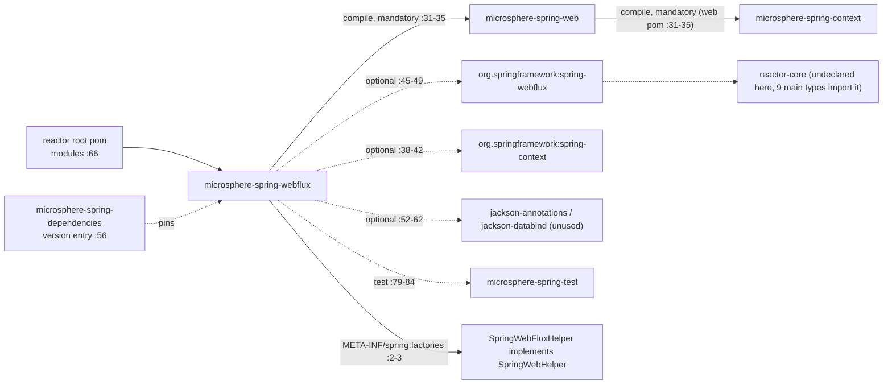
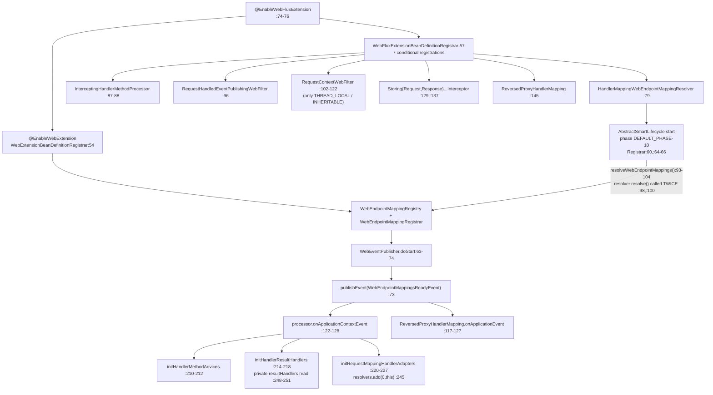
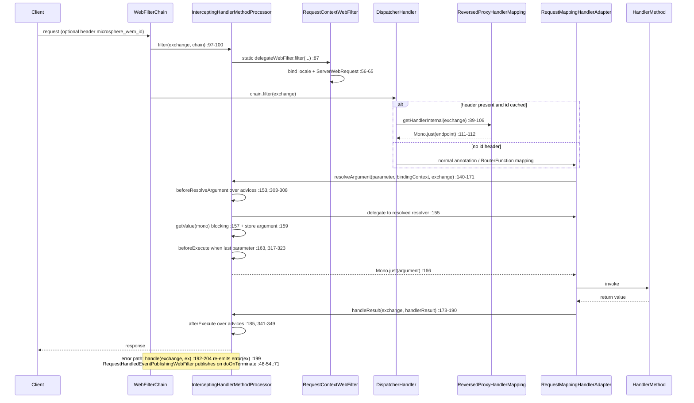

# microsphere-spring-webflux — 开发者文档（0.1.x / `release-1.x`）

[← 开发者文档总览](./README.md) · [English](../webflux.md) · [用户文档](../../../user-guide/1.x/zh/webflux.md) · [0.2.x](../../current/zh/webflux.md)

下文每一个行号都读自分支对象库（`git show origin/release-1.x:<path>`），而非 0.2.x 工作树。因此不带前缀的
`path:line` 引用一律指 **`origin/release-1.x`**；只有第 7 节引用当前工作树，并且显式加上 `main:` 前缀。包前缀做了缩写：
`…/webflux/…` 代表 `microsphere-spring-webflux/src/main/java/io/microsphere/spring/webflux/…`，
`…/web/…` 代表 `microsphere-spring-web/src/main/java/io/microsphere/spring/web/…`。

## 1. 模块标识、基线与依赖姿态

| 属性 | 取值 | 证据 |
|---|---|---|
| Maven 坐标 | `io.github.microsphere-projects:microsphere-spring-webflux:${revision}` | `microsphere-spring-webflux/pom.xml:13-16` |
| 父 POM | `microsphere-spring-parent:${revision}`，`relativePath ../microsphere-spring-parent/pom.xml` | `microsphere-spring-webflux/pom.xml:5-10` |
| 版本线 | 分支属性 `revision` = `0.1.40-SNAPSHOT`；构建父链为 `microsphere-build:0.3.14` → 根 POM → parent | `pom.xml:55`、`pom.xml:5-9` |
| Java 基线 | **本仓库未声明** —— 0.1.x 的任何 POM 里都没有 `java.version` 属性，也没有 compiler-plugin 配置（分支 POM 中唯一命中 `java.version` 字串的是 `microsphere-java.version` / `microsphere-logging.version`，与语言级别无关：`microsphere-spring-parent/pom.xml:22-23`）；CI 在 JDK **8、11、17、21、25** 上编译，发布流程锁定 JDK 8，因此该级别来自外部父 POM `microsphere-build:0.3.14` | `.github/workflows/maven-build.yml:25`、`.github/workflows/maven-publish.yml:41`、`pom.xml:5-9` |
| Spring Framework 基线 | 通过 `spring-framework-bom` 导入，由 profile 选择 `4.3.30.RELEASE` / `5.0.20.RELEASE` / `5.1.20.RELEASE` / `5.2.25.RELEASE` / `5.3.39`；`spring-framework-5.3` 为 `activeByDefault` | `microsphere-spring-parent/pom.xml:97-104`、`:136-179`、`:171-173` |
| Reactor 基线 | 用的是发布 train 名称而非 BOM 版本号：`Bismuth-SR17`（4.3 + 5.0）、`Californium-SR23`、`Dysprosium-SR25`、`2020.0.47`，通过 `reactor-bom` 导入 | `microsphere-spring-parent/pom.xml:106-113`、`:141`、`:149`、`:157`、`:165`、`:176` |
| 命名空间 | 本模块的**主源码既不 import `javax.*`，也不 import `jakarta.*`** —— 对 `…/webflux/src/main/java` 执行 `git grep -c 'javax\.'` 与 `git grep -c 'jakarta\.'` 均返回 **0**；它是纯响应式模块，没有任何 Servlet API 痕迹 | `git grep` on `origin/release-1.x` |
| reactor 内的强制边 | `microsphere-spring-web` —— compile 作用域，**非** optional；它进而使 `microsphere-spring-context` 成为强制依赖，并且**不**依赖 `microsphere-spring-webmvc`（其中唯一的 `webmvc` 字串是 test 作用域的 `spring-webmvc`） | `microsphere-spring-webflux/pom.xml:31-35`、`microsphere-spring-web/pom.xml:31-35`、`:107-112` |
| optional 依赖 | `microsphere-annotation-processor` `:24-28`、`spring-context` `:38-42`、`spring-webflux` `:45-49`、`jackson-annotations` `:52-56`、`jackson-databind` `:58-62` | `microsphere-spring-webflux/pom.xml` |
| test 依赖 | `junit-jupiter` `:65-69`、`spring-test` `:72-76`、`microsphere-spring-test` `:79-84`、`mockito-core` `:87-91`、`jsonassert` `:94-98`、`logback-classic` `:101-105` | `microsphere-spring-webflux/pom.xml` |
| 模块局部 profile | `<profile><id>spring-framework-4.3</id>` 把 `spring-framework.version` 改写为 `5.0.20.RELEASE` —— 该 POM 其余部分是纯依赖声明，且这是文件里**唯一**的 `<profiles>` 块（POM 到 119 行结束） | `microsphere-spring-webflux/pom.xml:109-116` |
| 源码数量 | **24** 个主类型、**22** 个测试类型、**1** 个主资源（`META-INF/spring.factories`）、**0** 个测试资源 | `git ls-tree -r --name-only origin/release-1.x -- microsphere-spring-webflux/src` |

依赖姿态：发布出去的 POM 除了自身之外不把使用者绑定到任何东西 —— `microsphere-spring-web` 是唯一的强制边（`:31-35`），
所有 Spring 与 Jackson 相关的依赖都是 `optional`（`:38-62`），而且完全没有 `provided` 条目。optional 依赖*确实*在本模块
自身的编译类路径上，这就是九个主类型可以 import `reactor.core.*`（`…/web/util/MonoUtils.java:21`、
`…/webflux/server/filter/CompositeWebFilter.java:25` 以及其余七处）的原因，尽管这里从未声明过
`io.projectreactor:reactor-core`；使用者必须自备 Spring WebFlux 与 Reactor。
⚠ 两个已声明的 optional 是死重量：模块的主源码和测试源码都没有提到 `jackson`（对 `microsphere-spring-webflux/src` 执行
`git grep -c jackson` → **0** 命中），所以 `jackson-annotations` `:52-56` 与 `jackson-databind` `:58-62` 未被使用，
与 0.2.x 完全一致。

## 2. 入边与出边

reactor 中没有任何模块**建立在本模块之上**：在自己的目录之外，该 artifact id 只出现在根模块列表（`pom.xml:66`）和 BOM
版本条目（`microsphere-spring-dependencies/pom.xml:56`）里，因此它是叶子节点。它唯一真实的出边是
`microsphere-spring-web`，由它提供本模块所实现的每一个内核类型；test 作用域的 `microsphere-spring-test` 提供
`AbstractWebFluxTest`（`…/webflux/annotation/AbstractEnableWebFluxExtensionTest.java:20`）和
`WebTestUtils.mockServerWebExchange`（`…/web/util/WebServerScopeTest.java:24-27`）。唯一一项*运行期*出贡献是
`SpringWebHelper` SPI 条目：`src/main/resources/META-INF/spring.factories:2-3` 把
`io.microsphere.spring.web.util.SpringWebHelper` 映射到
`io.microsphere.spring.webflux.util.SpringWebFluxHelper`，内核通过
`SpringFactoriesLoader.loadFactories(...)` 把它加载进一个以 `SpringWebHelper#getType()` 为键的 `EnumMap`
（`…/web/util/WebRequestUtils.java:355-361`），并按请求通过 `SpringWebType.valueOf(NativeWebRequest)`
（`…/web/util/SpringWebType.java:74-82`，`WEB_FLUX` `:33`）选中它。`webmvc` 与 `webflux` 从不互相引用 ——
两种传输是同一内核的互斥适配器，而且两个模块里同名的 `ReversedProxyHandlerMapping` 并不是共享代码（见 4.5 节）。

## 3. 0.1.x 上 `io.microsphere.spring.webflux.*` 的包地图

| 包 | 类型 | 职责 |
|---|---|---|
| `io.microsphere.spring.webflux.annotation` | `EnableWebFluxExtension`（public，`:77`）、`WebFluxExtensionBeanDefinitionRegistrar`（**package-private**，`:54`） | 激活注解（8 个属性）+ 七项条件化注册 |
| `io.microsphere.spring.webflux.context.request` | `ServerWebRequest` | 基于 `ServerWebExchange` 的 `NativeWebRequest` 适配器（`:65`） |
| `io.microsphere.spring.webflux.context.event` | `ServerRequestHandledEvent` | 携带 exchange 的 `RequestHandledEvent` 子类（`:35`） |
| `io.microsphere.spring.webflux.server.filter` | `RequestContextWebFilter`、`RequestHandledEventPublishingWebFilter`、`CompositeWebFilter`、`DelegatingWebFilter` | `WebFilter` 接缝：上下文绑定、事件发布、组合 |
| `io.microsphere.spring.webflux.method` | `InterceptingHandlerMethodProcessor`、`StoringRequestBodyArgumentInterceptor`、`StoringResponseBodyReturnValueInterceptor` | 内核拦截 SPI 的响应式实现 |
| `io.microsphere.spring.webflux.metadata` | `HandlerMappingWebEndpointMappingResolver`、`HandlerMappingWebEndpointMappingFactory`（abstract）、`HandlerMetadataWebEndpointMappingFactory`、`RequestMappingMetadataWebEndpointMappingFactory` | 从三类 WebFlux `HandlerMapping` 采收 `WebEndpointMapping` |
| `io.microsphere.spring.webflux.function.server` | `RouterFunctionVisitorAdapter`、`RequestPredicateVisitorAdapter`、`RequestPredicateKind`（11 个常量）、`ConsumingWebEndpointMappingAdapter` | `RouterFunction` / `RequestPredicate` 遍历，跨版本 |
| `io.microsphere.spring.webflux.handler` | `ReversedProxyHandlerMapping` | 面向网关转发流量的、由 header 驱动的 handler 捷径 |
| `io.microsphere.spring.webflux.util` | `SpringWebFluxHelper` | 面向 `SpringWebType.WEB_FLUX` 的 `SpringWebHelper` SPI 条目（`:52`、`:282-284`） |
| `io.microsphere.spring.web.util`（**内核包！**） | `MonoUtils`、`WebServerScope`、`WebServerUtils` | 阻塞式 `Mono` 读取器、exchange/session 属性作用域、session/principal 访问器 |

有三个类刻意放在内核的 `io.microsphere.spring.web.util` 包中而不是本模块自己的包里，这一点在上面这张包地图里可见，
也正是本模块存在两个命名空间根的原因。

⚠ **0.1.x 与 0.2.x 的包集合完全相同 —— 不要重复"0.1.x 多出一个 `function.server` 包"这种说法。**
`git ls-tree -r --name-only origin/release-1.x -- microsphere-spring-webflux` 与
`git ls-tree -r --name-only main -- microsphere-spring-webflux` 各返回 **48** 条路径（1 个 POM、24 个主类型、
1 个主资源、22 个测试类型），逐字节为同一份列表；`git diff --name-status origin/release-1.x main -- microsphere-spring-webflux`
得到 **零个 `A`、零个 `D`、十一个 `M`** —— 一个 POM、一个主类型（`…/function/server/RequestPredicateVisitorAdapter.java`，
朝 `main` 方向 `27` 行新增 / `69` 行删除）以及九个测试类型。`io.microsphere.spring.webflux.function.server`
在**两侧**都存在且是同样四个类（`RouterFunctionVisitorAdapter.java:41`、`RequestPredicateVisitorAdapter.java:48`、
`RequestPredicateKind.java:93`、`ConsumingWebEndpointMappingAdapter.java:76`），其中三个（包括
`RouterFunctionVisitorAdapter.java`）是逐字节相同的，因为它们完全没有出现在 `git diff --name-status` 里。
本模块没有任何类只存在于版本线的一侧。真正的不对称在**兄弟**模块 `microsphere-spring-webmvc`：
`git diff --name-status … -- microsphere-spring-webmvc/src/main/java` 报告 **3 个 `A`**
（`io/microsphere/spring/web/servlet/function/{ConsumingWebEndpointMappingAdapter,RequestPredicateVisitorAdapter,RouterFunctionVisitorAdapter}.java`，
即 0.2.x 把响应式风格的 visitor 机制回植到了 Servlet 侧）、**1 个 `D`**
（`io/microsphere/spring/webmvc/config/WebMvcConfigurerAdapter.java`）和 **20 个 `M`**。

## 4. 架构设计

### 4.1 `@EnableWebFluxExtension` 及其 registrar

| 属性 | 声明位置 | 默认值 | 是否桥接到 `EnableWebExtension` | 它所控制的 Bean（registrar 行号） |
|---|---|---|---|---|
| `registerWebEndpointMappings` | `…/annotation/EnableWebFluxExtension.java:91` | `true` | `@AliasFor` `:90` | `HandlerMappingWebEndpointMappingResolver`（`…Registrar.java:79`） |
| `interceptHandlerMethods` | `:103` | `true` | `@AliasFor` `:102` | 以 `BEAN_NAME` 注册的 `InterceptingHandlerMethodProcessor`（`:87-88`） |
| `publishEvents` | `:122` | `true` | `@AliasFor` `:121` | `RequestHandledEventPublishingWebFilter`（`:96`） |
| `sources` | `:143` | `{BEAN_FACTORY, SPRING_FACTORIES, JAVA_SERVICE_PROVIDER}` | `@AliasFor` `:142` | **这里没有** —— 仅由内核 registrar 消费 |
| `requestContextStrategy` | `:155` | `RequestContextStrategy.DEFAULT` | `@AliasFor` `:154` | `requestContextWebFilter`，仅当 `THREAD_LOCAL` / `INHERITABLE_THREAD_LOCAL`（`:102-122`） |
| `storeRequestBodyArgument` | `:165` | `false` | 未桥接 | `StoringRequestBodyArgumentInterceptor`（`:129`） |
| `storeResponseBodyReturnValue` | `:174` | `false` | 未桥接 | `StoringResponseBodyReturnValueInterceptor`（`:137`） |
| `reversedProxyHandlerMapping` | `:182` | `false` | 未桥接 | `ReversedProxyHandlerMapping`（`:145`） |

1. **三个元注解** —— `:74` `@EnableWebExtension`（它 import 内核 registrar
   `…/web/annotation/WebExtensionBeanDefinitionRegistrar.java:54`）、`:75` **没有显式成员的**
   `@OverrideAnnotationAttributes`、`:76` `@Import(WebFluxExtensionBeanDefinitionRegistrar.class)`。
2. **属性外置** —— `@OverrideAnnotationAttributes` 默认使用
   `ConfigurationPropertyOverrideAnnotationAttributesStrategy`（`…/context/annotation/OverrideAnnotationAttributes.java:89`），
   该策略按 *前缀 + 属性名* 为每个属性构造配置键
   （`…/ConfigurationPropertyOverrideAnnotationAttributesStrategy.java:212-214`），默认前缀是
   `microsphere.spring.@<AnnotationSimpleName>.`（`:289-291`）—— 于是
   `microsphere.spring.@EnableWebFluxExtension.publishEvents=false` 可以覆盖注解 —— 也可以通过
   `microsphere.spring.prefix.<注解 FQN>` 安装自定义前缀（`:246-248`、`:268-270`）。注解的 Javadoc
   （`OverrideAnnotationAttributes.java:36-37`）要求被 import 的 registrar 必须是
   `BeanCapableImportCandidate` 或其子类型且同时是 `ImportBeanDefinitionRegistrar`，
   `WebFluxExtensionBeanDefinitionRegistrar` 通过 `AnnotatedBeanCapableImportBeanDefinitionRegistrar` 满足这一约束
   （`…Registrar.java:54`）。该注解类型声明了八个属性（`:91`、`:103`、`:122`、`:143`、`:155`、`:165`、`:174`、`:182`），
   没有任何方法。
3. **七项条件化注册，按顺序** —— `registerBeanDefinitions(AnnotationMetadata, BeanDefinitionRegistry, BeanNameGenerator,
   ResolvablePlaceholderAnnotationAttributes<EnableWebFluxExtension>)`（`:57-59`）依次调用
   `registerWebEndpointMappingResolver`（`:61`）、`registerInterceptingHandlerMethodProcessor`（`:63`）、
   `registerEventPublishingProcessor`（`:65`）、`registerRequestContextWebFilter`（`:67`）、
   `registerStoringRequestBodyArgumentInterceptor`（`:69`）、`registerStoringResponseBodyReturnValueInterceptor`（`:71`）
   和 `registerReversedProxyHandlerMapping`（`:73`）。每个方法**只读一个**属性 —— 六个 `getBoolean(...)` 加一个
   `getEnum(...)`（`:77`、`:85`、`:94`、`:102`、`:127`、`:135`、`:143`），`git grep` 找不到对 `sources` 的任何读取 ——
   并且每个方法都通过私有的 `log(...)` 辅助方法记录决策，而该方法受 `logger.isTraceEnabled()` 保护（`:150-154`）。
4. **两种注册机制** —— 六项注册使用 `BeanRegistrar.registerBeanDefinition(registry, Class)`（context 模块，
   `…/beans/factory/support/BeanRegistrar.java:199`），一项使用带
   `InterceptingHandlerMethodProcessor.BEAN_NAME` 的具名重载（`:87-88`，名字声明于
   `…/method/InterceptingHandlerMethodProcessor.java:85`），而 `RequestContextWebFilter` 那条路径绕过这两者，
   手工构造 `genericBeanDefinition`（`:117`）、设置 `threadContextInheritable` 属性值（`:119`），
   并以 `uncapitalize(simpleName)` 为名注册（`:120-121`）。
5. **⚠ `DEFAULT` 策略什么都不注册** —— `:104-114` 的 `switch` 把 `THREAD_LOCAL` 映射为 `false`、
   `INHERITABLE_THREAD_LOCAL` 映射为 `true`，其余所有值（也就是 `DEFAULT`）映射为 `null`，而注册被包在
   `if (threadContextInheritable != null)` 里（`:115`）。在使用*声明的默认值* `DEFAULT`（`:155`）时，
   不存在独立的 `RequestContextWebFilter` bean；此时只有当 `interceptHandlerMethods` 打开时，
   请求上下文才会通过处理器自己的 `filter()`（4.2 节）被绑定。两者都关掉，WebFlux 应用里的
   `RequestContextHolder` 就是空的。
6. **没有任何环境或类路径守卫** —— ⚠ 与 `microsphere-spring-webmvc` 的 registrar 不同，这个 registrar 完全没有
   `isWebApplicationConfigured()` / `hasServlet6()` / `hasDispatcherServletClass()` 这类检查：唯一的条件就是
   那七个注解属性。0.1.x 与 0.2.x 的 registrar 文件是**相同的**（未出现在 `git diff --name-status` 中），
   所以"0.2.x 有七道守卫、0.1.x 有五道"这种读法在两个方向上都是错的 —— 七项*注册*在两条版本线上相同，
   而两侧都没有守卫。

### 4.2 `InterceptingHandlerMethodProcessor`（WebFlux 变体）

`…/webflux/method/InterceptingHandlerMethodProcessor.java:81-83` 声明
`public class InterceptingHandlerMethodProcessor extends OnceApplicationContextEventListener<WebEndpointMappingsReadyEvent>
implements WebFilter, HandlerAdapter, HandlerMethodArgumentResolver, HandlerResultHandler, WebExceptionHandler, Ordered` ——
一个 bean 上同时挂着六个 WebFlux 扩展点，因此无论容器以哪个角色来找它，都能找到。状态字段：
`BEAN_NAME = "interceptingHandlerMethodProcessor"`（`:85`）、`private static final RequestContextWebFilter
delegateWebFilter = new RequestContextWebFilter()`（`:87`）、两个以 `MethodParameter` 为键的 `newHashMap(256)`
缓存（`:89` `parameterContextsCache`、`:91` `returnTypeContextsCache` —— 返回类型那张表的键是
`handlerMethod.getReturnType()`，在响应式 Spring 里它*就是*一个 `MethodParameter`），以及两个可变列表
（`:93` `handlerMethodAdvices`、`:95` `handlerResultHandlers`，初始值都是 `emptyList()`）。

1. **对 filter 采用组合而非继承** —— `filter(exchange, chain)`（`:97-100`）是一行对静态
   `delegateWebFilter` 的委托，而这个静态字段*并不是* registrar 可能创建的那个 bean（见 4.1 节第 5 条）；
   每个上下文里的每个 `InterceptingHandlerMethodProcessor` 都共用同一个 `RequestContextWebFilter` 实例。
2. **`HandlerAdapter` 是一个诱饵** —— `supports(Object)`（`:102-110`）无条件返回 `false`，
   在此之前会对无参 handler 方法把 `getRequestAttributes()` 强转为 `ServerWebRequest` 后触发 `beforeExecute`
   （`:106`）；`handle(exchange, handler)`（`:112-115`）返回 `null`，附带注释 "No access in the normal way."。
   一旦 Spring 真的路由到它，`HandlerAdapter.handle` 返回 `null` 就是一起契约违规 —— 让它保持不可达的正是
   `supports` 返回 `false`。
3. **一次性接线** —— `getOrder()` 返回 `HIGHEST_PRECEDENCE`（`:117-120`），`onApplicationContextEvent`
   在内核基类里是 `final`，且只有当 `isOriginalEventSource(event)` 与 aware context 匹配时才执行覆写
   （`…/context/event/OnceApplicationContextEventListener.java:77-81`、`:96-100`），因此子上下文重新发布该事件会被忽略；
   覆写本体（`:122-128`）**不是** `synchronized` 的，依次调用 `initHandlerMethodAdvices`、
   `initHandlerResultHandlers`、`initRequestMappingHandlerAdapters`。
4. **advice 收集** —— `initHandlerMethodAdvices`（`:210-212`）使用 `getSortedBeans(context, HandlerMethodAdvice.class)`，
   即包含祖先上下文在内的 `Ordered` 排序 bean；`initHandlerResultHandlers`（`:214-218`）从 `DispatcherHandler`
   里读出**私有的** `resultHandlers` 列表（`:248-251`，`getFieldValue(true, dispatcherHandler, "resultHandlers")`），
   移除 `this` 再插回索引 0（`:216-217`）。
5. **argument resolver 嫁接** —— `initRequestMappingHandlerAdapters`（`:220-227`）遍历每一个
   `RequestMappingHandlerAdapter` bean，`initRequestMappingHandlerAdapter`（`:229-246`）则遍历事件里的
   `WebEndpointMapping` 集合，只保留 `HandlerMethod` 端点（`:233`），按参数与按返回类型分别预热两张缓存
   （`:240`、`:242`），最后把 `this` 插入私有的 `methodResolver` → `requestMappingResolvers` 列表的索引 0
   （`:253-256`，`resolvers.add(0, this)` 在 `:245`）。
6. **`i = 1` 的循环是刻意为之** —— `resolveArgumentResolver`（`:351-368`）与 `resolveHandlerResultHandler`
   （`:370-389`）都从 `i = 1`（`:354`、`:374`）开始扫描，恰恰是因为索引 0 刚被填成了 `this`（`:217`、`:245`）：
   跳过 0 就是把处理器自己排除在自己的解析之外，从而返回*第一个真实的* handler。这不是一个 off-by-one 缺陷，
   但它确实意味着：如果有人手工把某个 resolver 放在两张列表的索引 0，它对本模块就是隐形的。
7. **解析与拦截** —— `supportsParameter`（`:130-133`）与 `supports(HandlerResult)`（`:135-138`）是纯粹的缓存探测；
   `resolveArgument`（`:140-171`）用 `new ServerWebRequest(exchange)` 包装 exchange（`:146`），调用
   `beforeResolveArgument`（`:153`），委托给解析出的 resolver（`:155`），通过 `MonoUtils.getValue(...)`
   **阻塞**等待返回的 `Mono`（`:157`，`…/web/util/MonoUtils.java:43`），把实参写入 request attributes（`:159`），
   触发 `afterResolveArgument`（`:161`），并且只在最后一个参数时（`:317-323`，判断在 `:320`）触发 `beforeExecute`（`:163`），
   随后用 `just(argument)` 重建结果（`:166`）；任何 `Exception` 都变成 `error(e)`（`:167-168`）。
8. **结果与错误两条腿** —— `handleResult`（`:173-190`）委托给缓存下来的 `HandlerResultHandler`，然后用返回值触发
   `afterExecute`（`:185`）；`handle(exchange, Throwable)`（`:192-204`）是一个 `WebExceptionHandler`，从
   `BEST_MATCHING_HANDLER_ATTRIBUTE` 解析出 handler（`:206-208`），用错误触发 `afterExecute`，并**重新发出原始异常**
   （`:199` `result = error(ex)`）—— 它不会吞掉失败，尽管当 `afterExecute` 自己抛错时，它确实会用拦截器的错误替换掉
   原错误（`:200-202`）。`getReturnTypeContext`（`:286-301`）是一个惰性兜底：当启动期预热没覆盖到该参数时，
   按需解析并写入缓存。

### 4.3 把 Servlet 形态的内核 SPI 适配到响应式类型

内核 SPI 是 `javax` 年代的 Servlet 形态（`NativeWebRequest`、`HandlerMethodArgumentInterceptor`、
`HandlerMethodInterceptor`），因此本模块的职责就是让一个 `ServerWebExchange` 看起来像一个 request context。

1. `ServerWebRequest implements NativeWebRequest`（`…/context/request/ServerWebRequest.java:65`），由 exchange 构造
   （`:109`）；`getNativeRequest()` / `getNativeResponse()` 返回响应式的 request/response（`:116`、`:122`），
   而带类型参数的重载在类型不匹配时返回 `null`（`:128-133`、`:138-143`）；header 与查询参数从 `ServerHttpRequest`
   读取（`:148-204`），其中只有 `getHeaderValues`（`:155`）与 `getParameterValues`（`:179`）是多值读取；
   `isUserInRole` 与 `isSecure` 硬编码为 `false`（`:232-238`）；属性读写委托给
   `WebServerScope`（`:279-284`、`:295-296`），而 `getSession()` 通过 `MonoUtils.getValue` 阻塞在
   `exchange.getSession()` 上（`:392-393`）。
2. `WebServerScope`（`…/web/util/WebServerScope.java:43`）是一个枚举，包含 `REQUEST(SCOPE_REQUEST)`（`:50`）与
   `SESSION(SCOPE_SESSION)`（`:62`），把 Servlet 的作用域整数映射到 exchange/session 的属性访问
   （`:98`、`:114`、`:129`、`:147`、`:176`，`valueOf(int)` 在 `:194`）；`WebServerUtils` 补充了
   session/principal 访问器（`…/web/util/WebServerUtils.java:37-53`）。
3. `RequestContextWebFilter implements WebFilter, Ordered`（`…/server/filter/RequestContextWebFilter.java:49`）
   在进入时绑定 locale 与 request attributes，并在 `chain.filter(exchange).doOnTerminate(...)` 里复位（`:56-65`），
   暴露 registrar 所设置的 `threadContextInheritable` 开关（字段声明在 `:53`，默认 `false`；setter/getter 在 `:79-81`、`:89-91`），排序为
   `HIGHEST_PRECEDENCE + 1`（`:93-96`），并从 `Accept-Language` 读取 locale（`:107-111`）。
4. `SpringWebFluxHelper implements SpringWebHelper`（`…/util/SpringWebFluxHelper.java:52`）是内核按请求挑选的 helper：
   `getMethod`（`:68`）、`setHeader`（`:88`）、`addHeader`（`:108`）、`getCookieValue`（`:129`）、`addCookie`（`:151`）、
   `getBestMatchingHandler`（`:174`）、`getPathWithinHandlerMapping`（`:191`）、`getBestMatchingPattern`（`:209`）、
   `getUriTemplateVariables`（`:229`）、`getMatrixVariables`（`:248`）、`getProducibleMediaTypes`（`:266`）以及
   `getType() → SpringWebType.WEB_FLUX`（`:282-284`）；`SpringWebType` 本身是 `WEB_MVC, WEB_FLUX, UNKNOWN`
   （`…/web/util/SpringWebType.java:31-35`）。
5. `ServerRequestHandledEvent extends RequestHandledEvent`（`…/context/event/ServerRequestHandledEvent.java:35`）
   保留 exchange（`:37`、`:66`），让 Servlet 风格的监听器也能读到响应式状态；两个可选的 storing 拦截器是纯粹的
   attribute 写入器：`StoringRequestBodyArgumentInterceptor`（`…/method/…:45`）只对 `@RequestBody` 参数写入
   （`:50-51`），`StoringResponseBodyReturnValueInterceptor`（`…/method/…:44`）只对带 `@ResponseBody` 且返回值非 null
   的方法写入（`:48-49`）。

### 4.4 函数式端点的发现与元数据采收

`HandlerMappingWebEndpointMappingResolver implements WebEndpointMappingResolver`
（`…/metadata/HandlerMappingWebEndpointMappingResolver.java:55`）是 `registerWebEndpointMappings` 打开时
registrar 注册的那个 bean，也是全模块唯一把 `RouterFunction` 树变成 `WebEndpointMapping` 的地方。

1. `resolve(ApplicationContext)`（`:57-69`）用 `beansOfTypeIncludingAncestors` 收集**全部** `HandlerMapping` bean
   （`:60`），然后对每个 mapping 施加三条分支（`:63-67`）：`AbstractUrlHandlerMapping`（`:71-79`，
   handler map 的键在 `:103-111` 从 `PathPattern` 重新键为 pattern 字符串）、`RequestMappingInfoHandlerMapping`
   （`:81-91`）和 `RouterFunctionMapping`（`:93-101`）。
2. 函数式那条分支只有两行：`routerFunction.accept(new ConsumingWebEndpointMappingAdapter(webEndpointMappings::add,
   routerFunctionMapping))`（`:96-99`）—— `RouterFunction` 的遍历**就是**发现机制，不需要任何注解。
3. `ConsumingWebEndpointMappingAdapter implements RequestPredicateVisitorAdapter, RouterFunctionVisitorAdapter`（`:76`）
   维护一个 `ThreadLocal<LinkedList<Entry<RequestPredicate, Builder<?>>>>` 嵌套栈（`:78`），每进入一个 predicate 就压入
   一个由内核工厂方法 `webflux()` 创建的全新 `WebEndpointMapping.Builder`（`:147-152`、`:174-177`，静态 import `:38`），
   弹出时断言弹出的正是预期的那个 predicate（`:154-160`）。
4. visitor 的各条分支是 `method(Set<HttpMethod>)`（`:93-99`）、`path(String)`（`:101-107`）、
   `header(String,String)`（`:109-115`）和 `queryParam(String,String)`（`:117-123`），全部经由
   `doInBuilderStack(...)`（`:179-192`），后者还会通过 `nestMethods` / `nestPatterns` / `nestHeaders` /
   `nestParams` 把父 builder 的状态复制进子 builder，于是嵌套 predicate 继承外层路由的约束。`startNested`（`:125-129`）
   既压栈*又*重新访问该 predicate；`endNested`（`:131-137`）弹栈并在栈空时释放 `ThreadLocal`；`route`（`:139-145`）
   压栈、访问、弹栈，然后调用 `buildAndConsumeWebEndpointMapping`（`:162-168`），后者设置
   `.source(source).endpoint(handlerFunction)` 并把构造好的 mapping 交给消费者 —— 其中 `Kind.WEB_FLUX`
   由 `webflux()` builder 固定（`…/web/metadata/WebEndpointMapping.java:1806`，`Kind` 枚举 `:186`，
   `WEB_FLUX` `:206`）。
5. 注解驱动的端点走的是那组工厂类：`HandlerMappingWebEndpointMappingFactory`（`…/metadata/…:41`）
   是模板，其 `final doCreate(...)`（`:49-63`）组装
   `webflux().endpoint(handler).patterns(patterns).methods(methods).source(handlerMapping)`（builder 链起于 `:56`），然后调用 `contribute(...)`
   钩子（`:101-104`）；`RequestMappingMetadataWebEndpointMappingFactory`（`:51`）解析出 bean 已就绪的 handler
   （`createWithResolvedBean()` `:60`），从 `getMethodsCondition()` 取方法（`:64-67`）、从
   `getPatternsCondition()` 取 pattern（`:91-98`），并在 `contribute` 里填充 params/headers/consumes/produces
   （`:74-89`）；`HandlerMetadataWebEndpointMappingFactory`（`:34`）对应 `AbstractUrlHandlerMapping` 分支，
   报告 `ALL_HTTP_METHODS`（`:41-43`）并把 map 的键作为唯一 pattern（`:45-48`）。
6. **跨版本接缝** —— `RouterFunctionVisitorAdapter extends RouterFunctions.Visitor`（`…/function/server/…:41`）
   以 default 方法实现了 `startNested`（`:44`）、`endNested`（`:48`）、`route`（`:52`）、`resources`（`:56`）、
   `unknown`（`:68`），并额外加入 `attributes(Map<String,Object>)`（方法在 `:64`）这个普通 default 方法，其注释写着
   "Compatible with Spring Framework 5.3.x and earlier versions"（`:59-65`）—— 该方法在 Spring 5.3+ 上是一次
   `@Override`，但对 Spring 4.3/5.0 不可见，这正是它不带 `@Override` 注解的原因。
7. `RequestPredicateVisitorAdapter`（`…:48`）是 1.x 独有的手法：`public interface RequestPredicateVisitorAdapter extends
   InvocationHandler`，也就是说这个 visitor 接口*本身就是一个* JDK `InvocationHandler`。它的常量通过反射解析出 API ——
   `VISITOR_CLASS = resolveClass("org.springframework.web.reactive.function.server.RequestPredicates$Visitor",
   RequestPredicates.class.getClassLoader())`（`:56-58`，Javadoc `@since Spring Framework 5.1` 在 `:54`）与
   `ACCEPT_METHOD = findMethod(RequestPredicate.class, "accept", VISITOR_CLASS)`（`:65-66`），
   而 `isVisitorSupported()` 就是 `VISITOR_CLASS != null`（`:210-212`）。因此 `visit(RequestPredicate)`（`:241-248`）
   有两条腿：支持时 —— 通过 `invokeMethod(true, predicate, ACCEPT_METHOD, visitor)`（`:244`）调用
   `predicate.accept(proxy)`，proxy 来自
   `newProxyInstance(getClassLoader(getClass()), ofArray(VISITOR_CLASS), this)`（`:219-222`）；不支持时
   （Spring 4.3 / 5.0，那里还没有 `RequestPredicates.Visitor`）—— 回落到模块内部的
   `acceptVisitor(predicate, this)`（`:246`）。`invoke`（`:224-230`）把代理调用转发回 adapter 上同名的 default 方法。
   十四条分支（`method` `:75`、`path` `:85`、`pathExtension` `:95`、`header` `:108`、`queryParam` `:119`、
   `startAnd` `:130`、`and` `:140`、`endAnd` `:149`、`startOr` `:160`、`or` `:170`、`endOr` `:179`、
   `startNegate` `:190`、`endNegate` `:199`、`unknown` `:207`）全是 `default {}` 空实现，
   因此实现类只需覆写它关心的那几个。
8. `RequestPredicateKind`（`…:93`）是回落用的分类器：11 个常量 `AND :99`、`OR :156`、`NEGATE :213`、`METHOD :258`、
   `PATH :304`、`PATH_EXTENSION :338`、`QUERY_PARAM :379`、`ACCEPT :433`、`CONTENT_TYPE :482`、`HEADERS :532`、
   `UNKNOWN :561`，每个都实现 `accept`（接口默认分支在 `:591-593` 转交给 `visitor.unknown(predicate)`）、两个 `matches` 重载、
   `predicate(String)` 与 `expression(RequestPredicate)`（静态辅助方法 `toExpression(RequestPredicate)` 在 `:735-738`）；
   分类过程由一个 `static ThreadLocal<List<RequestPredicate>>` 操作数栈支撑（`:583`）。
   `acceptVisitor`（`:655-658`）先分类再分派，`valueOf(RequestPredicate)`（`:748-755`）
   依据**实现类名**匹配，类名来自当场构造的原型 predicate（`matches(predicate, implementationClassName)` `:645-646`）。
   组合类 kind 通过反射读取 Spring 的私有字段来拿到操作数 —— `getFieldValue(true, predicate, "left"/"right")`
   （`AND` 在 `:143-149`、`OR` 在 `:201-207`），以及 `NEGATE` 先试 `arg$1` 再试 `delegate`（`:248-251`）。

### 4.5 `ReversedProxyHandlerMapping`（WebFlux 变体）

⚠ **这个 simple name 在*两个*兄弟模块中都存在，而它们并*非*共享代码**：响应式那份是
`…/webflux/handler/ReversedProxyHandlerMapping.java`（132 行，两条版本线之间未改动），Servlet 那份是
`…/webmvc/handler/ReversedProxyHandlerMapping.java`（分支上 174 行）。两者在排序与意图上一致，其余处处不同。

- **契约**：`extends AbstractHandlerMapping implements ApplicationListener<WebEndpointMappingsReadyEvent>`（`:76`）——
  Servlet 变体在 `…/webmvc/handler/ReversedProxyHandlerMapping.java:76` 声明同样的一对。
- **排序**：`DEFAULT_ORDER = Ordered.HIGHEST_PRECEDENCE + 1`（`:80`），在公有构造器里应用（`:84-86`），
  这样子类可以重新排序；Servlet 变体在 `:80`/`:103` 使用完全相同的值。
- **Header**：`WebEndpointMapping.ID_HEADER_NAME`（`…/web/metadata/WebEndpointMapping.java:134`，取值
  `"microsphere_wem_id"`，在 `:42` 被静态 import），以 **String** 方式读取：
  `request.getHeaders().getFirst(ID_HEADER_NAME)`（`:91`），空白 → `Mono.empty()`（`:92-97`），缓存未命中 →
  `Mono.empty()`（`:98-104`）。Servlet 变体改用 **int**：`request.getIntHeader(ID_HEADER_NAME)`（`…/webmvc/…:108`）。
- **缓存**：`Map<String, WebEndpointMapping> webEndpointMappingsCache`（`:82`），键为 `valueOf(mapping.getId())`（`:124`），
  因为内核的 id 是 `int`（`…/web/metadata/WebEndpointMapping.java:1344`）；Servlet 变体的缓存是
  `Map<Integer, WebEndpointMapping>`（`…/webmvc/…:100`，`put(mapping.getId(), …)` 在 `:166`）。
- **生命周期**：这里没有 `clearCache()`/`initCache()` —— `onApplicationEvent` 构造一个全新的
  `newFixedHashMap(size)`（`:119-121`），填入内容（`:122-124`），然后**整体替换引用**（`:126`），
  所以只有在事件从未重新发布时陈旧条目才可能存活；条目还要经过 `isAbstractHandlerMapping` 过滤
  （`:122-123`、`:129-132`），它要求 `Kind.WEB_FLUX` **且** `getSource() instanceof AbstractHandlerMapping`。
  Servlet 变体的闸门只检查来源类型（`…/webmvc/…:130`、`:173`）—— 它**不**按 `Kind` 过滤。
- **解析**：`getHandlerInternal(ServerWebExchange)`（`:88-106`）把缓存中的 mapping 交给受保护的重载（`:108-115`），
  后者再次校验来源类型并返回 `Mono.just(webEndpointMapping.getEndpoint())`（`:111-112`）—— 是端点本身，
  不是一条 handler 链。Servlet 变体则在静态块里解析出
  `AbstractHandlerMapping#getHandlerExecutionChain` 的 `MethodHandle`（`…/webmvc/…:37`、`:91-97`），
  用来弥合 Servlet 5/6 的 `getHeader(int)` 签名差异；响应式变体不需要这种接缝。

## 5. 启动期与请求期流程

事件是在**smart-lifecycle 启动时**发布的，不是在 context refresh 时：`WebEventPublisher` 是一个
`AbstractSmartLifecycle`，phase 为 `EARLIEST_PHASE + 100`（`…/web/event/WebEventPublisher.java:45`、`:49`、`:55`），
而内核的 `WebEndpointMappingRegistrar` 比它早十个 phase 运行（`…/web/metadata/WebEndpointMappingRegistrar.java:60`），
这正是"事件携带 registry 内容时 registry 必然已填充完毕"的保证。⚠ 推论：嫁接发生时 `DispatcherHandler` 与
`RequestMappingHandlerAdapter` 早已完成初始化，因此在晚于该 phase 才创建的 `RequestMappingHandlerAdapter` ——
子上下文，或 actuator 那类二级上下文 —— 永远看不到本模块的 resolver，而
`OnceApplicationContextEventListener`（`:77-81`）也不会为它重跑。

⚠ 那个 `alt` 分支是真实存在的优先级，不是推测：`ReversedProxyHandlerMapping` 位于所有 `HandlerMapping` bean 中的
`HIGHEST_PRECEDENCE + 1`（`:80`），因此一个携带 id header 的转发请求会完全短路注解匹配与 `RouterFunction` 匹配。
处理器自己的 `HandlerAdapter` 角色永远赢不了，因为 `supports` 返回 `false`（`:109`）；它的 `WebExceptionHandler`
角色则是*最后*一条腿（`Ordered.HIGHEST_PRECEDENCE` 在 `:119` 把它排在所有异常处理器最前面，
所以 `afterExecute` 会在任何其他处理器格式化失败之前先看到失败）。

## 6. 有证据支撑的设计模式

| 模式 | 证据 |
|---|---|
| Extension / 激活门面 | `EnableWebFluxExtension.java:74-76` —— 以 `@EnableWebExtension` 为元注解，加上 `@Import` 一个 package-private 的 registrar |
| 属性别名桥接 | 五个属性上的 `@AliasFor(annotation = EnableWebExtension.class)`（`:90`、`:102`、`:121`、`:142`、`:154`），三个属性保持模块局部（`:165`、`:174`、`:182`） |
| 可被外部覆盖的注解 | `@OverrideAnnotationAttributes` `:75` + `ConfigurationPropertyOverrideAnnotationAttributesStrategy.java:212-214,289-291` |
| 声明式条件注册 | `WebFluxExtensionBeanDefinitionRegistrar.java:61-73` —— 七道单属性闸门，七条 `log(...)` 跟踪 |
| 带 final 骨架的模板方法 | `HandlerMappingWebEndpointMappingFactory.java:49-63`（`doCreate` 为 `final`），`getMethods`/`getPatterns` 为抽象（`:81`、`:91`），`contribute` 为钩子（`:101-104`） |
| 组合优于继承 | `InterceptingHandlerMethodProcessor.java:87` 的静态 `RequestContextWebFilter` 委托，`filter()` 直接透传 `:97-100` |
| 多角色扩展点收集器 | 同一个类声明 `WebFilter, HandlerAdapter, HandlerMethodArgumentResolver, HandlerResultHandler, WebExceptionHandler, Ordered` `:81-83` |
| 一次性的生命周期监听器 | `extends OnceApplicationContextEventListener<WebEndpointMappingsReadyEvent>` `:81`；基类的 final 闸门 `…/OnceApplicationContextEventListener.java:77-81` |
| 私有状态嫁接 | `getFieldValue(true, dispatcherHandler, "resultHandlers")` `:250` 与 `methodResolver` → `requestMappingResolvers` `:254-255`，随后 `add(0, this)` `:217`、`:245` |
| 分支为 default 空实现的 Visitor | `RouterFunctionVisitorAdapter.java:41,44-69`、`RequestPredicateVisitorAdapter.java:75-208`（14 个空 default） |
| 用动态代理顶替缺失的接口 | `RequestPredicateVisitorAdapter.java:48`（`interface … extends InvocationHandler`）、`:56-58`、`:219-222`、`:241-248` |
| 枚举作分派表 + 反射读字段 | `RequestPredicateKind.java:93-561` 十一条分支，`acceptVisitor` `:655-658`，类名匹配 `:645-646`，`"left"`/`"right"`/`"arg$1"` 读取 `:143-149`、`:201-207`、`:248-251` |
| 栈机式 Visitor（`ThreadLocal` 作用域） | `ConsumingWebEndpointMappingAdapter.java:78`，压栈/弹栈 `:147-160`，`doInBuilderStack` `:179-192` |
| 注册表 / 反查索引 | `ReversedProxyHandlerMapping.java:82`，构建 `:117-127`，查询 `:98`，闸门 `:129-132` |
| 通过 `spring.factories` 贡献 SPI | `src/main/resources/META-INF/spring.factories:2-3`，消费点 `…/web/util/WebRequestUtils.java:355-361` |

## 7. 0.1.x 与 0.2.x 的差异

下表中每一个 0.2.x 单元格都读自当前工作树并带 `main:` 前缀；本模块自身的源码清单在两条线上**完全相同**，
所以真正不同的只有下面这些方面。

| 方面 | 0.1.x / `release-1.x` | 0.2.x / 工作树 |
|---|---|---|
| reactor revision | `revision` = `0.1.40-SNAPSHOT`（`pom.xml:55`） | `revision` = `0.2.40-SNAPSHOT`（`main:pom.xml:55`） |
| Java 基线来源 | 仓库内没有任何声明；JDK 8–25 矩阵，发布锁定 8（见第 1 节） | 根 POM 声明 `<java.version>17</java.version>`（`main:pom.xml:56`） |
| Spring / Reactor 矩阵 | 4.3.30 / 5.0.20 / 5.1.20 / 5.2.25 / 5.3.39，配 `Bismuth`→`2020.0.47`（`microsphere-spring-parent/pom.xml:136-179`） | 6.0.23 / 6.1.21 / 6.2.18 / 7.0.9，配 `2022.0.22`→`2025.0.7`（`main:microsphere-spring-parent/pom.xml:138-173`） |
| 模块 POM 的额外内容 | `<profiles>` 块在 `spring-framework-4.3` 下强制 `spring-framework.version=5.0.20.RELEASE`（`microsphere-spring-webflux/pom.xml:109-116`），全文件 119 行 | 没有 `<profiles>` 元素；多出两个 **test** 依赖 `jakarta.websocket-client-api` / `jakarta.websocket-api`（`main:microsphere-spring-webflux/pom.xml:94-105`），全文件 123 行 |
| `RequestPredicateVisitorAdapter` | `extends InvocationHandler`，反射探测 `VISITOR_CLASS` / `ACCEPT_METHOD`，配 `isVisitorSupported()` + `getProxy()` + `invoke()` 回落（`:48`、`:56-66`、`:210-248`） | 直接 `extends RequestPredicates.Visitor`（`main:…:38`），无反射，`visit()` 是一行 `predicate.accept(this)`（`main:…:204-205`）；为 Spring 7 新增 `version(String)` 分支（`main:…:104`） |
| 模块其余部分 | 24 个主类型、22 个测试类型、1 个主资源 | **同样的 48 条路径，1 个主源码修改、9 个测试源码修改、0 个新增、0 个删除** |
| Servlet 兄弟模块 | `microsphere-spring-webmvc` 是兄弟模块，有自己的 `ReversedProxyHandlerMapping`（`…webmvc/handler/…:76`） | 该兄弟模块新增 3 个 `io/microsphere/spring/web/servlet/function/*` 类型并删掉 `WebMvcConfigurerAdapter`（`git diff --name-status`：3 个 `A`、1 个 `D`、20 个 `M`） |
| `microsphere-spring-compatible` | 是一个 reactor 模块（`pom.xml:61`），但从不作为本模块的依赖 | 已从 reactor 中移除（`main:pom.xml:60-68` 无此条目） |
| CI 矩阵 | JDK `8, 11, 17, 21, 25` × 5 个 Spring profile（`origin/release-1.x:.github/workflows/maven-build.yml:25-29`） | JDK `17, 21, 25` × 4 个 Spring profile（`main:.github/workflows/maven-build.yml:25-29`） |
| 本模块源码的命名空间 | 既无 `javax.` 也无 `jakarta.`（主源码 grep 0 命中） | 不变 —— 仍然两者都没有，只有*测试* POM 新增了 Jakarta 产物 |

## 8. 构建与验证

| 命令 | 它证明了什么 |
|---|---|
| `mvn --batch-mode --update-snapshots --file pom.xml -Drevision=0.0.1-SNAPSHOT test --activate-profiles test,coverage,spring-framework-5.3` | 正是 CI 的调用方式（`origin/release-1.x:.github/workflows/maven-build.yml:43-49`），默认 profile 为 `spring-framework-5.3` |
| `mvn --activate-profiles spring-framework-4.3 test -pl microsphere-spring-webflux` | 触发 `microsphere-spring-webflux/pom.xml:109-116` 的模块级覆盖；`test` 与 `coverage` 这两个 profile id **只**存在于外部 `microsphere-build` 父 POM（对分支 POM 执行 `git grep -n '<id>test</id>\|<id>coverage</id>'` → 无匹配） |
| `mvn -f microsphere-spring-webflux/pom.xml -am test` | 构建本模块及其上游 reactor 工程（`microsphere-spring-web`、`microsphere-spring-context`） |
| `git show origin/release-1.x:microsphere-spring-webflux/src/main/java/…/RequestPredicateVisitorAdapter.java \| head -70` | 不检出分支即可阅读 1.x 独有的代理接缝 —— 它是本模块唯一与 `main` 不同的主源码文件 |
| `git diff --name-status origin/release-1.x main -- microsphere-spring-webflux` | 第 3 节与第 7 节背后那 11 个 `M` / 0 个 `A` / 0 个 `D` 的证据 |
| `git ls-tree -r --name-only origin/release-1.x -- microsphere-spring-webflux/src/main/resources` | 恰好一个资源，`META-INF/spring.factories` —— 0.1.x 上没有 `AutoConfiguration.imports`，也没有 `module-info.java` |

分支上的测试清单：22 个测试类型，其中体量最大的五个是 `RequestPredicateKindTest`（753 行）、
`SpringWebFluxHelperTest`（357）、`ServerWebRequestTest`（311）、`RequestPredicateVisitorAdapterTest`（293）
和 `WebServerScopeTest`（178）；激活矩阵为 `EnableWebFluxExtensionTest`（`:57-58` 全默认值）、
`EnableWebFluxExtensionAllEnabledTest`（`:62`）、`EnableWebFluxExtensionAllDisabledTest`（`:55`）、
`EnableWebFluxExtensionInterceptorsTest`（`:62`，`requestContextStrategy = THREAD_LOCAL`），四者都继承
`@Disabled` 的基类 `AbstractEnableWebFluxExtensionTest`（`:50-52`），其 `testRegisteredBeans()`
按属性逐一断言 bean 是否存在（`:84-103`）—— 其中包括派生标志
`requestContextWebFilterRegistered = DEFAULT != this.requestContextStrategy`（`:77`），而它只在
`if (requestContextWebFilterRegistered)`（`:96-100`）内部被消费。⚠ 本页没有通过实际跑构建来验证过：一个**子** POM 的 profile 属性
是否真的能压过父 POM `dependencyManagement` 里导入的 `spring-framework-bom` 版本 —— Maven 并未为这种先后次序
给出文档，而 CI 通过 `spring-framework-4.3` 那条腿只是间接证据；可用
`mvn -Pspring-framework-4.3 -pl microsphere-spring-webflux help:evaluate -Dexpression=spring-webflux.version`
自行确认。同样未经验证的还有该覆盖*为何*存在 —— POM 在 `:109-116` 没有任何注释，因此下面这句"Spring 4.3 没有
`spring-webflux` 产物"的解读，只是从"本模块 import 了 `org.springframework:spring-webflux`（`:45-49`），
而 4.3 profile 把 BOM 钉在 `4.3.30.RELEASE`（`microsphere-spring-parent/pom.xml:140`），
那会让该坐标无法解析"这一事实倒推出的推断。

## 9. 陷阱、死代码与缺陷

| 问题 | 证据与影响 |
|---|---|
| ⚠ 每个 `WebEndpointMappingResolver` 每次启动都跑**两遍** | `…/web/metadata/WebEndpointMappingRegistrar.java:93-104` —— `:98` 调用 `resolver.resolve(context)`，`:99` 只对结果做判空，`:100` **再次**调用 `resolver.resolve(context)` 并采用第二次的结果；于是本模块的 `HandlerMappingWebEndpointMappingResolver` 会把每个 `HandlerMapping` 与每棵 `RouterFunction` 树各遍历两次。该缺陷在两条版本线上都存在（`main:…WebEndpointMappingRegistrar.java:98,100`） |
| ⚠ `DEFAULT` 请求上下文策略不注册任何 filter | `…Registrar.java:104-115` —— 见 4.1 节第 5 条；当 `interceptHandlerMethods = false` 时没有任何东西绑定 `RequestContextHolder`。测试抓不到这个缺口：`AbstractEnableWebFluxExtensionTest.java:77` 派生出 `requestContextWebFilterRegistered = DEFAULT != requestContextStrategy`，而只在 `if (requestContextWebFilterRegistered)`（`:96-100`）内部断言 bean 存在，于是 `DEFAULT` 这条路径完全没有被检查过 |
| ⚠ 响应式路径上的阻塞读取 | `MonoUtils.getValue(Mono)`（`…/web/util/MonoUtils.java:43`）被 `resolveArgument`（`…method/…:157`）与 `ServerWebRequest.getSession()`（`…context/request/…:392-393`）调用 —— 一个永不完成的 `Mono` 会阻塞 Netty 工作线程，而 `RequestContextWebFilter.filter` 把这个上下文绑定到**线程**上（`:56-65`），尽管 WebFlux 可能在一次请求中途切换线程 |
| ⚠ `DelegatingWebFilter` 是死代码 | `git grep -n DelegatingWebFilter origin/release-1.x -- …/src/main/java` → **1** 处命中，就是它自己的声明（`…/server/filter/DelegatingWebFilter.java:39`）；`CompositeWebFilter` 有 **6** 处命中，其中 5 处在自己的文件里（`:41`、`:47`、`:51`、`:108`、`:111`），第 6 处是 `DelegatingWebFilter.java:41` 的字段。两者都不被 registrar（`:61-73`）也不被任何主类引用，因此只能从 `DelegatingWebFilterTest` / `CompositeWebFilterTest` 触达 |
| ⚠ 两个未被使用的 optional 依赖 | `jackson-annotations` 与 `jackson-databind` 声明在 `pom.xml:52-62`，而 `microsphere-spring-webflux/src` 下 `jackson` 命中数为 **0** —— 纯属 POM 噪声 |
| 处理器的 `HandlerAdapter` 那一半是惰性的 | `supports(Object)` 返回 `false`（`:109`），`handle(exchange, handler)` 返回 `null`（`:114`）；从 `:82` 去掉 `HandlerAdapter` 接口不会改变行为，但正是这个声明的存在让 `DispatcherHandler` 有可能考虑这个 bean |
| predicate visitor 的各条分支全是空实现 | `RequestPredicateVisitorAdapter.java:75-208` —— 14 个空的 `default` 方法；忘记覆写的子类会静息地什么也发现不了，而不是失败 |
| ⚠ path predicate 只被分类、从不被匹配 | `RequestPredicateKind.PATH.matches(String)` 无条件返回 `false`（`…/function/server/RequestPredicateKind.java:319-322`），而 `buildRequestPredicate` 对任何无法识别的表达式都会落到 `PATH.predicate(expression)`（`:757-769`），所以 `expression → predicate` 的往返依赖的是兜底，而不是匹配器 |
| ⚠ 反射读取私有内部结构 | `getFieldValue(true, predicate, "left"/"right")`（`:143-149`、`:201-207`）、`"arg$1"`（`:249`）、`resultHandlers`（`…method/…:250`）、`methodResolver`/`requestMappingResolvers`（`…method/…:254-255`）—— 这四处都会因 Spring 内部改名而断裂，而且在 Java 17+ 的模块限制下需要 0.1.x 构建父 POM 应当提供的 `--add-opens`（本仓库无法验证） |
| 动态代理分派基于方法名 | `RequestPredicateVisitorAdapter.invoke`（`:224-230`）用 `findMethod(RequestPredicateVisitorAdapter.class, methodName, parameterTypes)` 解析委托目标；较新版本 Spring 里新增的 visitor 方法（例如 `version(String)`，0.2.x 在 `main:…:104` 声明）在 1.x 没有对应物，会返回 `null` → NPE，而不是一次干净的跳过 |
| ⚠ 内核 id 类型在两个 mapping 之间不一致 | `WebEndpointMapping.getId()` 是 `int`（`…/web/metadata/WebEndpointMapping.java:1344`），因此响应式那张表以 `valueOf(id)` 为键（`…handler/…:124`），Servlet 那张以 `Integer` 本身为键（`…webmvc/handler/…:100`、`:166`）；在两种传输之间转发 `microsphere_wem_id` 的网关不能假定 header 解析相同，因为一边读 `getFirst(...)`、另一边读 `getIntHeader(...)`（`:91` vs `…webmvc/…:108`） |
| `sources` 对本模块是惰性的 | `EnableWebFluxExtension.java:143` 被桥接（`:142`），但本模块从不读取它（`…Registrar.java` 只读 7 个属性）；该值只影响内核侧 `…/web/annotation/WebExtensionBeanDefinitionRegistrar.java:63-77` 的收集行为 |
| 可能同时存在两个 `RequestContextWebFilter` 实例 | 静态委托（`…method/…:87`）与 registrar 构造的 bean（`…Registrar.java:117-121`）是两个不同对象；它们共享类但不共享 `threadContextInheritable` 取值，于是 `THREAD_LOCAL`/`INHERITABLE_THREAD_LOCAL` 只配置了那个 bean，而处理器自己那份仍停在字段默认值 `false`（`…filter/RequestContextWebFilter.java:53`） |
| `ServerWebRequest` 对 Servlet 形态的调用方"撒谎" | `isUserInRole` 与 `isSecure` 恒为 `false`（`:232-238`），带类型的 `getNativeRequest(Class)` 在不匹配时返回 `null`（`:128-133`），多值读取只有 `getHeaderValues`/`getParameterValues`（`:155`、`:179`）—— 任何依据 `isSecure()` 分支的代码都会静息地走不安全分支 |
| ⚠ 完全没有类路径守卫 | `…Registrar.java:57-74` 纯粹依据注解属性注册；没有任何一处检查 `DispatcherHandler`、`RouterFunctionMapping` 或 `spring-webflux` 是否存在，所以一个纯 Servlet 应用如果误把 `@EnableWebFluxExtension` 放到某个 `@Configuration` 上，这七个 bean 照样会注册，然后在更晚的时候、在 `RequestMappingHandlerAdapter` 查找处失败（`…method/…:183-184` 的等价位置：`getSortedBeans(context, RequestMappingHandlerAdapter.class)` `:222`） |

**相关文档** — [`web`](../web.md)（本模块所实现的内核 SPI，也是双重 resolve 缺陷的归属地）、
[`webmvc`](../webmvc.md)（拥有同名 `ReversedProxyHandlerMapping` 的 Servlet 孪生模块，也正是包结构真正随版本线变化的那个模块）、
以及 0.2.x 页面 [../current/zh/webflux.md](../../current/zh/webflux.md)。
