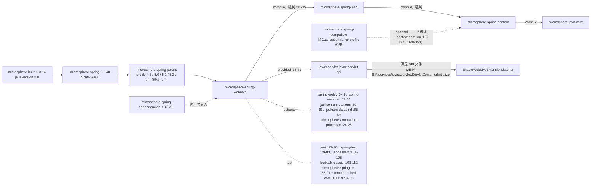
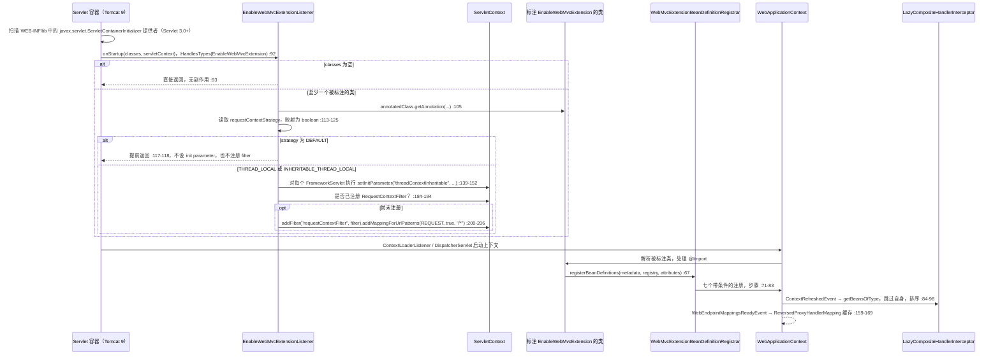
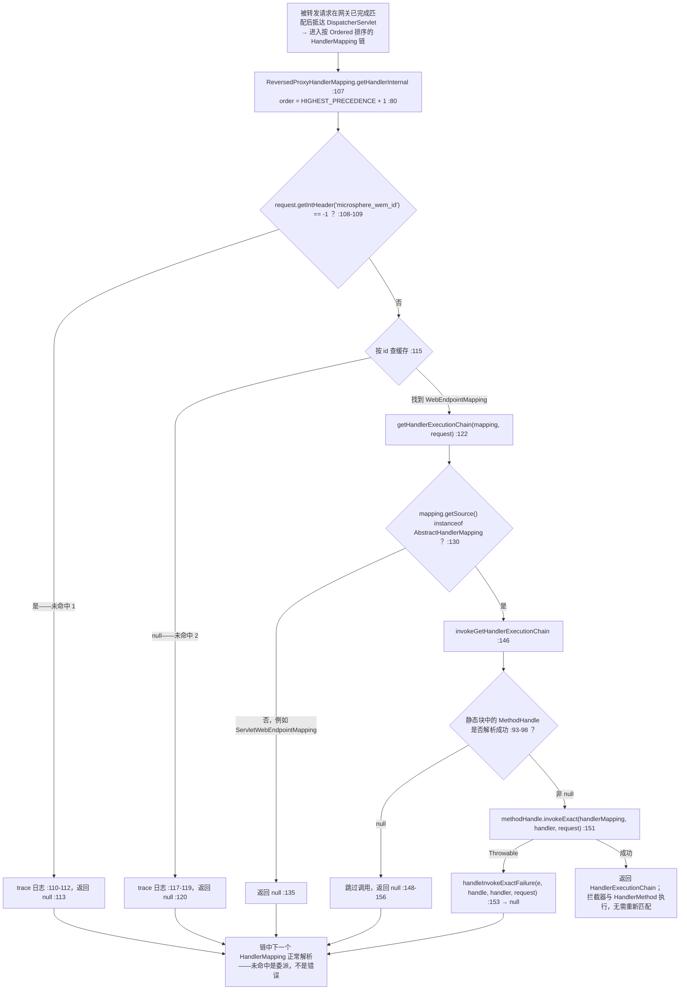

# microsphere-spring-webmvc — 开发者文档（0.1.x / `release-1.x`）

[← 开发者文档总览](./README.md) · [English](../webmvc.md) · [用户文档](../../../user-guide/1.x/zh/webmvc.md) · [0.2.x](../../current/zh/webmvc.md)

下文每一个代码行号与 POM 坐标都读自分支对象库（`git show origin/release-1.x:<path>`），而非当前 0.2.x 工作树。
本模块是 reactor 的 Servlet 侧适配器：把 `microsphere-spring-web` 的通用端点/拦截模型翻译成 Spring WebMVC 与
`javax.servlet` 产物，并持有全项目唯一的容器级启动钩子（`EnableWebMvcExtensionListener`）。

## 1. 模块标识、基线与依赖姿态

| 属性 | 取值 | 证据（分支 POM） |
|---|---|---|
| Maven 坐标 / 版本 | `io.github.microsphere-projects:microsphere-spring-webmvc:${revision}`；本线版本 `0.1.40-SNAPSHOT`，最近发布 `0.1.39` | `microsphere-spring-webmvc/pom.xml:13-16`，`pom.xml:55` |
| 父 POM | `microsphere-spring-parent:${revision}`，`relativePath ../microsphere-spring-parent/pom.xml`；构建父链根为 `microsphere-build:0.3.14`，其设定 `java.version=8` | `microsphere-spring-webmvc/pom.xml:5-10`，`pom.xml:5-9`，[parent.md](./parent.md) |
| Spring 基线 | 由 profile 选择 `4.3.30.RELEASE` / `5.0.20.RELEASE` / `5.1.20.RELEASE` / `5.2.25.RELEASE` / `5.3.39`，`spring-framework-5.3` 为 `activeByDefault` | `microsphere-spring-parent/pom.xml:137-178` |
| 命名空间与 Servlet API | `javax.*` —— 本模块所有 servlet 导入都是 `javax.servlet.*`，来自 **`provided`** 作用域的 `javax.servlet:javax.servlet-api`（由容器提供，本 POM 不写版本，经 `microsphere-java-dependencies` 导入解析，即 `microsphere-java` 0.3.19）；分支上**不存在** `jakarta.*` 坐标 | `microsphere-spring-webmvc/pom.xml:39-40`，`:38-42`，`microsphere-spring-parent/pom.xml:22,115-122`，`EnableWebMvcExtensionListener.java:29-35` |
| reactor 内依赖边 | 唯一强制边是 `microsphere-spring-web`（compile，**非** optional）；`microsphere-spring-context` 因 `web` 以 compile 声明它而传递引入（`microsphere-spring-web/pom.xml:31-35`），其后是 `microsphere-java-core` | `microsphere-spring-webmvc/pom.xml:31-35` |
| optional / test 依赖 | optional：`spring-web` `:45-49`、`spring-webmvc` `:52-56`、`jackson-annotations` `:59-63`、`jackson-databind` `:65-69`、`microsphere-annotation-processor` `:24-28`；test：`junit`（JUnit 4）`:72-76`、`spring-test` `:79-83`、`microsphere-spring-test` `:85-91`、`tomcat-embed-core` `:94-98`（Tomcat 9.0.119，`microsphere-spring-parent/pom.xml:27`）、`jsonassert` `:101-105`、`logback-classic` `:108-112` | `microsphere-spring-webmvc/pom.xml` |
| 资源 / 规模 | `src/main/resources` **存在**：`META-INF/services/javax.servlet.ServletContainerInitializer:1`、`META-INF/spring.factories:1-2`；33 个主类分布在 13 个包，34 个测试类 | `git ls-tree -r origin/release-1.x -- microsphere-spring-webmvc` |

⚠ **`microsphere-spring-compatible` 只存在于 1.x，但本模块永远看不到它。** 该垫片模块确实在分支上（`pom.xml:61`），
但它只在最低两档 Spring profile 下、且以 `<optional>true</optional>` 形式挂在 `microsphere-spring-context` 上
（`microsphere-spring-context/pom.xml:127-137`、`:148-153`）。optional 依赖不传递，因此从 `webmvc` 到 `compatible`
不存在图路径——只有应用自己声明时垫片才会生效；BOM 中也没有 `compatible` 条目，下游无法锁定它。

一句话概括依赖姿态：**凡是 Spring 或 Jackson 形态的依赖都是 `optional`，Servlet API 是 `provided`，只有
`microsphere-spring-web` 是强制的**——发布出的 POM 因此把提供 Spring WebMVC 与容器的责任完全交给使用者；而
`spring-webmvc` 在运行时确实必需，因为本模块每个公开类型都继承或实现某个 `org.springframework.web.servlet.*` 类型。

reactor 内没有任何模块依赖 `microsphere-spring-webmvc`——`webflux` 依赖的是 `web` 而非 `webmvc`
（`microsphere-spring-webflux/pom.xml:33`）——因此它是叶子模块；外部引用者只有 BOM 条目
（`microsphere-spring-dependencies/pom.xml:50-51`）与模块清单（`pom.xml:65`）。

## 2. 0.1.x 上 `io.microsphere.spring.webmvc.*` 包地图

| 包 | 类型 | 职责 |
|---|---|---|
| `…webmvc.annotation` | `EnableWebMvcExtension`（`:84`）、`WebMvcExtensionBeanDefinitionRegistrar`（包私有，`:62`）、`WebMvcExtensionConfiguration`（`:37`） | 开关注解、读取其属性的注册器、安装组合拦截器的 `WebMvcConfigurer` |
| `…webmvc.handler` | `ReversedProxyHandlerMapping`（`:76`） | 由请求头驱动的 handler 查找，服务于网关/代理转发 |
| `…webmvc.interceptor` | `MethodHandlerInterceptor`（`:18`）、`AnnotatedMethodHandlerInterceptor`（`:22`）、`AbstractPageRenderContextHandlerInterceptor`（`:20`）、`LazyCompositeHandlerInterceptor`（`:47`）、`LoggingMethodHandlerInterceptor`（`:36`）、`LoggingPageRenderContextHandlerInterceptor`（`:35`） | 把 `Object handler` 收窄为 `HandlerMethod`、页面渲染过滤、惰性扇出组合 |
| `…webmvc.config` | `WebMvcConfigurerAdapter`（`:48`，**仅 1.x**）、`ConfigurableContentNegotiationManagerWebMvcConfigurer`（`:36`） | Java 8 default 方法适配器、由环境驱动的内容协商 |
| `…webmvc.advice` | `RequestBodyAdviceAdapter`（`:17`）、`ResponseBodyAdviceAdapter`（`:17`）、`StoringRequestBodyArgumentAdvice`（`:24`）、`StoringResponseBodyReturnValueAdvice`（`:25`） | 空实现 advice 基类 + 两个缓存请求体/返回值的 advice Bean |
| `…webmvc.metadata` | `HandlerMappingWebEndpointMappingResolver`（`:50`）、`HandlerMappingWebEndpointMappingFactory`（`:41`）、`HandlerMetadataWebEndpointMappingFactory`（`:33`）、`RequestMappingMetadataWebEndpointMappingFactory`（`:53`）、`RequestMappingMetadata`（`:32`） | 从 `HandlerMapping` 中收割 `WebEndpointMapping` |
| `…webmvc.method.support` | `InterceptingHandlerMethodProcessor`（`:76`）、`HandlerMethodArgumentResolverAdvice`（`:33`）、`LoggingHandlerMethodArgumentResolverAdvice`（`:35`） | 围绕 `HandlerMethod` 的参数/返回值拦截 |
| `…webmvc.context` / `…webmvc.constants` / `…webmvc.util` | `ExclusiveViewResolverApplicationListener`（`:34`）/ `PropertyConstants`（`:27`）/ `WebMvcUtils`、`ViewUtils`、`ViewResolverUtils`、`SpringWebMvcHelper` | 强制某个 `ViewResolver` 独占 / `microsphere.spring.webmvc.` 与 `…view-resolver.` 前缀 / 静态访问器与 `SpringWebHelper` SPI 实现 |
| `io.microsphere.spring.web.servlet.*`（注意包根不同） | `EnableWebMvcExtensionListener`、`ContentCachingFilter`、`WebUtils` | 本模块面向容器的那一半——`SCI`、响应缓存、注册信息查询 |

⚠ 包根是分裂的：面向容器的类型（`EnableWebMvcExtensionListener`、`ContentCachingFilter`、`WebUtils`）位于
`io.microsphere.spring.web.servlet.*`，MVC 专属类型才位于 `io.microsphere.spring.webmvc.*`——只扫描后者会漏掉前三个类型。

## 3. 架构设计

### 3.1 `@EnableWebMvcExtension` + 注册器

`EnableWebMvcExtension.java:78-84` 叠加了 `@Retention(RUNTIME)`、`@Target(TYPE)`、`@Documented`、`@EnableWebExtension`、
`@OverrideAnnotationAttributes` 与 `@Import(WebMvcExtensionBeanDefinitionRegistrar.class)`。共有十个属性（`:98-212`）：
五个通过 `@AliasFor` 桥接到 `@EnableWebExtension`（`registerWebEndpointMappings :97-98`、`interceptHandlerMethods :109-110`、
`publishEvents :124-125`、`requestContextStrategy :138-139`、`sources :181-182`），五个是 MVC 本地属性
（`registerHandlerInterceptors :149`、`handlerInterceptors :161`、`storeRequestBodyArgument :194`、
`storeResponseBodyReturnValue :204`、`reversedProxyHandlerMapping :212`）。

`WebMvcExtensionBeanDefinitionRegistrar`（`:62`）继承 `microsphere-spring-context` 的
`AnnotatedBeanCapableImportBeanDefinitionRegistrar<EnableWebMvcExtension>`，因此属性解析（含通过
`ResolvablePlaceholderAnnotationAttributes` 完成的 `${…}` 占位符解析）都是继承而来。其 `registerBeanDefinitions`
（`:71-83`）是固定的七步序列——配置类 → 端点映射解析器 → 拦截处理器 → handler 拦截器 → 请求体 advice → 响应体 advice →
反向代理映射——每个带条件的步骤都以 `trace` 记录决策（`:96`、`:105`、`:152`、`:160`、`:168`），这是判断某个 Bean 为何缺失的唯一手段。

### 3.2 拦截器自动注册

两套互不相干的机制，经常被混为一谈：

1. **Bean 注册**（注册器 `:108-145`）。`resolveHandlerInterceptorClasses`（`:116-125`）把
   `registerHandlerInterceptors=true` 转成哨兵值 `ALL_HANDLER_INTERCEPTOR_CLASSES = {HandlerInterceptor.class}`（`:64`），
   否则使用显式的 `handlerInterceptors()` 数组。数组非空时，`LazyCompositeHandlerInterceptor` 以固定名
   `lazyCompositeHandlerInterceptor` 注册（`:127-132`，`LazyCompositeHandlerInterceptor.java:52`），类数组作为构造参数；
   随后每个*显式*拦截器类也各自注册为 Bean——`registerInterceptors`（`:134-141`）遇到哨兵值会提前返回，因此
   `registerHandlerInterceptors=true` 只注册组合拦截器。
2. **MVC 注册**（`WebMvcExtensionConfiguration.java:47-64`）：它注入
   `ObjectProvider<LazyCompositeHandlerInterceptor[]>`（`:41-45`）——注意是数组类型，会收集该类型下的*所有* Bean，
   包括使用者自己声明的——并把每个可用组合加入 `InterceptorRegistry`。这里的"惰性"是字面意义：组合类继承
   `OnceApplicationContextEventListener<ContextRefreshedEvent>`（`:47`），只在上下文刷新时执行
   `getBeansOfType(interceptorClass)`（`:88`），并在 `AnnotationAwareOrderComparator.sort`（`:96`）之前跳过 `this` 与任意
   `InterceptingHandlerMethodProcessor`（`:90`）；其 `preHandle` 在第一个 `false` 处短路，原样重抛 `Exception`，
   其他 `Throwable` 包装成 `RuntimeException`（`:107-126`）。

### 3.3 Servlet 3.0+ 启动路径——分支上唯一的容器钩子

| 产物 | 内容 |
|---|---|
| `src/main/resources/META-INF/services/javax.servlet.ServletContainerInitializer` | 只有一行（`:1`）：`io.microsphere.spring.web.servlet.listener.EnableWebMvcExtensionListener` |
| `io.microsphere.spring.web.servlet.listener.EnableWebMvcExtensionListener` | `@HandlesTypes(EnableWebMvcExtension.class)`（`:57`），`implements ServletContainerInitializer`（`:58`） |
| `src/main/resources/META-INF/spring.factories` | `:1-2`：键 `io.microsphere.spring.web.util.SpringWebHelper` → 值 `io.microsphere.spring.webmvc.util.SpringWebMvcHelper`（即 `SpringWebHelper` SPI 实现，`SpringWebMvcHelper.java:54`） |

⚠ "Servlet 3.5" 并非正式发布版本：该 SPI 是 `ServletContainerInitializer`（**Servlet 3.0** 引入），本分支测试用
`web.xml` 声明的是 `version="3.1"`（`src/test/resources/webapp/WEB-INF/web.xml:2-5`，`javax/web-app_3_1.xsd`），
测试容器为 Tomcat 9.0.119（Servlet 4.0）。坐标不写版本，经 `microsphere-java-dependencies:0.3.19` 解析；
`WebUtils.isRunningBelowServlet3Container`（`WebUtils.java:36-38`）是本模块自己对该下限的守卫。

监听器流程：`onStartup`（`:92-96`）忽略空 `Set`；`processAnnotatedClasses`（`:98-102`）以反射读取每个注解
（`:104-107`）；`processRequestContextStrategy`（`:113-128`）把枚举映射为单个 `boolean threadContextInheritable`
（`DEFAULT` 在 `:117-118` 直接返回）。随后两次写入：`processFrameworkServlet`（`:139-153`）为每个类属于
`FrameworkServlet` 的 `ServletRegistration` 设置 **init parameter** `threadContextInheritable`（快路径：
`:156` 精确匹配 `DispatcherServlet` 类名）；`processRequestContextFilter`（`:177-182`）以编程方式注册名为
`requestContextFilter` 的 `RequestContextFilter`（由简单类名 `uncapitalize` 得到，`:79`），仅映射 `/*` 且仅
`DispatcherType.REQUEST`（`:84`、`:89`、`:205`），并且只有在尚未注册任何 `RequestContextFilter` 时才注册（`:184-194`）。

### 3.4 `WebMvcConfigurerAdapter`——仅 1.x 存在的兼容类型

`config/WebMvcConfigurerAdapter.java:48` 是一个继承 `WebMvcConfigurer` 的接口，为全部 18 个钩子方法提供 Java 8
`default` 空实现（`:55-194`；`getValidator`/`getMessageCodesResolver` 在 `:183`、`:192` 返回 `null`）。其 Javadoc
直言动机——它"replaces `org.springframework.web.servlet.config.annotation.WebMvcConfigurerAdapter` … using Java 8
default methods"（`:41-42`），即在 Spring 5.0 废弃并最终删除该类之后，不等宿主 Spring 版本升级就恢复单继承的便利。
三个主类实现它：`WebMvcExtensionConfiguration`（`:37`）、`InterceptingHandlerMethodProcessor`（`:77`）、
`ConfigurableContentNegotiationManagerWebMvcConfigurer`（`:36`）；在 0.2.x 上三者都直接实现 `WebMvcConfigurer`，本类型被删除。

### 3.5 `ReversedProxyHandlerMapping`

`handler/ReversedProxyHandlerMapping.java:76` 继承 `AbstractHandlerMapping`，并监听 `WebEndpointMappingsReadyEvent`（`:159-169`）。

- **请求头键**：`WebEndpointMapping.ID_HEADER_NAME`，即 `"microsphere_wem_id"`（`microsphere-spring-web/.../WebEndpointMapping.java:134`），通过 `request.getIntHeader` 读取（`:108`）。
- **顺序常量**：`public static final int DEFAULT_ORDER = HIGHEST_PRECEDENCE + 1`（`:80`），在无参构造中通过
  `setOrder(DEFAULT_ORDER)` 应用（`:102-104`）。它刻意*不是* `HIGHEST_PRECEDENCE`，以便使用者自己的映射可以排在前面。
- **反射 / MethodHandle 接缝**：静态块（`:93-98`）把
  `AbstractHandlerMapping.getHandlerExecutionChain(Object, HttpServletRequest)`——一个本模块无法直接调用的 `protected`
  方法，因为它不是*那个*映射的子类——经 `io.microsphere.invoke.MethodHandleUtils.findVirtual` 解析进
  `@Nullable MethodHandle` 字段（`:91`）。`invokeGetHandlerExecutionChain`（`:146-157`）随后 `invokeExact` 之，并把任何
  `Throwable` 交给 `handleInvokeExactFailure`（`:153`），结果保持 `null`。
- **未命中分支（两处，都 `return null`）**：请求头缺失 → `getIntHeader` 返回 `-1` → `null`（`:109-114`）；请求头存在但
  id 不在缓存中 → `null`（`:116-121`）。`AbstractHandlerMapping#getHandler` 会继续落到链中的下一个映射，所以未命中是
  正常委派，而非错误。
- **缓存填充**：`onApplicationEvent` 重建一个定容 `newFixedHashMap`（`:163`），按 `isAbstractHandlerMapping`（`:171-174`）
  过滤 = `Kind.WEB_MVC` **且** `source instanceof AbstractHandlerMapping`；该字段非 `volatile`，整体重新赋值（`:100`、`:168`）。
- ⚠ 在 0.1.x 上，`getHandlerExecutionChain` 自己再次判断 `source instanceof AbstractHandlerMapping`（`:129-131`），而没有复用
  `isAbstractHandlerMapping`；并且端点集合只覆盖 WebMVC：`HandlerMappingWebEndpointMappingResolver` 只解析
  `AbstractUrlHandlerMapping` + `RequestMappingInfoHandlerMapping`（`:65-86`），从不解析 `RouterFunctionMapping`。其 Javadoc
  也明说："For now … only supports to get the handlers from `RequestMappingHandlerMapping`"（`:63-65`）。

同一模块还有**第二处** MethodHandle 接缝，这才是 4.3→5.3 矩阵能够编译的真正原因：
`RequestMappingMetadataWebEndpointMappingFactory.java:60,67` 解析 `RequestMappingInfo.getPatternValues()`（Spring 5.3 新增），
而 `getPatterns`（`:107-125`）在句柄为 `NOT_FOUND_METHOD_HANDLE` 或调用失败时回落到
`PatternsRequestCondition.getPatterns()`；0.2.x 删掉了句柄与回落，直接调用 `source.getPatternValues()`（`:88-90`）。

### 3.6 注册器是否遵循 `requestContextStrategy`？否——两条线都是

- `WebMvcExtensionBeanDefinitionRegistrar.java:66-169` 从未提到该属性，并且 `git diff origin/release-1.x main` 对该文件
  的结果是**空的**：两条分支携带逐字节相同的注册器——同样七步，同样的沉默。
- 两条分支上 MVC 侧唯一的消费者是容器钩子，即各自的 `EnableWebMvcExtensionListener.java:114`；两个监听器只有导入不同
  （`javax.servlet.*` → `jakarta.servlet.*`），方法体完全一致。
- 该属性确实被某个注册器遵循，但那是**WebFlux** 的：`microsphere-spring-webflux/.../WebFluxExtensionBeanDefinitionRegistrar.java:102-123`
  调用了 `annotationAttributes.getEnum("requestContextStrategy")`。因此不对称之处在于 MVC 与 WebFlux 之间，**而非** 0.1.x 与 0.2.x 之间。

### 3.7 Web 应用启动：从 `ServletContainerInitializer` 到上下文初始化

顺序至关重要：`onStartup` 运行在 servlet 与 filter 初始化**之前**，这正是 `:147` 处的 `setInitParameter` 写入
仍能作用于已注册 `DispatcherServlet` 的唯一原因。

### 3.8 反向代理分发流程，包含未命中分支

## 4. 有证据支撑的设计模式

| 模式 | 相关类 | 证据 |
|---|---|---|
| 配置开关（"Enable\*"）+ `ImportBeanDefinitionRegistrar`，并含元注解别名 | `EnableWebMvcExtension`、`WebMvcExtensionBeanDefinitionRegistrar` | `EnableWebMvcExtension.java:83`；`@AliasFor(annotation = EnableWebExtension.class)` ×5，位于 `:97,:109,:124,:138,:181`；`@OverrideAnnotationAttributes` `:82`；注册器 `:62,:71-83` |
| 责任链 + 组合 + 延迟初始化 | `HandlerMapping` 链中的 `ReversedProxyHandlerMapping`；覆盖在 `HandlerInterceptor` 之上的 `LazyCompositeHandlerInterceptor` | `:80,:102-104`；`LazyCompositeHandlerInterceptor.java:47,:54-60,:84-98,:107-126` |
| 通过 default 方法实现适配器 + 空对象 | `WebMvcConfigurerAdapter`、`RequestBodyAdviceAdapter`、`ResponseBodyAdviceAdapter`、`AbstractPageRenderContextHandlerInterceptor`；`ViewUtils`/`WebMvcUtils` 返回 `null`/空而不抛异常 | `WebMvcConfigurerAdapter.java:48,:55-194`；`RequestBodyAdviceAdapter.java:17`；`AbstractPageRenderContextHandlerInterceptor.java:20`；`ViewUtils.java:50` |
| 模板方法 | `MethodHandlerInterceptor`（`preHandle`/`postHandle`/`afterCompletion` 为 `final`）、`AnnotatedMethodHandlerInterceptor`、`HandlerMappingWebEndpointMappingFactory` | `MethodHandlerInterceptor.java:21,34,46,:57`；`AnnotatedMethodHandlerInterceptor.java:36,51,65`；`HandlerMappingWebEndpointMappingFactory.java:57,88,97,107` |
| 观察者 / 事件驱动装配 + 装饰器（重写 handler 链） | `ReversedProxyHandlerMapping`、`InterceptingHandlerMethodProcessor`、`ExclusiveViewResolverApplicationListener`、`LazyCompositeHandlerInterceptor`；`initRequestMappingHandlerAdapter` 把 `this` 前插到解析器与 handler 列表 | `:159`；`InterceptingHandlerMethodProcessor.java:76,123-128,:214-244`，尤其 `:232-243`；`ExclusiveViewResolverApplicationListener.java:48-51` |
| 策略 | 监听器消费 `RequestContextStrategy`；`sources()`（`BeanSource`）选择 Bean 来源 | `EnableWebMvcExtensionListener.java:113-128`；`EnableWebMvcExtension.java:182` |
| 服务提供者 / 插件 | `META-INF/services/javax.servlet.ServletContainerInitializer`、`META-INF/spring.factories` → `SpringWebMvcHelper` | 两个资源文件，见 §3.3 |
| 反射 / `MethodHandle` 间接调用 + 整体替换式缓存旁路 | `ReversedProxyHandlerMapping`（`webEndpointMappingsCache`）、`RequestMappingMetadataWebEndpointMappingFactory`、`ConfigurableContentNegotiationManagerWebMvcConfigurer`、`InterceptingHandlerMethodProcessor`（`parameterContextsCache`/`returnTypeContextsCache`） | `ReversedProxyHandlerMapping.java:93-98,:100,:163-168`；`RequestMappingMetadataWebEndpointMappingFactory.java:67,:107-125`；`ConfigurableContentNegotiationManagerWebMvcConfigurer.java:48-66`；`InterceptingHandlerMethodProcessor.java:81-83` |

## 5. 0.1.x（`release-1.x`）与 0.2.x（`release`）的差异

| 维度 | 0.1.x | 0.2.x | 证据 |
|---|---|---|---|
| Java 基线 | 8（`microsphere-build:0.3.14` → `java.version=8`） | 17（`microsphere-build:0.3.17`） | 两条线的 `pom.xml:5-9` |
| Servlet 命名空间与坐标 | `javax.servlet:javax.servlet-api`，`provided`，不写版本 | `jakarta.servlet:jakarta.servlet-api`，`provided`，解析为 6.1.0 | `microsphere-spring-webmvc/pom.xml:38-42` 对 `:39-40`；`.flattened-pom.xml:57-60` |
| 启动机制 | `META-INF/services/**javax**.servlet.ServletContainerInitializer` | `META-INF/services/**jakarta**.servlet.ServletContainerInitializer`——文件被*重命名*，内容逐字节相同（`R100`） | `git diff --name-status origin/release-1.x main` |
| `threadContextInheritable` / `RequestContextFilter` 处理 | 逻辑完全相同，只有导入不同；`SCI` 是*唯一*消费者 | 相同 | 1.x 监听器 `:113-206` ≡ 0.2.x 监听器 `:113-206` |
| `requestContextStrategy` 与 MVC 注册器 | 注册器忽略它；只有容器钩子遵循它 | **同样如此**——注册器文件在两条分支逐字节相同 | 两条线的 `WebMvcExtensionBeanDefinitionRegistrar.java`（diff 为空） |
| 访问者 API | `WebEndpointMappingVisitor` 存在于 `microsphere-spring-web`（`…/web/metadata/WebEndpointMappingVisitor.java`），仅是接口，**webmvc 从未使用**；此处没有函数模型访问者 | `WebEndpointMappingVisitor` 被移除；webmvc 新增基于 Spring 6 访问者 API 的 `io.microsphere.spring.web.servlet.function.{RouterFunctionVisitorAdapter,RequestPredicateVisitorAdapter,ConsumingWebEndpointMappingAdapter}` | 逐分支 `git grep WebEndpointMappingVisitor` |
| WebMVC 中的函数式端点 | 不解析：`HandlerMappingWebEndpointMappingResolver` 只处理 `AbstractUrlHandlerMapping` + `RequestMappingInfoHandlerMapping`（`:65-86`） | 增加 `resolveFromRouterFunctionMapping`（`:90-98`），因此 `ReversedProxyHandlerMapping` 也能服务 `RouterFunction` | 该文件 diff，+13 行 |
| 0.2.x 上被删除/不再存在的类型 | `io.microsphere.spring.webmvc.config.WebMvcConfigurerAdapter`（195 行，被 3 个类实现）；`AbstractPageRenderContextHandlerInterceptor extends HandlerInterceptorAdapter`（`:20`，Spring 5 才有的父类） | 适配器被删除——`WebMvcExtensionConfiguration.java:36` 直接实现 `WebMvcConfigurer`——拦截器改为 `implements HandlerInterceptor`（`:18`）；`HandlerInterceptorAdapter` 在 Spring 6 中已消失 | `git diff --stat`：`WebMvcConfigurerAdapter.java \| 195 ------`；0.2.x 拦截器文件 `:18` |
| 方法签名与转型写法 | `ViewUtils.getResponseStatus` 返回 `HttpStatus`（`ViewUtils.java:50`）；到处是显式 `if (x instanceof T) { T t = (T) x; }`（`MethodHandlerInterceptor.java:21-31`） | 返回 `HttpStatusCode`（Spring 6 拓宽）；改用 Java 16 的 `instanceof` 模式匹配 | `ViewUtils.java` 的 diff；`main` 上同一拦截器文件 |
| `RequestMappingInfo` 模式访问 | `MethodHandle` + `PatternsRequestCondition` 回落（兼容 Spring 4.3/5.0） | 直接 `getPatternValues()` | `RequestMappingMetadataWebEndpointMappingFactory.java:107-125` 对 `:88-90` |
| 测试栈 | JUnit 4（`junit`）、`SpringRunner`，34 个测试类；存在 `dispatcherServlet-servlet.xml` | JUnit 5（`junit-jupiter`）+ `hamcrest`，`web.xml` 为 Servlet 6.0 | `pom.xml:72-76` 对 `:73-75`、`:107-111`（新增）；测试资源清单 |
| `microsphere-spring-compatible` | 模块存在（`pom.xml:61`），在 `context` 下为 optional + profile 约束 | 从 reactor 中删除 | 两条线的 `pom.xml:58-69` |

## 6. 陷阱、死代码与被注释掉的代码

| # | 观察 | 证据 |
|---|---|---|
| 1 | ⚠ 四个公开类型**从不**被 `@EnableWebMvcExtension` 注册——`ContentCachingFilter`、`ConfigurableContentNegotiationManagerWebMvcConfigurer`、`ExclusiveViewResolverApplicationListener`、`ViewUtils`。对所有 1.x `src/main/java` 执行 `git grep`，除自身文件外找不到任何引用；必须自行声明（`@Bean`、`new`）。 | `WebMvcExtensionBeanDefinitionRegistrar.java:71-83`（七步中不含它们） |
| 2 | ⚠ 监听器以**反射**读取注解，而非通过 Spring 的合并注解：`annotatedClass.getAnnotation(EnableWebMvcExtension.class).requestContextStrategy()`（`:105,:114`）。原始 JDK 注解代理看不到 `@AliasFor`（`:138`），因此 `requestContextStrategy` 必须字面写在 `@EnableWebMvcExtension` 上——只写在 `@EnableWebExtension` 上会被静默忽略；分支上三个测试都用字面写法（`EnableWebMvcExtensionListenerThreadLocalStrategyTest.java:33`）。而 `strategy = DEFAULT` 时监听器**什么都不做**（`:117-118`），默认也就不会注册 `requestContextFilter`——`EnableWebMvcExtensionListenerTest.java:67-68,:82-83` 正是在断言这种"空"。 | `EnableWebMvcExtensionListener.java:104-125` |
| 3 | ⚠ 对 `ServletRegistration` 调用 `setInitParameter` 之所以有效，仅因 SCI 早于初始化运行；若应用在 `web.xml` 中声明过 `threadContextInheritable`，这里会被静默覆盖。 | `:147` 对照 `src/test/resources/webapp/WEB-INF/web.xml:11-15` |
| 4 | 当找不到被代理的解析器/handler 时，`initMethodParameterContextsCache`/`initReturnTypeContextsCache` 什么都不注册（`:249-255`、`:260-267`），于是 `supportsParameter`/`supportsReturnType`（`:136-143`）只是纯缓存查询——未处理的参数会被无声跳过，没有任何日志。 | `InterceptingHandlerMethodProcessor.java:136-143,:246-268` |
| 5 | `addInterceptors` 把 `this` 加入注册表（`:131-133`），而该处理器同时是 `InterceptorRegistry` 参与者*兼*参数解析器*兼*返回值处理器（`:77`）——一个 Bean 四种角色。使用者拦截器的 `preHandle` 返回 `false` 时，参数拦截也会被一并短路。 | `:76-77,:131-133` |
| 6 | `webEndpointMappingsCache` 在请求路径上没有 `null` 守卫：若请求在 `WebEndpointMappingsReadyEvent` 触发前就带上该请求头，`:115` 会抛 `NullPointerException`，而不是预期的 trace 记录未命中。 | `:100,:115,:159-169` |
| 7 | `WebUtils.getServletContext(request)` 使用 `request.getSession()`——即 `true` 的那个重载，会在无会话的请求上**创建** `HttpSession`。 | `WebUtils.java:47-49` |
| 8 | `ConfigurableContentNegotiationManagerWebMvcConfigurer` 通过反射伸手进入 Spring `ContentNegotiationConfigurer` 的私有字段（`doWithFields` + `setAccessible(true)`，`:49-61`），并用 `DataBinder` 把 Environment 的任意子属性绑定到 `ContentNegotiationManagerFactoryBean`（`:79-94`）。只有 `contentNegotiationManager` 与 `servletContext` 被禁止（`:83`），因此一个错误的 `microsphere.spring.webmvc.content-negotiation.*` 键会在请求时而非启动时失败。 | `:41,:48-66,:79-94` |
| 9 | 近似死代码：`getHandlerExecutionChainMethodName`（`:85`）是可变的（非 `final`）`private static String`，只被使用一次，就在它自己的静态块里（`:94`）。 | `ReversedProxyHandlerMapping.java:85,:93-98` |
| 10 | 分支上存在被注释掉的测试：`ReversedProxyHandlerMappingTest.java:156-161` 禁用了 `testInvokeGetHandlerExecutionChainOnFailed`——`ReversedProxyHandlerMapping.java:153` 的 `handleInvokeExactFailure` 路径在 0.1.x 上**没有**任何执行到的测试。 | 1.x 测试文件 |
| 11 | 表面不一致：许可证头分布不均——33 个主文件中有 12 个直接从 `package` 行开始（`advice/*` 四个全部、`config/ConfigurableContentNegotiationManagerWebMvcConfigurer.java:1`、`context/ExclusiveViewResolverApplicationListener.java:1`、`interceptor/{MethodHandlerInterceptor,AnnotatedMethodHandlerInterceptor,AbstractPageRenderContextHandlerInterceptor}.java:1`、`util/WebMvcUtils.java:1`、`web/servlet/{util/WebUtils,filter/ContentCachingFilter}.java:1`），而 `EnableWebMvcExtension.java:1-16` 与 `config/WebMvcConfigurerAdapter.java:1-17` 却带完整 Apache 头；此外每个类型上的 `@since 1.0.0` 与被分析的 `0.1.40-SNAPSHOT` 相冲突，因此本线上不能用 `@since` 做发布映射。 | 各文件 `git show origin/release-1.x:<file>` 首行；`EnableWebMvcExtension.java:76`、`pom.xml:55` |
| 12 | `ViewResolverUtils` 在 Javadoc 中引用了 `org.thymeleaf.spring5.view.ThymeleafViewResolver`（`:62-66`）与 `…view.velocity.VelocityViewResolver`（`:55-59`），而这两个构件都不在本模块 classpath 上——编译期引用会失败，所以这些常量只是与宿主应用视图栈之间的"按名约定"。 | `ViewResolverUtils.java:52-80` |

## 7. 构建与验证

| 任务 | 命令 / 事实 |
|---|---|
| 从分支构建/测试本模块，以及它必须通过的矩阵 | `mvn -pl microsphere-spring-webmvc -am test -P spring-framework-5.3`，profile 为 `4.3 / 5.0 / 5.1 / 5.2 / 5.3`，`5.3` 默认激活（`microsphere-spring-parent/pom.xml:137-178`）——这正是存在两处 `MethodHandle` 接缝的原因（§3.5） |
| 不改动工作树的查看方式 | `git show origin/release-1.x:microsphere-spring-webmvc/pom.xml`、`git grep -n <symbol> origin/release-1.x -- microsphere-spring-webmvc` |
| 测试底座 | `@RunWith(SpringRunner.class)` + 来自 `microsphere-spring-test` 的 `@EmbeddedTomcatConfiguration`（`AbstractEnableWebMvcExtensionListenerTest.java:20,:51-53,:80-92`）；Tomcat 9.0.119 |

**相关文档** — [开发者文档总览](./README.md) · [English](../webmvc.md) · [用户文档 — WebMVC 1.x](../../../user-guide/1.x/zh/webmvc.md) · [0.2.x 开发者文档](../../current/zh/webmvc.md) · [web（其强制上游）](./web.md) · [context](./context.md) · [compatible](./compatible.md) · [parent POM profile 矩阵](./parent.md) · [依赖管理](./dependencies.md) · [0.2.x webflux 开发者文档](../../current/zh/webflux.md)
