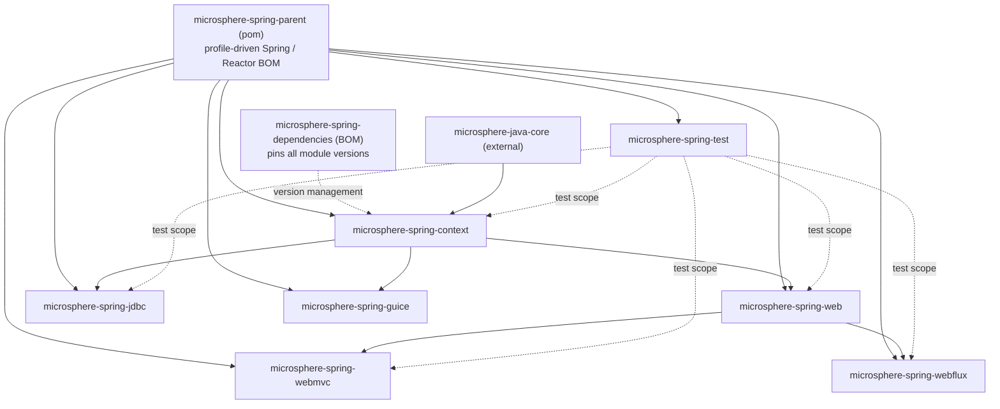

# Developer Guide

[← Documentation index](../README.md) · **English** · [简体中文](./zh/README.md) · [User Guide](../user-guide/README.md)

The Developer Guide explains **how `microsphere-spring` is built**: the architecture of each module,
the source code behind every extension seam, the design patterns the library relies on, and Mermaid
flow charts for the non-obvious runtime flows. It is written against the two released branches only —
`release` (documented as **current**, version line 0.2.x) and `release-1.x` (documented as **1.x**,
version line 0.1.x).

| Version line | Branch | Directory | Java | Baseline |
|---|---|---|---|---|
| 0.2.x | `release` | [`current/`](./current/README.md) | 17 | Spring Framework 6.0.x – 7.0.x, `jakarta.*` |
| 0.1.x | `release-1.x` | [`1.x/`](./1.x/README.md) | 8 | Spring Framework 4.3.x – 5.3.x, `javax.*` |

## Module dependency graph

Compile-scope dependencies between the reactor's own modules (every module also inherits
`microsphere-spring-parent`, and `microsphere-spring-dependencies` is the BOM that pins them all;
`microsphere-spring-test` is pulled in with **test** scope by every module that has tests except
`microsphere-spring-guice`, which is why it is a leaf and is built late in the reactor order):

### current — 0.2.x



### 1.x — 0.1.x

```mermaid
flowchart TD
  P["microsphere-spring-parent (pom)"]
  D["microsphere-spring-dependencies (BOM)"]
  X["microsphere-spring-compatible<br/>(1.x only, not in the BOM, deploy skipped)"]
  C["microsphere-spring-context"]
  W["microsphere-spring-web"]
  M["microsphere-spring-webmvc"]
  F["microsphere-spring-webflux"]
  J["microsphere-spring-jdbc"]
  G["microsphere-spring-guice"]
  T["microsphere-spring-test"]
  CORE["microsphere-java-core (external)"]

  CORE --> C
  P --> C
  D -.version management.-> C
  X -.optional, spring-framework-4.3 / 5.x profiles.-> C
  C --> W
  W --> M
  W --> F
  C --> J
  C --> G
  T -.test scope.-> C
  T -.test scope.-> W
  T -.test scope.-> M
  T -.test scope.-> F
  T -.test scope.-> J
```

Read each arrow as "is required by": the tail is the dependency, the head is the module that declares
it. `webmvc` and `webflux` never depend on each other: both sit on the
transport-neutral `web` kernel, which in turn sits on `context`. That layering is what lets a Servlet
application and a reactive application share the endpoint metadata model.

## Module documents

### current — 0.2.x ([`current/`](./current/README.md))

| Module | English | 简体中文 |
|---|---|---|
| Build: parent | [parent.md](./current/parent.md) | [中文](./current/zh/parent.md) |
| Build: dependencies (BOM) | [dependencies.md](./current/dependencies.md) | [中文](./current/zh/dependencies.md) |
| `microsphere-spring-context` | [context.md](./current/context.md) | [中文](./current/zh/context.md) |
| `microsphere-spring-web` | [web.md](./current/web.md) | [中文](./current/zh/web.md) |
| `microsphere-spring-webmvc` | [webmvc.md](./current/webmvc.md) | [中文](./current/zh/webmvc.md) |
| `microsphere-spring-webflux` | [webflux.md](./current/webflux.md) | [中文](./current/zh/webflux.md) |
| `microsphere-spring-jdbc` | [jdbc.md](./current/jdbc.md) | [中文](./current/zh/jdbc.md) |
| `microsphere-spring-guice` | [guice.md](./current/guice.md) | [中文](./current/zh/guice.md) |
| `microsphere-spring-test` | [test.md](./current/test.md) | [中文](./current/zh/test.md) |

### 1.x — 0.1.x ([`1.x/`](./1.x/README.md))

| Module | English | 简体中文 |
|---|---|---|
| Build: parent | [parent.md](./1.x/parent.md) | [中文](./1.x/zh/parent.md) |
| Build: dependencies (BOM) | [dependencies.md](./1.x/dependencies.md) | [中文](./1.x/zh/dependencies.md) |
| `microsphere-spring-context` | [context.md](./1.x/context.md) | [中文](./1.x/zh/context.md) |
| `microsphere-spring-web` | [web.md](./1.x/web.md) | [中文](./1.x/zh/web.md) |
| `microsphere-spring-webmvc` | [webmvc.md](./1.x/webmvc.md) | [中文](./1.x/zh/webmvc.md) |
| `microsphere-spring-webflux` | [webflux.md](./1.x/webflux.md) | [中文](./1.x/zh/webflux.md) |
| `microsphere-spring-jdbc` | [jdbc.md](./1.x/jdbc.md) | [中文](./1.x/zh/jdbc.md) |
| `microsphere-spring-guice` | [guice.md](./1.x/guice.md) | [中文](./1.x/zh/guice.md) |
| `microsphere-spring-test` | [test.md](./1.x/test.md) | [中文](./1.x/zh/test.md) |
| `microsphere-spring-compatible` (1.x only) | [compatible.md](./1.x/compatible.md) | [中文](./1.x/zh/compatible.md) |

## What every developer-guide page contains

1. **Module identity and reactor position** — the module's own dependency graph, and which of its
   dependencies are `optional` / `provided` versus compile-scope.
2. **Package map** — every package with its responsibility.
3. **Architecture layering** — a Mermaid diagram of the entry points, the Spring extension seams used
   (`ApplicationContextInitializer`, `BeanFactoryPostProcessor`, `BeanPostProcessor`,
   `ImportBeanDefinitionRegistrar`, `SmartLifecycle`, `ApplicationListener`, `ServletContainerInitializer`)
   and the runtime services they wire.
4. **Source analysis** — the actual classes, contracts and wiring, with repo-relative file references.
5. **Flow charts** — Mermaid diagrams for the complex flows: startup collection, request interception,
   property-source resolution, cache resolution, connection wrapping, embedded container startup.
6. **Design patterns** — which pattern each class implements and why the library chose it.
7. **Extension points** — every SPI, how it is discovered (`spring.factories`, `META-INF/services`,
   `@Import`, bean search) and when it is invoked.
8. **Build and verification** — the Maven profiles that affect the module and how to run its tests.
9. **Caveats** — verified discrepancies, including attributes that are declared but never read, and
   differences between the 0.1.x and 0.2.x lines.

## Cross-cutting architecture notes

- **Everything is opt-in.** No module activates behaviour by classpath scanning alone; each feature
  family is switched on by an `@Enable*` annotation that imports an `ImportBeanDefinitionRegistrar`.
- **Discovery is pluggable.** `BeanSource` selects where extension components are looked up:
  `BEAN_FACTORY`, `SPRING_FACTORIES` (`META-INF/spring.factories`) and `JAVA_SERVICE_PROVIDER`
  (`META-INF/services`).
- **Spring versions are a build-time choice, not a runtime branch.** The `spring-framework-*` profiles
  in `microsphere-spring-parent` swap the imported Spring and Reactor BOMs; module poms add the extra
  dependencies a given profile needs (on 1.x, that is where `microsphere-spring-compatible` enters).
- **The 0.1.x line is the maintenance line for Java 8 and `javax.*`.** Its sources are only reachable
  through `git show origin/release-1.x:<path>`, and the docs state so wherever a snippet is 1.x-specific.
