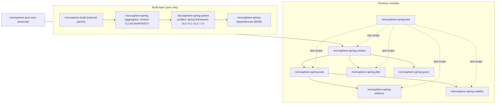

# Developer Guide — `release` branch (0.2.x)

[← Developer guide index](../README.md) · [简体中文](./zh/README.md) · [User Guide — current](../../user-guide/current/README.md) · [Developer Guide — 1.x](../1.x/README.md)

This directory documents the **0.2.x** line — the `release` branch: Java 17, `jakarta.*` namespaces,
Spring Framework 6.0.x – 7.0.x. Every class, package and flow described here is the code on that
branch; the 0.1.x maintenance line is documented separately in [`../1.x/`](../1.x/README.md).

## Version facts

| Item | Value |
|---|---|
| Branch | `release` |
| Version line | 0.2.x — latest release `0.2.39`, development `0.2.40-SNAPSHOT` |
| Java baseline | 17 |
| Namespace | `jakarta.*` (`jakarta.jakartaee-bom` 11.0.0) |
| Spring Framework verified | 6.0.23 / 6.1.21 / 6.2.18 / 7.0.9 (`spring-framework-6.0 … 7.0` profiles; **7.0 is `activeByDefault`**) |
| Reactor BOM | 2022.0.22 / 2023.0.19 / 2024.0.17 / 2025.0.7, paired with the Spring profile |
| Build parent | `io.github.microsphere-projects:microsphere-build` `0.3.17` (same on `origin/release:pom.xml:8` and in the working `main` tree) |
| Managed third parties | Jackson 2.22.3, SnakeYAML 2.7, P6Spy 3.9.1, ZooKeeper 3.9.6, Curator 5.9.0 (Guice 7.0.0 is **not** parent-managed — it is pinned in `microsphere-spring-guice/pom.xml:22`) |

The published artifacts on Maven Central are `0.2.30` … `0.2.39`; see
[release-notes.md](../../../release-notes.md) for per-version changes.

## Module dependency graph



Key structural properties, all visible in the module poms:

- **One kernel, two transports.** `webmvc` and `webflux` both depend on `web` and never on each other,
  so a Servlet application and a reactive application share one endpoint metadata model.
- **`context` is the root of the runtime tree.** `web`, `jdbc` and `guice` all build on it; nothing
  builds on `webmvc` or `webflux`.
- **`test` is a leaf.** It is consumed only with test scope, yet every module except `guice` needs it,
  so it must be resolvable before the others run their tests — that is why it sits at the end of the
  reactor order.
- **Only `microsphere-java-core` is mandatory.** Spring, Jackson, SnakeYAML, P6Spy, Guice, the Servlet
  API, Tomcat and ZooKeeper are declared `optional` or `provided` so the library never dictates the
  consumer's versions.

## Module documents

| Module | English | 简体中文 | What the page covers |
|---|---|---|---|
| parent | [parent.md](./parent.md) | [中文](./zh/parent.md) | `${revision}` flattening, profile → Spring/Reactor BOM selection |
| dependencies | [dependencies.md](./dependencies.md) | [中文](./zh/dependencies.md) | the consumer-facing BOM and its import chain |
| context | [context.md](./context.md) | [中文](./zh/context.md) | property sources, relaxed binding, TTL caching, listenable Environment, parallel pre-instantiation |
| web | [web.md](./web.md) | [中文](./zh/web.md) | endpoint metadata model, registrar lifecycle, interception SPI |
| webmvc | [webmvc.md](./webmvc.md) | [中文](./zh/webmvc.md) | Servlet/MVC adapters, `ReversedProxyHandlerMapping`, body caching |
| webflux | [webflux.md](./webflux.md) | [中文](./zh/webflux.md) | reactive adapters, `WebFilter` + `HandlerResult` path |
| jdbc | [jdbc.md](./jdbc.md) | [中文](./zh/jdbc.md) | `p6spy:` URL indirection, DataSource decoration, listener fan-out |
| guice | [guice.md](./guice.md) | [中文](./zh/guice.md) | One-way bridge: Guice `@Inject` sites satisfied by Spring (no `Injector`/`Module`); every site resolves as non-required |
| test | [test.md](./test.md) | [中文](./zh/test.md) | embedded Tomcat / ZooKeeper / SQLite lifecycles, abstract test bases |

Pages are added as they are completed; a missing link means that module page is still in progress.

## The extension model in one page

Every module follows the same three-step shape, which is why the flows look alike once you know it:

1. **An `@Enable*` annotation** carries the configuration and imports an `ImportBeanDefinitionRegistrar`
   (for example `@EnableWebExtension` → `WebExtensionBeanDefinitionRegistrar`).
2. **The registrar registers collaborators**, choosing between a `Simple`, `Composite` or framework
   specific implementation according to what already exists in the `BeanFactory`, and honouring the
   annotation's boolean gates (such as `registerWebEndpointMappings`, `interceptHandlerMethods`,
   `publishEvents`).
3. **Runtime objects hook Spring seams**: `ApplicationContextInitializer` and
   `BeanFactoryPostProcessor` before instantiation, `BeanPostProcessor` during it, `SmartLifecycle`
   after refresh, `ApplicationListener` for events, and `META-INF/spring.factories` /
   `META-INF/services` for discovery. `BeanSource` selects the discovery strategy:
   `BEAN_FACTORY`, `SPRING_FACTORIES`, `JAVA_SERVICE_PROVIDER`.

The flow charts inside each module page follow exactly that shape: annotation → registrar → seam →
runtime effect.

## Building and verifying

```bash
mvn -P spring-framework-7.0 clean verify       # default profile on this branch
mvn -P spring-framework-6.0 clean test         # lowest supported Spring line
mvn -pl microsphere-spring-webmvc -am test     # one module plus its dependencies
```

The profiles live in [`microsphere-spring-parent/pom.xml`](../../../microsphere-spring-parent/pom.xml)
and only swap the imported Spring and Reactor BOMs; module poms add the extra dependencies a given
profile needs. Java 17 is required, and the root POM declares `<java.version>17</java.version>`.

## Conventions in these pages

- File references are repo-relative (`microsphere-spring-context/src/main/java/...`) with line numbers
  where a specific claim depends on them.
- `⚠` marks a discrepancy verified in source: an attribute that is declared but never read, a package
  name typo, or behaviour that differs from the annotation's name.
- Differences against the 0.1.x line are called out per module and summarised in
  [the user guide's cross-branch table](../../user-guide/current/README.md).
