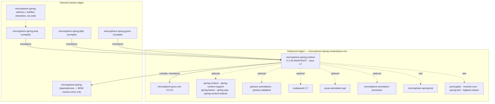
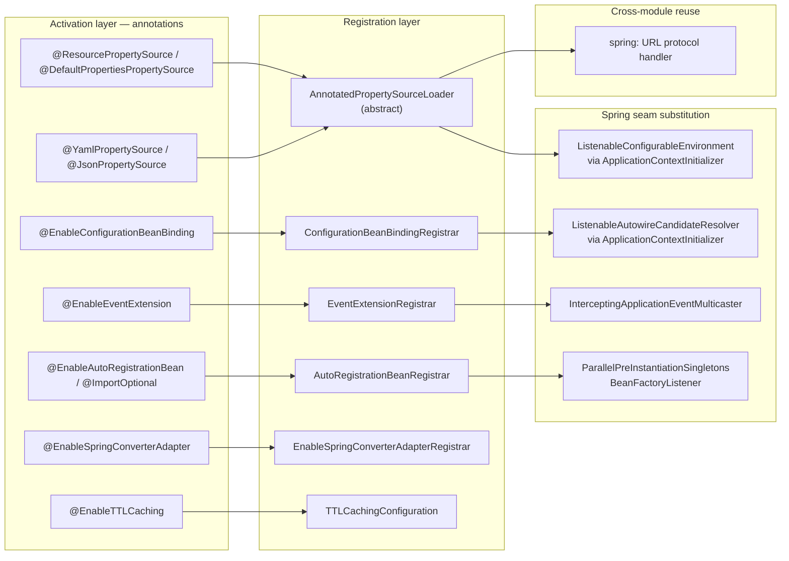
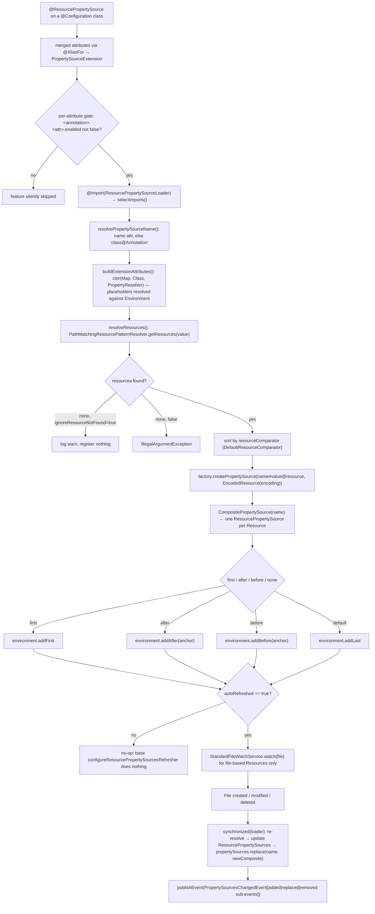
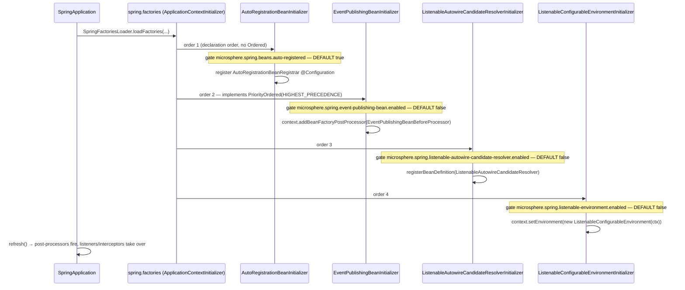

# microsphere-spring-context — Developer Guide

[← Developer guide overview](./README.md) · [简体中文](./zh/context.md) · [User guide](../../user-guide/current/context.md) · [1.x](../1.x/context.md)

## 1. Module identity, baselines and dependency posture

| Attribute | Value | Evidence |
|---|---|---|
| Maven coordinate | `io.github.microsphere-projects:microsphere-spring-context:${revision}` | `microsphere-spring-context/pom.xml:14-15` |
| Reactor version under analysis | `0.2.40-SNAPSHOT` (`revision`) | `pom.xml:55` |
| Parent | `microsphere-spring-parent:${revision}` | `microsphere-spring-context/pom.xml:5-11` |
| Java baseline | `17` (`java.version`) | `pom.xml:56` |
| Spring baseline | profile-selected `6.0.23` / `6.1.21` / `6.2.18` / `7.0.9` via `spring-framework-bom` | `microsphere-spring-parent/pom.xml:100-104,140-170` |
| Mandatory in-reactor edge | `microsphere-java-core` **only** (compile, non-optional), version `0.3.19` | `microsphere-spring-context/pom.xml:30-34`, `microsphere-spring-parent/pom.xml:22,119-124` |
| Optional Spring artifacts | `spring-context`, `spring-context-support`, `spring-beans`, `spring-aop`, `spring-context-indexer` | `microsphere-spring-context/pom.xml:37-65` |
| Optional third parties | `javax.annotation-api`, `jackson-annotations`, `jackson-databind` (BOM `2.22.3`), `snakeyaml` (`2.7`) | `microsphere-spring-context/pom.xml:67-92`, `microsphere-spring-parent/pom.xml:25-26,37-48` |
| Annotation processor | `microsphere-annotation-processor`, optional (build-time only) | `microsphere-spring-context/pom.xml:24-28` |
| Test scope | `junit-jupiter`, `mockito-core`, `spring-test`, `microsphere-spring-test`, `logback-classic` | `microsphere-spring-context/pom.xml:94-127` |
| Namespace root | `io.microsphere.spring` — 8 top-level packages (`beans`, `cache`, `config`, `constants`, `context`, `core`, `net`, `util`) | `microsphere-spring-context/src/main/java/io/microsphere/spring/` |
| Main / test types | 161 main classes, 136 test classes (119 `*Test` suites) | `src/main/java/**`, `src/test/java/**` |
| Shipped resources | exactly one: `META-INF/spring.factories` (12 lines) | `microsphere-spring-context/src/main/resources/META-INF/spring.factories` |
| BOM entry | version-managed by `microsphere-spring-dependencies` | `microsphere-spring-dependencies/pom.xml:26` |

**Dependency posture.** This is the foundation module of the reactor, and its posture is deliberate: `microsphere-java-core` is the *only* compile-mandatory dependency (`microsphere-spring-context/pom.xml:30-34`). Every Spring artifact it compiles against is marked `<optional>true</optional>` (`:37-65`), as are Jackson (`:75-85`), SnakeYAML (`:88-92`) and `javax.annotation-api` (`:67-72`). Optional flags are preserved by the flatten plugin, so a downstream application gets *no* Spring, Jackson or SnakeYAML transitively from this jar. The payoff is that a **single published binary serves Spring Framework 6.0 through 7.0**: because the compile-time surface is only ever `spring-beans`/`spring-context` APIs that are stable across that range, and because optional extras are probed reflectively (`@ConditionalOnMissingBean`-free, property-gated design), the reactor does not need per-Spring-version artifacts — it just re-runs the test suite under four profiles (`microsphere-spring-parent/pom.xml:138-172`).

The cost of the same posture: features that touch optional libraries fail with `NoClassDefFoundError` rather than a clean message. Concretely — `@JsonPropertySource` needs `com.fasterxml.jackson.databind.ObjectMapper` (`microsphere-spring-context/src/main/java/io/microsphere/spring/config/env/support/JsonPropertySourceFactory.java`), `@YamlPropertySource` needs `org.yaml.snakeyaml.Yaml` (`.../YamlPropertySourceFactory.java`), and `@EnableTTLCaching` needs `spring-context-support` for the `org.springframework.cache.*` types (`.../cache/annotation/TTLCachingConfiguration.java`).



Evidence for the inbound edges: `microsphere-spring-web/pom.xml:33`, `microsphere-spring-jdbc/pom.xml:33`, `microsphere-spring-guice/pom.xml:44`, `microsphere-spring-test` is consumed *by* this module (`microsphere-spring-context/pom.xml:116-121`) rather than the reverse. ⚠ `microsphere-spring-webmvc` / `microsphere-spring-webflux` are declared reactor modules (`pom.xml:65-66`) but have no direct `microsphere-spring-context` edge — they inherit it transitively through `microsphere-spring-web` (`microsphere-spring-webmvc/pom.xml:33`, `microsphere-spring-webflux/pom.xml:33`).

## 2. Package map

| Package | Representative types | Responsibility |
|---|---|---|
| `io.microsphere.spring.beans` | `BeanSource`, `BeanUtils`, `PropertyValuesUtils` | bean-definition introspection; the `BeanSource` metadata object used by registration helpers |
| `io.microsphere.spring.beans.factory` | `BeanFactoryUtils`, `Dependency`, `DependencyTreeWalker`, `BeanDependencyResolver`, `DefaultBeanDependencyResolver`, `InjectionPointDependencyResolvers`, `AbstractInjectionPointDependencyResolver`, `ConstructionInjectionPointDependencyResolver`, `DelegatingFactoryBean` | bean-dependency graph model; pluggable injection-point resolution loaded from `spring.factories` |
| `io.microsphere.spring.beans.factory.annotation` | `AnnotatedInjectionBeanPostProcessor`, `AnnotationBeanDefinitionRegistryPostProcessor`, `ConfigurationBeanBindingPostProcessor`, `ConfigurationBeanBindingRegistrar`, `ConfigurationBeanBindingsRegister`, `EnableConfigurationBeanBinding`, `EnableConfigurationBeanBindings`, `AutowiredInjectionPointDependencyResolver`, `ResourceInjectionPointDependencyResolver`, `AnnotatedInjectionPointDependencyResolver` | injection scanning (`@Autowired`/`@Resource` re-implementation), relaxed binding of `@ConfigurationProperties`-style classes, resolver plug-ins |
| `io.microsphere.spring.beans.factory.config` | `BeanDefinitionUtils`, `GenericBeanPostProcessorAdapter`, `NamedBeanHolderComparator` | post-processor base classes and bean-definition lookup helpers |
| `io.microsphere.spring.beans.factory.filter` | `ResolvableDependencyTypeFilter` | `TypeFilter` over resolvable dependencies |
| `io.microsphere.spring.beans.factory.support` | `BeanRegistrar`, `ListenableAutowireCandidateResolver`, `ListenableAutowireCandidateResolverInitializer`, `AutowireCandidateResolvingListener`, `CompositeAutowireCandidateResolvingListener`, `LoggingAutowireCandidateResolvingListener`, `GenericBeanNameGenerator`, `ConfigurationBeanAliasGenerator`, `DefaultConfigurationBeanAliasGenerator`, `HyphenAliasGenerator`, `JoinAliasGenerator`, `UnderScoreJoinAliasGenerator` | programmatic bean registration; observable `AutowireCandidateResolver`; alias-generation strategy set |
| `io.microsphere.spring.cache` | `TTLContext` | per-call TTL carrier + cache key bookkeeping for the TTL cache subsystem |
| `io.microsphere.spring.cache.annotation` | `EnableTTLCaching`, `TTLCacheable`, `TTLCachePut`, `TTLCachingConfiguration` | annotation surface (`@EnableCaching` / `@Cacheable` / `@CachePut` meta-annotations) + the single `@Bean` that publishes the resolver; no `@Aspect` is used |
| `io.microsphere.spring.cache.intereptor` ⚠ | `TTLCacheResolver` | `CacheResolver` that reads `@TTLCacheable`/`@TTLCachePut`, publishes the TTL to `TTLContext` and fans out over all `CacheManager` beans (note the misspelled package name) |
| `io.microsphere.spring.cache.redis` | `TTLRedisCacheWriterWrapper`, `TTLRedisConfiguration` | ⚠ Redis-backed TTL caches — **every line is commented out**, so the package contributes no compiled classes (see §4.3) |
| `io.microsphere.spring.config` | `ConfigurationPropertyRepository`, `CollectingConfigurationPropertyListener` | collected configuration-property metadata |
| `io.microsphere.spring.config.context.annotation` | `PropertySourceExtension`, `PropertySourceExtensionAttributes`, `AnnotatedPropertySourceLoader`, `ResourcePropertySource`, `ResourcePropertySources`, `ResourcePropertySourceLoader`, `DefaultPropertiesPropertySource`, `DefaultPropertiesPropertySources`, `PropertySourceExtensionLoader` | the annotation + loader extension model for property sources |
| `io.microsphere.spring.config.env` | `EnvironmentEnabled`, `ImmutableMapPropertySource` | activation marker annotation; read-only `MapPropertySource` |
| `io.microsphere.spring.config.env.annotation` | `YamlPropertySource`, `JsonPropertySource` | format-specific meta-annotation specialisations of `@PropertySourceExtension` |
| `io.microsphere.spring.config.env.config` | `ResourceYamlProcessor` | SnakeYAML loading with wildcard/multi-resource support |
| `io.microsphere.spring.config.env.event` | `PropertySourceChangedEvent`, `PropertySourcesChangedEvent` | events published by the auto-refresh branch |
| `io.microsphere.spring.config.env.support` | `YamlPropertySourceFactory`, `JsonPropertySourceFactory`, `DefaultResourceComparator` | `PropertySourceFactory` implementations + resource ordering |
| `io.microsphere.spring.constants` | `PropertyConstants` | shared property-name constants (the config gates of §4) |
| `io.microsphere.spring.context` | `ApplicationContextUtils`, `ConfigurableApplicationContextInitializer` | context-wide static helpers; ordered-initializer base |
| `io.microsphere.spring.context.annotation` | `AnnotatedBeanCapableImportBeanDefinitionRegistrar`, `AnnotatedBeanCapableImportSelector`, `AnnotatedBeanCapableImportCandidate`, `BeanCapableImportCandidate`, `AutoRegistrationBeanInitializer`, `AutoRegistrationBeanRegistrar`, `EnableAutoRegistrationBean`, `ExposingClassPathBeanDefinitionScanner`, `ImportOptional`, `ImportOptionalSelector`, `OverrideAnnotationAttributes`, `OverrideAnnotationAttributesStrategy`, `ConfigurationPropertyOverrideAnnotationAttributesStrategy` | `@Import` machinery, optional-import filtering, auto-registration of annotated beans |
| `io.microsphere.spring.context.config` | `AutoRegistrationBean`, `ConfigurationBeanBinder`, `DefaultConfigurationBeanBinder`, `ConfigurationBeanCustomizer` | binding strategy + registrable bean model |
| `io.microsphere.spring.context.event` | `BeanFactoryListener(s)`, `BeanFactoryListenerAdapter`, `BeanListener(s)`, `BeanListenerAdapter`, `ParallelPreInstantiationSingletonsBeanFactoryListener`, `DependencyAnalysisBeanFactoryListener`, `LoggingBeanFactoryListener`, `EnableEventExtension`, `EventExtensionRegistrar`, `EventPublishingBeanInitializer`, `EventPublishingBeanBeforeProcessor`, `EventPublishingBeanAfterProcessor`, `InterceptingApplicationEventMulticaster(Proxy)`, `ApplicationEventInterceptor(Chain)`, `ApplicationListenerInterceptor(Chain)`, `InterceptingApplicationListener`, `GenericApplicationListenerAdapter`, `OnceApplicationContextEventListener`, `BeanTimeStatistics`, `BeanPropertyChangedEvent` | bean-factory lifecycle observability + event interception chains |
| `io.microsphere.spring.context.lifecycle` | `AbstractSmartLifecycle`, `LoggingSmartLifecycle` | `SmartLifecycle` scaffolding |
| `io.microsphere.spring.core` | `SpringVersion`, `MethodParameterUtils` | version introspection, method-parameter helpers |
| `io.microsphere.spring.core.annotation` | `AnnotationUtils`, `GenericAnnotationAttributes`, `ResolvablePlaceholderAnnotationAttributes` | attribute extraction with placeholder resolution |
| `io.microsphere.spring.core.convert` | `ConversionServiceUtils`, `SpringConverterAdapter` | `ConversionService` bridging to `microsphere-java-core` converters |
| `io.microsphere.spring.core.convert.annotation` | `EnableSpringConverterAdapter`, `EnableSpringConverterAdapterRegistrar` | install the converter adapter into the context `ConversionService` |
| `io.microsphere.spring.core.convert.support` | `ConversionServiceResolver` | locate the right `ConversionService` |
| `io.microsphere.spring.core.env` | `ListenableConfigurableEnvironment`, `ListenableConfigurableEnvironmentInitializer`, `EnvironmentListener`, `PropertyResolverListener`, `ProfileListener`, `LoggingEnvironmentListener`, `EnvironmentUtils`, `PropertyResolverUtils`, `PropertySourcesUtils` | observable `Environment` (mutation notifications), environment/property-source utilities |
| `io.microsphere.spring.core.io` | `ResourceUtils`, `ResourceLoaderUtils` | resource location resolution, wildcard expansion |
| `io.microsphere.spring.core.io.support` | `PropertiesUtils`, `SpringFactoriesLoaderUtils` | properties loading; `spring.factories` access helpers |
| `io.microsphere.spring.net` | `SpringProtocolURLStreamHandler`, `SpringSubProtocolURLConnectionFactory`, `SpringResourceURLConnectionFactory`, `SpringResourceURLConnection`, `AbstractSpringResourceURLConnection`, `SpringResourceURLConnectionAdapter`, `SpringEnvironmentURLConnectionFactory`, `SpringPropertySourcesURLConnectionAdapter`, `SpringProfilesURLConnectionAdapter`, `SpringDelegatingBeanProtocolURLConnectionFactory` | the `spring:` URL protocol, reused by `microsphere-spring-jdbc` |
| `io.microsphere.spring.util` | `FilterMode`, `MimeTypeUtils`, `SpringVersionUtils` | inclusion/exclusion semantics shared across annotations; MIME mapping; Spring-version predicates |

External types this module is built on:

| Type | Home | Why this module needs it |
|---|---|---|
| `io.microsphere.core.Version`, `io.microsphere.util.*`, `io.microsphere.lang.*` | `microsphere-java-core` | the only mandatory dependency; generic utilities this module delegates to rather than duplicating |
| `org.springframework.cache.Cache`, `CacheResolver`, `concurrent.ConcurrentMapCacheFactoryBean` | `spring-context-support` / `spring-context` (optional) | TTL cache subsystem base types |
| `org.aspectj.lang.annotation.Aspect` | AspectJ annotations (via Spring) | `@EnableTTLCaching` advice binding |
| `com.fasterxml.jackson.databind.ObjectMapper` | `jackson-databind` (optional) | `JsonPropertySourceFactory` |
| `org.yaml.snakeyaml.Yaml` | `snakeyaml` (optional) | `YamlPropertySourceFactory`, `ResourceYamlProcessor` |

## 3. Architecture at a glance



## 4. Architecture design, with evidence

### 4.1 The annotation + registrar/loader extension model

Every feature in this module follows one shape: a public annotation whose meta-annotations carry an `ImportSelector` or `ImportBeanDefinitionRegistrar`, and a shared abstract base that does the generic work.

* `AnnotatedBeanCapableImportCandidate` is the root: it resolves the merged annotation attributes (with placeholder resolution) and applies a per-attribute enable gate built as `annotationType.getName() + "." + attribute + ".enabled"` (`context/annotation/AnnotatedBeanCapableImportCandidate.java:206`, `:28`).
* `AnnotatedBeanCapableImportSelector` makes `selectImports(AnnotationMetadata)` `final` and dispatches to a template method taking the resolved attributes (`context/annotation/AnnotatedBeanCapableImportSelector.java:73`, `:113`).
* `AnnotatedBeanCapableImportBeanDefinitionRegistrar` is the registrar twin, used by `ConfigurationBeanBindingRegistrar` (`beans/factory/annotation/ConfigurationBeanBindingRegistrar.java:94`), `EventExtensionRegistrar` (`context/event/EventExtensionRegistrar.java:55`), `AutoRegistrationBeanRegistrar` and `EnableSpringConverterAdapterRegistrar`.
* `@ImportOptional` / `ImportOptionalSelector` filter the imported class names by `BeanSource`-style discovery, so an optional import silently disappears when its library is absent (`context/annotation/ImportOptional.java`, `ImportOptionalSelector.java`). This is the mechanism that keeps the optional-dependency posture of §1 usable at runtime.

### 4.2 The property-source subsystem

`@PropertySourceExtension` is `@Target(ANNOTATION_TYPE)` (`config/context/annotation/PropertySourceExtension.java:144-148`) — it is *only* a meta-annotation, never applied directly. `@ResourcePropertySource` layers it on a `@Target(TYPE) @Inherited @Repeatable(ResourcePropertySources)` annotation plus `@Import(ResourcePropertySourceLoader.class)` (`config/context/annotation/ResourcePropertySource.java:127-134`), and re-exposes all ten attributes through `@AliasFor(annotation = PropertySourceExtension.class)` (`:142-242`).

The loader hierarchy is three deep, each level adding one axis:

| Class | Adds | Evidence |
|---|---|---|
| `AnnotatedPropertySourceLoader<A>` | name resolution + error wrapping into `BeanCreationException` | `config/context/annotation/AnnotatedPropertySourceLoader.java:67,74-88`; default name is `declaringClass@AnnotationType` (`:129-133`) |
| `PropertySourceExtensionLoader<A, EA>` | attribute→`PropertySourceExtensionAttributes`, resource resolution, composite assembly, positional insertion, auto-refresh | `config/context/annotation/PropertySourceExtensionLoader.java:72-73`; attributes built reflectively via `getConstructor(Map.class, Class.class, PropertyResolver.class)` (`:164-167`); generic attributes type from `resolveGeneric(...,1)` (`:82-84`) |
| `ResourcePropertySourceLoader` | wildcard resolution + file watching | `config/context/annotation/ResourcePropertySourceLoader.java:51-52`; `PathMatchingResourcePatternResolver` in `afterPropertiesSet` (`:76-80`); `StandardFileWatchService` (`:147-169`); `destroy()` stops the watcher (`:307-312`) |

**Positional insertion** is exactly four branches, in this precedence order: `first` → `addFirst`; else `after` → `addAfter`; else `before` → `addBefore`; else `addLast` (`PropertySourceExtensionLoader.java:133-152`). `first` therefore silently overrides both relative attributes, matching the annotation javadoc at `PropertySourceExtension.java:167-168`.

**Multiple resources become one `CompositePropertySource`.** Each annotation resolves to N resources; every resource is wrapped as a `ResourcePropertySource` named `<composite>#<resourceValue>@<resource.toString()>` and added to a single `CompositePropertySource` registered under the annotation's `name` (`PropertySourceExtensionLoader.java:183-190`, `:460-463`, `:475-486`). Resources are ordered by the `resourceComparator` attribute, instantiated reflectively (`:452-454`, `:517-520`), default `DefaultResourceComparator` (`config/env/support/DefaultResourceComparator.java`).

**Auto-refresh** installs a refresher only when `autoRefreshed = true` (`:192-198`). The refresher is a lambda that `synchronized (this)` on the loader, re-resolves, then `propertySources.replace(name, newComposite)` (`:203-226`, `:297-308`) and publishes a `PropertySourcesChangedEvent` carrying per-source `PropertySourceChangedEvent` sub-events of type added/replaced/removed (`:228-232`, `config/env/event/PropertySourcesChangedEvent.java`). The base `configureResourcePropertySourcesRefresher` is a deliberate no-op (`:499-503`); only `ResourcePropertySourceLoader` overrides it, and it watches **only file-based resources** (`isFileBasedResource`, `ResourcePropertySourceLoader.java:160`).

**Format factories.** `@YamlPropertySource` is nothing but `@ResourcePropertySource(factory = YamlPropertySourceFactory.class)` (`config/env/annotation/YamlPropertySource.java:111`); the factory runs `ResourceYamlProcessor` and wraps the map in `ImmutableMapPropertySource` (`config/env/support/YamlPropertySourceFactory.java:51,54-56`). `@JsonPropertySource` mirrors it with Jackson into a mutable `MapPropertySource` (`config/env/support/JsonPropertySourceFactory.java:69,72-76`). ⚠ The asymmetry is real: YAML is immutable, JSON is not. `@DefaultPropertiesPropertySource` targets the well-known `defaultProperties` source name and imports its own loader (`config/context/annotation/DefaultPropertiesPropertySource.java:89-95`).

### 4.3 The TTL cache subsystem

`@EnableTTLCaching` is `@EnableCaching` + `@Import(TTLCachingConfiguration.class)` (`cache/annotation/EnableTTLCaching.java:68-73`); the imported configuration is package-private and contributes exactly one bean, `TTLCacheResolver` under the fixed name `ttlCacheResolver` (`cache/annotation/TTLCachingConfiguration.java:30-35`, `cache/intereptor/TTLCacheResolver.java:60`).

`@TTLCacheable` / `@TTLCachePut` are `@Cacheable` / `@CachePut` with `cacheResolver = BEAN_NAME` pre-set (`cache/annotation/TTLCacheable.java:60-64`, `cache/annotation/TTLCachePut.java:66`), plus two TTL-only attributes: `timeUnit()` defaulting to `MILLISECONDS` and **`expire()` with no default — it is mandatory** (`TTLCacheable`/`TTLCachePut`, `long expire();` at `TTLCachePut.java:173`, `:178`).

`TTLCacheResolver` is simultaneously a `CacheResolver` and a `OnceApplicationContextEventListener<ContextRefreshedEvent>`; it captures `Environment` and *all* `CacheManager` beans on context refresh (`TTLCacheResolver.java:58,152-157`). Per call it maps the Spring cache operation class to the TTL annotation (`:62-65`), reads the attributes from method first then declaring class/target (`:124-143`), pushes the duration into `TTLContext.setTTL(...)` (`:91-93`, `:119-122`), and returns the cross-product of selected cache managers × cache names (`:95-114`); `cacheManagers()` narrows the manager set (`:97-106`).

⚠ **The TTL is currently written but never consumed.** `TTLContext` exposes the duration through a `ThreadLocal<Duration>` intended to be read by a cache writer (`cache/TTLContext.java:55,98-110`), and the only consumer in the tree is `TTLRedisCacheWriterWrapper.put(...)`, which lives in `cache/redis/` with **every line from `:17` onward commented out**, along with `TTLRedisConfiguration`. A repo-wide search for `doWithTTL` in `src/main/java` returns only `TTLContext` itself and those commented lines. Consequences: (a) with the in-memory caches this module ships, `@TTLCacheable` behaves exactly like `@Cacheable`; (b) `TTLCacheResolver` never calls `TTLContext.clearTTL()`, so the value persists on the pooled thread until some later `doWithTTL` removes it.

### 4.4 Relaxed binding and alias generation

`@EnableConfigurationBeanBinding` imports `ConfigurationBeanBindingRegistrar` (`beans/factory/annotation/ConfigurationBeanBindingRegistrar.java:94`), which registers the configuration bean itself (`:148-165`), then installs the infrastructure post-processor `configurationBeanBindingPostProcessor` via `registerInfrastructureBean` (`:185-186`). `ConfigurationBeanBindingPostProcessor` is a `BeanPostProcessor, BeanFactoryAware, PriorityOrdered` that binds in `postProcessBeforeInitialization` (`beans/factory/annotation/ConfigurationBeanBindingPostProcessor.java:85,109-116,178-190`). The binder is pluggable: it first tries `beanFactory.getBean(ConfigurationBeanBinder.class)` and falls back to `DefaultConfigurationBeanBinder` (`:193-207`, `:229-230`) — Strategy over `context/config/ConfigurationBeanBinder.java`.

Aliases come from `spring.factories`: `loadFactories(beanFactory, ConfigurationBeanAliasGenerator.class)` then `registry.registerAlias(beanName, alias)` for each generator (`:139-146`). Implementations are `DefaultConfigurationBeanAliasGenerator`, `HyphenAliasGenerator`, `JoinAliasGenerator`, `UnderScoreJoinAliasGenerator` (`beans/factory/support/`). ⚠ None of them is listed in this module's shipped `META-INF/spring.factories`; the only populated registration is in test resources (`src/test/resources/META-INF/spring.factories:8-11`). Out of the box the alias list is therefore **empty**, and only the plain bean name resolves.

### 4.5 Listenable `Environment` and `AutowireCandidateResolver`

Both are swapped in by `ApplicationContextInitializer`s, both are off by default:

* `ListenableConfigurableEnvironmentInitializer` (`core/env/`) calls `context.setEnvironment(new ListenableConfigurableEnvironment(context))` (`core/env/ListenableConfigurableEnvironmentInitializer.java:92-95`), gated by `microsphere.spring.listenable-environment.enabled`, default `false` (`:73,75,85,90`). `ListenableConfigurableEnvironment` is a pure delegating decorator implementing `ConfigurableEnvironment` (`core/env/ListenableConfigurableEnvironment.java:53`) that fires `before…`/`after…` around every mutator (`:106-109`). Listeners come from three `spring.factories` keys — `EnvironmentListener`, `ProfileListener`, `PropertyResolverListener` — and every `EnvironmentListener` is *also* registered as both a profile and a property-resolver listener (`:79-102`).
* `ListenableAutowireCandidateResolverInitializer` registers `ListenableAutowireCandidateResolver` as a bean definition (`beans/factory/support/ListenableAutowireCandidateResolverInitializer.java:97-100`), gated by `microsphere.spring.listenable-autowire-candidate-resolver.enabled`, default `false` (`:77,79,89,94`). The resolver implements `AutowireCandidateResolver, BeanFactoryPostProcessor` and composes `AutowireCandidateResolvingListener`s loaded from `spring.factories` (`beans/factory/support/ListenableAutowireCandidateResolver.java:69,151`, `beans/factory/support/AutowireCandidateResolvingListener.java:80`), with `CompositeAutowireCandidateResolvingListener` / `LoggingAutowireCandidateResolvingListener` as the fan-out and reference implementation.

### 4.6 Bean-factory listener infrastructure and parallel pre-instantiation

`EventPublishingBeanInitializer` runs at `HIGHEST_PRECEDENCE` (`context/event/EventPublishingBeanInitializer.java:112-115`), is gated by `microsphere.spring.event-publishing-bean.enabled` default `false` (`:84,86,96,101`), and does one thing: `context.addBeanFactoryPostProcessor(new EventPublishingBeanBeforeProcessor())` (`:108-110`).

`EventPublishingBeanBeforeProcessor` then implements four interfaces at once — `InstantiationAwareBeanPostProcessor, BeanDefinitionRegistryPostProcessor, DestructionAwareBeanPostProcessor, InstantiationStrategy` — and reaches into `AbstractAutowireCapableBeanFactory.getInstantiationStrategy()` reflectively to wrap the real strategy (`context/event/EventPublishingBeanBeforeProcessor.java:58-61,72-84`). It registers the `beanFactoryListeners` / `beanListeners` composites (`:185-195`, `context/event/BeanFactoryListeners.java:54,66-67`, `context/event/BeanListeners.java:85`) and injects `EventPublishingBeanAfterProcessor` *as the first bean definition* (`:169`).

`BeanFactoryListener` exposes three callbacks — `onBeanDefinitionRegistryReady`, `onBeanFactoryReady`, `onBeanFactoryConfigurationFrozen` (`context/event/BeanFactoryListener.java:61-84`) — and `BeanFactoryListeners` fans out to all discovered beans, ordered by `NamedBeanHolderComparator`.

`ParallelPreInstantiationSingletonsBeanFactoryListener` hooks `onBeanFactoryConfigurationFrozen` (`context/event/ParallelPreInstantiationSingletonsBeanFactoryListener.java:109,148-173`): it builds a dependency map with `DefaultBeanDependencyResolver` (`:185-194`), groups bean names into dependency paths, and submits one task per path to a fixed thread pool sized by `microsphere.spring.pre-instantiation.singletons.threads` (default = available processors; `< 1` disables the feature entirely) with names prefixed by `microsphere.spring.pre-instantiation.singletons.thread.name-prefix` (`:115,125,140,175-183,196-213`).

**Thread-safety.** The pool is `newFixedThreadPool` and is only `shutdown()`-ed in a `finally` (`:166`); there is no `awaitTermination` timeout bound other than a 10 ms polling loop (`:215`). Correctness rests on Spring's own `synchronized singletonObjects` locking in `DefaultSingletonBeanRegistry`; nothing here synchronises user code, and `@PostConstruct` blocks that touch shared mutable state become racy exactly in proportion to `threads`. Bean creation order is *not* preserved across paths — only dependencies within a path. `DependencyAnalysisBeanFactoryListener` is the read-only sibling that dumps the same graph (`context/event/DependencyAnalysisBeanFactoryListener.java:80,85-97`).

### 4.7 Event interception chains

`@EnableEventExtension` is `@Target({TYPE, ANNOTATION_TYPE})`, annotated `@OverrideAnnotationAttributes` and `@Import(EventExtensionRegistrar.class)` (`context/event/EnableEventExtension.java:57-62`). Attributes: `intercepted()` (default `true`), `executorForListener()` (sentinel `"N/E"`, `:67,87`), and `sources()` defaulting to `{BEAN_FACTORY, SPRING_FACTORIES, JAVA_SERVICE_PROVIDER}` (`:102`).

`EventExtensionRegistrar` replaces the multicaster under the well-known `applicationEventMulticaster` bean name (`:79,117`). It short-circuits when neither interception nor an executor is requested (`:81-90`), de-duplicates identical registrations by bean-definition attributes (`:100-104,120-128`), and otherwise **rebuilds** around an existing definition instead of clobbering it (`:107`). When `intercepted`, it registers `ApplicationEventInterceptor` and `ApplicationListenerInterceptor` beans discovered through the `BeanSource` set (`:110-114,160-164`).

The runtime is `InterceptingApplicationEventMulticaster(Proxy)` plus `DefaultApplicationEventInterceptorChain` / `DefaultApplicationListenerInterceptorChain`, classic Chain of Responsibility: each interceptor receives `(event, eventType, chain)` and must call `chain.intercept(...)` to continue, or omit it to swallow the event (`context/event/ApplicationEventInterceptor.java:52-87`, `ApplicationEventInterceptorChain.java:57-60`, `DefaultApplicationEventInterceptorChain.java:32,45-47`). `GenericApplicationListenerAdapter` bridges typed `ApplicationListener` contracts to the `GenericApplicationListener` seam.

### 4.8 The `spring:` URL protocol handler

`SpringProtocolURLStreamHandler` extends `ExtendableProtocolURLStreamHandler` from `microsphere-java-core` with `PROTOCOL = "spring"` and implements `InitializingBean, ResourceLoaderAware, BeanFactoryAware, EnvironmentAware` (`net/SpringProtocolURLStreamHandler.java:60-62,72`). On `afterPropertiesSet` it resolves the context `ConversionService` through `ConversionServiceResolver` and adds a `SpringConverterAdapter`, then initialises the sub-protocol table with three factories (`:76-93`): `SpringResourceURLConnectionFactory` (`spring:resource:<scheme>://…`), `SpringEnvironmentURLConnectionFactory` (`spring:env:property-sources://…`, `spring:env:profiles://…` via `SpringPropertySourcesURLConnectionAdapter` / `SpringProfilesURLConnectionAdapter`), and `SpringDelegatingBeanProtocolURLConnectionFactory`, which dispatches unknown sub-protocols back to Spring beans implementing `SpringSubProtocolURLConnectionFactory` (`net/SpringSubProtocolURLConnectionFactory.java:32-49`). A URL with no sub-protocol is rejected as `MalformedURLException` (`:96-103`).

⚠ Nothing in this module installs the handler. There is no `AutoRegistrationBean` implementation, no `spring.factories` entry, and no `URL.setURLStreamHandlerFactory` call in `src/main/java`. `microsphere-spring-jdbc` is the consumer that actually registers it, by listing it in an `@Import` triple (`microsphere-spring-jdbc/src/main/java/io/microsphere/spring/jdbc/p6spy/annotation/EnableP6DataSource.java:41-45`); the module's own tests do the same (`src/test/java/io/microsphere/spring/net/SpringProtocolURLStreamHandlerTest.java:47`).

## 5. Runtime flows

### 5.1 `@ResourcePropertySource` processing, including the auto-refresh branch



### 5.2 A TTL-cached call

```mermaid
sequenceDiagram
    participant C as Caller
    participant P as Caching proxy (@EnableCaching)
    participant CR as TTLCacheResolver
    participant TL as TTLContext (ThreadLocal)
    participant CM as CacheManager bean
    participant B as Target method
    C->>P: invoke @TTLCacheable(cacheNames, expire, timeUnit)
    P->>CR: resolveCaches(context)
    CR->>CR: map CacheableOperation → TTLCacheable; read attrs from method, else class/target
    CR->>TL: setTTL(Duration.ofMillis(timeUnit.toMillis(expire)))
    Note over CR,TL: never cleared here — residue stays on the thread
    CR->>CM: getCache(name) for each selected cacheManager × cacheName
    CM-->>CR: Cache handles
    CR-->>P: Collection<Cache>
    P->>B: cache miss → execute method
    B-->>P: result
    P->>CM: cache.put(key, result)  ← TTLContext.getTTL() is NOT read by any shipped Cache/CacheWriter ⚠
    Note over CM: Redis path (TTLRedisCacheWriterWrapper.doWithTTL) is commented out
    P-->>C: result
```

### 5.3 Startup order of the four `spring.factories` initializers



Ordering caveat: only `EventPublishingBeanInitializer` declares an order (`getOrder()` = `HIGHEST_PRECEDENCE`, `context/event/EventPublishingBeanInitializer.java:112-115`); `ConfigurableApplicationContextInitializer` implements no `Ordered`, so the remaining three run in `spring.factories` declaration order (`src/main/resources/META-INF/spring.factories:8-12`), which happens to put the environment swap last — a later initializer that reads `environment` would see the pre-decoration instance.

## 6. Design patterns evidenced

| Pattern | Concrete classes | Evidence |
|---|---|---|
| Meta-annotation-driven configuration | `@PropertySourceExtension` → `@ResourcePropertySource` → `@YamlPropertySource` / `@JsonPropertySource`; `@EnableTTLCaching` → `@EnableCaching`; `@TTLCacheable` → `@Cacheable` | `PropertySourceExtension.java:144`, `ResourcePropertySource.java:131-133`, `YamlPropertySource.java:111`, `EnableTTLCaching.java:71-72`, `TTLCacheable.java:64` |
| Registrar / Loader | `ConfigurationBeanBindingRegistrar`, `EventExtensionRegistrar`, `AutoRegistrationBeanRegistrar`, `ResourcePropertySourceLoader`, `PropertySourceExtensionLoader` | `ConfigurationBeanBindingRegistrar.java:94`, `EventExtensionRegistrar.java:55`, `ResourcePropertySourceLoader.java:51` |
| Template Method | `AnnotatedBeanCapableImportSelector.selectImports` final → abstract overload; `AnnotatedPropertySourceLoader.loadPropertySource` abstract; `PropertySourceExtensionLoader` abstract `resolveResources` / `isResourcePattern`, open `configureResourcePropertySourcesRefresher` | `AnnotatedBeanCapableImportSelector.java:73,113`, `AnnotatedPropertySourceLoader.java:145`, `PropertySourceExtensionLoader.java:92,502,515` |
| Factory | `PropertySourceFactory` implementations (`YamlPropertySourceFactory`, `JsonPropertySourceFactory`), `BeanRegistrar.registerFactoryBean`, `SpringSubProtocolURLConnectionFactory` | `YamlPropertySourceFactory.java:51`, `JsonPropertySourceFactory.java:69`, `BeanRegistrar.java:667`, `SpringSubProtocolURLConnectionFactory.java:32` |
| Decorator | `ListenableConfigurableEnvironment` wraps a `ConfigurableEnvironment` and notifies around each mutator; `GenericBeanPostProcessorAdapter` type-filters a delegate post-processor; `DecoratingDisposableBean` wraps destroy callbacks | `ListenableConfigurableEnvironment.java:53,106-109`, `GenericBeanPostProcessorAdapter.java`, `EventPublishingBeanAfterProcessor.java:131` |
| Chain of Responsibility | `ApplicationEventInterceptorChain` / `DefaultApplicationEventInterceptorChain`, `ApplicationListenerInterceptorChain`, `InjectionPointDependencyResolvers` | `DefaultApplicationEventInterceptorChain.java:32,45-47`, `InjectionPointDependencyResolvers.java:64` |
| Observer | `EnvironmentListener` / `ProfileListener` / `PropertyResolverListener`, `AutowireCandidateResolvingListener` + composite, `BeanFactoryListener` / `BeanListener`, `FileChangedListener`, `PropertySourcesChangedEvent` | `ListenableConfigurableEnvironment.java:79-102`, `AutowireCandidateResolvingListener.java:80`, `BeanFactoryListeners.java:88-96`, `ResourcePropertySourceLoader.java:171` |
| Strategy | `ConfigurationBeanBinder` (`DefaultConfigurationBeanBinder`) injected or defaulted; `Comparator<Resource>` via `resourceComparator`; `ConfigurationBeanAliasGenerator` set | `ConfigurationBeanBindingPostProcessor.java:193-207`, `PropertySourceExtensionLoader.java:452-454`, `ConfigurationBeanBindingRegistrar.java:140` |
| Adapter | `SpringConverterAdapter` adapts Spring `Converter` to the core SPI; `JavaBeansPropertyChangeListenerAdapter`; `GenericApplicationListenerAdapter`; `SpringResourceURLConnectionAdapter` / `SpringProfilesURLConnectionAdapter` | `core/convert/SpringConverterAdapter.java`, `context/event/JavaBeansPropertyChangeListenerAdapter.java`, `GenericApplicationListenerAdapter.java`, `net/SpringProfilesURLConnectionAdapter.java` |
| Composite | `CompositePropertySource` built per annotation; `CompositeAutowireCandidateResolvingListener` | `PropertySourceExtensionLoader.java:183`, `CompositeAutowireCandidateResolvingListener.java` |
| Null Object / sentinel | `EnableEventExtension.NO_EXECUTOR = "N/E"`, `FilterMode.SEQUENTIAL` default | `EnableEventExtension.java:67`, `util/FilterMode.java:20,43` |

## 7. Extension guide

### 7.1 Add a property-source annotation

1. Declare `@Target(TYPE) @Retention(RUNTIME) @Inherited @Documented`, meta-annotated `@ResourcePropertySource` (reuse) or `@PropertySourceExtension` plus `@Import(YourLoader.class)`, and `@Repeatable(YourSources.class)` if needed — mirror `ResourcePropertySource.java:127-134`.
2. Re-expose each attribute with `@AliasFor(annotation = PropertySourceExtension.class)`; `PropertySourceExtensionLoader` requires the attribute names `value`, `name`, `first`, `before`, `after`, `autoRefreshed`, `encoding`, `ignoreResourceNotFound`, `resourceComparator`, `factory` (`PropertySourceExtensionAttributes.java`).
3. Extend `PropertySourceExtensionLoader<YourAnnotation, YourAttributes>`; the attributes class must expose a `public YourAttributes(Map, Class, PropertyResolver)` constructor because it is instantiated reflectively (`PropertySourceExtensionLoader.java:164-167`), and the loader's second type parameter is resolved generically (`:82-84`). Implement `isResourcePattern` and `resolveResources`; override `configureResourcePropertySourcesRefresher` only if you support `autoRefreshed`.
4. Users enable or disable a single attribute without code by setting `io.microsphere…YourAnnotation.<attribute>.enabled=false` — the gate is assembled in `AnnotatedBeanCapableImportCandidate.java:206`.

### 7.2 Add an `EnvironmentListener`

1. Implement `io.microsphere.spring.core.env.EnvironmentListener` (which transitively covers `ProfileListener` and `PropertyResolverListener` notification, `ListenableConfigurableEnvironment.java:83-102`) or one of the narrower interfaces directly. Provide a `(Map, …)`-free public no-arg or `BeanFactory`-friendly constructor — `loadFactories` instantiates them.
2. Register the fully-qualified class names under the key `io.microsphere.spring.core.env.EnvironmentListener` (or `…core.env.ProfileListener` / `…core.env.PropertyResolverListener`) in your own `META-INF/spring.factories`, exactly as `src/test/resources/META-INF/spring.factories:16-21` does.
3. Turn the subsystem on: `microsphere.spring.listenable-environment.enabled=true`. Without it the `Environment` is never replaced and no listener is ever consulted. Ordering is `Ordered`-based (`sort(...)` at `:90`).
4. The same recipe covers `AutowireCandidateResolvingListener` (needs `microsphere.spring.listenable-autowire-candidate-resolver.enabled=true`), `BeanFactoryListener` and `BeanListener` (need `microsphere.spring.event-publishing-bean.enabled=true`; registered via `registerSpringFactoriesBeans`, `BeanFactoryListeners.java:66`), `ConfigurationBeanAliasGenerator` (`ConfigurationBeanBindingRegistrar.java:140`) and `AutoRegistrationBean` (`AutoRegistrationBeanRegistrar.java:52`).

### 7.3 Discovery rules in one table

| Mechanism | Key / type | Where consulted | Default |
|---|---|---|---|
| `spring.factories` — Spring's own | `org.springframework.context.ApplicationContextInitializer` | `SpringFactoriesLoader` at `SpringApplication` boot | 4 initializers shipped (`src/main/resources/META-INF/spring.factories:8-12`) |
| `spring.factories` — module SPI | `io.microsphere.spring.beans.factory.InjectionPointDependencyResolver` | `InjectionPointDependencyResolvers.java:64` | 3 resolvers shipped (`:1-5`) |
| `spring.factories` — module SPI | `EnvironmentListener`, `ProfileListener`, `PropertyResolverListener`, `AutowireCandidateResolvingListener`, `ConfigurationBeanAliasGenerator`, `BeanFactoryListener`, `BeanListener`, `AutoRegistrationBean` | `loadFactories` / `registerSpringFactoriesBeans` call sites in §7.2 | **none shipped** — declare them yourself |
| `BeanSource` | `BEAN_FACTORY`, `SPRING_FACTORIES`, `JAVA_SERVICE_PROVIDER` | `EnableEventExtension.sources()` → `EventExtensionRegistrar.java:111-114,160-164`; `beans/BeanSource.java:55-80` | all three |
| `EnvironmentEnabled` | `<prefix>.enabled` read by `isEnabled(environment)` | `config/env/EnvironmentEnabled.java:38-106`, `ConfigurableApplicationContextInitializer.java:70-82,101-123` | prefix + bean name, default `true` unless overridden |
| `FilterMode` | `microsphere.spring.filter-mode` → `SEQUENTIAL` / `CONDITIONAL` | `util/FilterMode.java:33-43` | ⚠ `valueOf(Environment)` has no production caller (see §8) |

## 8. Gotchas

| # | Gotcha | Evidence |
|---|---|---|
| 1 | The interceptor package is misspelled **`io.microsphere.spring.cache.intereptor`** ("intereptor"). It is part of the public class path of `TTLCacheResolver` and is referenced by name from `TTLCachingConfiguration.java:19,22` and `TTLCacheable.java:30`, so it cannot be renamed without breaking binary compatibility. The test tree keeps *both* spellings (`src/test/java/io/microsphere/spring/cache/interceptor/` and `.../intereptor/`). | `cache/intereptor/TTLCacheResolver.java:17` |
| 2 | `expire` on `@TTLCacheable` / `@TTLCachePut` is **mandatory** — it has no `default`. Omitting it is a compile error, and there is no "never expire" sentinel; `expire = 0` yields a zero-length TTL. | `TTLCachePut.java:173`, `TTLCacheable.java` |
| 3 | Three of the four shipped initializers are **off by default**. `AutoRegistrationBeanInitializer` is the only one that defaults to `true` (`PropertyConstants.DEFAULT_AUTO_REGISTERED_VALUE`, `constants/PropertyConstants.java:64-69`; used at `AutoRegistrationBeanInitializer.java:55-57`). | `ListenableConfigurableEnvironmentInitializer.java:75`, `ListenableAutowireCandidateResolverInitializer.java:79`, `EventPublishingBeanInitializer.java:86` |
| 4 | ⚠ The javadoc of `ListenableConfigurableEnvironmentInitializer` tells users to register `io.microsphere.spring.beans.factory.support.ListenableConfigurableEnvironmentInitializer` — that class does not exist; the real FQN is `io.microsphere.spring.core.env.…`. Copying the documented line fails with `ClassNotFoundException` at boot. | `core/env/ListenableConfigurableEnvironmentInitializer.java:49` vs `:17` |
| 5 | Parallel pre-instantiation is opt-in by thread count, not a flag: `threads < 1` returns a `null` executor and the whole feature no-ops (`ParallelPreInstantiationSingletonsBeanFactoryListener.java:175-183`). The default is derived from available processors, so a container with a low CPU quota can silently lose the optimisation. It also calls `beanFactory.getBean(name)` from worker threads; anything relying on creation-order side effects, thread-local security/tenant context, or non-thread-safe `@PostConstruct` code will behave differently from a serial start. | `:148-215` |
| 6 | `microsphere.spring.filter-mode` (`FilterMode.PROPERTY_NAME`) is annotated `@ConfigurationProperty` and therefore appears in generated configuration metadata, yet `FilterMode.valueOf(Environment)` has **no caller in `src/main/java`** of any reactor module — only `src/test/java/.../FilterModeTest.java`. Setting it changes nothing. | `util/FilterMode.java:27-43`; repo-wide grep for `FilterMode.` |
| 7 | No `ConfigurationBeanAliasGenerator` is registered in shipped `META-INF/spring.factories`, so relaxed aliasing (hyphen / underscore forms) is inert in production even though four implementations exist. | `src/main/resources/META-INF/spring.factories` (12 lines, no such key) vs `src/test/resources/META-INF/spring.factories:8-11` |
| 8 | ⚠ TTL caching writes a value nobody reads: `TTLCacheResolver` sets `TTLContext` on the calling thread and never clears it, and the only reader (`TTLRedisCacheWriterWrapper`) plus `TTLRedisConfiguration` are commented out in their entirety. `@TTLCacheable` therefore caches forever with in-memory providers. | `cache/intereptor/TTLCacheResolver.java:119-122`, `cache/TTLContext.java:129-131`, `cache/redis/TTLRedisCacheWriterWrapper.java:17+` |
| 9 | `spring:` URLs do not work merely by depending on this module — the handler is never self-registered. Add `SpringProtocolURLStreamHandler.class` to an `@Import` (as `@EnableP6DataSource` does) or install a JVM-wide `URLStreamHandlerFactory`. | `net/SpringProtocolURLStreamHandler.java:60`; `EnableP6DataSource.java:41-45` |
| 10 | Auto-refresh watches **file-system resources only**; a `classpath:` resource inside a jar is never registered with the `StandardFileWatchService`, and `autoRefreshed = true` on such a resource degrades silently to a static source. | `ResourcePropertySourceLoader.java:157-165` |
| 11 | `PropertySourceExtensionLoader.handleSourceName()` assumes the generated source name contains `@` and calls `substring(0, lastIndexOf("@"))`; a custom `PropertySourceFactory` that renames sources can drive `lastIndexOf` to `-1` and throw. | `PropertySourceExtensionLoader.java:341-344`, `:460-463` |
| 12 | `first`, `after` and `before` are mutually exclusive by precedence, not by validation: `first` wins, then `after` wins over `before`. Setting both silently ignores one. | `PropertySourceExtensionLoader.java:133-152` |
| 13 | `microsphere.spring.injection.metadata.cache.size` (used by this module's largest type, `AnnotatedInjectionBeanPostProcessor`) is read once at class-initialisation through `Integer.getInteger`, i.e. a **JVM system property** (`-D…`), never from the Spring `Environment` — putting it in `application.properties` has no effect, and `Environment`-based profiles silently cannot tune it. | `beans/factory/annotation/AnnotatedInjectionBeanPostProcessor.java:167,172,185,251` |

## 9. Cross-links

* User-facing "how do I use it" for this module: [user-guide/current/context.md](../../user-guide/current/context.md) (简体中文: [user-guide/current/zh/context.md](../../user-guide/current/zh/context.md))
* Reactor-wide dependency policy and version profiles: [dependencies.md](./dependencies.md) · parent POM: [parent.md](./parent.md)
* Modules built on this one: [jdbc.md](./jdbc.md) (reuses `io.microsphere.spring.net`) · [guice.md](./guice.md) (reuses `AnnotatedInjectionBeanPostProcessor`) · [web.md](./web.md) · [test.md](./test.md)
* 1.x / 0.1.x line of this module: [../1.x/context.md](../1.x/context.md) — index: [Developer guide overview](./README.md)
