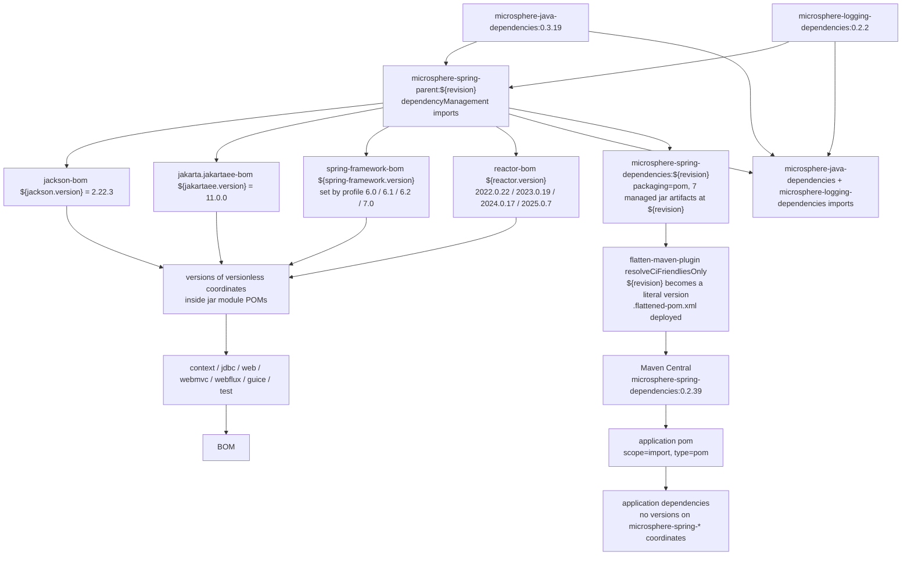

# microsphere-spring-dependencies — Developer Guide (0.2.x / `release`)

[← Developer guide overview](./README.md) · [简体中文](./zh/dependencies.md) · [User guide](../../user-guide/current/dependencies.md)

**Who needs this document.** Application teams need it: this POM is the published BOM (`scope=import`) that lets them
depend on any `microsphere-spring-*` module without stating a version. Library maintainers need it for the smaller but
stricter duty behind it — keeping the managed list in sync with the module list, because a module that is not added
here cannot be consumed version-free.

## 1. Version information

| Item | Value |
|------|-------|
| Branch | `release` |
| Docs directory | `docs/**/current/` |
| Version line | **0.2.x** |
| Development version (root `<revision>`) | `0.2.40-SNAPSHOT` |
| Latest released version | `0.2.39` |
| Parent | `io.github.microsphere-projects:microsphere-spring-parent:${revision}` (`../microsphere-spring-parent/pom.xml`) |
| Build baseline parent | `io.github.microsphere-projects:microsphere-build:0.3.17` (inherited via the parent chain) |
| Java baseline | Java 17 (set in the reactor root POM) |
| Coordinates / packaging | `io.github.microsphere-projects:microsphere-spring-dependencies:${revision}`, `packaging=pom` |

## 2. What the module is

`microsphere-spring-dependencies` is the reactor's outward-facing contract. It is a build-only module — the directory
contains exactly one file, `microsphere-spring-dependencies/pom.xml`, with no `src/` — and its only content is a
`<dependencyManagement>` block over the seven published library artifacts:

```xml
<parent>
    <groupId>io.github.microsphere-projects</groupId>
    <artifactId>microsphere-spring-parent</artifactId>
    <version>${revision}</version>
    <relativePath>../microsphere-spring-parent/pom.xml</relativePath>
</parent>

<groupId>io.github.microsphere-projects</groupId>
<artifactId>microsphere-spring-dependencies</artifactId>
<version>${revision}</version>
<packaging>pom</packaging>

<name>Microsphere :: Spring :: Dependencies</name>
<description>Microsphere Spring Dependencies</description>
```

It inherits from `microsphere-spring-parent` rather than from the reactor root, which is what pulls the Spring/Reactor
profile machinery and the third-party BOM imports into this POM's effective model.

## 3. `<dependencyManagement>` contents, verbatim

The BOM declares **seven** entries, all in group `io.github.microsphere-projects`, all at version `${revision}`
(no `<type>`/`<scope>`, i.e. plain jar coordinates, no exclusions):

| # | groupId | artifactId | version |
|---|---------|------------|---------|
| 1 | `io.github.microsphere-projects` | `microsphere-spring-context` | `${revision}` |
| 2 | `io.github.microsphere-projects` | `microsphere-spring-guice` | `${revision}` |
| 3 | `io.github.microsphere-projects` | `microsphere-spring-jdbc` | `${revision}` |
| 4 | `io.github.microsphere-projects` | `microsphere-spring-web` | `${revision}` |
| 5 | `io.github.microsphere-projects` | `microsphere-spring-webmvc` | `${revision}` |
| 6 | `io.github.microsphere-projects` | `microsphere-spring-webflux` | `${revision}` |
| 7 | `io.github.microsphere-projects` | `microsphere-spring-test` | `${revision}` |

Nothing else is declared in the BOM: no `<properties>`, no `<profiles>`, no `<build>`, no `<repositories>`,
no `<pluginManagement>`, and no dependency of its own.

Because the parent is inherited, the *effective* `dependencyManagement` a consumer sees through this BOM is the union
of the seven entries above and everything the parent chain manages:

| Source | Managed content |
|--------|-----------------|
| `microsphere-spring-parent` (imported BOMs) | `com.fasterxml.jackson:jackson-bom:${jackson.version}` (`2.22.3`), `jakarta.platform:jakarta.jakartaee-bom:${jakartaee.version}` (`11.0.0`), `org.springframework:spring-framework-bom:${spring-framework.version}`, `io.projectreactor:reactor-bom:${reactor.version}`, `io.github.microsphere-projects:microsphere-java-dependencies:0.3.19`, `io.github.microsphere-projects:microsphere-logging-dependencies:0.2.2` |
| `microsphere-spring-parent` (direct entries) | `org.yaml:snakeyaml:2.7`, `p6spy:p6spy:3.9.1`, `org.apache.zookeeper:zookeeper:3.9.6`, `org.apache.curator:curator-recipes:5.9.0` and `curator-test:5.9.0` (both excluding `org.apache.zookeeper:zookeeper`) |

Important distinction: importing a BOM pulls the **declarations of that POM only**. The seven entries are what an
application actually inherits by importing `microsphere-spring-dependencies`; the parent-chain BOMs are *not* re-exported
through the import, which is why the modules' own compile dependencies (Spring, Jackson, Jakarta APIs) must be declared
as `<optional>` in each module POM. See [./parent.md](./parent.md) for the property side.

## 4. How consumers import it

```xml
<dependencyManagement>
    <dependencies>
        <dependency>
            <groupId>io.github.microsphere-projects</groupId>
            <artifactId>microsphere-spring-dependencies</artifactId>
            <version>0.2.39</version>
            <type>pom</type>
            <scope>import</scope>
        </dependency>
    </dependencies>
</dependencyManagement>

<dependencies>
    <dependency>
        <groupId>io.github.microsphere-projects</groupId>
        <artifactId>microsphere-spring-context</artifactId>
    </dependency>
</dependencies>
```

Rules that follow from the BOM's shape:

- The version must be a released version; `${revision}` never reaches a consumer because
  `flatten-maven-plugin` (`flattenMode=resolveCiFriendliesOnly`, `updatePomFile=true`) deploys a POM whose managed
  versions are literals — the published `0.2.39` BOM lists `microsphere-spring-context:0.2.39`, and so on.
- `spring-framework.version` is not part of the BOM contract: it is chosen at *this* repository's build time by the
  `spring-framework-6.0` … `spring-framework-7.0` profiles, so the artifact published for a given version is built
  against one line and runs against 6.0.x–7.0.x. Applications align Spring themselves with `spring-framework-bom`.
- An application that wants a module version different from the BOM states the version explicitly — a direct
  `<dependency><version>` always beats imported management.

## 5. Reactor coverage

| Reactor module | Managed by this BOM | Published |
|----------------|---------------------|-----------|
| `microsphere-spring-parent` | no (it is the internal parent) | yes, as a `pom` parent to inherit |
| `microsphere-spring-dependencies` | n/a (it is the BOM) | yes |
| `microsphere-spring-context` | yes | yes |
| `microsphere-spring-jdbc` | yes | yes |
| `microsphere-spring-web` | yes | yes |
| `microsphere-spring-webmvc` | yes | yes |
| `microsphere-spring-webflux` | yes | yes |
| `microsphere-spring-guice` | yes | yes |
| `microsphere-spring-test` | yes | yes |

On `release` the list is complete: every `jar` module in the root `<modules>` is managed here, so the "managed set ==
publishable set" invariant holds. On `release-1.x` it does not — `microsphere-spring-compatible` is a reactor module
that is neither managed nor deployed; see [../1.x/dependencies.md](../1.x/dependencies.md).

Maintenance rule: adding module #10 means editing three files in one commit — root `<modules>`,
`microsphere-spring-<new>/pom.xml`, and this BOM. Verify with:

```bash
mvn -P spring-framework-7.0 help:effective-pom -pl microsphere-spring-dependencies \
    | grep -c "microsphere-spring-"
```

## 6. BOM import chain



Related documents: [./README.md](./README.md) · [./parent.md](./parent.md) · [./context.md](./context.md) ·
[./web.md](./web.md) · [./test.md](./test.md) · [../1.x/dependencies.md](../1.x/dependencies.md)
