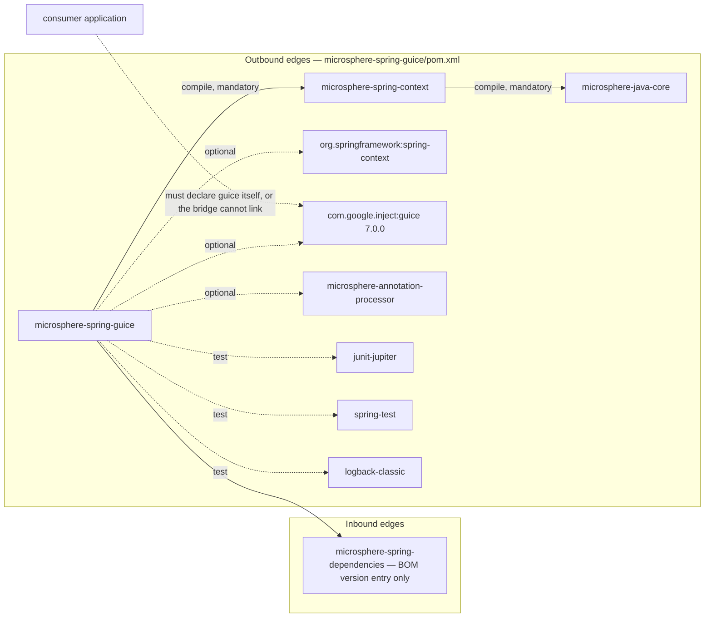
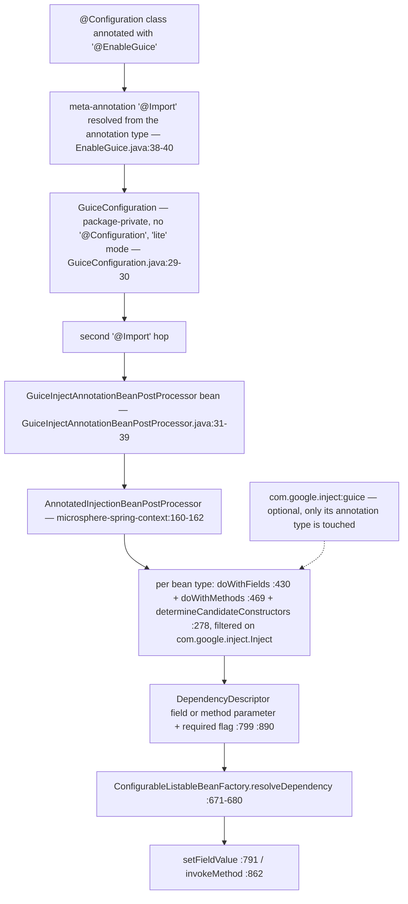
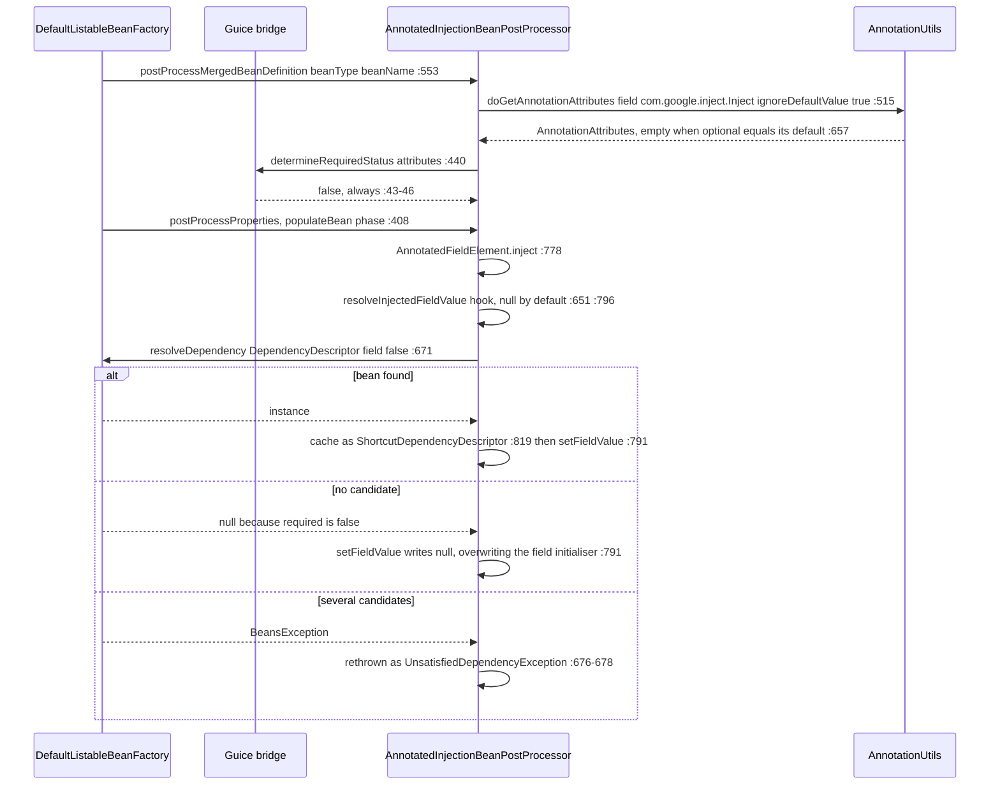

# microsphere-spring-guice — Developer Guide

[← Developer guide overview](./README.md) · [简体中文](./zh/guice.md) · [User guide](../../user-guide/current/guice.md) · [1.x](../1.x/guice.md)

## 1. Module identity, baselines and dependency posture

| Attribute | Value | Evidence |
|---|---|---|
| Maven coordinate | `io.github.microsphere-projects:microsphere-spring-guice:${revision}` | `microsphere-spring-guice/pom.xml:13-16` |
| Reactor version / last built artifact | `0.2.40-SNAPSHOT` (`revision`); `0.2.39` jar and sources jar exist in `target/` | `pom.xml:55`, `microsphere-spring-guice/.flattened-pom.xml:13` |
| Parent | `microsphere-spring-parent:${revision}` | `microsphere-spring-guice/pom.xml:5-10` |
| Java baseline | `17` (`java.version`) | `pom.xml:56` |
| Spring baseline | profile-selected `6.0.23` / `6.1.21` / `6.2.18` / `7.0.9`, default active `spring-framework-7.0`; the parent imports `jakarta.jakartaee-bom` `11.0.0`, yet this module declares no `jakarta.*` artifact | `microsphere-spring-parent/pom.xml:138-173`, `:99-106`, `:24,51-58` |
| Guice | `com.google.inject:guice` `7.0.0`, **optional**, version pinned inside the module | `microsphere-spring-guice/pom.xml:21-23,48-54` |
| `microsphere-spring-context` | compile, **not** optional — the only mandatory in-reactor edge | `microsphere-spring-guice/pom.xml:41-46` |
| `org.springframework:spring-context`, `microsphere-annotation-processor` | both optional; the processor is version-less, resolved to `0.3.19` by the `microsphere-java-dependencies` import | `microsphere-spring-guice/pom.xml:27-39`, `microsphere-spring-parent/pom.xml:22,117-124` |
| Test dependencies | `junit-jupiter`, `spring-test`, `logback-classic` — there is **no** `microsphere-spring-test` edge here | `microsphere-spring-guice/pom.xml:56-73` |
| Namespace root / types | `io.microsphere.spring.guice.annotation`; 3 main classes, 1 test class | `microsphere-spring-guice/src/**` |
| `src/main/resources` | **absent** — no `spring.factories`, no `AutoConfiguration.imports`, no `module-info.java` | listing of `microsphere-spring-guice/src/main/` |

Dependency posture, stated precisely because it is the module's most common breakage: **Guice is `optional`** (`microsphere-spring-guice/pom.xml:53`), so `com.google.inject:guice` is *not* transitive to a consumer; the published POM keeps the flag (`.flattened-pom.xml:66-72`) and the application must declare Guice itself. The single mandatory in-reactor edge is `microsphere-spring-context` (`:41-46`), which in turn contributes `microsphere-java-core` as mandatory (`microsphere-spring-context/pom.xml:30-34`). ⚠ Guice is *not* managed by the parent or the BOM — `microsphere-spring-parent/pom.xml:32-136` has no `com.google.inject` entry and `microsphere-spring-dependencies/pom.xml:30-34` manages only this module's artifact; [parent.md:140-141](./parent.md) and [the overview's managed-third-parties row](./README.md) both record this exception.



No reactor module depends on `microsphere-spring-guice`; outside the module the only source references are `pom.xml:67` (module list) and `microsphere-spring-dependencies/pom.xml:32` (BOM).

## 2. Package map

| Package | Types (visibility) | Responsibility |
|---|---|---|
| `io.microsphere.spring.guice.annotation` | `EnableGuice` (public), `GuiceConfiguration` (package-private, `GuiceConfiguration.java:30`), `GuiceInjectAnnotationBeanPostProcessor` (package-private, `GuiceInjectAnnotationBeanPostProcessor.java:31`) | activation annotation + the annotation type this module binds + the required-ness override |

| External type | Home | Why this module needs it |
|---|---|---|
| `io.microsphere.spring.beans.factory.annotation.AnnotatedInjectionBeanPostProcessor` | **`microsphere-spring-context`** | super-class (`GuiceInjectAnnotationBeanPostProcessor.java:31`); it owns *all* scanning, resolving and caching |
| `io.microsphere.spring.core.annotation.AnnotationUtils`, `AnnotatedInjectionBeanPostProcessor.AnnotationInjectedElement` | `microsphere-spring-context` | attribute extraction called by the base (`AnnotatedInjectionBeanPostProcessor.java:515-517` → `AnnotationUtils.java:463-485`); public injection-point model (`:739-762`) |
| `org.springframework.context.annotation.Import`, `com.google.inject.Inject` | Spring Framework / Guice 7.0.0 | the only activation mechanism (`EnableGuice.java:38-40`, `GuiceConfiguration.java:29`) and the annotation type bound by the bridge (`GuiceInjectAnnotationBeanPostProcessor.java:19,33`) |
| `SmartInstantiationAwareBeanPostProcessor`, `MergedBeanDefinitionPostProcessor`, `PriorityOrdered`, `BeanFactoryAware`, `BeanClassLoaderAware`, `EnvironmentAware`, `InitializingBean`, `DisposableBean` | Spring Framework | the seams implemented by the base class (`AnnotatedInjectionBeanPostProcessor.java:160-162`) |

## 3. Architecture

⚠ This module has **no `ImportBeanDefinitionRegistrar`, no `ApplicationContextInitializer`, no `Injector`, no `Module` and no `Provider`**. It is therefore the exception to the reactor-wide "annotation → registrar → seam" shape described in [the overview](./README.md): the direction is one-way (Guice-annotated members of *Spring* beans are satisfied by *Spring*), and activation is a two-hop `@Import` with no registrar in between.



`@EnableGuice` (`EnableGuice.java:41`) declares no attributes, so there is nothing to configure and no Environment-level switch. The intermediate `GuiceConfiguration` carries no `@Configuration` and no `@Bean` method (`GuiceConfiguration.java:30`); it exists purely as an `@Import` carrier, and as a side effect both imported classes become ordinary bean definitions — the module's own test proves it by injecting them (`EnableGuiceTest.java:45-46,48-49`, asserted non-null at `:57-58`).

## 4. Source analysis

### 4.1 The bridge class

```java
class GuiceInjectAnnotationBeanPostProcessor extends AnnotatedInjectionBeanPostProcessor {  // :31
    private static final Class<? extends Annotation> ANNOTATION_TYPE = Inject.class;        // :33
    private static final String OPTIONAL_ATTRIBUTE_NAME = "optional";                       // :35
    public GuiceInjectAnnotationBeanPostProcessor() { super(ANNOTATION_TYPE); }             // :37-39
    @Override
    protected boolean determineRequiredStatus(AnnotationAttributes attributes) {            // :41-47
        if (!attributes.containsKey(OPTIONAL_ATTRIBUTE_NAME)) { return false; }
        return Boolean.FALSE.equals(attributes.getBoolean(OPTIONAL_ATTRIBUTE_NAME));
    }
}
```

The whole module is one constant (`Inject.class`) plus one overridden hook. Fixing the annotation type in a `static final` field also explains why a missing Guice dependency fails at *link* time: initialising the class requires `com.google.inject.Inject` (`:19,33`), so creating the post-processor bean throws `NoClassDefFoundError`.

### 4.2 Inherited machinery and its fixed points

The base class is a self-contained injection engine whose steps are frozen: `postProcessProperties`, `postProcessPropertyValues`, `postProcessMergedBeanDefinition`, `determineCandidateConstructors`, `setBeanFactory`, `setEnvironment`, `setBeanClassLoader`, `getOrder` and `getAnnotationTypes` are all `final` (`AnnotatedInjectionBeanPostProcessor.java:278,387,408,553,561,566,571,713,717`), so a subclass cannot change *when* or *how often* it runs; the overridable surface is exactly three protected hooks — `determineRequiredStatus` (`:455-457`, default `true`), `resolveInjectedFieldValue` (`:651-654`, returns `null`), `resolveInjectedMethodArguments` (`:666-669`, returns `null`) — and the Guice subclass overrides one of them. Two constructor defaults decide the semantics below: `setOrder(LOWEST_PRECEDENCE - 3)` (`:246`, asserted in the context module's test at `AnnotatedInjectionBeanPostProcessorTest.java:96`) and `setIgnoreDefaultValue(true)` + `setTryMergedAnnotation(true)` (`:249-250`). ⚠ The field comment at `:201-203` claims the order exists to be "higher priority than `AutowiredAnnotationBeanPostProcessor`", yet `LOWEST_PRECEDENCE - 3` sits at the bottom of the `Ordered` scale, so relative ordering against Spring's own processors is not established by the value.

### 4.3 Required vs optional — the exact resolution

`determineRequiredStatus` reads only the `optional` key, but that key's *presence* is decided upstream. The chain, end to end:

1. `doGetAnnotationAttributes(member, Inject.class)` passes `ignoreDefaultValue = true` and `tryMergedAnnotation = true` (`AnnotatedInjectionBeanPostProcessor.java:515-517`).
2. Both branches of `AnnotationUtils.getAnnotationAttributes(...)` (`AnnotationUtils.java:463-485`: merged at `:474-477`, plain at `:479-482`) funnel into `filterAnnotationAttributes` (`:643-671`).
3. That method **removes** any attribute whose value equals the annotation's declared default — `if (ignoreDefaultValue && nullSafeEquals(attributeValue, getDefaultValue(annotation, attributeName))) continue;` (`:657-659`), `getDefaultValue` being Spring's own, statically imported at `:34`.
4. Guice declares `boolean optional() default false`, and a Java annotation proxy reports `false` for an undeclared element, so the synthesised map holds `optional=false` both for the bare and the explicit-`false` case — and step 3 deletes it.

The consequence is arithmetic, not opinion: the only way `containsKey("optional")` is `true` is when the value differs from `false`, i.e. is `true`, and then `Boolean.FALSE.equals(true)` is `false`. **`determineRequiredStatus` can never return `true` through `@EnableGuice`** — every Guice injection point on this line is non-required.

| Guice declaration | `optional` value | key survives the default filter? | `determineRequiredStatus` | runtime effect, evidenced |
|---|---|---|---|---|
| `@Inject` | `false` (default) | no | `false` (`GuiceInjectAnnotationBeanPostProcessor.java:43-45`) | missing candidate → field set to `null`, no exception (`resolveFieldValue:795-806`) |
| `@Inject(optional = false)` | `false` (default) | **no — identical to the row above** | `false` | ⚠ no spelling of this attribute can reach `true` (see gotcha 3) |
| `@Inject(optional = true)` | `true` | yes | `false` (`:46`) | missing candidate → `null`; asserted by `EnableGuiceTest.java:51-52,59` |

`required` reaches Spring only as the second argument of `DependencyDescriptor` (`:799` fields, `:890` method parameters, `:323` constructors). Absence is tolerated; **ambiguity is not** — `resolveDependency` catches every `BeansException` and rethrows `UnsatisfiedDependencyException` (`:671-680`), so two candidates fail an `@Inject(optional = true)` field exactly like a required one. The switch that would restore Guice semantics, `setIgnoreDefaultValue(false)` (`:606-608`), is unreachable through `@EnableGuice`: the subclass never calls it and is package-private (`:31`), so user code can neither subclass nor configure it.

### 4.4 Injection-point edge cases (all inherited)

- **Static fields** are dropped with a `warn` (`:434-439`); **zero-parameter methods** are only warned about (`:483-487`) and still registered (`:490`), then invoked with an empty argument array (`:884-886`, `:861-863`) — the bridge turns them into init-like callbacks, where Guice itself rejects both.
- **Overridden and bridge methods** are de-duplicated: bridge pairs are resolved (`:470-473`) and only the most specific declaration is kept (`:476`).
- **Constructors**: an `@Inject` constructor becomes a candidate (`:304`), but since `required` is always `false` the `requiredConstructor` path never fires (`:316-333`); if the class also declares a no-arg constructor, that one is appended as a fallback (`:338-351`), and an unannotated single constructor with parameters is still selected (`:353-354`).
- **Explicit property values win for setters**: `checkPropertySkipping(pvs)` returns early (`:846-848`), so a `@Inject` setter supplied by XML or `PropertyValues` is skipped. Fields have no such guard — `inject` always writes, `null` included (`:778-792`).

## 5. One injection request



Those three branches are the complete contract of the module: *found → inject, absent → `null`, ambiguous → fail*. There is no fourth step that consults Guice; an `Injector` created in your own code is never reached.

## 6. Design patterns

| Pattern | Class(es) | Evidence |
|---|---|---|
| Configuration activation ("Enable*") with two-hop import indirection | `EnableGuice`, `GuiceConfiguration` | `EnableGuice.java:35-41` (attribute-free marker whose payload is a meta-`@Import`); `GuiceConfiguration.java:29-30` — a package-private "lite" class that carries the second hop and is itself injectable (`EnableGuiceTest.java:45-46`) |
| Template Method | `AnnotatedInjectionBeanPostProcessor` + `GuiceInjectAnnotationBeanPostProcessor` | frozen steps `:278,408,553`, hooks `:455,651,666`; the only override at `GuiceInjectAnnotationBeanPostProcessor.java:41-47` |
| Bridge / Adapter | `GuiceInjectAnnotationBeanPostProcessor` | `:33,35` map `com.google.inject.Inject.optional` onto Spring's `required`; the module description is literally "Microsphere Spring Bridge Guice" (`microsphere-spring-guice/pom.xml:19`) |
| Factory (instantiation-aware) | `determineCandidateConstructors`, `ShortcutDependencyDescriptor.resolveShortcut` | `AnnotatedInjectionBeanPostProcessor.java:277-368`, `:933-949` |
| Registry / cache | `candidateConstructorsCache`, `injectionMetadataCache` | `:191-193`, `:627-630`, writes at `:363,542`, cleared only in `destroy()` (`:633-639`) |
| Null Object | `resolveInjectedFieldValue`, `resolveInjectedMethodArguments` | `:651-654`, `:666-669` — `null` means "no custom value, fall through to Spring" |
| Strategy | `annotationTypes` set + `order` | `:189,236-238,713-715`, `:580,717-720` |
| *No* Observer, Decorator or Composite | — | neither this module nor the inherited path wraps or fans out, unlike `microsphere-spring-jdbc` |

## 7. Extension guide

Because the shipped post-processor is package-private, extension happens against the **public** base class in `microsphere-spring-context`.

### 7.1 Serve Guice injection points from a real `Injector`

```java
public class GuiceBackedInjectBeanPostProcessor extends AnnotatedInjectionBeanPostProcessor {
    private final Injector injector;   // created by the application, e.g. Guice.createInjector(new AppModule())
    public GuiceBackedInjectBeanPostProcessor(Injector injector) {
        super(com.google.inject.Inject.class);      // or add jakarta/javax Inject as var-args (:236)
        this.injector = injector;
        setIgnoreDefaultValue(false);               // :606-608 — otherwise optional=false is filtered away
    }
    @Override
    protected boolean determineRequiredStatus(AnnotationAttributes attributes) {
        return !Boolean.TRUE.equals(attributes.getBoolean("optional"));   // :41-47 equivalent, now reachable
    }
    @Override
    protected Object resolveInjectedFieldValue(Object bean, String beanName, PropertyValues pvs,
            AnnotationInjectedElement<Field> fieldElement) throws Throwable {
        return injector.getInstance(fieldElement.getInjectionPoint().getType());   // consulted BEFORE Spring (:796)
    }
}
```

Register it with a `@Bean` method (declare it `static` to avoid early-infrastructure warnings, as for any `BeanPostProcessor`) or by `@Import` of a class that declares it; returning a non-`null` value from the hook **short-circuits** Spring lookup entirely.

### 7.2 Rules that decide what wins

| Rule | Evidence |
|---|---|
| The resolver hooks run *before* the bean factory (field path `:796-804`, method path `:881-893`) and a `null` return means "ask Spring"; hook values are assigned **without** type conversion, unlike the Spring path which passes a `TypeConverter` | `AnnotatedInjectionBeanPostProcessor.java:796,881` vs `:791,862` and `:672-675` |
| Each registered processor is an independent pass over every bean with its own caches, so two processors claiming one field mean the later one writes the final value; relative order is set by `setOrder` (default `LOWEST_PRECEDENCE - 3`) | `:778-792`, `:191-193,627-630`, `:580-582,246` |
| `@EnableGuice` takes no modules — it has no attributes — so extra sources are added by registering *another* processor, not by configuring this one | `EnableGuice.java:41` |
| Exposing Spring beans *to* Guice is not an extension point here: no `Binder`/`AbstractModule` ships. Hand-write a Guice module whose providers read from `ApplicationContext`, or use `ObjectProvider` on the Spring side | absence of such types in `microsphere-spring-guice/src/main/java` |

## 8. Build and verification

| Task | Command / fact |
|---|---|
| Build and test this module | `mvn -pl microsphere-spring-guice -am test --activate-profiles test,coverage,spring-framework-7.0` — CI adds `-Drevision=0.0.1-SNAPSHOT` (`.github/workflows/maven-build.yml:43-49`) |
| Spring matrix / JDK matrix | `spring-framework-6.0 / 6.1 / 6.2 / 7.0` with `7.0` `activeByDefault` (`microsphere-spring-parent/pom.xml:138-173`, `:163-172`); JDK `17`, `21`, `25` (`.github/workflows/maven-build.yml:25`) |
| Build parent | `microsphere-build:0.3.17` (`pom.xml:5-9`, the same version on `origin/release`) |
| Test inventory | `EnableGuiceTest` — the test class is also the bean under test (`EnableGuiceTest.java:36-40`); 4 injection sites (`:42-52`), 4 assertions (`:54-60`) |
| What the tests do **not** cover | constructor or setter `@Inject`, any required-failure path, and every use of `Injector`, `Module`, `Provider` or `Scope` — Guice participates only as an annotation type |
| Optional-dependency behaviour | the module's own compile classpath does see Guice (optional suppresses transitivity, not local use), which is why the test compiles without extra declarations; the flattened POM keeps `<optional>true</optional>` (`.flattened-pom.xml:66-72`) so consumers still must provide it |

## 9. Gotchas

| # | Observation | Evidence |
|---|---|---|
| 1 | Guice is optional and never transitive; a consumer without `com.google.inject:guice` fails when the bridge class is initialised, not when its own code compiles. | `microsphere-spring-guice/pom.xml:48-54`; `GuiceInjectAnnotationBeanPostProcessor.java:19,33` |
| 2 | ⚠ There is no `Injector`/`Module`/`Provider`/`Scope` integration and the direction is Guice-annotations → Spring only; describing the module as a bidirectional "Spring ↔ Guice bridge" overstates it. | `microsphere-spring-guice/src/main/java` (3 classes) |
| 3 | ⚠ `@Inject(optional = false)` is **not** required — the default-valued attribute is filtered before `determineRequiredStatus` sees it — so bare `@Inject` and explicit `false` are the same, and both are optional, unlike Guice's own required default. | `AnnotatedInjectionBeanPostProcessor.java:249`; `AnnotationUtils.java:657-659`; `GuiceInjectAnnotationBeanPostProcessor.java:43-45` |
| 4 | `optional = true` tolerates absence but not duplicate candidates. | `AnnotatedInjectionBeanPostProcessor.java:798-802,671-680` |
| 5 | The field write is unconditional, so `@Inject` on a field with an initialiser erases that initialiser with `null` when no bean matches. | `:778-792` |
| 6 | Both concrete types are package-private; user code can only extend the public base class or intervene via `instanceof AnnotatedInjectionBeanPostProcessor` from another post-processor. | `GuiceInjectAnnotationBeanPostProcessor.java:31`; `AnnotatedInjectionBeanPostProcessor.java:160` |
| 7 | No Environment-level kill switch: unlike other `@Enable*` entry points in the reactor this one imports a plain class instead of an `AnnotatedBeanCapableImportBeanDefinitionRegistrar`, so `…enabled=false` does nothing here. | `EnableGuice.java:38-40` |
| 8 | `microsphere.spring.injection.metadata.cache.size` is read once from **system properties** at class initialisation (`-D…`), not from the Spring `Environment`, and the two caches never evict — the name promises a bound the code does not implement. | `AnnotatedInjectionBeanPostProcessor.java:167,179-185,363,542,633-639` |
| 9 | Only `com.google.inject.Inject` is bound: classes importing `jakarta.inject.Inject` or `javax.inject.Inject` are invisible to this bridge (neither name occurs in any main source of the reactor except one comment, `AbstractInjectionPointDependencyResolver.java:394`); use §7.1's var-args constructor if you need them. | `GuiceInjectAnnotationBeanPostProcessor.java:33` |
| 10 | Guice 7.0.0 needs Java 11+, satisfied by this line's Java 17; the Java 8 vs Guice 7 conflict is confined to 1.x (`docs/user-guide/1.x/guice.md:13-19`). | `microsphere-spring-guice/pom.xml:21-23`, `pom.xml:56` |
| 11 | The bridge runs in the same `populateBean` phase as `@Autowired` and at the low end of the `PriorityOrdered` band, so annotating one field with both annotations yields two independent resolutions. | `AnnotatedInjectionBeanPostProcessor.java:408,246,201-203` |
| 12 | ⚠ `@since 1.0.0` on all four types conflicts with the analysed `0.2.40-SNAPSHOT`; do not use `@since` for release mapping. | `EnableGuice.java:33`, `pom.xml:55` |

**Related** — [Developer guide overview](./README.md) · [简体中文版](./zh/guice.md) · [User guide — Guice](../../user-guide/current/guice.md) · [1.x developer guide](../1.x/guice.md) · [parent POM profiles](./parent.md) · [dependency management](./dependencies.md)
