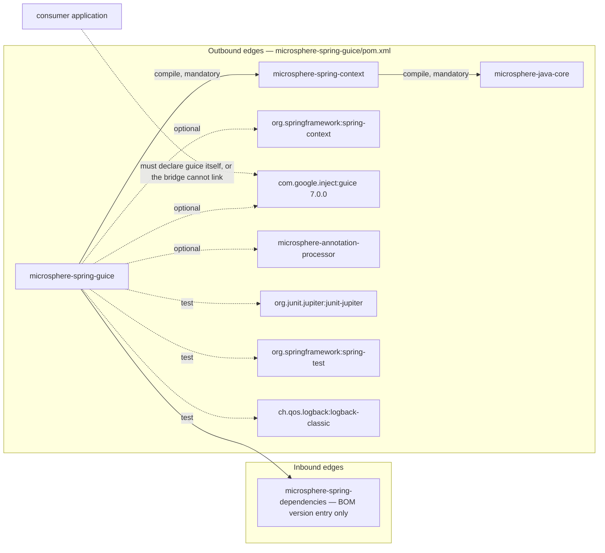
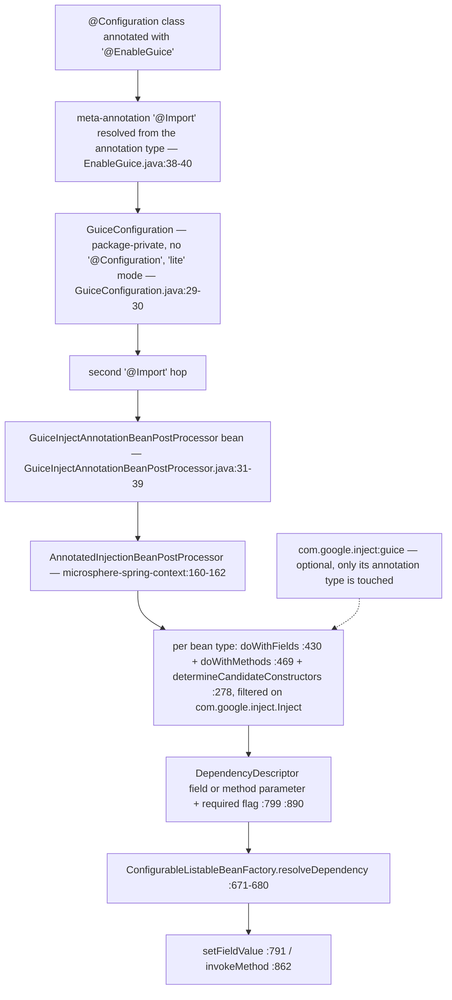
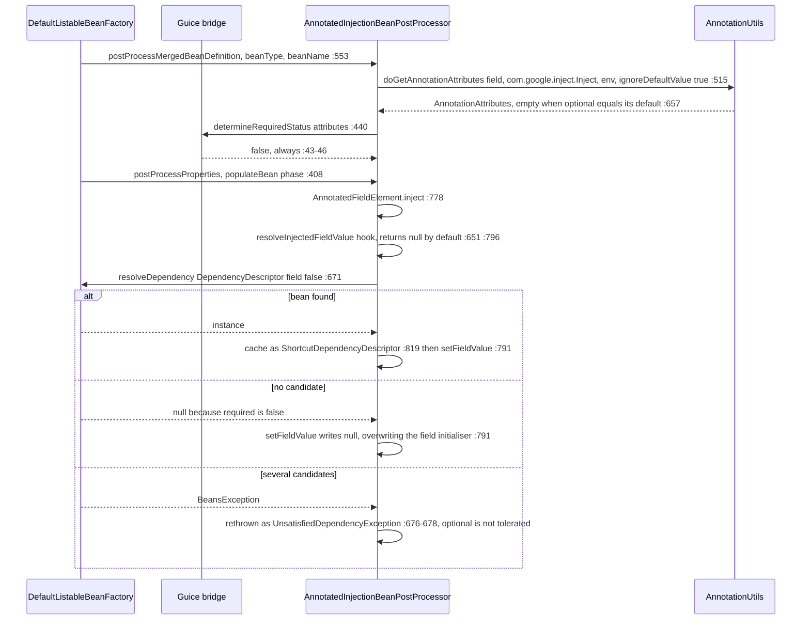

# microsphere-spring-guice — Developer Guide

[← Developer guide overview](./README.md) · [简体中文](./zh/guice.md) · [User guide](../../user-guide/current/guice.md) · [1.x](../1.x/guice.md)

## 1. Module identity, baselines and dependency posture

| Attribute | Value | Evidence |
|---|---|---|
| Maven coordinate | `io.github.microsphere-projects:microsphere-spring-guice:${revision}` | `microsphere-spring-guice/pom.xml:13-16` |
| Reactor version under analysis | `0.2.40-SNAPSHOT` (`revision`) | `pom.xml:55` |
| Last built artifact | `0.2.39` jar + sources jar | `microsphere-spring-guice/target/`, `microsphere-spring-guice/.flattened-pom.xml:13` |
| Parent | `microsphere-spring-parent:${revision}` | `microsphere-spring-guice/pom.xml:5-10` |
| Java baseline | `17` (`java.version`) | `pom.xml:56` |
| Spring baseline | profile-selected `6.0.23` / `6.1.21` / `6.2.18` / `7.0.9`; default active `spring-framework-7.0` | `microsphere-spring-parent/pom.xml:138-173`, BOM import `:99-106` |
| Jakarta EE | `jakarta.jakartaee-bom` `11.0.0` is imported by the parent, but this module declares **no** `jakarta.*` artifact | `microsphere-spring-parent/pom.xml:24,51-58` |
| Guice | `com.google.inject:guice` `7.0.0`, **optional**, version pinned inside the module | `microsphere-spring-guice/pom.xml:21-23,48-54` |
| `microsphere-spring-context` | compile, **not** optional — the only mandatory in-reactor edge | `microsphere-spring-guice/pom.xml:41-46` |
| `org.springframework:spring-context` | optional | `microsphere-spring-guice/pom.xml:34-39` |
| `microsphere-annotation-processor` | optional, version-less (from `microsphere-java-dependencies` → `0.3.19`) | `microsphere-spring-guice/pom.xml:27-32`, `microsphere-spring-parent/pom.xml:22,117-124` |
| Test dependencies | `junit-jupiter`, `spring-test`, `logback-classic` — there is **no** `microsphere-spring-test` edge here | `microsphere-spring-guice/pom.xml:56-73` |
| Namespace root | `io.microsphere.spring.guice.annotation` | `microsphere-spring-guice/src/main/java` |
| Main / test types | 3 main classes, 1 test class | `microsphere-spring-guice/src/**` |
| `src/main/resources` | **absent** — no `spring.factories`, no `AutoConfiguration.imports`, no `module-info.java` | directory listing of `microsphere-spring-guice/src/main/` |

Dependency posture, stated precisely because it is the module's most common breakage: **Guice is `optional`** (`microsphere-spring-guice/pom.xml:53`), so `com.google.inject:guice` is *not* transitive to a consumer. The published POM keeps the flag (`.flattened-pom.xml:66-72`), so the application must declare Guice itself. `spring-context` and the annotation processor are optional too (`:28-39`); the single mandatory in-reactor edge is `microsphere-spring-context` (`:41-46`), which itself contributes `microsphere-java-core` as a mandatory transitive dependency (`microsphere-spring-context/pom.xml:30-34`).

⚠ Guice is *not* managed in the parent or the BOM: `microsphere-spring-parent/pom.xml:32-136` has no `com.google.inject` entry and `microsphere-spring-dependencies/pom.xml:30-34` manages only this module's own artifact. `docs/developer-guide/current/README.md:20` lists Guice among "managed third parties"; [parent.md:140-141](./parent.md) is the accurate statement — this module is the exception that pins its version locally.



No reactor module depends on `microsphere-spring-guice`; outside this module the only source references are `pom.xml:67` (module list) and `microsphere-spring-dependencies/pom.xml:32` (BOM).

## 2. Package map

| Package | Types (visibility) | Responsibility |
|---|---|---|
| `io.microsphere.spring.guice.annotation` | `EnableGuice` (public), `GuiceConfiguration` (package-private, `GuiceConfiguration.java:30`), `GuiceInjectAnnotationBeanPostProcessor` (package-private, `GuiceInjectAnnotationBeanPostProcessor.java:31`) | activation annotation + the annotation type this module binds + the required-ness override |

External types the module is built on:

| Type | Home | Why this module needs it |
|---|---|---|
| `io.microsphere.spring.beans.factory.annotation.AnnotatedInjectionBeanPostProcessor` | **`microsphere-spring-context`** | super-class (`GuiceInjectAnnotationBeanPostProcessor.java:31`); it owns *all* scanning, resolving and caching |
| `io.microsphere.spring.core.annotation.AnnotationUtils` | `microsphere-spring-context` | attribute extraction called by the base (`AnnotatedInjectionBeanPostProcessor.java:515-517` → `AnnotationUtils.java:463-485`) |
| `io.microsphere.spring.beans.factory.annotation.AnnotatedInjectionBeanPostProcessor.AnnotationInjectedElement` | `microsphere-spring-context` | public injection-point model (`:739-762`) used by the resolver hooks |
| `org.springframework.context.annotation.Import` | Spring Framework | the only activation mechanism (`EnableGuice.java:38-40`, `GuiceConfiguration.java:29`) |
| `com.google.inject.Inject` | Guice 7.0.0 | the annotation type bound by the bridge (`GuiceInjectAnnotationBeanPostProcessor.java:19,33`) |
| `SmartInstantiationAwareBeanPostProcessor`, `MergedBeanDefinitionPostProcessor`, `PriorityOrdered`, `BeanFactoryAware`, `BeanClassLoaderAware`, `EnvironmentAware`, `InitializingBean`, `DisposableBean` | Spring Framework | the seams implemented by the base class (`AnnotatedInjectionBeanPostProcessor.java:160-162`) |

## 3. Architecture

⚠ This module has **no `ImportBeanDefinitionRegistrar`, no `ApplicationContextInitializer`, no `Injector`, no `Module` and no `Provider`**. `docs/developer-guide/current/README.md:84` describes the page as a "Spring ↔ Guice injection bridge" and `:92-103` describes the reactor-wide shape "annotation → registrar → seam"; `microsphere-spring-guice` matches neither literally — the direction is one-way (Guice-annotated members of *Spring* beans are satisfied by *Spring*), and activation is a two-hop `@Import` with no registrar in between. Everything below is the evidence for that.



`@EnableGuice` (`EnableGuice.java:41`) declares no attributes, so there is nothing to configure and no Environment-level switch. The intermediate `GuiceConfiguration` carries no `@Configuration` and no `@Bean` method (`GuiceConfiguration.java:30`); it exists purely as an `@Import` carrier, and as a side effect both imported classes become ordinary bean definitions — the module's own test proves it by injecting them (`EnableGuiceTest.java:45-46,48-49` asserted non-null at `:57-58`).

## 4. Source analysis

### 4.1 The bridge class

```java
class GuiceInjectAnnotationBeanPostProcessor extends AnnotatedInjectionBeanPostProcessor {  // :31
    private static final Class<? extends Annotation> ANNOTATION_TYPE = Inject.class;        // :33
    private static final String OPTIONAL_ATTRIBUTE_NAME = "optional";                       // :35
    public GuiceInjectAnnotationBeanPostProcessor() { super(ANNOTATION_TYPE); }             // :37-39
    @Override
    protected boolean determineRequiredStatus(AnnotationAttributes attributes) {            // :41-47
        if (!attributes.containsKey(OPTIONAL_ATTRIBUTE_NAME)) {
            return false;
        }
        return Boolean.FALSE.equals(attributes.getBoolean(OPTIONAL_ATTRIBUTE_NAME));
    }
}
```

The whole module is a constant (`Inject.class`) plus one overridden hook. Fixing the annotation type in a `static final` field is also the reason a missing Guice dependency fails at link time: initialising this class requires `com.google.inject.Inject` (`:19,33`), so with the optional dependency absent, bean creation for the post-processor throws `NoClassDefFoundError`.

### 4.2 Inherited machinery and its fixed points

The base class is a self-contained injection engine: `postProcessProperties`, `postProcessPropertyValues`, `postProcessMergedBeanDefinition`, `determineCandidateConstructors`, `setBeanFactory`, `setEnvironment`, `setBeanClassLoader`, `getOrder` and `getAnnotationTypes` are all `final` (`AnnotatedInjectionBeanPostProcessor.java:278,387,408,553,561,566,571,713,717`), so a subclass cannot change *when* or *how often* it runs. The overridable surface is exactly three protected hooks: `determineRequiredStatus` (`:455-457`, returns `true` by default), `resolveInjectedFieldValue` (`:651-654`, returns `null`), `resolveInjectedMethodArguments` (`:666-669`, returns `null`). The Guice subclass overrides one of them.

Two defaults set by the base constructor matter for the semantics below: `setOrder(LOWEST_PRECEDENCE - 3)` (`:246`, asserted in the context module's test at `AnnotatedInjectionBeanPostProcessorTest.java:96`) and `setIgnoreDefaultValue(true)` + `setTryMergedAnnotation(true)` (`:249-250`). ⚠ The field comment at `:201-203` claims the order exists to be "higher priority than `AutowiredAnnotationBeanPostProcessor`", yet `LOWEST_PRECEDENCE - 3` sits at the bottom of the `Ordered` scale; relative ordering against Spring's own annotation processors is therefore not established by the value.

### 4.3 Required vs optional — the exact resolution

`determineRequiredStatus` reads only the `optional` key, but the key's *presence* is decided upstream. The chain, end to end:

1. `doGetAnnotationAttributes(member, Inject.class)` passes `ignoreDefaultValue = true` and `tryMergedAnnotation = true` (`AnnotatedInjectionBeanPostProcessor.java:515-517`).
2. Both branches of `AnnotationUtils.getAnnotationAttributes(...)` (`AnnotationUtils.java:463-485`, merged at `:474-477`, plain at `:479-482`) funnel into `filterAnnotationAttributes` (`:643-671`).
3. `filterAnnotationAttributes` **removes** any attribute whose value equals the annotation's declared default: `if (ignoreDefaultValue && nullSafeEquals(attributeValue, getDefaultValue(annotation, attributeName))) continue;` (`AnnotationUtils.java:657-659`), with `getDefaultValue` being Spring's own, statically imported at `AnnotationUtils.java:34`.
4. Guice declares `boolean optional() default false`. A Java annotation proxy reports `false` for an undeclared element, so the synthesised map contains `optional=false` in both the bare and the explicit-`false` case — and step 3 deletes it.

The consequence is arithmetic, not opinion: the only way `containsKey("optional")` becomes `true` is when the value differs from `false`, i.e. is `true`, and then `Boolean.FALSE.equals(true)` is `false`. **`determineRequiredStatus` can never return `true` through `@EnableGuice`.** Every Guice injection point on this line is non-required.

| Guice declaration | `optional` value | key survives the default filter? | `determineRequiredStatus` | runtime effect, evidenced |
|---|---|---|---|---|
| `@Inject` | `false` (default) | no | `false` (`GuiceInjectAnnotationBeanPostProcessor.java:43-45`) | missing candidate → field set to `null`, no exception (`AnnotatedFieldElement.resolveFieldValue:795-806`) |
| `@Inject(optional = false)` | `false` (default) | **no — identical to the row above** | `false` | ⚠ documented as `required = true` in `docs/user-guide/current/guice.md:42` and `docs/user-guide/1.x/guice.md:71`; the source cannot reach `true` |
| `@Inject(optional = true)` | `true` | yes | `false` (`:46`) | missing candidate → `null`; asserted by `EnableGuiceTest.java:51-52,59` |

`required` is only ever carried into Spring as the second argument of `DependencyDescriptor` (`:799` for fields, `:890` for method parameters, `:323` for constructors). Absence is tolerated; **ambiguity is not** — `resolveDependency` catches every `BeansException` and rethrows `UnsatisfiedDependencyException` (`:671-680`), so two candidate beans fail an `@Inject(optional = true)` field exactly like a required one. The escape hatch that would restore Guice semantics (`setIgnoreDefaultValue(false)`, `:606-608`) is unreachable through `@EnableGuice`, because the subclass never calls it and is package-private (`:31`), so user code cannot subclass or configure it either.

### 4.4 Injection-point edge cases (all inherited)

- **Static fields** are dropped with a `warn` (`:434-439`); Guice rejects them outright, so a legacy static `@Inject` silently does nothing here.
- **Zero-parameter methods** are only warned about (`:483-487`) and still registered (`:490`); at injection time `resolveMethodArguments` yields an empty argument array (`:884-886`) and the method is invoked with no arguments (`:861-863`) — the bridge turns them into init-like callbacks.
- **Overridden and bridge methods** are de-duplicated: bridge pairs are resolved (`:470-473`) and only the most specific method is kept (`:476`).
- **Constructors**: an `@Inject` constructor becomes a candidate (`:304`), but since `required` is always `false` the `requiredConstructor` path never fires (`:316-333`); if the class also declares a no-arg constructor, that one is appended as a fallback (`:338-351`), and an unannotated single constructor with parameters is still selected (`:353-354`).
- **Explicit property values win for setters**: `checkPropertySkipping(pvs)` returns early (`:846-848`), so a `@Inject` setter supplied by XML or a `PropertyValues`-based definition is skipped. Fields have no such guard — `inject` always writes, `null` included (`:778-792`).

## 5. One injection request



The three branches are the complete contract of the module: *found → inject, absent → `null`, ambiguous → fail*. There is no fourth step that consults Guice; the `Injector` you may have created in your own code is never reached.

## 6. Design patterns

| Pattern | Class(es) | Evidence | Notes |
|---|---|---|---|
| Configuration activation ("Enable*") | `EnableGuice` | `EnableGuice.java:35-41` | attribute-free marker whose payload is a meta-`@Import` |
| Two-hop import indirection | `GuiceConfiguration` | `GuiceConfiguration.java:29-30` | a package-private "lite" class that carries the second `@Import` and is itself injectable (`EnableGuiceTest.java:45-46`) |
| Template Method | `AnnotatedInjectionBeanPostProcessor` + `GuiceInjectAnnotationBeanPostProcessor` | final steps `:278,408,553`, hooks `:455,651,666`; override at `GuiceInjectAnnotationBeanPostProcessor.java:41-47` | the algorithm is frozen, only the required-ness decision varies |
| Bridge / Adapter | `GuiceInjectAnnotationBeanPostProcessor` | `:33,35` map `com.google.inject.Inject.optional` onto Spring's `required` | the module description is literally "Microsphere Spring Bridge Guice" (`microsphere-spring-guice/pom.xml:19`) |
| Factory (instantiation-aware) | `determineCandidateConstructors`, `ShortcutDependencyDescriptor.resolveShortcut` | `AnnotatedInjectionBeanPostProcessor.java:277-368`, `:933-949` | selects constructor candidates; the shortcut re-resolves a pre-bound bean name |
| Registry / cache | `candidateConstructorsCache`, `injectionMetadataCache` | `:191-193`, `:627-630`, writes at `:363,542` | keyed by bean class / bean name; cleared only in `destroy()` (`:633-639`) |
| Null Object | `resolveInjectedFieldValue`, `resolveInjectedMethodArguments` | `:651-654`, `:666-669` | `null` means "no custom value, fall through to Spring" |
| Strategy | `annotationTypes` set + `order` | `:189,236-238,713-715`, `:580,717-720` | the annotation type is the strategy parameter; here fixed to one value |

No Observer, Decorator or Composite is present in either this module or the inherited path — unlike `microsphere-spring-jdbc`, nothing wraps or fans out.

## 7. Extension guide

Because the shipped post-processor is package-private, extension happens against the **public** base class in `microsphere-spring-context`.

### 7.1 Serve Guice injection points from a real `Injector`

```java
public class GuiceBackedInjectBeanPostProcessor extends AnnotatedInjectionBeanPostProcessor {

    private final Injector injector;   // created by the application, e.g. Guice.createInjector(new AppModule())

    public GuiceBackedInjectBeanPostProcessor(Injector injector) {
        super(com.google.inject.Inject.class);      // or add jakarta/javax Inject as var-args (:236)
        this.injector = injector;
        setIgnoreDefaultValue(false);               // :606-608 — otherwise optional=false is filtered away
    }

    @Override
    protected boolean determineRequiredStatus(AnnotationAttributes attributes) {   // :41-47 equivalent, but reachable now
        return !Boolean.TRUE.equals(attributes.getBoolean("optional"));
    }

    @Override
    protected Object resolveInjectedFieldValue(Object bean, String beanName, PropertyValues pvs,
                                               AnnotationInjectedElement<Field> fieldElement) throws Throwable {
        return injector.getInstance(fieldElement.getInjectionPoint().getType());   // consulted BEFORE Spring (:796)
    }
}
```

Register it with `@Bean` (a `@Bean` method returning a `BeanPostProcessor` must be `static` to avoid early-infrastructure warnings) or by `@Import` of a class that declares it. Returning a non-`null` value from the hook **short-circuits** Spring lookup entirely.

### 7.2 Rules that decide what wins

| Rule | Evidence |
|---|---|
| The resolver hooks run before the bean factory: field path `:796-804`, method path `:881-893`; a `null` return means "ask Spring" | `AnnotatedInjectionBeanPostProcessor.java:796,881` |
| Hook values are assigned **without** type conversion — `setFieldValue` / `invokeMethod` receive the raw object, unlike the Spring path which passes a `TypeConverter` | `:791,862` vs `:672-675` |
| Each registered processor is an independent pass over every bean; if two processors both claim a field, the one that runs later writes the final value | `:778-792` (unconditional write) |
| Relative order is controlled by `setOrder`; the inherited default is `LOWEST_PRECEDENCE - 3` | `:580-582,246` |
| Caches are per processor instance, so a custom processor re-scans classes the Guice processor already scanned | `:191-193,627-630` |
| To keep `@EnableGuice` and expose extra binding sources, register your processor **in addition**; there is no way to add modules to `@EnableGuice` — it has no attributes | `EnableGuice.java:41` |
| Exposing Spring beans *to* Guice is not an extension point of this module: no `Binder`/`AbstractModule` is shipped. Hand-write a module whose providers read from `ApplicationContext`, or use `ObjectProvider` on the Spring side | absence of such types in `microsphere-spring-guice/src/main/java` |

## 8. Build and verification

| Task | Command / fact |
|---|---|
| Build and test this module | `mvn -pl microsphere-spring-guice -am test --activate-profiles test,coverage,spring-framework-7.0` |
| Pin the reactor version | CI uses `-Drevision=0.0.1-SNAPSHOT` (`.github/workflows/maven-build.yml:47`) |
| Spring matrix | `spring-framework-6.0 / 6.1 / 6.2 / 7.0` (`microsphere-spring-parent/pom.xml:138-173`), `7.0` is `activeByDefault` (`:163-172`) |
| JDK matrix | `17`, `21`, `25` (`.github/workflows/maven-build.yml:25`) |
| Build parent | `microsphere-build:0.3.17` (`pom.xml:5-9`) — ⚠ `docs/developer-guide/current/README.md:19` states `0.3.16` for `release` |
| Test inventory | `EnableGuiceTest` — the test class is also the bean under test (`EnableGuiceTest.java:36-40`); four injection sites (`:42-52`), four assertions (`:54-60`) |
| What the tests do **not** cover | constructor or setter `@Inject`, a required-failure path, any use of `Injector`, `Module`, `Provider` or `Scope`; the Guice dependency is exercised only as an annotation type |
| Optional-dependency check | the module's own compile classpath does see Guice (optional only suppresses transitivity), which is why the single test compiles and passes without an extra declaration |
| Deployed metadata | `.flattened-pom.xml` keeps `<optional>true</optional>` for Guice (`:66-72`), so the consumer-side requirement survives flattening |

## 9. Gotchas

| # | Observation | Evidence |
|---|---|---|
| 1 | Guice is optional and never transitive; a consumer without `com.google.inject:guice` fails when the bridge class is initialised, not at compile time of its own code. | `microsphere-spring-guice/pom.xml:48-54`; `GuiceInjectAnnotationBeanPostProcessor.java:19,33` |
| 2 | ⚠ There is no `Injector`, `Module`, `Provider` or `Scope` integration, and the direction is Guice-annotations → Spring only. The "Spring ↔ Guice" wording in `docs/developer-guide/current/README.md:84` overstates it. | `microsphere-spring-guice/src/main/java` (3 classes) |
| 3 | ⚠ `@Inject(optional = false)` is **not** required, because the default-valued attribute is filtered before `determineRequiredStatus` sees it. `docs/user-guide/current/guice.md:42` and `docs/user-guide/1.x/guice.md:71` claim it throws. | `AnnotatedInjectionBeanPostProcessor.java:249`; `AnnotationUtils.java:657-659` |
| 4 | Bare `@Inject` is optional here, the opposite of Guice's own behaviour — a typo'd type silently produces `null` instead of a startup error. | `GuiceInjectAnnotationBeanPostProcessor.java:43-45` |
| 5 | `optional = true` does not tolerate duplicate candidates; only absence is tolerated. | `AnnotatedInjectionBeanPostProcessor.java:671-680,798-802` |
| 6 | The field write is unconditional, so `@Inject` on a field with an initialiser erases that initialiser with `null` when no bean matches. | `:778-792` |
| 7 | Both concrete types are package-private; user code can only extend the public base class or intervene via `instanceof AnnotatedInjectionBeanPostProcessor` in another post-processor. | `GuiceInjectAnnotationBeanPostProcessor.java:31`; `AnnotatedInjectionBeanPostProcessor.java:160` |
| 8 | No Environment-level kill switch: unlike other `@Enable*` entry points in the reactor, this one imports a plain class rather than an `AnnotatedBeanCapableImportBeanDefinitionRegistrar`, so `microsphere.spring...enabled=false` does nothing here. | `EnableGuice.java:38-40` |
| 9 | `microsphere.spring.injection.metadata.cache.size` is read from **system properties** once at class initialisation (`-D...`), not from the Spring `Environment`, and the two caches never evict — the name promises a bound the code does not implement. | `AnnotatedInjectionBeanPostProcessor.java:167,179-185,363,542,633-639` |
| 10 | `@Inject` on a zero-arg method becomes an invocation callback; on a static field it is ignored with a `warn`. Both diverge from Guice's compiler-time checks. | `:434-439,483-490,861-863` |
| 11 | Only `com.google.inject.Inject` is bound. Classes importing `jakarta.inject.Inject` or `javax.inject.Inject` are invisible to this bridge — neither name appears in any main source of the reactor (single hit is a comment in `AbstractInjectionPointDependencyResolver.java:394`). | `GuiceInjectAnnotationBeanPostProcessor.java:33` |
| 12 | Guice 7.0.0 needs Java 11+, which this line satisfies at Java 17 (`pom.xml:56`); the Java 8 vs Guice 7 conflict is confined to the 1.x line (`docs/user-guide/1.x/guice.md:13-19`). | `microsphere-spring-guice/pom.xml:21-23` |
| 13 | Because the bridge runs in the same `populateBean` phase as `@Autowired` at the low end of the `PriorityOrdered` band, mixing both annotations on one field yields two independent resolutions. | `AnnotatedInjectionBeanPostProcessor.java:246,408` |
| 14 | ⚠ `@since 1.0.0` on all four types is inconsistent with the analysed `0.2.40-SNAPSHOT`; do not use `@since` for release mapping. | `EnableGuice.java:33`, `pom.xml:55` |

---

**Related** — [Developer guide overview](./README.md) · [简体中文版](./zh/guice.md) · [User guide — Guice](../../user-guide/current/guice.md) · [1.x developer guide](../1.x/guice.md) · [parent POM profiles](./parent.md) · [dependency management](./dependencies.md)
