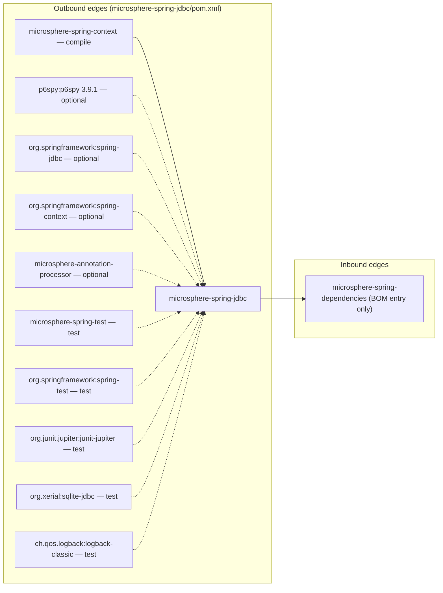
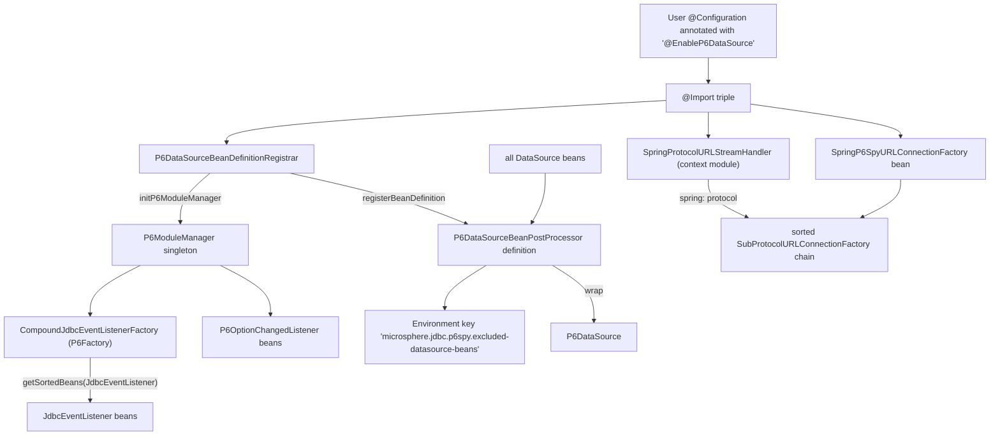
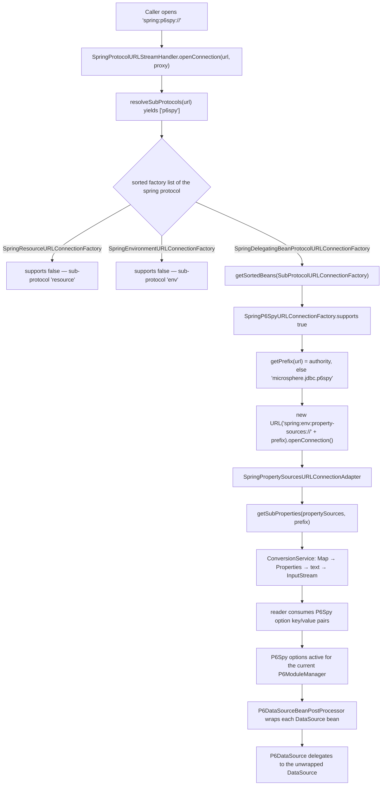
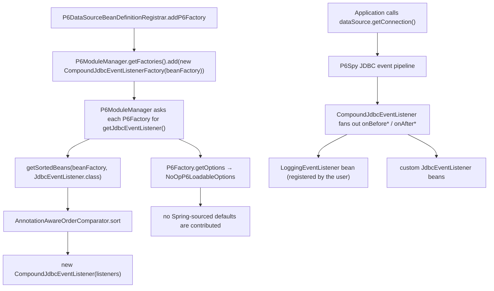

# microsphere-spring-jdbc — Developer Guide

[← Developer guide overview](./README.md) · [简体中文](./zh/jdbc.md) · [User guide](../../user-guide/current/jdbc.md) · [1.x](../1.x/jdbc.md)

## 1. Module identity, baselines and dependency posture

| Attribute | Value | Evidence |
|---|---|---|
| Maven coordinate | `io.github.microsphere-projects:microsphere-spring-jdbc:${revision}` | `microsphere-spring-jdbc/pom.xml:14-17` |
| Reactor version under analysis | `0.2.40-SNAPSHOT` (`revision` property) | `pom.xml:57` |
| Parent | `microsphere-spring-parent:${revision}` | `microsphere-spring-jdbc/pom.xml:5-11` |
| Java baseline | `17` (`java.version`) | `pom.xml:58` |
| Spring baseline | profile-selected: `6.0.23` / `6.1.21` / `6.2.18` / `7.0.9` (default active `spring-framework-7.0`) | `microsphere-spring-parent/pom.xml:186-241` |
| Jakarta EE | `jakarta.*` (BOM `jakartaee 11.0.0`) | `microsphere-spring-parent/pom.xml:31,90-97` |
| P6Spy | `p6spy:p6spy` `3.9.1`, **optional** | `microsphere-spring-parent/pom.xml:33`, `:73-78`; `microsphere-spring-jdbc/pom.xml:53-57` |
| Namespace root | `io.microsphere.spring.jdbc.p6spy` | `find microsphere-spring-jdbc/src/main/java` |
| Main / test types | 7 main classes, 2 test classes | `microsphere-spring-jdbc/src/**` |
| `src/main/resources` | **absent** — the module ships no resources at all | directory listing of `microsphere-spring-jdbc/src/main/` |

Dependency posture: everything the module actually compiles against (`spring-context`, `spring-jdbc`, `p6spy`) is `optional`, so none of it reaches a consumer's classpath transitively. The only mandatory compile dependency inside the reactor is `microsphere-spring-context`. The consequence for downstream projects: adding `microsphere-spring-jdbc` alone yields `NoClassDefFoundError` on first use of `@EnableP6DataSource` unless `p6spy:p6spy` is added explicitly (`microsphere-spring-jdbc/pom.xml:53-57`).



No reactor module declares a compile-time dependency on `microsphere-spring-jdbc`; `microsphere-spring-dependencies/pom.xml:38` only manages its version.

## 2. Package map

| Package | Types (visibility) | Responsibility |
|---|---|---|
| `io.microsphere.spring.jdbc.p6spy` | `NoOpP6LoadableOptions`, `PropertySourcesP6LoadableOptionsAdapter` | `com.p6spy.engine.spy.P6LoadableOptions` implementations |
| `io.microsphere.spring.jdbc.p6spy.annotation` | `EnableP6DataSource` (public), `P6DataSourceBeanDefinitionRegistrar` (package-private) | annotation-driven activation |
| `io.microsphere.spring.jdbc.p6spy.beans.factory` | `CompoundJdbcEventListenerFactory` | `P6Factory` bridging Spring beans into the P6Spy event pipeline |
| `io.microsphere.spring.jdbc.p6spy.beans.factory.config` | `P6DataSourceBeanPostProcessor` | `DataSource` → `P6DataSource` decoration |
| `io.microsphere.spring.jdbc.p6spy.net` | `SpringP6SpyURLConnectionFactory` | `p6spy` URL sub-protocol indirection |

External types the module is built on (defined elsewhere, referenced here):

| Type | Home | Why this module needs it |
|---|---|---|
| `io.microsphere.spring.net.SpringProtocolURLStreamHandler` | **`microsphere-spring-context`**, `io.microsphere.spring.net` | registers the `spring:` protocol handler |
| `io.microsphere.spring.net.SpringSubProtocolURLConnectionFactory` | `microsphere-spring-context` | base class of `SpringP6SpyURLConnectionFactory` (`:38`) |
| `io.microsphere.spring.net.SpringEnvironmentURLConnectionFactory` | `microsphere-spring-context` | serves `spring:env:property-sources://` (`:44`, `:67-75`) |
| `io.microsphere.spring.net.SpringDelegatingBeanProtocolURLConnectionFactory` | `microsphere-spring-context` | discovers this module's factory as a Spring bean (`:75-77`) |
| `io.microsphere.spring.context.annotation.AnnotatedBeanCapableImportBeanDefinitionRegistrar` | `microsphere-spring-context` | registrar super-class (`:64-74`) |
| `io.microsphere.spring.beans.factory.config.GenericBeanPostProcessorAdapter` | `microsphere-spring-context` | type-filtering post-processor super-class (`:42`) |
| `com.p6spy.engine.spy.P6DataSource`, `P6ModuleManager`, `P6Factory`, `P6LoadableOptions`, `CompoundJdbcEventListener`, `JdbcEventListener` | P6Spy 3.9.1 | decorated type and extension contracts |

## 3. Architecture



Two integration seams are used and both are structural: (1) Spring's `@Import` → `ImportBeanDefinitionRegistrar` → `BeanPostProcessor` chain, and (2) P6Spy's `P6ModuleManager` registry, which is a JVM-wide singleton mutated from `registerBeanDefinitions` (`microsphere-spring-jdbc/src/main/java/io/microsphere/spring/jdbc/p6spy/annotation/P6DataSourceBeanDefinitionRegistrar.java:56-66`).

## 4. Source analysis

### 4.1 `@EnableP6DataSource` — attribute-free activation

The annotation declares **no attributes** and imports three types:

```java
@Target(TYPE)
@Retention(RUNTIME)
@Documented
@Import(value = {
        P6DataSourceBeanDefinitionRegistrar.class,
        SpringProtocolURLStreamHandler.class,
        SpringP6SpyURLConnectionFactory.class
})
public @interface EnableP6DataSource {   // annotation/EnableP6DataSource.java:38-46
```

`P6DataSourceBeanDefinitionRegistrar` is an `ImportBeanDefinitionRegistrar`, so Spring executes it instead of registering it as a bean; the other two entries become ordinary bean definitions (a `URLStreamHandler` component and a `SubProtocolURLConnectionFactory` component). The registrar is package-private (`P6DataSourceBeanDefinitionRegistrar.java:46`), so `@EnableP6DataSource` is the only supported entry point.

### 4.2 The registrar: what it mutates at startup

```java
protected void registerBeanDefinitions(AnnotationMetadata metadata, BeanDefinitionRegistry registry,
                                       BeanNameGenerator importBeanNameGenerator,
                                       ResolvablePlaceholderAnnotationAttributes<EnableP6DataSource> annotationAttributes) {
    initP6ModuleManager(getBeanFactory());
    registerBeanDefinition(registry, P6DataSourceBeanPostProcessor.class);
}   // P6DataSourceBeanDefinitionRegistrar.java:48-54
```

`initP6ModuleManager` performs two registrations against P6Spy: it appends a `CompoundJdbcEventListenerFactory` holding the `ConfigurableListableBeanFactory` to `p6ModuleManager.getFactories()` (`:62-66`), and it copies every `P6OptionChangedListener` bean into P6Spy via `p6ModuleManager::registerOptionChangedListener` (`:68-71`). Both use `io.microsphere.spring.beans.BeanUtils.getSortedBeans`, which resolves beans including ancestors and sorts with `AnnotationAwareOrderComparator` (`microsphere-spring-context/src/main/java/io/microsphere/spring/beans/BeanUtils.java:593-598`).

Because the super-class `AnnotatedBeanCapableImportBeanDefinitionRegistrar.registerBeanDefinitions` is `final` and gated by `isEnabled(metadata)` (`microsphere-spring-context/src/main/java/io/microsphere/spring/context/annotation/AnnotatedBeanCapableImportBeanDefinitionRegistrar.java:67-74`), the activation is switchable through Environment properties even though the annotation has no attributes (see §7).

The post-processor is registered with `registerBeanDefinition(registry, Class)`, which passes `beanName = null` and therefore lets `BeanDefinitionReaderUtils.generateBeanName` mint a generated name (`microsphere-spring-context/src/main/java/io/microsphere/spring/beans/factory/support/BeanRegistrar.java:198-200,565`). It is not registered as an infrastructure bean.

### 4.3 `p6spy:` URL protocol indirection

`SpringP6SpyURLConnectionFactory` extends `SpringSubProtocolURLConnectionFactory` whose `supports(...)` is `final` and compares the **first** resolved sub-protocol with `getSubProtocol()` (`microsphere-spring-context/src/main/java/io/microsphere/spring/net/SpringSubProtocolURLConnectionFactory.java:37-42`).

```java
protected String getSubProtocol() {
    return "p6spy";
}

public URLConnection create(URL url, List<String> subProtocols, Proxy proxy) throws IOException {
    String prefix = getPrefix(url);
    URL targetURL = new URL("spring:env:property-sources://" + prefix);
    return targetURL.openConnection();
}

private String getPrefix(URL url) {
    String authority = url.getAuthority();
    return hasText(authority) ? authority : "microsphere.jdbc.p6spy";   // :40-55
}
```

The indirection therefore maps the sub-protocol `p6spy` onto the property-source reader: the URL authority becomes the property-name prefix, with `microsphere.jdbc.p6spy` as the default when the authority is absent or blank. Re-issuing `new URL("spring:env:property-sources://...")` only works because `SpringProtocolURLStreamHandler` is imported in the same annotation and registers itself as the `spring` handler in `afterPropertiesSet()` → `init()` → `URLUtils.registerURLStreamHandler(this)` (`microsphere-spring-context/src/main/java/io/microsphere/spring/net/SpringProtocolURLStreamHandler.java:76-80,95-96`).

On the target side, `SpringEnvironmentURLConnectionFactory` matches sub-protocol `env` with type index 1 (`property-sources`) and returns `SpringPropertySourcesURLConnectionAdapter`, whose `getInputStream()` collects `getSubProperties(propertySources, prefix)` and converts `Map` → `Properties` → `text` → `InputStream` through the bean factory's `ConfigurableConversionService` (`microsphere-spring-context/src/main/java/io/microsphere/spring/net/SpringPropertySourcesURLConnectionAdapter.java:70-84,113-115`). The prefix is read as `resolveAuthority(url.getAuthority())`, i.e. matrix parameters are truncated (`:114`, `URLUtils.java:1287-1289`).

### 4.4 DataSource post-processing

```java
public class P6DataSourceBeanPostProcessor extends GenericBeanPostProcessorAdapter<DataSource>
        implements EnvironmentAware {                       // :41

    public static final String EXCLUDED_DATASOURCE_BEAN_NAMES_PROPERTY_NAME =
            "microsphere.jdbc.p6spy.excluded-datasource-beans";           // :45
```

`GenericBeanPostProcessorAdapter` resolves the type argument `DataSource` once from the subclass declaration and makes `postProcessBeforeInitialization`/`postProcessAfterInitialization` `final`, delegating only when `beanType.isAssignableFrom(ultimateTargetClass(bean))` (`microsphere-spring-context/src/main/java/io/microsphere/spring/beans/factory/config/GenericBeanPostProcessorAdapter.java:58-59,126-132`). The module overrides only the *after* hook:

```java
protected DataSource doPostProcessAfterInitialization(DataSource bean, String beanName) {
    DataSource targetDataSource = bean;
    if (excludedDataSourceBeanNames.contains(beanName)) { /* trace + keep original */ }
    else {
        try {
            DataSource datasource = bean.unwrap(DataSource.class);
            targetDataSource = new P6DataSource(datasource);      // :54-61
        } catch (SQLException e) { /* trace, keep original */ }
    }
    return targetDataSource;
}
```

Exclusions are read once in `setEnvironment` as `environment.getProperty(EXCLUDED_DATASOURCE_BEAN_NAMES_PROPERTY_NAME, Set.class, emptySet())` (`:76-79`) — a `Set<String>` of **exact bean names**, not patterns, resolved before any bean is post-processed. `bean.unwrap(DataSource.class)` (JDBC 4.3 `Wrapper.unwrap`) peels a vendor proxy before wrapping, so the P6Spy layer sits directly on the physical driver source.

### 4.5 JDBC event listener aggregation and options

`CompoundJdbcEventListenerFactory implements P6Factory` (`beans/factory/CompoundJdbcEventListenerFactory.java:39-56`):

```java
public P6LoadableOptions getOptions(P6OptionsRepository optionsRepository) {
    return new NoOpP6LoadableOptions();
}

public JdbcEventListener getJdbcEventListener() {
    List<JdbcEventListener> listeners = getSortedBeans(beanFactory, JdbcEventListener.class);
    return new CompoundJdbcEventListener(listeners);
}
```

`NoOpP6LoadableOptions` contributes nothing to P6Spy configuration: `load(Map)` is empty and `getDefaults()` returns `emptyMap()` (`NoOpP6LoadableOptions.java:33-41`). A second implementation exists — `PropertySourcesP6LoadableOptionsAdapter`, which reads sub-properties below the prefix `microsphere.jdbc.p6spy.options` (`PropertySourcesP6LoadableOptionsAdapter.java:37,50-55`) — but it is **not referenced by any code in this repository**: the only matches for that type name are its own declaration and constructor (`grep -rn "PropertySourcesP6LoadableOptionsAdapter" microsphere-spring-*/src`).

## 5. Complex flows

### 5.1 (a) `spring:env:property-sources://` resolution → P6Spy connection factory → wrapped DataSource



The final two nodes are part of the same feature but driven by a different seam (Bean lifecycle, not URL): see §5.2 and §4.4.

### 5.2 (b) JDBC event listener dispatch through `CompoundJdbcEventListenerFactory`



`EnableP6DataSourceTest` demonstrates the pattern in practice: the test class itself extends `com.p6spy.engine.logging.LoggingEventListener` and is a bean in the context, and it asserts in `onBeforeGetConnection` that `connectionInformation.getDataSource()` is the same object as `dataSource.unwrap(DataSource.class)` (`microsphere-spring-jdbc/src/test/java/io/microsphere/spring/jdbc/p6spy/annotation/EnableP6DataSourceTest.java:54,66-73`).

## 6. Design patterns

| Pattern | Class(es) | Rationale | Spring seam used |
|---|---|---|---|
| Configuration activation ("Enable*") | `EnableP6DataSource` | zero-attribute marker, all behaviour is `@Import`-driven | `@Import` |
| Registrar | `P6DataSourceBeanDefinitionRegistrar` (package-private, extends `AnnotatedBeanCapableImportBeanDefinitionRegistrar`) | registers a post-processor and mutates a non-Spring registry during bean-definition phase | `ImportBeanDefinitionRegistrar` |
| Decorator | `P6DataSourceBeanPostProcessor` → `com.p6spy.engine.spy.P6DataSource` | replaces the `DataSource` bean with a wrapping instance after initialization | `BeanPostProcessor` (`postProcessAfterInitialization`) |
| Generic type-filtered template | `GenericBeanPostProcessorAdapter<DataSource>` | makes both hooks `final`, dispatches on resolved type argument | `BeanPostProcessor` |
| Composite + Observer | `CompoundJdbcEventListenerFactory` returning `CompoundJdbcEventListener` | aggregates all `JdbcEventListener` beans into one P6Spy listener | `BeanFactory` lookup (`getSortedBeans`) |
| Factory method | `CompoundJdbcEventListenerFactory implements P6Factory` | P6Spy's own SPI; `getJdbcEventListener()` / `getOptions()` | none (P6Spy SPI) |
| Null object | `NoOpP6LoadableOptions` | deliberately contributes no P6Spy options | none |
| Adapter | `PropertySourcesP6LoadableOptionsAdapter`, `SpringPropertySourcesURLConnectionAdapter` | maps Spring `Environment`/`PropertySources` onto P6Spy's `P6LoadableOptions` / `URLConnection` view | `Environment`, `ConfigurableConversionService` |
| Strategy (URL) | `SpringP6SpyURLConnectionFactory` selected by `supports(url, subProtocols)` | sub-protocol dispatch among `SubProtocolURLConnectionFactory` implementations | `SubProtocolURLConnectionFactory` bean discovery via `SpringDelegatingBeanProtocolURLConnectionFactory` |
| Singleton/mutable holder | `P6ModuleManager.getInstance()` touched from the registrar | one JVM-wide P6Spy registry shared by all Spring contexts | none |

## 7. Extension points

| Extension point | Contract | Registered by | Notes |
|---|---|---|---|
| `JdbcEventListener` beans | `com.p6spy.engine.event.JdbcEventListener` | ordinary Spring bean | aggregated on every `P6Factory.getJdbcEventListener()` call, order-sensitive (`CompoundJdbcEventListenerFactory.java:53-56`) |
| `P6OptionChangedListener` beans | `com.p6spy.engine.spy.option.P6OptionChangedListener` | copied into `P6ModuleManager` once at registration time | `P6DataSourceBeanDefinitionRegistrar.java:68-71` |
| `P6LoadableOptions` implementations | `NoOpP6LoadableOptions`, `PropertySourcesP6LoadableOptionsAdapter` (`ConfigurableEnvironment` ctor, prefix `microsphere.jdbc.p6spy.options`) | user-supplied `P6Factory` | the module itself wires only the no-op variant |
| `SubProtocolURLConnectionFactory` beans | any sub-protocol handler, `p6spy` provided here | `@Import` in `@EnableP6DataSource` | discovered by the delegating factory of the context module |
| `microsphere.jdbc.p6spy.excluded-datasource-beans` | `Set<String>` of exact `DataSource` bean names | `Environment` | read once in `setEnvironment` (`P6DataSourceBeanPostProcessor.java:45,76-79`) |
| Global kill switch for the annotation | `microsphere.spring.io.microsphere.spring.jdbc.p6spy.annotation.EnableP6DataSource.enabled=false`, or the per-importing-class form `microsphere.spring.<importing-class>@<annotation>.enabled` | inherited from `AnnotatedBeanCapableImportCandidate.isEnabled` | property-name format from `microsphere-spring-context/src/main/java/io/microsphere/spring/context/annotation/AnnotatedBeanCapableImportCandidate.java:161-162,204-207` |
| `META-INF/spring.factories` | **none** | — | the module has no `src/main/resources` directory; `@Import` is the only discovery mechanism |

## 8. Build and verification

| Task | Command / fact |
|---|---|
| Build + test the module | `mvn -pl microsphere-spring-jdbc -am test --activate-profiles test,coverage,spring-framework-7.0` |
| Pin the reactor version | CI passes `-Drevision=0.0.1-SNAPSHOT` (`.github/workflows/maven-build.yml:44-52`) |
| Spring matrix | `spring-framework-6.0`, `-6.1`, `-6.2`, `-7.0` (`microsphere-spring-parent/pom.xml:186-241`); default active is `7.0` (`:229-231`) |
| JDK matrix | `17`, `21`, `25` (`.github/workflows/maven-build.yml:24-26`) |
| Profiles | `test` = surefire + failsafe + checkstyle, `coverage` = jacoco (parent `microsphere-build` pom lines 624-654); publish flow uses `publish,ci` with `-Dgpg.skip=true` (`.github/workflows/maven-publish.yml`) |
| Surefire selection | includes `**/*Tests.java`, `**/*Test.java`, excludes `**/Abstract*.java` (`microsphere-build/pom.xml:242-248`) |
| Test inventory | `EnableP6DataSourceTest` (context integration with `@EnableEmbeddedDatabase(dataSource = "testDataSource")`), `P6DataSourceBeanPostProcessorTest` (wrapped vs excluded bean names) |
| What this module needs from `microsphere-spring-test` | `@EnableEmbeddedDatabase` + `@SpringLoggingTest` to create SQLite `DataSource` beans for tests (`microsphere-spring-jdbc/pom.xml:71-77`, test sources lines 20-23, 44-46) |
| Running a single test | `mvn -pl microsphere-spring-jdbc test -Dtest=P6DataSourceBeanPostProcessorTest -Drevision=0.2.40-SNAPSHOT` |

## 9. Caveats and pitfalls

| # | Observation | Evidence |
|---|---|---|
| 1 | P6Spy is `optional`; the module cannot supply it. `@EnableP6DataSource` references `P6DataSource` and `P6ModuleManager` directly, so a missing `p6spy:p6spy` breaks activation. | `microsphere-spring-jdbc/pom.xml:53-57`; `P6DataSourceBeanPostProcessor.java:19,61` |
| 2 | `spring-jdbc` and `spring-context` are optional too, while `microsphere-spring-context` is a hard compile dependency — the module's transitive footprint is context-only. | `microsphere-spring-jdbc/pom.xml:29-51` |
| 3 | `PropertySourcesP6LoadableOptionsAdapter` is dead code within this repository: no production or test source instantiates it, so `microsphere.jdbc.p6spy.options.*` is **not** fed to P6Spy by default. | `grep -rn "PropertySourcesP6LoadableOptionsAdapter" */src` → declaration only |
| 4 | The registrar mutates the JVM-global `P6ModuleManager.getInstance()` factories list on every `@EnableP6DataSource` processing; a second context in the same JVM appends a second `CompoundJdbcEventListenerFactory`. | `P6DataSourceBeanDefinitionRegistrar.java:56-66` |
| 5 | `P6DataSourceBeanPostProcessor` implements only `EnvironmentAware`; neither `Ordered` nor `PriorityOrdered` is implemented by it or by `GenericBeanPostProcessorAdapter`, so wrapping runs in the unordered post-processor phase. | `P6DataSourceBeanPostProcessor.java:41`; `GenericBeanPostProcessorAdapter.java:42` |
| 6 | Exclusion is an exact-bean-name `Set<String>`; renaming a `DataSource` bean silently makes it wrapped again. | `P6DataSourceBeanPostProcessor.java:54-56,78` |
| 7 | `bean.unwrap(DataSource.class)` may return the bean itself for a plain `DataSource`, and the `SQLException` path degrades to "no wrapping" with only a `trace` log. | `P6DataSourceBeanPostProcessor.java:59-66` |
| 8 | `SpringP6SpyURLConnectionFactory` depends on `SpringProtocolURLStreamHandler.afterPropertiesSet()` having already registered the `spring` protocol; the two are separate `@Import` entries with no declared ordering between them. | `EnableP6DataSource.java:41-45`; `SpringProtocolURLStreamHandler.java:76-80` |
| 9 | The default authority `microsphere.jdbc.p6spy` is used only when `url.getAuthority()` is blank; a URL written as `spring:p6spy:` with no authority therefore reads that prefix. | `SpringP6SpyURLConnectionFactory.java:52-55` |
| 10 | No test in this repository opens a `spring:p6spy:` URL or asserts `CompoundJdbcEventListenerFactory` behaviour — the URL indirection and options mapping are untested here. | `microsphere-spring-jdbc/src/test/java` (2 test classes only) |
| 11 | Javadoc `@since 1.0.0` on every type of this module conflicts with the analysed reactor version `0.2.40-SNAPSHOT`; treat `@since` as unreliable for release mapping. | `EnableP6DataSource.java:36`, `pom.xml:57` |
