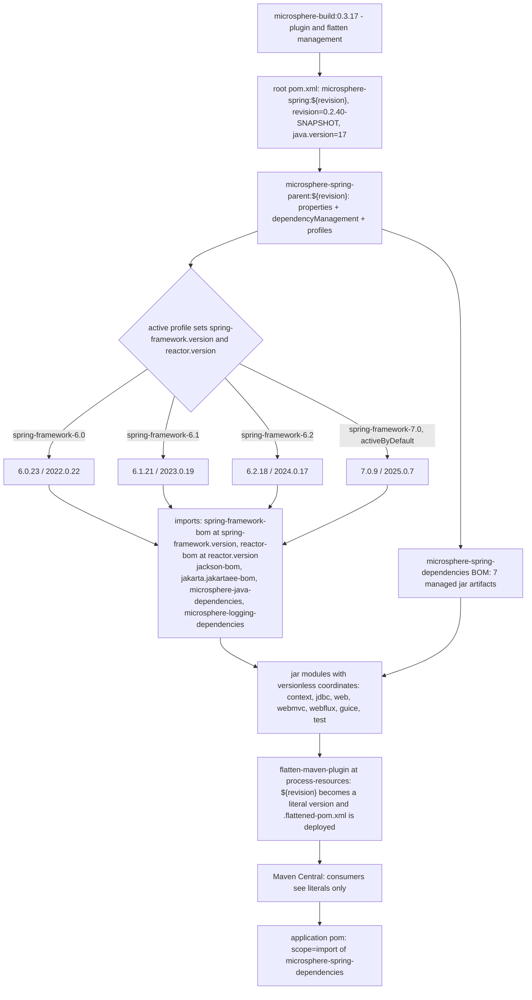

# microsphere-spring-parent — Developer Guide (0.2.x / `release`)

[← Developer guide overview](./README.md) · [简体中文](./zh/parent.md) · [User guide](../../user-guide/current/parent.md)

**Who needs this document.** Library maintainers need it: this POM is the single place where every version in the
`microsphere-spring` reactor is aligned, so any dependency change, any new Spring Framework line, and any question about
the release mechanism lands here first. Application teams rarely need it — they consume the published
[`microsphere-spring-dependencies`](./dependencies.md) BOM and read this file only to reproduce a version-alignment
decision or to override a managed version.

## 1. Version information

| Item | Value |
|------|-------|
| Branch | `release` |
| Docs directory | `docs/**/current/` |
| Version line | **0.2.x** |
| Development version (root `<revision>`) | `0.2.40-SNAPSHOT` |
| Latest released version | `0.2.39` |
| Build baseline parent | `io.github.microsphere-projects:microsphere-build:0.3.17` |
| Java baseline | **Java 17** (`<java.version>17</java.version>` in the root POM) |
| Jakarta namespace | `jakarta.*` (`jakarta.platform:jakarta.jakartaee-bom:11.0.0`) |
| Coordinates / packaging | `io.github.microsphere-projects:microsphere-spring-parent:${revision}`, `packaging=pom` |

## 2. Role of the parent inside the reactor

`microsphere-spring-parent` is a build-only module: it packages no classes, publishes a `pom` artifact, and exists to be
inherited. Its own parent is the reactor root `microsphere-spring` (`<relativePath>../pom.xml</relativePath>`), and the
root's parent is the external `microsphere-build:0.3.17`, which supplies all plugin management.

| Module | Declared parent | Packaging |
|--------|-----------------|-----------|
| `pom.xml` (root, aggregator) | `microsphere-build:0.3.17` | `pom` |
| `microsphere-spring-parent` | `microsphere-spring` (`../pom.xml`) | `pom` |
| `microsphere-spring-dependencies` | `microsphere-spring-parent` | `pom` |
| `microsphere-spring-context`, `-jdbc`, `-web`, `-webmvc`, `-webflux`, `-guice`, `-test` | `microsphere-spring-parent` | `jar` |

The parent carries `<dependencyManagement>` and `<profiles>` and nothing else — no `<build>`, no `<pluginManagement>`,
no `<repositories>`. All eight inheriting modules point at `../microsphere-spring-parent/pom.xml`, so a version added
here applies to the whole reactor in one build, and the parent is itself a published artifact that external projects may
inherit from directly.

## 3. `${revision}` + `flatten-maven-plugin` versioning

Every POM in the reactor declares the same version expression, and only the root POM gives it a value:

```xml
<version>${revision}</version>   <!-- root properties: <revision>0.2.40-SNAPSHOT</revision> -->
```

This is the Maven "CI-friendly versions" scheme: the version is not duplicated across ten POMs, and a release is
produced by passing a property instead of editing files — `mvn -Drevision=0.2.40 deploy -P publish,ci` is what the
publish workflow runs. The scheme only works if the POM that leaves the machine no longer contains `${revision}`, and
that is the job of `org.codehaus.mojo:flatten-maven-plugin:1.7.3`, configured once in `microsphere-build`:

| Setting | Value | Effect on the published POM |
|---------|-------|-----------------------------|
| execution `flatten` | phase `process-resources`, goal `flatten` | runs in every module, before `package` / `install` / `deploy` |
| `flattenMode` | `resolveCiFriendliesOnly` | rewrites `${revision}`, `${sha1}`, `${changelist}` and the parent version only; structure is kept |
| `updatePomFile` | `true` | the generated `.flattened-pom.xml` is the POM that is installed and deployed |
| `pomElements.parent` | `expand` | the parent block is written with a concrete version (`microsphere-spring:0.2.39`) |
| `pomElements.properties` | `keep` | properties such as `microsphere-java.version` survive, so BOM imports stay resolvable |
| `pomElements.dependencyManagement` | `interpolate` | managed versions are resolved where interpolable |
| `pomElements.dependencies` | `resolve` | module dependency versions become literals |
| `pomElements.scm` / `url` / `developers` | `resolve` | expressions such as `${project.scm.url}` are expanded |
| `pomElements.distributionManagement` / `repositories` | `remove` | internal repository details never reach Central |
| `flattenDependencyMode` / `embedBuildProfileDependencies` | `all` / `false` | full dependency set considered; profile-conditional dependencies are **not** baked in |
| `.flattened-pom.xml` | git-ignored | build output only: never hand-edit, never commit |

**Why `flatten` matters for consumers.** A deployed POM that still said `<version>${revision}</version>` would send the
consumer's Maven up the parent chain of `microsphere-spring-parent` looking for a `revision` property that exists only
in this reactor's root POM; absent from the published model, resolution fails with an unresolvable-parent /
bad-version error. Flatten substitutes a literal (`0.2.39`) and yields a self-describing POM. Two follow-on effects: the
flattened `microsphere-spring-dependencies` lists managed modules as literals such as
`io.github.microsphere-projects:microsphere-spring-context:0.2.39`, which is what makes the BOM usable with no
`${revision}` in an application POM; and `embedBuildProfileDependencies=false` freezes no profile into the published
POM, so the Spring line remains a build-time decision of this repository.

## 4. Profile matrix

Compatibility is expressed as four properties-only profiles in `microsphere-spring-parent/pom.xml`:

| Profile id | `${spring-framework.version}` | `${reactor.version}` | Activation |
|-------------|-------------------------------|----------------------|------------|
| `spring-framework-6.0` | `6.0.23` | `2022.0.22` | explicit |
| `spring-framework-6.1` | `6.1.21` | `2023.0.19` | explicit |
| `spring-framework-6.2` | `6.2.18` | `2024.0.17` | explicit |
| `spring-framework-7.0` | `7.0.9` | `2025.0.7` | **`activeByDefault`** |

The profiles declare properties only — no dependencies, no plugins, no build changes.

## 5. How `${spring-framework.version}` and `${reactor.version}` are consumed

Each property is referenced exactly once in the parent's `<dependencyManagement>`, as a BOM import version:

```xml
<dependency>
    <groupId>org.springframework</groupId>
    <artifactId>spring-framework-bom</artifactId>
    <version>${spring-framework.version}</version>
    <type>pom</type>
    <scope>import</scope>
</dependency>

<dependency>
    <groupId>io.projectreactor</groupId>
    <artifactId>reactor-bom</artifactId>
    <version>${reactor.version}</version>
    <type>pom</type>
    <scope>import</scope>
</dependency>
```

Chain: a profile sets a property → the property instantiates a BOM import → the BOM supplies versions → module POMs
declare versionless coordinates such as `org.springframework:spring-context` and `io.projectreactor:reactor-core`. A
module never states a Spring version; activating a profile is the only way to move one, and the whole reactor moves
together. Import order is load-bearing (the first declaration wins for a duplicate coordinate): `jackson-bom`,
`org.yaml:snakeyaml`, `jakarta.jakartaee-bom`, `p6spy:p6spy`, `org.apache.zookeeper:zookeeper`,
`org.apache.curator:curator-recipes`, `org.apache.curator:curator-test`, `spring-framework-bom`, `reactor-bom`,
`microsphere-java-dependencies`, `microsphere-logging-dependencies`.

## 6. Managed third-party versions

| Property | Value on `release` | Managed artifact(s) |
|----------|--------------------|---------------------|
| `microsphere-java.version` | `0.3.19` | import `io.github.microsphere-projects:microsphere-java-dependencies` |
| `microsphere-logging.version` | `0.2.2` | import `io.github.microsphere-projects:microsphere-logging-dependencies` |
| `jakartaee.version` | `11.0.0` | import `jakarta.platform:jakarta.jakartaee-bom` (supplies `jakarta.servlet-api`, `jakarta.websocket-api`, …) |
| `jackson.version` | `2.22.3` | import `com.fasterxml.jackson:jackson-bom` |
| `snakeyaml.version` | `2.7` | direct `org.yaml:snakeyaml` |
| `p6spy.version` | `3.9.1` | direct `p6spy:p6spy` |
| `zookeeper.version` | `3.9.6` | direct `org.apache.zookeeper:zookeeper` |
| `curator.version` | `5.9.0` | direct `org.apache.curator:curator-recipes` and `curator-test`, both excluding `org.apache.zookeeper:zookeeper` so the explicit `zookeeper` entry controls the version |

Other coordinates are versionless in module POMs but are **not** managed here; they resolve through the imported
`microsphere-java` / `microsphere-logging` / Spring / Reactor / Jakarta EE BOMs: `ch.qos.logback:logback-classic`,
`org.junit.jupiter:junit-jupiter`, `org.mockito:mockito-core`, `org.hamcrest:hamcrest`, `org.skyscreamer:jsonassert`,
`com.google.code.findbugs:jsr305`, `com.h2database:h2`, `org.xerial:sqlite-jdbc`,
`org.apache.tomcat.embed:tomcat-embed-core`, `javax.annotation:javax.annotation-api`,
`org.springframework:spring-context-indexer`. `microsphere-spring-guice` is the exception: it pins
`com.google.inject:guice:7.0.0` in its own module POM.

## 7. Profile → versions (parent POM) vs profile → extra dependencies (module POM)

Two different questions are answered by two different files, and keeping them apart is the core maintenance rule:

| Question | Answered in | Mechanism |
|----------|-------------|-----------|
| "Which *versions* are used on this Spring line?" | `microsphere-spring-parent/pom.xml` | properties in a profile, feeding BOM imports ([§4](#4-profile-matrix)) |
| "Which *extra dependencies* does a Spring line need?" | module POM, e.g. `microsphere-spring-context/pom.xml` | `<dependencies>` inside a profile of the same id |

On `release` (0.2.x) the second row is **unused**: `grep '<profiles>' --include=pom.xml` matches
`microsphere-spring-parent/pom.xml` only. Every module's dependency list is identical across the four profiles, and
`spring-context-indexer` is a plain `<optional>true</optional>` dependency of `microsphere-spring-context`. The
mechanism is exercised on `release-1.x` (0.1.x), where `microsphere-spring-context` adds `microsphere-spring-compatible`
and/or `spring-context-indexer` per profile and `microsphere-spring-test` / `microsphere-spring-webflux` override
`spring-framework.version` under `spring-framework-4.3` — see [the 1.x parent guide](../1.x/parent.md).

## 8. Building and testing against a specific Spring line

```bash
./mvnw clean test   -P spring-framework-6.0     # oldest supported line
./mvnw clean verify -P spring-framework-6.2
./mvnw clean install -P spring-framework-7.0    # equals the activeByDefault build

# the exact CI invocation, repeated per Spring line
mvn --batch-mode --update-snapshots --file pom.xml -Drevision=0.0.1-SNAPSHOT test \
    --activate-profiles test,coverage,spring-framework-6.1
```

`.github/workflows/maven-build.yml` runs the matrix Java `17` × `21` × `25` against all four Spring profiles;
`-Drevision=0.0.1-SNAPSHOT` keeps CI artifacts out of the real version space. Maven drops an `activeByDefault` profile
as soon as any other profile is activated, so `-P spring-framework-6.0` replaces `7.0` — never rely on the default in
scripts. Verify the effective property with
`./mvnw -P spring-framework-6.0 help:evaluate -Dexpression=spring-framework.version -q -DforceStdout`, and the resolved
library with `./mvnw -P spring-framework-6.0 -pl microsphere-spring-context dependency:tree -Dincludes=org.springframework:*`.
Adding a Spring line means one profile block here plus one workflow matrix entry; no module POM change.

## 9. Versioning and profile flow



## 10. Divergence from `release-1.x` (0.1.x)

| Aspect | `release` / 0.2.x (this document) | `release-1.x` / 0.1.x |
|--------|-----------------------------------|-----------------------|
| `microsphere-build` parent | `0.3.17` | `0.3.14` |
| Java baseline | `17`, set in the root POM | not set in the root POM; inherited `8` from `microsphere-build` |
| Reactor modules | 9, no compatible module | 10, adds `microsphere-spring-compatible` |
| Profiles | `6.0` / `6.1` / `6.2` / `7.0`, default `7.0` | `4.3` / `5.0` / `5.1` / `5.2` / `5.3`, default `5.3` |
| Reactor version style | numeric train versions (`2022.0.22` … `2025.0.7`) | release-train names (`Bismuth-SR17`, `Californium-SR23`, `Dysprosium-SR25`, `2020.0.47`) |
| Servlet namespace | `jakarta.jakartaee-bom:11.0.0` imported | no Jakarta BOM; `javax.servlet:javax.servlet-api` used versionless |
| Extra managed artifact | — | `tomcat-embed-core`, pinned by `tomcat.version` = `9.0.119` |
| `jackson` / `snakeyaml` / `zookeeper` | `2.22.3` / `2.7` / `3.9.6` | `2.22.2` / `2.6` / `3.9.5` |
| `microsphere-java` / `microsphere-logging` / `p6spy` / `curator` | `0.3.19` / `0.2.2` / `3.9.1` / `5.9.0` | identical: `0.3.19` / `0.2.2` / `3.9.1` / `5.9.0` |
| Profile-conditional module dependencies | none | yes — `microsphere-spring-compatible`, `spring-context-indexer`, per-module `spring-framework.version` overrides |
| CI Java matrix | `17` / `21` / `25` | `8` / `11` / `17` / `21` / `25` |

Related documents: [./README.md](./README.md) · [./dependencies.md](./dependencies.md) · [./context.md](./context.md) ·
[./web.md](./web.md) · [./test.md](./test.md) · [../1.x/parent.md](../1.x/parent.md)
