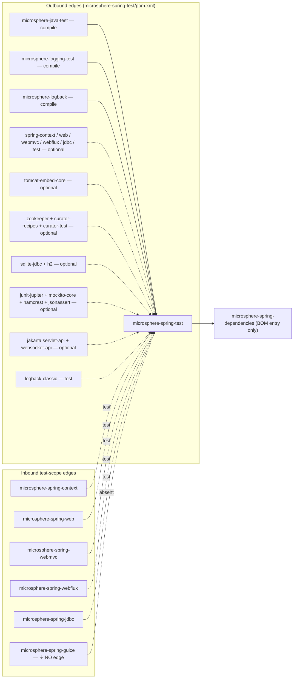
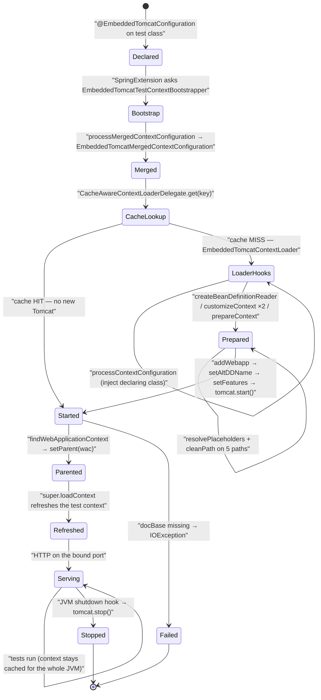
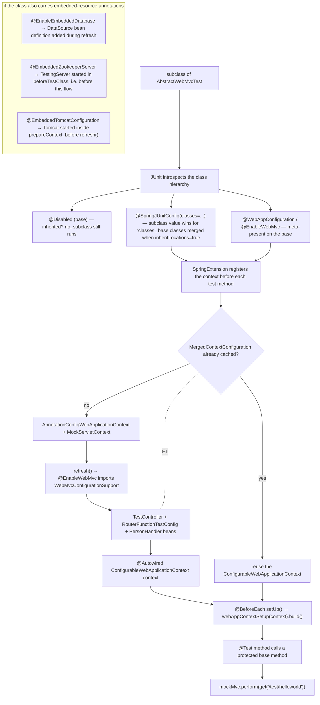

# microsphere-spring-test — Developer Guide

[← Developer guide overview](./README.md) · [简体中文](./zh/test.md) · [User guide](../../user-guide/current/test.md) · [1.x](../1.x/test.md)

Paths below are relative to `microsphere-spring-test/`; `…/` abbreviates `src/main/java/io/microsphere/spring/test/`.

## 1. Module identity, baselines and dependency posture

| Attribute | Value | Evidence |
|---|---|---|
| Maven coordinate | `io.github.microsphere-projects:microsphere-spring-test:${revision}` | `pom.xml:13-16` |
| Reactor version under analysis | `0.2.40-SNAPSHOT` (`revision` property) | `../pom.xml:55` |
| Parent | `microsphere-spring-parent:${revision}` | `pom.xml:5-10` |
| Java baseline | `17` (`java.version`) | `../pom.xml:56` |
| Spring baseline | profile-selected: `6.0.23` / `6.1.21` / `6.2.18` / `7.0.9` (default active `spring-framework-7.0`) | `../microsphere-spring-parent/pom.xml:138-173` |
| Jakarta EE | `jakarta.*` (BOM `jakartaee 11.0.0`) | `../microsphere-spring-parent/pom.xml:24,51-58` |
| ZooKeeper / Curator | `3.9.6` / `5.9.0` (both Curator artifacts exclude `org.apache.zookeeper:zookeeper`) | `../microsphere-spring-parent/pom.xml:28-29,67-97` |
| Tomcat / SQLite / H2 / JUnit / Mockito / Hamcrest / JSONAssert | versionless here — managed by `microsphere-java-dependencies:0.3.19` | `../microsphere-spring-parent/pom.xml:22,117-124`; `pom.xml:65-76,146-199` |
| Namespace root | `io.microsphere.spring.test` | `find src/main/java` |
| Main / test types | 35 main types, 30 `*Test` classes + 1 non-test helper (`TestServletContainerInitializer`) | `src/**` |
| `src/main/resources` | **absent** — the module ships no production resources | directory listing of `src/main/` |
| `src/test/resources` | 3 webapps (`webapp`, `webapps/empty-app`, `webapps/context-loader-app`), `config/test.properties`, `META-INF/services/jakarta.servlet.ServletContainerInitializer` | `src/test/resources` |

**Leaf-module posture.** This module declares **no intra-reactor dependency at all** — not even `microsphere-spring-context`. Its only non-optional artifacts come from sibling microsphere repositories (`microsphere-java-test`, `microsphere-logging-test`, `microsphere-logback`; `pom.xml:30-46`). Every framework, container and test-library artifact is `<optional>` (`pom.xml:48-199`), so nothing reaches a consumer's classpath transitively. That is what makes it safe for *every other module in the reactor* to consume it in `test` scope without creating a cycle or dragging Tomcat/ZooKeeper into production builds.

Full dependency table:

| Artifact | Declared scope | Referenced by main sources? | Evidence |
|---|---|---|---|
| `microsphere-annotation-processor` | compile + optional | no | `pom.xml:23-28` |
| `microsphere-java-test` | **compile** | yes (`io.microsphere.util.*`, `io.microsphere.lang.function.*`) | `pom.xml:30-34` |
| `microsphere-logging-test` | **compile** | yes (`io.microsphere.logging.test.jupiter.LoggingLevelsClass`) | `pom.xml:36-40`; `…/junit/jupiter/SpringLoggingTest.java:20` |
| `microsphere-logback` | **compile** | yes (`io.microsphere.logging.Logger`) | `pom.xml:42-46`; `…/tomcat/embedded/EmbeddedTomcatContextLoader.java:22` |
| `jakarta.websocket-client-api` / `jakarta.websocket-api` | compile + optional | no | `pom.xml:50-62` |
| `org.skyscreamer:jsonassert` | compile + optional | no | `pom.xml:64-69` |
| `org.hamcrest:hamcrest` | compile + optional | no | `pom.xml:71-76` |
| `org.springframework:spring-context` | compile + optional | yes | `pom.xml:78-83` |
| `org.springframework:spring-context-indexer` | compile + optional | no | `pom.xml:85-89` |
| `org.springframework:spring-jdbc` | compile + optional | yes (`DriverManagerDataSource`) | `pom.xml:91-96`; `…/jdbc/embedded/EmbeddedDataBaseBeanDefinitionRegistrar.java:28` |
| `org.springframework:spring-web` | compile + optional | yes | `pom.xml:98-103` |
| `org.springframework:spring-webmvc` | compile + optional | yes (`DispatcherServlet`, `@EnableWebMvc`) | `pom.xml:105-110` |
| `org.springframework:spring-webflux` | compile + optional | yes (`WebTestClient`, `@EnableWebFlux`) | `pom.xml:112-117` |
| `org.springframework:spring-test` | compile + optional | yes (`AbstractGenericContextLoader`, `WebTestContextBootstrapper`, `MockHttpServletRequest`) | `pom.xml:119-124` |
| `jakarta.servlet:jakarta.servlet-api` | compile + optional | yes | `pom.xml:126-131` |
| `com.fasterxml.jackson.core:jackson-annotations` / `jackson-databind` | compile + optional | databind yes (`ObjectMapper`) | `pom.xml:133-144`; `…/webmvc/AbstractWebMvcTest.java:20` |
| `org.xerial:sqlite-jdbc` | compile + optional | no (used only as a `jdbc:sqlite:` driver at runtime) | `pom.xml:146-151`; `…/jdbc/embedded/EmbeddedDataBaseBeanDefinitionRegistrar.java:87` |
| `com.h2database:h2` | compile + optional | no (used only as a `jdbc:h2:mem:` driver at runtime) | `pom.xml:153-158`; `…/jdbc/embedded/EmbeddedDataBaseBeanDefinitionRegistrar.java:92` |
| `org.apache.tomcat.embed:tomcat-embed-core` | compile + optional | yes (`Tomcat`, `Context`) | `pom.xml:160-165`; `…/tomcat/embedded/EmbeddedTomcatContextLoader.java:25-26` |
| `org.apache.zookeeper:zookeeper` | compile + optional | no directly (pulled by the Curator server) | `pom.xml:167-172` |
| `org.apache.curator:curator-recipes` | compile + optional | no | `pom.xml:174-179` |
| `org.apache.curator:curator-test` | compile + optional | yes (`TestingServer`, `InstanceSpec`) | `pom.xml:181-185`; `…/zookeeper/embedded/EmbeddedZookeeperServerTestExecutionListener.java:20-21` |
| `org.junit.jupiter:junit-jupiter` | compile + optional | **yes — in `src/main/java`** (`@ExtendWith`, `@Test`, `@BeforeEach`, `@Disabled`) | `pom.xml:187-192`; `…/webmvc/AbstractWebMvcTest.java:24-25` |
| `org.mockito:mockito-core` | compile + optional | no | `pom.xml:194-199` |
| `ch.qos.logback:logback-classic` | **test** | n/a (module's own tests only) | `pom.xml:203-208` |

The four artifacts that are optional yet referenced from `src/main/java` by *annotations in public API* (`junit-jupiter`, `spring-test`, `tomcat-embed-core`, `jakarta.servlet-api`) are why optional scope — not `test` scope — is mandatory: the annotations must be compilable by consumers.



Measured inbound edges: `microsphere-spring-context/pom.xml:115-121`, `microsphere-spring-web/pom.xml:85-91`, `microsphere-spring-webmvc/pom.xml:85-91`, `microsphere-spring-webflux/pom.xml:78-84`, `microsphere-spring-jdbc/pom.xml:71-77`. ⚠ **`microsphere-spring-guice` does *not* depend on this module at all** — its test block declares only `junit-jupiter`, `spring-test` and `logback-classic` (`../microsphere-spring-guice/pom.xml:56-73`). Any doc claiming a guice → test edge is stale. Version management only: `../microsphere-spring-dependencies/pom.xml:60-64`.

Because everything is optional, **each consumer re-declares what it actually uses**, e.g. `microsphere-spring-webmvc/pom.xml:94-98` adds `tomcat-embed-core` in `test` scope for `@EmbeddedTomcatConfiguration`, and `microsphere-spring-jdbc` adds `org.xerial:sqlite-jdbc` for `@EnableEmbeddedDatabase`.

## 2. Package map

| Package (`io.microsphere.spring.test.`) | Types (visibility) | Responsibility |
|---|---|---|
| `jdbc.embedded` | `EnableEmbeddedDatabase` (public), `EnableEmbeddedDatabases` (public), `EmbeddedDatabaseType` (public), `EmbeddedDataBaseBeanDefinitionRegistrar` (package-private), `EmbeddedDataBaseBeanDefinitionsRegistrar` (package-private) | annotation-driven `DriverManagerDataSource` registration for SQLite / H2 |
| `tomcat.embedded` | `EmbeddedTomcatConfiguration` (public, with nested `enum Feature`), `EmbeddedTomcatTestContextBootstrapper` (package-private), `EmbeddedTomcatMergedContextConfiguration` (package-private), `EmbeddedTomcatContextLoader` (package-private) | a real embedded Tomcat as the Spring test `ContextLoader` |
| `zookeeper.embedded` | `EmbeddedZookeeperServer` (public), `EmbeddedZookeeperServerTestExecutionListener` (package-private) | Curator `TestingServer` bound to the JUnit class lifecycle |
| `junit.jupiter` | `SpringLoggingTest` (public annotation) | composes `@LoggingLevelsClass({"TRACE","INFO","ERROR"})` |
| `webmvc` | `AbstractWebMvcTest` (public abstract), `PersonHandler`, `RouterFunctionTestConfig`, `SimpleUrlHandlerMappingTestConfig` | functional/annotated WebMVC fixtures + `MockMvc` base |
| `webflux` | `AbstractWebFluxTest` (public abstract), `PersonHandler`, `RouterFunctionTestConfig`, `SimpleUrlHandlerMappingTestConfig` | the WebFlux mirror of `webmvc` |
| `web.controller` | `TestController` (public, `@Controller @RequestMapping("/test")`) | the single endpoint fixture used by both stacks |
| `web.servlet` | `TestServletContext`, `TestServlet`, `TestFilter`, `TestServletRegistration`, `TestFilterRegistration`, `TestServletContextListener` (all public) | `ServletContext` that really honours `addServlet`/`addFilter`/`addListener` |
| `web.context.request` | `MockServletWebRequest` (public) | `ServletWebRequest` exposing the mock request/response |
| `web` | `WebTestUtils` (public) | `MockServerWebExchange` factory, `getValue(Mono)`, shared route constants |
| `util` | `SpringTestUtils`, `ServletTestUtils`, `SpringTestWebUtils` (public abstract, private ctor) | ad-hoc container, servlet registration, `NativeWebRequest` builders |
| `context.annotation` | `AnnotatedTypeMetadataTestFactory`, `TestConditionContext` (public) | `AnnotatedTypeMetadata` / `ConditionContext` test doubles |
| `domain` | `User` (public JavaBean with `equals`/`hashCode`/`toString`) | payload fixture for JSON round-trips |

## 3. Architecture design

The module implements one idea: **an embedded resource becomes either a bean definition, part of the context-loader triple, or a `TestExecutionListener`** — chosen by whether the resource must exist *before* `refresh()`.

```mermaid
flowchart TD
    subgraph A["Path A — bean-definition phase"]
        ANN["@EnableEmbeddedDatabase (repeatable)"] -->|"@Import (1 occurrence)"| REG1["EmbeddedDataBaseBeanDefinitionRegistrar"]
        ANN -->|"container @EnableEmbeddedDatabases (≥2)"| REG2["EmbeddedDataBaseBeanDefinitionsRegistrar"]
        REG2 -->|"loops getAnnotationArray('value')"| REG1
        REG1 -->|"switch EmbeddedDatabaseType"| JDBC["jdbc:sqlite::memory: / jdbc:h2:mem:"]
        JDBC --> BDS["BeanDefinition(DriverManagerDataSource) + setPrimary()"]
    end
    subgraph B["Path B — context-loader triple"]
        ETC["@EmbeddedTomcatConfiguration"] -->|@BootstrapWith| BST["EmbeddedTomcatTestContextBootstrapper"]
        BST -->|processMergedContextConfiguration| MCC["EmbeddedTomcatMergedContextConfiguration"]
        BST -->|getDefaultContextLoaderClass| TCL["EmbeddedTomcatContextLoader"]
        TCL -->|deployContext| TOM["Tomcat.addWebapp + tomcat.start()"]
        TOM -->|shutdown hook| STOP["tomcat.stop()"]
    end
    subgraph C["Path C — test-execution listener"]
        EZ["@EmbeddedZookeeperServer"] -->|@TestExecutionListeners MERGE_WITH_DEFAULTS| TEL["EmbeddedZookeeperServerTestExecutionListener"]
        TEL -->|beforeTestClass| TS["new TestingServer(instanceSpec, true)"]
        TEL -->|afterTestClass| TSS["testingServer.stop()"]
    end
```

* Path A runs during bean-definition registration, so `@Autowired DataSource` works with no ordering care.
* Path B exists because Tomcat must be **started before the test context refreshes** — the webapp's own `ContextLoaderListener`/`DispatcherServlet` create a `WebApplicationContext` that the test context then adopts as its parent (`…/tomcat/embedded/EmbeddedTomcatContextLoader.java:87-99`).
* Path C is for resources that are *outside* the context, so the JUnit class lifecycle is the right home.

**Spring lifecycle events actually hooked:** none. No type in `src/main/java` implements `Lifecycle`, `SmartLifecycle`, `ApplicationListener` or consumes `ContextClosedEvent` (`grep` over `src/main` returns zero hits). The hooks are: `ImportBeanDefinitionRegistrar.registerBeanDefinitions`, the `ContextLoader` template methods (`processContextConfiguration`, `createBeanDefinitionReader`, both `customizeContext` overloads, `prepareContext`), `AbstractTestExecutionListener.beforeTestClass`/`afterTestClass`, plus `ShutdownHookUtils.addShutdownHookCallback` (`…/tomcat/embedded/EmbeddedTomcatContextLoader.java:58,247`).

**Caching.** Only Spring's own `CacheAwareContextLoaderDelegate` caches contexts, keyed by `MergedContextConfiguration`. `EmbeddedTomcatMergedContextConfiguration` stores port/contextPath/basedir/alternativeWebXml/features as fields but overrides **only `toString()`** (`…/tomcat/embedded/EmbeddedTomcatMergedContextConfiguration.java:35-112`) — they take no part in `equals`/`hashCode`.

## 4. Source analysis

### 4.1 `@EnableEmbeddedDatabase` and its two registrars

```java
@Target({TYPE, ANNOTATION_TYPE}) @Retention(RUNTIME) @Documented
@Import(EmbeddedDataBaseBeanDefinitionRegistrar.class)
@Repeatable(EnableEmbeddedDatabases.class)                 // …/jdbc/embedded/EnableEmbeddedDatabase.java:39-44
public @interface EnableEmbeddedDatabase {
    EmbeddedDatabaseType type() default SQLITE;  int port() default -1;
    String dataSource();                        boolean primary() default false;
    String[] properties() default {};
}
```

`@EnableEmbeddedDatabase` is **not** `@Inherited`, while its container `@EnableEmbeddedDatabases` **is** `@Inherited` (`…/jdbc/embedded/EnableEmbeddedDatabases.java:38-43`) — see §9.

The singular registrar is a plain `ImportBeanDefinitionRegistrar`, package-private (`…/jdbc/embedded/EmbeddedDataBaseBeanDefinitionRegistrar.java:47`). Its whole body is name-guard + type switch:

```java
void registerBeanDefinitions(AnnotationAttributes attributes, BeanDefinitionRegistry registry) {
    assertBeanName(attributes, registry);                        // :58, :70-75
    EmbeddedDatabaseType type = attributes.getEnum("type");      // :59
    switch (type) { case SQLITE -> processSQLite(...); case H2 -> processH2(...); }
}
```

`registerDataSourceBeanDefinition` builds a `DriverManagerDataSource` with two **constructor** args (the JDBC URL and the resolved `Properties`), applies `beanDefinition.setPrimary(primary)` and registers under the annotation's `dataSource` name (`:95-109`). `resolveProperties` casts the registry to `ConfigurableBeanFactory`, runs each `properties` entry through `resolveEmbeddedValue` (so `${...}` from the Environment works), joins them with `SeparatorConstants.LINE_SEPARATOR` and feeds the result to `Properties.load` (`:111-122`).

Repeatability is handled by a **second** registrar, `EmbeddedDataBaseBeanDefinitionsRegistrar` (note the extra `s` — `…/jdbc/embedded/EmbeddedDataBaseBeanDefinitionsRegistrar.java:37-48`), which is the `@Import` target of the container annotation. It reads `attributes.getAnnotationArray("value")` and delegates each element to a fresh `EmbeddedDataBaseBeanDefinitionRegistrar`. So: one occurrence → singular registrar once; two or more occurrences → Spring exposes the container, the plural registrar loops. `EnableEmbeddedDatabasesTest` (`src/test/java/.../EnableEmbeddedDatabasesTest.java:42-43`) proves the loop by declaring `primary` (SQLite) and `secondary` (H2) on one class.

### 4.2 `EmbeddedTomcatConfiguration` — composed annotation and `Feature`

The annotation carries the full Spring Test stack (`…/tomcat/embedded/EmbeddedTomcatConfiguration.java:49-56`): `@ExtendWith(SpringExtension.class)`, `@BootstrapWith(EmbeddedTomcatTestContextBootstrapper.class)`, `@ContextConfiguration`, `@WebAppConfiguration`, `@Inherited`. Six attributes are plain Tomcat knobs (`port` `:64`, `contextPath` `:72`, `basedir` `:88`, `alternativeWebXml` `:128`, `features` `:135`), six are `@AliasFor` mirrors: `docBase` → `WebAppConfiguration#value` (`:106-107`) and `classes`/`locations`/`initializers`/`inheritLocations`/`inheritInitializers` → `@ContextConfiguration` (`:142-177`).

`enum Feature` (`:182-226`) is a pure enum-as-feature-flag with exactly one applier each, resolved in `setFeatures`:

| `Feature` | Applied as | Effect |
|---|---|---|
| `NAMING` | `tomcat.enableNaming()` (`:269-271`) | JNDI |
| `DEFAULT_WEB_XML` | `tomcat.setAddDefaultWebXmlToWebapp(true)` (`:272-274`) | reverses the `false` forced at `:196` |
| `WEB_APP_DEFAULTS` | `initWebappDefaults(context)` (`:275-277`) | default servlet, JSP servlet, 30-min session, MIME map, welcome files |
| `USE_TEST_CLASSPATH` | `context.setParentClassLoader(config.getTestClass().getClassLoader())` (`:278-281`) | webapp sees test dependencies |
| `SILENT` | `tomcat.setSilent(true)` (`:282-284`) | suppresses Tomcat's internal logging |

⚠ `DEFAULT_WEB_XML` is not additive: `deployContext` unconditionally calls `tomcat.setAddDefaultWebXmlToWebapp(false)` at `:196` *before* `setFeatures` runs, so omitting the flag is meaningful and the flag is a re-enablement, not a default.

### 4.3 The package-private Tomcat trio

Both `EmbeddedTomcatTestContextBootstrapper` (`:35`) and `EmbeddedTomcatContextLoader` (`:73`) are declared with **no access modifier** — verified in source, and consistent with the user guide's warning that `@ContextConfiguration(loader = EmbeddedTomcatContextLoader.class)` does not compile. Only same-package tests can reach them (`src/test/java/.../EmbeddedTomcatContextLoaderTest.java:31,46,50`).

The bootstrapper does two things: forces the loader class (`:37-40`) and wraps the `WebMergedContextConfiguration` produced by `super.processMergedContextConfiguration` into the Tomcat-aware subclass, reading the annotation via `findMergedAnnotation(testClass, …)` (`:42-56`).

The loader extends `AbstractGenericContextLoader` and overrides five template methods:

| Override | Line | Behaviour |
|---|---|---|
| `processContextConfiguration` | `:77-84` | if no `classes` were declared, injects `configAttributes.getDeclaringClass()` — so `@EmbeddedTomcatConfiguration` with no attributes still configures the annotated test class |
| `prepareContext` | `:86-99` | casts to `EmbeddedTomcatMergedContextConfiguration`, calls `deployContext(...)`, then `setParent(...)` |
| `createBeanDefinitionReader` | `:111-115` | returns `XmlBeanDefinitionReader` over the `DefaultListableBeanFactory` (so `locations` are XML) |
| `customizeContext(GenericApplicationContext)` | `:117-121` | registers four resolvable dependencies (`ApplicationContext`, `ConfigurableApplicationContext`, `WebApplicationContext`, `ConfigurableWebApplicationContext`) — deliberately **not** calling `super` |
| `customizeContext(ConfigurableApplicationContext, MergedContextConfiguration)` | `:123-127` | calls `super`, then registers `classes` through an `AnnotatedBeanDefinitionReader` (`:129-136`) |
| `getResourceSuffix` | `:293-296` | `"-context.xml"` so `WEB-INF/<name>-context.xml` is auto-detected |

`deployContext` (`:179-250`) is the resource lifecycle core:

1. Resolves all five path-ish attributes through `environment.resolvePlaceholders` + `StringUtils.cleanPath` (`:183-188`, `:252-255`).
2. `new Tomcat()`; `setAddDefaultWebXmlToWebapp(false)`; `setPort(port)`; `setBaseDir(basedir)` when present (`:195-201`).
3. If `alternativeWebXml` resolves to a real file, its **parent directory becomes the docBase** and `resourceBasePath` is discarded (`:206-220`); otherwise docBase = the resolved `resourceBasePath` (`:222-224`).
4. Missing docBase ⇒ `throw new IOException("The Context's docBase directory can't be found on the path : '…'")` (`:226-228`).
5. `tomcat.addWebapp(contextPath, docBasePath)`; `context.setAltDDName(absPath)` when an alternative descriptor was found; `setFeatures(...)`; `tomcat.start()`; `addShutdownHookCallback(() -> execute(tomcat::stop))` (`:237-249`).
6. `findWebApplicationContext(servletContext)` scans `ServletContext` attribute names for `FrameworkServlet.SERVLET_CONTEXT_PREFIX` and prefers that, falling back to `WebApplicationContextUtils.getWebApplicationContext(servletContext)` (`:159-169`).
7. `setParent` puts the Tomcat-side web context above the test context — or, if the test context already has a configurable parent, re-parents **that** one instead (`:101-109`).

### 4.4 `@EmbeddedZookeeperServer`

A public marker annotation (`…/zookeeper/embedded/EmbeddedZookeeperServer.java:41-50`) carrying `@ExtendWith(SpringExtension.class)` plus `@TestExecutionListeners(listeners = EmbeddedZookeeperServerTestExecutionListener.class, mergeMode = MERGE_WITH_DEFAULTS)`. Attributes: `port()` = `2181`, `dataDir()` = `"${java.io.tmpdir}/test-zookeeper-${port}"`, `tickTime()` = `2000L` (`:57-78`).

The listener is package-private (`…/zookeeper/embedded/EmbeddedZookeeperServerTestExecutionListener.java:45`) and `getOrder()` returns `HIGHEST_PRECEDENCE + 5` (`:71-74`) — the server therefore starts before the Spring context is prepared and stops after every other listener finishes (Spring reverses the listener order for `after*` callbacks). It stores the `TestingServer` under the key `microsphere:zookeeper-server` (`:47`, `:61`, `:67`), builds the spec with `new InstanceSpec(dataDirectory, port, -1, -1, true, -1, tickTime, -1, null, null)` (`:90-92`) and resolves `dataDir` against a **fresh `StandardEnvironment`** seeded with a `MapPropertySource("_")` containing only `port`, then `ResourceUtils.getURL(...)` → `new File(url.toURI())` (`:76-88`). The test's own `ApplicationContext` `Environment` is never consulted.

`EmbeddedZookeeperServer` also imports `org.apache.catalina.Context` purely for a stray `@see Context` in its Javadoc (`:20`, `:38`) — a copy-paste leftover from the Tomcat annotation that ties the ZooKeeper package to `tomcat-embed-core`.

### 4.5 Abstract test bases

`AbstractWebMvcTest` (`…/webmvc/AbstractWebMvcTest.java:50-57`) is `@Disabled @WebAppConfiguration @SpringJUnitConfig(classes = {TestController.class, RouterFunctionTestConfig.class}) @EnableWebMvc`. It exposes `protected ConfigurableWebApplicationContext context`, `protected MockMvc mockMvc`, a `@BeforeEach protected void setUp()` that rebuilds `mockMvc` via `MockMvcBuilders.webAppContextSetup(context)` (`:59-70`), and eight `protected` smoke methods: `testWebEndpoints`, `testHelloWorld`, `testGreeting`, `testUser`, `testError`, `testResponseEntity`, `testView`, `testUpdatePerson` (`:82-173`).

`AbstractWebFluxTest` (`…/webflux/AbstractWebFluxTest.java:44-50`) is the same shape without `@WebAppConfiguration` and with `@EnableWebFlux`; it holds `ConfigurableApplicationContext context`, a `protected TestController` (public where WebMVC's is **private**, see §9), a `WebTestClient` built in `@BeforeEach final void init()` (package-private, `:62-65`) via the overridable `buildWebTestClient(context)` hook (`:165-168`), and the same smoke methods minus `testView`, with none of them declaring `throws Exception`.

`@Disabled` on the bases only suppresses the bases themselves; subclasses are not disabled by it — proven by the reactor: `microsphere-spring-webmvc/…/ReversedProxyHandlerMappingTest.java:59` and `microsphere-spring-webflux/…/RequestContextWebFilterTest.java:53` extend the bases and execute `@Test` methods in CI. Surefire additionally excludes `**/Abstract*.java`.

## 5. Complex flows

### 5.1 (a) Embedded Tomcat lifecycle — start, serve, tear down



Two facts are load-bearing: the context (and therefore the server) is **never** stopped between test classes — only at JVM exit — and the `Tomcat` reference is captured solely by the shutdown-hook lambda, so no API exposes the actually bound port when `port = 0`.

### 5.2 (b) How an abstract base bootstraps a context and registers embedded resources



## 6. Design patterns

| Pattern | Class(es) | Evidence |
|---|---|---|
| Registrar (`@Enable*`) | `EmbeddedDataBaseBeanDefinitionRegistrar`, `EmbeddedDataBaseBeanDefinitionsRegistrar` | `@Import` targets, both package-private (`:47`, `:37`) |
| Composite/Chain-of-registrars (repeatable dispatch) | plural registrar delegates to a `new EmbeddedDataBaseBeanDefinitionRegistrar()` per element | `EmbeddedDataBaseBeanDefinitionsRegistrar.java:44-47` |
| Builder (fluent bean-definition construction) | `BeanDefinitionBuilder.genericBeanDefinition(DriverManagerDataSource.class).addConstructorArgValue(...)` | `EmbeddedDataBaseBeanDefinitionRegistrar.java:102-108` |
| Enum-as-feature-flag + command dispatch | `EmbeddedTomcatConfiguration.Feature` consumed by a `switch` in `EmbeddedTomcatContextLoader.setFeatures` | `EmbeddedTomcatConfiguration.java:182-226`; `EmbeddedTomcatContextLoader.java:265-287` |
| Decorator / value-object enrichment | `EmbeddedTomcatMergedContextConfiguration` wraps a `WebMergedContextConfiguration` and adds five fields | `EmbeddedTomcatMergedContextConfiguration.java:47-55` |
| Template Method | `EmbeddedTomcatContextLoader` overrides 6 `AbstractGenericContextLoader` hooks; `AbstractWebFluxTest.buildWebTestClient` and `AbstractWebMvcTest.setUp` are the base-class hooks; `testWebEndpoints()` is the template invocation | `EmbeddedTomcatContextLoader.java:77-135,293-296`; `AbstractWebFluxTest.java:165-168`; `AbstractWebMvcTest.java:82-89` |
| Strategy (test-double selection) | `EmbeddedDatabaseType {SQLITE, H2}` selects `processSQLite`/`processH2` | `EmbeddedDataBaseBeanDefinitionRegistrar.java:59-67` |
| Factory Method | `AnnotatedTypeMetadataTestFactory.createMethodAnnotatedTypeMetadata()`, `WebTestUtils.mockServerWebExchange()`, `SpringTestWebUtils.createWebRequest(...)` | `AnnotatedTypeMetadataTestFactory.java:40-43`; `WebTestUtils.java:82-99`; `SpringTestWebUtils.java:66-98` |
| Static-facility (utility, non-instantiable) | `SpringTestUtils`, `ServletTestUtils`, `SpringTestWebUtils` are `abstract` with `private` constructors | `SpringTestUtils.java:33,109`; `ServletTestUtils.java:40,95`; `SpringTestWebUtils.java:49,303` |
| Adapter | `TestServletContext` adapts `MockServletContext` to mutable registrations; `TestConditionContext` adapts an `ApplicationContext` into `ConditionContext`; `MockServletWebRequest` adapts mock request/response into `ServletWebRequest` | `TestServletContext.java:49-186`; `TestConditionContext.java:41-73`; `MockServletWebRequest.java:35-51` |
| Observer (test lifecycle, not application events) | `EmbeddedZookeeperServerTestExecutionListener extends AbstractTestExecutionListener` | `EmbeddedZookeeperServerTestExecutionListener.java:45-74` |
| Null-object | `TestFilter` (`doFilter` body empty), `TestServletContextListener`, `PersonHandler` returning `null` | `TestFilter.java:53-64`; `webmvc/PersonHandler.java:33-51` |
| **Absent:** Lifecycle / SmartLifecycle, `ApplicationListener`, singleton-holder caching | — | zero matches in `src/main` |

## 7. Extension guide

To add a new embedded component, decide the path first: inside the Spring context (Path A/B) or outside it (Path C — the cheapest, follow `zookeeper.embedded`).

```java
package io.microsphere.spring.test.redis.embedded;            // naming: test.<component>.embedded

@Target(TYPE) @Retention(RUNTIME) @Documented @Inherited
@ExtendWith(SpringExtension.class)
@TestExecutionListeners(listeners = EmbeddedRedisServerTestExecutionListener.class,
                        mergeMode = TestExecutionListeners.MergeMode.MERGE_WITH_DEFAULTS)
public @interface EmbeddedRedisServer {                        // public marker
    int port() default 6379;
    String bindDir() default "${java.io.tmpdir}/test-redis-${port}";
}

class EmbeddedRedisServerTestExecutionListener extends AbstractTestExecutionListener {
    static final String ATTRIBUTE_NAME = "microsphere:redis-server";   // key convention
    @Override public void beforeTestClass(TestContext tc) throws Exception {
        tc.setAttribute(ATTRIBUTE_NAME, start(resolve(tc)));            // start, then stash
    }
    @Override public void afterTestClass(TestContext tc) throws Exception {
        RedisServer s = (RedisServer) tc.getAttribute(ATTRIBUTE_NAME);
        if (s != null) { s.stop(); }                                     // null-guard before stop
    }
    @Override public int getOrder() { return Ordered.HIGHEST_PRECEDENCE + 5; }
}
```

Conventions the new code must follow:

1. **Naming.** Package `io.microsphere.spring.test.<component>.embedded`; annotation `Embedded<Component>` (or `<Component>Configuration` when it owns the context triple: `<X>Configuration` + `<X>TestContextBootstrapper` + `<X>MergedContextConfiguration` + `<X>ContextLoader`, all package-private except the annotation).
2. **Visibility.** Only the user-facing annotation, enum and fixture types are `public`; registrars, bootstrappers, merged configurations and listeners stay package-private so `@Import`/`@BootstrapWith` is the sole entry point.
3. **Toggles.** There is no property kill-switch anywhere in this module (`@EnableEmbeddedDatabase` has no `enabled` attribute and does not extend `AnnotatedBeanCapableImportCandidate`). If you add one, mirror `microsphere-spring-context`'s `microsphere.spring.<annotated-class>.enabled` form rather than inventing a new scheme; otherwise the only toggle is the annotation/`Feature` array itself.
4. **Attribute placeholders.** Declare defaults as `${...}` and resolve them explicitly — `environment.resolvePlaceholders` + `StringUtils.cleanPath` for Tomcat, a seeded `StandardEnvironment` for ZooKeeper. Document which `Environment` is consulted.
5. **Shutdown ordering.** External resources go in `beforeTestClass`/`afterTestClass` with `getOrder()` near `HIGHEST_PRECEDENCE` so they outlive every context. Anything started from a `ContextLoader` must register its own teardown (`addShutdownHookCallback`) because the Spring context cache never closes it.
6. **Dependencies.** Add the third-party artifact to `pom.xml` as `<optional>` in **compile** scope (never `test` — `src/main/java` must compile), and note in the consumer docs that each test-scope consumer re-declares it.
7. **Do not** put JUnit 4 constructs in the module: everything here is Jupiter (`@ExtendWith`, `@BeforeEach`, `@Disabled`, `@Test`), and `junit-jupiter` is the only Jupiter artifact declared (`pom.xml:187-192`).

## 8. Build and verification

| Task | Command / fact |
|---|---|
| Build + test the module | `mvn -pl microsphere-spring-test -am test --activate-profiles test,coverage,spring-framework-7.0` |
| Pin the reactor version | CI passes `-Drevision=0.0.1-SNAPSHOT` (`.github/workflows/maven-build.yml:43-49`) |
| Spring matrix | `spring-framework-6.0`, `-6.1`, `-6.2`, `-7.0`; default active is `7.0` (`../microsphere-spring-parent/pom.xml:138-173`) |
| JDK matrix | `17`, `21`, `25` (`.github/workflows/maven-build.yml:25`) |
| Surefire selection | includes `**/*Test.java`, `**/*Tests.java`, excludes `**/Abstract*.java` (`microsphere-build` pom) — this is why `AbstractWebMvcTest`/`AbstractWebFluxTest` are not themselves run |
| Test inventory (30 classes) | Tomcat: `EmbeddedTomcatConfigurationTest` (defaults, `/webapp` + `dispatcherServlet`), `EmbeddedTomcatConfigurationContextLoaderWebAppTest` (`port=0`, inlined `@TestPropertySource`), `EmbeddedTomcatConfigurationEmptyWebAppTest` (`alternativeWebXml` wins over `docBase`), `EmbeddedTomcatConfigurationFullTest` (all five `Feature`s, placeholders, `locations`, `initializers`, both `inherit*` off), `EmbeddedTomcatContextLoaderTest`; JDBC: `EnableEmbeddedDatabaseTest`, `EnableEmbeddedDatabasesTest`, `EmbeddedDataBaseBeanDefinitionRegistrarTest`; ZooKeeper: `EmbeddedZookeeperServerTest` (Curator CRUD against `localhost:2181`); plus `util`, `web`, `web.servlet`, `webmvc`, `webflux`, `context.annotation`, `domain` units |
| Test resources that matter | `src/test/resources/webapp/WEB-INF/web.xml` declares `ContextLoaderListener` + `DispatcherServlet` mapped `/*` with an empty `contextConfigLocation` — the assertions of `EmbeddedTomcatConfigurationTest:61-65` read exactly these values |
| Running a single test | `mvn -pl microsphere-spring-test test -Dtest=EmbeddedTomcatConfigurationFullTest -Drevision=0.2.40-SNAPSHOT` |

## 9. Gotchas and pitfalls

| # | Observation | Evidence |
|---|---|---|
| 1 | **Port allocation is not managed.** `port = 0` means "ask the OS", but the loader keeps no reference to `Tomcat` besides the shutdown-hook lambda, so nothing publishes the bound port. ⚠ The user guide's `WebAppIT` sample comment "resolve the actually bound port from the context" has no supporting API. | `EmbeddedTomcatContextLoader.java:195,245-249`; `../../user-guide/current/test.md:81-83` |
| 2 | Two `Feature`s are **not** independent toggles: `DEFAULT_WEB_XML` only re-enables what `deployContext` force-disables first, and `USE_TEST_CLASSPATH` overwrites `WEB_APP_DEFAULTS`-adjacent classloader state by calling `setParentClassLoader` after `addWebapp`. Both are applied after `addWebapp(...)` but before `start()`, so ordering is fixed and not configurable. | `EmbeddedTomcatContextLoader.java:196,237-245,265-287` |
| 3 | **Context-cache key ignores Tomcat settings.** Different `port` / `contextPath` / `basedir` / `alternativeWebXml` / `features` with identical `classes`+`locations` map to the same `MergedContextConfiguration`, so the second test class silently reuses the first server instead of starting its own. | `EmbeddedTomcatMergedContextConfiguration.java:35-112` (no `equals`/`hashCode` override) |
| 4 | The embedded server is never shut down between classes; it survives until JVM exit. Fork-per-test-class or surefire reuse must be considered when ports collide. | `EmbeddedTomcatContextLoader.java:247` |
| 5 | `@EnableEmbeddedDatabase.port` is **declared but never read** by either registrar; SQLite/H2 URLs are hard-coded. ⚠ Corrects nothing in the user guide (which already flags it) but do not build on it. | `EnableEmbeddedDatabase.java:56`; `EmbeddedDataBaseBeanDefinitionRegistrar.java:57-68` |
| 6 | `jdbc:sqlite::memory:` / `jdbc:h2:mem:` combined with `DriverManagerDataSource` (no pooling) means every `getConnection()` is a fresh connection — for SQLite an in-memory DB per connection, and for H2 an unnamed `mem:` database destroyed with its last connection. Schema created in one connection is invisible in the next. | `EmbeddedDataBaseBeanDefinitionRegistrar.java:87,92,102-104` |
| 7 | Duplicate bean names throw `BeanCreationException` from the **bean-definition phase**, not `IllegalStateException`, and the message is `"The duplicated BeanDefinition with name : <name>"`; the exact class name is part of the observable contract in `EmbeddedDataBaseBeanDefinitionRegistrarTest:37`. | `EmbeddedDataBaseBeanDefinitionRegistrar.java:70-75` |
| 8 | `@Inherited` asymmetry: `EnableEmbeddedDatabases` is `@Inherited`, `EnableEmbeddedDatabase` is not. Inheriting one occurrence from a superclass behaves differently from inheriting two. | `EnableEmbeddedDatabase.java:39-44`; `EnableEmbeddedDatabases.java:41` |
| 9 | `resolveProperties` casts `BeanDefinitionRegistry` to `ConfigurableBeanFactory` with no `instanceof` guard, and swallows `Properties.load` failures through `ThrowableAction.execute`. | `EmbeddedDataBaseBeanDefinitionRegistrar.java:112,120` |
| 10 | ZooKeeper cleanup is unguarded: `afterTestClass` casts the attribute and calls `stop()` without a null check, so a failed `beforeTestClass` produces an `NPE` that masks the real cause; `stop()` is called but `close()` never is. | `EmbeddedZookeeperServerTestExecutionListener.java:64-69` |
| 11 | `beforeTestClass` uses `testClass.getAnnotation(EmbeddedZookeeperServer.class)` (direct, `@Inherited` only), **not** `findMergedAnnotation` — so `@EmbeddedZookeeperServer` cannot be used as a meta-annotation on a custom composed annotation; it would `NPE` at `:54`. | `EmbeddedZookeeperServerTestExecutionListener.java:52-54` |
| 12 | The ZooKeeper listener resolves `dataDir` against a brand-new `StandardEnvironment` seeded with only `port`, ignoring the Spring test `Environment`: `@TestPropertySource` values never reach `dataDir`. On Windows `cleanPath` rewrites `\` to `/` before `ResourceUtils.getURL`. | `EmbeddedZookeeperServerTestExecutionListener.java:76-88` |
| 13 | `@EmbeddedTomcatConfiguration` and `@EmbeddedZookeeperServer` both compose `@ExtendWith(SpringExtension.class)`; combining them on one class registers the extension twice, and only the `@BootstrapWith` from whichever annotation JUnit resolves first takes effect. | `EmbeddedTomcatConfiguration.java:53`; `EmbeddedZookeeperServer.java:45` |
| 14 | `SpringTestUtils.testInSpringContainer` only calls `context.close()` on the success path; a throwing consumer escapes as `RuntimeException` before `close()`, leaking the container. | `SpringTestUtils.java:96-107` |
| 15 | `AnnotatedTypeMetadataTestFactory` hard-codes `stackTraces[3]` and carries a live `// TODO be refactored by StackWalker API`; any added delegation frame breaks it. It is also a `BeanClassLoaderAware` component that returns a `StandardMethodMetadata` even when used outside a container. | `AnnotatedTypeMetadataTestFactory.java:36,45-53` |
| 16 | ⚠ The user guide's table lists `TestController testController` as a **protected** field of `AbstractWebMvcTest`; in source it is `private` (`:62-63`). Subclasses can only read the WebFlux one (`AbstractWebFluxTest.java:57-58` is `protected`). | `AbstractWebMvcTest.java:59-65` |
| 17 | ⚠ The user guide's version table says ZooKeeper `3.9.5`; the reactor manages **`3.9.6`** (`3.9.5` is the 0.1.x value). Curator `5.9.0` is correct. | `../microsphere-spring-parent/pom.xml:28-29`; `../docs/developer-guide/current/parent.md:208`; `../../user-guide/current/test.md:16` |
| 18 | ⚠ The user guide lists `@EnableEmbeddedDatabases` and `@EmbeddedZookeeperServer` attributes accurately but omits the second registrar entirely; the two near-identical class names (`...BeanDefinitionRegistrar` vs `...BeanDefinitionsRegistrar`) differ by one `s` and are both live. | `EmbeddedDataBaseBeanDefinitionsRegistrar.java:37-48` |
| 19 | Six optional artifacts are referenced by neither `src/main` nor `src/test` of this module: `mockito-core`, `jsonassert`, `hamcrest`, `jakarta.websocket-api`, `jakarta.websocket-client-api`, `spring-context-indexer`, `curator-recipes`. They exist purely as declared-but-unused convenience; consumers get nothing from them transitively (all optional). | `pom.xml:64-76,85-89,174-179,194-199` |
| 20 | `AbstractWebFluxTest.init()` is `@BeforeEach` **and `final`** and package-private (`:62-65`), while `AbstractWebMvcTest.setUp()` is `@BeforeEach protected` and overridable (`:67-70`) — the WebFlux base cannot customise its own client through the lifecycle method, only through `buildWebTestClient`. | `AbstractWebFluxTest.java:62-65`; `AbstractWebMvcTest.java:67-70` |
| 21 | All `Feature`/`EmbeddedDatabaseType` switches are exhaustive `switch` statements without a `default`, so adding an enum constant breaks compilation of the registrars/loader rather than failing at runtime — deliberate, but it means the enum is not extensible by consumers. | `EmbeddedDataBaseBeanDefinitionRegistrar.java:60-67`; `EmbeddedTomcatContextLoader.java:267-286` |
| 22 | `@since 1.0.0` on every type conflicts with the analysed reactor version `0.2.40-SNAPSHOT`; treat `@since` as unreliable for release mapping. | `EnableEmbeddedDatabase.java:37`; `../pom.xml:55` |

Related documents: [./README.md](./README.md) · [./dependencies.md](./dependencies.md) · [./parent.md](./parent.md) · [./context.md](./context.md) · [./jdbc.md](./jdbc.md) · [./web.md](./web.md) · [../../user-guide/current/test.md](../../user-guide/current/test.md) · [../1.x/test.md](../1.x/test.md)
