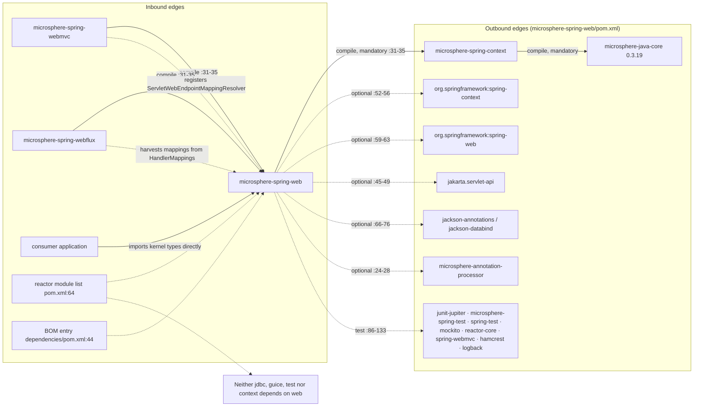
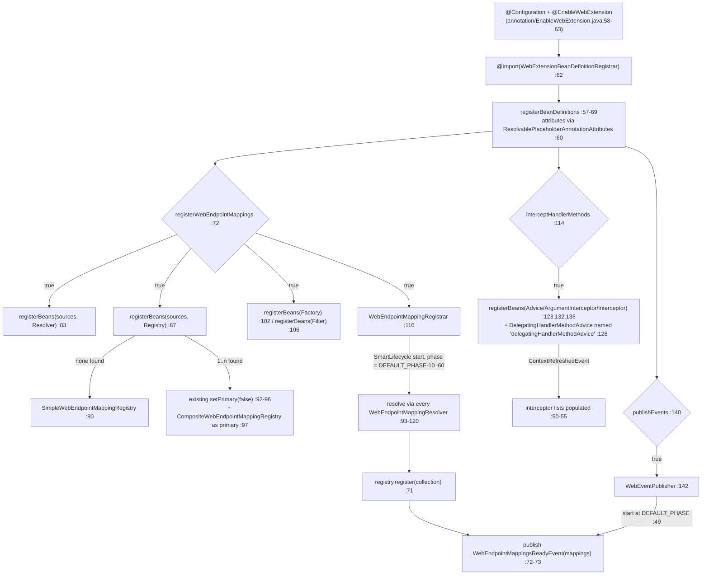
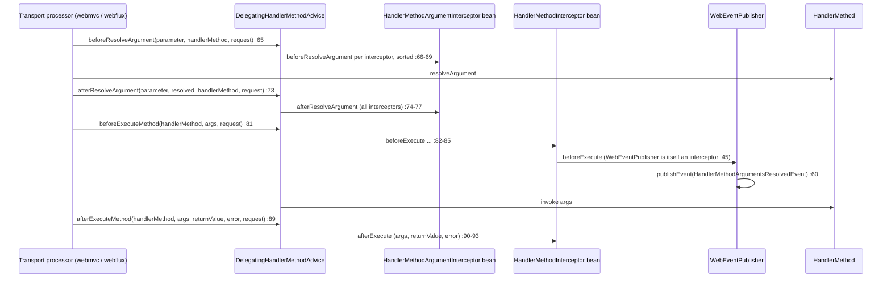

# microsphere-spring-web — Developer Guide

[← Developer guide overview](./README.md) · [简体中文](./zh/web.md) · [User guide](../../user-guide/current/web.md) · [1.x](../1.x/web.md)

## 1. Module identity, baselines and dependency posture

| Attribute | Value | Evidence |
|---|---|---|
| Maven coordinate | `io.github.microsphere-projects:microsphere-spring-web:${revision}` | `microsphere-spring-web/pom.xml:13-16` |
| Packaging | `jar` | `microsphere-spring-web/pom.xml:16` |
| Parent | `microsphere-spring-parent:${revision}`, `relativePath ../microsphere-spring-parent/pom.xml` | `microsphere-spring-web/pom.xml:5-10` |
| Reactor revision under analysis | `0.2.40-SNAPSHOT` | `pom.xml:55` |
| Java baseline | `17` (`java.version`) | `pom.xml:56` |
| Spring baseline | profile-selected `6.0.23` / `6.1.21` / `6.2.18` / `7.0.9` through `spring-framework-bom`; `spring-framework-7.0` is `activeByDefault` | `microsphere-spring-parent/pom.xml:139-172`, BOM import `:99-106` |
| Jakarta EE | `jakarta.jakartaee-bom` `11.0.0` → `jakarta.servlet.*` namespace | `microsphere-spring-parent/pom.xml:24,52-56` |
| Microsphere Java | `0.3.19` via `microsphere-java-dependencies` import — every version-less dependency below resolves there | `microsphere-spring-parent/pom.xml:22,117-124` |
| `microsphere-spring-context` | compile, **mandatory**, explicit `${revision}` | `microsphere-spring-web/pom.xml:31-35` |
| `microsphere-annotation-processor` | optional, version-less | `:24-28` |
| `com.google.code.findbugs:jsr305` | optional | `:38-42` |
| `jakarta.servlet:jakarta.servlet-api` | optional | `:45-49` |
| `org.springframework:spring-context` | optional | `:52-56` |
| `org.springframework:spring-web` | optional | `:59-63` |
| `com.fasterxml.jackson.core:jackson-annotations` / `jackson-databind` | both optional | `:66-70`, `:72-76` |
| Test edges | `junit-jupiter` `:80-83`, `microsphere-spring-test` `:86-91`, `spring-test` `:94-98`, `mockito-core` `:101-105`, `reactor-core` `:108-112`, `spring-webmvc` `:115-119`, `hamcrest` `:122-126`, `logback-classic` `:129-133` | `microsphere-spring-web/pom.xml:79-133` |
| `src/main/resources` | one file: `META-INF/spring.factories` (5 lines, two keys) — no `AutoConfiguration.imports`, no `module-info.java` | `microsphere-spring-web/src/main/resources/META-INF/spring.factories:1-5` |
| Main / test type count | 58 main types, 61 test types | listing of `src/main/java`, `src/test/java` |

Dependency posture: this is the **kernel** of the web family — one mandatory edge downward (`microsphere-spring-context`, `pom.xml:31-35`, which itself drags `microsphere-java-core` 0.3.19) and **every** API it compiles against is `optional`: the Servlet API (`:45-49`), `spring-context` (`:52-56`), `spring-web` (`:59-63`) and both Jackson artifacts (`:66-76`). Nothing therefore reaches a consumer transitively. A downstream application must add `spring-web` plus a `jakarta.servlet-api` itself, and the two transports close that gap differently: `webmvc` re-declares them (`microsphere-spring-webmvc/pom.xml:37-42` for `jakarta.servlet-api` at `provided`, `:44-49` for `spring-web` as optional), whereas `webflux` declares only `spring-webflux` optional (`microsphere-spring-webflux/pom.xml:44-49`) and never names `spring-web` — so its `ServerWebRequest implements NativeWebRequest` compiles against a dependency the kernel deliberately keeps off the transitive path. Jackson is only needed when the JSON factory is used (`Jackson2WebEndpointMappingFactory.java:19` imports `com.fasterxml.jackson.databind.ObjectMapper`). Note the deliberate absence of `spring-webmvc`, `spring-webflux` and `reactor-core` from the compile classpath: they exist only at test scope (`:108-112`, `:115-119`), so the kernel can never reference a transport type — the one exception being test-local helpers such as `microsphere-spring-web/src/test/java/io/microsphere/spring/web/util/SpringWebMvcHelper.java`.

Inbound consumers: `microsphere-spring-webmvc` (`microsphere-spring-webmvc/pom.xml:31-35`) and `microsphere-spring-webflux` (`microsphere-spring-webflux/pom.xml:31-35`) are the **only** reactor modules with a compile dependency on this artifact; `microsphere-spring-context`, `-jdbc`, `-guice` and `-test` never declare it, and outside those two transports the artifact appears only in the reactor module list (`pom.xml:64`) and the BOM (`microsphere-spring-dependencies/pom.xml:44`).

## 2. Inbound and outbound edges



The kernel is a **hub by consumption, leaf by production**: exactly two modules sit above it (`webmvc`, `webflux`) and it sits above exactly one (`context`). Because `spring-web` is optional (`pom.xml:59-63`), neither transport may rely on this jar for it: `webmvc` re-declares it explicitly (`microsphere-spring-webmvc/pom.xml:44-49`), whereas `webflux` never names it and instead picks it up transitively at compile scope from the `spring-webflux` artifact itself — which is why `ServerWebRequest implements NativeWebRequest` (`microsphere-spring-webflux/.../ServerWebRequest.java:30`) compiles for them but not for consumers of this jar alone.

## 3. Package map of `io.microsphere.spring.web.*`

| Package | Types | Responsibility |
|---|---|---|
| `io.microsphere.spring.web.annotation` | `EnableWebExtension` (5 attributes, `:63-135`), `WebExtensionBeanDefinitionRegistrar` (public, `:55`) | activation annotation + the registrar that wires resolvers, registries, factories, filters, advices and the publisher |
| `io.microsphere.spring.web.metadata` (18) | `WebEndpointMapping` (`:129`) + `Kind` (`:186`) + `Builder` (`:215`); `WebEndpointMappingRegistry` (`:34`), `FilteringWebEndpointMappingRegistry` (`:40`), `SimpleWebEndpointMappingRegistry` (`:31`), `CompositeWebEndpointMappingRegistry` (`:36`); `WebEndpointMappingResolver` (`:32`), `ServletWebEndpointMappingResolver` (`:43`); `WebEndpointMappingFactory` (`:33`), `AbstractWebEndpointMappingFactory` (`:34`), `RegistrationWebEndpointMappingFactory` (`:40`), `ServletRegistrationWebEndpointMappingFactory` (`:53`), `FilterRegistrationWebEndpointMappingFactory` (`:39`), `SmartWebEndpointMappingFactory` (`:40`), `Jackson2WebEndpointMappingFactory` (`:29`); `WebEndpointMappingFilter` (`:29`), `WebEndpointMappingRegistrar` (`:50`); `HandlerMetadata` (`:31`), `HandlerMethodMetadata` (`:29`) | the endpoint metadata model, its discovery/registration machinery and the handler metadata value types |
| `io.microsphere.spring.web.method.support` | `HandlerMethodAdvice` (`:33`), `HandlerMethodArgumentInterceptor` (`:31`), `HandlerMethodInterceptor` (`:27`), `DelegatingHandlerMethodAdvice` (`:40`) | the transport-agnostic handler-method interception SPI and its fan-out delegate |
| `io.microsphere.spring.web.event` | `WebEndpointMappingsReadyEvent` (`:34`), `HandlerMethodArgumentsResolvedEvent` (`:20`), `WebEventPublisher` (`:45`) | the two lifecycle/request events and the `SmartLifecycle` that publishes them |
| `io.microsphere.spring.web.rule` (17) | `WebRequestRule` (`:30`), `AbstractWebRequestRule` (`:30`), `CompositeWebRequestRule` (`:36`), `WebRequestPatternsRule` (`:58`), `WebRequestMethodsRule` (`:48`), `WebRequestParamsRule` (`:48`), `WebRequestHeadersRule` (`:44`), `WebRequestConsumesRule` (`:50`), `WebRequestProducesRule` (`:56`), `NameValueExpression` (`:32`), `AbstractNameValueExpression` (`:40`), `WebRequestHeaderExpression` (`:42`), `WebRequestParamExpression` (`:38`), `MediaTypeExpression` (`:32`), `GenericMediaTypeExpression` (`:52`), `ConsumeMediaTypeExpression` (`:41`), `ProduceMediaTypeExpression` (`:40`) | a port of Spring's `RequestMappingInfo` condition algebra onto `NativeWebRequest` — request-matching rules and media-type/name-value expressions |
| `io.microsphere.spring.web.util` | `WebRequestUtils`, `RequestAttributesUtils`, `WebUtils`, `HttpUtils`, `MediaTypeUtils`, `SpringWebHelper` (SPI, `:49`), `UnknownSpringWebHelper` (`:36`), `SpringWebType` (`:29`), `WebType` (`:34`), `WebScope` (`:40`), `WebSource` (`:61`), `WebTarget` (`:35`), `RequestContextStrategy` (`:30`) | request/response abstractions, attribute storage, web-type detection and the helper SPI the transports plug into |
| `io.microsphere.spring.web.constants` | `PropertyConstants` (`:27`) | one property prefix: `microsphere.spring.web.` (`:32`) |

External types this module is built on:

| Type | Home | Use here |
|---|---|---|
| `BeanSource`, `registerBeans(...)` | `microsphere-spring-context`, `io.microsphere.spring.beans` | attribute `sources()` (`EnableWebExtension.java:125`), every collection in the registrar (`WebExtensionBeanDefinitionRegistrar.java:44,83-106,123-136`) |
| `AnnotatedBeanCapableImportBeanDefinitionRegistrar`, `ResolvablePlaceholderAnnotationAttributes` | `microsphere-spring-context` | super-class (`:20,55`) and attribute accessor (`:21,60`) — the reason the five annotation attributes are placeholder-resolvable |
| `AbstractSmartLifecycle` | `microsphere-spring-context`, `io.microsphere.spring.context.lifecycle` | super-class of the registrar (`WebEndpointMappingRegistrar.java:21,50`) and the publisher (`WebEventPublisher.java:20,45`) |
| `OnceApplicationContextEventListener` | `microsphere-spring-context` | super-class of the advice delegate (`DelegatingHandlerMethodAdvice.java:19,40`) |
| `io.microsphere.spring.beans.BeanUtils.getSortedBeans` | `microsphere-spring-context` | ordering of filters, registries, resolvers, advices (`FilteringWebEndpointMappingRegistry.java:29,97`, `CompositeWebEndpointMappingRegistry.java:26,58`, `WebEndpointMappingRegistrar.java:32,116`, `DelegatingHandlerMethodAdvice.java:28,97,102`) |
| `SpringFactoriesLoaderUtils.loadFactories` | `microsphere-spring-context` | `@EnableWebExtension.sources()` SPI loading (`WebEndpointMappingRegistrar.java:33,117`, `SmartWebEndpointMappingFactory.java:30,80`) |
| `Filter`, `FilterOperator` (`AND`/`OR`/`NOT`) | `microsphere-java-core` | the registry filter chain (`FilteringWebEndpointMappingRegistry.java:20-21,42-44,75`) |
| `io.microsphere.json.JSONUtils`, `io.microsphere.annotation.Nonnull/Nullable` | `microsphere-java-core` | `WebEndpointMapping.toJSON()` (`:21,1734-1754`) and the null contracts (`:146-181`) |

## 4. Architecture design

### 4.1 The endpoint metadata model

`WebEndpointMapping<E>` (`metadata/WebEndpointMapping.java:129`) is an immutable value object holding `kind`, `endpoint`, `id`, `negated`, `source` and six `String[]` condition arrays (`patterns`, `methods`, `params`, `headers`, `consumes`, `produces`, `:146-181`). `Kind` (`:186-213`) has exactly five constants — `SERVLET`, `FILTER`, `WEB_MVC`, `WEB_FLUX`, `CUSTOMIZED` — and `getKind()` is the only discriminator the downstream code filters on. Three constants define the identity surface: `ID_HEADER_NAME = "microsphere_wem_id"` (`:134`, consumed by the transports' `ReversedProxyHandlerMapping`), `UNKNOWN_SOURCE` (`:139`, substituted for a `null` source at `:1277`) and `ALL_METHODS` (`:144`, the builder fallback at `:1242-1244`).

The nested `Builder<E>` (`:215-1259`) is reached only through the six static factories `servlet()`, `filter()`, `webmvc()`, `webflux()`, `customized()` and `of(Kind)` (`:1770-1833`); the builder constructor is private (`:252`). Its rules are worth memorising because downstream libraries depend on them: `pattern()`/`method()` accumulate while `patterns(...)`/`methods(...)`/`headers(...)`/`consumes(...)`/`produces(...)` **replace** (`:378-383,526-530,739-744,866-871,995-1000`); `header(name, value)` silently re-routes `Content-Type` to `consume()` and `Accept` to `produce()` (`:656-664`); `negate()` **toggles** rather than sets (`:1020-1023`); `nestPatterns(other)` composes this builder's patterns *onto* the other's via `buildURI(otherPattern, pattern)` (`:1067-1077`) — used for class-level × method-level combination — while `nestMethods`/`nestParams`/`nestHeaders`/`nestConsumes`/`nestProduces` merge by re-adding (`:1097-1197`), and every `nest*` requires the *same* `Kind` (`assertBuilders`, `:1855-1859`). `build()` (`:1236-1258`) mandates a non-null endpoint and at least one pattern, defaults methods to `ALL_METHODS`, and calls the private constructor which sets `id = Objects.hashCode(endpoint)` (`:1275`).

Equality deliberately excludes `endpoint`, `id` and `source` (`:1547-1559`): two mappings for different handler methods with the same condition set are `equals`. `hashCode()` caches into a non-volatile `transient int` guarded by the sentinel `0` (`:178,1575-1598`). Serialization is manual: `toJSON()` (`:1645-1658`) and `toExpression()` (`:1730-1732`, built by the static chain at `:1921-1979` producing `((GET && /a) && ?a == 1)`-style text), plus a private no-arg constructor "For serialization" (`:1289-1291`) that Jackson uses — the real reason `jackson-databind` is an optional dependency here.

### 4.2 Registry, discovery and `BeanSource`

`WebEndpointMappingRegistry` (`metadata/WebEndpointMappingRegistry.java:34-85`) declares one abstract `register(WebEndpointMapping)` and two default bulk methods (`:51-58`, `:66-76`) that count successes. `FilteringWebEndpointMappingRegistry` (`:40`) is the `BeanFactoryAware` decorator: `register` is `final` and gates on a `Filter<WebEndpointMapping>` before calling the abstract `doRegister` (`:53-59,109`); the filter is assembled in `setBeanFactory` from `getSortedBeans(beanFactory, WebEndpointMappingFilter.class)` combined with a `FilterOperator` that defaults to `OR` (`:44,75,95-99`), and an unset filter degrades to `DEFAULT_FILTER = e -> true` (`:42,79-84`).

`SimpleWebEndpointMappingRegistry` (`:31-44`) keeps a `HashMap` with initial capacity 256 **keyed by `mapping.getId()`**, i.e. by the endpoint's hash code, and returns the live `values()` view. `CompositeWebEndpointMappingRegistry` (`:36-65`) additionally implements `SmartInitializingSingleton` and collects every sorted `WebEndpointMappingRegistry` bean *except itself* (`:57-64`), `doRegister` fan-out returning the OR of members (`:41-47`).

Discovery is resolver-driven. `WebEndpointMappingResolver.resolve(ApplicationContext)` is the single-method SPI (`:32-42`). The kernel ships exactly one implementation, `ServletWebEndpointMappingResolver` (`:43-100`): it returns an empty list when the context is not a `WebApplicationContext` or `ServletContext#getMajorVersion() < 3` (`:52-54`), then walks `getFilterRegistrations()` and `getServletRegistrations()`, instantiating a `FilterRegistrationWebEndpointMappingFactory` / `ServletRegistrationWebEndpointMappingFactory` **per call** (`:71,85`). The kernel registrar never registers a resolver of its own — `webmvc` does, at `microsphere-spring-webmvc/.../WebMvcExtensionBeanDefinitionRegistrar.java:93` — so `@EnableWebExtension` alone yields an empty registry.

The factory SPI is `WebEndpointMappingFactory<E>` (`:33-75`, `@FunctionalInterface` at `:32`): `supports(E)` defaults to `true`, `create(E)` returns `Optional`, and `getSourceType()` derives the endpoint class from the generic parameter via `ResolvableType` (`:72-74`) — the key by which the router indexes factories. `AbstractWebEndpointMappingFactory.create` is `final` and converts *any* `Throwable` from `doCreate` into `Optional.empty()` plus an ERROR log (`:38-49`): factory failures are invisible to callers by design. `RegistrationWebEndpointMappingFactory` (`:40-111`) is the template method: `final supports`/`final doCreate` (`:49,54`) assembling `of(kind).endpoint(name).patterns(...).methods(...).source(className)` plus an overridable `contribute(...)` hook (`:66,108-110`); `getKind` infers `FILTER` vs `SERVLET` from the registration type (`:70-72`). `ServletRegistrationWebEndpointMappingFactory` maps overridden `doXxx` methods to HTTP verbs and falls back to `ALL_HTTP_METHODS` (`:59-103`); the filter subclass unions its servlet's patterns and methods (`FilterRegistrationWebEndpointMappingFactory.java:48-95`). `SmartWebEndpointMappingFactory` (`:40-103`) is the dispatcher: it buckets `spring.factories`-loaded and bean-factory-resolved factories by `getSourceType()`, sorts each bucket on insertion (`:69-77`) and, on `doCreate`, walks the bucket keeping the **last** produced mapping (`:92-101`).

`WebEndpointMappingFilter` (`:29`) is a marker extending `io.microsphere.filter.Filter<WebEndpointMapping>` — the pruning seam, consumed only by the registry. `WebEndpointMappingRegistrar` (`:50-125`) extends `AbstractSmartLifecycle`: its constructor pins `setPhase(WebEventPublisher.DEFAULT_PHASE - 10)` "Mark sure earlier than WebEventPublisher" (`:59-60`), `doStart` → `registerWebEndpointMappings()` (`:63-75`) resolves through every `WebEndpointMappingResolver` gathered from `getSortedBeans` **plus** `loadFactories` then re-sorted (`:112-120`), and registers the union into the single `WebEndpointMappingRegistry` bean (`:83-85`).

### 4.3 Handler-method interception SPI

Three interfaces plus one implementation form the whole seam. `HandlerMethodArgumentInterceptor` (`method/support/HandlerMethodArgumentInterceptor.java:31-58`) = `beforeResolveArgument(MethodParameter, HandlerMethod, NativeWebRequest)` + `afterResolveArgument(..., Object resolvedArgument, ...)`, both `default` no-ops that `throw Exception`. `HandlerMethodInterceptor` (`:27-56`) = `beforeExecute(HandlerMethod, Object[] args, NativeWebRequest)` + `afterExecute(..., Object returnValue, Throwable error, ...)`. `HandlerMethodAdvice` (`:33-88`) is the **facade** that unions all four callbacks, and `DelegatingHandlerMethodAdvice` (`:40-104`) implements it by delegating: it extends `OnceApplicationContextEventListener<ContextRefreshedEvent>` (so nothing is wired before the context is refreshed), publishes the fixed `BEAN_NAME = "delegatingHandlerMethodAdvice"` (`:43`), and on that event re-reads both interceptor lists with `getSortedBeans` (`:50-55,96-104`) — before it, both fields are `emptyList()` (`:45-47`), making the advice a silent no-op. Fan-out is plain in-order iteration: arguments first for `before/afterResolveArgument` (`:64-78`), then method interceptors for `before/afterExecuteMethod` (`:80-94`). The kernel never invokes these callbacks itself; each transport's `InterceptingHandlerMethodProcessor` collects `HandlerMethodAdvice` beans with `getSortedBeans(context, HandlerMethodAdvice.class)` and fans out per callback (`microsphere-spring-webmvc/src/main/java/io/microsphere/spring/webmvc/method/support/InterceptingHandlerMethodProcessor.java:201,293,307,325,353`) — that is how `DelegatingHandlerMethodAdvice` reaches handler execution.

### 4.4 `RequestContextStrategy` and how it is read

`RequestContextStrategy` (`util/RequestContextStrategy.java:30-52`) has `DEFAULT`, `THREAD_LOCAL`, `INHERITABLE_THREAD_LOCAL`. It surfaces as `EnableWebExtension.requestContextStrategy() default DEFAULT` (`annotation/EnableWebExtension.java:135`), documented as "Indicate where the `RequestAttributes` stores" (`:127-134`). ⚠ **The kernel never reads it**: `WebExtensionBeanDefinitionRegistrar.registerBeanDefinitions` consumes only `sources`, `registerWebEndpointMappings`, `interceptHandlerMethods` and `publishEvents` (`:62,72,114,140`) — there is no fifth call site in `microsphere-spring-web/src/main/java`. The value becomes effective only in the transports, which re-declare it as an `@AliasFor(annotation = EnableWebExtension.class)` attribute (`microsphere-spring-webmvc/.../annotation/EnableWebMvcExtension.java:138-139`, `microsphere-spring-webflux/.../annotation/EnableWebFluxExtension.java:155`): `EnableWebMvcExtensionListener.processRequestContextStrategy(...)` reads it at `microsphere-spring-webmvc/src/main/java/io/microsphere/spring/web/servlet/listener/EnableWebMvcExtensionListener.java:113-114`, and `WebFluxExtensionBeanDefinitionRegistrar.java:102` calls `annotationAttributes.getEnum("requestContextStrategy")`. Reading it off `EnableWebExtension` directly (`annotationAttributes.getEnum(...)`) is therefore the only kernel-side access, and both transports obtain it because `@AliasFor` makes the same attribute visible on both annotations.

### 4.5 Events

`WebEndpointMappingsReadyEvent` (`event/WebEndpointMappingsReadyEvent.java:34-61`) extends `ApplicationContextEvent`, wraps the mapping collection in `unmodifiableCollection` (`:47`) and exposes `getMappings()` (`:50-52`) — it is fired once, from `WebEventPublisher.doStart()` after the registrar has filled the registry (`WebEventPublisher.java:64-74`). `HandlerMethodArgumentsResolvedEvent` (`:20-79`) extends `ApplicationEvent` with the `WebRequest` as source (`:31-37`), keeps `handlerMethod`/`arguments` `transient`, and offers `getHandlerMethod()`, `getMethod()` (`:51-53`), `getArguments()`, `getWebRequest()` (`:67-69`). `WebEventPublisher` (`:45-79`) is both a `SmartLifecycle` (`DEFAULT_PHASE = EARLIEST_PHASE + 100`, `:49,55`) **and** a `HandlerMethodInterceptor` (`:45`): its `beforeExecute` publishes `HandlerMethodArgumentsResolvedEvent` per handled request (`:59-61`), and because it is a regular bean it is picked up by `DelegatingHandlerMethodAdvice`'s `getSortedBeans(HandlerMethodInterceptor.class)` sweep (`DelegatingHandlerMethodAdvice.java:101-103`) — the event therefore fires only when `interceptHandlerMethods = true` as well as `publishEvents = true`. If `registerWebEndpointMappings = false` the publisher logs a WARN and publishes nothing (`WebEventPublisher.java:65-71`).

## 5. Startup and request-time flows

Startup, from the enabling annotation to the ready event:



Request-time interception, including the argument-resolution event:



## 6. Design patterns actually evidenced

| Pattern | Classes | Evidence |
|---|---|---|
| Builder (nested, kind-scoped static entry points) | `WebEndpointMapping.Builder` | `WebEndpointMapping.java:215-1259`, factories `:1770-1833`, `build()` `:1236-1258` |
| Fluent specification/composition via nesting | `Builder.nestPatterns` / `nestMethods` / `nestParams` / `nestHeaders` / `nestConsumes` / `nestProduces` | `:1067-1197`, `assertBuilders` `:1855-1859` |
| Registry + Decorator | `WebEndpointMappingRegistry`, `FilteringWebEndpointMappingRegistry`, `SimpleWebEndpointMappingRegistry` | `WebEndpointMappingRegistry.java:34-85`, `FilteringWebEndpointMappingRegistry.java:40-109` |
| Composite (with self-exclusion) | `CompositeWebEndpointMappingRegistry` | `:36-64`, fan-out `:41-47` |
| Template Method | `AbstractWebEndpointMappingFactory`, `RegistrationWebEndpointMappingFactory` | `AbstractWebEndpointMappingFactory.java:38-52`; `RegistrationWebEndpointMappingFactory.java:49-110` |
| Strategy | `RequestContextStrategy`, `FilterOperator` (`OR`/`AND`), `SpringWebHelper` per `SpringWebType` | `RequestContextStrategy.java:30-52`; `FilteringWebEndpointMappingRegistry.java:44,75,87-92`; `WebRequestUtils.java:356-367` |
| Enum-as-function (state machine over request sources) | `WebSource` (8 constants), `WebTarget` (3), `WebScope` (2), `WebType` (3), `SpringWebType` (3) | `WebSource.java:61-181`; `WebTarget.java:35-74`; `WebScope.java:40-274`; `WebType.java:34-66`; `SpringWebType.java:29-82` |
| Null Object | `UnknownSpringWebHelper.INSTANCE` as `getOrDefault` fallback | `UnknownSpringWebHelper.java:36-103`, used at `WebRequestUtils.java:366` |
| Delegation / Facade | `DelegatingHandlerMethodAdvice`, `WebRequestUtils`, `RequestAttributesUtils`, `WebUtils` | `DelegatingHandlerMethodAdvice.java:40-104`; `WebRequestUtils.java:95-354`; `RequestAttributesUtils.java:50-305`; `WebUtils.java:41-76` |
| Chain of Responsibility (condition algebra) | `CompositeWebRequestRule`, `AbstractWebRequestRule`, `AbstractNameValueExpression`, `GenericMediaTypeExpression` | `WebRequestRule.java:30-34`; `AbstractWebRequestRule.java:30-69`; `AbstractNameValueExpression.java:107`; `GenericMediaTypeExpression.java:100-129` |
| Observer, one-shot + lifecycle | `OnceApplicationContextEventListener` base, `ApplicationContextEvent` subtypes, `AbstractSmartLifecycle` | `DelegatingHandlerMethodAdvice.java:40,50`; `WebEndpointMappingsReadyEvent.java:34-48`; `WebEndpointMappingRegistrar.java:50-66` |
| Service Provider Interface + generic-type dispatch | `WebEndpointMappingFactory.getSourceType()`, `SmartWebEndpointMappingFactory`, `spring.factories` | `WebEndpointMappingFactory.java:32,72-74`; `SmartWebEndpointMappingFactory.java:50-101`; `META-INF/spring.factories:1-5` |
| Registrar-as-guard-chain (feature flags) | `WebExtensionBeanDefinitionRegistrar` | `:57-144`, three boolean reads |
| Value object / structural equality | `HandlerMetadata`, `HandlerMethodMetadata`, `WebEndpointMapping` | `HandlerMetadata.java:31-72`; `HandlerMethodMetadata.java:29-37`; `WebEndpointMapping.java:1547-1598` |

## 7. Extension guide

**Add a new endpoint kind.** Nothing in the kernel enumerates `Kind` exhaustively, so a downstream library adds a factory for its own endpoint type rather than a new enum constant (extending `Kind` is not possible — it is a closed enum, `WebEndpointMapping.java:186-213`; use `CUSTOMIZED`, `:211`):

```java
// a) the factory — the generic parameter IS the routing key (getSourceType, WebEndpointMappingFactory.java:72-74)
public class MyEndpointMappingFactory extends AbstractWebEndpointMappingFactory<MyEndpoint> {
    @Override
    protected WebEndpointMapping<?> doCreate(MyEndpoint endpoint) {
        return WebEndpointMapping.customized()          // Kind.CUSTOMIZED, no transport assumption
                .endpoint(endpoint)
                .patterns(endpoint.getPaths())
                .methods(endpoint.getHttpMethods(), HttpMethod::name)
                .source(endpoint.getRegistry())          // null becomes UNKNOWN_SOURCE
                .build();                                // patterns must be non-empty (:1239)
    }
}

// b) expose it — either as a bean (collected by BeanSource.BEAN_FACTORY) ...
@Bean MyEndpointMappingFactory myEndpointMappingFactory() { return new MyEndpointMappingFactory(); }
```

…or through `META-INF/spring.factories` under the `io.microsphere.spring.web.metadata.WebEndpointMappingFactory` key, which the shipped `spring.factories:1-2` already demonstrates. Both routes require `@EnableWebExtension(registerWebEndpointMappings = true)` (the default, `EnableWebExtension.java:79`) because `sources()` defaults to `{BEAN_FACTORY, SPRING_FACTORIES, JAVA_SERVICE_PROVIDER}` (`:125`) and the registrar registers factories only inside that guard (`WebExtensionBeanDefinitionRegistrar.java:71-80,101-103`). A factory that wants to participate in the *type-dispatching* router must additionally be handed to a `SmartWebEndpointMappingFactory` (`SmartWebEndpointMappingFactory.java:46-63`) — the kernel registrar does not do that for you.

**Add a resolver / filter / interceptor** — the same three `BeanSource` routes apply per type (`WebEndpointMappingRegistrar.java:112-120` for resolvers, `FilteringWebEndpointMappingRegistry.java:94-99` for filters, `DelegatingHandlerMethodAdvice.java:96-104` for interceptors):

```java
@Component
class ExcludeManagementFilter implements WebEndpointMappingFilter {   // io.microsphere.filter.Filter
    @Override public boolean accept(WebEndpointMapping mapping) {
        return !Arrays.stream(mapping.getPatterns()).anyMatch(p -> p.startsWith("/actuator"));
    }
    @Override public int getOrder() { return 0; }                     // respected by getSortedBeans
}
```

Real ordering rules, all read from source:

| Rule | Value / mechanism | Evidence |
|---|---|---|
| Registration precedes the ready event | registrar phase `= WebEventPublisher.DEFAULT_PHASE - 10`, publisher phase `= EARLIEST_PHASE + 100` | `WebEndpointMappingRegistrar.java:59-60`; `WebEventPublisher.java:49,55` |
| Resolvers run bean-first then factories, then a global re-sort | `getSortedBeans` + `loadFactories` + `AnnotationAwareOrderComparator.sort` | `WebEndpointMappingRegistrar.java:113-119` |
| Multiple registry beans are demoted and shadowed by the composite | `beanDefinition.setPrimary(false)` for each found registry, composite registered as primary | `WebExtensionBeanDefinitionRegistrar.java:88-98` |
| Composite registry collects members at singleton-instantiation time, excluding itself | `afterSingletonsInstantiated` | `CompositeWebEndpointMappingRegistry.java:57-64` |
| Filters combine with `OR` unless overridden; empty filter means "accept everything" | `DEFAULT_FILTER_OPERATOR = OR`, `DEFAULT_FILTER = e -> true` | `FilteringWebEndpointMappingRegistry.java:42-44,75,79-92` |
| Smart factory buckets per source type, sorted on insertion, and the **last** produced mapping wins | `sort(factoriesList)` then `result = optionalResult.get()` | `SmartWebEndpointMappingFactory.java:69-77,92-101` |
| Interceptor fan-out order is `getSortedBeans` order; argument interceptors run before method interceptors within a callback pair | two independent lists | `DelegatingHandlerMethodAdvice.java:45-47,64-94,96-104` |
| Advice callbacks are inert until `ContextRefreshedEvent` | `OnceApplicationContextEventListener<ContextRefreshedEvent>` | `DelegatingHandlerMethodAdvice.java:40,50-55` |
| `HandlerMethodArgumentsResolvedEvent` needs two flags | `publishEvents` registers the publisher, `interceptHandlerMethods` makes it reachable as an interceptor | `WebExtensionBeanDefinitionRegistrar.java:113-120,139-144`; `WebEventPublisher.java:45,59-61` |

## 8. Gotchas

| # | Observation | Evidence |
|---|---|---|
| 1 | ⚠ Every resolver is invoked **twice** per start-up: the result is tested with `isNotEmpty(mappings)` from one call and then re-`resolve(...)`d into the list, doubling the collection cost and any reflection a resolver performs. | `WebEndpointMappingRegistrar.java:97-102` |
| 2 | ⚠ The default registry keys by `mapping.getId()` — the *endpoint's* `hashCode()` — so two mappings whose endpoints collide (equal `hashCode`, e.g. the same servlet name or value-equal handlers) silently overwrite, and `WebEndpointMapping.equals`/`hashCode` are never consulted by the store. | `SimpleWebEndpointMappingRegistry.java:33-43`; `WebEndpointMapping.java:1275` |
| 3 | Thread-safety is not designed in: `repository` is a plain `HashMap`, `getWebEndpointMappings()` returns its live `values()` view, `FilteringWebEndpointMappingRegistry.filter`/`filterOperator` are non-volatile mutable fields, and `DelegatingHandlerMethodAdvice` swaps two list fields on `ContextRefreshedEvent` while request threads iterate them. | `SimpleWebEndpointMappingRegistry.java:33,41-43`; `FilteringWebEndpointMappingRegistry.java:46-50,70-76`; `DelegatingHandlerMethodAdvice.java:45-47,96-104` |
| 4 | Sentinel-default traps: `hashCode()` re-computes whenever the cached value is `0` (`:1577`); `ALL_METHODS` is substituted only when the builder has *no* methods (`:1242-1244`); `UNKNOWN_SOURCE` replaces a `null` source (`:1277`); `WebEndpointMappingFilter` absent ⇒ `DEFAULT_FILTER` accepts everything; a second `negate()` call flips back to `false`. | `WebEndpointMapping.java:178,1242-1244,1277,1575-1598,1020-1023`; `FilteringWebEndpointMappingRegistry.java:42,79-84` |
| 5 | `@Nullable` fields behind `@Nonnull` getters: `params`, `headers`, `consumes`, `produces` are declared nullable (`:161-171`) and returned from getters annotated `@Nonnull` (`:1419-1476`). The builder always emits empty arrays (`toStrings`, `:1889-1919`), but instances created by Jackson (`Jackson2WebEndpointMappingFactory.java:46`) or the private no-arg constructor (`:1289-1291`, all `null` including `kind` despite `@Nonnull`) can return `null` — so `mapping.getParams().length` is safe only for builder-produced mappings. | `WebEndpointMapping.java:161-171,1289-1291,1419-1476,1889-1919` |
| 6 | `equals` ignores `endpoint`, `id` and `source` (`:1547-1559`): de-duplicating a mapping list by `Set` semantics collapses distinct handler methods that share a condition set. `transient` modifiers on `endpoint`/`source`/`attributes` (`:150,176,181`) are decorative — the class does not implement `Serializable` (`:129`), so `toJSON()` (`:1645`) is the only serializer. | `WebEndpointMapping.java:129,150-181,1547-1559,1645-1658` |
| 7 | ⚠ `RequestContextStrategy` is kernel-declared but kernel-unread: `@EnableWebExtension(requestContextStrategy = THREAD_LOCAL)` on its own changes nothing, because the registrar reads four attributes only. Effects live exclusively in `webmvc`/`webflux`. | `annotation/EnableWebExtension.java:127-135`; `annotation/WebExtensionBeanDefinitionRegistrar.java:62,72,114,140`; consumers at `microsphere-spring-webmvc/.../EnableWebMvcExtensionListener.java:113-114`, `microsphere-spring-webflux/.../WebFluxExtensionBeanDefinitionRegistrar.java:102` |
| 8 | ⚠ `@EnableWebExtension` alone registers **no resolver**: `ServletWebEndpointMappingResolver` is wired by `webmvc` (`WebMvcExtensionBeanDefinitionRegistrar.java:93`), and the module's own `spring.factories` lists only a factory and a helper (`spring.factories:1-5`). Expect an empty `WebEndpointMappingsReadyEvent` payload in a kernel-only setup — the publisher still fires it (`WebEventPublisher.java:72-73`). | `microsphere-spring-web/src/main/resources/META-INF/spring.factories:1-5`; `WebEndpointMappingRegistrar.java:112-120` |
| 9 | ⚠ The whole `io.microsphere.spring.web.rule` package (17 types) has **no main-source consumer** anywhere in the reactor: `WebRequestRule`, the six `*Rule` classes and the expression hierarchy are referenced only from inside their own package and from `microsphere-spring-web/src/test/java/io/microsphere/spring/web/rule/*`. Treat it as a preview port of Spring's condition algebra, not a supported SPI. | Grep of `spring.web.rule.` across `src/main/java`: only intra-package imports (`WebRequestConsumesRule.java:28`, `WebRequestHeadersRule.java:25`, `WebRequestParamsRule.java:24`, `WebRequestProducesRule.java:33`, `GenericMediaTypeExpression.java:26`) |
| 10 | ⚠ `SmartWebEndpointMappingFactory` is likewise never instantiated by the kernel registrar (only by its own test, `src/test/java/.../SmartWebEndpointMappingFactoryTest.java:70`), so `supports()`-based multi-factory dispatch and the last-wins rule apply only when a consumer wires it explicitly. | `WebExtensionBeanDefinitionRegistrar.java:101-103` (registers raw factories) |
| 11 | Jackson auto-installation collides with `String`-keyed factories: `spring.factories:1-2` registers `Jackson2WebEndpointMappingFactory`, whose `getSourceType()` resolves to `String` — the same bucket the servlet registration factories use if they are ever registered as beans; with `supports(String) == objectMapperPresent` it claims every `String` endpoint whenever Jackson is on the classpath. | `spring.factories:1-2`; `Jackson2WebEndpointMappingFactory.java:29,35-47`; `RegistrationWebEndpointMappingFactory.java:40` |
| 12 | Failures are swallowed by design: `AbstractWebEndpointMappingFactory.create` is `final` and converts any `Throwable` (including the `IllegalArgumentException` from `Builder.build()`) into `Optional.empty()` + an ERROR log, so a malformed mapping simply disappears from the registry. Debugging needs `logging.level.io.microsphere=ERROR` or lower; only TRACE reveals the interceptor counts. | `AbstractWebEndpointMappingFactory.java:38-49`; `DelegatingHandlerMethodAdvice.java:57-62` |
| 13 | Web-type detection is substring-based: `WebType.valueOf` returns `SERVLET` for `instanceof ServletWebRequest`, otherwise looks for `".reactive."` in the native request type name and falls back to `NONE` (`WebType.java:58-66`); `SpringWebType.valueOf` then maps `SERVLET → WEB_MVC`, `REACTIVE → WEB_FLUX`, `NONE → UNKNOWN` (`SpringWebType.java:74-82`), so a plain servlet-only app is reported as `WEB_MVC` and `WebRequestUtils` answers through `UnknownSpringWebHelper.INSTANCE`, whose methods all return `null`/no-op (`UnknownSpringWebHelper.java:38-103`, fallback at `WebRequestUtils.java:364-367`). | `WebType.java:58-66`; `SpringWebType.java:74-82`; `WebRequestUtils.java:364-367` |
| 14 | The helper table is a mutable non-`final` static `EnumMap` populated at class-initialisation from `SpringFactoriesLoader` (`WebRequestUtils.java:71,356-362`), so it is fixed per classloader: two transports on one classpath compete for the same `SpringWebType` key (`put(helper.getType(), helper)`, `:360`), with last-loaded winning and no logging of the collision. | `WebRequestUtils.java:71,356-362` |
| 15 | `WebEndpointMappingFilter`/`FilteringWebEndpointMappingRegistry` combine filters with `OR` by default (`DEFAULT_FILTER_OPERATOR = OR`, `FilteringWebEndpointMappingRegistry.java:44`), so *one* permissive filter admits a mapping regardless of the others; switch to `AND` explicitly via `setFilterOperator` (`:66-68`) if pruning is the intent. | `FilteringWebEndpointMappingRegistry.java:42-44,66-76` |
| 16 | Split packages with the transports: `microsphere-spring-webmvc` publishes into `io.microsphere.spring.web.servlet` and its 4 sub-packages (`filter`, `function`, `listener`, `util`), and `microsphere-spring-webflux` into `io.microsphere.spring.web.util` — the kernel's own package. Fine on a flat classpath, breaking under JPMS/OSGi strict resolution, and it means `io.microsphere.spring.web.util` classes may come from three jars. | `microsphere-spring-webmvc/src/main/java/io/microsphere/spring/web/servlet/`, `microsphere-spring-webflux/src/main/java/io/microsphere/spring/web/util/` |
| 17 | Naming and `@since` drift: the class is `WebRequestPatternsRule` ("Pattens", `rule/WebRequestPattensRule.java:58`); `WebRequestConsumesRule.java:48` and `WebRequestHeadersRule.java:42` say `@since 1.0.066`; the rule types carry Spring's own `@since 3.1` / `@since Spring Framework 3.1` (`GenericMediaTypeExpression.java:50`, `NameValueExpression.java:30`) while every kernel type says `@since 1.0.0` against a `0.2.40-SNAPSHOT` build (`pom.xml:55`); `WebRequestUtils.PATH_ATTRIBUTE` is still documented `@since Spring Framework 5.3` (`:82-84`). | listed lines |
| 18 | Left-over and impossible code: commented-out `MEDIA_TYPE_ALL_LIST` (`rule/WebRequestProducesRule.java:61`), an open `// FIXME : WebFlux` inside the patterns rule (`rule/WebRequestPattensRule.java:163`), `@Nullable` on the primitive-returning `WebRequestRule.matches` (`rule/WebRequestRule.java:32-33`), static factory Javadoc promising `@throws IllegalArgumentException if the kind or endpoint is null` for methods that take no endpoint (`WebEndpointMapping.java:1767,1828` — the endpoint is only checked in `Builder.endpoint()` / `build()`, `:276,1237`), and the misspelled Javadoc `{@lin WebEndpointMapping}` (`event/WebEndpointMappingsReadyEvent.java:43`). | listed lines |
| 19 | The builder is single-use by convention only, not by construction: `build()` mutates its own state (defaulting `methods` to `ALL_METHODS`, `:1242-1244`), the constructor is private, so calling `build()` twice on the same builder is legal and the second call returns a *new* mapping derived from the already-mutated state, and no field is `synchronized` — sharing one builder across threads is unsafe. The built mapping adds a second mutable escape hatch: `setAttribute`/`getAttribute` over a lazily created, non-concurrent `Map` with an unchecked cast (`:181,1495-1527`). | `WebEndpointMapping.java:1236-1258,1495-1527` |
| 20 | Test surface worth knowing before changing semantics: fixtures `NoOpWebEndpointMappingResolver`, `NullWebEndpointMappingFactory`, `ThrowableWebEndpointMappingFactory`, `UnsupportedWebEndpointMappingFactory` (all under `src/test/java/io/microsphere/spring/web/metadata/`) pin the "factory failure is invisible" contract, `WebEndpointMappingRegistrarTest.java:56` registers `ServletWebEndpointMappingResolver` manually — mirroring the fact that production wiring comes from `webmvc` — and a *second* `SpringWebMvcHelper` exists in this module's tests (`src/test/java/io/microsphere/spring/web/util/SpringWebMvcHelper.java:36`) alongside the real one in `microsphere-spring-webmvc/.../util/SpringWebMvcHelper.java:35`. | those paths |

## 9. Cross-links

**Related** — [Developer guide overview](./README.md) · [简体中文版](./zh/web.md) · [User guide — Web](../../user-guide/current/web.md) · [1.x developer guide](../1.x/web.md) · [context (the module below this one)](./context.md) · [webmvc (servlet transport)](./webmvc.md) · [webflux (reactive transport)](./webflux.md) · [test](./test.md) · [parent POM profiles](./parent.md) · [dependency management](./dependencies.md)
