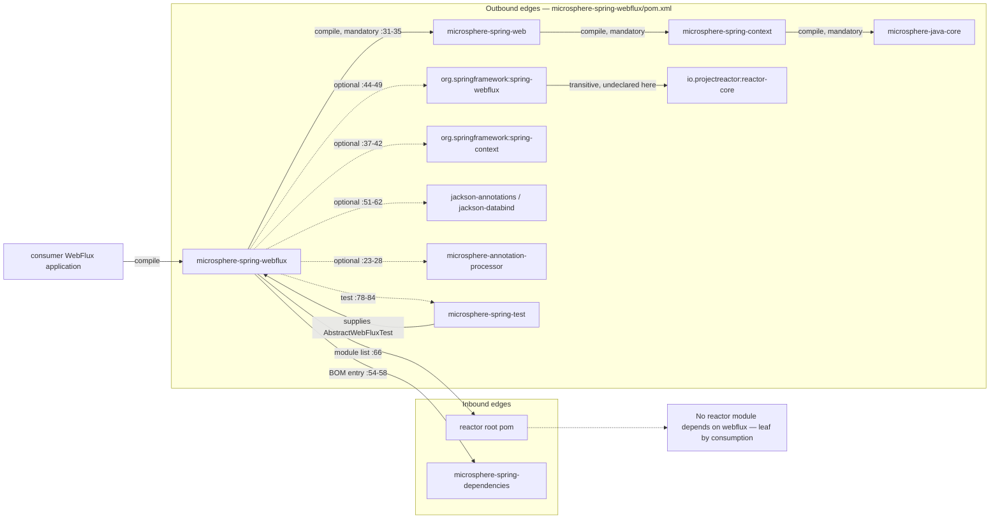
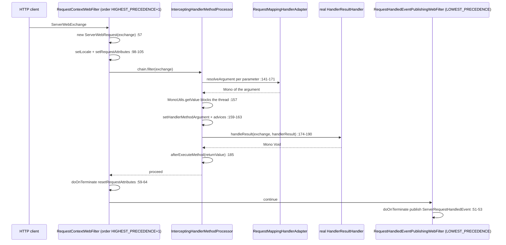
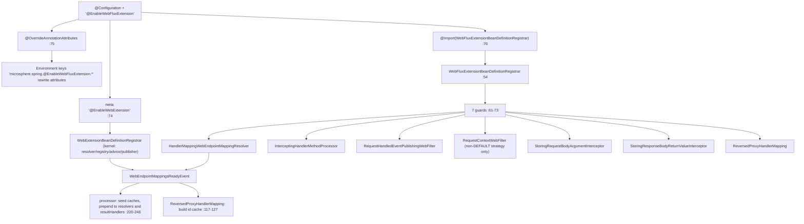

# microsphere-spring-webflux — Developer Guide

[← Developer guide overview](./README.md) · [简体中文](./zh/webflux.md) · [User guide](../../user-guide/current/webflux.md) · [1.x](../1.x/webflux.md)

## 1. Module identity, baselines and dependency posture

| Attribute | Value | Evidence |
|---|---|---|
| Maven coordinate | `io.github.microsphere-projects:microsphere-spring-webflux:${revision}` | `microsphere-spring-webflux/pom.xml:13-16` |
| Reactor revision | `0.2.40-SNAPSHOT` | `pom.xml:55` |
| Parent | `microsphere-spring-parent:${revision}` (relative path `../microsphere-spring-parent/pom.xml`) | `microsphere-spring-webflux/pom.xml:5-10` |
| Java baseline | `17` (`java.version`) | `pom.xml:56` |
| Spring baseline | profile-selected `6.0.23` / `6.1.21` / `6.2.18` / `7.0.9` through `spring-framework-bom`; `spring-framework-7.0` is `activeByDefault` | `microsphere-spring-parent/pom.xml:99-106,138-173` |
| Reactor baseline | paired `reactor-bom` `2022.0.22` / `2023.0.19` / `2024.0.17` / `2025.0.7` — managed **only**, never declared here | `microsphere-spring-parent/pom.xml:108-115,138-173` |
| `microsphere-spring-web` | compile, **not** optional — the single mandatory in-reactor edge | `microsphere-spring-webflux/pom.xml:31-35` |
| `org.springframework:spring-webflux` | **optional** | `microsphere-spring-webflux/pom.xml:44-49` |
| `org.springframework:spring-context` | optional | `:37-42` |
| `microsphere-annotation-processor` | optional, version-less → `0.3.19` via the `microsphere-java-dependencies` import | `:23-28`, `microsphere-spring-parent/pom.xml:22,117-124` |
| `jackson-annotations`, `jackson-databind` | both optional | `:51-62` |
| Test edges | `junit-jupiter`, `spring-test`, `microsphere-spring-test`, `mockito-core`, `jakarta.websocket-client-api`, `jakarta.websocket-api`, `jsonassert`, `logback-classic` | `:64-119` |
| Namespace roots | `io.microsphere.spring.webflux.*` **and** `io.microsphere.spring.web.util` (three classes placed in the kernel's package) | `src/main/java/**` |
| Main / test type count | 24 main classes, 22 test classes (one of them a test configuration) | listing of `src/main/java`, `src/test/java` |
| `src/main/resources` | one file only: `META-INF/spring.factories` — no `AutoConfiguration.imports`, no `module-info.java` | `microsphere-spring-webflux/src/main/resources/META-INF/spring.factories:1-3` |

Dependency posture, in one sentence: this module is a **thin reactive adapter bolted onto `microsphere-spring-web`**, and every Spring/Reactor type it touches is `optional`, so nothing here is transitive to a consumer. `spring-webflux` being optional (`pom.xml:45-49`) means the application must provide it; and because the module **never declares `io.projectreactor:reactor-core`** — even though nine main types import `reactor.core.*` (`MonoUtils.java:21,24`, `CompositeWebFilter.java:25`, and seven others) — Reactor reaches the compile classpath only as a transitive requirement of optional `spring-webflux`. ⚠ Two declared optionals are entirely unused: no main or test source imports `com.fasterxml.jackson.*` (zero matches under `microsphere-spring-webflux/src`), and no test source names `websocket`/`WebSocket` although `jakarta.websocket-api` and `jakarta.websocket-client-api` are declared at test scope (`pom.xml:93-105`). Likewise `spring-web` is not declared here at all, yet `ServerWebRequest` implements `NativeWebRequest` and `RequestContextWebFilter` imports `RequestContextHolder` (`ServerWebRequest.java:30`, `RequestContextWebFilter.java:39-40`); those types arrive through `microsphere-spring-web`'s own optional `spring-web` (`microsphere-spring-web/pom.xml:58-63`) and therefore must also be supplied by the consumer.

## 2. Inbound and outbound edges



Nothing in the reactor builds *on* `microsphere-spring-webflux`. Outside the module itself, the only source references to the artifact are the reactor module list (`pom.xml:66`) and the BOM version entry (`microsphere-spring-dependencies/pom.xml:54-58`). It is a leaf on both axes: nothing consumes it, and it consumes exactly one in-reactor artifact for real (`microsphere-spring-web`), with `microsphere-spring-test` only at test scope (`pom.xml:78-84`, used for `AbstractWebFluxTest` in `ReversedProxyHandlerMappingTest.java:22,57`). `webmvc` and `webflux` never reference each other, so the two transports stay mutually exclusive on a classpath.

## 3. Package map

| Package | Types | Responsibility |
|---|---|---|
| `io.microsphere.spring.webflux.annotation` | `EnableWebFluxExtension` (public, `:77`), `WebFluxExtensionBeanDefinitionRegistrar` (**package-private**, `:54`) | activation annotation with 8 attributes + the conditional bean registrar |
| `io.microsphere.spring.webflux.context.request` | `ServerWebRequest` | `NativeWebRequest` adapter over `ServerWebExchange` (`ServerWebRequest.java:65`) |
| `io.microsphere.spring.webflux.context.event` | `ServerRequestHandledEvent` | `RequestHandledEvent` subtype carrying the exchange (`ServerRequestHandledEvent.java:35,66`) |
| `io.microsphere.spring.webflux.server.filter` | `RequestContextWebFilter`, `RequestHandledEventPublishingWebFilter`, `CompositeWebFilter`, `DelegatingWebFilter` | the `WebFilter` seam: context binding, event publishing, filter composition |
| `io.microsphere.spring.webflux.method` | `InterceptingHandlerMethodProcessor`, `StoringRequestBodyArgumentInterceptor`, `StoringResponseBodyReturnValueInterceptor` | the reactive implementation of the kernel's interception SPI |
| `io.microsphere.spring.webflux.metadata` | `HandlerMappingWebEndpointMappingResolver`, `HandlerMappingWebEndpointMappingFactory` (abstract), `HandlerMetadataWebEndpointMappingFactory`, `RequestMappingMetadataWebEndpointMappingFactory` | harvest `WebEndpointMapping` from the three WebFlux `HandlerMapping` families |
| `io.microsphere.spring.webflux.function.server` | `RouterFunctionVisitorAdapter`, `RequestPredicateVisitorAdapter`, `RequestPredicateKind` (enum, 11 constants), `ConsumingWebEndpointMappingAdapter` | visitor machinery that reads `RouterFunction`/`RequestPredicate` trees |
| `io.microsphere.spring.webflux.handler` | `ReversedProxyHandlerMapping` | header-driven handler shortcut for gateway-forwarded traffic |
| `io.microsphere.spring.webflux.util` | `SpringWebFluxHelper` | `SpringWebHelper` SPI entry for `SpringWebType.WEB_FLUX` |
| `io.microsphere.spring.web.util` (kernel package!) | `MonoUtils`, `WebServerScope` (enum), `WebServerUtils` | blocking-tolerant `Mono` reader, exchange/session attribute scopes, session/principal accessors |

| External kernel type | Home | Use here |
|---|---|---|
| `EnableWebExtension`, `WebExtensionBeanDefinitionRegistrar` | `microsphere-spring-web` | meta-annotation (`EnableWebFluxExtension.java:74`) and the sibling registrar (`WebExtensionBeanDefinitionRegistrar.java:55`) |
| `WebEndpointMapping`, `WebEndpointMappingResolver`, `WebEndpointMappingRegistry`, `HandlerMethodAdvice`, `HandlerMethodInterceptor`, `HandlerMethodArgumentInterceptor` | `microsphere-spring-web` | the shared metadata + interception model |
| `RequestContextStrategy` (`DEFAULT`/`THREAD_LOCAL`/`INHERITABLE_THREAD_LOCAL`), `RequestAttributesUtils`, `WebScope`, `SpringWebHelper`, `SpringWebType` | `microsphere-spring-web` | strategy switch (`EnableWebFluxExtension.java:155`), attribute storage (`StoringRequestBodyArgumentInterceptor.java:51`), helper slot |
| `OverrideAnnotationAttributes`, `AnnotatedBeanCapableImportBeanDefinitionRegistrar`, `ResolvablePlaceholderAnnotationAttributes`, `BeanSource` | `microsphere-spring-context` | attribute externalisation (`EnableWebFluxExtension.java:75`) and registrar base (`WebFluxExtensionBeanDefinitionRegistrar.java:54`) |
| `OnceApplicationContextEventListener` | `microsphere-spring-context` | super-class of the processor (`InterceptingHandlerMethodProcessor.java:81`) |

## 4. Architecture

### 4.1 `@EnableWebFluxExtension` and its registrar

`EnableWebFluxExtension` is `@Target(TYPE)`, `@Retention(RUNTIME)` and carries three meta-annotations: `@EnableWebExtension` (`:74`), `@OverrideAnnotationAttributes` (`:75`) and `@Import(WebFluxExtensionBeanDefinitionRegistrar.class)` (`:76`). Five of its eight attributes are `@AliasFor(annotation = EnableWebExtension.class)`: `registerWebEndpointMappings`, `interceptHandlerMethods`, `publishEvents`, `sources`, `requestContextStrategy` (`:90-155`); three are local: `storeRequestBodyArgument` (`:165`), `storeResponseBodyReturnValue` (`:174`), `reversedProxyHandlerMapping` (`:182`). Note the aliasing is *bidirectional in effect*: the five aliased attributes are read by **both** registrars, since `@EnableWebExtension` also fires `WebExtensionBeanDefinitionRegistrar`, which registers the kernel side (resolvers, registry, `DelegatingHandlerMethodAdvice`, `WebEventPublisher`) — `WebExtensionBeanDefinitionRegistrar.java:64-68,109-143`.

The registrar is package-private (`WebFluxExtensionBeanDefinitionRegistrar.java:54`) and its `registerBeanDefinitions` calls seven independent guards (`:61-73`). Every bean is conditional:

| Attribute | Default | Bean registered when `true` | Evidence |
|---|---|---|---|
| `registerWebEndpointMappings` | `true` | `HandlerMappingWebEndpointMappingResolver` | `:76-82` |
| `interceptHandlerMethods` | `true` | `InterceptingHandlerMethodProcessor` under the fixed name `interceptingHandlerMethodProcessor` | `:84-91`, `InterceptingHandlerMethodProcessor.java:85` |
| `publishEvents` | `true` | `RequestHandledEventPublishingWebFilter` | `:93-99` |
| `requestContextStrategy` | `DEFAULT` | `RequestContextWebFilter` **only** for `THREAD_LOCAL` (property `threadContextInheritable=false`) or `INHERITABLE_THREAD_LOCAL` (`true`) | `:101-124` |
| `storeRequestBodyArgument` | `false` | `StoringRequestBodyArgumentInterceptor` | `:126-132` |
| `storeResponseBodyReturnValue` | `false` | `StoringResponseBodyReturnValueInterceptor` | `:134-140` |
| `reversedProxyHandlerMapping` | `false` | `ReversedProxyHandlerMapping` | `:142-148` |

⚠ Nothing here is installed unconditionally — all seven registrations sit behind their own attribute guard (`:61-73`). `RequestContextWebFilter` is doubly conditional: it is registered **only** when `requestContextStrategy` is `THREAD_LOCAL` or `INHERITABLE_THREAD_LOCAL` (`:101-122`), so under the default `DEFAULT` no request-context bean exists at all (`:111-113`, `:115`). Consequence for `EnableWebFluxExtensionTest.java:57` (bare annotation): no thread-bound request context exists unless a `HandlerMethod` is being intercepted, because `InterceptingHandlerMethodProcessor` then delegates to a **`private static final RequestContextWebFilter`** instance it holds itself (`:87,98-100`) rather than to a bean.

⚠ The processor is frequently mis-described as a `HandlerMapping`. `InterceptingHandlerMethodProcessor.java:81-83` extends `OnceApplicationContextEventListener<WebEndpointMappingsReadyEvent>` and implements `WebFilter, HandlerAdapter, HandlerMethodArgumentResolver, HandlerResultHandler, WebExceptionHandler, Ordered`: there is **no** `HandlerMapping` role, no type named `ServerWebfluxMethodArgumentResolver` exists anywhere in the reactor, and the argument-resolver role uses Spring's reactive `org.springframework.web.reactive.result.method.HandlerMethodArgumentResolver` (import at `:39`). Endpoint lookup therefore stays with `RequestMappingHandlerMapping`; this bean contributes the *execution* roles only.

`@OverrideAnnotationAttributes` (`EnableWebFluxExtension.java:75`) declares no explicit `strategy`, so it resolves to `ConfigurationPropertyOverrideAnnotationAttributesStrategy` (`OverrideAnnotationAttributes.java:89`), whose default prefix is `microsphere.spring.` + `@` + annotation simple name + `.` — i.e. `microsphere.spring.@EnableWebFluxExtension.storeResponseBodyReturnValue=true` rewrites the annotation attribute before the registrar ever reads it (`ConfigurationPropertyOverrideAnnotationAttributesStrategy.java:139-163,245-249,281`). All seven guards log their decision at TRACE (`WebFluxExtensionBeanDefinitionRegistrar.java:150-154`), so `logging.level.io.microsphere=TRACE` is the only way to see the wiring outcome.

### 4.2 Adapting the servlet-shaped kernel to reactive types

The kernel SPI is written against `NativeWebRequest` and `HandlerMethod` — both servlet-agnostic by Spring's own design — so the reactive module supplies three adapters instead of a second SPI:

- **`ServerWebRequest implements NativeWebRequest`** (`ServerWebRequest.java:65`) wraps one `ServerWebExchange` plus its `ServerHttpRequest` (`:105-112`). Headers come from `request.getHeaders()` (`:148-168`), "parameters" from `request.getQueryParams()` only — path variables and form fields are **not** exposed (`:172-204`). Attribute access delegates to `WebServerScope` on the exchange/session (`:279-297`), and the `Mono`-returning exchange members are drained synchronously through `MonoUtils.getValue` for session and principal (`:228`, `:393`). Two servlet verbs are hardcoded: `isUserInRole` and `isSecure` both return `false` (`:232-239`), and `registerDestructionCallback` degrades to a WARN with no registration (`:300-306`).
- **`WebServerScope`** (REQUEST → `exchange.getAttributes()`, SESSION → `webSession.getAttributes()`, `WebServerScope.java:50-72`) maps `RequestAttributes.SCOPE_REQUEST`/`SCOPE_SESSION` onto exchange/session, so kernel code such as `RequestAttributesUtils.setHandlerMethodArgument` runs unchanged.
- **`MonoUtils.getValue`** (`MonoUtils.java:43-49`) is the single blocking bridge: `block()` on a blocking thread, `toFuture().get()` on a non-blocking one — the latter still parks the event-loop thread.

The `spring.factories` line `io.microsphere.spring.web.util.SpringWebHelper=io.microsphere.spring.webflux.util.SpringWebFluxHelper` (`spring.factories:2-3`) installs `SpringWebFluxHelper` into the kernel's helper table, keyed by `getType() == WEB_FLUX` (`SpringWebFluxHelper.java:282-284`; loaded by `WebRequestUtils.loadSpringWebHelpers()` at `microsphere-spring-web/.../WebRequestUtils.java:356-362`). `getRequestAttribute`-style reads therefore resolve `HandlerMapping` best-match attributes (`:174-268`), and every method casts through `getServerWebRequest`, which **throws** `IllegalArgumentException("The NativeWebRequest is not a ServerWebRequest")` for a foreign `NativeWebRequest` (`:349-354`).

### 4.3 `WebFilter` and `HandlerResult` interception points

`InterceptingHandlerMethodProcessor` is one object wearing five Spring roles, and each role is a distinct hook:

| Role | Method | Behaviour | Evidence |
|---|---|---|---|
| `WebFilter` | `filter` | pure delegation to the static `RequestContextWebFilter` | `:97-100` |
| `HandlerMethodArgumentResolver` | `supportsParameter` / `resolveArgument` | cache lookup, then `beforeResolveArgument` → delegate resolver → **blocking** `getValue(result)` → store argument → `afterResolveArgument` → `beforeExecuteMethod` on the last parameter, and rebuilds `Mono.just(argument)` | `:130-171`, `:303-331`, `:317-323` |
| `HandlerResultHandler` | `supports` / `handleResult` | runs the real handler first, then `afterExecuteMethod` with `handlerResult.getReturnValue()` | `:135-138,173-190` |
| `WebExceptionHandler` | `handle(exchange, ex)` | `afterExecuteMethod` with the throwable read from `BEST_MATCHING_HANDLER_ATTRIBUTE`, then re-emits `error(ex)` | `:192-208` |
| `HandlerAdapter` | `supports` / `handle` | a trap, not an adapter: `supports` returns `false` always (while firing `beforeExecuteMethod` for zero-argument handlers) and `handle` returns `null` | `:102-115` |

Self-installation is the subtle part: at `WebEndpointMappingsReadyEvent` time it grabs the `DispatcherHandler`'s private `resultHandlers` list by reflection and moves itself to index 0 (`:248-251,214-218`), and prepends itself to `RequestMappingHandlerAdapter`'s private `methodResolver.requestMappingResolvers` list (`:253-256,245`). Because it is now index 0, both lookup loops **start at `i = 1`** so the processor never resolves against itself (`:351-361,370-380`). Caches are keyed by `MethodParameter` / return `MethodParameter` and pre-populated for every `HandlerMethod` endpoint in the event payload (`:89-91,229-246`); an uncached return type falls back to live resolution (`:286-301`).

`HandlerMethodAdvice` beans are the callback fan-out (`:210-212,303-349`, collected with `getSortedBeans`), and the two `Storing*` classes are themselves kernel SPI implementations registered as ordinary beans: `StoringRequestBodyArgumentInterceptor implements HandlerMethodArgumentInterceptor` storing only `@RequestBody` arguments (`:45-53`), `StoringResponseBodyReturnValueInterceptor implements HandlerMethodInterceptor` storing only `@ResponseBody` return values (`:44-51`). ⚠ Unlike `webmvc`, which does the same job with `RequestBodyAdviceAdapter`/`ResponseBodyAdviceAdapter` (`microsphere-spring-webmvc/.../advice/`), the reactive path never touches Spring's advice chain.

### 4.4 Endpoint metadata harvesting

`HandlerMappingWebEndpointMappingResolver.resolve` iterates every `HandlerMapping` bean (ancestors included, `:60`) and applies three probes per mapping: `AbstractUrlHandlerMapping` → `HandlerMetadataWebEndpointMappingFactory` with `PathPattern.getPatternString()` keys and `ALL_HTTP_METHODS` (`:71-79`, `HandlerMetadataWebEndpointMappingFactory.java:40-48`); `RequestMappingInfoHandlerMapping` → `RequestMappingMetadataWebEndpointMappingFactory`, which calls `createWithResolvedBean()` and copies methods/params/headers/consumes/produces (`:81-91`, `RequestMappingMetadataWebEndpointMappingFactory.java:57-89`); `RouterFunctionMapping` → `ConsumingWebEndpointMappingAdapter` fed as a `WebEndpointMapping` sink (`:93-101`). `RequestPredicateKind` is the parse/visit engine over `RequestPredicates` internals — AND/OR/NEGATE read the private `left`/`right`/`arg$1`/`delegate` fields (`:143-149,248-251`), and it also round-trips predicates to text (`parseRequestPredicate`/`toExpression`, `:682-738`). `ReversedProxyHandlerMapping` (`:76`) then shortcuts forwarded requests: it caches only `Kind.WEB_FLUX` mappings whose `source instanceof AbstractHandlerMapping` (`:117-132`) and returns the endpoint directly when the `microsphere_wem_id` header matches (`:88-106`). It **does exist** in this module, and separately also in `webmvc` under `io.microsphere.spring.webmvc.handler`; they are two distinct classes, not a shared type.

## 5. Runtime and startup flow

Reactive request flow with interception enabled (`interceptHandlerMethods = true`, the default):



Startup wiring of `@EnableWebFluxExtension`:



## 6. Design patterns actually evidenced

| Pattern | Classes | Evidence |
|---|---|---|
| Enable*/activation with attribute override (`@AliasFor` onto a kernel annotation) | `EnableWebFluxExtension`, `EnableWebExtension` | `EnableWebFluxExtension.java:74-76,90-155` |
| Registrar as guard chain (feature-flag per bean) | `WebFluxExtensionBeanDefinitionRegistrar` | `:57-74`, seven boolean/enum reads |
| Adapter (object adapter over an incompatible API) | `ServerWebRequest`, `SpringWebFluxHelper` | `ServerWebRequest.java:65,109-112`; `SpringWebFluxHelper.java:52,349-354` |
| Client-adapter facade over `Mono` | `MonoUtils`, `WebServerUtils` | `MonoUtils.java:43-49`; `WebServerUtils.java:37-56` |
| Chain-of-Responsibility, Spring's own, extended not replaced | `InterceptingHandlerMethodProcessor` | self-prepend `:216-217,245`, skip-index-0 lookups `:354,375` |
| Composite + Delegation (Wrapper) | `CompositeWebFilter`, `DelegatingWebFilter`, `RequestContextWebFilter` inside the processor | `CompositeWebFilter.java:41,129-136`; `DelegatingWebFilter.java:39-61`; `InterceptingHandlerMethodProcessor.java:87,99` |
| Visitor (double dispatch over two Spring hierarchies) | `RouterFunctionVisitorAdapter`, `RequestPredicateVisitorAdapter`, `ConsumingWebEndpointMappingAdapter` | `ConsumingWebEndpointMappingAdapter.java:76,140-145`; adapter defaults `RequestPredicateVisitorAdapter.java:47-206` |
| Strategy (enum-as-strategy, stateful visitors) | `RequestPredicateKind`, `WebServerScope`, `RequestContextStrategy` | `RequestPredicateKind.java:93-581`; `WebServerScope.java:43-72`; consumed at `WebFluxExtensionBeanDefinitionRegistrar.java:104-114` |
| Template Method | `HandlerMappingWebEndpointMappingFactory` | final `doCreate` `:49-63` with abstract `getMethods`/`getPatterns` and a hook `contribute` `:80-104` |
| Observer, one-shot | `OnceApplicationContextEventListener` base, `ApplicationListener` implementations | `InterceptingHandlerMethodProcessor.java:81,122-128`; `ReversedProxyHandlerMapping.java:76,117` |
| Builder (kernel type reused) | `WebEndpointMapping.Builder` via `webflux()` | `HandlerMappingWebEndpointMappingFactory.java:56-62`; `ConsumingWebEndpointMappingAdapter.java:162-168` |

## 7. Extension guide

Add a cross-cutting reactive handler — timing, audit, mock injection — without touching WebFlux configuration:

```java
@Component
public class ReactiveAuditAdvice implements HandlerMethodAdvice, Ordered {  // kernel SPI + Ordered, so getSortedBeans can rank it
    @Override
    public void beforeExecuteMethod(HandlerMethod handlerMethod, Object[] args, NativeWebRequest request) {
        ServerWebRequest web = (ServerWebRequest) request;                  // the only reactive-specific cast
        log.info("{} {} -> {}", web.getRequest().getMethod().name(),
                web.getRequest().getPath().value(), handlerMethod.getMethod().getName());
    }
    @Override
    public int getOrder() { return 0; }
}
```

`HandlerMethodAdvice`/`HandlerMethodInterceptor`/`HandlerMethodArgumentInterceptor` beans are picked up twice over: the kernel registrar registers collected instances from all `sources` (`WebExtensionBeanDefinitionRegistrar.java:113-137`), and the processor fans out to sorted `HandlerMethodAdvice` beans at `InterceptingHandlerMethodProcessor.java:210-212`. A `WebFilter` bean needs no registration at all — Spring WebFlux's `WebHandlerAdapter` discovers beans of that type itself; `DelegatingWebFilter` is the module's own opt-in alternative, harvesting sorted `WebFilter` beans on `ContextRefreshedEvent` and excluding itself (`DelegatingWebFilter.java:49-61`).

Real ordering rules, all read from source:

| Rule | Value | Evidence |
|---|---|---|
| `InterceptingHandlerMethodProcessor` is first among ordered web components | `HIGHEST_PRECEDENCE` | `:117-120` |
| `RequestContextWebFilter` and `ReversedProxyHandlerMapping` are both `HIGHEST_PRECEDENCE + 1` — tie, so bean-name order decides | `HIGHEST_PRECEDENCE + 1` | `RequestContextWebFilter.java:93-96`; `ReversedProxyHandlerMapping.java:80,84-86` |
| `RequestHandledEventPublishingWebFilter` observes last, so its timer covers the whole chain | `LOWEST_PRECEDENCE` | `:74-77` |
| Inside the processor, advice callbacks run in `getSortedBeans` order; argument resolution fires per parameter and `beforeExecuteMethod` fires once, on the **last** parameter only | `parameterIndex == arguments.length - 1` | `:317-323` |
| `HandlerResultHandler` and resolver self-installation puts the processor ahead of every built-in | `add(0, this)` | `:216-217,245` |
| `ReversedProxyHandlerMapping` pre-empts `RequestMappingHandlerMapping` by order, and only for `WEB_FLUX` + `AbstractHandlerMapping`-sourced mappings | filter at `:129-132` | `:88-115` |

## 8. Gotchas

| # | Observation | Evidence |
|---|---|---|
| 1 | Servlet assumptions that silently fail: `isSecure()` and `isUserInRole()` always `false`; `registerDestructionCallback` only WARNs; `getParameter*` sees query params only, so `@RequestParam`-from-form data is invisible to kernel code reading `NativeWebRequest`. | `ServerWebRequest.java:232-239,300-306,172-204` |
| 2 | Blocking on the event loop is structural, not incidental: `resolveArgument` calls `MonoUtils.getValue` inside the reactive pipeline, and `getValue` falls back to `toFuture().get()` when already on a non-blocking thread — it parks either way. | `MonoUtils.java:43-49`; `InterceptingHandlerMethodProcessor.java:157`; `ServerWebRequest.java:228,393` |
| 3 | `RequestContextWebFilter` binds on subscribe and clears on `doOnTerminate`, so any `publishOn`/`subscribeOn` hop leaves the handler thread without `RequestContextHolder` attributes — the `THREAD_LOCAL` strategies are best-effort in WebFlux by construction. | `RequestContextWebFilter.java:56-65,98-105,113-116` |
| 4 | Default configuration registers no context filter (`requestContextStrategy = DEFAULT`), yet `InterceptingHandlerMethodProcessor.supports` reads `RequestContextHolder.getRequestAttributes()` and casts to `ServerWebRequest` — a `ClassCastException`-prone path that only a `doOnTerminate`-clean thread avoids. | `WebFluxExtensionBeanDefinitionRegistrar.java:111-122`; `InterceptingHandlerMethodProcessor.java:106` |
| 5 | Reflection into Spring internals: `DispatcherHandler.resultHandlers`, then the private two-hop chain `RequestMappingHandlerAdapter.methodResolver` → `requestMappingResolvers`, plus `RequestPredicates` private `left`/`right`/`arg$1` fields. Any of these renamed upstream breaks the module silently (or via `NEGATE` falling back to `delegate`). | `InterceptingHandlerMethodProcessor.java:248-256`; `RequestPredicateKind.java:143-149,248-251` |
| 6 | `handle` returning `null` and `supports` returning `false` are intentional dead ends, not bugs: the `HandlerAdapter` role exists only to catch zero-argument handler methods. Any WebFlux build that dispatches to this adapter gets an NPE instead of a 404. | `InterceptingHandlerMethodProcessor.java:102-115` |
| 7 | `CompositeWebFilter.filter` is a mis-named fan-out: it invokes every member against the **same** `chain` and returns only the last `Mono`, so earlier filters' `Mono<Void>` results are discarded and no filter sees another's mutation ordering. | `CompositeWebFilter.java:129-136` |
| 8 | ⚠ Dead-ish wiring: `CompositeWebFilter` and `DelegatingWebFilter` are referenced nowhere in `src/main/java` outside each other — the registrar never installs them, so they are library-only classes exercised solely by their own tests. | `WebFluxExtensionBeanDefinitionRegistrar.java:61-73` (no call), `DelegatingWebFilter.java:41`, `CompositeWebFilterTest.java:48-52`, `DelegatingWebFilterTest.java:39-46` |
| 9 | Router-function metadata gaps: `ConsumingWebEndpointMappingAdapter` overrides only `method`, `path`, `header`, `queryParam`, `startNested`, `endNested`, `route` — so `pathExtension`, `resources(...)`, `unknown(...)` and `HEADERS`/`ACCEPT`-style predicates hitting the base `accept`/`unknown` defaults are dropped from the registry. | `ConsumingWebEndpointMappingAdapter.java:93-145`; `RequestPredicateVisitorAdapter.java:69-71,196-206`; `RouterFunctionVisitorAdapter.java:55-57,67-69`; `RequestPredicateKind.java:532-556` |
| 10 | ⚠ `ReversedProxyHandlerMapping`'s Javadoc narrows itself to `RequestMappingHandlerMapping` ("For now … only supports"), while the code accepts any `AbstractHandlerMapping` source of kind `WEB_FLUX`, i.e. also `SimpleUrlHandlerMapping`. Also `webEndpointMappingsCache` is `null` until `WebEndpointMappingsReadyEvent` fires, so a request before that event NPEs at the `get` call. | `ReversedProxyHandlerMapping.java:63-65,82,98,129-132` |
| 11 | No `HandlerInterceptor` counterpart and no WebFlux equivalent of the MVC extras: this module ships no `MethodHandlerInterceptor`, no `LazyCompositeHandlerInterceptor`, no page-render-context interceptor, no `ContentCachingFilter` (body caching), no `WebFluxExtensionConfiguration` and no `registerHandlerInterceptors`/`handlerInterceptors` attributes — WebFlux has no `HandlerInterceptor`, `WebFilter` is the seam. | compare `microsphere-spring-webmvc/src/main/java/io/microsphere/spring/webmvc/interceptor/`, `.../web/servlet/filter/ContentCachingFilter.java` with `microsphere-spring-webflux/src/main/java` |
| 12 | Split package: `MonoUtils`, `WebServerScope`, `WebServerUtils` live in this jar under `io.microsphere.spring.web.util`, the same package the kernel uses (13 classes there). Harmless for the classpath, fatal for JPMS or OSGi strict resolution. | `src/main/java/io/microsphere/spring/web/util/*.java`; `microsphere-spring-web/src/main/java/io/microsphere/spring/web/util/` |
| 13 | `@ConditionalOnWebApplication`-style protection is absent: nothing checks that the runtime is reactive. Adding this jar plus `@EnableWebFluxExtension` to a Servlet app wires `WebFilter` beans and a `HandlerAdapter` into a stack that never calls them, and the reflection at `:249` fails on a missing `DispatcherHandler`. | `WebFluxExtensionBeanDefinitionRegistrar.java:57-74`; `InterceptingHandlerMethodProcessor.java:248-251` |
| 14 | Two Spring-Framework-7-only and 5.3-only compatibility shims exist as un-`@Override` default methods (`version(String)`, `attributes(Map)`), so on 6.x they are simply never called — they are forward/backward padding, not features. | `RequestPredicateVisitorAdapter.java:99-105`; `RouterFunctionVisitorAdapter.java:59-65` |
| 15 | `@since 1.0.0` on every type contradicts the analysed `0.2.40-SNAPSHOT`; do not map `@since` to a release line. | `EnableWebFluxExtension.java:69`, `pom.xml:55` |

## 9. Cross-links

**Related** — [Developer guide overview](./README.md) · [简体中文版](./zh/webflux.md) · [User guide — WebFlux](../../user-guide/current/webflux.md) · [1.x developer guide](../1.x/webflux.md) · [web (shared kernel)](./web.md) · [webmvc (sibling transport)](./webmvc.md) · [test (`AbstractWebFluxTest`)](./test.md) · [parent POM profiles](./parent.md) · [dependency management](./dependencies.md)
