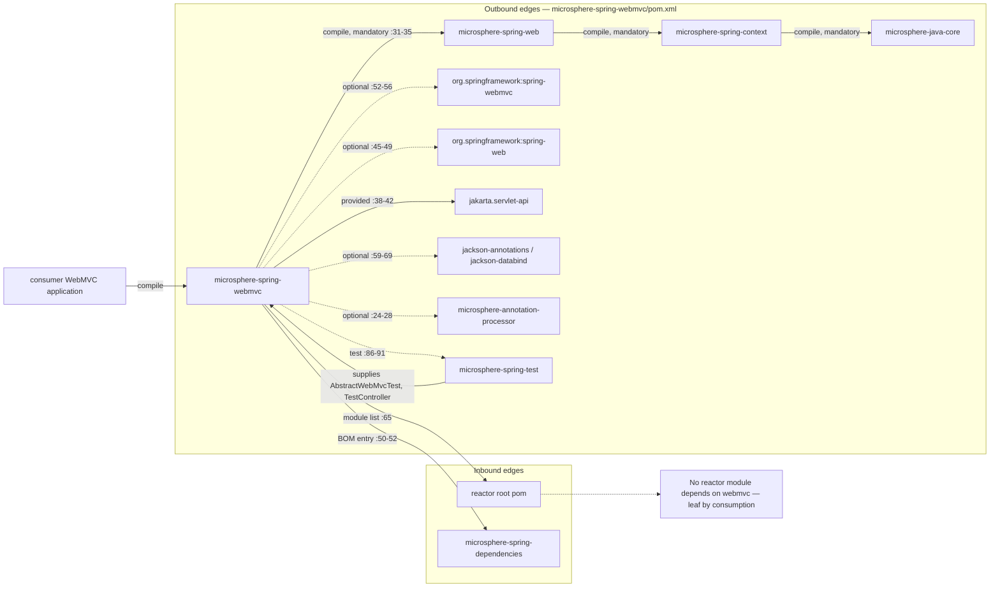
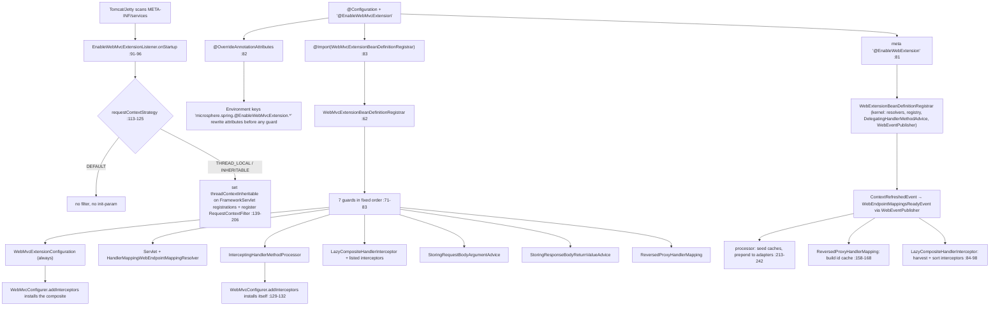
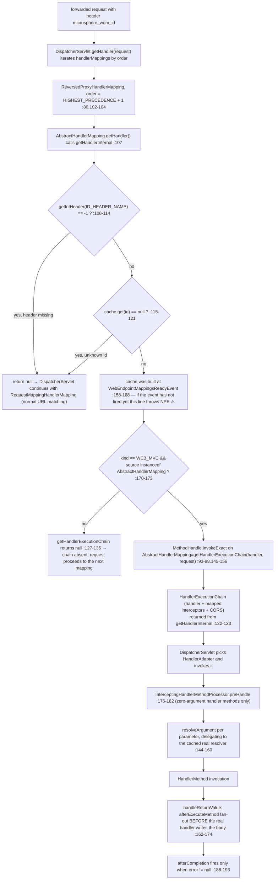

# microsphere-spring-webmvc — Developer Guide

[← Developer guide overview](./README.md) · [简体中文](./zh/webmvc.md) · [User guide](../../user-guide/current/webmvc.md) · [1.x](../1.x/webmvc.md)

## 1. Module identity, baselines and dependency posture

| Attribute | Value | Evidence |
|---|---|---|
| Maven coordinate | `io.github.microsphere-projects:microsphere-spring-webmvc:${revision}` | `microsphere-spring-webmvc/pom.xml:13-16` |
| Reactor revision | `0.2.40-SNAPSHOT` | `pom.xml:55` |
| Parent | `microsphere-spring-parent:${revision}` (relative path `../microsphere-spring-parent/pom.xml`) | `microsphere-spring-webmvc/pom.xml:5-10` |
| Java baseline | `17` (`java.version`) | `pom.xml:56` |
| Spring baseline | profile-selected `6.0.23` / `6.1.21` / `6.2.18` / `7.0.9` through `spring-framework-bom`; `spring-framework-7.0` is `activeByDefault` | `microsphere-spring-parent/pom.xml:102-103,139-172` |
| Servlet namespace | `jakarta.servlet.*` from `jakarta.jakartaee-bom` `11.0.0`, declared **`provided`** | `microsphere-spring-parent/pom.xml:24,53-55`; `microsphere-spring-webmvc/pom.xml:38-42` |
| Microsphere kernel | `microsphere-java` `0.3.19` via `microsphere-java-dependencies` import | `microsphere-spring-parent/pom.xml:22,120-121` |
| `microsphere-spring-web` | compile, **not** optional — the single mandatory in-reactor edge | `microsphere-spring-webmvc/pom.xml:31-35` |
| `org.springframework:spring-webmvc` | **optional** | `:52-56` |
| `org.springframework:spring-web` | optional | `:45-49` |
| `microsphere-annotation-processor` | optional, version-less → `0.3.19` | `:24-28` |
| `jackson-annotations`, `jackson-databind` | both optional | `:59-63`, `:65-69` |
| Test edges | `junit-jupiter`, `spring-test`, `microsphere-spring-test`, `tomcat-embed-core`, `jsonassert`, `hamcrest`, `logback-classic` | `:72-119` |
| Namespace roots | `io.microsphere.spring.webmvc.*` **and** `io.microsphere.spring.web.servlet.*` (five classes outside the module's own root) | `src/main/java/**` |
| Main / test type count | 35 main classes, 36 test classes | listing of `src/main/java`, `src/test/java` |
| `src/main/resources` | two files only: `META-INF/spring.factories` (one `SpringWebHelper` line) and `META-INF/services/jakarta.servlet.ServletContainerInitializer` — no `AutoConfiguration.imports`, no `module-info.java` | `src/main/resources/META-INF/**` |

Dependency posture, in one sentence: this module is the **servlet-side adapter bolted onto `microsphere-spring-web`**, and every Spring type it compiles against is `optional`, so nothing here is transitive to a consumer. A consumer must therefore add, itself: `org.springframework:spring-webmvc` (which drags `spring-web`, `spring-context`, `spring-beans`, `spring-core`), `microsphere-spring-web` + `microsphere-spring-context` + the `microsphere-java` kernel (the first is transitive through this jar, the rest through it), and a Servlet 6.1 container. Note the asymmetry with `microsphere-spring-web`, which declares `jakarta.servlet-api` as **optional** (`microsphere-spring-web/pom.xml:47-48`) while this module declares it **`provided`** (`microsphere-spring-webmvc/pom.xml:41`) — for a WAR that is correct (the container supplies it), for an embedded bootstrap it means the API arrives only through `tomcat-embed-core`/`jetty` and never from this jar. ⚠ Three declared dependencies are provably dead weight in the current tree: `jsonassert` (`:101-105`) and `hamcrest` (`:108-112`) have **zero** imports under `src/test/java`, and `jackson-annotations` (`:59-63`) has zero `com.fasterxml.jackson.annotation` imports anywhere in the module; `jackson-databind` is used by exactly one main type (`ConfigurableContentNegotiationManagerWebMvcConfigurer.java:3`) plus three tests. `microsphere-annotation-processor` (`:24-28`) is likewise unreferenced by any source file — it is a build-time-only optional, present for metadata generation. `tomcat-embed-core` at test scope (`:94-98`) is used indirectly, through `io.microsphere.spring.test.tomcat.embedded.EmbeddedTomcatConfiguration` imported by the listener tests.

## 2. Inbound and outbound edges



Nothing in the reactor builds *on* `microsphere-spring-webmvc`. Outside its own POM, the artifact is named only in the reactor module list (`pom.xml:65`) and in the BOM version entry (`microsphere-spring-dependencies/pom.xml:50-52`). It is a leaf on both axes: nothing consumes it, and it consumes exactly one in-reactor artifact for real (`microsphere-spring-web`, which in turn pulls `microsphere-spring-context` and the `microsphere-java` kernel), plus `microsphere-spring-test` at test scope (`pom.xml:86-91`, used for `AbstractWebMvcTest`, `TestController`, `TestServlet`, `TestFilter`, `EmbeddedTomcatConfiguration`). `webmvc` and `webflux` never reference each other — the two transports stay mutually exclusive on a classpath, even though they ship same-named visitor classes (see §8).

## 3. Package map

| Package | Types | Responsibility |
|---|---|---|
| `io.microsphere.spring.webmvc.annotation` | `EnableWebMvcExtension` (public, `:84`), `WebMvcExtensionBeanDefinitionRegistrar` (**package-private**, `:62`), `WebMvcExtensionConfiguration` (public, `:36`) | activation annotation with 10 attributes + conditional registrar + the `WebMvcConfigurer` that installs the composite interceptor |
| `io.microsphere.spring.webmvc.advice` | `RequestBodyAdviceAdapter`, `ResponseBodyAdviceAdapter`, `StoringRequestBodyArgumentAdvice`, `StoringResponseBodyReturnValueAdvice` | Spring `@ControllerAdvice` bridges that capture `@RequestBody` arguments and `@ResponseBody` return values |
| `io.microsphere.spring.webmvc.config` | `ConfigurableContentNegotiationManagerWebMvcConfigurer` | property-driven `ContentNegotiationConfigurer` (`:47-66`) |
| `io.microsphere.spring.webmvc.constants` | `PropertyConstants` | the `microsphere.spring.webmvc.` prefixes (`:32,37`) |
| `io.microsphere.spring.webmvc.context` | `ExclusiveViewResolverApplicationListener` | forces one `ViewResolver` to be the only resolver after refresh (`:68-104`) |
| `io.microsphere.spring.webmvc.handler` | `ReversedProxyHandlerMapping` | header-driven handler shortcut for proxy-forwarded traffic |
| `io.microsphere.spring.webmvc.interceptor` | `MethodHandlerInterceptor`, `AnnotatedMethodHandlerInterceptor`, `AbstractPageRenderContextHandlerInterceptor`, `LazyCompositeHandlerInterceptor`, `LoggingMethodHandlerInterceptor`, `LoggingPageRenderContextHandlerInterceptor` | the `HandlerInterceptor` family: method-scoped templates, lazy composite, page-render hook |
| `io.microsphere.spring.webmvc.metadata` | `HandlerMappingWebEndpointMappingResolver`, `HandlerMappingWebEndpointMappingFactory` (abstract), `HandlerMetadataWebEndpointMappingFactory`, `RequestMappingMetadataWebEndpointMappingFactory`, `RequestMappingMetadata` | harvest `WebEndpointMapping` from the three MVC `HandlerMapping` families |
| `io.microsphere.spring.webmvc.method.support` | `InterceptingHandlerMethodProcessor`, `HandlerMethodArgumentResolverAdvice`, `LoggingHandlerMethodArgumentResolverAdvice` | the servlet implementation of the kernel interception SPI |
| `io.microsphere.spring.webmvc.util` | `WebMvcUtils`, `ViewUtils`, `ViewResolverUtils`, `SpringWebMvcHelper` | attribute storage, view metadata, the `SpringWebHelper` SPI entry |
| `io.microsphere.spring.web.servlet.filter` | `ContentCachingFilter` | response body caching (`ContentCachingResponseWrapper`) |
| `io.microsphere.spring.web.servlet.function` | `RouterFunctionVisitorAdapter`, `RequestPredicateVisitorAdapter`, `ConsumingWebEndpointMappingAdapter` | visitor machinery over `RouterFunction` / `RequestPredicates` |
| `io.microsphere.spring.web.servlet.listener` | `EnableWebMvcExtensionListener` | `ServletContainerInitializer` that reads `@EnableWebMvcExtension` before Spring starts |
| `io.microsphere.spring.web.servlet.util` | `WebUtils` | `ServletContext` registration lookups (`:59-88`) |

| External kernel type | Home | Use here |
|---|---|---|
| `EnableWebExtension`, `WebExtensionBeanDefinitionRegistrar` | `microsphere-spring-web` | meta-annotation (`EnableWebMvcExtension.java:81`) and the sibling registrar |
| `WebEndpointMapping` (incl. `ID_HEADER_NAME = "microsphere_wem_id"`), `WebEndpointMappingResolver`, `WebEndpointMappingRegistry`, `WebEndpointMappingFactory` | `microsphere-spring-web` | shared endpoint model (`WebEndpointMapping.java:134`, `ReversedProxyHandlerMapping.java:108`) |
| `HandlerMethodAdvice`, `HandlerMethodInterceptor`, `HandlerMethodArgumentInterceptor`, `DelegatingHandlerMethodAdvice` | `microsphere-spring-web` | callback fan-out (`InterceptingHandlerMethodProcessor.java:200-202`) |
| `RequestContextStrategy`, `RequestAttributesUtils`, `WebScope`, `SpringWebHelper`, `SpringWebType` | `microsphere-spring-web` | strategy switch (`EnableWebMvcExtensionListener.java:114-125`), attribute storage, helper key `WEB_MVC` (`SpringWebMvcHelper.java:35`) |
| `OverrideAnnotationAttributes`, `AnnotatedBeanCapableImportBeanDefinitionRegistrar`, `ResolvablePlaceholderAnnotationAttributes`, `BeanRegistrar`, `BeanSource` | `microsphere-spring-context` | attribute externalisation and registrar base (`WebMvcExtensionBeanDefinitionRegistrar.java:62,69`) |
| `OnceApplicationContextEventListener` | `microsphere-spring-context` | super-class of the processor and of the composite interceptor |

## 4. Architecture

### 4.1 `@EnableWebMvcExtension` and its registrar

`EnableWebMvcExtension` is `@Target(TYPE)`, `@Retention(RUNTIME)`, `@Documented` and carries three meta-annotations: `@EnableWebExtension` (`:81`), `@OverrideAnnotationAttributes` (`:82`) and `@Import(WebMvcExtensionBeanDefinitionRegistrar.class)` (`:83`). Five of its ten attributes are `@AliasFor(annotation = EnableWebExtension.class)` — `registerWebEndpointMappings` (`:97`), `interceptHandlerMethods` (`:109`), `publishEvents` (`:124`), `requestContextStrategy` (`:138`), `sources` (`:181`) — and five are local: `registerHandlerInterceptors` (`:149`), `handlerInterceptors` (`:161`), `storeRequestBodyArgument` (`:194`), `storeResponseBodyReturnValue` (`:204`), `reversedProxyHandlerMapping` (`:212`).

The `@OverrideAnnotationAttributes` write-back is what makes the aliasing observable at runtime. With no explicit `strategy`, it resolves to `ConfigurationPropertyOverrideAnnotationAttributesStrategy` (`OverrideAnnotationAttributes.java:89`), whose default key prefix is `microsphere.spring.` + `@` + the annotation simple name + `.` — so `microsphere.spring.@EnableWebMvcExtension.storeRequestBodyArgument=true` rewrites the attribute *before* any registrar reads it. Because the override happens on the resolved attribute set of `EnableWebMvcExtension`, the five `@AliasFor` members are written back into the `@EnableWebExtension` view of the same class: both `WebMvcExtensionBeanDefinitionRegistrar` and the kernel's `WebExtensionBeanDefinitionRegistrar` (`WebExtensionBeanDefinitionRegistrar.java:58-71`) read the same overridden values. `@OverrideAnnotationAttributes` does **not** override the five local attributes for the kernel — the kernel never sees them. Two further gates exist above all of this, inherited from `AnnotatedBeanCapableImportBeanDefinitionRegistrar`: `isEnabled(...)` consults `microsphere.spring.<importingClass>@<annotation>.enabled` then `microsphere.spring.<annotation FQCN>.enabled`, defaulting to `true` (`AnnotatedBeanCapableImportCandidate.java:115-117,180-187,204-224`).

The registrar is package-private (`:62`) and its `registerBeanDefinitions` runs seven guards in a fixed order (`:71-83`):

| Step | Attribute | Default | Registered when enabled | Evidence |
|---|---|---|---|---|
| 1 | *(none — unconditional)* | — | `WebMvcExtensionConfiguration` | `:86-88` |
| 2 | `registerWebEndpointMappings` | `true` | `ServletWebEndpointMappingResolver` (kernel) + `HandlerMappingWebEndpointMappingResolver` | `:90-97` |
| 3 | `interceptHandlerMethods` | `true` | `InterceptingHandlerMethodProcessor` under the fixed name `interceptingHandlerMethodProcessor` | `:99-106`, `InterceptingHandlerMethodProcessor.java:78` |
| 4 | `registerHandlerInterceptors` / `handlerInterceptors` | `false` / `{}` | `LazyCompositeHandlerInterceptor` under `lazyCompositeHandlerInterceptor`, plus one bean per explicitly listed interceptor class | `:108-145`, `LazyCompositeHandlerInterceptor.java:52` |
| 5 | `storeRequestBodyArgument` | `false` | `StoringRequestBodyArgumentAdvice` | `:147-153` |
| 6 | `storeResponseBodyReturnValue` | `false` | `StoringResponseBodyReturnValueAdvice` | `:155-161` |
| 7 | `reversedProxyHandlerMapping` | `false` | `ReversedProxyHandlerMapping` | `:163-169` |

Every guard logs its decision at TRACE (`:171-175`), so `logging.level.io.microsphere=TRACE` is the only way to see the wiring outcome. ⚠ `publishEvents` is aliased and documented on this annotation (`:112-125`) but read by **no** guard here — it is honoured solely by the kernel registrar, and on the MVC path the promised `HandlerMethodArgumentsResolvedEvent` is published by the kernel's `WebEventPublisher` acting as a `HandlerMethodInterceptor` (`microsphere-spring-web/.../WebEventPublisher.java:45,59-60`), which only reaches the fan-out because the kernel also registers `DelegatingHandlerMethodAdvice` (`WebExtensionBeanDefinitionRegistrar.java:122-129`) and the MVC processor collects `HandlerMethodAdvice` beans (`InterceptingHandlerMethodProcessor.java:200-202`).

### 4.2 Interceptor auto-registration

Two independent channels feed `InterceptorRegistry`, and neither is on by default:

- **Explicit types.** `handlerInterceptors = {Foo.class, Bar.class}` makes the registrar register each class *as a bean* (`WebMvcExtensionBeanDefinitionRegistrar.java:134-145`) and hand the class array to `LazyCompositeHandlerInterceptor`'s constructor (`:127-132`). The composite then resolves every bean assignable to those classes on `ContextRefreshedEvent` (`LazyCompositeHandlerInterceptor.java:84-98`), drops itself and any `InterceptingHandlerMethodProcessor` (`:90-92`), sorts with `AnnotationAwareOrderComparator` (`:96`) and delegates `preHandle`/`postHandle`/`afterCompletion` through a short-circuiting `forEach` — the first member returning `false` stops the chain (`:63-81,107-126`).
- **Everything.** `registerHandlerInterceptors = true` substitutes the sentinel array `ALL_HANDLER_INTERCEPTOR_CLASSES = {HandlerInterceptor.class}` (`:64,120-121`), and `registerInterceptors` returns immediately when it sees that sentinel (`:135-137`) — no interceptor class is registered as a bean, only the composite is, and it harvests *all* `HandlerInterceptor` beans by type. This is why the Javadoc warns that setting the flag makes `handlerInterceptors()` "not work anymore" (`EnableWebMvcExtension.java:142-146`).
- Installation into Spring MVC is done by `WebMvcExtensionConfiguration.addInterceptors`, which injects `ObjectProvider<LazyCompositeHandlerInterceptor[]>` and adds each available element (`WebMvcExtensionConfiguration.java:40-63`); with no composite registered it logs and returns (`:50-55`).

⚠ With both defaults (`false` / `{}`), a `@Component HandlerInterceptor` in your application is **not** registered with `InterceptorRegistry` by this module — plain Spring MVC never does that either; the auto-registration only happens through the two channels above.

### 4.3 Argument-resolver / return-value interception

`InterceptingHandlerMethodProcessor` is one object with four Spring roles (`InterceptingHandlerMethodProcessor.java:75-76`): `HandlerMethodArgumentResolver`, `HandlerMethodReturnValueHandler`, `HandlerInterceptor`, `WebMvcConfigurer`.

| Role | Method | Behaviour | Evidence |
|---|---|---|---|
| `WebMvcConfigurer` | `addInterceptors` | adds **itself** to the registry, so `preHandle`/`afterCompletion` fire for every mapped request | `:129-132` |
| `HandlerMethodArgumentResolver` | `supportsParameter` | pure cache hit test — only parameters already seeded are intercepted | `:134-137` |
| | `resolveArgument` | `beforeResolveArgument` fan-out → **delegates to the cached real resolver** (`:153`) → `afterResolveArgument` → stores the argument in `RequestAttributes` and fires `beforeExecuteMethod` when `parameterIndex == parameterCount - 1` | `:144-160,284-328` |
| `HandlerMethodReturnValueHandler` | `supportsReturnType` / `handleReturnValue` | cache test, then `afterExecuteMethod` runs **before** the real handler writes the body | `:139-142,162-174` |
| `HandlerInterceptor` | `preHandle` | only for zero-argument `HandlerMethod`s, where no `resolveArgument` call would ever occur | `:176-182` |
| | `afterCompletion` | fires `afterExecuteMethod` **only when `error != null`** | `:188-193` |

Seeding happens once, at `WebEndpointMappingsReadyEvent` (`:121-127`): advice lists are collected with `getSortedBeans` for `HandlerMethodAdvice` (`:200-202`) and `HandlerMethodArgumentResolverAdvice` (`:195-198`); then for **every** `RequestMappingHandlerAdapter` bean (`:204-211`) the processor walks all `HandlerMethod` endpoints, resolves the real supporting resolver/handler out of the adapter's *current* lists — first match wins, ambiguity is WARNed not resolved (`:358-397`) — and caches them in two `HashMap(256)` keyed by `MethodParameter` (`:80-82,244-266`). Only then does it prepend itself and write the lists back through the adapter's **public** setters (`:230-241`). That is the key structural difference from `webflux`, which mutates private fields reflectively (`microsphere-spring-webflux/.../InterceptingHandlerMethodProcessor.java:248-256`): the MVC path needs no self-skip guard, because `supportsParameter` returns `false` for anything it did not cache and the delegate is stored per parameter.

### 4.4 Request/response body capture

Two mechanisms coexist and are frequently confused:

- **Argument/return-value objects** (deserialised Java values) go through `StoringRequestBodyArgumentAdvice` (`@RestControllerAdvice`, `final`, `:23-24`) and `StoringResponseBodyReturnValueAdvice` (`:24-25`), both gated by attributes 5/6 in §4.1. They accept only `MappingJackson2HttpMessageConverter` and `StringHttpMessageConverter` (`WebMvcUtils.java:56-57`), and store into `RequestAttributes` via `WebMvcUtils.setHandlerMethodRequestBodyArgument` / `setHandlerMethodReturnValue` (`:129-161`), readable later through `RequestAttributesUtils` / `WebMvcUtils.getHandlerMethod*` (`:173-300`).
- **Raw HTTP bytes** go through `ContentCachingFilter` (`ContentCachingFilter.java:25`), a `OncePerRequestFilter` that wraps every response in `ContentCachingResponseWrapper` and always calls `copyBodyToResponse()` in a `finally` block (`:31-40`). Its static reader `getResponseContentAsString` returns `null` unless the response really is a caching wrapper (`:47-49`), returns `null` for empty bodies (`:65-67`), and memoises the decoded `String` under the request attribute `_ContentCachingFilter_` (`:29,55-59,71`). ⚠ This filter is **never registered by the module** — the registrar has no reference to it, and `src/main/resources` declares no auto-configuration; it is a library class you must register yourself (see §7).

### 4.5 `ReversedProxyHandlerMapping` in depth

Forwarded traffic (Zuul, Spring Cloud Gateway, an nginx `proxy_pass`) re-derives the handler by URL even though the upstream already chose one. This `HandlerMapping` short-circuits that by identifier.

| Aspect | Value | Evidence |
|---|---|---|
| Header key | `WebEndpointMapping.ID_HEADER_NAME` = `microsphere_wem_id`, read with `request.getIntHeader(...)` | `microsphere-spring-web/.../WebEndpointMapping.java:134`; `ReversedProxyHandlerMapping.java:108` |
| Order constant | `public static final int DEFAULT_ORDER = HIGHEST_PRECEDENCE + 1`, applied in the constructor via `setOrder` | `:80`, `:102-104` |
| Reflective seam | a `static final @Nullable MethodHandle` for `AbstractHandlerMapping#getHandlerExecutionChain(Object, HttpServletRequest)`, resolved in a static initialiser from the method-name `String` constant + `ofArray(Object.class, HttpServletRequest.class)` via `MethodHandleUtils.findVirtual` | `:83-98` |
| Invocation | `methodHandle.invokeExact(handlerMapping, handler, request)` inside a `catch (Throwable)` routed to `MethodHandleUtils.handleInvokeExactFailure`; a `null` handle means the method returns `null` instead of throwing | `:145-156` |
| Cache population | `onApplicationEvent(WebEndpointMappingsReadyEvent)` filters the event payload with `isAbstractHandlerMapping` and assigns a **freshly built, non-volatile** `newFixedHashMap(size)` keyed by `mapping.getId()` | `:100`, `:158-168` |
| Accepted mappings | `Kind.WEB_MVC` **and** `mapping.getSource() instanceof AbstractHandlerMapping` | `:170-173` |
| Miss branches | header absent/unparseable → `getIntHeader` returns `-1` → `null`; header present but unknown id → `null`; both logged at TRACE | `:109-121` |
| Hit path | `getHandlerInternal` returns a fully built **`HandlerExecutionChain`** (not a bare handler), so the mapped interceptors and CORS of the original `AbstractHandlerMapping` still apply | `:122-123,127-135` |
| Fallback | returning `null` lets `AbstractHandlerMapping.getHandler` fall through to the default handler, and `DispatcherServlet` continues with the next mapping — normal URL matching is untouched | behaviour asserted by `ReversedProxyHandlerMappingTest.java:88-126` |

⚠ Two verified divergences from the class's own Javadoc. First, `:63-65` narrows support to "only … handlers from `RequestMappingHandlerMapping`", while `isAbstractHandlerMapping` (`:170-173`) accepts **any** `AbstractHandlerMapping` source of kind `WEB_MVC`, i.e. `SimpleUrlHandlerMapping` and friends too. Second, `webEndpointMappingsCache` is only assigned in the event listener and is read unguarded at `:115`, so a request carrying `microsphere_wem_id` that arrives before `WebEndpointMappingsReadyEvent` (async early startup, a second child context, or `registerWebEndpointMappings = false` with the proxy flag on) throws `NullPointerException` rather than falling through. The two `null`-returning miss branches are `@Nullable`-annotated and TRACE-logged, but the cache field itself is neither.

### 4.6 Endpoint metadata, functional endpoints and view helpers

`HandlerMappingWebEndpointMappingResolver.resolve` enumerates every `HandlerMapping` bean including ancestors (`HandlerMappingWebEndpointMappingResolver.java:56-67`) and applies three probes per mapping: `AbstractUrlHandlerMapping` → `HandlerMetadataWebEndpointMappingFactory` over `getHandlerMap()` (`:69-76`); `RequestMappingInfoHandlerMapping` → `RequestMappingMetadataWebEndpointMappingFactory` over `getHandlerMethods()`, copying HTTP methods, params and header expressions (`:78-88`, `RequestMappingMetadataWebEndpointMappingFactory.java:77-83`); `RouterFunctionMapping` → the router function is walked with `ConsumingWebEndpointMappingAdapter` used as a sink (`:90-97`). The functional path reuses Spring's own `RouterFunctions.Visitor` / `RequestPredicates.Visitor` interfaces with all-no-op adapters (`RouterFunctionVisitorAdapter.java:41-69`, `RequestPredicateVisitorAdapter.java:36-103`), and `ConsumingWebEndpointMappingAdapter` keeps its nested-predicate stack in a `ThreadLocal<LinkedList<...>>` (`:78,126-135`), building each mapping from `WebEndpointMapping.Builder.webmvc()` (`:175`). `SpringWebMvcHelper` is the `SpringWebHelper` SPI entry installed by `META-INF/spring.factories` (`spring.factories:1-2`), keyed by `SpringWebType.WEB_MVC` (`SpringWebMvcHelper.java:54,301-303`), and it is the only place that reads the kernel's method-override header `METHOD_HEADER_NAME` = `":METHOD:"` before falling back to `HttpServletRequest.getMethod()` (`SpringWebMvcHelper.java:70-78`; constant at `microsphere-spring-web/.../WebRequestUtils.java:76`). `EnableWebMvcExtensionListener` is a `@HandlesTypes(EnableWebMvcExtension.class)` `ServletContainerInitializer` registered through `META-INF/services` — it runs **before** the Spring context and only acts on `requestContextStrategy`: `DEFAULT` returns immediately, otherwise it sets the `threadContextInheritable` init parameter on every `FrameworkServlet` registration and registers a `RequestContextFilter` at `/*` unless one is already present (`EnableWebMvcExtensionListener.java:113-206`).

## 5. Startup and dispatch flows

`@EnableWebMvcExtension` wiring order:



Reversed-proxy dispatch, from `DispatcherServlet.getHandler()` to handler invocation:



## 6. Design patterns actually evidenced

| Pattern | Classes | Evidence |
|---|---|---|
| Enable*/activation with attribute override (`@AliasFor` onto a kernel annotation + Environment write-back) | `EnableWebMvcExtension`, `EnableWebExtension` | `EnableWebMvcExtension.java:81-83,97-182` |
| Registrar as guard chain (feature flag per bean, fixed order) | `WebMvcExtensionBeanDefinitionRegistrar` | `:71-83`, seven reads |
| Template Method | `MethodHandlerInterceptor` (final `preHandle`/`postHandle`/`afterCompletion` narrowing `Object handler` to `HandlerMethod`, abstract overloads + `supports` hook), `AnnotatedMethodHandlerInterceptor`, `AbstractPageRenderContextHandlerInterceptor`, `HandlerMappingWebEndpointMappingFactory` | `MethodHandlerInterceptor.java:19-55`; `AnnotatedMethodHandlerInterceptor.java:35-70`; `AbstractPageRenderContextHandlerInterceptor.java:20-42`; `HandlerMappingWebEndpointMappingFactory.java:41,109` |
| Composite + lazy delegation | `LazyCompositeHandlerInterceptor` | `:47,58-60,63-81,100-126` |
| Null-object / sentinel | `ALL_HANDLER_INTERCEPTOR_CLASSES` short-circuits per-class registration | `WebMvcExtensionBeanDefinitionRegistrar.java:64,135-137` |
| Object Adapter | `SpringWebMvcHelper` (SPI over `NativeWebRequest`), `ServerRequest`-facing `WebMvcUtils` accessors | `SpringWebMvcHelper.java:54,70-303`; `WebMvcUtils.java:77-300` |
| Client-adapter for advice APIs | `RequestBodyAdviceAdapter`, `ResponseBodyAdviceAdapter` | `RequestBodyAdviceAdapter.java:17-38`; `ResponseBodyAdviceAdapter.java:17-30` |
| Chain-of-Responsibility, extended not replaced | `InterceptingHandlerMethodProcessor` self-prepend + per-parameter delegate cache | `:230-241,144-160,268-282` |
| Visitor (double dispatch over two Spring MVC hierarchies) | `RouterFunctionVisitorAdapter`, `RequestPredicateVisitorAdapter`, `ConsumingWebEndpointMappingAdapter` | `RouterFunctionVisitorAdapter.java:41`; `RequestPredicateVisitorAdapter.java:36`; `ConsumingWebEndpointMappingAdapter.java:76,93-145` |
| Strategy (enum switch at container-bootstrap time) | `RequestContextStrategy` inside the `ServletContainerInitializer` | `EnableWebMvcExtensionListener.java:113-128` |
| Observer, one-shot | `OnceApplicationContextEventListener` subclasses; `ApplicationListener<ContextRefreshedEvent>` implementations | `InterceptingHandlerMethodProcessor.java:75,121-127`; `LazyCompositeHandlerInterceptor.java:47,84`; `ExclusiveViewResolverApplicationListener.java:34,48-51` |
| Builder (kernel type reused) | `WebEndpointMapping.Builder.webmvc()` | `ConsumingWebEndpointMappingAdapter.java:163-175`; `HandlerMappingWebEndpointMappingFactory.java` |
| MethodHandle as a compiled reflective seam | `ReversedProxyHandlerMapping` | `:85-98,145-156` |
| Service Provider / plugin | `spring.factories` → `SpringWebHelper`, `META-INF/services` → `ServletContainerInitializer` | `src/main/resources/META-INF/spring.factories:1-2`; `META-INF/services/jakarta.servlet.ServletContainerInitializer:1` |

## 7. Extension guide

Register the response-caching filter and add a method-targeted interceptor in a Boot/embedded application:

```java
@Configuration
@EnableWebMvcExtension(                          // kernel defaults on: endpoint mappings + handler-method interception
    handlerInterceptors = PageAuditInterceptor.class)
public class WebConfig implements WebMvcConfigurer {

    @Bean                                        // ContentCachingFilter is NOT auto-registered by the module
    public FilterRegistrationBean<ContentCachingFilter> contentCaching() {
        FilterRegistrationBean<ContentCachingFilter> bean = new FilterRegistrationBean<>(new ContentCachingFilter());
        bean.setOrder(Ordered.HIGHEST_PRECEDENCE + 10);   // must wrap the response before MVC writes it
        return bean;
    }
}

@Component                                        // picked up by LazyCompositeHandlerInterceptor,
public class PageAuditInterceptor                 // because handlerInterceptors listed its type
        extends MethodHandlerInterceptor          // template gives HandlerMethod-typed hooks
        implements Ordered {                      // HandlerInterceptor does NOT extend Ordered itself
    @Override protected boolean preHandle(HttpServletRequest r, HttpServletResponse s, HandlerMethod hm) { return true; }
    @Override protected void postHandle(HttpServletRequest r, HttpServletResponse s, HandlerMethod hm, ModelAndView mv) { /* audit */ }
    @Override protected void afterCompletion(HttpServletRequest r, HttpServletResponse s, HandlerMethod hm, Exception ex) { }
    @Override protected boolean supports(HttpServletRequest r, HttpServletResponse s, HandlerMethod hm) {
        return hm.hasMethodAnnotation(GetMapping.class);   // narrowing hook, inherited by MethodHandlerInterceptor
    }
    @Override public int getOrder() { return 0; }  // AnnotationAwareOrderComparator.sort() honours Ordered
}
```

For a new endpoint *kind*, implement `WebEndpointMappingResolver` as a bean — the **kernel** registrar harvests resolver implementations from the configured `sources` (`BeanSource.BEAN_FACTORY`, `SPRING_FACTORIES` and `JAVA_SERVICE_PROVIDER`; `WebExtensionBeanDefinitionRegistrar.java:71-84`), and the MVC guard only adds the two built-in resolvers (`WebMvcExtensionBeanDefinitionRegistrar.java:90-97`), so no registrar change is needed and the `ReversedProxyHandlerMapping` id cache is rebuilt from the resulting event.

Real ordering rules, all read from source:

| Rule | Value / mechanism | Evidence |
|---|---|---|
| `ReversedProxyHandlerMapping` beats every stock `HandlerMapping` | `HIGHEST_PRECEDENCE + 1`, set in the constructor | `ReversedProxyHandlerMapping.java:80,102-104` |
| `InterceptingHandlerMethodProcessor` is first among resolvers and return-value handlers | `add(this)` at index 0 of a rebuilt list, written through the adapter's public setters | `:230-241` |
| `beforeExecuteMethod` fires once per invocation, on the **last** parameter only | `parameterIndex == parameterCount - 1` | `:312-321` |
| Zero-argument handlers get `beforeExecuteMethod` from `preHandle` instead | `isNoArgumentHandlerMethod(handler)` | `:176-182` |
| Advices run in sorted order | `getSortedBeans(context, HandlerMethodAdvice.class)` | `:200-202` |
| Members of the composite interceptor run sorted, and the first `false` aborts the chain | `AnnotationAwareOrderComparator.sort`, `Boolean.FALSE.equals(result)` | `LazyCompositeHandlerInterceptor.java:96,107-125` |
| Interceptor registration itself happens at `ContextRefreshedEvent`, i.e. after `addInterceptors` | `OnceApplicationContextEventListener<ContextRefreshedEvent>` | `:47,84` |
| `RequestContextFilter` from the SCI maps at `/*` for `DispatcherType.REQUEST` only | constants | `EnableWebMvcExtensionListener.java:84,89,205` |

## 8. Gotchas

| # | Observation | Evidence |
|---|---|---|
| 1 | Servlet-namespace assumption: the whole module compiles against `jakarta.servlet.*` at `provided` scope, so on a 0.2.x build with a `javax.servlet` container nothing links; there is no `javax` variant and no `@ConditionalOnClass` guard anywhere in the module. | `microsphere-spring-webmvc/pom.xml:38-42`; imports throughout `src/main/java` |
| 2 | `@OverrideAnnotationAttributes` makes the annotation only the *nominal* source of configuration: `microsphere.spring.@EnableWebMvcExtension.<attr>=…` (or a custom prefix via `microsphere.spring.prefix.<FQCN>`) silently overrides what the registrar reads, and `microsphere.spring.<FQCN>.enabled=false` disables the whole registrar. Debugging "why is my flag ignored" without checking the Environment is futile. | `OverrideAnnotationAttributes.java:89`; `ConfigurationPropertyOverrideAnnotationAttributesStrategy.java:50-65`; `AnnotatedBeanCapableImportCandidate.java:180-187,204-224` |
| 3 | Documented-but-unread properties: `PropertyConstants.MICROSPHERE_SPRING_WEBMVC_PROPERTY_NAME_PREFIX` and `…VIEW_RESOLVER_PROPERTY_NAME_PREFIX` exist and are asserted by a test, but the two consumers (`ConfigurableContentNegotiationManagerWebMvcConfigurer`, `ExclusiveViewResolverApplicationListener`) are never registered by the registrar, so `microsphere.spring.webmvc.content-negotiation.*` and `microsphere.spring.webmvc.view-resolver.exclusive-bean-name` are inert unless you declare those beans yourself. | `constants/PropertyConstants.java:32,37`; `config/…:40,47-70`; `context/…:42-43,55`; `PropertyConstantsTest.java:37-38`; no reference in `annotation/WebMvcExtensionBeanDefinitionRegistrar.java:71-83` |
| 4 | ⚠ Unused declared dependencies: `jsonassert` and `hamcrest` at test scope have zero imports under `src/test/java`; `jackson-annotations` optional has zero `com.fasterxml.jackson.annotation` imports in the module; `microsphere-annotation-processor` optional is referenced by no source file. | `pom.xml:59-63,101-112,24-28`; repo-wide import scan |
| 5 | ⚠ Never auto-wired classes (library-only, exercised by their own tests): `ContentCachingFilter`, `ConfigurableContentNegotiationManagerWebMvcConfigurer`, `ExclusiveViewResolverApplicationListener`, `LoggingMethodHandlerInterceptor`, `LoggingPageRenderContextHandlerInterceptor`, `LoggingHandlerMethodArgumentResolverAdvice`, `AnnotatedMethodHandlerInterceptor`. Only `AbstractPageRenderContextHandlerInterceptor` is extended in-module (by the logging page interceptor). | `src/main/java/**` grep: each name occurs solely in its own file (plus subclass `LoggingPageRenderContextHandlerInterceptor.java:34`) |
| 6 | NPE window in `ReversedProxyHandlerMapping`: the id cache is a plain field assigned only by the event listener and dereferenced without a null check. | `:100,115,158-168` |
| 7 | `ReversedProxyHandlerMapping` Javadoc claims `RequestMappingHandlerMapping`-only support; the predicate is broader (any `AbstractHandlerMapping` source with `Kind.WEB_MVC`). | `:63-65` vs `:170-173` |
| 8 | `afterCompletion` reports failures only: successful requests never trigger `afterExecuteMethod` through the interceptor role — the success path depends entirely on `handleReturnValue`, so a handler returning `void`/`null` with no cached return-type context produces no after-callback at all. | `InterceptingHandlerMethodProcessor.java:188-193,162-174,256-266` |
| 9 | `resolveArgumentResolver` warns instead of failing on ambiguity and keeps the first match; with a custom resolver added *later* that also supports the parameter, the cached delegate silently diverges from what Spring would have chosen. | `:358-376,378-397` |
| 10 | Seeding mutates shared adapters: `getSortedBeans(…, RequestMappingHandlerAdapter.class)` rewrites `setArgumentResolvers`/`setReturnValueHandlers` for **every** adapter in the context (parent MVC contexts included, since beans are looked up by type), so a second `@EnableWebMvc` child context inherits a list whose index 0 belongs to the first processor. | `:204-211,240-241`; ancestor inclusion via `microsphere-spring-context/.../beans/BeanUtils.java:593-594` |
| 11 | Split-namespace and same-simple-name hazards: five types live in `io.microsphere.spring.web.servlet.*` — a package tree that `microsphere-spring-web` does **not** own (it has no `web/servlet` directory) — yet the `WebUtils` there is a *different* `WebUtils` from the kernel's `io.microsphere.spring.web.util.WebUtils`: the servlet one is statically imported by `WebMvcUtils.java:34` (plus two tests), the kernel one is statically imported by `InterceptingHandlerMethodProcessor.java:56-57`. No file imports both today, so any wildcard import or refactor that merges helpers will collide silently. `RouterFunctionVisitorAdapter`, `RequestPredicateVisitorAdapter` and `ConsumingWebEndpointMappingAdapter` are duplicated in name (not code — the reactive one adds `RequestPredicateKind`) in `webflux`. Harmless on the classpath, painful for JPMS/OSGi resolution, where the absence of `module-info.java` in both jars is also felt. | `src/main/java/io/microsphere/spring/web/servlet/**`; `webmvc/util/WebMvcUtils.java:34`; `InterceptingHandlerMethodProcessor.java:56-57`; compare `microsphere-spring-webflux/src/main/java/io/microsphere/spring/webflux/function/server/` |
| 12 | The `ServletContainerInitializer` only sees annotated classes in a WAR/SCI-capable deployment; with an embedded reactive or `SpringApplication` bootstrap that never scans `META-INF/services`, `requestContextStrategy = THREAD_LOCAL`/`INHERITABLE_THREAD_LOCAL` is silently ignored — unlike `webflux`, nothing in this module registers a context filter from a bean. | `src/main/resources/META-INF/services/jakarta.servlet.ServletContainerInitializer:1`; `EnableWebMvcExtensionListener.java:91-128` |
| 13 | `ContentCachingFilter.getResponseContentAsString` reads the response's `getCharacterEncoding()`, which is container-default (ISO-8859-1) until a view/message converter sets it, so a JSON body captured before `Content-Type` is finalised can be decoded with the wrong charset; the result is memoised in the request attribute, so the mistake is sticky. | `ContentCachingFilter.java:55-71` |
| 14 | Spring-Framework-7-only and legacy shims exist as un-`@Override` default methods (`version(String)` documented `@since Spring Framework 7.0`, `attributes(Map)`), i.e. they are never called on 6.x builds — forward padding, not a feature. | `RequestPredicateVisitorAdapter.java:61-65`; `RouterFunctionVisitorAdapter.java:64` |
| 15 | ⚠ `@since 1.0.0` on every type in this module contradicts the analysed `0.2.40-SNAPSHOT` line; do not map `@since` onto a release series. | `EnableWebMvcExtension.java:76`, `ReversedProxyHandlerMapping.java:74`, `pom.xml:55` |

## 9. Cross-links

**Related** — [Developer guide overview](./README.md) · [简体中文版](./zh/webmvc.md) · [User guide — WebMVC](../../user-guide/current/webmvc.md) · [1.x developer guide](../1.x/webmvc.md) · [web (shared kernel)](./web.md) · [webflux (sibling transport)](./webflux.md) · [context (annotation infrastructure)](./context.md) · [test (`AbstractWebMvcTest`)](./test.md) · [parent POM profiles](./parent.md) · [dependency management](./dependencies.md)
