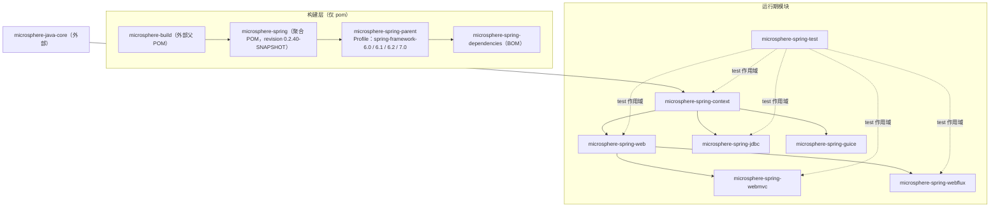

# 开发者文档 —— `release` 分支（0.2.x）

[← 开发者文档索引](../../zh/README.md) · [English](../README.md) · [用户文档 — current](../../../user-guide/current/zh/README.md) ·
[开发者文档 — 1.x](../../1.x/zh/README.md)

本目录文档面向 **0.2.x** 版本线，即 `release` 分支：Java 17、`jakarta.*` 命名空间、Spring Framework 6.0.x – 7.0.x。
这里描述的每个类、包与流程都是该分支上的代码；0.1.x 维护线单独记录在
[`../../1.x/`](../../1.x/zh/README.md) 中。

## 版本信息

| 项目 | 值 |
|---|---|
| 分支 | `release` |
| 版本线 | 0.2.x —— 已发布 `0.2.39`，开发中 `0.2.40-SNAPSHOT` |
| Java 基线 | 17 |
| 命名空间 | `jakarta.*`（`jakarta.jakartaee-bom` 11.0.0） |
| 已验证的 Spring Framework | 6.0.23 / 6.1.21 / 6.2.18 / 7.0.9（`spring-framework-6.0 … 7.0` Profile，其中 **7.0 为 `activeByDefault`**） |
| Reactor BOM | 2022.0.22 / 2023.0.19 / 2024.0.17 / 2025.0.7，与 Spring Profile 成对 |
| 构建父 POM | `io.github.microsphere-projects:microsphere-build` `0.3.17`（`origin/release:pom.xml:8` 与工作区 `main` 一致） |
| 受管第三方版本 | Jackson 2.22.3、SnakeYAML 2.7、P6Spy 3.9.1、ZooKeeper 3.9.6、Curator 5.9.0（Guice 7.0.0 **不由 parent 管理**——它钉在 `microsphere-spring-guice/pom.xml:22` 里） |

Maven Central 上的已发布构件为 `0.2.30` … `0.2.39`；各版本变更见
[release-notes.md](../../../../release-notes.md)。

## 模块依赖关系图



以上结构在模块 pom 中均可直接核对：

- **一个内核，两种传输。** `webmvc` 与 `webflux` 都依赖 `web`，彼此之间没有任何依赖，
  因此 Servlet 应用与响应式应用共用同一套端点元数据模型。
- **`context` 是运行期依赖树的根。** `web`、`jdbc`、`guice` 都建立在它之上；没有任何模块依赖 `webmvc` 或 `webflux`。
- **`test` 是叶子节点。** 它只以 test 作用域被使用，但除 `guice` 之外的每个模块都需要它，因此必须比其他模块更早可解析 ——
  这正是它在 reactor 顺序中排在末尾的原因。
- **唯一必需的外部依赖是 `microsphere-java-core`。** Spring、Jackson、SnakeYAML、P6Spy、Guice、Servlet API、
  Tomcat、ZooKeeper 都声明为 `optional` 或 `provided`，本库不会替使用者决定版本。

## 模块文档

| 模块 | English | 简体中文 | 内容 |
|---|---|---|---|
| parent | [parent.md](../parent.md) | [中文](./parent.md) | `${revision}` 扁平化，Profile → Spring/Reactor BOM 选择 |
| dependencies | [dependencies.md](../dependencies.md) | [中文](./dependencies.md) | 面向使用者的 BOM 及其导入链 |
| context | [context.md](../context.md) | [中文](./context.md) | 属性源、宽松绑定、TTL 缓存、可监听 Environment、并行预实例化 |
| web | [web.md](../web.md) | [中文](./web.md) | 端点元数据模型、注册器生命周期、拦截 SPI |
| webmvc | [webmvc.md](../webmvc.md) | [中文](./webmvc.md) | Servlet/MVC 适配、`ReversedProxyHandlerMapping`、响应体缓存 |
| webflux | [webflux.md](../webflux.md) | [中文](./webflux.md) | 响应式适配、`WebFilter` + `HandlerResult` 路径 |
| jdbc | [jdbc.md](../jdbc.md) | [中文](./jdbc.md) | `p6spy:` URL 间接层、DataSource 包装、监听器分发 |
| guice | [guice.md](../guice.md) | [中文](./guice.md) | 单向桥接：Guice `@Inject` 由 Spring 满足（无 Injector/Module）；所有注入点均按非必需解析 |
| test | [test.md](../test.md) | [中文](./test.md) | 内嵌 Tomcat / ZooKeeper / SQLite 生命周期、抽象测试基类 |

链接缺失表示该模块文档尚未完成。

## 一页看懂扩展模型

所有模块都遵循同样的三步结构，掌握之后各模块的流程便一目了然：

1. **`@Enable*` 注解**承载配置并 `import` 一个 `ImportBeanDefinitionRegistrar`
   （例如 `@EnableWebExtension` → `WebExtensionBeanDefinitionRegistrar`）。
2. **注册器装配协作者**，依据 `BeanFactory` 中已存在的实现选择 `Simple`、`Composite` 或框架专属实现，
   并尊重注解中的布尔开关（如 `registerWebEndpointMappings`、`interceptHandlerMethods`、`publishEvents`）。
3. **运行期对象挂接 Spring 扩展点**：实例化之前的 `ApplicationContextInitializer` 与
   `BeanFactoryPostProcessor`，实例化过程中的 `BeanPostProcessor`，刷新之后的 `SmartLifecycle`，
   事件用的 `ApplicationListener`，发现机制用的 `META-INF/spring.factories` 与 `META-INF/services`。
   `BeanSource` 决定发现策略：`BEAN_FACTORY`、`SPRING_FACTORIES`、`JAVA_SERVICE_PROVIDER`。

各模块文档中的流程图正是沿这条链路绘制：注解 → 注册器 → 扩展点 → 运行期效果。

## 构建与验证

```bash
mvn -P spring-framework-7.0 clean verify       # 本分支默认 Profile
mvn -P spring-framework-6.0 clean test         # 最低支持的 Spring 版本线
mvn -pl microsphere-spring-webmvc -am test     # 单模块 + 其依赖
```

这些 Profile 定义在 [`microsphere-spring-parent/pom.xml`](../../../../microsphere-spring-parent/pom.xml) 中，
只切换导入的 Spring 与 Reactor BOM；模块 pom 再补充该 Profile 所需的额外依赖。本分支要求 Java 17，
根 POM 声明 `<java.version>17</java.version>`。

## 本目录文档的约定

- 文件引用采用仓库相对路径（`microsphere-spring-context/src/main/java/...`），当某个论断依赖具体行号时给出行号。
- `⚠` 标记已在源码中核实的偏差：声明却从未读取的属性、包名拼写错误、或与注解名称不符的行为。
- 与 0.1.x 版本线的差异在各模块文档中单独说明，并汇总于
  [用户文档 current/README 的跨分支对照表](../../../user-guide/current/zh/README.md)。
