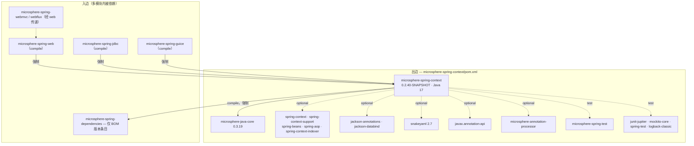
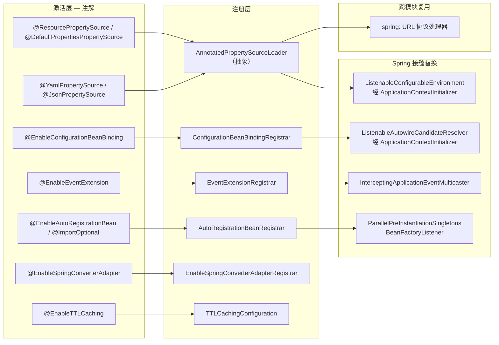
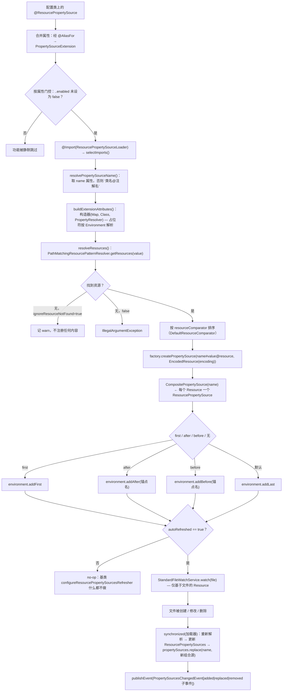
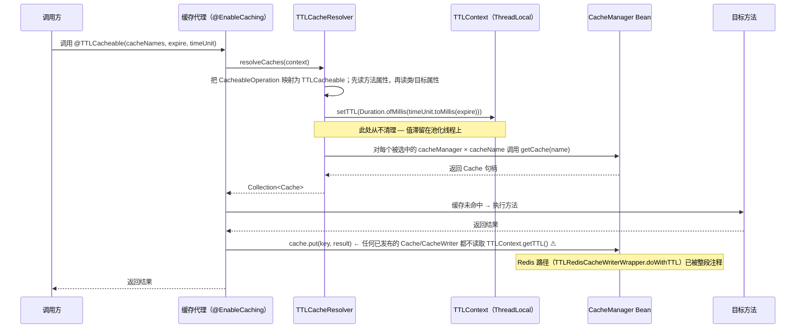
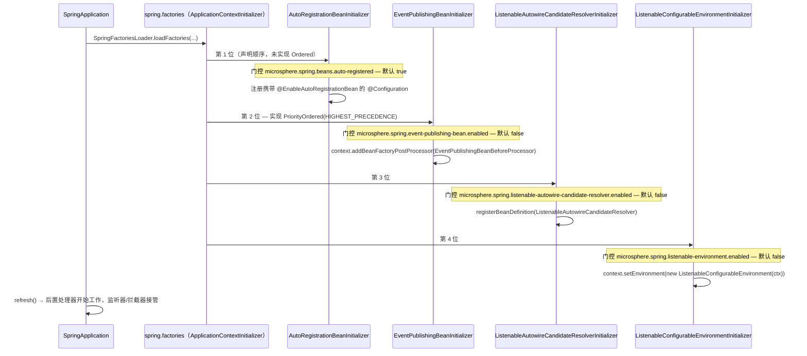

# microsphere-spring-context — 开发者文档

[← 开发者文档总览](./README.md) · [English](../context.md) · [用户文档](../../../user-guide/current/zh/context.md) · [1.x](../../1.x/zh/context.md)

## 1. 模块标识、基线与依赖态势

| 属性 | 值 | 证据 |
|---|---|---|
| Maven 坐标 | `io.github.microsphere-projects:microsphere-spring-context:${revision}` | `microsphere-spring-context/pom.xml:14-15` |
| 本次分析的多模块版本 | `0.2.40-SNAPSHOT`（`revision`） | `pom.xml:55` |
| 父 POM | `microsphere-spring-parent:${revision}` | `microsphere-spring-context/pom.xml:5-11` |
| Java 基线 | `17`（`java.version`） | `pom.xml:56` |
| Spring 基线 | 通过 profile 选择 `6.0.23` / `6.1.21` / `6.2.18` / `7.0.9`，经 `spring-framework-bom` 生效 | `microsphere-spring-parent/pom.xml:100-104,140-170` |
| 多模块内唯一强制依赖 | **仅** `microsphere-java-core`（compile、非 optional），版本 `0.3.19` | `microsphere-spring-context/pom.xml:30-34`, `microsphere-spring-parent/pom.xml:22,119-124` |
| 可选 Spring 构件 | `spring-context`、`spring-context-support`、`spring-beans`、`spring-aop`、`spring-context-indexer` | `microsphere-spring-context/pom.xml:37-65` |
| 可选第三方构件 | `javax.annotation-api`、`jackson-annotations`、`jackson-databind`（BOM `2.22.3`）、`snakeyaml`（`2.7`） | `microsphere-spring-context/pom.xml:67-92`, `microsphere-spring-parent/pom.xml:25-26,37-48` |
| 注解处理器 | `microsphere-annotation-processor`，optional（仅构建期） | `microsphere-spring-context/pom.xml:24-28` |
| test 作用域 | `junit-jupiter`、`mockito-core`、`spring-test`、`microsphere-spring-test`、`logback-classic` | `microsphere-spring-context/pom.xml:94-127` |
| 命名空间根 | `io.microsphere.spring` — 8 个顶层包（`beans`、`cache`、`config`、`constants`、`context`、`core`、`net`、`util`） | `microsphere-spring-context/src/main/java/io/microsphere/spring/` |
| 主/测试类型数 | 161 个主类，136 个测试类（其中 119 个 `*Test` 套件） | `src/main/java/**`, `src/test/java/**` |
| 打包资源 | 仅有一个：`META-INF/spring.factories`（12 行） | `microsphere-spring-context/src/main/resources/META-INF/spring.factories` |
| BOM 条目 | 由 `microsphere-spring-dependencies` 统一管理版本 | `microsphere-spring-dependencies/pom.xml:26` |

**依赖态势。** 本模块是整个多模块构建的基石，其依赖态势是刻意设计的：`microsphere-java-core` 是*唯一*的 compile 强制依赖（`microsphere-spring-context/pom.xml:30-34`）。所有编译期用到的 Spring 构件都被标记为 `<optional>true</optional>`（`:37-65`），Jackson（`:75-85`）、SnakeYAML（`:88-92`）与 `javax.annotation-api`（`:67-72`）同样如此。flatten 插件会保留这些 optional 标记，因此下游应用**不会**从本 jar 传递获得任何 Spring、Jackson 或 SnakeYAML 依赖。其收益是：**同一个已发布的二进制可同时服务于 Spring Framework 6.0 至 7.0** —— 因为编译期接触到的只是在这一区间内保持稳定的 `spring-beans`/`spring-context` API，并且可选增强是通过反射式探测（不依赖 `@ConditionalOnMissingBean`，而是属性门控）启用的，所以多模块构建无需为每个 Spring 版本发布单独构件 —— 只需在四个 profile 下重跑测试（`microsphere-spring-parent/pom.xml:138-172`）。

同一态势的代价：触及可选库的功能会以 `NoClassDefFoundError` 失败，而不是给出清晰提示。具体而言 —— `@JsonPropertySource` 需要 `com.fasterxml.jackson.databind.ObjectMapper`（`microsphere-spring-context/src/main/java/io/microsphere/spring/config/env/support/JsonPropertySourceFactory.java`），`@YamlPropertySource` 需要 `org.yaml.snakeyaml.Yaml`（`.../YamlPropertySourceFactory.java`），`@EnableTTLCaching` 需要 `spring-context-support` 以提供 `org.springframework.cache.*` 类型（`.../cache/annotation/TTLCachingConfiguration.java`）。

入边证据：`microsphere-spring-web/pom.xml:33`、`microsphere-spring-jdbc/pom.xml:33`、`microsphere-spring-guice/pom.xml:44`；而 `microsphere-spring-test` 是被本模块消费（`microsphere-spring-context/pom.xml:116-121`），方向相反。⚠ `microsphere-spring-webmvc` / `microsphere-spring-webflux` 虽是多模块声明的模块（`pom.xml:65-66`），却没有直接的 `microsphere-spring-context` 边 —— 它们经 `microsphere-spring-web` 传递获得（`microsphere-spring-webmvc/pom.xml:33`、`microsphere-spring-webflux/pom.xml:33`）。

## 2. 包地图

| 包 | 代表性类型 | 职责 |
|---|---|---|
| `io.microsphere.spring.beans` | `BeanSource`、`BeanUtils`、`PropertyValuesUtils` | Bean 定义自省；被注册助手使用的 `BeanSource` 元数据对象 |
| `io.microsphere.spring.beans.factory` | `BeanFactoryUtils`、`Dependency`、`DependencyTreeWalker`、`BeanDependencyResolver`、`DefaultBeanDependencyResolver`、`InjectionPointDependencyResolvers`、`AbstractInjectionPointDependencyResolver`、`ConstructionInjectionPointDependencyResolver`、`DelegatingFactoryBean` | Bean 依赖图模型；从 `spring.factories` 加载的可插拔注入点解析 |
| `io.microsphere.spring.beans.factory.annotation` | `AnnotatedInjectionBeanPostProcessor`、`AnnotationBeanDefinitionRegistryPostProcessor`、`ConfigurationBeanBindingPostProcessor`、`ConfigurationBeanBindingRegistrar`、`ConfigurationBeanBindingsRegister`、`EnableConfigurationBeanBinding`、`EnableConfigurationBeanBindings`、`AutowiredInjectionPointDependencyResolver`、`ResourceInjectionPointDependencyResolver`、`AnnotatedInjectionPointDependencyResolver` | 注入扫描（`@Autowired`/`@Resource` 的重新实现）、`@ConfigurationProperties` 式类的宽松绑定、解析器插件 |
| `io.microsphere.spring.beans.factory.config` | `BeanDefinitionUtils`、`GenericBeanPostProcessorAdapter`、`NamedBeanHolderComparator` | 后置处理器基类与 Bean 定义查找助手 |
| `io.microsphere.spring.beans.factory.filter` | `ResolvableDependencyTypeFilter` | 基于可解析依赖的 `TypeFilter` |
| `io.microsphere.spring.beans.factory.support` | `BeanRegistrar`、`ListenableAutowireCandidateResolver`、`ListenableAutowireCandidateResolverInitializer`、`AutowireCandidateResolvingListener`、`CompositeAutowireCandidateResolvingListener`、`LoggingAutowireCandidateResolvingListener`、`GenericBeanNameGenerator`、`ConfigurationBeanAliasGenerator`、`DefaultConfigurationBeanAliasGenerator`、`HyphenAliasGenerator`、`JoinAliasGenerator`、`UnderScoreJoinAliasGenerator` | 编程式 Bean 注册；可观测的 `AutowireCandidateResolver`；别名生成策略集 |
| `io.microsphere.spring.cache` | `TTLContext` | 每次调用的 TTL 承载体，为 TTL 缓存子系统提供线程局部存储 |
| `io.microsphere.spring.cache.annotation` | `EnableTTLCaching`、`TTLCacheable`、`TTLCachePut`、`TTLCachingConfiguration` | 注解面（`@EnableCaching` / `@Cacheable` / `@CachePut` 元注解）+ 发布解析器的那个唯一 `@Bean`；**不使用** `@Aspect` |
| `io.microsphere.spring.cache.intereptor` ⚠ | `TTLCacheResolver` | 读取 `@TTLCacheable`/`@TTLCachePut`、把 TTL 写入 `TTLContext` 并对所有 `CacheManager` Bean 扇出的 `CacheResolver`（注意包名拼写错误） |
| `io.microsphere.spring.cache.redis` | `TTLRedisCacheWriterWrapper`、`TTLRedisConfiguration` | ⚠ 基于 Redis 的 TTL 缓存 —— **每一行都被注释掉了**，该包不产生任何已编译类（见 §4.3） |
| `io.microsphere.spring.config` | `ConfigurationPropertyRepository`、`CollectingConfigurationPropertyListener` | 收集到的配置属性元数据 |
| `io.microsphere.spring.config.context.annotation` | `PropertySourceExtension`、`PropertySourceExtensionAttributes`、`AnnotatedPropertySourceLoader`、`ResourcePropertySource`、`ResourcePropertySources`、`ResourcePropertySourceLoader`、`DefaultPropertiesPropertySource`、`DefaultPropertiesPropertySources`、`PropertySourceExtensionLoader` | 属性源的注解 + 加载器扩展模型 |
| `io.microsphere.spring.config.env` | `EnvironmentEnabled`、`ImmutableMapPropertySource` | 激活标记接口；只读 `MapPropertySource` |
| `io.microsphere.spring.config.env.annotation` | `YamlPropertySource`、`JsonPropertySource` | `@PropertySourceExtension` 的格式特化元注解 |
| `io.microsphere.spring.config.env.config` | `ResourceYamlProcessor` | 支持通配符/多资源的 SnakeYAML 加载 |
| `io.microsphere.spring.config.env.event` | `PropertySourceChangedEvent`、`PropertySourcesChangedEvent` | 自动刷新分支发布的事件 |
| `io.microsphere.spring.config.env.support` | `YamlPropertySourceFactory`、`JsonPropertySourceFactory`、`DefaultResourceComparator` | `PropertySourceFactory` 实现 + 资源排序 |
| `io.microsphere.spring.constants` | `PropertyConstants` | 共享的属性名常量（§4 中各功能门的键） |
| `io.microsphere.spring.context` | `ApplicationContextUtils`、`ConfigurableApplicationContextInitializer` | 上下文级静态助手；带属性门的初始化器基类 |
| `io.microsphere.spring.context.annotation` | `AnnotatedBeanCapableImportBeanDefinitionRegistrar`、`AnnotatedBeanCapableImportSelector`、`AnnotatedBeanCapableImportCandidate`、`BeanCapableImportCandidate`、`AutoRegistrationBeanInitializer`、`AutoRegistrationBeanRegistrar`、`EnableAutoRegistrationBean`、`ExposingClassPathBeanDefinitionScanner`、`ImportOptional`、`ImportOptionalSelector`、`OverrideAnnotationAttributes`、`OverrideAnnotationAttributesStrategy`、`ConfigurationPropertyOverrideAnnotationAttributesStrategy` | `@Import` 机制、可选导入过滤、带注解 Bean 的自动注册 |
| `io.microsphere.spring.context.config` | `AutoRegistrationBean`、`ConfigurationBeanBinder`、`DefaultConfigurationBeanBinder`、`ConfigurationBeanCustomizer` | 绑定策略 + 可注册 Bean 模型 |
| `io.microsphere.spring.context.event` | `BeanFactoryListener(s)`、`BeanFactoryListenerAdapter`、`BeanListener(s)`、`BeanListenerAdapter`、`ParallelPreInstantiationSingletonsBeanFactoryListener`、`DependencyAnalysisBeanFactoryListener`、`LoggingBeanFactoryListener`、`EnableEventExtension`、`EventExtensionRegistrar`、`EventPublishingBeanInitializer`、`EventPublishingBeanBeforeProcessor`、`EventPublishingBeanAfterProcessor`、`InterceptingApplicationEventMulticaster(Proxy)`、`ApplicationEventInterceptor(Chain)`、`ApplicationListenerInterceptor(Chain)`、`InterceptingApplicationListener`、`GenericApplicationListenerAdapter`、`OnceApplicationContextEventListener`、`BeanTimeStatistics`、`BeanPropertyChangedEvent` | BeanFactory 生命周期可观测性 + 事件拦截链 |
| `io.microsphere.spring.context.lifecycle` | `AbstractSmartLifecycle`、`LoggingSmartLifecycle` | `SmartLifecycle` 脚手架 |
| `io.microsphere.spring.core` | `SpringVersion`、`MethodParameterUtils` | 版本自省、方法参数助手 |
| `io.microsphere.spring.core.annotation` | `AnnotationUtils`、`GenericAnnotationAttributes`、`ResolvablePlaceholderAnnotationAttributes` | 带占位符解析的属性抽取 |
| `io.microsphere.spring.core.convert` | `ConversionServiceUtils`、`SpringConverterAdapter` | 把 `ConversionService` 桥接到 `microsphere-java-core` 转换器 |
| `io.microsphere.spring.core.convert.annotation` | `EnableSpringConverterAdapter`、`EnableSpringConverterAdapterRegistrar` | 将转换器适配器装入上下文的 `ConversionService` |
| `io.microsphere.spring.core.convert.support` | `ConversionServiceResolver` | 定位正确的 `ConversionService` |
| `io.microsphere.spring.core.env` | `ListenableConfigurableEnvironment`、`ListenableConfigurableEnvironmentInitializer`、`EnvironmentListener`、`PropertyResolverListener`、`ProfileListener`、`LoggingEnvironmentListener`、`EnvironmentUtils`、`PropertyResolverUtils`、`PropertySourcesUtils` | 可观测的 `Environment`（变更通知）、环境/属性源工具 |
| `io.microsphere.spring.core.io` | `ResourceUtils`、`ResourceLoaderUtils` | 资源定位解析、通配符展开 |
| `io.microsphere.spring.core.io.support` | `PropertiesUtils`、`SpringFactoriesLoaderUtils` | properties 加载；`spring.factories` 访问助手 |
| `io.microsphere.spring.net` | `SpringProtocolURLStreamHandler`、`SpringSubProtocolURLConnectionFactory`、`SpringResourceURLConnectionFactory`、`SpringResourceURLConnection`、`AbstractSpringResourceURLConnection`、`SpringResourceURLConnectionAdapter`、`SpringEnvironmentURLConnectionFactory`、`SpringPropertySourcesURLConnectionAdapter`、`SpringProfilesURLConnectionAdapter`、`SpringDelegatingBeanProtocolURLConnectionFactory` | `spring:` URL 协议，被 `microsphere-spring-jdbc` 复用 |
| `io.microsphere.spring.util` | `FilterMode`、`MimeTypeUtils`、`SpringVersionUtils` | 各注解共享的包含/排除语义；MIME 映射；Spring 版本判定 |

本模块构建于其上的外部类型：

| 类型 | 所属 | 本模块为何需要它 |
|---|---|---|
| `io.microsphere.core.Version`、`io.microsphere.util.*`、`io.microsphere.lang.*` | `microsphere-java-core` | 唯一强制依赖；本模块委托而非重复实现的通用工具 |
| `org.springframework.cache.Cache`、`CacheResolver`、`concurrent.ConcurrentMapCacheFactoryBean` | `spring-context-support` / `spring-context`（optional） | TTL 缓存子系统的基类型 |
| `org.springframework.cache.annotation.EnableCaching`、`@Cacheable`、`@CachePut` | Spring Framework（optional） | `@EnableTTLCaching` 与 TTL 注解的元注解根 |
| `com.fasterxml.jackson.databind.ObjectMapper` | `jackson-databind`（optional） | `JsonPropertySourceFactory` |
| `org.yaml.snakeyaml.Yaml` | `snakeyaml`（optional） | `YamlPropertySourceFactory`、`ResourceYamlProcessor` |

## 3. 架构总览

## 4. 架构设计（含证据）

### 4.1 注解 + 注册器/加载器扩展模型

本模块所有功能都遵循同一形态：一个公开注解，其元注解携带 `ImportSelector` 或 `ImportBeanDefinitionRegistrar`，再由共享的抽象基类完成通用工作。

* `AnnotatedBeanCapableImportCandidate` 是根：它解析合并后的注解属性（含占位符解析），并施加按属性构造的启用门，键形如 `annotationType.getName() + "." + attribute + ".enabled"`（`context/annotation/AnnotatedBeanCapableImportCandidate.java:206`、`:28`）。
* `AnnotatedBeanCapableImportSelector` 将 `selectImports(AnnotationMetadata)` 声明为 `final`，并分派到接收已解析属性的模板方法（`context/annotation/AnnotatedBeanCapableImportSelector.java:73`、`:113`）。
* `AnnotatedBeanCapableImportBeanDefinitionRegistrar` 是注册器孪生类，被 `ConfigurationBeanBindingRegistrar`（`beans/factory/annotation/ConfigurationBeanBindingRegistrar.java:94`）、`EventExtensionRegistrar`（`context/event/EventExtensionRegistrar.java:55`）、`AutoRegistrationBeanRegistrar` 与 `EnableSpringConverterAdapterRegistrar` 继承。
* `@ImportOptional` / `ImportOptionalSelector` 依据 `BeanSource` 式发现规则过滤被导入的类名，因此当某个库缺失时可选导入会静默消失（`context/annotation/ImportOptional.java`、`ImportOptionalSelector.java`）。这正是让 §1 的可选依赖态势在运行时可用的机制。

### 4.2 属性源子系统

`@PropertySourceExtension` 是 `@Target(ANNOTATION_TYPE)`（`config/context/annotation/PropertySourceExtension.java:144-148`）—— 它*只*是元注解，绝不能直接使用。`@ResourcePropertySource` 把它叠加在 `@Target(TYPE) @Inherited @Repeatable(ResourcePropertySources)` 注解上，再加 `@Import(ResourcePropertySourceLoader.class)`（`config/context/annotation/ResourcePropertySource.java:127-134`），并通过 `@AliasFor(annotation = PropertySourceExtension.class)` 重新暴露全部十个属性（`:142-242`）。

加载器层次共三层，每层增加一个维度：

| 类 | 新增能力 | 证据 |
|---|---|---|
| `AnnotatedPropertySourceLoader<A>` | 名称解析 + 把错误包装成 `BeanCreationException` | `config/context/annotation/AnnotatedPropertySourceLoader.java:67,74-88`；默认名为 `declaringClass@AnnotationType`（`:129-133`） |
| `PropertySourceExtensionLoader<A, EA>` | 属性→`PropertySourceExtensionAttributes`、资源解析、组合装配、定位插入、自动刷新 | `config/context/annotation/PropertySourceExtensionLoader.java:72-73`；属性对象经 `getConstructor(Map.class, Class.class, PropertyResolver.class)` 反射构建（`:164-167`）；泛型属性类型来自 `resolveGeneric(...,1)`（`:82-84`） |
| `ResourcePropertySourceLoader` | 通配符解析 + 文件监听 | `config/context/annotation/ResourcePropertySourceLoader.java:51-52`；`afterPropertiesSet` 中创建 `PathMatchingResourcePatternResolver`（`:76-80`）；`StandardFileWatchService`（`:147-169`）；`destroy()` 停止监听（`:307-312`） |

**定位插入**恰好四个分支，优先级顺序为：`first` → `addFirst`；否则 `after` → `addAfter`；否则 `before` → `addBefore`；否则 `addLast`（`PropertySourceExtensionLoader.java:133-152`）。因此 `first` 会静默覆盖两个相对位置属性，与注解 javadoc `PropertySourceExtension.java:167-168` 一致。

**多个资源变成一个 `CompositePropertySource`。** 每个注解解析出 N 个资源；每个资源被包装为名为 `<composite>#<resourceValue>@<resource.toString()>` 的 `ResourcePropertySource`，并加入以注解 `name` 注册的单个 `CompositePropertySource`（`PropertySourceExtensionLoader.java:183-190`、`:460-463`、`:475-486`）。资源按 `resourceComparator` 属性排序，该比较器同样是反射实例化的（`:452-454`、`:517-520`），默认 `DefaultResourceComparator`（`config/env/support/DefaultResourceComparator.java`）。

**自动刷新**仅在 `autoRefreshed = true` 时安装刷新器（`:192-198`）。刷新器是一个对加载器实例 `synchronized (this)` 的 lambda，重新解析后调用 `propertySources.replace(name, newComposite)`（`:203-226`、`:297-308`），并发布携带 added/replaced/removed 子事件的 `PropertySourcesChangedEvent`（`:228-232`、`config/env/event/PropertySourcesChangedEvent.java`）。基类的 `configureResourcePropertySourcesRefresher` 是刻意留空的 no-op（`:499-503`）；只有 `ResourcePropertySourceLoader` 覆写它，且只监听**基于文件的资源**（`isFileBasedResource`，`ResourcePropertySourceLoader.java:160`）。

**格式工厂。** `@YamlPropertySource` 不过是 `@ResourcePropertySource(factory = YamlPropertySourceFactory.class)`（`config/env/annotation/YamlPropertySource.java:111`）；该工厂运行 `ResourceYamlProcessor` 并把结果包进 `ImmutableMapPropertySource`（`config/env/support/YamlPropertySourceFactory.java:51,54-56`）。`@JsonPropertySource` 用 Jackson 对等地镜像之，但产出可变的 `MapPropertySource`（`config/env/support/JsonPropertySourceFactory.java:69,72-76`）。⚠ 这种不对称是真实的：YAML 不可变，JSON 可变。`@DefaultPropertiesPropertySource` 面向众所周知的 `defaultProperties` 源名，并导入自己的加载器（`config/context/annotation/DefaultPropertiesPropertySource.java:89-95`）。

### 4.3 TTL 缓存子系统

`@EnableTTLCaching` 即 `@EnableCaching` + `@Import(TTLCachingConfiguration.class)`（`cache/annotation/EnableTTLCaching.java:68-73`）；被导入的配置类是包级私有的，只贡献一个 Bean —— 固定名为 `ttlCacheResolver` 的 `TTLCacheResolver`（`cache/annotation/TTLCachingConfiguration.java:30-35`、`cache/intereptor/TTLCacheResolver.java:60`）。

`@TTLCacheable` / `@TTLCachePut` 就是预先设好 `cacheResolver = BEAN_NAME` 的 `@Cacheable` / `@CachePut`（`cache/annotation/TTLCacheable.java:60-64`、`cache/annotation/TTLCachePut.java:66`），外加两个 TTL 专属属性：`timeUnit()` 默认 `MILLISECONDS`，以及**没有默认值、因此是必填的 `expire()`**（见 `TTLCachePut.java:173`、`:178`）。

`TTLCacheResolver` 同时是 `CacheResolver` 和 `OnceApplicationContextEventListener<ContextRefreshedEvent>`；它在上下文刷新时捕获 `Environment` 与*全部* `CacheManager` Bean（`TTLCacheResolver.java:58,152-157`）。每次调用它先把 Spring 缓存操作类映射到 TTL 注解（`:62-65`），先从方法、再从声明类/目标对象读取属性（`:124-143`），把时长写入 `TTLContext.setTTL(...)`（`:91-122`），最后返回被选中的缓存管理器 × 缓存名的笛卡尔积（`:95-114`）；`cacheManagers()` 用于收窄管理器集合（`:97-106`）。

⚠ **TTL 目前只写不读。** `TTLContext` 通过 `ThreadLocal<Duration>` 暴露时长，本应由缓存写入器读取（`cache/TTLContext.java:55,98-110`），而整棵源码树中唯一的消费者 `TTLRedisCacheWriterWrapper.put(...)` 位于 `cache/redis/`，**自 `:17` 起每一行都被注释掉**，`TTLRedisConfiguration` 亦然。在 `src/main/java` 中全局搜索 `doWithTTL`，只会命中 `TTLContext` 自身与那些被注释的行。后果是：(a) 在本模块自带的内存缓存下，`@TTLCacheable` 的行为与 `@Cacheable` 完全一致；(b) `TTLCacheResolver` 从不调用 `TTLContext.clearTTL()`，该值会滞留在池化线程上，直到后续某个 `doWithTTL` 才移除。

### 4.4 宽松绑定与别名生成

`@EnableConfigurationBeanBinding` 导入 `ConfigurationBeanBindingRegistrar`（`beans/factory/annotation/ConfigurationBeanBindingRegistrar.java:94`），后者注册配置 Bean 自身（`:148-165`），随后经 `registerInfrastructureBean` 安装基础设施后置处理器 `configurationBeanBindingPostProcessor`（`:185-186`）。`ConfigurationBeanBindingPostProcessor` 是一个 `BeanPostProcessor, BeanFactoryAware, PriorityOrdered`，在 `postProcessBeforeInitialization` 中完成绑定（`beans/factory/annotation/ConfigurationBeanBindingPostProcessor.java:85,109-116,178-190`）。绑定器可替换：先尝试 `beanFactory.getBean(ConfigurationBeanBinder.class)`，失败则回退到 `DefaultConfigurationBeanBinder`（`:193-207`、`:229-230`）—— 即针对 `context/config/ConfigurationBeanBinder.java` 的策略模式。

别名来自 `spring.factories`：`loadFactories(beanFactory, ConfigurationBeanAliasGenerator.class)`，然后对每个生成器调用 `registry.registerAlias(beanName, alias)`（`:139-146`）。实现有 `DefaultConfigurationBeanAliasGenerator`、`HyphenAliasGenerator`、`JoinAliasGenerator`、`UnderScoreJoinAliasGenerator`（`beans/factory/support/`）。⚠ 本模块打包的 `META-INF/spring.factories` 中**没有**列出其中任何一个；唯一有内容的是测试资源（`src/test/resources/META-INF/spring.factories:8-11`）。因此开箱状态下别名列表为**空**，只有裸 Bean 名可被解析。

### 4.5 可监听（Listenable）的 `Environment` 与 `AutowireCandidateResolver`

两者都由 `ApplicationContextInitializer` 换入，两者都默认关闭：

* `ListenableConfigurableEnvironmentInitializer`（`core/env/`）调用 `context.setEnvironment(new ListenableConfigurableEnvironment(context))`（`core/env/ListenableConfigurableEnvironmentInitializer.java:92-95`），门控属性为 `microsphere.spring.listenable-environment.enabled`，默认 `false`（`:73,75,85,90`）。`ListenableConfigurableEnvironment` 是一个实现 `ConfigurableEnvironment` 的纯委托装饰器（`core/env/ListenableConfigurableEnvironment.java:53`），在每个变更方法前后触发 `before…`/`after…` 通知（`:106-109`）。监听器来自三个 `spring.factories` 键 —— `EnvironmentListener`、`ProfileListener`、`PropertyResolverListener` —— 且每个 `EnvironmentListener` 都会*同时*被注册为 profile 监听器与属性解析监听器（`:79-102`）。
* `ListenableAutowireCandidateResolverInitializer` 把 `ListenableAutowireCandidateResolver` 注册为 Bean 定义（`beans/factory/support/ListenableAutowireCandidateResolverInitializer.java:97-100`），门控属性为 `microsphere.spring.listenable-autowire-candidate-resolver.enabled`，默认 `false`（`:77,79,89,94`）。该解析器实现 `AutowireCandidateResolver, BeanFactoryPostProcessor`，并组合从 `spring.factories` 载入的 `AutowireCandidateResolvingListener`（`beans/factory/support/ListenableAutowireCandidateResolver.java:69,151`、`beans/factory/support/AutowireCandidateResolvingListener.java:80`），`CompositeAutowireCandidateResolvingListener` / `LoggingAutowireCandidateResolvingListener` 分别充当扇出器与参考实现。

### 4.6 BeanFactory 监听器基础设施与并行预实例化

`EventPublishingBeanInitializer` 以 `HIGHEST_PRECEDENCE` 运行（`context/event/EventPublishingBeanInitializer.java:112-115`），门控属性 `microsphere.spring.event-publishing-bean.enabled` 默认 `false`（`:84,86,96,101`），且只做一件事：`context.addBeanFactoryPostProcessor(new EventPublishingBeanBeforeProcessor())`（`:108-110`）。

随后 `EventPublishingBeanBeforeProcessor` 同时实现四个接口 —— `InstantiationAwareBeanPostProcessor, BeanDefinitionRegistryPostProcessor, DestructionAwareBeanPostProcessor, InstantiationStrategy` —— 并反射侵入 `AbstractAutowireCapableBeanFactory.getInstantiationStrategy()` 以包裹真实策略（`context/event/EventPublishingBeanBeforeProcessor.java:58-61,72-84`）。它注册 `beanFactoryListeners` / `beanListeners` 组合体（`:185-195`、`context/event/BeanFactoryListeners.java:54,66-67`、`context/event/BeanListeners.java:85`），并把 `EventPublishingBeanAfterProcessor` 注入为*第一个* Bean 定义（`:169`）。

`BeanFactoryListener` 暴露三个回调 —— `onBeanDefinitionRegistryReady`、`onBeanFactoryReady`、`onBeanFactoryConfigurationFrozen`（`context/event/BeanFactoryListener.java:61-84`）—— `BeanFactoryListeners` 向所有被发现的 Bean 扇出，并用 `NamedBeanHolderComparator` 排序。

`ParallelPreInstantiationSingletonsBeanFactoryListener` 挂接 `onBeanFactoryConfigurationFrozen`（`context/event/ParallelPreInstantiationSingletonsBeanFactoryListener.java:109,148-173`）：用 `DefaultBeanDependencyResolver` 构建依赖映射（`:185-194`），把 Bean 名分组为依赖路径，然后每条路径向固定线程池提交一个任务；池大小由 `microsphere.spring.pre-instantiation.singletons.threads` 决定（默认为可用处理器数；`< 1` 时整个功能失效），线程名前缀为 `microsphere.spring.pre-instantiation.singletons.thread.name-prefix`（`:115,125,140,175-183,196-213`）。

**线程安全。** 线程池为 `newFixedThreadPool`，只在 `finally` 中 `shutdown()`（`:166`）；除了 10 ms 轮询循环外没有 `awaitTermination` 超时约束（`:215`）。正确性完全依赖 Spring 自身在 `DefaultSingletonBeanRegistry` 中对 `synchronized singletonObjects` 的加锁；这里没有为用户代码做任何同步，因此触碰共享可变状态的 `@PostConstruct` 会随着 `threads` 增大而按同样比例变得竞态。Bean 创建顺序在路径之间**不被保证** —— 只保证单条路径内的依赖次序。`DependencyAnalysisBeanFactoryListener` 是输出同一依赖图的只读兄弟类（`context/event/DependencyAnalysisBeanFactoryListener.java:80,85-97`）。

### 4.7 事件拦截链

`@EnableEventExtension` 是 `@Target({TYPE, ANNOTATION_TYPE})`，标注了 `@OverrideAnnotationAttributes` 与 `@Import(EventExtensionRegistrar.class)`（`context/event/EnableEventExtension.java:57-62`）。属性：`intercepted()`（默认 `true`）、`executorForListener()`（哨兵值 `"N/E"`，`:67,87`）、`sources()` 默认为 `{BEAN_FACTORY, SPRING_FACTORIES, JAVA_SERVICE_PROVIDER}`（`:102`）。

`EventExtensionRegistrar` 在众所周知的 `applicationEventMulticaster` Bean 名下替换多播器（`:79,117`）。当既不拦截也无执行器时直接短路（`:81-90`），依据 Bean 定义属性对重复注册去重（`:100-104,120-128`），否则**重建**而非粗暴覆盖既有定义（`:107`）。当 `intercepted` 时，它按 `BeanSource` 集合注册 `ApplicationEventInterceptor` 与 `ApplicationListenerInterceptor` Bean（`:110-114,160-164`）。

运行时由 `InterceptingApplicationEventMulticaster(Proxy)` 加上 `DefaultApplicationEventInterceptorChain` / `DefaultApplicationListenerInterceptorChain` 构成，是典型的职责链模式：每个拦截器收到 `(event, eventType, chain)`，必须调用 `chain.intercept(...)` 才能继续，省略即吞掉该事件（`context/event/ApplicationEventInterceptor.java:52-87`、`ApplicationEventInterceptorChain.java:57-60`、`DefaultApplicationEventInterceptorChain.java:32,45-47`）。`GenericApplicationListenerAdapter` 把类型化的 `ApplicationListener` 契约桥接到 `GenericApplicationListener` 接缝。

### 4.8 `spring:` URL 协议处理器

`SpringProtocolURLStreamHandler` 继承 `microsphere-java-core` 的 `ExtendableProtocolURLStreamHandler`，`PROTOCOL = "spring"`，并实现 `InitializingBean, ResourceLoaderAware, BeanFactoryAware, EnvironmentAware`（`net/SpringProtocolURLStreamHandler.java:60-62,72`）。在 `afterPropertiesSet` 中它通过 `ConversionServiceResolver` 解析上下文的 `ConversionService` 并加入 `SpringConverterAdapter`，随后用三个工厂初始化子协议表（`:76-93`）：`SpringResourceURLConnectionFactory`（`spring:resource:<scheme>://…`）、`SpringEnvironmentURLConnectionFactory`（`spring:env:property-sources://…`、`spring:env:profiles://…`，经 `SpringPropertySourcesURLConnectionAdapter` / `SpringProfilesURLConnectionAdapter`），以及 `SpringDelegatingBeanProtocolURLConnectionFactory` —— 它把未知子协议回派给实现 `SpringSubProtocolURLConnectionFactory` 的 Spring Bean（`net/SpringSubProtocolURLConnectionFactory.java:32-49`）。不含子协议的 URL 会以 `MalformedURLException` 被拒绝（`:96-103`）。

⚠ 本模块中没有任何东西安装该处理器。`src/main/java` 中既无 `AutoRegistrationBean` 实现，也无 `spring.factories` 条目，也没有 `URL.setURLStreamHandlerFactory` 调用。真正注册它的是消费者 `microsphere-spring-jdbc`，把它列进 `@Import` 三元组（`microsphere-spring-jdbc/src/main/java/io/microsphere/spring/jdbc/p6spy/annotation/EnableP6DataSource.java:41-45`）；本模块自身的测试同样如此（`src/test/java/io/microsphere/spring/net/SpringProtocolURLStreamHandlerTest.java:47`）。

## 5. 运行时流程

### 5.1 `@ResourcePropertySource` 的处理流程（含自动刷新分支）

### 5.2 一次 TTL 缓存调用

### 5.3 spring.factories 中四个初始化器的启动次序

次序上的注意点：四个之中只有 `EventPublishingBeanInitializer` 声明了顺序（`getOrder()` = `HIGHEST_PRECEDENCE`，`context/event/EventPublishingBeanInitializer.java:112-115`）；`ConfigurableApplicationContextInitializer` 并未实现 `Ordered`，因此其余三个按 `spring.factories` 的声明顺序执行（`src/main/resources/META-INF/spring.factories:8-12`），这恰好把 `Environment` 替换放在最后 —— 若某个更靠后的初始化器读取 `environment`，它看到的仍是装饰前的实例。

## 6. 有据可查的设计模式

| 模式 | 具体类 | 证据 |
|---|---|---|
| 元注解驱动配置 | `@PropertySourceExtension` → `@ResourcePropertySource` → `@YamlPropertySource` / `@JsonPropertySource`；`@EnableTTLCaching` → `@EnableCaching`；`@TTLCacheable` → `@Cacheable` | `PropertySourceExtension.java:144`、`ResourcePropertySource.java:131-133`、`YamlPropertySource.java:111`、`EnableTTLCaching.java:71-72`、`TTLCacheable.java:64` |
| 注册器 / 加载器（Registrar / Loader） | `ConfigurationBeanBindingRegistrar`、`EventExtensionRegistrar`、`AutoRegistrationBeanRegistrar`、`ResourcePropertySourceLoader`、`PropertySourceExtensionLoader` | `ConfigurationBeanBindingRegistrar.java:94`、`EventExtensionRegistrar.java:55`、`ResourcePropertySourceLoader.java:51` |
| 模板方法（Template Method） | `AnnotatedBeanCapableImportSelector.selectImports` 为 final 并转调抽象重载；`AnnotatedPropertySourceLoader.loadPropertySource` 抽象；`PropertySourceExtensionLoader` 的抽象 `resolveResources` / `isResourcePattern`，开放的 `configureResourcePropertySourcesRefresher` | `AnnotatedBeanCapableImportSelector.java:73,113`、`AnnotatedPropertySourceLoader.java:145`、`PropertySourceExtensionLoader.java:92,502,515` |
| 工厂（Factory） | `PropertySourceFactory` 实现（`YamlPropertySourceFactory`、`JsonPropertySourceFactory`）、`BeanRegistrar.registerFactoryBean`、`SpringSubProtocolURLConnectionFactory` | `YamlPropertySourceFactory.java:51`、`JsonPropertySourceFactory.java:69`、`BeanRegistrar.java:667`、`SpringSubProtocolURLConnectionFactory.java:32` |
| 装饰器（Decorator） | `ListenableConfigurableEnvironment` 包装 `ConfigurableEnvironment` 并在每个变更方法前后通知；`GenericBeanPostProcessorAdapter` 按类型过滤被委托的后置处理器；`DecoratingDisposableBean` 包裹销毁回调 | `ListenableConfigurableEnvironment.java:53,106-109`、`GenericBeanPostProcessorAdapter.java`、`EventPublishingBeanAfterProcessor.java:131` |
| 责任链（Chain of Responsibility） | `ApplicationEventInterceptorChain` / `DefaultApplicationEventInterceptorChain`、`ApplicationListenerInterceptorChain`、`InjectionPointDependencyResolvers` | `DefaultApplicationEventInterceptorChain.java:32,45-47`、`InjectionPointDependencyResolvers.java:64` |
| 观察者（Observer） | `EnvironmentListener` / `ProfileListener` / `PropertyResolverListener`、`AutowireCandidateResolvingListener` 及其组合体、`BeanFactoryListener` / `BeanListener`、`FileChangedListener`、`PropertySourcesChangedEvent` | `ListenableConfigurableEnvironment.java:79-102`、`AutowireCandidateResolvingListener.java:80`、`BeanFactoryListeners.java:88-96`、`ResourcePropertySourceLoader.java:171` |
| 策略（Strategy） | `ConfigurationBeanBinder`（`DefaultConfigurationBeanBinder`）可注入或回退；经 `resourceComparator` 选择的 `Comparator<Resource>`；`ConfigurationBeanAliasGenerator` 集合 | `ConfigurationBeanBindingPostProcessor.java:193-207`、`PropertySourceExtensionLoader.java:452-454`、`ConfigurationBeanBindingRegistrar.java:140` |
| 适配器（Adapter） | `SpringConverterAdapter` 把 Spring `Converter` 适配到 core SPI；`JavaBeansPropertyChangeListenerAdapter`；`GenericApplicationListenerAdapter`；`SpringResourceURLConnectionAdapter` / `SpringProfilesURLConnectionAdapter` | `core/convert/SpringConverterAdapter.java`、`context/event/JavaBeansPropertyChangeListenerAdapter.java`、`GenericApplicationListenerAdapter.java`、`net/SpringProfilesURLConnectionAdapter.java` |
| 组合（Composite） | 每个注解构建的 `CompositePropertySource`；`CompositeAutowireCandidateResolvingListener` | `PropertySourceExtensionLoader.java:183`、`CompositeAutowireCandidateResolvingListener.java` |
| 空对象 / 哨兵值 | `EnableEventExtension.NO_EXECUTOR = "N/E"`、`FilterMode.SEQUENTIAL` 默认值 | `EnableEventExtension.java:67`、`util/FilterMode.java:20,43` |

## 7. 扩展指南

### 7.1 新增一个属性源注解

1. 声明 `@Target(TYPE) @Retention(RUNTIME) @Inherited @Documented`，并以 `@ResourcePropertySource`（复用）或 `@PropertySourceExtension` 加 `@Import(YourLoader.class)` 作为元注解，必要时再加 `@Repeatable(YourSources.class)` —— 照着 `ResourcePropertySource.java:127-134` 写。
2. 用 `@AliasFor(annotation = PropertySourceExtension.class)` 逐个重新暴露属性；`PropertySourceExtensionLoader` 要求的属性名是 `value`、`name`、`first`、`before`、`after`、`autoRefreshed`、`encoding`、`ignoreResourceNotFound`、`resourceComparator`、`factory`（`PropertySourceExtensionAttributes.java`）。
3. 继承 `PropertySourceExtensionLoader<YourAnnotation, YourAttributes>`；属性类必须提供 `public YourAttributes(Map, Class, PropertyResolver)` 构造器，因为它是反射实例化的（`PropertySourceExtensionLoader.java:164-167`），而加载器的第二个类型参数是按泛型解析的（`:82-84`）。实现 `isResourcePattern` 与 `resolveResources`；仅当你要支持 `autoRefreshed` 时才覆写 `configureResourcePropertySourcesRefresher`。
4. 用户可通过设置 `io.microsphere…YourAnnotation.<attribute>.enabled=false` 关闭单个属性而无需改代码 —— 该门控键在 `AnnotatedBeanCapableImportCandidate.java:206` 拼装。

### 7.2 新增一个 `EnvironmentListener`

1. 实现 `io.microsphere.spring.core.env.EnvironmentListener`（它同时覆盖 `ProfileListener` 与 `PropertyResolverListener` 的通知，`ListenableConfigurableEnvironment.java:83-102`），或直接实现更窄的接口之一。`loadFactories` 负责实例化，请提供合适的公共构造器。
2. 在你自己的 `META-INF/spring.factories` 中，把全限定类名登记到键 `io.microsphere.spring.core.env.EnvironmentListener`（或 `…core.env.ProfileListener` / `…core.env.PropertyResolverListener`）下，做法与 `src/test/resources/META-INF/spring.factories:16-21` 完全一致。
3. 打开子系统：`microsphere.spring.listenable-environment.enabled=true`。否则 `Environment` 根本不会被替换，任何监听器也不会被询问。排序基于 `Ordered`（`:90` 处的 `sort(...)`）。
4. 同样的配方适用于 `AutowireCandidateResolvingListener`（需要 `microsphere.spring.listenable-autowire-candidate-resolver.enabled=true`）、`BeanFactoryListener` 与 `BeanListener`（需要 `microsphere.spring.event-publishing-bean.enabled=true`；经 `registerSpringFactoriesBeans` 注册，`BeanFactoryListeners.java:66`）、`ConfigurationBeanAliasGenerator`（`ConfigurationBeanBindingRegistrar.java:140`）以及 `AutoRegistrationBean`（`AutoRegistrationBeanRegistrar.java:52`）。

### 7.3 发现规则一览

| 机制 | 键 / 类型 | 被读取之处 | 默认值 |
|---|---|---|---|
| `spring.factories` — Spring 自带 | `org.springframework.context.ApplicationContextInitializer` | `SpringApplication` 启动时的 `SpringFactoriesLoader` | 打包了 4 个初始化器（`src/main/resources/META-INF/spring.factories:8-12`） |
| `spring.factories` — 本模块 SPI | `io.microsphere.spring.beans.factory.InjectionPointDependencyResolver` | `InjectionPointDependencyResolvers.java:64` | 打包了 3 个解析器（`:1-5`） |
| `spring.factories` — 本模块 SPI | `EnvironmentListener`、`ProfileListener`、`PropertyResolverListener`、`AutowireCandidateResolvingListener`、`ConfigurationBeanAliasGenerator`、`BeanFactoryListener`、`BeanListener`、`AutoRegistrationBean` | §7.2 中列出的 `loadFactories` / `registerSpringFactoriesBeans` 调用点 | **一个都没有打包** —— 需自行声明 |
| `BeanSource` | `BEAN_FACTORY`、`SPRING_FACTORIES`、`JAVA_SERVICE_PROVIDER` | `EnableEventExtension.sources()` → `EventExtensionRegistrar.java:111-114,160-164`；`beans/BeanSource.java:55-80` | 三者全选 |
| `EnvironmentEnabled` | 由 `isEnabled(environment)` 读取的 `<prefix>.enabled` | `config/env/EnvironmentEnabled.java:38-106`、`ConfigurableApplicationContextInitializer.java:70-82,101-123` | 前缀 + Bean 名，默认 `true`（除非覆写） |
| `FilterMode` | `microsphere.spring.filter-mode` → `SEQUENTIAL` / `CONDITIONAL` | `util/FilterMode.java:33-43` | ⚠ `valueOf(Environment)` 无生产调用者（见 §8） |

## 8. 陷阱

| # | 陷阱 | 证据 |
|---|---|---|
| 1 | 拦截器所在包被拼错为 **`io.microsphere.spring.cache.intereptor`**（"intereptor"）。它属于 `TTLCacheResolver` 公开类路径的一部分，并被 `TTLCachingConfiguration.java:19,22` 与 `TTLCacheable.java:30` 以名字引用，因此在不破坏二进制兼容的前提下无法更名。测试树同时保留了*两种*拼写（`src/test/java/io/microsphere/spring/cache/interceptor/` 与 `.../intereptor/`）。 | `cache/intereptor/TTLCacheResolver.java:17` |
| 2 | `@TTLCacheable` / `@TTLCachePut` 的 `expire` 是**必填项** —— 它没有 `default`。省略它是编译错误，而且不存在"永不过期"的哨兵值；`expire = 0` 得到零长度 TTL。 | `TTLCachePut.java:173`、`TTLCacheable.java` |
| 3 | 打包的四个初始化器中有三个**默认关闭**。只有 `AutoRegistrationBeanInitializer` 默认为 `true`（`PropertyConstants.DEFAULT_AUTO_REGISTERED_VALUE`，`constants/PropertyConstants.java:64-69`；用于 `AutoRegistrationBeanInitializer.java:55-57`）。 | `ListenableConfigurableEnvironmentInitializer.java:75`、`ListenableAutowireCandidateResolverInitializer.java:79`、`EventPublishingBeanInitializer.java:86` |
| 4 | ⚠ `ListenableConfigurableEnvironmentInitializer` 的 javadoc 让用户注册 `io.microsphere.spring.beans.factory.support.ListenableConfigurableEnvironmentInitializer` —— 该类并不存在；真实 FQN 是 `io.microsphere.spring.core.env.…`。照抄文档那一行会在启动时抛 `ClassNotFoundException`。 | `core/env/ListenableConfigurableEnvironmentInitializer.java:49` 对照 `:17` |
| 5 | 并行预实例化是靠线程数而非开关启用的：`threads < 1` 会返回 `null` 执行器，整个功能直接 no-op（`ParallelPreInstantiationSingletonsBeanFactoryListener.java:175-183`）。默认值取自可用处理器数，因此 CPU 配额受限的容器可能静默失去该优化。它还在工作线程上调用 `beanFactory.getBean(name)`；任何依赖创建顺序副作用、线程局部安全/租户上下文或非线程安全 `@PostConstruct` 的代码，其行为都会与串行启动不同。 | `:148-215` |
| 6 | `microsphere.spring.filter-mode`（`FilterMode.PROPERTY_NAME`）标注了 `@ConfigurationProperty`，因而会出现在生成的配置元数据里，但 `FilterMode.valueOf(Environment)` 在*任何*多模块构件的 `src/main/java` 中都**没有调用者** —— 只有 `src/test/java/.../FilterModeTest.java`。设置它不会改变任何行为。 | `util/FilterMode.java:27-43`；全仓搜索 `FilterMode.` |
| 7 | 打包的 `META-INF/spring.factories` 中没有登记任何 `ConfigurationBeanAliasGenerator`，因此尽管存在四个实现，宽松别名（连字符 / 下划线形式）在生产中是失效的。 | `src/main/resources/META-INF/spring.factories`（12 行，无该键）对照 `src/test/resources/META-INF/spring.factories:8-11` |
| 8 | ⚠ TTL 缓存写入的值无人读取：`TTLCacheResolver` 把 `TTLContext` 设在调用线程上且从不清理，而唯一的读取者（`TTLRedisCacheWriterWrapper`）连同 `TTLRedisConfiguration` 被整段注释。因此使用内存缓存提供者时 `@TTLCacheable` 实际永不过期。 | `cache/intereptor/TTLCacheResolver.java:119-122`、`cache/TTLContext.java:129-131`、`cache/redis/TTLRedisCacheWriterWrapper.java:17+` |
| 9 | 仅仅依赖本模块并不能让 `spring:` URL 生效 —— 该处理器从不自我注册。请把 `SpringProtocolURLStreamHandler.class` 加入某个 `@Import`（正如 `@EnableP6DataSource` 所做），或安装 JVM 级 `URLStreamHandlerFactory`。 | `net/SpringProtocolURLStreamHandler.java:60`；`EnableP6DataSource.java:41-45` |
| 10 | 自动刷新只监听**文件系统资源**；位于 jar 内部的 `classpath:` 资源永远不会注册到 `StandardFileWatchService`，对这类资源设置 `autoRefreshed = true` 会静默退化为静态属性源。 | `ResourcePropertySourceLoader.java:157-165` |
| 11 | `PropertySourceExtensionLoader.handleSourceName()` 假定生成的源名含 `@` 并调用 `substring(0, lastIndexOf("@"))`；若自定义的 `PropertySourceFactory` 会重命名属性源，`lastIndexOf` 可能返回 `-1` 并抛异常。 | `PropertySourceExtensionLoader.java:341-344`、`:460-463` |
| 12 | `first`、`after`、`before` 是靠优先级而非校验实现互斥：`first` 优先，其次 `after` 优先于 `before`。同时设置会静默忽略其一。 | `PropertySourceExtensionLoader.java:133-152` |
| 13 | `microsphere.spring.injection.metadata.cache.size`（由本模块最大的类型 `AnnotatedInjectionBeanPostProcessor` 使用）在类初始化时通过 `Integer.getInteger` 读取一次，即它是一个 **JVM 系统属性**（`-D…`），从不来自 Spring `Environment` —— 写进 `application.properties` 毫无作用，基于 `Environment` 的 profile 同样无法调整它。 | `beans/factory/annotation/AnnotatedInjectionBeanPostProcessor.java:167,172,185,251` |

## 9. 交叉链接

* 本模块面向使用者的"怎么用"文档：[user-guide/current/zh/context.md](../../../user-guide/current/zh/context.md)（英文：[user-guide/current/context.md](../../../user-guide/current/context.md)）
* 多模块整体依赖策略与版本 profile：[dependencies.md](./dependencies.md) · 父 POM：[parent.md](./parent.md)
* 构建在本模块之上的模块：[jdbc.md](./jdbc.md)（复用 `io.microsphere.spring.net`）· [guice.md](./guice.md)（复用 `AnnotatedInjectionBeanPostProcessor`）· [web.md](./web.md) · [test.md](./test.md)
* 本模块的 1.x / 0.1.x 分支：[../../1.x/zh/context.md](../../1.x/zh/context.md) — 总览：[开发者文档总览](./README.md)
