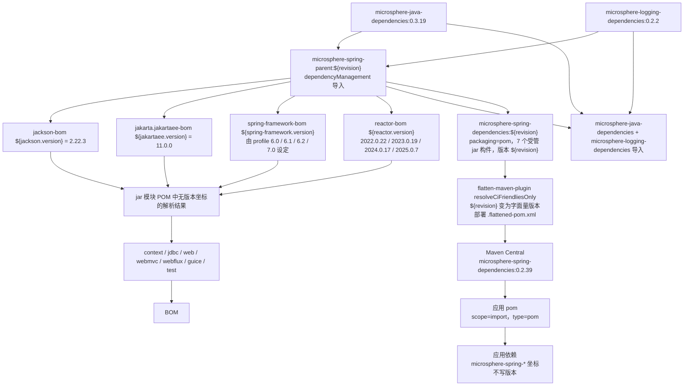

# microsphere-spring-dependencies — 开发者文档（0.2.x / `release`）

[← 开发者文档总览](./README.md) · [English](../dependencies.md) · [用户文档](../../../user-guide/current/zh/dependencies.md)

**谁需要这份文档。** 应用团队需要：这个 POM 就是对外发布的 BOM（`scope=import`），让使用者依赖任意
`microsphere-spring-*` 模块时无需写版本。库维护者也需要，出于一个更小但更硬的职责——保持受管清单与模块清单同步，
因为没被加进这里的目标无法被无版本地消费。

## 1. 版本信息

| 项目 | 值 |
|------|-------|
| 分支 | `release` |
| 文档目录 | `docs/**/current/` |
| 版本线 | **0.2.x** |
| 开发版本（根 `<revision>`） | `0.2.40-SNAPSHOT` |
| 最新发布版本 | `0.2.39` |
| Parent | `io.github.microsphere-projects:microsphere-spring-parent:${revision}`（`../microsphere-spring-parent/pom.xml`） |
| 构建基线 parent | `io.github.microsphere-projects:microsphere-build:0.3.17`（经 parent 链继承） |
| Java 基线 | Java 17（在 reactor 根 POM 中设定） |
| 坐标 / 打包方式 | `io.github.microsphere-projects:microsphere-spring-dependencies:${revision}`，`packaging=pom` |

## 2. 这个模块是什么

`microsphere-spring-dependencies` 是 reactor 对外的契约。它是一个纯构建模块——目录里只有
`microsphere-spring-dependencies/pom.xml` 这一个文件，没有 `src/`——而它唯一的内容就是一个覆盖七个已发布库构件的
`<dependencyManagement>` 块：

```xml
<parent>
    <groupId>io.github.microsphere-projects</groupId>
    <artifactId>microsphere-spring-parent</artifactId>
    <version>${revision}</version>
    <relativePath>../microsphere-spring-parent/pom.xml</relativePath>
</parent>

<groupId>io.github.microsphere-projects</groupId>
<artifactId>microsphere-spring-dependencies</artifactId>
<version>${revision}</version>
<packaging>pom</packaging>

<name>Microsphere :: Spring :: Dependencies</name>
<description>Microsphere Spring Dependencies</description>
```

它继承自 `microsphere-spring-parent` 而不是 reactor 根，正是这一点把 Spring/Reactor 的 profile 机制和第三方 BOM 导入
带进了这个 POM 的生效模型。

## 3. `<dependencyManagement>` 的内容（逐条）

BOM 声明了**七个**条目，全部属于 group `io.github.microsphere-projects`，全部使用版本 `${revision}`
（无 `<type>`/`<scope>`，即普通 jar 坐标，无排除项）：

| # | groupId | artifactId | version |
|---|---------|------------|---------|
| 1 | `io.github.microsphere-projects` | `microsphere-spring-context` | `${revision}` |
| 2 | `io.github.microsphere-projects` | `microsphere-spring-guice` | `${revision}` |
| 3 | `io.github.microsphere-projects` | `microsphere-spring-jdbc` | `${revision}` |
| 4 | `io.github.microsphere-projects` | `microsphere-spring-web` | `${revision}` |
| 5 | `io.github.microsphere-projects` | `microsphere-spring-webmvc` | `${revision}` |
| 6 | `io.github.microsphere-projects` | `microsphere-spring-webflux` | `${revision}` |
| 7 | `io.github.microsphere-projects` | `microsphere-spring-test` | `${revision}` |

BOM 里没有声明任何其他东西：没有 `<properties>`，没有 `<profiles>`，没有 `<build>`，没有 `<repositories>`，
没有 `<pluginManagement>`，也没有它自己的依赖。

由于 parent 被继承，使用者透过这个 BOM 看到的**生效** `dependencyManagement`，是上述七个条目与 parent 链所管理的
一切的并集：

| 来源 | 受管内容 |
|--------|-----------------|
| `microsphere-spring-parent`（导入的 BOM） | `com.fasterxml.jackson:jackson-bom:${jackson.version}`（`2.22.3`）、`jakarta.platform:jakarta.jakartaee-bom:${jakartaee.version}`（`11.0.0`）、`org.springframework:spring-framework-bom:${spring-framework.version}`、`io.projectreactor:reactor-bom:${reactor.version}`、`io.github.microsphere-projects:microsphere-java-dependencies:0.3.19`、`io.github.microsphere-projects:microsphere-logging-dependencies:0.2.2` |
| `microsphere-spring-parent`（直接条目） | `org.yaml:snakeyaml:2.7`、`p6spy:p6spy:3.9.1`、`org.apache.zookeeper:zookeeper:3.9.6`、`org.apache.curator:curator-recipes:5.9.0` 与 `curator-test:5.9.0`（两者都排除 `org.apache.zookeeper:zookeeper`） |

一个重要区别：导入一个 BOM 只会带入**那个 POM 自身的声明**。应用真正通过导入 `microsphere-spring-dependencies`
继承到的就是那七个条目；parent 链上的那些 BOM **不会**被这次导入再导出。这就是为什么各模块自己的 compile 依赖
（Spring、Jackson、Jakarta API）必须在每个模块 POM 里标成 `<optional>`。属性侧见 [./parent.md](./parent.md)。

## 4. 使用者如何导入

```xml
<dependencyManagement>
    <dependencies>
        <dependency>
            <groupId>io.github.microsphere-projects</groupId>
            <artifactId>microsphere-spring-dependencies</artifactId>
            <version>0.2.39</version>
            <type>pom</type>
            <scope>import</scope>
        </dependency>
    </dependencies>
</dependencyManagement>

<dependencies>
    <dependency>
        <groupId>io.github.microsphere-projects</groupId>
        <artifactId>microsphere-spring-context</artifactId>
    </dependency>
</dependencies>
```

由 BOM 的形状可以推出以下规则：

- 版本必须是已发布版本；`${revision}` 永远到不了使用者手里，因为 `flatten-maven-plugin`
  （`flattenMode=resolveCiFriendliesOnly`、`updatePomFile=true`）部署的是一份受管版本已是字面量的 POM——
  发布的 `0.2.39` BOM 里写的是 `microsphere-spring-context:0.2.39`，其余同理。
- `spring-framework.version` 不属于 BOM 契约：它是在**本仓库**构建期由 `spring-framework-6.0` … `spring-framework-7.0`
  profile 选定的，因此某个版本发布出来的构件是按一条版本线构建、可运行于 6.0.x–7.0.x。应用要用 `spring-framework-bom`
  自行对齐 Spring。
- 应用若想要不同于 BOM 的模块版本，显式写出版本即可——直接的 `<dependency><version>` 永远优先于导入的管理。

## 5. Reactor 覆盖情况

| Reactor 模块 | 是否由本 BOM 管理 | 是否发布 |
|----------------|---------------------|-----------|
| `microsphere-spring-parent` | 否（它是内部 parent） | 是，作为可继承的 `pom` parent 发布 |
| `microsphere-spring-dependencies` | 不适用（它就是 BOM） | 是 |
| `microsphere-spring-context` | 是 | 是 |
| `microsphere-spring-jdbc` | 是 | 是 |
| `microsphere-spring-web` | 是 | 是 |
| `microsphere-spring-webmvc` | 是 | 是 |
| `microsphere-spring-webflux` | 是 | 是 |
| `microsphere-spring-guice` | 是 | 是 |
| `microsphere-spring-test` | 是 | 是 |

在 `release` 上这份清单是完整的：根 `<modules>` 里每个 `jar` 模块都在此处受管，因此「受管集合 == 可发布集合」这条不变量成立。
在 `release-1.x` 上则不成立——`microsphere-spring-compatible` 是一个既不受管也不部署的 reactor 模块；
见 [../../1.x/zh/dependencies.md](../../1.x/zh/dependencies.md)。

维护规则：加入第 10 个模块意味着在一次提交里改三个文件——根 `<modules>`、`microsphere-spring-<new>/pom.xml` 和本 BOM。
核验方式：

```bash
mvn -P spring-framework-7.0 help:effective-pom -pl microsphere-spring-dependencies \
    | grep -c "microsphere-spring-"
```

## 6. BOM 导入链



相关文档：[./README.md](./README.md) · [./parent.md](./parent.md) · [./context.md](./context.md) ·
[./web.md](./web.md) · [./test.md](./test.md) · [../../1.x/zh/dependencies.md](../../1.x/zh/dependencies.md)
