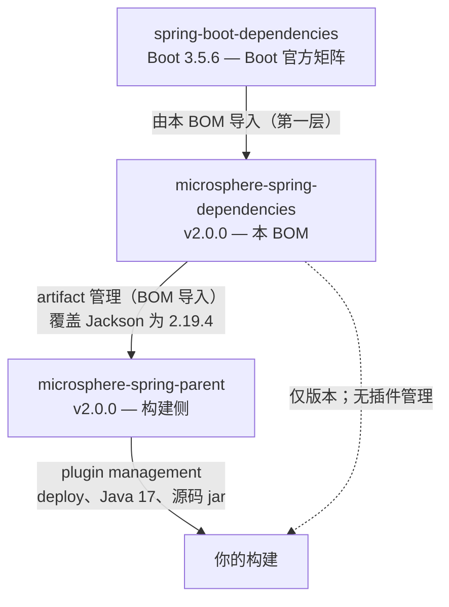

# 依赖管理 `microsphere-spring-dependencies`

[← 开发者文档总览](./README.md) · [English](../dependencies.md) · [用户文档](../../../user-guide/current/zh/dependencies.md)

---

## 定位

`microsphere-spring-dependencies` 是 Microsphere Spring 的 **Bill Of Materials（BOM，物料清单）**。它是整个生态的版本注册中心：

- 它自身**不**发布任何 jar。它只发布一个带有 `<dependencyManagement>` 的 `pom` 制品。
- 它导入 **Spring Boot BOM** 作为基础层，使 Spring Boot、Spring Framework 和 Jackson 的版本与官方 Boot 矩阵保持一致。
- 在此之上，它管理着 Boot **不**覆盖的依赖（Spring Statemachine、Guice、ASM、ShaleMigrations、微测、Pinyin4j，以及全部 Microsphere 自身制品）。

面向的读者：*构建任何使用本生态的项目的开发者。*

---

## BOM 分层

BOM 有意为之的**唯一一处版本覆盖**是 Jackson——本生态测试所用的 Jackson 2 系列与 Boot 默认的 Jackson 3 不同。如需完整清单，请查看已发布的 POM。



**规则**：依赖版本改在 `dependencies`，构建插件改在 `parent`。

---

## 导入 BOM

**继承 parent（推荐）**——`microsphere-spring-parent` 已经导入本 BOM，因此继承 parent 即可获得所有受管版本。见[构建 Parent](./parent.md)。

**只导入 BOM，不继承 parent**——当你的项目必须继承别的 parent（例如 `spring-boot-starter-parent`）时，直接导入 BOM：

```xml
<dependencyManagement>
    <dependencies>
        <dependency>
            <groupId>io.github.microsphere-projects</groupId>
            <artifactId>microsphere-spring-dependencies</artifactId>
            <version>2.0.0</version>
            <type>pom</type>
            <scope>import</scope>
        </dependency>
    </dependencies>
</dependencyManagement>
```

**独立使用（无 parent）**——导入 BOM 以得到版本，按需再自行添加插件：

```xml
<project>
    <groupId>com.acme</groupId>
    <artifactId>app</artifactId>
    <version>1.0.0</version>

    <dependencyManagement>
        <dependencies>
            <dependency>
                <groupId>io.github.microsphere-projects</groupId>
                <artifactId>microsphere-spring-dependencies</artifactId>
                <version>2.0.0</version>
                <type>pom</type>
                <scope>import</scope>
            </dependency>
        </dependencies>
    </dependencyManagement>

    <dependencies>
        <dependency>
            <groupId>io.github.microsphere-projects</groupId>
            <artifactId>microsphere-spring-context</artifactId>
        </dependency>
        <dependency>
            <groupId>io.github.microsphere-projects</groupId>
            <artifactId>microsphere-spring-jdbc</artifactId>
        </dependency>
    </dependencies>
</project>
```

> **关于版本的说明。** 上面各处写死的 `<version>2.0.0</version>` 是本手册撰写时的最新已发布版本；请替换成[最新已发布版本](https://search.maven.org/search?q=g:io.github.microsphere-projects%20a:microsphere-spring-dependencies)。属性 `${microsphere-spring-dependencies.version}` 在父 POM 自身内部可用，但下游用户引用 BOM 时用的是字面量版本。

---

## 受管版本

下面是本 BOM 管理的版本属性——**节选**。Boot 自身矩阵管理的每个 Spring Boot 制品（`spring-boot-starter-*` 等）同样无需版本即可使用，这里未列出。完整清单请查看已发布的 POM。

### 第三方库

| 属性 | 版本 | 制品（示例） |
|------|------|-------------|
| `spring-boot.version` | 3.5.6 | *（仅属性；Boot BOM 是被导入的那个）* |
| `spring-framework.version` | 6.2.11 | `spring-core`、`spring-aop`、`spring-beans`、`spring-context`、`spring-tx`、`spring-jdbc`、`spring-orm`、`spring-web`、`spring-webmvc`、`spring-webflux`、`spring-test` |
| `spring-state-machine.version` | 4.0.1 | `spring-statemachine-core` |
| `jackson.version` | 2.19.4 | `jackson-core`、`jackson-databind`、`jackson-annotations` |
| `guice.version` | 7.0.0 | `guice` |
| `ow2.asm.version` | 9.10.1 | `asm` |
| `shale-migrations.version` | 1.1.2 | `shale-migrations` |
| `weicai-test.version` | 1.4.5 | `weicai-test` |
| `pinyin4j.version` | 2.5.1 | `pinyin4j` |
| `slf4j-api.version` | 2.0.9 | `slf4j-api` |
| `commons-lang3.version` | （Boot BOM） | `commons-lang3` |
| `commons-logging.version` | （Boot BOM） | `commons-logging` |
| `h2.version` | （Boot BOM） | `h2` |

> **关于 Jackson。** Boot 矩阵自带的是 Jackson **3**，因此 `jackson-bom` 在 Boot BOM 之后被导入，以便 Jackson **2**（2.19.4）的坐标保持稳定。

### Microsphere Spring 模块

| 属性 | 制品 |
|------|------|
| `microsphere-spring-context.version` | `microsphere-spring-context` |
| `microsphere-spring-web.version` | `microsphere-spring-web` |
| `microsphere-spring-webmvc.version` | `microsphere-spring-webmvc` |
| `microsphere-spring-webflux.version` | `microsphere-spring-webflux` |
| `microsphere-spring-guice.version` | `microsphere-spring-guice` |
| `microsphere-spring-jdbc.version` | `microsphere-spring-jdbc` |
| `microsphere-spring-test.version` | `microsphere-spring-test` |

Microsphere 制品的版本跟随生态版本线（目前均为 `2.0.0`）。

---

## 添加一个新的受管版本

1. **添加版本属性**：在 `<properties>` 中以 `x.y.z` 形式声明。
2. **在 Boot 覆盖之下时加注释**：加一行 XML 注释，写明它覆盖或对齐了什么（Jackson 就是样例）。
3. **把制品加入 `<dependencyManagement>`**：不带 `<scope>`（除非确有必要，例如 `provided`），版本引用该属性。

```xml
<!-- 版本属性 -->
<properties>
    <acme-lib.version>1.2.3</acme-lib.version>
</properties>

<!-- 制品条目 -->
<dependencyManagement>
    <dependencies>
        <dependency>
            <groupId>com.acme</groupId>
            <artifactId>acme-lib</artifactId>
            <version>${acme-lib.version}</version>
        </dependency>
    </dependencies>
</dependencyManagement>
```

4. **在 parent 中镜像**：如果模块也通过 parent 解析依赖，请确认 parent 的导入会拾取新条目。
5. **验证**：把该制品加入测试模块（无需版本）并运行 `mvn dependency:tree`，确认解析到 `1.2.3`。

---

## 升级 Boot BOM

Boot BOM 是底座，所以升级它会带动 Spring Framework、Jackson 以及每一个 Boot 管理的依赖：

1. **修改** `spring-boot.version` 属性，并**更新** Boot BOM 导入里 `<dependencyManagement>` 中对应的 `<version>` 值。
2. **检查覆盖项**——Jackson 和 Spring Framework 是刻意钉住的，以免 Boot 的升级悄无声息地移动它们。若 Boot 的新版本已包含一个等于或高于我们钉住值的版本，就移除覆盖项。
3. **检查模块编译**——所有模块必须构建通过；破坏性变更通常来自 Boot 的传递升级，而不是 Boot 本身。
4. **检查受支持版本**——Boot 的版本范围必须仍然满足 `≥ 3.4`。
5. **运行 `mvn clean verify -DskipTests`**，然后跑一次完整测试。
6. **记录变更日志**——升级是面向用户的，因为 BOM 已被下游项目导入。

---

## 消费方的解析顺序

下游项目按下面的顺序解析版本：

1. 项目自身的 `<dependencyManagement>`（优先级最高）。
2. `microsphere-spring-parent`（若被继承）——它的导入会拾取 BOM 管理的条目。
3. `microsphere-spring-dependencies`（若被导入，或由 parent 导入）。
4. Boot BOM，以及本 BOM 导入的 Jackson BOM。

**覆盖一个版本**：在你的项目里用你想要的版本声明该制品——你的 `<dependencyManagement>` 会胜出。这比改动 BOM 更可取，因为 BOM 是与每个使用它的项目共享的。
