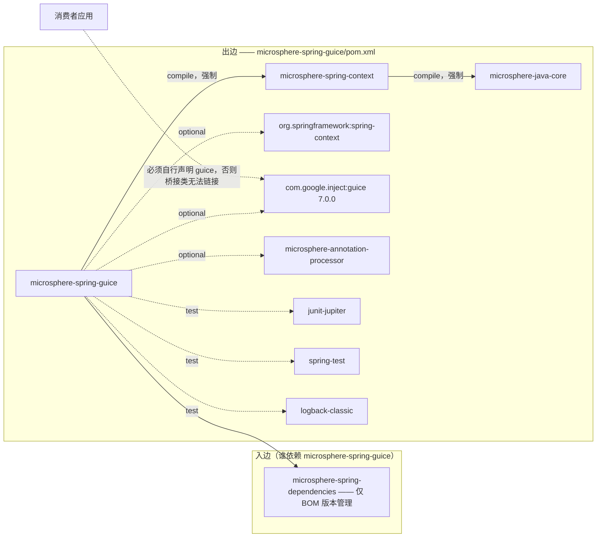
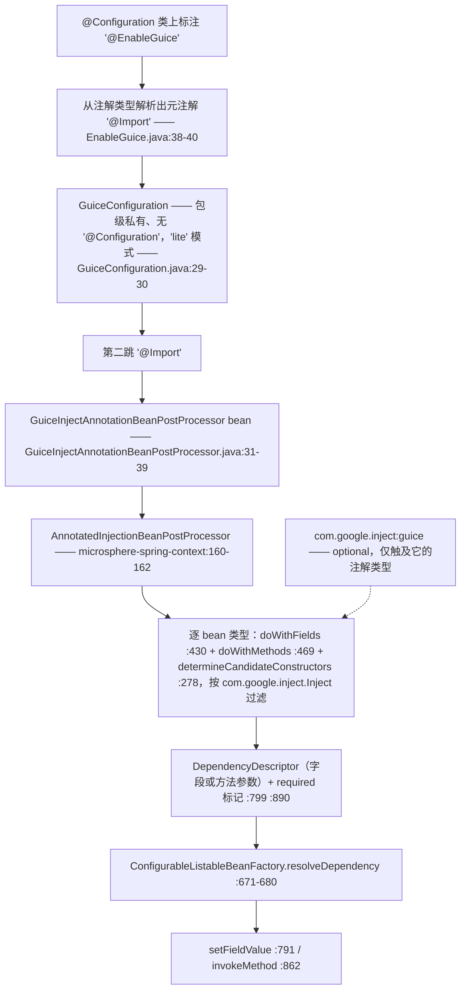
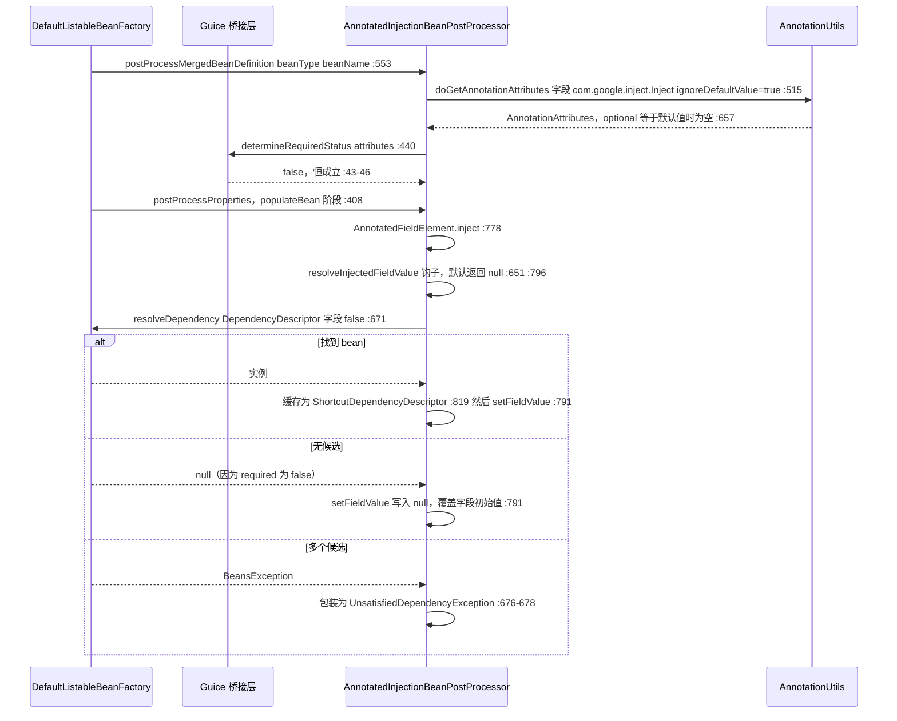

# microsphere-spring-guice — 开发者指南

[← 开发者文档总览](./README.md) · [English](../guice.md) · [用户文档](../../../user-guide/current/zh/guice.md) · [1.x](../../1.x/zh/guice.md)

## 1. 模块标识、版本基线与依赖姿态

| 属性 | 值 | 证据 |
|---|---|---|
| Maven 坐标 | `io.github.microsphere-projects:microsphere-spring-guice:${revision}` | `microsphere-spring-guice/pom.xml:13-16` |
| 聚合版本 / 最后一次构建产物 | `0.2.40-SNAPSHOT`（`revision`）；`target/` 中存在 `0.2.39` jar 与 sources jar | `pom.xml:55`、`microsphere-spring-guice/.flattened-pom.xml:13` |
| 父 POM | `microsphere-spring-parent:${revision}` | `microsphere-spring-guice/pom.xml:5-10` |
| Java 基线 | `17`（`java.version`） | `pom.xml:56` |
| Spring 基线 | 按 profile 选择 `6.0.23` / `6.1.21` / `6.2.18` / `7.0.9`，默认激活 `spring-framework-7.0`；父 POM 导入 `jakarta.jakartaee-bom` `11.0.0`，但本模块未声明任何 `jakarta.*` 构件 | `microsphere-spring-parent/pom.xml:138-173`、`:99-106`、`:24,51-58` |
| Guice | `com.google.inject:guice` `7.0.0`，**optional**，版本在本模块 POM 内钉死 | `microsphere-spring-guice/pom.xml:21-23,48-54` |
| `microsphere-spring-context` | compile 且**非** optional —— 聚合内唯一的强制依赖边 | `microsphere-spring-guice/pom.xml:41-46` |
| `org.springframework:spring-context`、`microsphere-annotation-processor` | 二者均为 optional；注解处理器不写版本，由 `microsphere-java-dependencies` 导入解析为 `0.3.19` | `microsphere-spring-guice/pom.xml:27-39`、`microsphere-spring-parent/pom.xml:22,117-124` |
| 测试依赖 | `junit-jupiter`、`spring-test`、`logback-classic` —— 本模块**没有** `microsphere-spring-test` 这条边 | `microsphere-spring-guice/pom.xml:56-73` |
| 包名根 / 类型数 | `io.microsphere.spring.guice.annotation`；3 个主类、1 个测试类 | `microsphere-spring-guice/src/**` |
| `src/main/resources` | **不存在** —— 无 `spring.factories`、无 `AutoConfiguration.imports`、无 `module-info.java` | `microsphere-spring-guice/src/main/` 目录清单 |

依赖姿态（这是该模块最常见的破坏点，因此精确表述）：**Guice 是 `optional`**（`microsphere-spring-guice/pom.xml:53`），`com.google.inject:guice` **不会**传递给消费者；已发布 POM 保留该标记（`.flattened-pom.xml:66-72`），应用必须自行声明 Guice。聚合内唯一强制边是 `microsphere-spring-context`（`:41-46`），它自身又以强制方式带入 `microsphere-java-core`（`microsphere-spring-context/pom.xml:30-34`）。⚠ Guice 并未由父 POM 或 BOM 管理 —— `microsphere-spring-parent/pom.xml:32-136` 没有 `com.google.inject` 条目，`microsphere-spring-dependencies/pom.xml:30-34` 只管理本模块构件；`docs/developer-guide/current/zh/README.md:21` 把 Guice 列入"受管第三方版本"属于偏差，[../parent.md:140-141](../parent.md) 的说法才与源码一致：本模块是把版本钉在本地的那个例外。



聚合内没有任何模块依赖 `microsphere-spring-guice`；模块之外的源码级引用只有 `pom.xml:67`（module 列表）与 `microsphere-spring-dependencies/pom.xml:32`（BOM）。

## 2. 包结构地图

| 包 | 类型（可见性） | 职责 |
|---|---|---|
| `io.microsphere.spring.guice.annotation` | `EnableGuice`（public）、`GuiceConfiguration`（包级私有，`GuiceConfiguration.java:30`）、`GuiceInjectAnnotationBeanPostProcessor`（包级私有，`GuiceInjectAnnotationBeanPostProcessor.java:31`） | 启用注解 + 本模块绑定的注解类型 + 必需性判定覆写 |

| 外部类型 | 所属 | 本模块为何需要 |
|---|---|---|
| `io.microsphere.spring.beans.factory.annotation.AnnotatedInjectionBeanPostProcessor` | **`microsphere-spring-context`** | 父类（`GuiceInjectAnnotationBeanPostProcessor.java:31`）；扫描、解析、缓存全部由它承载 |
| `io.microsphere.spring.core.annotation.AnnotationUtils`、`AnnotatedInjectionBeanPostProcessor.AnnotationInjectedElement` | `microsphere-spring-context` | 父类的注解属性提取（`AnnotatedInjectionBeanPostProcessor.java:515-517` → `AnnotationUtils.java:463-485`）；public 的注入点模型（`:739-762`） |
| `org.springframework.context.annotation.Import`、`com.google.inject.Inject` | Spring Framework / Guice 7.0.0 | 唯一激活机制（`EnableGuice.java:38-40`、`GuiceConfiguration.java:29`）与桥接所绑定的注解类型（`GuiceInjectAnnotationBeanPostProcessor.java:19,33`） |
| `SmartInstantiationAwareBeanPostProcessor`、`MergedBeanDefinitionPostProcessor`、`PriorityOrdered`、`BeanFactoryAware`、`BeanClassLoaderAware`、`EnvironmentAware`、`InitializingBean`、`DisposableBean` | Spring Framework | 父类实现的 Spring 缝隙（`AnnotatedInjectionBeanPostProcessor.java:160-162`） |

## 3. 架构

⚠ 本模块**没有 `ImportBeanDefinitionRegistrar`、没有 `ApplicationContextInitializer`、没有 `Injector`、没有 `Module`、也没有 `Provider`**：方向是单向的（*Spring* bean 上被 Guice 注解标注的成员由 *Spring* 满足），激活是两跳 `@Import`，中间不存在注册器。



`@EnableGuice`（`EnableGuice.java:41`）没有声明任何属性，因此既无可配置项也无 Environment 级开关。中间类 `GuiceConfiguration` 未标注 `@Configuration`，也没有 `@Bean` 方法（`GuiceConfiguration.java:30`），它只是承载第二跳 `@Import` 的容器；副作用是两个被导入类都成为普通 bean 定义 —— 模块自带测试通过注入它们证明了这点（`EnableGuiceTest.java:45-46,48-49`，在 `:57-58` 断言非空）。

## 4. 源码分析

### 4.1 桥接类

```java
class GuiceInjectAnnotationBeanPostProcessor extends AnnotatedInjectionBeanPostProcessor {  // :31
    private static final Class<? extends Annotation> ANNOTATION_TYPE = Inject.class;        // :33
    private static final String OPTIONAL_ATTRIBUTE_NAME = "optional";                       // :35
    public GuiceInjectAnnotationBeanPostProcessor() { super(ANNOTATION_TYPE); }             // :37-39
    @Override
    protected boolean determineRequiredStatus(AnnotationAttributes attributes) {            // :41-47
        if (!attributes.containsKey(OPTIONAL_ATTRIBUTE_NAME)) { return false; }
        return Boolean.FALSE.equals(attributes.getBoolean(OPTIONAL_ATTRIBUTE_NAME));
    }
}
```

整个模块就是一个常量（`Inject.class`）加一个钩子覆写。把注解类型固化在 `static final` 字段里，也解释了缺失 Guice 时为何失败发生在*链接*期：初始化该类需要 `com.google.inject.Inject`（`:19,33`），于是创建这个后处理器 bean 时抛 `NoClassDefFoundError`。

### 4.2 继承而来的机制及其不可变点

父类是一台自包含的注入引擎，且步骤被冻结：`postProcessProperties`、`postProcessPropertyValues`、`postProcessMergedBeanDefinition`、`determineCandidateConstructors`、`setBeanFactory`、`setEnvironment`、`setBeanClassLoader`、`getOrder`、`getAnnotationTypes` 全部是 `final`（`AnnotatedInjectionBeanPostProcessor.java:278,387,408,553,561,566,571,713,717`），子类无法改变它*何时*、*被执行几次*；可覆写面恰好是三个 protected 钩子 —— `determineRequiredStatus`（`:455-457`，默认 `true`）、`resolveInjectedFieldValue`（`:651-654`，返回 `null`）、`resolveInjectedMethodArguments`（`:666-669`，返回 `null`）—— 而 Guice 子类只覆写其中一个。构造器里的两个默认值决定了下文语义：`setOrder(LOWEST_PRECEDENCE - 3)`（`:246`，context 模块测试 `AnnotatedInjectionBeanPostProcessorTest.java:96` 对其做了断言）与 `setIgnoreDefaultValue(true)` + `setTryMergedAnnotation(true)`（`:249-250`）。⚠ `:201-203` 的字段注释声称该 order 是为了"比 `AutowiredAnnotationBeanPostProcessor` 优先级更高"，但 `LOWEST_PRECEDENCE - 3` 位于 `Ordered` 刻度末端，仅凭该数值并不能确立与 Spring 自身处理器的相对顺序。

### 4.3 必需 vs 可选 —— 精确的解析过程

`determineRequiredStatus` 只读 `optional` 键，但这个键*是否存在*由上游决定。完整链路如下：

1. `doGetAnnotationAttributes(member, Inject.class)` 传入 `ignoreDefaultValue = true` 与 `tryMergedAnnotation = true`（`AnnotatedInjectionBeanPostProcessor.java:515-517`）。
2. `AnnotationUtils.getAnnotationAttributes(...)` 的两个分支（`AnnotationUtils.java:463-485`：合并注解分支 `:474-477`、普通分支 `:479-482`）都汇入 `filterAnnotationAttributes`（`:643-671`）。
3. 该方法会**移除**取值等于注解声明默认值的属性 —— `if (ignoreDefaultValue && nullSafeEquals(attributeValue, getDefaultValue(annotation, attributeName))) continue;`（`:657-659`），其中 `getDefaultValue` 来自 Spring，在 `:34` 静态导入。
4. Guice 声明的是 `boolean optional() default false`，而 Java 注解代理对未书写的元素返回默认值，因此合成出的映射在"裸写"与"显式写 `false`"两种情况下都含 `optional=false` —— 随即被第 3 步删除。

结论是算术推导而非观点：`containsKey("optional")` 为 `true` 的唯一可能是取值不同于 `false`、即为 `true`，此时 `Boolean.FALSE.equals(true)` 等于 `false`。**经由 `@EnableGuice`，`determineRequiredStatus` 永远不可能返回 `true`** —— 该线上所有 Guice 注入点都是非必需的。

| Guice 声明 | `optional` 取值 | 是否通过默认值过滤 | `determineRequiredStatus` | 运行时效果（有据可查） |
|---|---|---|---|---|
| `@Inject` | `false`（默认值） | 否 | `false`（`GuiceInjectAnnotationBeanPostProcessor.java:43-45`） | 找不到候选 → 字段被写入 `null`，不抛异常（`resolveFieldValue:795-806`） |
| `@Inject(optional = false)` | `false`（默认值） | **否 —— 与上一行完全相同** | `false` | ⚠ 该属性的任何写法都无法到达 `true`（见 §9 第 3 条） |
| `@Inject(optional = true)` | `true` | 是 | `false`（`:46`） | 找不到候选 → `null`；由 `EnableGuiceTest.java:51-52,59` 断言 |

`required` 只会作为 `DependencyDescriptor` 的第二个参数传给 Spring（字段 `:799`、方法参数 `:890`、构造器 `:323`）。它容忍"缺失"，但**不容忍"歧义"**：`resolveDependency` 捕获所有 `BeansException` 并重新抛出 `UnsatisfiedDependencyException`（`:671-680`），因此两个候选 bean 一样会让 `@Inject(optional = true)` 字段失败。唯一能恢复 Guice 语义的开关是 `setIgnoreDefaultValue(false)`（`:606-608`），但经由 `@EnableGuice` 无法触达：子类从未调用它，且子类本身是包级私有（`:31`），用户代码既不能继承也不能配置。

### 4.4 注入点边界情况（全部继承而来）

- **静态字段**被丢弃并打 `warn`（`:434-439`）；**零参数方法**只 `warn`（`:483-487`）却仍被登记（`:490`），随后以空参数数组被调用（`:884-886`、`:861-863`）—— 桥接把它们变成初始化式回调，而 Guice 自身对这两种写法都是直接拒绝。
- **覆写方法与桥接方法**会去重：先解析桥接方法对（`:470-473`），再只保留最具体的声明（`:476`）。
- **构造器**：带 `@Inject` 的构造器成为候选（`:304`），但由于 `required` 恒为 `false`，`requiredConstructor` 分支永不触发（`:316-333`）；若类同时声明无参构造器，后者会被追加为回退（`:338-351`）；而"只有一个带参构造器且未加注解"的情形仍会被选中（`:353-354`）。
- **显式属性值优先于 setter**：`checkPropertySkipping(pvs)` 提前返回（`:846-848`），因此由 XML 或 `PropertyValues` 显式赋值的 `@Inject` setter 被跳过。字段没有这层保护 —— `inject` 永远写入，`null` 也不例外（`:778-792`）。

## 5. 一次注入请求的完整路径



这三个分支就是该模块契约的全部：*命中 → 注入，缺失 → `null`，歧义 → 失败*。不存在第四步去咨询 Guice；你在自己代码里创建的 `Injector` 永远不会被触达。

## 6. 设计模式

| 模式 | 类 | 证据 |
|---|---|---|
| 配置启用（Enable*）+ 两跳 Import 间接层 | `EnableGuice`、`GuiceConfiguration` | `EnableGuice.java:35-41`（零属性标记，载荷是元注解 `@Import`）；`GuiceConfiguration.java:29-30` —— 包级私有 "lite" 类承载第二跳，且自身可被注入（`EnableGuiceTest.java:45-46`） |
| 模板方法 | `AnnotatedInjectionBeanPostProcessor` + `GuiceInjectAnnotationBeanPostProcessor` | 固定步骤 `:278,408,553`，钩子 `:455,651,666`；唯一覆写位于 `GuiceInjectAnnotationBeanPostProcessor.java:41-47` |
| 桥接 / 适配器 | `GuiceInjectAnnotationBeanPostProcessor` | `:33,35` 把 `com.google.inject.Inject.optional` 映射为 Spring 的 `required`；模块描述本身就是 "Microsphere Spring Bridge Guice"（`microsphere-spring-guice/pom.xml:19`） |
| 工厂（实例化感知） | `determineCandidateConstructors`、`ShortcutDependencyDescriptor.resolveShortcut` | `AnnotatedInjectionBeanPostProcessor.java:277-368`、`:933-949` |
| 注册表 / 缓存 | `candidateConstructorsCache`、`injectionMetadataCache` | `:191-193`、`:627-630`，写入点 `:363,542`，仅在 `destroy()` 清空（`:633-639`） |
| 空对象 | `resolveInjectedFieldValue`、`resolveInjectedMethodArguments` | `:651-654`、`:666-669` —— 返回 `null` 即"我没有自定义值，交给 Spring" |
| 策略 | `annotationTypes` 集合 + `order` | `:189,236-238,713-715`、`:580,717-720` |
| *不存在*观察者 / 装饰器 / 组合 | — | 本模块与继承链上都没有包装或事件扇出，与 `microsphere-spring-jdbc` 不同 |

## 7. 扩展指南

由于内置后处理器是包级私有，扩展必须针对 `microsphere-spring-context` 中的 **public** 父类进行。

### 7.1 用真实 `Injector` 为 Guice 注入点供值

```java
public class GuiceBackedInjectBeanPostProcessor extends AnnotatedInjectionBeanPostProcessor {
    private final Injector injector;   // 由应用创建，例如 Guice.createInjector(new AppModule())
    public GuiceBackedInjectBeanPostProcessor(Injector injector) {
        super(com.google.inject.Inject.class);      // 也可用可变参数追加 jakarta/javax 的 Inject（:236）
        this.injector = injector;
        setIgnoreDefaultValue(false);               // :606-608 —— 否则 optional=false 会被过滤掉
    }
    @Override
    protected boolean determineRequiredStatus(AnnotationAttributes attributes) {
        return !Boolean.TRUE.equals(attributes.getBoolean("optional"));   // 等价于 :41-47，但此时可达
    }
    @Override
    protected Object resolveInjectedFieldValue(Object bean, String beanName, PropertyValues pvs,
            AnnotationInjectedElement<Field> fieldElement) throws Throwable {
        return injector.getInstance(fieldElement.getInjectionPoint().getType());   // 在 Spring 之前被咨询（:796）
    }
}
```

注册方式是 `@Bean` 方法（和任何 `BeanPostProcessor` 一样声明为 `static`，以避免基础设施过早初始化告警），或 `@Import` 声明它的类；钩子返回非 `null` 值会**完全短路** Spring 查找。

### 7.2 决定"谁获胜"的规则

| 规则 | 证据 |
|---|---|
| 解析钩子*先于* bean 工厂执行（字段路径 `:796-804`、方法路径 `:881-893`），返回 `null` 才表示"交给 Spring"；且钩子返回值**不做**类型转换，只有 Spring 路径会传入 `TypeConverter` | `AnnotatedInjectionBeanPostProcessor.java:796,881` 对比 `:791,862` 与 `:672-675` |
| 每个已注册处理器都带独立缓存、对每个 bean 各跑一遍；两个处理器认领同一字段时后执行者写入最终值；相对顺序由 `setOrder` 决定（默认 `LOWEST_PRECEDENCE - 3`） | `:778-792`、`:191-193,627-630`、`:580-582,246` |
| `@EnableGuice` 不接受模块 —— 它没有属性；增加绑定来源的方式是再注册一个处理器，而不是配置这一个 | `EnableGuice.java:41` |
| "把 Spring bean 暴露给 Guice"不是本模块的扩展点：仓库中没有 `Binder`/`AbstractModule`。要么手写 provider 读取 `ApplicationContext` 的 Guice 模块，要么在 Spring 侧改用 `ObjectProvider` | `microsphere-spring-guice/src/main/java` 中不存在这些类型 |

## 8. 构建与验证

| 任务 | 命令 / 事实 |
|---|---|
| 构建并测试该模块 | `mvn -pl microsphere-spring-guice -am test --activate-profiles test,coverage,spring-framework-7.0` —— CI 另加 `-Drevision=0.0.1-SNAPSHOT`（`.github/workflows/maven-build.yml:43-49`） |
| Spring 矩阵 / JDK 矩阵 | `spring-framework-6.0 / 6.1 / 6.2 / 7.0`，其中 `7.0` 为 `activeByDefault`（`microsphere-spring-parent/pom.xml:138-173`、`:163-172`）；JDK `17`、`21`、`25`（`.github/workflows/maven-build.yml:25`） |
| 构建父 POM | `microsphere-build:0.3.17`（`pom.xml:5-9`，`origin/release` 上同为 `0.3.17`） |
| 测试清单 | `EnableGuiceTest` —— 测试类本身即被测 bean（`EnableGuiceTest.java:36-40`）；4 个注入点（`:42-52`）、4 个断言（`:54-60`） |
| 测试**未**覆盖 | 构造器与 setter 形式的 `@Inject`、必需性失败路径，以及 `Injector`、`Module`、`Provider`、`Scope` 的任何使用 —— Guice 只以注解类型身份参与 |
| optional 依赖的行为 | 模块自身的编译类路径能看到 Guice（optional 只压制传递性，不影响本地使用），这就是测试无需额外声明即可编译通过的原因；flatten 后的 POM 仍保留 `<optional>true</optional>`（`.flattened-pom.xml:66-72`），消费者侧的自备要求因此存续 |

## 9. 注意事项与陷阱

| # | 观察结论 | 证据 |
|---|---|---|
| 1 | Guice 是 optional 且永不传递；消费者缺少 `com.google.inject:guice` 时失败发生在桥接类初始化那一刻，而不是消费者代码编译期。 | `microsphere-spring-guice/pom.xml:48-54`；`GuiceInjectAnnotationBeanPostProcessor.java:19,33` |
| 2 | ⚠ 不存在 `Injector`/`Module`/`Provider`/`Scope` 集成，且方向只有“Guice 注解 → Spring”；把本模块描述为双向的“Spring ↔ Guice 注入桥”会言过其实。 | `microsphere-spring-guice/src/main/java`（共 3 个类） |
| 3 | ⚠ `@Inject(optional = false)` 并**不**必需 —— 默认值属性在进入 `determineRequiredStatus` 之前已被过滤 —— 因此裸写与显式 `false` 完全等价，且两者都是可选的，与 Guice 自身的 required 默认相反。 | `AnnotatedInjectionBeanPostProcessor.java:249`；`AnnotationUtils.java:657-659`；`GuiceInjectAnnotationBeanPostProcessor.java:43-45` |
| 4 | `optional = true` 只容忍缺失，不容忍重复候选。 | `AnnotatedInjectionBeanPostProcessor.java:798-802,671-680` |
| 5 | 字段写入是无条件的：字段本有初始值时，若无匹配 bean，`@Inject` 会用 `null` 抹掉它。 | `:778-792` |
| 6 | 两个具体类型都是包级私有；用户代码只能继承 public 父类，或在另一个后处理器里用 `instanceof AnnotatedInjectionBeanPostProcessor` 介入。 | `GuiceInjectAnnotationBeanPostProcessor.java:31`；`AnnotatedInjectionBeanPostProcessor.java:160` |
| 7 | 没有 Environment 级开关：与聚合内其它 `@Enable*` 入口不同，本注解导入普通类而非 `AnnotatedBeanCapableImportBeanDefinitionRegistrar`，因此 `…enabled=false` 在此无效。 | `EnableGuice.java:38-40` |
| 8 | `microsphere.spring.injection.metadata.cache.size` 只在类初始化时从**系统属性**读取（`-D…`），不来自 Spring `Environment`；两个缓存从不淘汰元素 —— 名字承诺了实现并不存在的上限。 | `AnnotatedInjectionBeanPostProcessor.java:167,179-185,363,542,633-639` |
| 9 | 只绑定 `com.google.inject.Inject`：使用 `jakarta.inject.Inject` 或 `javax.inject.Inject` 的类对本桥接不可见（全聚合 main 源码中这两个名字仅出现在一处注释 `AbstractInjectionPointDependencyResolver.java:394`）；若需要它们，见 §7.1 的可变参数构造器。 | `GuiceInjectAnnotationBeanPostProcessor.java:33` |
| 10 | Guice 7.0.0 需要 Java 11+，本线路的 Java 17 基线满足它；Java 8 与 Guice 7 的冲突只存在于 1.x 线路（`docs/user-guide/1.x/zh/guice.md:13-19`）。 | `microsphere-spring-guice/pom.xml:21-23`、`pom.xml:56` |
| 11 | 桥接与 `@Autowired` 同在 `populateBean` 阶段执行且处于 `PriorityOrdered` 区间末端，因此同一字段混用两种注解会得到两次独立解析。 | `AnnotatedInjectionBeanPostProcessor.java:408,246,201-203` |
| 12 | ⚠ 四个类型上的 `@since 1.0.0` 与被分析的 `0.2.40-SNAPSHOT` 不一致，不要用 `@since` 判断版本归属。 | `EnableGuice.java:33`、`pom.xml:55` |

**相关页面** — [开发者文档总览](./README.md) · [English 版](../guice.md) · [用户文档（Guice）](../../../user-guide/current/zh/guice.md) · [1.x 开发者文档](../../1.x/zh/guice.md) · [父 POM profile](./parent.md) · [依赖管理](./dependencies.md)
