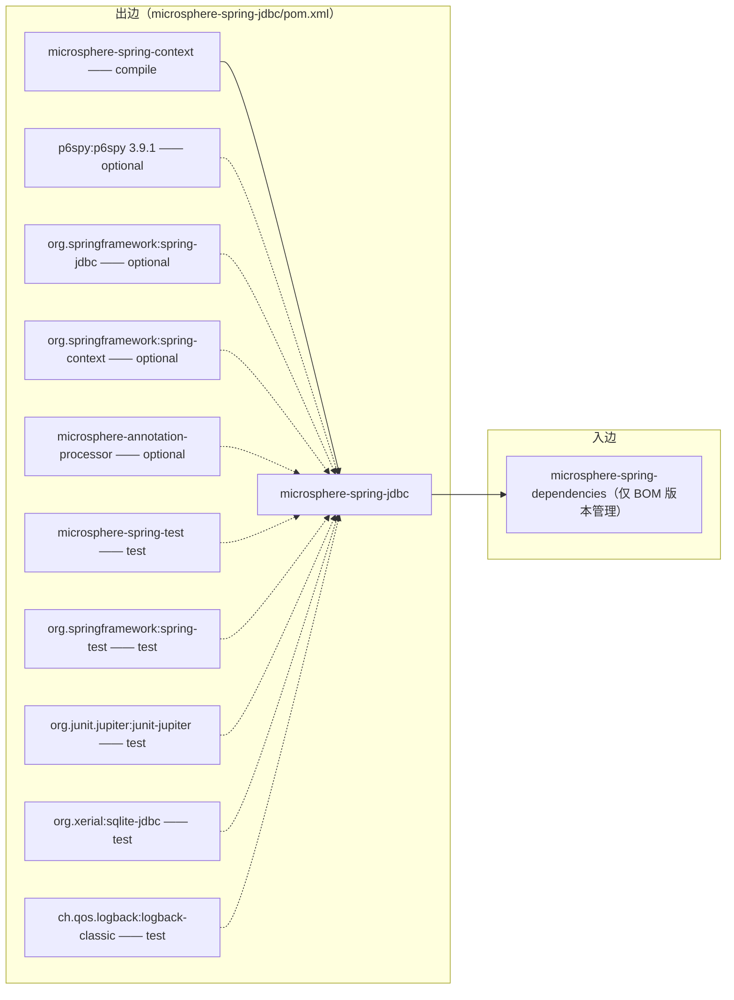
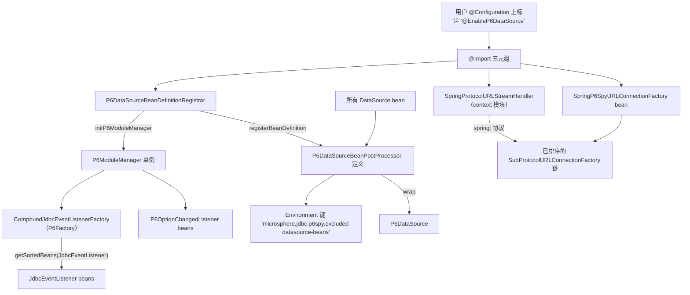
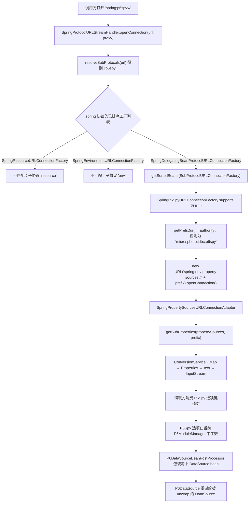
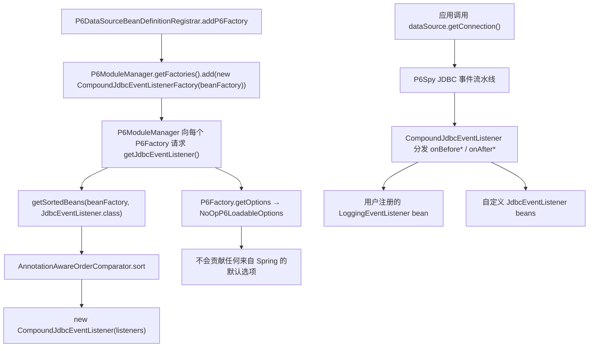

# microsphere-spring-jdbc — 开发者指南

[← 开发者文档总览](./README.md) · [English](../jdbc.md) · [用户文档](../../../user-guide/current/zh/jdbc.md) · [1.x](../../1.x/zh/jdbc.md)

## 1. 模块标识、版本基线与依赖姿态

| 属性 | 值 | 证据 |
|---|---|---|
| Maven 坐标 | `io.github.microsphere-projects:microsphere-spring-jdbc:${revision}` | `microsphere-spring-jdbc/pom.xml:14-17` |
| 本文分析的聚合版本 | `0.2.40-SNAPSHOT`（`revision` 属性） | `pom.xml:57` |
| 父 POM | `microsphere-spring-parent:${revision}` | `microsphere-spring-jdbc/pom.xml:5-11` |
| Java 基线 | `17`（`java.version`） | `pom.xml:58` |
| Spring 基线 | 按 profile 选择：`6.0.23` / `6.1.21` / `6.2.18` / `7.0.9`（默认激活 `spring-framework-7.0`） | `microsphere-spring-parent/pom.xml:186-241` |
| Jakarta EE | `jakarta.*`（BOM `jakartaee 11.0.0`） | `microsphere-spring-parent/pom.xml:31,90-97` |
| P6Spy | `p6spy:p6spy` `3.9.1`，**optional** | `microsphere-spring-parent/pom.xml:33`, `:73-78`；`microsphere-spring-jdbc/pom.xml:53-57` |
| 包名根 | `io.microsphere.spring.jdbc.p6spy` | `find microsphere-spring-jdbc/src/main/java` |
| 主/测试类型数 | 7 个主类、2 个测试类 | `microsphere-spring-jdbc/src/**` |
| `src/main/resources` | **不存在** —— 该模块不携带任何资源文件 | `microsphere-spring-jdbc/src/main/` 目录清单 |

依赖姿态：该模块编译时真正依赖的构件（`spring-context`、`spring-jdbc`、`p6spy`）全部标记为 `optional`，因此不会传递到下游 classpath。聚合内唯一的强制编译依赖是 `microsphere-spring-context`。对下游工程的影响：仅引入 `microsphere-spring-jdbc` 时，首次使用 `@EnableP6DataSource` 会抛出 `NoClassDefFoundError`，除非显式补充 `p6spy:p6spy`（`microsphere-spring-jdbc/pom.xml:53-57`）。



聚合内没有任何模块对 `microsphere-spring-jdbc` 声明编译期依赖；`microsphere-spring-dependencies/pom.xml:38` 只负责版本管理。

## 2. 包结构地图

| 包 | 类型（可见性） | 职责 |
|---|---|---|
| `io.microsphere.spring.jdbc.p6spy` | `NoOpP6LoadableOptions`、`PropertySourcesP6LoadableOptionsAdapter` | `com.p6spy.engine.spy.P6LoadableOptions` 实现 |
| `io.microsphere.spring.jdbc.p6spy.annotation` | `EnableP6DataSource`（public）、`P6DataSourceBeanDefinitionRegistrar`（包级私有） | 注解驱动的启用入口 |
| `io.microsphere.spring.jdbc.p6spy.beans.factory` | `CompoundJdbcEventListenerFactory` | 将 Spring bean 桥接进 P6Spy 事件流水线的 `P6Factory` |
| `io.microsphere.spring.jdbc.p6spy.beans.factory.config` | `P6DataSourceBeanPostProcessor` | `DataSource` → `P6DataSource` 装饰 |
| `io.microsphere.spring.jdbc.p6spy.net` | `SpringP6SpyURLConnectionFactory` | `p6spy` URL 子协议间接层 |

本模块构建所依赖的外部类型（定义在别处，此处引用）：

| 类型 | 所属 | 本模块为何需要 |
|---|---|---|
| `io.microsphere.spring.net.SpringProtocolURLStreamHandler` | **`microsphere-spring-context`**，`io.microsphere.spring.net` | 注册 `spring:` 协议处理器 |
| `io.microsphere.spring.net.SpringSubProtocolURLConnectionFactory` | `microsphere-spring-context` | `SpringP6SpyURLConnectionFactory` 的父类（`:38`） |
| `io.microsphere.spring.net.SpringEnvironmentURLConnectionFactory` | `microsphere-spring-context` | 承载 `spring:env:property-sources://`（`:44`、`:67-75`） |
| `io.microsphere.spring.net.SpringDelegatingBeanProtocolURLConnectionFactory` | `microsphere-spring-context` | 以 Spring bean 方式发现本模块的工厂（`:75-77`） |
| `io.microsphere.spring.context.annotation.AnnotatedBeanCapableImportBeanDefinitionRegistrar` | `microsphere-spring-context` | 注册器父类（`:64-74`） |
| `io.microsphere.spring.beans.factory.config.GenericBeanPostProcessorAdapter` | `microsphere-spring-context` | 按类型过滤的后处理器父类（`:42`） |
| `com.p6spy.engine.spy.P6DataSource`、`P6ModuleManager`、`P6Factory`、`P6LoadableOptions`、`CompoundJdbcEventListener`、`JdbcEventListener` | P6Spy 3.9.1 | 被装饰类型与扩展契约 |

## 3. 架构



该模块使用两条集成缝隙，且都是结构性的：（1）Spring 的 `@Import` → `ImportBeanDefinitionRegistrar` → `BeanPostProcessor` 链路；（2）P6Spy 的 `P6ModuleManager` 注册表，它是 JVM 级单例，在 `registerBeanDefinitions` 期间被改写（`microsphere-spring-jdbc/src/main/java/io/microsphere/spring/jdbc/p6spy/annotation/P6DataSourceBeanDefinitionRegistrar.java:56-66`）。

## 4. 源码分析

### 4.1 `@EnableP6DataSource` —— 无属性的启用注解

该注解**没有声明任何属性**，并导入三个类型：

```java
@Target(TYPE)
@Retention(RUNTIME)
@Documented
@Import(value = {
        P6DataSourceBeanDefinitionRegistrar.class,
        SpringProtocolURLStreamHandler.class,
        SpringP6SpyURLConnectionFactory.class
})
public @interface EnableP6DataSource {   // annotation/EnableP6DataSource.java:38-46
```

`P6DataSourceBeanDefinitionRegistrar` 是一个 `ImportBeanDefinitionRegistrar`，因此 Spring 会执行它而不是把它注册成 bean；其余两项会成为普通 bean 定义（一个 `URLStreamHandler` 组件和一个 `SubProtocolURLConnectionFactory` 组件）。该注册器是包级私有的（`P6DataSourceBeanDefinitionRegistrar.java:46`），所以 `@EnableP6DataSource` 是唯一受支持的入口。

### 4.2 注册器：启动阶段改写了什么

```java
protected void registerBeanDefinitions(AnnotationMetadata metadata, BeanDefinitionRegistry registry,
                                       BeanNameGenerator importBeanNameGenerator,
                                       ResolvablePlaceholderAnnotationAttributes<EnableP6DataSource> annotationAttributes) {
    initP6ModuleManager(getBeanFactory());
    registerBeanDefinition(registry, P6DataSourceBeanPostProcessor.class);
}   // P6DataSourceBeanDefinitionRegistrar.java:48-54
```

`initP6ModuleManager` 针对 P6Spy 执行两项注册：把一个持有 `ConfigurableListableBeanFactory` 的 `CompoundJdbcEventListenerFactory` 追加到 `p6ModuleManager.getFactories()`（`:62-66`），并把所有 `P6OptionChangedListener` bean 通过 `p6ModuleManager::registerOptionChangedListener` 复制进 P6Spy（`:68-71`）。两者都使用 `io.microsphere.spring.beans.BeanUtils.getSortedBeans`，该方法会解析包含祖先容器的 bean，并用 `AnnotationAwareOrderComparator` 排序（`microsphere-spring-context/src/main/java/io/microsphere/spring/beans/BeanUtils.java:593-598`）。

由于父类 `AnnotatedBeanCapableImportBeanDefinitionRegistrar.registerBeanDefinitions` 是 `final` 且受 `isEnabled(metadata)` 门控（`microsphere-spring-context/src/main/java/io/microsphere/spring/context/annotation/AnnotatedBeanCapableImportBeanDefinitionRegistrar.java:67-74`），即便注解本身没有属性，也可以通过 Environment 属性关闭启用行为（见 §7）。

后处理器通过 `registerBeanDefinition(registry, Class)` 注册，该重载传入 `beanName = null`，因此由 `BeanDefinitionReaderUtils.generateBeanName` 生成名称（`microsphere-spring-context/src/main/java/io/microsphere/spring/beans/factory/support/BeanRegistrar.java:198-200,565`）；它并未作为 infrastructure bean 注册。

### 4.3 `p6spy:` URL 协议间接层

`SpringP6SpyURLConnectionFactory` 继承 `SpringSubProtocolURLConnectionFactory`，其 `supports(...)` 是 `final` 的，并把**第一个**解析出的子协议与 `getSubProtocol()` 比较（`microsphere-spring-context/src/main/java/io/microsphere/spring/net/SpringSubProtocolURLConnectionFactory.java:37-42`）。

```java
protected String getSubProtocol() {
    return "p6spy";
}

public URLConnection create(URL url, List<String> subProtocols, Proxy proxy) throws IOException {
    String prefix = getPrefix(url);
    URL targetURL = new URL("spring:env:property-sources://" + prefix);
    return targetURL.openConnection();
}

private String getPrefix(URL url) {
    String authority = url.getAuthority();
    return hasText(authority) ? authority : "microsphere.jdbc.p6spy";   // :40-55
}
```

因此该间接层把子协议 `p6spy` 映射到属性源读取器：URL 的 authority 成为属性名前缀，authority 缺失或为空白时使用默认值 `microsphere.jdbc.p6spy`。之所以能重新发起 `new URL("spring:env:property-sources://...")`，是因为同一个注解还导入了 `SpringProtocolURLStreamHandler`，它在 `afterPropertiesSet()` → `init()` → `URLUtils.registerURLStreamHandler(this)` 中把自身注册为 `spring` 处理器（`microsphere-spring-context/src/main/java/io/microsphere/spring/net/SpringProtocolURLStreamHandler.java:76-80,95-96`）。

在目标侧，`SpringEnvironmentURLConnectionFactory` 匹配子协议 `env` 且类型索引 1（`property-sources`），返回 `SpringPropertySourcesURLConnectionAdapter`；其 `getInputStream()` 通过 `getSubProperties(propertySources, prefix)` 收集属性，并借助 bean 工厂的 `ConfigurableConversionService` 完成 `Map` → `Properties` → `text` → `InputStream` 的转换（`microsphere-spring-context/src/main/java/io/microsphere/spring/net/SpringPropertySourcesURLConnectionAdapter.java:70-84,113-115`）。前缀取自 `resolveAuthority(url.getAuthority())`，即矩阵参数会被截断（`:114`、`URLUtils.java:1287-1289`）。

### 4.4 DataSource 后处理

```java
public class P6DataSourceBeanPostProcessor extends GenericBeanPostProcessorAdapter<DataSource>
        implements EnvironmentAware {                       // :41

    public static final String EXCLUDED_DATASOURCE_BEAN_NAMES_PROPERTY_NAME =
            "microsphere.jdbc.p6spy.excluded-datasource-beans";           // :45
```

`GenericBeanPostProcessorAdapter` 会依据子类声明一次性解析出类型参数 `DataSource`，并将 `postProcessBeforeInitialization`/`postProcessAfterInitialization` 设为 `final`，仅在 `beanType.isAssignableFrom(ultimateTargetClass(bean))` 时委派（`microsphere-spring-context/src/main/java/io/microsphere/spring/beans/factory/config/GenericBeanPostProcessorAdapter.java:58-59,126-132`）。本模块只覆写了 *after* 钩子：

```java
protected DataSource doPostProcessAfterInitialization(DataSource bean, String beanName) {
    DataSource targetDataSource = bean;
    if (excludedDataSourceBeanNames.contains(beanName)) { /* trace + 保留原对象 */ }
    else {
        try {
            DataSource datasource = bean.unwrap(DataSource.class);
            targetDataSource = new P6DataSource(datasource);      // :54-61
        } catch (SQLException e) { /* trace，保留原对象 */ }
    }
    return targetDataSource;
}
```

排除项在 `setEnvironment` 中一次性读取：`environment.getProperty(EXCLUDED_DATASOURCE_BEAN_NAMES_PROPERTY_NAME, Set.class, emptySet())`（`:76-79`）——它是一个**精确 bean 名称**的 `Set<String>` 而非模式匹配，且在任何 bean 被后处理之前完成解析。`bean.unwrap(DataSource.class)`（JDBC 4.3 的 `Wrapper.unwrap`）会先剥掉厂商代理，使 P6Spy 层直接位于物理驱动数据源之上。

### 4.5 JDBC 事件监听器聚合与选项

`CompoundJdbcEventListenerFactory implements P6Factory`（`beans/factory/CompoundJdbcEventListenerFactory.java:39-56`）：

```java
public P6LoadableOptions getOptions(P6OptionsRepository optionsRepository) {
    return new NoOpP6LoadableOptions();
}

public JdbcEventListener getJdbcEventListener() {
    List<JdbcEventListener> listeners = getSortedBeans(beanFactory, JdbcEventListener.class);
    return new CompoundJdbcEventListener(listeners);
}
```

`NoOpP6LoadableOptions` 对 P6Spy 配置毫无贡献：`load(Map)` 为空实现，`getDefaults()` 返回 `emptyMap()`（`NoOpP6LoadableOptions.java:33-41`）。另有一个实现类 `PropertySourcesP6LoadableOptionsAdapter`，它读取 `microsphere.jdbc.p6spy.options` 前缀下的子属性（`PropertySourcesP6LoadableOptionsAdapter.java:37,50-55`），但**本仓库中没有任何代码引用它**：该类型名的匹配结果只有其自身声明与构造器（`grep -rn "PropertySourcesP6LoadableOptionsAdapter" microsphere-spring-*/src`）。

## 5. 复杂流程

### 5.1 （a）`spring:env:property-sources://` 解析 → P6Spy 连接工厂 → 被包装的 DataSource



最后两个节点属于同一特性，但走的是另一条缝隙（Bean 生命周期而非 URL）：见 §5.2 与 §4.4。

### 5.2 （b）经由 `CompoundJdbcEventListenerFactory` 的 JDBC 事件监听分发



`EnableP6DataSourceTest` 实际演示了该模式：测试类本身继承 `com.p6spy.engine.logging.LoggingEventListener` 并作为 bean 存在于容器中，且在 `onBeforeGetConnection` 中断言 `connectionInformation.getDataSource()` 与 `dataSource.unwrap(DataSource.class)` 为同一对象（`microsphere-spring-jdbc/src/test/java/io/microsphere/spring/jdbc/p6spy/annotation/EnableP6DataSourceTest.java:54,66-73`）。

## 6. 设计模式

| 模式 | 类 | 动机 | 使用的 Spring 缝隙 |
|---|---|---|---|
| 配置启用（Enable*） | `EnableP6DataSource` | 零属性标记，全部行为由 `@Import` 驱动 | `@Import` |
| 注册器 | `P6DataSourceBeanDefinitionRegistrar`（包级私有，继承 `AnnotatedBeanCapableImportBeanDefinitionRegistrar`） | 在 bean 定义阶段注册后处理器并改写非 Spring 注册表 | `ImportBeanDefinitionRegistrar` |
| 装饰器 | `P6DataSourceBeanPostProcessor` → `com.p6spy.engine.spy.P6DataSource` | 初始化后用包装实例替换 `DataSource` bean | `BeanPostProcessor`（`postProcessAfterInitialization`） |
| 泛型类型过滤模板 | `GenericBeanPostProcessorAdapter<DataSource>` | 两个钩子均为 `final`，按已解析类型参数分发 | `BeanPostProcessor` |
| 组合 + 观察者 | `CompoundJdbcEventListenerFactory` 返回 `CompoundJdbcEventListener` | 把所有 `JdbcEventListener` bean 聚合为单个 P6Spy 监听器 | `BeanFactory` 查找（`getSortedBeans`） |
| 工厂方法 | `CompoundJdbcEventListenerFactory implements P6Factory` | P6Spy 自身 SPI：`getJdbcEventListener()` / `getOptions()` | 无（P6Spy SPI） |
| 空对象 | `NoOpP6LoadableOptions` | 刻意不向 P6Spy 贡献选项 | 无 |
| 适配器 | `PropertySourcesP6LoadableOptionsAdapter`、`SpringPropertySourcesURLConnectionAdapter` | 把 Spring `Environment`/`PropertySources` 映射为 P6Spy 的 `P6LoadableOptions` / `URLConnection` 视图 | `Environment`、`ConfigurableConversionService` |
| 策略（URL） | `SpringP6SpyURLConnectionFactory` 由 `supports(url, subProtocols)` 选中 | 多个 `SubProtocolURLConnectionFactory` 之间按子协议分发 | 经 `SpringDelegatingBeanProtocolURLConnectionFactory` 发现 `SubProtocolURLConnectionFactory` bean |
| 单例/可变持有者 | 注册器中改写 `P6ModuleManager.getInstance()` | 全 JVM 唯一的 P6Spy 注册表被所有 Spring 容器共享 | 无 |

## 7. 扩展点

| 扩展点 | 契约 | 注册方式 | 说明 |
|---|---|---|---|
| `JdbcEventListener` bean | `com.p6spy.engine.event.JdbcEventListener` | 普通 Spring bean | 每次 `P6Factory.getJdbcEventListener()` 调用都会重新聚合，顺序敏感（`CompoundJdbcEventListenerFactory.java:53-56`） |
| `P6OptionChangedListener` bean | `com.p6spy.engine.spy.option.P6OptionChangedListener` | 注册阶段一次性复制进 `P6ModuleManager` | `P6DataSourceBeanDefinitionRegistrar.java:68-71` |
| `P6LoadableOptions` 实现 | `NoOpP6LoadableOptions`、`PropertySourcesP6LoadableOptionsAdapter`（`ConfigurableEnvironment` 构造器，前缀 `microsphere.jdbc.p6spy.options`） | 由用户自备 `P6Factory` | 模块自身只装配 no-op 变体 |
| `SubProtocolURLConnectionFactory` bean | 任意子协议处理器，本模块提供 `p6spy` | `@EnableP6DataSource` 中的 `@Import` | 由 context 模块的委派工厂发现 |
| `microsphere.jdbc.p6spy.excluded-datasource-beans` | 精确 `DataSource` bean 名的 `Set<String>` | `Environment` | 在 `setEnvironment` 中读取一次（`P6DataSourceBeanPostProcessor.java:45,76-79`） |
| 注解全局开关 | `microsphere.spring.io.microsphere.spring.jdbc.p6spy.annotation.EnableP6DataSource.enabled=false`，或按导入类的形式 `microsphere.spring.<importing-class>@<annotation>.enabled` | 继承自 `AnnotatedBeanCapableImportCandidate.isEnabled` | 属性名格式见 `microsphere-spring-context/src/main/java/io/microsphere/spring/context/annotation/AnnotatedBeanCapableImportCandidate.java:161-162,204-207` |
| `META-INF/spring.factories` | **无** | — | 该模块没有 `src/main/resources` 目录；`@Import` 是唯一发现机制 |

## 8. 构建与验证

| 任务 | 命令 / 事实 |
|---|---|
| 构建并测试该模块 | `mvn -pl microsphere-spring-jdbc -am test --activate-profiles test,coverage,spring-framework-7.0` |
| 固定聚合版本 | CI 传入 `-Drevision=0.0.1-SNAPSHOT`（`.github/workflows/maven-build.yml:44-52`） |
| Spring 矩阵 | `spring-framework-6.0`、`-6.1`、`-6.2`、`-7.0`（`microsphere-spring-parent/pom.xml:186-241`）；默认激活 `7.0`（`:229-231`） |
| JDK 矩阵 | `17`、`21`、`25`（`.github/workflows/maven-build.yml:24-26`） |
| Profile | `test` = surefire + failsafe + checkstyle，`coverage` = jacoco（父 `microsphere-build` pom 624-654 行）；发布流程使用 `publish,ci` 且带 `-Dgpg.skip=true`（`.github/workflows/maven-publish.yml`） |
| Surefire 选择规则 | 包含 `**/*Tests.java`、`**/*Test.java`，排除 `**/Abstract*.java`（`microsphere-build/pom.xml:242-248`） |
| 测试清单 | `EnableP6DataSourceTest`（配合 `@EnableEmbeddedDatabase(dataSource = "testDataSource")` 的容器集成测试）、`P6DataSourceBeanPostProcessorTest`（被包装 bean 与被排除 bean 名） |
| 该模块从 `microsphere-spring-test` 获得什么 | `@EnableEmbeddedDatabase` + `@SpringLoggingTest`，用于在测试中创建 SQLite `DataSource` bean（`microsphere-spring-jdbc/pom.xml:71-77`，测试源码 20-23、44-46 行） |
| 运行单个测试 | `mvn -pl microsphere-spring-jdbc test -Dtest=P6DataSourceBeanPostProcessorTest -Drevision=0.2.40-SNAPSHOT` |

## 9. 注意事项与陷阱

| # | 观察结论 | 证据 |
|---|---|---|
| 1 | P6Spy 是 `optional`，模块无法提供它。`@EnableP6DataSource` 直接引用 `P6DataSource` 与 `P6ModuleManager`，缺少 `p6spy:p6spy` 会导致启用失败。 | `microsphere-spring-jdbc/pom.xml:53-57`；`P6DataSourceBeanPostProcessor.java:19,61` |
| 2 | `spring-jdbc` 与 `spring-context` 同样是 optional，而 `microsphere-spring-context` 是强制编译依赖 —— 该模块的传递足迹仅有 context。 | `microsphere-spring-jdbc/pom.xml:29-51` |
| 3 | `PropertySourcesP6LoadableOptionsAdapter` 在本仓库内属于死代码：没有任何生产或测试源码实例化它，因此 `microsphere.jdbc.p6spy.options.*` 默认**不会**送入 P6Spy。 | `grep -rn "PropertySourcesP6LoadableOptionsAdapter" */src` → 仅有声明 |
| 4 | 注册器在每次处理 `@EnableP6DataSource` 时都会改写 JVM 全局的 `P6ModuleManager.getInstance()` 工厂列表；同一 JVM 中的第二个容器会再追加一个 `CompoundJdbcEventListenerFactory`。 | `P6DataSourceBeanDefinitionRegistrar.java:56-66` |
| 5 | `P6DataSourceBeanPostProcessor` 只实现 `EnvironmentAware`；它与 `GenericBeanPostProcessorAdapter` 均未实现 `Ordered`/`PriorityOrdered`，因此包装发生在无序后处理器阶段。 | `P6DataSourceBeanPostProcessor.java:41`；`GenericBeanPostProcessorAdapter.java:42` |
| 6 | 排除机制是精确 bean 名的 `Set<String>`；一旦重命名 `DataSource` bean，它会被悄悄重新包装。 | `P6DataSourceBeanPostProcessor.java:54-56,78` |
| 7 | 对于普通 `DataSource`，`bean.unwrap(DataSource.class)` 可能返回自身；`SQLException` 分支会降级为“不包装”，且只输出 `trace` 日志。 | `P6DataSourceBeanPostProcessor.java:59-66` |
| 8 | `SpringP6SpyURLConnectionFactory` 依赖 `SpringProtocolURLStreamHandler.afterPropertiesSet()` 已完成 `spring` 协议注册；两者是同一注解中彼此独立的 `@Import` 项，之间没有声明的顺序约束。 | `EnableP6DataSource.java:41-45`；`SpringProtocolURLStreamHandler.java:76-80` |
| 9 | 默认 authority `microsphere.jdbc.p6spy` 仅在 `url.getAuthority()` 为空白时生效；因此写成不带 authority 的 `spring:p6spy:` 就会读取该前缀。 | `SpringP6SpyURLConnectionFactory.java:52-55` |
| 10 | 本仓库没有任何测试打开 `spring:p6spy:` URL，也没有断言 `CompoundJdbcEventListenerFactory` 行为 —— URL 间接层与选项映射在本模块中未被测试覆盖。 | `microsphere-spring-jdbc/src/test/java`（仅 2 个测试类） |
| 11 | 该模块所有类型的 Javadoc `@since 1.0.0` 与所分析的聚合版本 `0.2.40-SNAPSHOT` 冲突；`@since` 不能用于版本归属判断。 | `EnableP6DataSource.java:36`、`pom.xml:57` |
