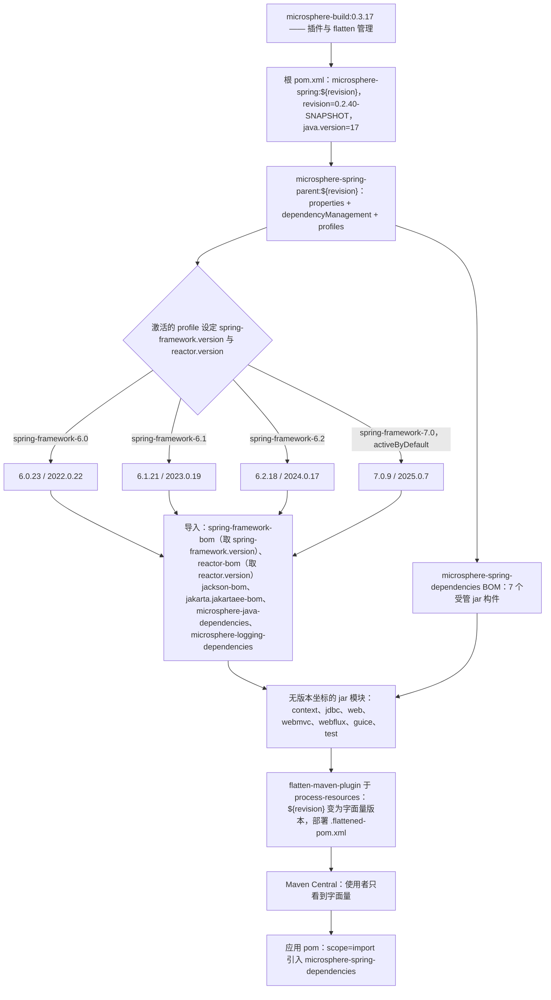

# microsphere-spring-parent — 开发者文档（0.2.x / `release`）

[← 开发者文档总览](./README.md) · [English](../parent.md) · [用户文档](../../../user-guide/current/zh/parent.md)

**谁需要这份文档。** 库维护者需要：这个 POM 是 `microsphere-spring` reactor 中对齐所有版本的唯一场所，因此任何依赖变更、
任何新增的 Spring Framework 版本线、任何关于发布机制的疑问，都会先落到这里。应用团队很少需要它——他们消费的是已发布的
[`microsphere-spring-dependencies`](./dependencies.md) BOM，只在复现某个版本对齐决策、或覆盖某个受管版本时才会读这份文件。

## 1. 版本信息

| 项目 | 值 |
|------|-------|
| 分支 | `release` |
| 文档目录 | `docs/**/current/` |
| 版本线 | **0.2.x** |
| 开发版本（根 `<revision>`） | `0.2.40-SNAPSHOT` |
| 最新发布版本 | `0.2.39` |
| 构建基线 parent | `io.github.microsphere-projects:microsphere-build:0.3.17` |
| Java 基线 | **Java 17**（根 POM 中 `<java.version>17</java.version>`） |
| Jakarta 命名空间 | `jakarta.*`（`jakarta.platform:jakarta.jakartaee-bom:11.0.0`） |
| 坐标 / 打包方式 | `io.github.microsphere-projects:microsphere-spring-parent:${revision}`，`packaging=pom` |

## 2. Parent 在 reactor 中的角色

`microsphere-spring-parent` 是一个纯构建模块：它不打包任何 class，发布的是 `pom` 构件，存在的意义就是被继承。它自己的
parent 是 reactor 根 `microsphere-spring`（`<relativePath>../pom.xml</relativePath>`），而根的 parent 是外部
`microsphere-build:0.3.17`，由后者提供全部插件管理。

| 模块 | 声明的 parent | 打包方式 |
|--------|-----------------|-----------|
| `pom.xml`（根，聚合器） | `microsphere-build:0.3.17` | `pom` |
| `microsphere-spring-parent` | `microsphere-spring`（`../pom.xml`） | `pom` |
| `microsphere-spring-dependencies` | `microsphere-spring-parent` | `pom` |
| `microsphere-spring-context`、`-jdbc`、`-web`、`-webmvc`、`-webflux`、`-guice`、`-test` | `microsphere-spring-parent` | `jar` |

这个 parent 只携带 `<dependencyManagement>`（`:32`）和 `<profiles>`（`:138`），其余一概没有——没有 `<build>`，
没有 `<pluginManagement>`，没有 `<repositories>`。八个继承者全部指向 `../microsphere-spring-parent/pom.xml`，因此在这里
新增一个版本，一次构建就能作用于整个 reactor；同时 parent 本身是发布构件，外部项目可以直接从它继承。

## 3. `${revision}` + `flatten-maven-plugin` 版本机制

reactor 中每个 POM 都声明同一个版本表达式，而只有根 POM 给它赋值：

```xml
<version>${revision}</version>   <!-- 根 properties：<revision>0.2.40-SNAPSHOT</revision> -->
```

这就是 Maven 的「CI 友好版本」方案：版本不必在十个 POM 里重复，发布时传一个属性而不是改文件——发布工作流跑的就是
`mvn -Drevision=0.2.40 deploy -P publish,ci`。这个方案成立的前提是：离开本机的那个 POM 里不再包含 `${revision}`，
而这正是 `org.codehaus.mojo:flatten-maven-plugin:1.7.3` 的职责，它只在 `microsphere-build` 里配置一次：

| 配置项 | 值 | 对发布 POM 的影响 |
|---------|-------|-----------------------------|
| execution `flatten` | phase `process-resources`，goal `flatten` | 每个模块都会执行，早于 `package` / `install` / `deploy` |
| `flattenMode` | `resolveCiFriendliesOnly` | 只重写 `${revision}`、`${sha1}`、`${changelist}` 和 parent 版本；结构保持不变 |
| `updatePomFile` | `true` | 生成的 `.flattened-pom.xml` 就是被 install 和 deploy 的那个 POM |
| `pomElements.parent` | `expand` | parent 块写成具体版本（`microsphere-spring:0.2.39`） |
| `pomElements.properties` | `keep` | `microsphere-java.version` 之类的属性得以保留，BOM 导入仍可解析 |
| `pomElements.dependencyManagement` | `interpolate` | 可插值的受管版本被解析为字面量 |
| `pomElements.dependencies` | `resolve` | 模块依赖版本变成字面量 |
| `pomElements.scm` / `url` / `developers` | `resolve` | `${project.scm.url}` 之类的表达式被展开 |
| `pomElements.distributionManagement` / `repositories` | `remove` | 内部仓库细节永不进入 Central |
| `flattenDependencyMode` / `embedBuildProfileDependencies` | `all` / `false` | 考虑完整依赖集；profile 条件依赖**不会**被烤进 POM |
| `.flattened-pom.xml` | 被 git 忽略 | 纯构建产物：不要手改，不要提交 |

**为什么 `flatten` 对使用者至关重要。** 如果 deploy 出去的 POM 仍写着 `<version>${revision}</version>`，使用者的 Maven
会沿 `microsphere-spring-parent` 的 parent 链向上找一个只存在于本 reactor 根 POM 里的 `revision` 属性；发布模型中并不存在它，
解析就会以 unresolvable-parent / bad-version 错误收场。flatten 把字面量（`0.2.39`）替换进去，产出一个自描述的 POM。
由此带来两个后续效果：展平后的 `microsphere-spring-dependencies` 里，受管模块写作
`io.github.microsphere-projects:microsphere-spring-context:0.2.39` 这样的字面量，这正是 BOM 在应用 POM 中无需 `${revision}`
即可使用的原因；而 `embedBuildProfileDependencies=false` 不会把任何 profile 冻结进发布 POM，因此选哪条 Spring 版本线始终是
本仓库的构建期决定。

## 4. Profile 矩阵

兼容性在 `microsphere-spring-parent/pom.xml` 中表达为四个纯属性 profile：

| Profile id | `${spring-framework.version}` | `${reactor.version}` | 激活方式 |
|-------------|-------------------------------|----------------------|------------|
| `spring-framework-6.0` | `6.0.23` | `2022.0.22` | 显式 |
| `spring-framework-6.1` | `6.1.21` | `2023.0.19` | 显式 |
| `spring-framework-6.2` | `6.2.18` | `2024.0.17` | 显式 |
| `spring-framework-7.0` | `7.0.9` | `2025.0.7` | **`activeByDefault`** |

这些 profile 只声明属性——没有依赖，没有插件，没有构建变更。

## 5. `${spring-framework.version}` 与 `${reactor.version}` 如何被消费

每个属性在 parent 的 `<dependencyManagement>` 中恰好被引用一次，作为 BOM 导入版本：

```xml
<dependency>
    <groupId>org.springframework</groupId>
    <artifactId>spring-framework-bom</artifactId>
    <version>${spring-framework.version}</version>
    <type>pom</type>
    <scope>import</scope>
</dependency>

<dependency>
    <groupId>io.projectreactor</groupId>
    <artifactId>reactor-bom</artifactId>
    <version>${reactor.version}</version>
    <type>pom</type>
    <scope>import</scope>
</dependency>
```

链路是：profile 设定属性 → 属性实例化一次 BOM 导入 → BOM 提供版本 → 模块 POM 声明无版本坐标，如
`org.springframework:spring-context` 和 `io.projectreactor:reactor-core`。模块从不写出 Spring 版本；激活 profile 是移动
版本的唯一方式，而且整个 reactor 一起移动。导入顺序是有约束力的（同一坐标重复声明时，先声明者胜出）：`jackson-bom`、
`org.yaml:snakeyaml`、`jakarta.jakartaee-bom`、`p6spy:p6spy`、`org.apache.zookeeper:zookeeper`、
`org.apache.curator:curator-recipes`、`org.apache.curator:curator-test`、`spring-framework-bom`、`reactor-bom`、
`microsphere-java-dependencies`、`microsphere-logging-dependencies`。

## 6. 受管的第三方版本

| 属性 | `release` 上的值 | 受管构件 |
|----------|--------------------|---------------------|
| `microsphere-java.version` | `0.3.19` | 导入 `io.github.microsphere-projects:microsphere-java-dependencies` |
| `microsphere-logging.version` | `0.2.2` | 导入 `io.github.microsphere-projects:microsphere-logging-dependencies` |
| `jakartaee.version` | `11.0.0` | 导入 `jakarta.platform:jakarta.jakartaee-bom`（提供 `jakarta.servlet-api`、`jakarta.websocket-api` 等） |
| `jackson.version` | `2.22.3` | 导入 `com.fasterxml.jackson:jackson-bom` |
| `snakeyaml.version` | `2.7` | 直接管理 `org.yaml:snakeyaml` |
| `p6spy.version` | `3.9.1` | 直接管理 `p6spy:p6spy` |
| `zookeeper.version` | `3.9.6` | 直接管理 `org.apache.zookeeper:zookeeper` |
| `curator.version` | `5.9.0` | 直接管理 `org.apache.curator:curator-recipes` 与 `curator-test`，两者都排除 `org.apache.zookeeper:zookeeper`，从而让显式的 `zookeeper` 条目掌控版本 |

还有一些坐标在模块 POM 中不写版本，但**并非**由这里管理，而是通过导入的 `microsphere-java` / `microsphere-logging` /
Spring / Reactor / Jakarta EE BOM 解析：`ch.qos.logback:logback-classic`、`org.junit.jupiter:junit-jupiter`、
`org.mockito:mockito-core`、`org.hamcrest:hamcrest`、`org.skyscreamer:jsonassert`、
`com.google.code.findbugs:jsr305`、`com.h2database:h2`、`org.xerial:sqlite-jdbc`、
`org.apache.tomcat.embed:tomcat-embed-core`、`javax.annotation:javax.annotation-api`、
`org.springframework:spring-context-indexer`。`microsphere-spring-guice` 是唯一的例外：它在自己的模块 POM 里钉住
`com.google.inject:guice:7.0.0`。

## 7. Profile → 版本（parent POM）与 profile → 额外依赖（模块 POM）

两个不同的问题由两个不同的文件回答，把它们分开是最核心的维护规则：

| 问题 | 回答处 | 机制 |
|----------|-------------|-----------|
| 「这条 Spring 版本线用哪些*版本*？」 | `microsphere-spring-parent/pom.xml` | profile 里的属性，喂给 BOM 导入（[§4](#4-profile-矩阵)） |
| 「这条 Spring 版本线需要哪些*额外依赖*？」 | 模块 POM，例如 `microsphere-spring-context/pom.xml` | 同 id profile 内的 `<dependencies>` |

在 `release`（0.2.x）上，第二行**并未被使用**：`grep '<profiles>' --include=pom.xml` 只命中
`microsphere-spring-parent/pom.xml`。四个 profile 下每个模块的依赖列表完全相同，而 `spring-context-indexer` 只是
`microsphere-spring-context` 的一个普通 `<optional>true</optional>` 依赖。这套机制真正被用起来是在 `release-1.x`（0.1.x）：
`microsphere-spring-context` 按 profile 追加 `microsphere-spring-compatible` 和/或 `spring-context-indexer`，
`microsphere-spring-test` / `microsphere-spring-webflux` 在 `spring-framework-4.3` 下覆盖 `spring-framework.version`
——见 [1.x parent 开发者文档](../../1.x/zh/parent.md)。

## 8. 针对特定 Spring 版本线构建与测试

```bash
./mvnw clean test   -P spring-framework-6.0     # 最老的受支持版本线
./mvnw clean verify -P spring-framework-6.2
./mvnw clean install -P spring-framework-7.0    # 与 activeByDefault 构建等价

# CI 的精确调用方式，对每条 Spring 版本线重复一遍
mvn --batch-mode --update-snapshots --file pom.xml -Drevision=0.0.1-SNAPSHOT test \
    --activate-profiles test,coverage,spring-framework-6.1
```

`.github/workflows/maven-build.yml` 用 Java `17` × `21` × `25` 对四个 Spring profile 跑满矩阵；
`-Drevision=0.0.1-SNAPSHOT` 让 CI 产物不进入真实版本空间。一旦激活任何其他 profile，Maven 就会丢弃 `activeByDefault`
profile，所以 `-P spring-framework-6.0` 是*替换* `7.0`——脚本里不要依赖默认值。用
`./mvnw -P spring-framework-6.0 help:evaluate -Dexpression=spring-framework.version -q -DforceStdout` 核验生效属性，
用 `./mvnw -P spring-framework-6.0 -pl microsphere-spring-context dependency:tree -Dincludes=org.springframework:*`
核验解析结果。新增一条 Spring 版本线 = 这里一个 profile 块 + 工作流一条矩阵项，模块 POM 无需改动。

## 9. 版本与 profile 流转



## 10. 与 `release-1.x`（0.1.x）的差异

| 维度 | `release` / 0.2.x（本文档） | `release-1.x` / 0.1.x |
|--------|-----------------------------------|-----------------------|
| `microsphere-build` parent | `0.3.17` | `0.3.14` |
| Java 基线 | `17`，在根 POM 中设定 | 根 POM 未设定；从 `microsphere-build` 继承 `8` |
| Reactor 模块数 | 9，无 compatible 模块 | 10，多出 `microsphere-spring-compatible` |
| Profiles | `6.0` / `6.1` / `6.2` / `7.0`，默认 `7.0` | `4.3` / `5.0` / `5.1` / `5.2` / `5.3`，默认 `5.3` |
| Reactor 版本写法 | 数字列车版本（`2022.0.22` … `2025.0.7`） | 版本列车代号（`Bismuth-SR17`、`Californium-SR23`、`Dysprosium-SR25`、`2020.0.47`） |
| Servlet 命名空间 | 导入 `jakarta.jakartaee-bom:11.0.0` | 无 Jakarta BOM；`javax.servlet:javax.servlet-api` 不写版本 |
| 额外受管构件 | — | `tomcat-embed-core`，由 `tomcat.version` = `9.0.119` 钉住 |
| `jackson` / `snakeyaml` / `zookeeper` | `2.22.3` / `2.7` / `3.9.6` | `2.22.2` / `2.6` / `3.9.5` |
| `microsphere-java` / `microsphere-logging` / `p6spy` / `curator` | `0.3.19` / `0.2.2` / `3.9.1` / `5.9.0` | 相同：`0.3.19` / `0.2.2` / `3.9.1` / `5.9.0` |
| profile 条件化模块依赖 | 无 | 有——`microsphere-spring-compatible`、`spring-context-indexer`、按模块覆盖 `spring-framework.version` |
| CI Java 矩阵 | `17` / `21` / `25` | `8` / `11` / `17` / `21` / `25` |

相关文档：[./README.md](./README.md) · [./dependencies.md](./dependencies.md) · [./context.md](./context.md) ·
[./web.md](./web.md) · [./test.md](./test.md) · [../../1.x/zh/parent.md](../../1.x/zh/parent.md)
