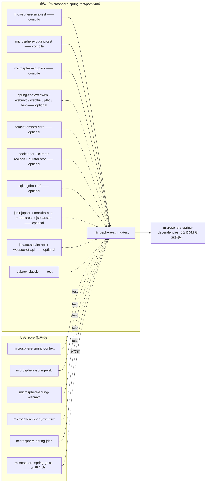
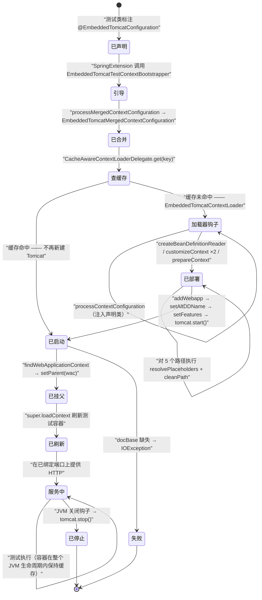
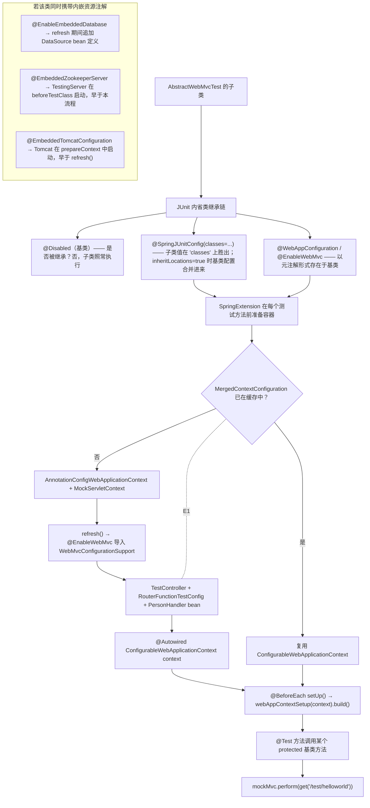

# microsphere-spring-test — 开发者指南

[← 开发者文档总览](./README.md) · [English](../test.md) · [用户文档](../../../user-guide/current/zh/test.md) · [1.x](../../1.x/zh/test.md)

下文路径均相对于 `microsphere-spring-test/`；`…/` 是 `src/main/java/io/microsphere/spring/test/` 的缩写。

## 1. 模块标识、版本基线与依赖姿态

| 属性 | 值 | 证据 |
|---|---|---|
| Maven 坐标 | `io.github.microsphere-projects:microsphere-spring-test:${revision}` | `pom.xml:13-16` |
| 本文分析的聚合版本 | `0.2.40-SNAPSHOT`（`revision` 属性） | `../pom.xml:55` |
| 父 POM | `microsphere-spring-parent:${revision}` | `pom.xml:5-10` |
| Java 基线 | `17`（`java.version`） | `../pom.xml:56` |
| Spring 基线 | 按 profile 选择：`6.0.23` / `6.1.21` / `6.2.18` / `7.0.9`（默认激活 `spring-framework-7.0`） | `../microsphere-spring-parent/pom.xml:138-173` |
| Jakarta EE | `jakarta.*`（BOM `jakartaee 11.0.0`） | `../microsphere-spring-parent/pom.xml:24,51-58` |
| ZooKeeper / Curator | `3.9.6` / `5.9.0`（两个 Curator 构件都排除了 `org.apache.zookeeper:zookeeper`） | `../microsphere-spring-parent/pom.xml:28-29,67-97` |
| Tomcat / SQLite / H2 / JUnit / Mockito / Hamcrest / JSONAssert | 本仓库不写版本号，由 `microsphere-java-dependencies:0.3.19` 统一管理 | `../microsphere-spring-parent/pom.xml:22,117-124`；`pom.xml:65-76,146-199` |
| 包名根 | `io.microsphere.spring.test` | `find src/main/java` |
| 主/测试类型数 | 35 个主类型、30 个 `*Test` 类 + 1 个非测试辅助类（`TestServletContainerInitializer`） | `src/**` |
| `src/main/resources` | **不存在** —— 该模块不携带任何生产资源 | `src/main/` 目录清单 |
| `src/test/resources` | 3 个 webapp（`webapp`、`webapps/empty-app`、`webapps/context-loader-app`）、`config/test.properties`、`META-INF/services/jakarta.servlet.ServletContainerInitializer` | `src/test/resources` |

**叶子模块姿态。** 该模块**对本聚合内其他模块零依赖** —— 连 `microsphere-spring-context` 都不依赖。它唯一的非 optional 构件来自兄弟仓库（`microsphere-java-test`、`microsphere-logging-test`、`microsphere-logback`；`pom.xml:30-46`）。所有框架、容器与测试库构件都标记为 `<optional>`（`pom.xml:48-199`），因此不会传递到消费者的 classpath。这正是"聚合内每个其他模块都能以 `test` 作用域消费它"的前提：既不会产生循环，也不会把 Tomcat/ZooKeeper 带进生产构建。

完整依赖表：

| 构件 | 声明作用域 | 主源码是否引用 | 证据 |
|---|---|---|---|
| `microsphere-annotation-processor` | compile + optional | 否 | `pom.xml:23-28` |
| `microsphere-java-test` | **compile** | 是（`io.microsphere.util.*`、`io.microsphere.lang.function.*`） | `pom.xml:30-34` |
| `microsphere-logging-test` | **compile** | 是（`io.microsphere.logging.test.jupiter.LoggingLevelsClass`） | `pom.xml:36-40`；`…/junit/jupiter/SpringLoggingTest.java:20` |
| `microsphere-logback` | **compile** | 是（`io.microsphere.logging.Logger`） | `pom.xml:42-46`；`…/tomcat/embedded/EmbeddedTomcatContextLoader.java:22` |
| `jakarta.websocket-client-api` / `jakarta.websocket-api` | compile + optional | 否 | `pom.xml:50-62` |
| `org.skyscreamer:jsonassert` | compile + optional | 否 | `pom.xml:64-69` |
| `org.hamcrest:hamcrest` | compile + optional | 否 | `pom.xml:71-76` |
| `org.springframework:spring-context` | compile + optional | 是 | `pom.xml:78-83` |
| `org.springframework:spring-context-indexer` | compile + optional | 否 | `pom.xml:85-89` |
| `org.springframework:spring-jdbc` | compile + optional | 是（`DriverManagerDataSource`） | `pom.xml:91-96`；`…/jdbc/embedded/EmbeddedDataBaseBeanDefinitionRegistrar.java:28` |
| `org.springframework:spring-web` | compile + optional | 是 | `pom.xml:98-103` |
| `org.springframework:spring-webmvc` | compile + optional | 是（`DispatcherServlet`、`@EnableWebMvc`） | `pom.xml:105-110` |
| `org.springframework:spring-webflux` | compile + optional | 是（`WebTestClient`、`@EnableWebFlux`） | `pom.xml:112-117` |
| `org.springframework:spring-test` | compile + optional | 是（`AbstractGenericContextLoader`、`WebTestContextBootstrapper`、`MockHttpServletRequest`） | `pom.xml:119-124` |
| `jakarta.servlet:jakarta.servlet-api` | compile + optional | 是 | `pom.xml:126-131` |
| `com.fasterxml.jackson.core:jackson-annotations` / `jackson-databind` | compile + optional | databind 是（`ObjectMapper`） | `pom.xml:133-144`；`…/webmvc/AbstractWebMvcTest.java:20` |
| `org.xerial:sqlite-jdbc` | compile + optional | 否（仅作为 `jdbc:sqlite:` 驱动在运行期使用） | `pom.xml:146-151`；`…/jdbc/embedded/EmbeddedDataBaseBeanDefinitionRegistrar.java:87` |
| `com.h2database:h2` | compile + optional | 否（仅作为 `jdbc:h2:mem:` 驱动在运行期使用） | `pom.xml:153-158`；`…/jdbc/embedded/EmbeddedDataBaseBeanDefinitionRegistrar.java:92` |
| `org.apache.tomcat.embed:tomcat-embed-core` | compile + optional | 是（`Tomcat`、`Context`） | `pom.xml:160-165`；`…/tomcat/embedded/EmbeddedTomcatContextLoader.java:25-26` |
| `org.apache.zookeeper:zookeeper` | compile + optional | 不直接引用（由 Curator 服务端带入） | `pom.xml:167-172` |
| `org.apache.curator:curator-recipes` | compile + optional | 否 | `pom.xml:174-179` |
| `org.apache.curator:curator-test` | compile + optional | 是（`TestingServer`、`InstanceSpec`） | `pom.xml:181-185`；`…/zookeeper/embedded/EmbeddedZookeeperServerTestExecutionListener.java:20-21` |
| `org.junit.jupiter:junit-jupiter` | compile + optional | **是 —— 出现在 `src/main/java`**（`@ExtendWith`、`@Test`、`@BeforeEach`、`@Disabled`） | `pom.xml:187-192`；`…/webmvc/AbstractWebMvcTest.java:24-25` |
| `org.mockito:mockito-core` | compile + optional | 否 | `pom.xml:194-199` |
| `ch.qos.logback:logback-classic` | **test** | 不适用（仅本模块自身测试） | `pom.xml:203-208` |

其中 `junit-jupiter`、`spring-test`、`tomcat-embed-core`、`jakarta.servlet-api` 既被 `src/main/java` 中的公开 API 注解所引用，又必须是 optional：这正是它们只能用 optional 作用域、而不能用 `test` 作用域声明的原因 —— 注解必须对消费者可编译。



实测入边：`microsphere-spring-context/pom.xml:115-121`、`microsphere-spring-web/pom.xml:85-91`、`microsphere-spring-webmvc/pom.xml:85-91`、`microsphere-spring-webflux/pom.xml:78-84`、`microsphere-spring-jdbc/pom.xml:71-77`。⚠ **`microsphere-spring-guice` 完全不依赖本模块** —— 它的测试依赖块只声明了 `junit-jupiter`、`spring-test`、`logback-classic`（`../microsphere-spring-guice/pom.xml:56-73`）。任何声称存在 guice → test 边的文档均已过时。版本管理见 `../microsphere-spring-dependencies/pom.xml:60-64`。

由于全部为 optional，**每个消费者都必须重新声明自己真正使用的那些**，例如 `microsphere-spring-webmvc/pom.xml:94-98` 为 `@EmbeddedTomcatConfiguration` 追加了 `test` 作用域的 `tomcat-embed-core`，`microsphere-spring-jdbc` 为 `@EnableEmbeddedDatabase` 追加了 `org.xerial:sqlite-jdbc`。

## 2. 包结构地图

| 包（`io.microsphere.spring.test.`） | 类型（可见性） | 职责 |
|---|---|---|
| `jdbc.embedded` | `EnableEmbeddedDatabase`（public）、`EnableEmbeddedDatabases`（public）、`EmbeddedDatabaseType`（public）、`EmbeddedDataBaseBeanDefinitionRegistrar`（包级私有）、`EmbeddedDataBaseBeanDefinitionsRegistrar`（包级私有） | 注解驱动地注册 SQLite / H2 的 `DriverManagerDataSource` |
| `tomcat.embedded` | `EmbeddedTomcatConfiguration`（public，内含嵌套 `enum Feature`）、`EmbeddedTomcatTestContextBootstrapper`（包级私有）、`EmbeddedTomcatMergedContextConfiguration`（包级私有）、`EmbeddedTomcatContextLoader`（包级私有） | 把真实内嵌 Tomcat 作为 Spring 测试的 `ContextLoader` |
| `zookeeper.embedded` | `EmbeddedZookeeperServer`（public）、`EmbeddedZookeeperServerTestExecutionListener`（包级私有） | 将 Curator `TestingServer` 绑定到 JUnit 类生命周期 |
| `junit.jupiter` | `SpringLoggingTest`（public 注解） | 组合 `@LoggingLevelsClass({"TRACE","INFO","ERROR"})` |
| `webmvc` | `AbstractWebMvcTest`（public abstract）、`PersonHandler`、`RouterFunctionTestConfig`、`SimpleUrlHandlerMappingTestConfig` | 函数式/注解式 WebMVC 夹具 + `MockMvc` 基类 |
| `webflux` | `AbstractWebFluxTest`（public abstract）、`PersonHandler`、`RouterFunctionTestConfig`、`SimpleUrlHandlerMappingTestConfig` | `webmvc` 的 WebFlux 镜像 |
| `web.controller` | `TestController`（public，`@Controller @RequestMapping("/test")`） | 两套技术栈共用的唯一端点夹具 |
| `web.servlet` | `TestServletContext`、`TestServlet`、`TestFilter`、`TestServletRegistration`、`TestFilterRegistration`、`TestServletContextListener`（全部 public） | 真正兑现 `addServlet`/`addFilter`/`addListener` 的 `ServletContext` |
| `web.context.request` | `MockServletWebRequest`（public） | 暴露底层 mock 请求/响应的 `ServletWebRequest` |
| `web` | `WebTestUtils`（public） | `MockServerWebExchange` 工厂、`getValue(Mono)`、共享路由常量 |
| `util` | `SpringTestUtils`、`ServletTestUtils`、`SpringTestWebUtils`（public abstract + 私有构造器） | 临时容器、Servlet 注册、`NativeWebRequest` 构造器 |
| `context.annotation` | `AnnotatedTypeMetadataTestFactory`、`TestConditionContext`（public） | `AnnotatedTypeMetadata` / `ConditionContext` 测试替身 |
| `domain` | `User`（public JavaBean，含 `equals`/`hashCode`/`toString`） | JSON 往返的载荷夹具 |

## 3. 架构设计

本模块只实现一个思想：**内嵌资源要么变成 bean 定义、要么进入 context-loader 三件套、要么变成 `TestExecutionListener`** —— 取决于该资源是否必须在 `refresh()` **之前**存在。

```mermaid
flowchart TD
    subgraph A["路径 A —— bean 定义阶段"]
        ANN["@EnableEmbeddedDatabase（可重复）"] -->|"@Import（单个实例）"| REG1["EmbeddedDataBaseBeanDefinitionRegistrar"]
        ANN -->|"容器注解 @EnableEmbeddedDatabases（≥2 个）"| REG2["EmbeddedDataBaseBeanDefinitionsRegistrar"]
        REG2 -->|"循环 getAnnotationArray('value')"| REG1
        REG1 -->|"switch EmbeddedDatabaseType"| JDBC["jdbc:sqlite::memory: / jdbc:h2:mem:"]
        JDBC --> BDS["BeanDefinition(DriverManagerDataSource) + setPrimary()"]
    end
    subgraph B["路径 B —— context-loader 三件套"]
        ETC["@EmbeddedTomcatConfiguration"] -->|@BootstrapWith| BST["EmbeddedTomcatTestContextBootstrapper"]
        BST -->|processMergedContextConfiguration| MCC["EmbeddedTomcatMergedContextConfiguration"]
        BST -->|getDefaultContextLoaderClass| TCL["EmbeddedTomcatContextLoader"]
        TCL -->|deployContext| TOM["Tomcat.addWebapp + tomcat.start()"]
        TOM -->|关闭钩子| STOP["tomcat.stop()"]
    end
    subgraph C["路径 C —— 测试执行监听器"]
        EZ["@EmbeddedZookeeperServer"] -->|@TestExecutionListeners MERGE_WITH_DEFAULTS| TEL["EmbeddedZookeeperServerTestExecutionListener"]
        TEL -->|beforeTestClass| TS["new TestingServer(instanceSpec, true)"]
        TEL -->|afterTestClass| TSS["testingServer.stop()"]
    end
```

* 路径 A 运行在 bean 定义注册期，因此 `@Autowired DataSource` 无需关心顺序。
* 路径 B 之所以存在，是因为 Tomcat 必须**在测试容器 refresh 之前启动** —— webapp 自身的 `ContextLoaderListener`/`DispatcherServlet` 会创建一个 `WebApplicationContext`，测试容器随后把它收编为父容器（`…/tomcat/embedded/EmbeddedTomcatContextLoader.java:87-99`）。
* 路径 C 面向**位于容器之外**的资源，因此 JUnit 类生命周期才是它正确的归属。

**真正被挂钩的 Spring 生命周期事件：没有。** `src/main/java` 中没有任何类型实现 `Lifecycle`、`SmartLifecycle`、`ApplicationListener`，也不消费 `ContextClosedEvent`（对 `src/main` 的 grep 返回零命中）。实际挂钩点是：`ImportBeanDefinitionRegistrar.registerBeanDefinitions`、`ContextLoader` 的模板方法（`processContextConfiguration`、`createBeanDefinitionReader`、两个 `customizeContext` 重载、`prepareContext`）、`AbstractTestExecutionListener.beforeTestClass`/`afterTestClass`，以及 `ShutdownHookUtils.addShutdownHookCallback`（`…/tomcat/embedded/EmbeddedTomcatContextLoader.java:58,247`）。

**缓存。** 只有 Spring 自身的 `CacheAwareContextLoaderDelegate` 会缓存容器，键为 `MergedContextConfiguration`。`EmbeddedTomcatMergedContextConfiguration` 把 port/contextPath/basedir/alternativeWebXml/features 存为字段，但**只覆写了 `toString()`**（`…/tomcat/embedded/EmbeddedTomcatMergedContextConfiguration.java:35-112`）—— 它们不参与 `equals`/`hashCode`。

## 4. 源码分析

### 4.1 `@EnableEmbeddedDatabase` 与它的两个注册器

```java
@Target({TYPE, ANNOTATION_TYPE}) @Retention(RUNTIME) @Documented
@Import(EmbeddedDataBaseBeanDefinitionRegistrar.class)
@Repeatable(EnableEmbeddedDatabases.class)                 // …/jdbc/embedded/EnableEmbeddedDatabase.java:39-44
public @interface EnableEmbeddedDatabase {
    EmbeddedDatabaseType type() default SQLITE;  int port() default -1;
    String dataSource();                        boolean primary() default false;
    String[] properties() default {};
}
```

`@EnableEmbeddedDatabase` **没有** `@Inherited`，而其容器注解 `@EnableEmbeddedDatabases` **有** `@Inherited`（`…/jdbc/embedded/EnableEmbeddedDatabases.java:38-43`）—— 见 §9。

单数注册器是一个朴素的 `ImportBeanDefinitionRegistrar`，包级私有（`…/jdbc/embedded/EmbeddedDataBaseBeanDefinitionRegistrar.java:47`）。其方法体只有"名字守卫 + 类型 switch"：

```java
void registerBeanDefinitions(AnnotationAttributes attributes, BeanDefinitionRegistry registry) {
    assertBeanName(attributes, registry);                        // :58, :70-75
    EmbeddedDatabaseType type = attributes.getEnum("type");      // :59
    switch (type) { case SQLITE -> processSQLite(...); case H2 -> processH2(...); }
}
```

`registerDataSourceBeanDefinition` 用两个**构造器参数**（JDBC URL 与解析后的 `Properties`）构建 `DriverManagerDataSource`，调用 `beanDefinition.setPrimary(primary)`，并以注解的 `dataSource` 值作为 bean 名注册（`:95-109`）。`resolveProperties` 把 registry 强转为 `ConfigurableBeanFactory`，对每个 `properties` 条目执行 `resolveEmbeddedValue`（因此 Environment 中的 `${...}` 可用），用 `SeparatorConstants.LINE_SEPARATOR` 拼接后交给 `Properties.load`（`:111-122`）。

可重复性由**第二个**注册器 `EmbeddedDataBaseBeanDefinitionsRegistrar`（注意多出的那个 `s` —— `…/jdbc/embedded/EmbeddedDataBaseBeanDefinitionsRegistrar.java:37-48`）承担，它是容器注解的 `@Import` 目标。它读取 `attributes.getAnnotationArray("value")`，把每个元素委托给一个新建的 `EmbeddedDataBaseBeanDefinitionRegistrar`。于是：单个实例 → 单数注册器执行一次；两个及以上 → Spring 暴露的是容器注解，复数注册器循环执行。`EnableEmbeddedDatabasesTest`（`src/test/java/.../EnableEmbeddedDatabasesTest.java:42-43`）在一个类上同时声明 `primary`（SQLite）与 `secondary`（H2），正是对循环路径的证明。

### 4.2 `EmbeddedTomcatConfiguration` —— 组合注解与 `Feature`

该注解携带完整的 Spring Test 栈（`…/tomcat/embedded/EmbeddedTomcatConfiguration.java:49-56`）：`@ExtendWith(SpringExtension.class)`、`@BootstrapWith(EmbeddedTomcatTestContextBootstrapper.class)`、`@ContextConfiguration`、`@WebAppConfiguration`、`@Inherited`。六个属性是纯 Tomcat 旋钮（`port` `:64`、`contextPath` `:72`、`basedir` `:88`、`alternativeWebXml` `:128`、`features` `:135`），六个是 `@AliasFor` 镜像：`docBase` → `WebAppConfiguration#value`（`:106-107`），以及 `classes`/`locations`/`initializers`/`inheritLocations`/`inheritInitializers` → `@ContextConfiguration`（`:142-177`）。

`enum Feature`（`:182-226`）是标准的"枚举即特性开关"，每项对应 `setFeatures` 中恰好一个应用动作：

| `Feature` | 应用方式 | 效果 |
|---|---|---|
| `NAMING` | `tomcat.enableNaming()`（`:269-271`） | JNDI |
| `DEFAULT_WEB_XML` | `tomcat.setAddDefaultWebXmlToWebapp(true)`（`:272-274`） | 反转 `:196` 处强制设置的 `false` |
| `WEB_APP_DEFAULTS` | `initWebappDefaults(context)`（`:275-277`） | 默认 servlet、JSP servlet、30 分钟会话、MIME 映射、欢迎文件 |
| `USE_TEST_CLASSPATH` | `context.setParentClassLoader(config.getTestClass().getClassLoader())`（`:278-281`） | webapp 可见测试依赖 |
| `SILENT` | `tomcat.setSilent(true)`（`:282-284`） | 抑制 Tomcat 内部日志 |

⚠ `DEFAULT_WEB_XML` 不是增量开关：`deployContext` 在 `:196` **无条件**调用 `tomcat.setAddDefaultWebXmlToWebapp(false)`，且发生在 `setFeatures` 之前，因此"不写该标志"本身是有语义的，而写上它是"重新启用"而非"启用默认"。

### 4.3 包级私有的 Tomcat 三件套

`EmbeddedTomcatTestContextBootstrapper`（`:35`）与 `EmbeddedTomcatContextLoader`（`:73`）在源码中**均无访问修饰符** —— 已在源码中核实，与用户指南"`@ContextConfiguration(loader = EmbeddedTomcatContextLoader.class)` 无法编译"的警告一致。只有同包测试能触达它们（`src/test/java/.../EmbeddedTomcatContextLoaderTest.java:31,46,50`）。

bootstrapper 只做两件事：锁定 loader 类（`:37-40`）；用 `findMergedAnnotation(testClass, …)` 读取注解后，把 `super.processMergedContextConfiguration` 产出的 `WebMergedContextConfiguration` 包装成 Tomcat 感知的子类（`:42-56`）。

loader 继承 `AbstractGenericContextLoader` 并覆写五个模板方法：

| 覆写 | 行号 | 行为 |
|---|---|---|
| `processContextConfiguration` | `:77-84` | 若未声明 `classes`，注入 `configAttributes.getDeclaringClass()` —— 因此不带任何属性的 `@EmbeddedTomcatConfiguration` 仍会把被注解的测试类当作配置类 |
| `prepareContext` | `:86-99` | 强转 `EmbeddedTomcatMergedContextConfiguration`，调用 `deployContext(...)`，随后 `setParent(...)` |
| `createBeanDefinitionReader` | `:111-115` | 基于 `DefaultListableBeanFactory` 返回 `XmlBeanDefinitionReader`（因此 `locations` 是 XML） |
| `customizeContext(GenericApplicationContext)` | `:117-121` | 注册 4 个可解析依赖（`ApplicationContext`、`ConfigurableApplicationContext`、`WebApplicationContext`、`ConfigurableWebApplicationContext`）—— 有意**不调用** `super` |
| `customizeContext(ConfigurableApplicationContext, MergedContextConfiguration)` | `:123-127` | 先 `super`，再通过 `AnnotatedBeanDefinitionReader` 注册 `classes`（`:129-136`） |
| `getResourceSuffix` | `:293-296` | `"-context.xml"`，从而自动探测 `WEB-INF/<name>-context.xml` |

`deployContext`（`:179-250`）是资源生命周期核心：

1. 五个路径类属性统一经 `environment.resolvePlaceholders` + `StringUtils.cleanPath` 解析（`:183-188`、`:252-255`）。
2. `new Tomcat()`；`setAddDefaultWebXmlToWebapp(false)`；`setPort(port)`；有值时 `setBaseDir(basedir)`（`:195-201`）。
3. 若 `alternativeWebXml` 能解析成真实文件，则**其父目录成为 docBase**，`resourceBasePath` 被丢弃（`:206-220`）；否则 docBase = 解析后的 `resourceBasePath`（`:222-224`）。
4. docBase 缺失 ⇒ `throw new IOException("The Context's docBase directory can't be found on the path : '…'")`（`:226-228`）。
5. `tomcat.addWebapp(contextPath, docBasePath)`；找到备用描述符时 `context.setAltDDName(absPath)`；`setFeatures(...)`；`tomcat.start()`；`addShutdownHookCallback(() -> execute(tomcat::stop))`（`:237-249`）。
6. `findWebApplicationContext(servletContext)` 先扫描 `ServletContext` 属性名中以 `FrameworkServlet.SERVLET_CONTEXT_PREFIX` 开头者，找不到才回退到 `WebApplicationContextUtils.getWebApplicationContext(servletContext)`（`:159-169`）。
7. `setParent` 把 Tomcat 侧的 web 容器置于测试容器之上 —— 若测试容器已有一个可配置父容器，则改为给**那个**父容器重新指定 parent（`:101-109`）。

### 4.4 `@EmbeddedZookeeperServer`

一个 public 标记注解（`…/zookeeper/embedded/EmbeddedZookeeperServer.java:41-50`），组合 `@ExtendWith(SpringExtension.class)` 与 `@TestExecutionListeners(listeners = EmbeddedZookeeperServerTestExecutionListener.class, mergeMode = MERGE_WITH_DEFAULTS)`。属性：`port()` = `2181`、`dataDir()` = `"${java.io.tmpdir}/test-zookeeper-${port}"`、`tickTime()` = `2000L`（`:57-78`）。

监听器为包级私有（`…/zookeeper/embedded/EmbeddedZookeeperServerTestExecutionListener.java:45`），`getOrder()` 返回 `HIGHEST_PRECEDENCE + 5`（`:71-74`）—— 因此 ZooKeeper 在 Spring 容器准备之前就已启动，在所有其他监听器完成之后才停止（Spring 对 `after*` 回调会反转监听器顺序）。它把 `TestingServer` 存放在键 `microsphere:zookeeper-server` 下（`:47`、`:61`、`:67`），用 `new InstanceSpec(dataDirectory, port, -1, -1, true, -1, tickTime, -1, null, null)` 构造规格（`:90-92`），并按如下方式解析 `dataDir`：新建一个 **`StandardEnvironment`**，只塞入一个仅含 `port` 的 `MapPropertySource("_")`，再 `ResourceUtils.getURL(...)` → `new File(url.toURI())`（`:76-88`）。测试自身的 `ApplicationContext` `Environment` 从不参与。

`EmbeddedZookeeperServer` 还 import 了 `org.apache.catalina.Context`，仅为支撑 Javadoc 里一句游离的 `@see Context`（`:20`、`:38`）—— 这是从 Tomcat 注解复制粘贴遗留下来的，使 ZooKeeper 包与 `tomcat-embed-core` 产生了不必要的编译期牵连。

### 4.5 抽象测试基类

`AbstractWebMvcTest`（`…/webmvc/AbstractWebMvcTest.java:50-57`）标注 `@Disabled @WebAppConfiguration @SpringJUnitConfig(classes = {TestController.class, RouterFunctionTestConfig.class}) @EnableWebMvc`。它暴露 `protected ConfigurableWebApplicationContext context`、`protected MockMvc mockMvc`、一个用 `MockMvcBuilders.webAppContextSetup(context)` 重建 `mockMvc` 的 `@BeforeEach protected void setUp()`（`:59-70`），以及八个 `protected` 冒烟方法：`testWebEndpoints`、`testHelloWorld`、`testGreeting`、`testUser`、`testError`、`testResponseEntity`、`testView`、`testUpdatePerson`（`:82-173`）。

`AbstractWebFluxTest`（`…/webflux/AbstractWebFluxTest.java:44-50`）形状相同，去掉 `@WebAppConfiguration`、改用 `@EnableWebFlux`；持有 `ConfigurableApplicationContext context`、一个 `protected TestController`（而 WebMVC 侧是 **private**，见 §9）、一个在 `@BeforeEach final void init()`（包级私有，`:62-65`）中通过可覆写的 `buildWebTestClient(context)` 钩子（`:165-168`）构建的 `WebTestClient`，冒烟方法同样齐全但少了 `testView`，且它们都不声明 `throws Exception`。

基类上的 `@Disabled` 只压制基类自身，并不会把子类一并禁用 —— 本聚合即为证据：`microsphere-spring-webmvc/…/ReversedProxyHandlerMappingTest.java:59` 与 `microsphere-spring-webflux/…/RequestContextWebFilterTest.java:53` 都继承这些基类并在 CI 中执行 `@Test` 方法。此外 surefire 还额外排除了 `**/Abstract*.java`。

## 5. 复杂流程

### 5.1 (a) 内嵌 Tomcat 生命周期 —— 启动、服务、拆除



有两个事实具有决定性：容器（因而服务器）**从不**在测试类之间关闭 —— 只在 JVM 退出时关闭；`Tomcat` 引用仅被 shutdown-hook 的 lambda 捕获，所以当 `port = 0` 时没有任何 API 能读出实际绑定的端口。

### 5.2 (b) 抽象基类如何引导 Spring 容器并注册内嵌资源



## 6. 设计模式

| 模式 | 类 | 证据 |
|---|---|---|
| 注册器（Registrar，`@Enable*`） | `EmbeddedDataBaseBeanDefinitionRegistrar`、`EmbeddedDataBaseBeanDefinitionsRegistrar` | 二者皆为 `@Import` 目标，且都是包级私有（`:47`、`:37`） |
| 组合/链式注册（可重复分发） | 复数注册器逐元素 `new EmbeddedDataBaseBeanDefinitionRegistrar()` 委托 | `EmbeddedDataBaseBeanDefinitionsRegistrar.java:44-47` |
| 建造者（流式构建 bean 定义） | `BeanDefinitionBuilder.genericBeanDefinition(DriverManagerDataSource.class).addConstructorArgValue(...)` | `EmbeddedDataBaseBeanDefinitionRegistrar.java:102-108` |
| 枚举即特性开关 + 命令分发 | `EmbeddedTomcatConfiguration.Feature` 由 `EmbeddedTomcatContextLoader.setFeatures` 的 `switch` 消费 | `EmbeddedTomcatConfiguration.java:182-226`；`EmbeddedTomcatContextLoader.java:265-287` |
| 装饰器 / 值对象增强 | `EmbeddedTomcatMergedContextConfiguration` 包装 `WebMergedContextConfiguration` 并追加 5 个字段 | `EmbeddedTomcatMergedContextConfiguration.java:47-55` |
| 模板方法（Template Method） | `EmbeddedTomcatContextLoader` 覆写 6 个 `AbstractGenericContextLoader` 钩子；`AbstractWebFluxTest.buildWebTestClient` 与 `AbstractWebMvcTest.setUp` 是基类钩子；`testWebEndpoints()` 是模板调用 | `EmbeddedTomcatContextLoader.java:77-135,293-296`；`AbstractWebFluxTest.java:165-168`；`AbstractWebMvcTest.java:82-89` |
| 策略（测试替身选择） | `EmbeddedDatabaseType {SQLITE, H2}` 选择 `processSQLite`/`processH2` | `EmbeddedDataBaseBeanDefinitionRegistrar.java:59-67` |
| 工厂方法 | `AnnotatedTypeMetadataTestFactory.createMethodAnnotatedTypeMetadata()`、`WebTestUtils.mockServerWebExchange()`、`SpringTestWebUtils.createWebRequest(...)` | `AnnotatedTypeMetadataTestFactory.java:40-43`；`WebTestUtils.java:82-99`；`SpringTestWebUtils.java:66-98` |
| 静态工具（不可实例化） | `SpringTestUtils`、`ServletTestUtils`、`SpringTestWebUtils` 均为 `abstract` + `private` 构造器 | `SpringTestUtils.java:33,109`；`ServletTestUtils.java:40,95`；`SpringTestWebUtils.java:49,303` |
| 适配器 | `TestServletContext` 把 `MockServletContext` 适配为可变更注册表；`TestConditionContext` 把 `ApplicationContext` 适配为 `ConditionContext`；`MockServletWebRequest` 把 mock 请求/响应适配为 `ServletWebRequest` | `TestServletContext.java:49-186`；`TestConditionContext.java:41-73`；`MockServletWebRequest.java:35-51` |
| 观察者（测试生命周期，而非应用事件） | `EmbeddedZookeeperServerTestExecutionListener extends AbstractTestExecutionListener` | `EmbeddedZookeeperServerTestExecutionListener.java:45-74` |
| 空对象 | `TestFilter`（`doFilter` 体为空）、`TestServletContextListener`、返回 `null` 的 `PersonHandler` | `TestFilter.java:53-64`；`webmvc/PersonHandler.java:33-51` |
| **不存在：** Lifecycle / SmartLifecycle、`ApplicationListener`、单例持有式缓存 | —— | `src/main` 零命中 |

## 7. 扩展指南

要新增一个内嵌组件，先决定路径：位于 Spring 容器之内（路径 A/B），还是容器之外（路径 C —— 成本最低，照抄 `zookeeper.embedded`）。

```java
package io.microsphere.spring.test.redis.embedded;            // 命名规范：test.<component>.embedded

@Target(TYPE) @Retention(RUNTIME) @Documented @Inherited
@ExtendWith(SpringExtension.class)
@TestExecutionListeners(listeners = EmbeddedRedisServerTestExecutionListener.class,
                        mergeMode = TestExecutionListeners.MergeMode.MERGE_WITH_DEFAULTS)
public @interface EmbeddedRedisServer {                        // public 标记注解
    int port() default 6379;
    String bindDir() default "${java.io.tmpdir}/test-redis-${port}";
}

class EmbeddedRedisServerTestExecutionListener extends AbstractTestExecutionListener {
    static final String ATTRIBUTE_NAME = "microsphere:redis-server";   // 键名约定
    @Override public void beforeTestClass(TestContext tc) throws Exception {
        tc.setAttribute(ATTRIBUTE_NAME, start(resolve(tc)));            // 先启动，再存属性
    }
    @Override public void afterTestClass(TestContext tc) throws Exception {
        RedisServer s = (RedisServer) tc.getAttribute(ATTRIBUTE_NAME);
        if (s != null) { s.stop(); }                                     // stop 前先判空
    }
    @Override public int getOrder() { return Ordered.HIGHEST_PRECEDENCE + 5; }
}
```

新代码必须遵循的约定：

1. **命名。** 包名 `io.microsphere.spring.test.<component>.embedded`；注解名 `Embedded<Component>`（若该组件需独占容器三件套则用 `<Component>Configuration`，配套 `<X>TestContextBootstrapper` + `<X>MergedContextConfiguration` + `<X>ContextLoader`，除注解外全部包级私有）。
2. **可见性。** 只有面向用户的注解、枚举与夹具类型是 `public`；注册器、bootstrapper、merged configuration、监听器一律保持包级私有，使 `@Import`/`@BootstrapWith` 成为唯一入口。
3. **开关。** 本模块目前**不存在任何属性 kill-switch**（`@EnableEmbeddedDatabase` 既无 `enabled` 属性，也不继承 `AnnotatedBeanCapableImportCandidate`）。若要新增，请沿用 `microsphere-spring-context` 的 `microsphere.spring.<annotated-class>.enabled` 形式，而不要另造一套；否则唯一的开关就是注解本身与 `Feature` 数组。
4. **属性占位符。** 默认值请写成 `${...}` 并显式解析 —— Tomcat 用 `environment.resolvePlaceholders` + `StringUtils.cleanPath`，ZooKeeper 用预置过的 `StandardEnvironment`。并在文档中写明用的是哪一个 `Environment`。
5. **关闭顺序。** 外部资源必须放在 `beforeTestClass`/`afterTestClass`，并把 `getOrder()` 设在 `HIGHEST_PRECEDENCE` 附近，以确保其生命周期覆盖所有容器。任何由 `ContextLoader` 启动的东西都必须自行注册拆除动作（`addShutdownHookCallback`），因为 Spring 的容器缓存永远不会关闭它。
6. **依赖。** 第三方构件写入 `pom.xml` 时必须是 **compile** 作用域的 `<optional>`（绝不能用 `test` —— `src/main/java` 需要编译通过），并在消费者文档中注明每个 test 作用域的使用方需自行重复声明。
7. **不要**在本模块引入 JUnit 4 构造：这里全是 Jupiter（`@ExtendWith`、`@BeforeEach`、`@Disabled`、`@Test`），且声明的 Jupiter 构件只有 `junit-jupiter` 一个（`pom.xml:187-192`）。

## 8. 构建与验证

| 任务 | 命令 / 事实 |
|---|---|
| 构建并测试本模块 | `mvn -pl microsphere-spring-test -am test --activate-profiles test,coverage,spring-framework-7.0` |
| 固定聚合版本 | CI 传入 `-Drevision=0.0.1-SNAPSHOT`（`.github/workflows/maven-build.yml:43-49`） |
| Spring 矩阵 | `spring-framework-6.0`、`-6.1`、`-6.2`、`-7.0`；默认激活 `7.0`（`../microsphere-spring-parent/pom.xml:138-173`） |
| JDK 矩阵 | `17`、`21`、`25`（`.github/workflows/maven-build.yml:25`） |
| Surefire 选取规则 | 包含 `**/*Test.java`、`**/*Tests.java`，排除 `**/Abstract*.java`（`microsphere-build` pom）—— 这就是 `AbstractWebMvcTest`/`AbstractWebFluxTest` 本身不被执行的原因 |
| 测试清单（30 个类） | Tomcat：`EmbeddedTomcatConfigurationTest`（默认值、`/webapp` + `dispatcherServlet`）、`EmbeddedTomcatConfigurationContextLoaderWebAppTest`（`port=0`、内联 `@TestPropertySource`）、`EmbeddedTomcatConfigurationEmptyWebAppTest`（`alternativeWebXml` 压过 `docBase`）、`EmbeddedTomcatConfigurationFullTest`（全部五个 `Feature`、占位符、`locations`、`initializers`、两个 `inherit*` 均关闭）、`EmbeddedTomcatContextLoaderTest`；JDBC：`EnableEmbeddedDatabaseTest`、`EnableEmbeddedDatabasesTest`、`EmbeddedDataBaseBeanDefinitionRegistrarTest`；ZooKeeper：`EmbeddedZookeeperServerTest`（对 `localhost:2181` 做 Curator CRUD）；另有 `util`、`web`、`web.servlet`、`webmvc`、`webflux`、`context.annotation`、`domain` 的单元 |
| 关键的测试资源 | `src/test/resources/webapp/WEB-INF/web.xml` 声明了 `ContextLoaderListener` 与映射 `/*`、`contextConfigLocation` 为空值的 `DispatcherServlet` —— `EmbeddedTomcatConfigurationTest:61-65` 断言的正是这些值 |
| 运行单个测试 | `mvn -pl microsphere-spring-test test -Dtest=EmbeddedTomcatConfigurationFullTest -Drevision=0.2.40-SNAPSHOT` |

## 9. 陷阱与注意事项

| # | 观察 | 证据 |
|---|---|---|
| 1 | **端口分配无人管理。** `port = 0` 表示"向操作系统索取"，但 loader 除 shutdown-hook lambda 外不保留任何 `Tomcat` 引用，因此没有任何东西公布实际绑定的端口。⚠ 用户指南的 `WebAppIT` 示例注释"resolve the actually bound port from the context"没有对应 API 支撑。 | `EmbeddedTomcatContextLoader.java:195,245-249`；`../../user-guide/current/zh/test.md:81-83` |
| 2 | 两个 `Feature` **并非**彼此独立：`DEFAULT_WEB_XML` 只是重新打开 `deployContext` 先前强制关闭的东西；`USE_TEST_CLASSPATH` 在 `addWebapp` 之后才调用 `setParentClassLoader`。两者都发生在 `addWebapp(...)` 之后、`start()` 之前，顺序固定且不可配置。 | `EmbeddedTomcatContextLoader.java:196,237-245,265-287` |
| 3 | **容器缓存键忽略 Tomcat 配置。** 若 `classes`+`locations` 相同而 `port` / `contextPath` / `basedir` / `alternativeWebXml` / `features` 不同，它们映射到同一个 `MergedContextConfiguration`，于是第二个测试类会静默复用第一台服务器，而不是启动自己的那台。 | `EmbeddedTomcatMergedContextConfiguration.java:35-112`（未覆写 `equals`/`hashCode`） |
| 4 | 内嵌服务器从不在测试类之间关闭，会存活到 JVM 退出。端口冲突时必须考虑 fork 每测试类，或 surefire 的复用策略。 | `EmbeddedTomcatContextLoader.java:247` |
| 5 | `@EnableEmbeddedDatabase.port` **已声明但两个注册器都不读取**；SQLite/H2 的 URL 是硬编码的。⚠ 用户指南已标注此点，但不要基于它构建任何行为。 | `EnableEmbeddedDatabase.java:56`；`EmbeddedDataBaseBeanDefinitionRegistrar.java:57-68` |
| 6 | `jdbc:sqlite::memory:` / `jdbc:h2:mem:` 叠加 `DriverManagerDataSource`（无连接池）意味着每次 `getConnection()` 都是一个全新连接 —— 对 SQLite 相当于每次一个独立内存库，对 H2 则是无名的 `mem:` 库并随最后一个连接销毁。在一个连接里建的 schema 在下一个连接中不可见。 | `EmbeddedDataBaseBeanDefinitionRegistrar.java:87,92,102-104` |
| 7 | bean 名重复时抛的是 **bean 定义阶段**的 `BeanCreationException`，而不是 `IllegalStateException`，消息文本为 `"The duplicated BeanDefinition with name : <name>"`；该具体异常类型已是可观测契约的一部分（`EmbeddedDataBaseBeanDefinitionRegistrarTest:37` 断言它）。 | `EmbeddedDataBaseBeanDefinitionRegistrar.java:70-75` |
| 8 | `@Inherited` 不对称：`EnableEmbeddedDatabases` 带 `@Inherited`，`EnableEmbeddedDatabase` 不带。从父类继承"一个实例"与继承"两个实例"的行为路径不同。 | `EnableEmbeddedDatabase.java:39-44`；`EnableEmbeddedDatabases.java:41` |
| 9 | `resolveProperties` 在没有 `instanceof` 守卫的情况下把 `BeanDefinitionRegistry` 强转为 `ConfigurableBeanFactory`，并通过 `ThrowableAction.execute` 吞掉 `Properties.load` 的失败。 | `EmbeddedDataBaseBeanDefinitionRegistrar.java:112,120` |
| 10 | ZooKeeper 的清理无守卫：`afterTestClass` 直接强转属性并调用 `stop()`，不判空；一旦 `beforeTestClass` 失败，清理阶段抛出的 `NullPointerException` 会掩盖真正的错误原因；且只调用 `stop()`，从不调用 `close()`。 | `EmbeddedZookeeperServerTestExecutionListener.java:64-69` |
| 11 | `beforeTestClass` 使用 `testClass.getAnnotation(EmbeddedZookeeperServer.class)`（直接读取，仅靠 `@Inherited` 生效），**不是** `findMergedAnnotation` —— 因此 `@EmbeddedZookeeperServer` 无法作为元注解放在自定义组合注解上，那样会在 `:54` 处 `NPE`。 | `EmbeddedZookeeperServerTestExecutionListener.java:52-54` |
| 12 | ZooKeeper 监听器用一个全新的 `StandardEnvironment` 解析 `dataDir`，其中只预置了 `port`，完全忽略 Spring 测试的 `Environment`：`@TestPropertySource` 的值永远到不了 `dataDir`。在 Windows 上，`cleanPath` 会先把 `\` 改写成 `/`，再交给 `ResourceUtils.getURL`。 | `EmbeddedZookeeperServerTestExecutionListener.java:76-88` |
| 13 | `@EmbeddedTomcatConfiguration` 与 `@EmbeddedZookeeperServer` 都组合了 `@ExtendWith(SpringExtension.class)`；同时标注在同一个类上会把该扩展注册两次，而 `@BootstrapWith` 只有一处（取决于 JUnit 先解析到哪个注解）真正生效。 | `EmbeddedTomcatConfiguration.java:53`；`EmbeddedZookeeperServer.java:45` |
| 14 | `SpringTestUtils.testInSpringContainer` 只在成功路径调用 `context.close()`；消费者抛异常时会以 `RuntimeException` 逃逸，`close()` 不会执行，容器泄漏。 | `SpringTestUtils.java:96-107` |
| 15 | `AnnotatedTypeMetadataTestFactory` 硬编码 `stackTraces[3]`，并保留着一条未完成的 `// TODO be refactored by StackWalker API`；任何新增的委托栈帧都会破坏它。它同时是一个 `BeanClassLoaderAware` 组件，却在容器之外被使用时返回 `StandardMethodMetadata`。 | `AnnotatedTypeMetadataTestFactory.java:36,45-53` |
| 16 | ⚠ 用户指南的表格把 `TestController testController` 列为 `AbstractWebMvcTest` 的 **protected** 字段；源码中它是 `private`（`:62-63`）。子类只能读到 WebFlux 侧那一个（`AbstractWebFluxTest.java:57-58` 是 `protected`）。 | `AbstractWebMvcTest.java:59-65` |
| 17 | ⚠ 用户指南的版本表写的是 ZooKeeper `3.9.5`；聚合实际管理的是 **`3.9.6`**（`3.9.5` 是 0.1.x 的值）。Curator `5.9.0` 正确。 | `../microsphere-spring-parent/pom.xml:28-29`；`../docs/developer-guide/current/parent.md:208`；`../../user-guide/current/zh/test.md:16` |
| 18 | ⚠ 用户指南对 `@EnableEmbeddedDatabases` 与 `@EmbeddedZookeeperServer` 属性的描述是准确的，但完全遗漏了第二个注册器；两个仅差一个 `s` 的近似类名（`...BeanDefinitionRegistrar` 与 `...BeanDefinitionsRegistrar`）**都是活代码**。 | `EmbeddedDataBaseBeanDefinitionsRegistrar.java:37-48` |
| 19 | 有七个 optional 构件在本模块的 `src/main` 与 `src/test` 中都未被引用：`mockito-core`、`jsonassert`、`hamcrest`、`jakarta.websocket-api`、`jakarta.websocket-client-api`、`spring-context-indexer`、`curator-recipes`。它们只是"已声明但未使用"的便利项；由于全部 optional，消费者也拿不到任何传递依赖。 | `pom.xml:64-76,85-89,174-179,194-199` |
| 20 | `AbstractWebFluxTest.init()` 同时是 `@BeforeEach`、**`final`** 且包级私有（`:62-65`），而 `AbstractWebMvcTest.setUp()` 是 `@BeforeEach protected` 且可覆写（`:67-70`）—— WebFlux 基类无法通过生命周期方法自定义客户端，只能通过 `buildWebTestClient`。 | `AbstractWebFluxTest.java:62-65`；`AbstractWebMvcTest.java:67-70` |
| 21 | 所有 `Feature`/`EmbeddedDatabaseType` 的 `switch` 都是穷尽式且**没有 `default`**：新增枚举常量会导致注册器/loader 编译失败而非运行期失败 —— 这是有意为之，但也意味着消费者无法扩展这些枚举。 | `EmbeddedDataBaseBeanDefinitionRegistrar.java:60-67`；`EmbeddedTomcatContextLoader.java:267-286` |
| 22 | 每个类型上的 `@since 1.0.0` 与本文分析的聚合版本 `0.2.40-SNAPSHOT` 相冲突；`@since` 不可用于映射发布版本。 | `EnableEmbeddedDatabase.java:37`；`../pom.xml:55` |

相关文档：[./README.md](./README.md) · [./dependencies.md](./dependencies.md) · [./parent.md](./parent.md) · [./context.md](./context.md) · [./jdbc.md](./jdbc.md) · [./web.md](./web.md) · [用户文档](../../../user-guide/current/zh/test.md) · [1.x](../../1.x/zh/test.md)
