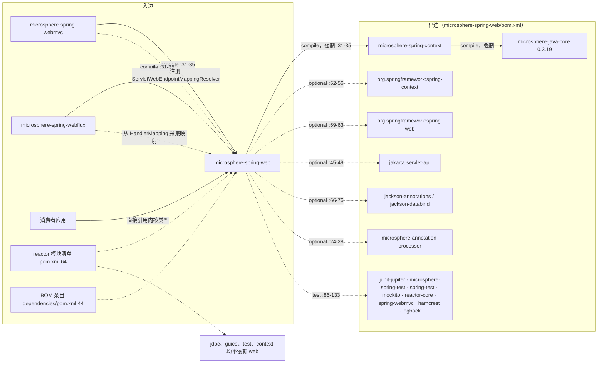
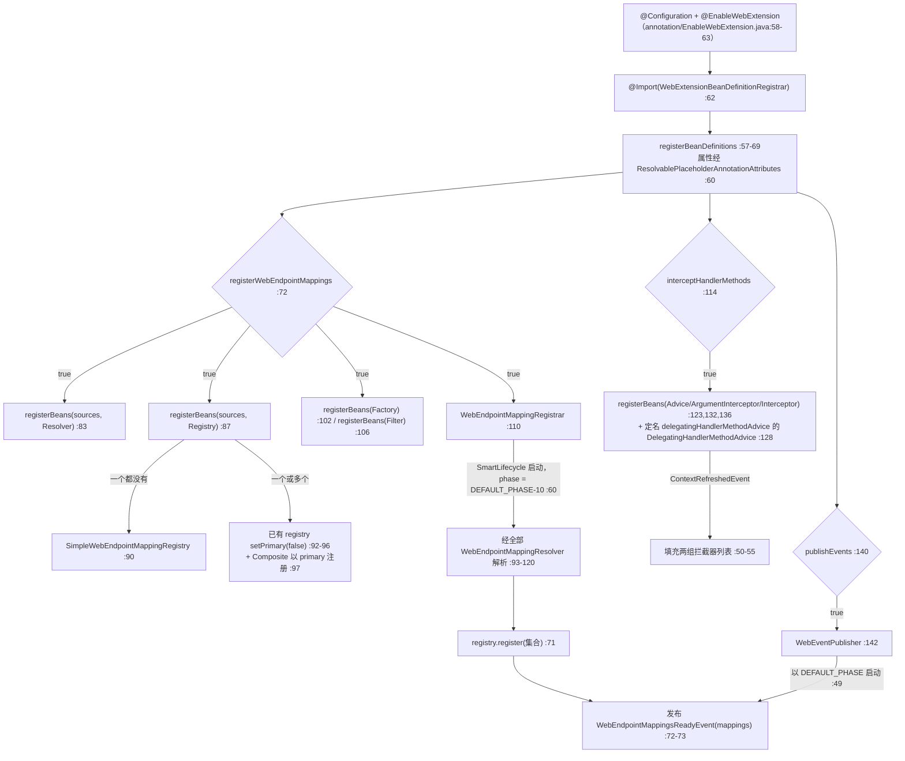
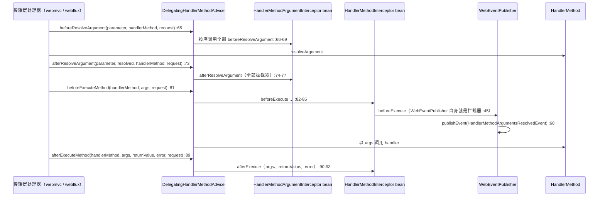

# microsphere-spring-web — 开发者文档

[← 开发者文档总览](./README.md) · [English](../web.md) · [用户文档](../../../user-guide/current/zh/web.md) · [1.x](../../1.x/zh/web.md)

## 1. 模块标识、基线与依赖姿态

| 属性 | 取值 | 证据 |
|---|---|---|
| Maven 坐标 | `io.github.microsphere-projects:microsphere-spring-web:${revision}` | `microsphere-spring-web/pom.xml:13-16` |
| 打包方式 | `jar` | `microsphere-spring-web/pom.xml:16` |
| 父 POM | `microsphere-spring-parent:${revision}`，`relativePath ../microsphere-spring-parent/pom.xml` | `microsphere-spring-web/pom.xml:5-10` |
| 当前分析版本 | `0.2.40-SNAPSHOT` | `pom.xml:55` |
| Java 基线 | `17`（`java.version`） | `pom.xml:56` |
| Spring 基线 | 由 profile 选择 `6.0.23` / `6.1.21` / `6.2.18` / `7.0.9`，经 `spring-framework-bom` 导入；`spring-framework-7.0` 为 `activeByDefault` | `microsphere-spring-parent/pom.xml:139-172`，BOM 导入 `:99-106` |
| Jakarta EE | `jakarta.jakartaee-bom` `11.0.0` → `jakarta.servlet.*` 命名空间 | `microsphere-spring-parent/pom.xml:24,52-56` |
| Microsphere Java | `0.3.19`，经 `microsphere-java-dependencies` 导入——下列所有无版本号依赖均在此解析 | `microsphere-spring-parent/pom.xml:22,117-124` |
| `microsphere-spring-context` | compile，**强制依赖**，显式 `${revision}` | `microsphere-spring-web/pom.xml:31-35` |
| `microsphere-annotation-processor` | optional，无版本号 | `:24-28` |
| `com.google.code.findbugs:jsr305` | optional | `:38-42` |
| `jakarta.servlet:jakarta.servlet-api` | optional | `:45-49` |
| `org.springframework:spring-context` | optional | `:52-56` |
| `org.springframework:spring-web` | optional | `:59-63` |
| `jackson-annotations` / `jackson-databind` | 均为 optional | `:66-70`、`:72-76` |
| 测试依赖 | `junit-jupiter` `:80-83`、`microsphere-spring-test` `:86-91`、`spring-test` `:94-98`、`mockito-core` `:101-105`、`reactor-core` `:108-112`、`spring-webmvc` `:115-119`、`hamcrest` `:122-126`、`logback-classic` `:129-133` | `microsphere-spring-web/pom.xml:79-133` |
| `src/main/resources` | 仅一个文件：`META-INF/spring.factories`（5 行、两个 key）——没有 `AutoConfiguration.imports`，也没有 `module-info.java` | `microsphere-spring-web/src/main/resources/META-INF/spring.factories:1-5` |
| 主/测试类数量 | 58 个主类、61 个测试类 | `src/main/java`、`src/test/java` 目录清单 |

依赖姿态：本模块是 Web 家族的**内核**——向下只有一条强制依赖（`microsphere-spring-context`，`pom.xml:31-35`，它自身再拖入 `microsphere-java-core` 0.3.19），而编译所触及的 API **全部**是 `optional`：Servlet API（`:45-49`）、`spring-context`（`:52-56`）、`spring-web`（`:59-63`）以及两个 Jackson 构件（`:66-76`）。因此没有任何东西会传递到消费者的 classpath 上。下游应用必须自行加入 `spring-web` 与 `jakarta.servlet-api`，而两个传输层模块以不同方式补上了这个缺口：`webmvc` 重新声明了它们（`microsphere-spring-webmvc/pom.xml:37-42` 的 `jakarta.servlet-api` 为 `provided`，`:44-49` 的 `spring-web` 为 optional），而 `webflux` 只声明了 optional 的 `spring-webflux`（`microsphere-spring-webflux/pom.xml:44-49`），从未出现 `spring-web`——于是它的 `ServerWebRequest implements NativeWebRequest` 实际上是针对一个内核刻意排除在传递依赖之外的构件编译的。只有需要 JSON 工厂时才需要 `jackson-databind`（`Jackson2WebEndpointMappingFactory.java:19` 导入了 `com.fasterxml.jackson.databind.ObjectMapper`）。值得注意的是编译 classpath 上刻意缺少 `spring-webmvc`、`spring-webflux` 与 `reactor-core`：它们只以 test scope 存在（`:108-112`、`:115-119`），因此内核永远无法引用传输层类型——唯一例外是测试目录内的本地辅助类，例如 `microsphere-spring-web/src/test/java/io/microsphere/spring/web/util/SpringWebMvcHelper.java`。

入边消费者：`microsphere-spring-webmvc`（`microsphere-spring-webmvc/pom.xml:31-35`）与 `microsphere-spring-webflux`（`microsphere-spring-webflux/pom.xml:31-35`）是**唯一**两个对本构件有 compile 依赖的 reactor 模块；`microsphere-spring-context`、`-jdbc`、`-guice`、`-test` 都不声明它；除这两个传输层之外，该构件只出现在 reactor 模块清单（`pom.xml:64`）与 BOM（`microsphere-spring-dependencies/pom.xml:44`）中。

## 2. 入边与出边



内核在**被消费**意义上是枢纽，在**消费**意义上是叶子：恰有两个模块位于其上（`webmvc`、`webflux`），它之上恰有一个（`context`）。由于 `spring-web` 是 optional（`pom.xml:59-63`），两个传输层都不能依赖本 jar 提供它：`webmvc` 显式重新声明（`microsphere-spring-webmvc/pom.xml:44-49`），而 `webflux` 从未声明它，而是从 `spring-webflux` 构件自身以 compile 作用域传递获得——这正是 `ServerWebRequest implements NativeWebRequest`（`microsphere-spring-webflux/.../ServerWebRequest.java:30`）对它们可编译、却对仅引用本 jar 的消费者不可编译的原因。

## 3. `io.microsphere.spring.web.*` 包地图

| 包 | 类型 | 职责 |
|---|---|---|
| `io.microsphere.spring.web.annotation` | `EnableWebExtension`（5 个属性，`:63-135`）、`WebExtensionBeanDefinitionRegistrar`（public，`:55`） | 激活注解 + 装配 resolver、registry、factory、filter、advice 与事件发布器的注册器 |
| `io.microsphere.spring.web.metadata`（18 个） | `WebEndpointMapping`（`:129`）+ `Kind`（`:186`）+ `Builder`（`:215`）；`WebEndpointMappingRegistry`（`:34`）、`FilteringWebEndpointMappingRegistry`（`:40`）、`SimpleWebEndpointMappingRegistry`（`:31`）、`CompositeWebEndpointMappingRegistry`（`:36`）；`WebEndpointMappingResolver`（`:32`）、`ServletWebEndpointMappingResolver`（`:43`）；`WebEndpointMappingFactory`（`:33`）、`AbstractWebEndpointMappingFactory`（`:34`）、`RegistrationWebEndpointMappingFactory`（`:40`）、`ServletRegistrationWebEndpointMappingFactory`（`:53`）、`FilterRegistrationWebEndpointMappingFactory`（`:39`）、`SmartWebEndpointMappingFactory`（`:40`）、`Jackson2WebEndpointMappingFactory`（`:29`）；`WebEndpointMappingFilter`（`:29`）、`WebEndpointMappingRegistrar`（`:50`）；`HandlerMetadata`（`:31`）、`HandlerMethodMetadata`（`:29`） | 端点元数据模型、其发现/注册机制，以及 handler 元数据值类型 |
| `io.microsphere.spring.web.method.support` | `HandlerMethodAdvice`（`:33`）、`HandlerMethodArgumentInterceptor`（`:31`）、`HandlerMethodInterceptor`（`:27`）、`DelegatingHandlerMethodAdvice`（`:40`） | 与传输层无关的 handler-method 拦截 SPI 及其扇出委托实现 |
| `io.microsphere.spring.web.event` | `WebEndpointMappingsReadyEvent`（`:34`）、`HandlerMethodArgumentsResolvedEvent`（`:20`）、`WebEventPublisher`（`:45`） | 两个生命周期/请求期事件，以及发布它们的 `SmartLifecycle` |
| `io.microsphere.spring.web.rule`（17 个） | `WebRequestRule`（`:30`）、`AbstractWebRequestRule`（`:30`）、`CompositeWebRequestRule`（`:36`）、`WebRequestPatternsRule`（`:58`）、`WebRequestMethodsRule`（`:48`）、`WebRequestParamsRule`（`:48`）、`WebRequestHeadersRule`（`:44`）、`WebRequestConsumesRule`（`:50`）、`WebRequestProducesRule`（`:56`）、`NameValueExpression`（`:32`）、`AbstractNameValueExpression`（`:40`）、`WebRequestHeaderExpression`（`:42`）、`WebRequestParamExpression`（`:38`）、`MediaTypeExpression`（`:32`）、`GenericMediaTypeExpression`（`:52`）、`ConsumeMediaTypeExpression`（`:41`）、`ProduceMediaTypeExpression`（`:40`） | 把 Spring 的 `RequestMappingInfo` 条件代数移植到 `NativeWebRequest` 上——请求匹配规则与媒体类型/名值表达式 |
| `io.microsphere.spring.web.util` | `WebRequestUtils`、`RequestAttributesUtils`、`WebUtils`、`HttpUtils`、`MediaTypeUtils`、`SpringWebHelper`（SPI，`:49`）、`UnknownSpringWebHelper`（`:36`）、`SpringWebType`（`:29`）、`WebType`（`:34`）、`WebScope`（`:40`）、`WebSource`（`:61`）、`WebTarget`（`:35`）、`RequestContextStrategy`（`:30`） | 请求/响应抽象、属性存储、Web 类型探测，以及供传输层插入的 helper SPI |
| `io.microsphere.spring.web.constants` | `PropertyConstants`（`:27`） | 仅一个属性前缀：`microsphere.spring.web.`（`:32`） |

本模块构建于其上的外部类型：

| 类型 | 归属 | 在此处的用途 |
|---|---|---|
| `BeanSource`、`registerBeans(...)` | `microsphere-spring-context`，`io.microsphere.spring.beans` | `sources()` 属性（`EnableWebExtension.java:125`）、注册器中的每一处采集（`WebExtensionBeanDefinitionRegistrar.java:44,83-106,123-136`） |
| `AnnotatedBeanCapableImportBeanDefinitionRegistrar`、`ResolvablePlaceholderAnnotationAttributes` | `microsphere-spring-context` | 父类（`:20,55`）与属性访问器（`:21,60`）——五个注解属性可被占位符解析的原因 |
| `AbstractSmartLifecycle` | `microsphere-spring-context`，`io.microsphere.spring.context.lifecycle` | 注册器的父类（`WebEndpointMappingRegistrar.java:21,50`）与发布器的父类（`WebEventPublisher.java:20,45`） |
| `OnceApplicationContextEventListener` | `microsphere-spring-context` | advice 委托类的父类（`DelegatingHandlerMethodAdvice.java:19,40`） |
| `io.microsphere.spring.beans.BeanUtils.getSortedBeans` | `microsphere-spring-context` | filter、registry、resolver、advice 的排序（`FilteringWebEndpointMappingRegistry.java:29,97`、`CompositeWebEndpointMappingRegistry.java:26,58`、`WebEndpointMappingRegistrar.java:32,116`、`DelegatingHandlerMethodAdvice.java:28,97,102`） |
| `SpringFactoriesLoaderUtils.loadFactories` | `microsphere-spring-context` | `@EnableWebExtension.sources()` 的 SPI 加载（`WebEndpointMappingRegistrar.java:33,117`、`SmartWebEndpointMappingFactory.java:30,80`） |
| `Filter`、`FilterOperator`（`AND`/`OR`/`NOT`） | `microsphere-java-core` | registry 的过滤器链（`FilteringWebEndpointMappingRegistry.java:20-21,42-44,75`） |
| `io.microsphere.json.JSONUtils`、`io.microsphere.annotation.Nonnull/Nullable` | `microsphere-java-core` | `WebEndpointMapping.toJSON()`（`:21,1734-1754`）与 null 契约（`:146-181`） |

## 4. 架构设计

### 4.1 端点元数据模型

`WebEndpointMapping<E>`（`metadata/WebEndpointMapping.java:129`）是不可变值对象，持有 `kind`、`endpoint`、`id`、`negated`、`source` 与六个 `String[]` 条件数组（`patterns`、`methods`、`params`、`headers`、`consumes`、`produces`，`:146-181`）。`Kind`（`:186-213`）恰有五个常量——`SERVLET`、`FILTER`、`WEB_MVC`、`WEB_FLUX`、`CUSTOMIZED`——而 `getKind()` 是下游代码唯一用于过滤的判别器。三个常量定义了标识面：`ID_HEADER_NAME = "microsphere_wem_id"`（`:134`，被两个传输层的 `ReversedProxyHandlerMapping` 消费）、`UNKNOWN_SOURCE`（`:139`，在 `:1277` 替代 `null` source）与 `ALL_METHODS`（`:144`，builder 的兜底值 `:1242-1244`）。

内嵌的 `Builder<E>`（`:215-1259`）只能通过六个静态工厂进入：`servlet()`、`filter()`、`webmvc()`、`webflux()`、`customized()`、`of(Kind)`（`:1770-1833`）；builder 构造器是私有的（`:252`）。它的规则值得牢记，因为下游库依赖这些语义：`pattern()`/`method()` 是**累加**，而 `patterns(...)`/`methods(...)`/`headers(...)`/`consumes(...)`/`produces(...)` 是**替换**（`:378-383,526-530,739-744,866-871,995-1000`）；`header(name, value)` 会把 `Content-Type` 悄悄改道到 `consume()`、把 `Accept` 改道到 `produce()`（`:656-664`）；`negate()` 是**取反**而非置位（`:1020-1023`）；`nestPatterns(other)` 通过 `buildURI(otherPattern, pattern)` 把本 builder 的模式**叠加到**对方模式之后（`:1067-1077`）——用于类级 × 方法级组合——而 `nestMethods`/`nestParams`/`nestHeaders`/`nestConsumes`/`nestProduces` 采用重新添加的方式合并（`:1097-1197`），所有 `nest*` 都要求 `Kind` 相同（`assertBuilders`，`:1855-1859`）。`build()`（`:1236-1258`）要求 endpoint 非空、pattern 至少一个，methods 缺省填 `ALL_METHODS`，并调用私有构造器设置 `id = Objects.hashCode(endpoint)`（`:1275`）。

`equals` 刻意忽略 `endpoint`、`id` 与 `source`（`:1547-1559`）：条件集相同但 handler 方法不同的两个映射是 `equals`。`hashCode()` 把结果缓存进一个非 `volatile` 的 `transient int`，并以哨兵值 `0` 判断是否需要重算（`:178,1575-1598`）。序列化是手工的：`toJSON()`（`:1645-1658`）与 `toExpression()`（`:1730-1732`，由 `:1921-1979` 的静态链生成 `((GET && /a) && ?a == 1)` 风格文本），另有一个标注「For serialization」的私有零参构造器（`:1289-1291`）供 Jackson 使用——这也是本模块把 `jackson-databind` 列为 optional 的真实原因。

### 4.2 Registry、发现机制与 `BeanSource`

`WebEndpointMappingRegistry`（`metadata/WebEndpointMappingRegistry.java:34-85`）声明一个抽象 `register(WebEndpointMapping)` 与两个统计成功数的默认批量方法（`:51-58`、`:66-76`）。`FilteringWebEndpointMappingRegistry`（`:40`）是 `BeanFactoryAware` 装饰器：`register` 为 `final`，先过 `Filter<WebEndpointMapping>` 再调用抽象 `doRegister`（`:53-59,109`）；过滤器在 `setBeanFactory` 中由 `getSortedBeans(beanFactory, WebEndpointMappingFilter.class)` 装配，并用默认值为 `OR` 的 `FilterOperator` 组合（`:44,75,95-99`），未设置过滤器时退化为 `DEFAULT_FILTER = e -> true`（`:42,79-84`）。

`SimpleWebEndpointMappingRegistry`（`:31-44`）使用初始容量 256 的 `HashMap`，**以 `mapping.getId()`（即 endpoint 的哈希值）为键**，并返回 `values()` 活视图。`CompositeWebEndpointMappingRegistry`（`:36-65`）额外实现 `SmartInitializingSingleton`，收集所有排序后的 `WebEndpointMappingRegistry` bean *并排除自己*（`:57-64`），`doRegister` 做扇出并对成员结果取 OR（`:41-47`）。

发现过程由 resolver 驱动。`WebEndpointMappingResolver.resolve(ApplicationContext)` 是单方法 SPI（`:32-42`）。内核自带且仅带一个实现 `ServletWebEndpointMappingResolver`（`:43-100`）：当上下文不是 `WebApplicationContext`，或 `ServletContext#getMajorVersion() < 3` 时返回空列表（`:52-54`），随后遍历 `getFilterRegistrations()` 与 `getServletRegistrations()`，**每次调用都新建** `FilterRegistrationWebEndpointMappingFactory` / `ServletRegistrationWebEndpointMappingFactory`（`:71,85`）。工厂 SPI 是 `WebEndpointMappingFactory<E>`（`:33-75`，`:32` 处标注 `@FunctionalInterface`）：`supports(E)` 默认 `true`，`create(E)` 返回 `Optional`，`getSourceType()` 通过 `ResolvableType` 从泛型参数解析出端点类型（`:72-74`）——这正是路由型工厂的索引键。`AbstractWebEndpointMappingFactory.create` 为 `final`，把 `doCreate` 抛出的**任何** `Throwable` 转成 `Optional.empty()` 并打一条 ERROR 日志（`:38-49`）：工厂失败按设计对调用方不可见。`RegistrationWebEndpointMappingFactory`（`:40-111`）是模板方法：`final supports`/`final doCreate`（`:49,54`）组装 `of(kind).endpoint(name).patterns(...).methods(...).source(className)`，并留出可覆写的 `contribute(...)` 钩子（`:66,108-110`）；`getKind` 依据注册类型推断 `FILTER` 或 `SERVLET`（`:70-72`）。`ServletRegistrationWebEndpointMappingFactory` 把被覆写的 `doXxx` 方法映射为 HTTP 方法，无覆写时回落到 `ALL_HTTP_METHODS`（`:59-103`）；filter 子类则并集其所属 servlet 的模式与方法（`FilterRegistrationWebEndpointMappingFactory.java:48-95`）。`SmartWebEndpointMappingFactory`（`:40-103`）是分发器：把 `spring.factories` 加载到的与 bean factory 中的工厂按 `getSourceType()` 分桶，每次插入都排序（`:69-77`），`doCreate` 遍历该桶并保留**最后一个**产出结果（`:92-101`）。

`WebEndpointMappingFilter`（`:29`）只是继承 `io.microsphere.filter.Filter<WebEndpointMapping>` 的标记接口——裁剪缝隙，仅被 registry 消费。`WebEndpointMappingRegistrar`（`:50-125`）继承 `AbstractSmartLifecycle`：构造器钉住 `setPhase(WebEventPublisher.DEFAULT_PHASE - 10)`，注释写着 "Mark sure earlier than WebEventPublisher"（`:59-60`）；`doStart` → `registerWebEndpointMappings()`（`:63-75`），经由 `getSortedBeans` **加上** `loadFactories` 汇总后再排序得到的每个 `WebEndpointMappingResolver`（`:112-120`）解析映射，并注册进唯一的 `WebEndpointMappingRegistry` bean（`:83-85`）。

### 4.3 handler-method 拦截 SPI

三个接口加一个实现构成整条缝隙。`HandlerMethodArgumentInterceptor`（`method/support/HandlerMethodArgumentInterceptor.java:31-58`）= `beforeResolveArgument(MethodParameter, HandlerMethod, NativeWebRequest)` + `afterResolveArgument(..., Object resolvedArgument, ...)`，两者都是 `default` 空实现且声明 `throws Exception`。`HandlerMethodInterceptor`（`:27-56`）= `beforeExecute(HandlerMethod, Object[] args, NativeWebRequest)` + `afterExecute(..., Object returnValue, Throwable error, ...)`。`HandlerMethodAdvice`（`:33-88`）是**合并四个回调的门面**，而 `DelegatingHandlerMethodAdvice`（`:40-104`）以委托方式实现它：它继承 `OnceApplicationContextEventListener<ContextRefreshedEvent>`（因此上下文刷新前什么都不接），公开固定 bean 名 `BEAN_NAME = "delegatingHandlerMethodAdvice"`（`:43`），并在该事件里用 `getSortedBeans` 重新读取两组拦截器列表（`:50-55,96-104`）——在此之前两个字段都是 `emptyList()`（`:45-47`），advice 完全静默。扇出是朴素的原序遍历：`before/afterResolveArgument` 走参数拦截器（`:64-78`），`before/afterExecuteMethod` 走方法拦截器（`:80-94`）。内核自己从不触发这些回调；是每个传输层的 `InterceptingHandlerMethodProcessor` 用 `getSortedBeans(context, HandlerMethodAdvice.class)` 收集 advice 并按回调逐个扇出（`microsphere-spring-webmvc/src/main/java/io/microsphere/spring/webmvc/method/support/InterceptingHandlerMethodProcessor.java:201,293,307,325,353`）——`DelegatingHandlerMethodAdvice` 由此抵达 handler 执行现场。

### 4.4 `RequestContextStrategy` 及其读取方式

`RequestContextStrategy`（`util/RequestContextStrategy.java:30-52`）含 `DEFAULT`、`THREAD_LOCAL`、`INHERITABLE_THREAD_LOCAL`。它以 `EnableWebExtension.requestContextStrategy() default DEFAULT` 形式暴露（`annotation/EnableWebExtension.java:135`），Javadoc 说明为 "Indicate where the `RequestAttributes` stores"（`:127-134`）。⚠ **内核从不读取它**：`WebExtensionBeanDefinitionRegistrar.registerBeanDefinitions` 只消费 `sources`、`registerWebEndpointMappings`、`interceptHandlerMethods`、`publishEvents` 四项（`:62,72,114,140`）——`microsphere-spring-web/src/main/java` 中不存在第五个读取点。该取值只在传输层生效，二者都把它重声明为 `@AliasFor(annotation = EnableWebExtension.class)` 属性（`microsphere-spring-webmvc/.../annotation/EnableWebMvcExtension.java:138-139`、`microsphere-spring-webflux/.../annotation/EnableWebFluxExtension.java:155`）：`EnableWebMvcExtensionListener.processRequestContextStrategy(...)` 在 `microsphere-spring-webmvc/src/main/java/io/microsphere/spring/web/servlet/listener/EnableWebMvcExtensionListener.java:113-114` 读取它，`WebFluxExtensionBeanDefinitionRegistrar.java:102` 则调用 `annotationAttributes.getEnum("requestContextStrategy")`。

### 4.5 事件

`WebEndpointMappingsReadyEvent`（`event/WebEndpointMappingsReadyEvent.java:34-61`）继承 `ApplicationContextEvent`，用 `unmodifiableCollection` 包装映射集合（`:47`）并提供 `getMappings()`（`:50-52`）——它在 `WebEventPublisher.doStart()` 中、即注册器填满 registry 之后触发一次（`WebEventPublisher.java:64-74`）。`HandlerMethodArgumentsResolvedEvent`（`:20-79`）继承 `ApplicationEvent`，以 `WebRequest` 作为事件源（`:31-37`），`handlerMethod`/`arguments` 字段为 `transient`，提供 `getHandlerMethod()`、`getMethod()`（`:51-53`）、`getArguments()`、`getWebRequest()`（`:67-69`）。`WebEventPublisher`（`:45-79`）既是 `SmartLifecycle`（`DEFAULT_PHASE = EARLIEST_PHASE + 100`，`:49,55`），**又是** `HandlerMethodInterceptor`（`:45`）：`beforeExecute` 在每个请求上发布 `HandlerMethodArgumentsResolvedEvent`（`:59-61`），而由于它本身就是一个普通 bean，会被 `DelegatingHandlerMethodAdvice` 的 `getSortedBeans(HandlerMethodInterceptor.class)` 扫到（`DelegatingHandlerMethodAdvice.java:101-103`）——所以该事件要求 `publishEvents = true` **且** `interceptHandlerMethods = true` 才会发生。若 `registerWebEndpointMappings = false`，发布器只打 WARN 并发布空事件（`WebEventPublisher.java:65-71`）。

## 5. 启动期与请求期流程

启动期：从激活注解到 ready 事件。



请求期：拦截链与参数解析事件。



## 6. 实际存在的设计模式

| 模式 | 类 | 证据 |
|---|---|---|
| Builder（内嵌类 + 按 Kind 划分的静态入口） | `WebEndpointMapping.Builder` | `WebEndpointMapping.java:215-1259`，工厂 `:1770-1833`，`build()` `:1236-1258` |
| 流式规格组合（nesting） | `Builder.nestPatterns` / `nestMethods` / `nestParams` / `nestHeaders` / `nestConsumes` / `nestProduces` | `:1067-1197`，`assertBuilders` `:1855-1859` |
| Registry + Decorator | `WebEndpointMappingRegistry`、`FilteringWebEndpointMappingRegistry`、`SimpleWebEndpointMappingRegistry` | `WebEndpointMappingRegistry.java:34-85`、`FilteringWebEndpointMappingRegistry.java:40-109` |
| Composite（自排除） | `CompositeWebEndpointMappingRegistry` | `:36-64`，扇出 `:41-47` |
| Template Method | `AbstractWebEndpointMappingFactory`、`RegistrationWebEndpointMappingFactory` | `AbstractWebEndpointMappingFactory.java:38-52`；`RegistrationWebEndpointMappingFactory.java:49-110` |
| Strategy | `RequestContextStrategy`、`FilterOperator`（`OR`/`AND`）、按 `SpringWebType` 分派的 `SpringWebHelper` | `RequestContextStrategy.java:30-52`；`FilteringWebEndpointMappingRegistry.java:44,75,87-92`；`WebRequestUtils.java:356-367` |
| 枚举即函数（请求来源状态机） | `WebSource`（8 常量）、`WebTarget`（3）、`WebScope`（2）、`WebType`（3）、`SpringWebType`（3） | `WebSource.java:61-181`；`WebTarget.java:35-74`；`WebScope.java:40-274`；`WebType.java:34-66`；`SpringWebType.java:29-82` |
| Null Object | 以 `UnknownSpringWebHelper.INSTANCE` 作为 `getOrDefault` 兜底 | `UnknownSpringWebHelper.java:36-103`，用于 `WebRequestUtils.java:366` |
| Delegation / Facade | `DelegatingHandlerMethodAdvice`、`WebRequestUtils`、`RequestAttributesUtils`、`WebUtils` | `DelegatingHandlerMethodAdvice.java:40-104`；`WebRequestUtils.java:95-354`；`RequestAttributesUtils.java:50-305`；`WebUtils.java:41-76` |
| Chain of Responsibility（条件代数） | `CompositeWebRequestRule`、`AbstractWebRequestRule`、`AbstractNameValueExpression`、`GenericMediaTypeExpression` | `WebRequestRule.java:30-34`；`AbstractWebRequestRule.java:30-69`；`AbstractNameValueExpression.java:107`；`GenericMediaTypeExpression.java:100-129` |
| Observer（一次性）+ 生命周期编排 | `OnceApplicationContextEventListener` 基类、`ApplicationContextEvent` 子类、`AbstractSmartLifecycle` | `DelegatingHandlerMethodAdvice.java:40,50`；`WebEndpointMappingsReadyEvent.java:34-48`；`WebEndpointMappingRegistrar.java:50-66` |
| SPI + 泛型类型分发 | `WebEndpointMappingFactory.getSourceType()`、`SmartWebEndpointMappingFactory`、`spring.factories` | `WebEndpointMappingFactory.java:32,72-74`；`SmartWebEndpointMappingFactory.java:50-101`；`META-INF/spring.factories:1-5` |
| 注册器即守卫链（特性开关） | `WebExtensionBeanDefinitionRegistrar` | `:57-144`，三处 boolean 读取 |
| 值对象 / 结构相等 | `HandlerMetadata`、`HandlerMethodMetadata`、`WebEndpointMapping` | `HandlerMetadata.java:31-72`；`HandlerMethodMetadata.java:29-37`；`WebEndpointMapping.java:1547-1598` |

## 7. 扩展指南

**新增一种端点类型。** 内核没有任何代码穷举 `Kind`，因此下游库应当为自定义端点类型新增一个工厂，而不是新增枚举常量（`Kind` 是封闭枚举，`WebEndpointMapping.java:186-213`，无法扩展；请用 `CUSTOMIZED`，`:211`）：

```java
// a) 工厂——泛型参数即路由键（getSourceType，WebEndpointMappingFactory.java:72-74）
public class MyEndpointMappingFactory extends AbstractWebEndpointMappingFactory<MyEndpoint> {
    @Override
    protected WebEndpointMapping<?> doCreate(MyEndpoint endpoint) {
        return WebEndpointMapping.customized()          // Kind.CUSTOMIZED，不假设传输层
                .endpoint(endpoint)
                .patterns(endpoint.getPaths())
                .methods(endpoint.getHttpMethods(), HttpMethod::name)
                .source(endpoint.getRegistry())          // null 会被换成 UNKNOWN_SOURCE
                .build();                                // patterns 必须非空（:1239）
    }
}

// b) 暴露它——注册为 bean（由 BeanSource.BEAN_FACTORY 采集）……
@Bean MyEndpointMappingFactory myEndpointMappingFactory() { return new MyEndpointMappingFactory(); }
```

……也可以在 `META-INF/spring.factories` 中以 `io.microsphere.spring.web.metadata.WebEndpointMappingFactory` 为 key 声明，本模块自带的 `spring.factories:1-2` 就是这么做的。两条路都要求 `@EnableWebExtension(registerWebEndpointMappings = true)`（默认即 true，`EnableWebExtension.java:79`），因为 `sources()` 默认是 `{BEAN_FACTORY, SPRING_FACTORIES, JAVA_SERVICE_PROVIDER}`（`:125`），而注册器只在那个守卫内部注册工厂（`WebExtensionBeanDefinitionRegistrar.java:71-80,101-103`）。若希望参与*类型分发*路由，还必须把工厂交给 `SmartWebEndpointMappingFactory`（`SmartWebEndpointMappingFactory.java:46-63`）——内核注册器不会代劳。

**新增 resolver / filter / interceptor**——三类都走同样的 `BeanSource` 三条路径（resolver 见 `WebEndpointMappingRegistrar.java:112-120`，filter 见 `FilteringWebEndpointMappingRegistry.java:94-99`，interceptor 见 `DelegatingHandlerMethodAdvice.java:96-104`）：

```java
@Component
class ExcludeManagementFilter implements WebEndpointMappingFilter {   // io.microsphere.filter.Filter
    @Override public boolean accept(WebEndpointMapping mapping) {
        return !Arrays.stream(mapping.getPatterns()).anyMatch(p -> p.startsWith("/actuator"));
    }
    @Override public int getOrder() { return 0; }                     // getSortedBeans 会尊重它
}
```

真实的排序规则（全部来自源码）：

| 规则 | 取值 / 机制 | 证据 |
|---|---|---|
| 注册先于 ready 事件 | 注册器 phase `= WebEventPublisher.DEFAULT_PHASE - 10`，发布器 phase `= EARLIEST_PHASE + 100` | `WebEndpointMappingRegistrar.java:59-60`；`WebEventPublisher.java:49,55` |
| resolver 先 bean 后 factories，最后整体重排 | `getSortedBeans` + `loadFactories` + `AnnotationAwareOrderComparator.sort` | `WebEndpointMappingRegistrar.java:113-119` |
| 多个 registry bean 被降级并由 composite 顶替 | 逐个 `beanDefinition.setPrimary(false)`，composite 以 primary 注册 | `WebExtensionBeanDefinitionRegistrar.java:88-98` |
| composite 在单例实例化完成时收集成员且排除自身 | `afterSingletonsInstantiated` | `CompositeWebEndpointMappingRegistry.java:57-64` |
| filter 默认以 `OR` 组合；没有 filter 即「全部接受」 | `DEFAULT_FILTER_OPERATOR = OR`、`DEFAULT_FILTER = e -> true` | `FilteringWebEndpointMappingRegistry.java:42-44,75,79-92` |
| Smart 工厂按源类型分桶、插入即排序、**最后一个**产出者胜出 | `sort(factoriesList)` 后 `result = optionalResult.get()` | `SmartWebEndpointMappingFactory.java:69-77,92-101` |
| interceptor 扇出顺序即 `getSortedBeans` 顺序；同一回调对内参数拦截器先于方法拦截器 | 两个互相独立的列表 | `DelegatingHandlerMethodAdvice.java:45-47,64-94,96-104` |
| 在 `ContextRefreshedEvent` 之前 advice 完全不生效 | `OnceApplicationContextEventListener<ContextRefreshedEvent>` | `DelegatingHandlerMethodAdvice.java:40,50-55` |
| `HandlerMethodArgumentsResolvedEvent` 需要两个开关同时为真 | `publishEvents` 注册发布器，`interceptHandlerMethods` 才让它作为拦截器被扫到 | `WebExtensionBeanDefinitionRegistrar.java:113-120,139-144`；`WebEventPublisher.java:45,59-61` |

## 8. 坑与注意事项

| # | 观察 | 证据 |
|---|---|---|
| 1 | ⚠ 每次启动都会把每个 resolver **调用两遍**：先用一次调用的结果做 `isNotEmpty(mappings)` 判断，随后再 `resolve(...)` 一次把结果加入列表，采集成本与 resolver 内部的反射开销直接翻倍。 | `WebEndpointMappingRegistrar.java:97-102` |
| 2 | ⚠ 默认 registry 以 `mapping.getId()`（也就是 *endpoint* 的 `hashCode()`）为键，于是两个 endpoint 哈希相撞的映射（例如同名 servlet 或值相等的 handler）会静默互相覆盖；`WebEndpointMapping.equals`/`hashCode` 在存储环节从未被使用。 | `SimpleWebEndpointMappingRegistry.java:33-43`；`WebEndpointMapping.java:1275` |
| 3 | 线程安全并非设计目标：`repository` 是普通 `HashMap`，`getWebEndpointMappings()` 返回其 `values()` 活视图，`FilteringWebEndpointMappingRegistry` 的 `filter`/`filterOperator` 是非 `volatile` 可变字段，而 `DelegatingHandlerMethodAdvice` 在 `ContextRefreshedEvent` 中替换两个列表字段的同时请求线程正在遍历它们。 | `SimpleWebEndpointMappingRegistry.java:33,41-43`；`FilteringWebEndpointMappingRegistry.java:46-50,70-76`；`DelegatingHandlerMethodAdvice.java:45-47,96-104` |
| 4 | 哨兵/缺省值陷阱：缓存值为 `0` 时 `hashCode()` 会重算（`:1577`）；`ALL_METHODS` 只在 builder *完全没有* methods 时填入（`:1242-1244`）；`null` source 被换成 `UNKNOWN_SOURCE`（`:1277`）；未注册 `WebEndpointMappingFilter` ⇒ `DEFAULT_FILTER` 全通过；第二次调用 `negate()` 会翻回 `false`。 | `WebEndpointMapping.java:178,1242-1244,1277,1575-1598,1020-1023`；`FilteringWebEndpointMappingRegistry.java:42,79-84` |
| 5 | `@Nullable` 字段藏在 `@Nonnull` getter 之后：`params`、`headers`、`consumes`、`produces` 声明为可空（`:161-171`），getter 却标注 `@Nonnull`（`:1419-1476`）。builder 总是产出空数组（`toStrings`，`:1889-1919`），但由 Jackson 创建的实例（`Jackson2WebEndpointMappingFactory.java:46`）或私有零参构造器（`:1289-1291`，全部为 `null`，包括标了 `@Nonnull` 的 `kind`）可以返回 `null`——所以 `mapping.getParams().length` 只对 builder 产物安全。 | `WebEndpointMapping.java:161-171,1289-1291,1419-1476,1889-1919` |
| 6 | `equals` 忽略 `endpoint`、`id`、`source`（`:1547-1559`）：用 `Set` 去重映射列表会把条件集相同的不同 handler 方法合并掉。`endpoint`/`source`/`attributes` 上的 `transient`（`:150,176,181`）纯属装饰——该类并未实现 `Serializable`（`:129`），`toJSON()`（`:1645`）才是唯一的序列化手段。 | `WebEndpointMapping.java:129,150-181,1547-1559,1645-1658` |
| 7 | ⚠ `RequestContextStrategy` 由内核声明却不由内核读取：单独写 `@EnableWebExtension(requestContextStrategy = THREAD_LOCAL)` 毫无效果，因为注册器只读四个属性；其效果只存在于 `webmvc`/`webflux`。 | `annotation/EnableWebExtension.java:127-135`；`annotation/WebExtensionBeanDefinitionRegistrar.java:62,72,114,140`；消费点 `microsphere-spring-webmvc/.../EnableWebMvcExtensionListener.java:113-114`、`microsphere-spring-webflux/.../WebFluxExtensionBeanDefinitionRegistrar.java:102` |
| 8 | ⚠ `@EnableWebExtension` 自身**不注册任何 resolver**：`ServletWebEndpointMappingResolver` 是由 `webmvc` 注册的（`WebMvcExtensionBeanDefinitionRegistrar.java:93`），而本模块的 `spring.factories` 只声明了一个 factory 与一个 helper（`spring.factories:1-5`）。纯内核环境下 `WebEndpointMappingsReadyEvent` 的载荷为空集合，但事件照发（`WebEventPublisher.java:72-73`）。 | `microsphere-spring-web/src/main/resources/META-INF/spring.factories:1-5`；`WebEndpointMappingRegistrar.java:112-120` |
| 9 | ⚠ 整个 `io.microsphere.spring.web.rule` 包（17 个类型）在 reactor 中**没有任何主源码消费者**：`WebRequestRule`、六个 `*Rule` 与表达式体系只被包内自身以及 `microsphere-spring-web/src/test/java/io/microsphere/spring/web/rule/*` 引用。请把它当作 Spring 条件代数的前瞻性移植，而非受支持的 SPI。 | 对 `spring.web.rule.` 的全仓 `src/main/java` 检索：仅包内导入（`WebRequestConsumesRule.java:28`、`WebRequestHeadersRule.java:25`、`WebRequestParamsRule.java:24`、`WebRequestProducesRule.java:33`、`GenericMediaTypeExpression.java:26`） |
| 10 | ⚠ `SmartWebEndpointMappingFactory` 同样从不被内核注册器实例化（只有它自己的测试引用它，`src/test/java/.../SmartWebEndpointMappingFactoryTest.java:70`），因此基于 `supports()` 的多工厂分发与「最后一个胜出」规则只有在消费者显式装配时才生效。 | `WebExtensionBeanDefinitionRegistrar.java:101-103`（只注册原生 factory） |
| 11 | Jackson 的自动装配会与同样以 `String` 为键的工厂抢位：`spring.factories:1-2` 注册了 `Jackson2WebEndpointMappingFactory`，其 `getSourceType()` 解析为 `String`——恰是 Servlet 注册型工厂（若被注册成 bean）使用的同一分桶；而它的 `supports(String)` 等于「`ObjectMapper` 是否存在」，只要 Jackson 在 classpath 上就认领所有 `String` 端点。 | `spring.factories:1-2`；`Jackson2WebEndpointMappingFactory.java:29,35-47`；`RegistrationWebEndpointMappingFactory.java:40` |
| 12 | 失败按设计被吞掉：`AbstractWebEndpointMappingFactory.create` 为 `final`，把 `doCreate` 的任何 `Throwable`（包括 `Builder.build()` 抛出的 `IllegalArgumentException`）转为 `Optional.empty()` + ERROR 日志，因此格式错误的映射会直接从 registry 消失。排障需要 `logging.level.io.microsphere=ERROR` 或更低；只有 TRACE 才会打印拦截器数量。 | `AbstractWebEndpointMappingFactory.java:38-49`；`DelegatingHandlerMethodAdvice.java:57-62` |
| 13 | Web 类型探测基于字符串匹配：`WebType.valueOf` 对 `instanceof ServletWebRequest` 返回 `SERVLET`，否则在原生请求类型名中查找 `".reactive."`，都不匹配则 `NONE`（`WebType.java:58-66`）；`SpringWebType.valueOf` 再映射 `SERVLET → WEB_MVC`、`REACTIVE → WEB_FLUX`、`NONE → UNKNOWN`（`SpringWebType.java:74-82`）。于是纯 servlet（未用 MVC）应用会被报成 `WEB_MVC`；而当类型落到 `UNKNOWN` 时 `WebRequestUtils` 会用 `UnknownSpringWebHelper.INSTANCE` 应答，其方法全部返回 `null` 或空操作（`UnknownSpringWebHelper.java:38-103`，兜底点 `WebRequestUtils.java:364-367`）。 | `WebType.java:58-66`；`SpringWebType.java:74-82`；`WebRequestUtils.java:364-367` |
| 14 | helper 表是一个可变且非 `final` 的静态 `EnumMap`，在类初始化时由 `SpringFactoriesLoader` 填充（`WebRequestUtils.java:71,356-362`），因此每个 classloader 固定一次：同一 classpath 上两个传输层会争用同一个 `SpringWebType` key（`put(helper.getType(), helper)`，`:360`），后加载者胜出且没有任何冲突日志。 | `WebRequestUtils.java:71,356-362` |
| 15 | `WebEndpointMappingFilter` / `FilteringWebEndpointMappingRegistry` 默认以 `OR` 组合过滤器（`DEFAULT_FILTER_OPERATOR = OR`，`FilteringWebEndpointMappingRegistry.java:44`），因此只要有*一个*宽松过滤器就会放行映射；若目的是裁剪，必须显式调用 `setFilterOperator`（`:66-68`）改为 `AND`。 | `FilteringWebEndpointMappingRegistry.java:42-44,66-76` |
| 16 | 与传输层之间的 split package：`microsphere-spring-webmvc` 向 `io.microsphere.spring.web.servlet.*` 输出主源码（`filter`、`function`、`listener`、`util` 四个子包外加 `io.microsphere.spring.web.servlet` 本身），`microsphere-spring-webflux` 向 `io.microsphere.spring.web.util`——即内核自己的包——输出。扁平 classpath 无碍，JPMS/OSGi 严格解析会失败，并且意味着 `io.microsphere.spring.web.util` 可能来自三个 jar。 | `microsphere-spring-webmvc/src/main/java/io/microsphere/spring/web/servlet/`、`microsphere-spring-webflux/src/main/java/io/microsphere/spring/web/util/` |
| 17 | 命名与 `@since` 漂移：类名是 `WebRequestPatternsRule`（"Pattens" 拼错，`rule/WebRequestPattensRule.java:58`）；`WebRequestConsumesRule.java:48` 与 `WebRequestHeadersRule.java:42` 写着 `@since 1.0.066`；rule 类型沿用 Spring 自身的 `@since 3.1` / `@since Spring Framework 3.1`（`GenericMediaTypeExpression.java:50`、`NameValueExpression.java:30`），而内核所有类型都写 `@since 1.0.0`，与当前 `0.2.40-SNAPSHOT` 不一致（`pom.xml:55`）；`WebRequestUtils.PATH_ATTRIBUTE` 仍标注 `@since Spring Framework 5.3`（`:82-84`）。 | 对应行号 |
| 18 | 残留与「不可能」代码：被注释掉的 `MEDIA_TYPE_ALL_LIST`（`rule/WebRequestProducesRule.java:61`）、patterns 规则里悬空的 `// FIXME : WebFlux`（`rule/WebRequestPattensRule.java:163`）、在 `boolean` 返回值上标注 `@Nullable` 的 `WebRequestRule.matches`（`rule/WebRequestRule.java:32-33`）、静态工厂 Javadoc 声称 `@throws IllegalArgumentException if the kind or endpoint is null` 却根本不接收 endpoint 参数（`WebEndpointMapping.java:1767,1828`——endpoint 只在 `Builder.endpoint()` / `build()` 中校验，`:276,1237`），以及拼错的 Javadoc 标签 `{@lin WebEndpointMapping}`（`event/WebEndpointMappingsReadyEvent.java:43`）。 | 对应行号 |
| 19 | builder 的「一次性」只是约定而非约束：`build()` 会改写自身状态（把 `methods` 填成 `ALL_METHODS`，`:1242-1244`），构造器是私有的，因此对同一 builder 再次调用 `build()` 完全合法，第二次返回的是一个由已变更状态推导出的*新*映射；字段也没有任何 `synchronized`，跨线程共享 builder 不安全。产出的映射还额外提供可变后门：`setAttribute`/`getAttribute` 建立在懒创建的非并发 `Map` 上并带未检查强转（`:181,1495-1527`）。 | `WebEndpointMapping.java:1236-1258,1495-1527` |
| 20 | 改动语义前值得了解的测试面：`NoOpWebEndpointMappingResolver`、`NullWebEndpointMappingFactory`、`ThrowableWebEndpointMappingFactory`、`UnsupportedWebEndpointMappingFactory`（均在 `src/test/java/io/microsphere/spring/web/metadata/`）钉住了「工厂失败不可见」这一契约；`WebEndpointMappingRegistrarTest.java:56` 手工注册 `ServletWebEndpointMappingResolver`——正说明生产装配来自 `webmvc`；本模块测试目录下还存在**第二个** `SpringWebMvcHelper`（`src/test/java/io/microsphere/spring/web/util/SpringWebMvcHelper.java:36`），与 `microsphere-spring-webmvc/.../util/SpringWebMvcHelper.java:35` 的真实实现并存。 | 对应路径 |

## 9. 交叉链接

**相关链接** — [开发者文档总览](./README.md) · [英文版](../web.md) · [用户文档 — Web](../../../user-guide/current/zh/web.md) · [1.x 开发者文档](../../1.x/zh/web.md) · [context（本模块的下一层）](./context.md) · [webmvc（Servlet 传输层）](./webmvc.md) · [webflux（响应式传输层）](./webflux.md) · [test](./test.md) · [parent POM profiles](./parent.md) · [依赖管理](./dependencies.md)
