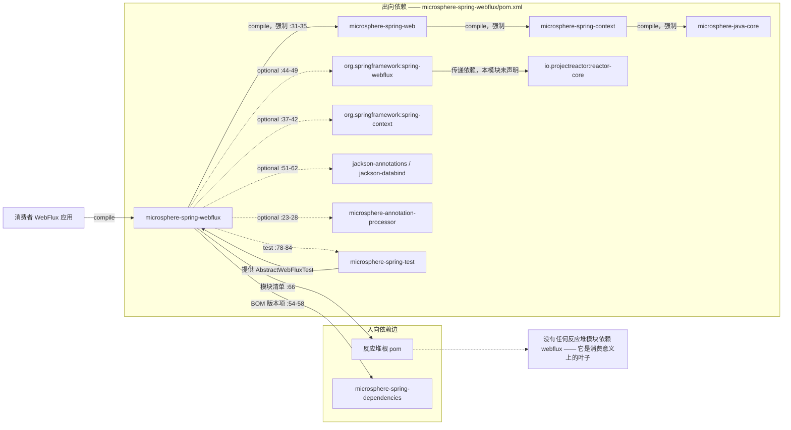
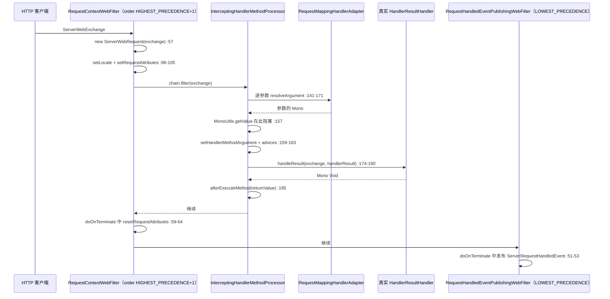
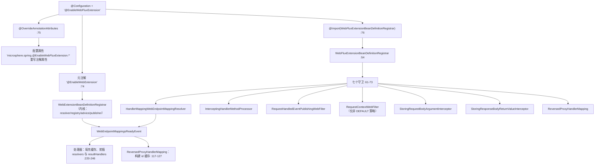

# microsphere-spring-webflux — 开发者文档

[← 开发者文档总览](./README.md) · [English](../webflux.md) · [用户文档](../../../user-guide/current/zh/webflux.md) · [1.x](../../1.x/zh/webflux.md)

## 1. 模块标识、版本基线与依赖姿态

| 属性 | 值 | 证据 |
|---|---|---|
| Maven 坐标 | `io.github.microsphere-projects:microsphere-spring-webflux:${revision}` | `microsphere-spring-webflux/pom.xml:13-16` |
| 反应堆版本 | `0.2.40-SNAPSHOT` | `pom.xml:55` |
| 父 POM | `microsphere-spring-parent:${revision}`（相对路径 `../microsphere-spring-parent/pom.xml`） | `microsphere-spring-webflux/pom.xml:5-10` |
| Java 基线 | `17`（`java.version`） | `pom.xml:56` |
| Spring 基线 | 通过 `spring-framework-bom` 由 profile 选定 `6.0.23` / `6.1.21` / `6.2.18` / `7.0.9`；`spring-framework-7.0` 为 `activeByDefault` | `microsphere-spring-parent/pom.xml:99-106,138-173` |
| Reactor 基线 | 与 profile 配对的 `reactor-bom` `2022.0.22` / `2023.0.19` / `2024.0.17` / `2025.0.7` —— **仅**被版本管理，本模块从未声明 | `microsphere-spring-parent/pom.xml:108-115,138-173` |
| `microsphere-spring-web` | compile、**非** optional —— 唯一强制的反应堆内依赖 | `microsphere-spring-webflux/pom.xml:31-35` |
| `org.springframework:spring-webflux` | **optional** | `microsphere-spring-webflux/pom.xml:44-49` |
| `org.springframework:spring-context` | optional | `:37-42` |
| `microsphere-annotation-processor` | optional、无版本号 → 经 `microsphere-java-dependencies` 导入解析为 `0.3.19` | `:23-28`、`microsphere-spring-parent/pom.xml:22,117-124` |
| `jackson-annotations`、`jackson-databind` | 二者皆 optional | `:51-62` |
| 测试依赖 | `junit-jupiter`、`spring-test`、`microsphere-spring-test`、`mockito-core`、`jakarta.websocket-client-api`、`jakarta.websocket-api`、`jsonassert`、`logback-classic` | `:64-119` |
| 包命名根 | `io.microsphere.spring.webflux.*` **以及** `io.microsphere.spring.web.util`（三个类被放进内核包） | `src/main/java/**` |
| 主/测试类数量 | 24 个主类、22 个测试类（其中一个是测试配置类） | `src/main/java`、`src/test/java` 目录清单 |
| `src/main/resources` | 仅一个文件：`META-INF/spring.factories` —— 无 `AutoConfiguration.imports`、无 `module-info.java` | `microsphere-spring-webflux/src/main/resources/META-INF/spring.factories:1-3` |

依赖姿态一句话概括：本模块是**一个薄薄的响应式适配层，钉在 `microsphere-spring-web` 之上**，它接触到的每一个 Spring/Reactor 类型都是 `optional`，因此对下游消费者没有任何传递性。`spring-webflux` 是 optional（`pom.xml:45-49`），意味着应用必须自备；而本模块**从未声明 `io.projectreactor:reactor-core`** —— 尽管有 9 个主类导入 `reactor.core.*`（`MonoUtils.java:21,24`、`CompositeWebFilter.java:25` 以及其余 7 个）—— Reactor 只是作为 optional `spring-webflux` 的传递依赖进入编译类路径。⚠ 两个已声明的 optional 完全未被使用：`microsphere-spring-webflux/src` 下没有任何主源码或测试源码导入 `com.fasterxml.jackson.*`（零匹配），测试源码中也从未出现 `websocket`/`WebSocket`，但 `jakarta.websocket-api` 与 `jakarta.websocket-client-api` 却以 test 声明（`pom.xml:93-105`）。同理，本模块根本没有声明 `spring-web`，可 `ServerWebRequest` 实现了 `NativeWebRequest`、`RequestContextWebFilter` 导入了 `RequestContextHolder`（`ServerWebRequest.java:30`、`RequestContextWebFilter.java:39-40`）；这些类型来自 `microsphere-spring-web` 自己的 optional `spring-web`（`microsphere-spring-web/pom.xml:58-63`），因此同样需要由消费者补齐。

## 2. 入向与出向依赖边



反应堆内没有任何模块**构建于** `microsphere-spring-webflux` 之上。除该模块自身之外，源码中对该构件的引用只有反应堆模块清单（`pom.xml:66`）与 BOM 版本项（`microsphere-spring-dependencies/pom.xml:54-58`）。两个维度上它都是叶子：无人消费它，而它真正依赖的反应堆内构件只有一个（`microsphere-spring-web`），`microsphere-spring-test` 仅以 test 出现（`pom.xml:78-84`，用于 `ReversedProxyHandlerMappingTest.java:22,57` 的 `AbstractWebFluxTest`）。`webmvc` 与 `webflux` 互不引用，因此两种传输方式在类路径上始终互斥。

## 3. 包结构地图

| 包 | 类型 | 职责 |
|---|---|---|
| `io.microsphere.spring.webflux.annotation` | `EnableWebFluxExtension`（public，`:77`）、`WebFluxExtensionBeanDefinitionRegistrar`（**包级私有**，`:54`） | 含 8 个属性的激活注解 + 条件化 Bean 注册器 |
| `io.microsphere.spring.webflux.context.request` | `ServerWebRequest` | 基于 `ServerWebExchange` 的 `NativeWebRequest` 适配器（`ServerWebRequest.java:65`） |
| `io.microsphere.spring.webflux.context.event` | `ServerRequestHandledEvent` | 携带 exchange 的 `RequestHandledEvent` 子类（`ServerRequestHandledEvent.java:35,66`） |
| `io.microsphere.spring.webflux.server.filter` | `RequestContextWebFilter`、`RequestHandledEventPublishingWebFilter`、`CompositeWebFilter`、`DelegatingWebFilter` | `WebFilter` 切点：上下文绑定、事件发布、过滤器组合 |
| `io.microsphere.spring.webflux.method` | `InterceptingHandlerMethodProcessor`、`StoringRequestBodyArgumentInterceptor`、`StoringResponseBodyReturnValueInterceptor` | 内核拦截 SPI 的响应式实现 |
| `io.microsphere.spring.webflux.metadata` | `HandlerMappingWebEndpointMappingResolver`、`HandlerMappingWebEndpointMappingFactory`（抽象）、`HandlerMetadataWebEndpointMappingFactory`、`RequestMappingMetadataWebEndpointMappingFactory` | 从三类 WebFlux `HandlerMapping` 家族采集 `WebEndpointMapping` |
| `io.microsphere.spring.webflux.function.server` | `RouterFunctionVisitorAdapter`、`RequestPredicateVisitorAdapter`、`RequestPredicateKind`（枚举，11 个常量）、`ConsumingWebEndpointMappingAdapter` | 遍历 `RouterFunction`/`RequestPredicate` 树的访问器机制 |
| `io.microsphere.spring.webflux.handler` | `ReversedProxyHandlerMapping` | 网关转发流量的请求头驱动 handler 短路 |
| `io.microsphere.spring.webflux.util` | `SpringWebFluxHelper` | `SpringWebHelper` SPI 在 `SpringWebType.WEB_FLUX` 上的实现 |
| `io.microsphere.spring.web.util`（内核包！） | `MonoUtils`、`WebServerScope`（枚举）、`WebServerUtils` | 容忍阻塞的 `Mono` 读取器、exchange/session 属性作用域、session/principal 访问 |

| 外部内核类型 | 归属 | 在此处的用途 |
|---|---|---|
| `EnableWebExtension`、`WebExtensionBeanDefinitionRegistrar` | `microsphere-spring-web` | 元注解（`EnableWebFluxExtension.java:74`）与同级注册器（`WebExtensionBeanDefinitionRegistrar.java:55`） |
| `WebEndpointMapping`、`WebEndpointMappingResolver`、`WebEndpointMappingRegistry`、`HandlerMethodAdvice`、`HandlerMethodInterceptor`、`HandlerMethodArgumentInterceptor` | `microsphere-spring-web` | 共享的元数据 + 拦截模型 |
| `RequestContextStrategy`（`DEFAULT`/`THREAD_LOCAL`/`INHERITABLE_THREAD_LOCAL`）、`RequestAttributesUtils`、`WebScope`、`SpringWebHelper`、`SpringWebType` | `microsphere-spring-web` | 策略开关（`EnableWebFluxExtension.java:155`）、属性存储（`StoringRequestBodyArgumentInterceptor.java:51`）、helper 槽位 |
| `OverrideAnnotationAttributes`、`AnnotatedBeanCapableImportBeanDefinitionRegistrar`、`ResolvablePlaceholderAnnotationAttributes`、`BeanSource` | `microsphere-spring-context` | 属性外置（`EnableWebFluxExtension.java:75`）与注册器基类（`WebFluxExtensionBeanDefinitionRegistrar.java:54`） |
| `OnceApplicationContextEventListener` | `microsphere-spring-context` | 处理器的父类（`InterceptingHandlerMethodProcessor.java:81`） |

## 4. 架构设计

### 4.1 `@EnableWebFluxExtension` 及其注册器

`EnableWebFluxExtension` 是 `@Target(TYPE)`、`@Retention(RUNTIME)`，带三个元注解：`@EnableWebExtension`（`:74`）、`@OverrideAnnotationAttributes`（`:75`）与 `@Import(WebFluxExtensionBeanDefinitionRegistrar.class)`（`:76`）。8 个属性中有 5 个使用 `@AliasFor(annotation = EnableWebExtension.class)`：`registerWebEndpointMappings`、`interceptHandlerMethods`、`publishEvents`、`sources`、`requestContextStrategy`（`:90-155`）；3 个是本地属性：`storeRequestBodyArgument`（`:165`）、`storeResponseBodyReturnValue`（`:174`）、`reversedProxyHandlerMapping`（`:182`）。注意别名机制**实际是双向生效**的：这 5 个属性会被**两个**注册器同时读取，因为 `@EnableWebExtension` 本身也会触发 `WebExtensionBeanDefinitionRegistrar`，由它注册内核侧组件（resolver、registry、`DelegatingHandlerMethodAdvice`、`WebEventPublisher`）—— `WebExtensionBeanDefinitionRegistrar.java:64-68,109-143`。

注册器是包级私有的（`WebFluxExtensionBeanDefinitionRegistrar.java:54`），其 `registerBeanDefinitions` 依次调用七个互相独立的守卫（`:61-73`）。所有 Bean 都是有条件的：

| 属性 | 默认值 | 为 `true` 时注册的 Bean | 证据 |
|---|---|---|---|
| `registerWebEndpointMappings` | `true` | `HandlerMappingWebEndpointMappingResolver` | `:76-82` |
| `interceptHandlerMethods` | `true` | `InterceptingHandlerMethodProcessor`，固定 Bean 名 `interceptingHandlerMethodProcessor` | `:84-91`、`InterceptingHandlerMethodProcessor.java:85` |
| `publishEvents` | `true` | `RequestHandledEventPublishingWebFilter` | `:93-99` |
| `requestContextStrategy` | `DEFAULT` | `RequestContextWebFilter` **仅**在 `THREAD_LOCAL`（属性 `threadContextInheritable=false`）或 `INHERITABLE_THREAD_LOCAL`（`true`）时注册 | `:101-124` |
| `storeRequestBodyArgument` | `false` | `StoringRequestBodyArgumentInterceptor` | `:126-132` |
| `storeResponseBodyReturnValue` | `false` | `StoringResponseBodyReturnValueInterceptor` | `:134-140` |
| `reversedProxyHandlerMapping` | `false` | `ReversedProxyHandlerMapping` | `:142-148` |

⚠ 这里没有任何一项是无条件安装的——七项注册各自受属性门控（`:61-73`）。`RequestContextWebFilter` 更是双重条件：仅当 `requestContextStrategy` 为 `THREAD_LOCAL` 或 `INHERITABLE_THREAD_LOCAL` 时才注册（`:101-122`），因此默认的 `DEFAULT` 下根本不存在请求上下文 Bean（`:111-113`、`:115`）。对 `EnableWebFluxExtensionTest.java:57`（裸注解）的后果是：不存在线程绑定的请求上下文，除非有 `HandlerMethod` 正被拦截——因为此时 `InterceptingHandlerMethodProcessor` 委托的是它**自己持有的 `private static final RequestContextWebFilter`** 实例（`:87,98-100`），而不是一个 Bean。

⚠ 该处理器常被误述为一个 `HandlerMapping`。`InterceptingHandlerMethodProcessor.java:81-83` 的声明列出父类是 `OnceApplicationContextEventListener<WebEndpointMappingsReadyEvent>`，接口是 `WebFilter, HandlerAdapter, HandlerMethodArgumentResolver, HandlerResultHandler, WebExceptionHandler, Ordered`：**没有** `HandlerMapping` 角色，反应堆内也不存在名为 `ServerWebfluxMethodArgumentResolver` 的类型，参数解析角色用的是 Spring 响应式的 `org.springframework.web.reactive.result.method.HandlerMethodArgumentResolver`（`:39` 的导入）。因此端点查找仍由 `RequestMappingHandlerMapping` 承担；这个 Bean 只贡献*执行*角色。

`@OverrideAnnotationAttributes`（`EnableWebFluxExtension.java:75`）未显式指定 `strategy`，因此解析为 `ConfigurationPropertyOverrideAnnotationAttributesStrategy`（`OverrideAnnotationAttributes.java:89`），其默认前缀为 `microsphere.spring.` + `@` + 注解简单名 + `.` —— 也就是说 `microsphere.spring.@EnableWebFluxExtension.storeResponseBodyReturnValue=true` 会在注册器读取属性之前重写注解属性（`ConfigurationPropertyOverrideAnnotationAttributesStrategy.java:139-163,245-249,281`）。七个守卫全部以 TRACE 级别打印决策（`WebFluxExtensionBeanDefinitionRegistrar.java:150-154`），因此 `logging.level.io.microsphere=TRACE` 是观察装配结果的唯一手段。

### 4.2 把 Servlet 形态的内核适配到响应式类型

内核 SPI 是针对 `NativeWebRequest` 与 `HandlerMethod` 编写的——按 Spring 自身设计它们与 Servlet 无关——因此响应式模块提供的是三个适配器，而不是一套第二 SPI：

- **`ServerWebRequest implements NativeWebRequest`**（`ServerWebRequest.java:65`）包装一个 `ServerWebExchange` 及其 `ServerHttpRequest`（`:105-112`）。请求头取自 `request.getHeaders()`（`:148-168`），"参数"只来自 `request.getQueryParams()` —— 路径变量与表单字段**不**暴露（`:172-204`）。属性访问委托给 `WebServerScope` 落到 exchange/session（`:279-297`），而返回 `Mono` 的 exchange 成员通过 `MonoUtils.getValue` 同步抽取消解 session 与 principal（`:228`、`:393`）。两个 Servlet 语义被硬编码：`isUserInRole` 与 `isSecure` 一律返回 `false`（`:232-239`），`registerDestructionCallback` 退化为一句 WARN 且不做任何注册（`:300-306`）。
- **`WebServerScope`**（REQUEST → `exchange.getAttributes()`，SESSION → `webSession.getAttributes()`，`WebServerScope.java:50-72`）把 `RequestAttributes.SCOPE_REQUEST`/`SCOPE_SESSION` 映射到 exchange/session，于是 `RequestAttributesUtils.setHandlerMethodArgument` 之类的内核代码可原样运行。
- **`MonoUtils.getValue`**（`MonoUtils.java:43-49`）是唯一的阻塞桥：阻塞线程上 `block()`，非阻塞线程上 `toFuture().get()` —— 后者同样把事件循环线程挂住。

`spring.factories` 中的 `io.microsphere.spring.web.util.SpringWebHelper=io.microsphere.spring.webflux.util.SpringWebFluxHelper`（`spring.factories:2-3`）把 `SpringWebFluxHelper` 装进内核的 helper 表，键为 `getType() == WEB_FLUX`（`SpringWebFluxHelper.java:282-284`；由 `WebRequestUtils.loadSpringWebHelpers()` 加载，见 `microsphere-spring-web/.../WebRequestUtils.java:356-362`）。因此属性读取会解析 `HandlerMapping` 的 best-match 特性（`:174-268`），而每个方法都要经过 `getServerWebRequest`，遇到外来 `NativeWebRequest` 时**抛出** `IllegalArgumentException("The NativeWebRequest is not a ServerWebRequest")`（`:349-354`）。

### 4.3 `WebFilter` 与 `HandlerResult` 切点

`InterceptingHandlerMethodProcessor` 是一个对象扮演五种 Spring 角色，每个角色各是一个独立钩子：

| 角色 | 方法 | 行为 | 证据 |
|---|---|---|---|
| `WebFilter` | `filter` | 纯粹委托给静态的 `RequestContextWebFilter` | `:97-100` |
| `HandlerMethodArgumentResolver` | `supportsParameter` / `resolveArgument` | 缓存命中后依次执行 `beforeResolveArgument` → 真实 resolver → **阻塞式** `getValue(result)` → 存储实参 → `afterResolveArgument` → 在最后一个参数上触发 `beforeExecuteMethod`，最后用 `Mono.just(argument)` 重建结果 | `:130-171`、`:303-331`、`:317-323` |
| `HandlerResultHandler` | `supports` / `handleResult` | 先执行真实 handler，再以 `handlerResult.getReturnValue()` 回调 `afterExecuteMethod` | `:135-138,173-190` |
| `WebExceptionHandler` | `handle(exchange, ex)` | 用 `BEST_MATCHING_HANDLER_ATTRIBUTE` 取出 handlerMethod 并回调 `afterExecuteMethod`，随后重新发出 `error(ex)` | `:192-208` |
| `HandlerAdapter` | `supports` / `handle` | 一个陷阱而非适配器：`supports` 恒返回 `false`（但对零参数 handler 仍触发 `beforeExecuteMethod`），`handle` 返回 `null` | `:102-115` |

自我安装是最微妙的一环：在 `WebEndpointMappingsReadyEvent` 时刻，它通过反射拿到 `DispatcherHandler` 的私有 `resultHandlers` 列表并把自己移到下标 0（`:248-251,214-218`），同时把自己前插到 `RequestMappingHandlerAdapter` 的私有 `methodResolver.requestMappingResolvers` 列表（`:253-256,245`）。正因为它现在位于下标 0，两个查找循环都**从 `i = 1` 开始**，处理器才不会解析到自己（`:351-361,370-380`）。缓存以 `MethodParameter` / 返回 `MethodParameter` 为键，并为事件载荷中的每个 `HandlerMethod` 端点预填充（`:89-91,229-246`）；未缓存的返回类型退回实时解析（`:286-301`）。

`HandlerMethodAdvice` Bean 是回调扇出目标（`:210-212,303-349`，用 `getSortedBeans` 收集），而两个 `Storing*` 类本身就是注册为普通 Bean 的内核 SPI 实现：`StoringRequestBodyArgumentInterceptor implements HandlerMethodArgumentInterceptor`，只存储 `@RequestBody` 实参（`:45-53`）；`StoringResponseBodyReturnValueInterceptor implements HandlerMethodInterceptor`，只存储 `@ResponseBody` 返回值（`:44-51`）。⚠ 与 `webmvc` 不同——后者用 `RequestBodyAdviceAdapter`/`ResponseBodyAdviceAdapter` 完成同样的事情（`microsphere-spring-webmvc/.../advice/`）——响应式路径完全不触碰 Spring 的 advice 链。

### 4.4 端点元数据采集

`HandlerMappingWebEndpointMappingResolver.resolve` 遍历每个 `HandlerMapping` Bean（含祖先，`:60`），对每个 mapping 施加三种探测：`AbstractUrlHandlerMapping` → `HandlerMetadataWebEndpointMappingFactory`，以 `PathPattern.getPatternString()` 作键、方法集合取 `ALL_HTTP_METHODS`（`:71-79`、`HandlerMetadataWebEndpointMappingFactory.java:40-48`）；`RequestMappingInfoHandlerMapping` → `RequestMappingMetadataWebEndpointMappingFactory`，会调用 `createWithResolvedBean()` 并复制 methods/params/headers/consumes/produces（`:81-91`、`RequestMappingMetadataWebEndpointMappingFactory.java:57-89`）；`RouterFunctionMapping` → `ConsumingWebEndpointMappingAdapter`，作为 `WebEndpointMapping` 的接收端注入（`:93-101`）。`RequestPredicateKind` 是构建在 `RequestPredicates` 内部结构之上的解析/访问引擎 —— AND/OR/NEGATE 读取私有字段 `left`/`right`/`arg$1`/`delegate`（`:143-149,248-251`），同时把谓词往返为文本（`parseRequestPredicate`/`toExpression`，`:682-738`）。`ReversedProxyHandlerMapping`（`:76`）随后为转发请求提供短路：只缓存 `Kind.WEB_FLUX` 且 `source instanceof AbstractHandlerMapping` 的映射（`:117-132`），当 `microsphere_wem_id` 请求头命中时直接返回端点（`:88-106`）。该类在本模块中**确实存在**；`webmvc` 在 `io.microsphere.spring.webmvc.handler` 下另有同名类，两者是不同实现，并非共享类型。

## 5. 运行时与启动流程

启用拦截（`interceptHandlerMethods = true`，即默认值）时的响应式请求流：



`@EnableWebFluxExtension` 的启动装配：



## 6. 有证据支撑的设计模式

| 模式 | 类 | 证据 |
|---|---|---|
| Enable*/激活式注解 + 属性覆盖（`@AliasFor` 指向内核注解） | `EnableWebFluxExtension`、`EnableWebExtension` | `EnableWebFluxExtension.java:74-76,90-155` |
| 注册器作为守卫链（每个 Bean 一个特性开关） | `WebFluxExtensionBeanDefinitionRegistrar` | `:57-74`，七次 boolean/enum 读取 |
| 适配器（对不兼容 API 的对象适配） | `ServerWebRequest`、`SpringWebFluxHelper` | `ServerWebRequest.java:65,109-112`；`SpringWebFluxHelper.java:52,349-354` |
| 针对 `Mono` 的客户端适配器门面 | `MonoUtils`、`WebServerUtils` | `MonoUtils.java:43-49`；`WebServerUtils.java:37-56` |
| 职责链：扩展 Spring 自带的链而非替换 | `InterceptingHandlerMethodProcessor` | 自我前插 `:216-217,245`，跳过下标 0 的查找 `:354,375` |
| 组合 + 委托（包装器） | `CompositeWebFilter`、`DelegatingWebFilter`、处理器内部的 `RequestContextWebFilter` | `CompositeWebFilter.java:41,129-136`；`DelegatingWebFilter.java:39-61`；`InterceptingHandlerMethodProcessor.java:87,99` |
| 访问者（对两套 Spring 层级的双分派） | `RouterFunctionVisitorAdapter`、`RequestPredicateVisitorAdapter`、`ConsumingWebEndpointMappingAdapter` | `ConsumingWebEndpointMappingAdapter.java:76,140-145`；适配器默认方法 `RequestPredicateVisitorAdapter.java:47-206` |
| 策略（枚举即策略、有状态访问者） | `RequestPredicateKind`、`WebServerScope`、`RequestContextStrategy` | `RequestPredicateKind.java:93-581`；`WebServerScope.java:43-72`；消费点 `WebFluxExtensionBeanDefinitionRegistrar.java:104-114` |
| 模板方法 | `HandlerMappingWebEndpointMappingFactory` | final 的 `doCreate` `:49-63` + 抽象 `getMethods`/`getPatterns` + 钩子 `contribute` `:80-104` |
| 观察者（一次性） | 基类 `OnceApplicationContextEventListener`、`ApplicationListener` 实现 | `InterceptingHandlerMethodProcessor.java:81,122-128`；`ReversedProxyHandlerMapping.java:76,117` |
| 建造者（复用内核类型） | 经 `webflux()` 得到 `WebEndpointMapping.Builder` | `HandlerMappingWebEndpointMappingFactory.java:56-62`；`ConsumingWebEndpointMappingAdapter.java:162-168` |

## 7. 扩展指南

不改 WebFlux 配置就加入横切响应式处理——计时、审计、mock 注入：

```java
@Component
public class ReactiveAuditAdvice implements HandlerMethodAdvice, Ordered {  // 内核 SPI + Ordered，便于 getSortedBeans 排序
    @Override
    public void beforeExecuteMethod(HandlerMethod handlerMethod, Object[] args, NativeWebRequest request) {
        ServerWebRequest web = (ServerWebRequest) request;                  // 唯一与响应式相关的强制转换
        log.info("{} {} -> {}", web.getRequest().getMethod().name(),
                web.getRequest().getPath().value(), handlerMethod.getMethod().getName());
    }
    @Override
    public int getOrder() { return 0; }
}
```

`HandlerMethodAdvice`/`HandlerMethodInterceptor`/`HandlerMethodArgumentInterceptor` Bean 会被双重收集：内核注册器从所有 `sources` 注册采集到的实例（`WebExtensionBeanDefinitionRegistrar.java:113-137`），处理器则在 `InterceptingHandlerMethodProcessor.java:210-212` 向已排序的 `HandlerMethodAdvice` Bean 扇出。`WebFilter` Bean 无需任何注册 —— Spring WebFlux 的 `WebHandlerAdapter` 自行发现该类型 Bean；`DelegatingWebFilter` 是本模块自带的可选替代，在 `ContextRefreshedEvent` 上采集已排序的 `WebFilter` Bean 并排除自身（`DelegatingWebFilter.java:49-61`）。

真实排序规则，全部取自源码：

| 规则 | 值 | 证据 |
|---|---|---|
| `InterceptingHandlerMethodProcessor` 在所有有序 Web 组件中最先 | `HIGHEST_PRECEDENCE` | `:117-120` |
| `RequestContextWebFilter` 与 `ReversedProxyHandlerMapping` 同为 `HIGHEST_PRECEDENCE + 1` —— 并列，故由 Bean 名顺序决定 | `HIGHEST_PRECEDENCE + 1` | `RequestContextWebFilter.java:93-96`；`ReversedProxyHandlerMapping.java:80,84-86` |
| `RequestHandledEventPublishingWebFilter` 最后观察，其计时覆盖整条链 | `LOWEST_PRECEDENCE` | `:74-77` |
| 处理器内部，advice 回调按 `getSortedBeans` 顺序执行；参数解析逐参数触发，而 `beforeExecuteMethod` **只在最后一个参数**上触发一次 | `parameterIndex == arguments.length - 1` | `:317-323` |
| 自我安装使处理器排在所有内建 `HandlerResultHandler` 与 resolver 之前 | `add(0, this)` | `:216-217,245` |
| `ReversedProxyHandlerMapping` 依靠 order 抢先于 `RequestMappingHandlerMapping`，且仅针对 `WEB_FLUX` + `AbstractHandlerMapping` 来源的映射 | 过滤条件见 `:129-132` | `:88-115` |

## 8. 坑与注意事项

| # | 观察 | 证据 |
|---|---|---|
| 1 | 静默失效的 Servlet 假设：`isSecure()` 与 `isUserInRole()` 恒为 `false`；`registerDestructionCallback` 只 WARN；`getParameter*` 只见查询参数，因此表单来源的 `@RequestParam` 数据对读取 `NativeWebRequest` 的内核代码不可见。 | `ServerWebRequest.java:232-239,300-306,172-204` |
| 2 | 阻塞事件循环是结构性的而非偶发：`resolveArgument` 在响应式管道内部调用 `MonoUtils.getValue`，而 `getValue` 在已是非阻塞线程时退回 `toFuture().get()` —— 两种路径都会挂住线程。 | `MonoUtils.java:43-49`；`InterceptingHandlerMethodProcessor.java:157`；`ServerWebRequest.java:228,393` |
| 3 | `RequestContextWebFilter` 在订阅时绑定、在 `doOnTerminate` 时清理，因此任何 `publishOn`/`subscribeOn` 跳变都会让处理线程失去 `RequestContextHolder` 属性 —— 在 WebFlux 中 `THREAD_LOCAL` 系列策略本质上只是尽力而为。 | `RequestContextWebFilter.java:56-65,98-105,113-116` |
| 4 | 默认配置不注册上下文过滤器（`requestContextStrategy = DEFAULT`），可 `InterceptingHandlerMethodProcessor.supports` 却读取 `RequestContextHolder.getRequestAttributes()` 并强转为 `ServerWebRequest` —— 一条容易 `ClassCastException` 的路径，只有在被 `doOnTerminate` 清理过的线程上才安全。 | `WebFluxExtensionBeanDefinitionRegistrar.java:111-122`；`InterceptingHandlerMethodProcessor.java:106` |
| 5 | 反射深入 Spring 内部：`DispatcherHandler.resultHandlers`，随后是私有两跳链 `RequestMappingHandlerAdapter.methodResolver` → `requestMappingResolvers`，以及 `RequestPredicates` 的私有 `left`/`right`/`arg$1` 字段。上游任一改名都会静默破坏本模块（`NEGATE` 还会退回 `delegate`）。 | `InterceptingHandlerMethodProcessor.java:248-256`；`RequestPredicateKind.java:143-149,248-251` |
| 6 | `handle` 返回 `null` 与 `supports` 返回 `false` 是有意为之的死胡同，不是缺陷：`HandlerAdapter` 角色只为捕获零参数 handler 而存在。任何把请求分派到该适配器的 WebFlux 版本都会得到 NPE 而非 404。 | `InterceptingHandlerMethodProcessor.java:102-115` |
| 7 | `CompositeWebFilter.filter` 名不副实：它把每个成员都作用在**同一个** `chain` 上并只返回最后一个 `Mono`，前面过滤器的 `Mono<Void>` 结果被丢弃，过滤器之间也不存在嵌套次序。 | `CompositeWebFilter.java:129-136` |
| 8 | ⚠ 近似死代码的装配：`CompositeWebFilter` 与 `DelegatingWebFilter` 在 `src/main/java` 中除彼此之外无任何引用 —— 注册器从不安装它们，它们只是库性质类，仅被自己的测试驱动。 | `WebFluxExtensionBeanDefinitionRegistrar.java:61-73`（无调用）、`DelegatingWebFilter.java:41`、`CompositeWebFilterTest.java:48-52`、`DelegatingWebFilterTest.java:39-46` |
| 9 | 路由函数元数据缺口：`ConsumingWebEndpointMappingAdapter` 只覆写 `method`、`path`、`header`、`queryParam`、`startNested`、`endNested`、`route`，因此 `pathExtension`、`resources(...)`、`unknown(...)` 以及落入基类 `accept`/`unknown` 默认实现的 `HEADERS`/`ACCEPT` 型谓词都会从注册表中丢失。 | `ConsumingWebEndpointMappingAdapter.java:93-145`；`RequestPredicateVisitorAdapter.java:69-71,196-206`；`RouterFunctionVisitorAdapter.java:55-57,67-69`；`RequestPredicateKind.java:532-556` |
| 10 | ⚠ `ReversedProxyHandlerMapping` 的 Javadoc 自我限缩为"目前……仅支持" `RequestMappingHandlerMapping`，而代码接受任何 `WEB_FLUX` 且来源为 `AbstractHandlerMapping` 的映射，即也包括 `SimpleUrlHandlerMapping`。此外 `webEndpointMappingsCache` 在 `WebEndpointMappingsReadyEvent` 之前为 `null`，此时到达的请求会在 `get` 处 NPE。 | `ReversedProxyHandlerMapping.java:63-65,82,98,129-132` |
| 11 | 没有 `HandlerInterceptor` 对应物，也没有 MVC 那些扩展的响应式版本：本模块不含 `MethodHandlerInterceptor`、不含 `LazyCompositeHandlerInterceptor`、不含页面渲染上下文拦截器、不含 `ContentCachingFilter`（请求体缓存）、不含 `WebFluxExtensionConfiguration`，注解里也没有 `registerHandlerInterceptors`/`handlerInterceptors` —— WebFlux 没有 `HandlerInterceptor`，`WebFilter` 才是切点。 | 对比 `microsphere-spring-webmvc/src/main/java/io/microsphere/spring/webmvc/interceptor/`、`.../web/servlet/filter/ContentCachingFilter.java` 与 `microsphere-spring-webflux/src/main/java` |
| 12 | 分包（split package）：`MonoUtils`、`WebServerScope`、`WebServerUtils` 位于本 jar 的 `io.microsphere.spring.web.util`，与内核同包（内核该包有 13 个类）。对 classpath 无害，但对 JPMS 或严格 OSGi 解析是致命的。 | `src/main/java/io/microsphere/spring/web/util/*.java`；`microsphere-spring-web/src/main/java/io/microsphere/spring/web/util/` |
| 13 | 缺少 `@ConditionalOnWebApplication` 式保护：没有任何代码检查运行时是否为响应式。在 Servlet 应用里加入本 jar 并标注 `@EnableWebFluxExtension`，会装配出一批永远不会被调用的 `WebFilter` 与 `HandlerAdapter` Bean，而 `:249` 的反射会因缺失 `DispatcherHandler` 失败。 | `WebFluxExtensionBeanDefinitionRegistrar.java:57-74`；`InterceptingHandlerMethodProcessor.java:248-251` |
| 14 | 存在两个未加 `@Override` 的默认方法作为 Spring Framework 7 与 5.3 的兼容垫片（`version(String)`、`attributes(Map)`），在 6.x 上它们永远不会被调用 —— 是前后向 padding，不是特性。 | `RequestPredicateVisitorAdapter.java:99-105`；`RouterFunctionVisitorAdapter.java:59-65` |
| 15 | 所有类型上的 `@since 1.0.0` 与所分析的 `0.2.40-SNAPSHOT` 相矛盾；不要用 `@since` 推断发布线。 | `EnableWebFluxExtension.java:69`、`pom.xml:55` |

## 9. 交叉链接

**相关页面** — [开发者文档总览](./README.md) · [English 版](../webflux.md) · [用户文档 — WebFlux](../../../user-guide/current/zh/webflux.md) · [1.x 开发者文档](../../1.x/zh/webflux.md) · [web（共享内核）](./web.md) · [webmvc（同级传输方式）](./webmvc.md) · [test（`AbstractWebFluxTest`）](./test.md) · [父 POM profile](./parent.md) · [依赖管理](./dependencies.md)
