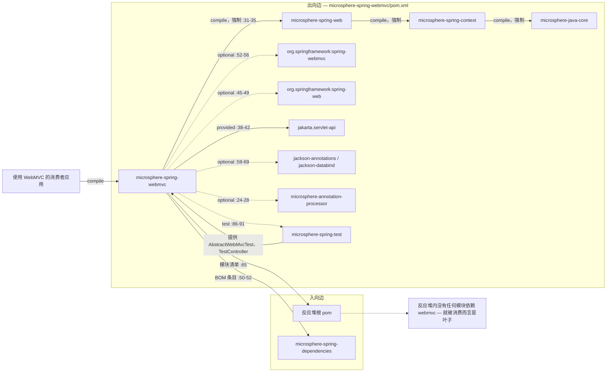
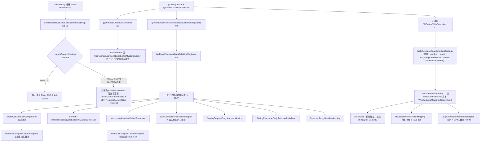
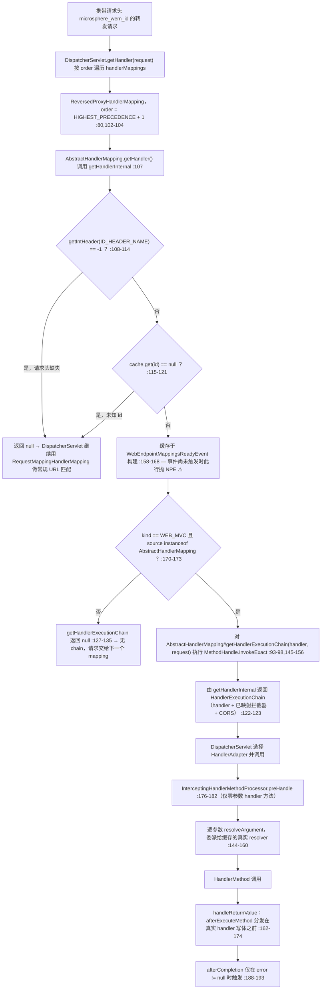

# microsphere-spring-webmvc — 开发者指南

[← 开发者文档总览](./README.md) · [English](../webmvc.md) · [用户文档](../../../user-guide/current/zh/webmvc.md) · [1.x](../../1.x/zh/webmvc.md)

## 1. 模块标识、基线与依赖姿态

| 属性 | 取值 | 证据 |
|---|---|---|
| Maven 坐标 | `io.github.microsphere-projects:microsphere-spring-webmvc:${revision}` | `microsphere-spring-webmvc/pom.xml:13-16` |
| 反应堆版本 | `0.2.40-SNAPSHOT` | `pom.xml:55` |
| 父 POM | `microsphere-spring-parent:${revision}`（相对路径 `../microsphere-spring-parent/pom.xml`） | `microsphere-spring-webmvc/pom.xml:5-10` |
| Java 基线 | `17`（`java.version`） | `pom.xml:56` |
| Spring 基线 | 由 profile 选择的 `6.0.23` / `6.1.21` / `6.2.18` / `7.0.9`，经 `spring-framework-bom` 导入；`spring-framework-7.0` 为 `activeByDefault` | `microsphere-spring-parent/pom.xml:102-103,139-172` |
| Servlet 命名空间 | 来自 `jakarta.jakartaee-bom` `11.0.0` 的 `jakarta.servlet.*`，声明为 **`provided`** | `microsphere-spring-parent/pom.xml:24,53-55`；`microsphere-spring-webmvc/pom.xml:38-42` |
| Microsphere 内核 | 经 `microsphere-java-dependencies` 导入的 `microsphere-java` `0.3.19` | `microsphere-spring-parent/pom.xml:22,120-121` |
| `microsphere-spring-web` | compile，**非** optional——唯一强制的反应堆内依赖边 | `microsphere-spring-webmvc/pom.xml:31-35` |
| `org.springframework:spring-webmvc` | **optional** | `:52-56` |
| `org.springframework:spring-web` | optional | `:45-49` |
| `microsphere-annotation-processor` | optional，无版本号 → `0.3.19` | `:24-28` |
| `jackson-annotations`、`jackson-databind` | 二者皆 optional | `:59-63`、`:65-69` |
| 测试依赖边 | `junit-jupiter`、`spring-test`、`microsphere-spring-test`、`tomcat-embed-core`、`jsonassert`、`hamcrest`、`logback-classic` | `:72-119` |
| 包命名根 | `io.microsphere.spring.webmvc.*` **以及** `io.microsphere.spring.web.servlet.*`（五个类位于模块自身根包之外） | `src/main/java/**` |
| 主/测试类数量 | 35 个主类，36 个测试类 | `src/main/java`、`src/test/java` 目录清单 |
| `src/main/resources` | 仅两个文件：`META-INF/spring.factories`（一行 `SpringWebHelper`）与 `META-INF/services/jakarta.servlet.ServletContainerInitializer`——没有 `AutoConfiguration.imports`，也没有 `module-info.java` | `src/main/resources/META-INF/**` |

依赖姿态一句话概括：本模块是**铆接在 `microsphere-spring-web` 之上的 Servlet 侧适配器**，它编译期接触的所有 Spring 类型都是 `optional`，因此对下游消费者不构成任何传递依赖。消费者必须自行补齐：`org.springframework:spring-webmvc`（连带 `spring-web`、`spring-context`、`spring-beans`、`spring-core`）、`microsphere-spring-web` + `microsphere-spring-context` + `microsphere-java` 内核（前者经本 jar 传递，其余经它继续传递），以及一个 Servlet 6.1 容器。注意与 `microsphere-spring-web` 的不对称：后者把 `jakarta.servlet-api` 声明为 **optional**（`microsphere-spring-web/pom.xml:47-48`），而本模块声明为 **`provided`**（`microsphere-spring-webmvc/pom.xml:41`）——对 WAR 部署这是正确的（由容器提供），但对内嵌式启动意味着该 API 只能来自 `tomcat-embed-core`/Jetty，绝不会来自本 jar。⚠ 在当前代码树中，有三个已声明依赖可证明是死重：`jsonassert`（`:101-105`）与 `hamcrest`（`:108-112`）在 `src/test/java` 下的 import 数为**零**；`jackson-annotations`（`:59-63`）在整个模块内没有任何 `com.fasterxml.jackson.annotation` 的 import；`jackson-databind` 在主代码中仅被一个类使用（`ConfigurableContentNegotiationManagerWebMvcConfigurer.java:3`），另加三个测试。`microsphere-annotation-processor`（`:24-28`）同样没有被任何源文件引用——它只是构建期的 optional，用于元数据生成。`tomcat-embed-core`（test scope，`:94-98`）是间接使用的，经由监听器测试 import 的 `io.microsphere.spring.test.tomcat.embedded.EmbeddedTomcatConfiguration`。

## 2. 入向与出向依赖边



反应堆中没有任何模块构建在 `microsphere-spring-webmvc` 之上。除其自身 POM 外，该 artifact 只出现在反应堆模块清单（`pom.xml:65`）与 BOM 版本条目（`microsphere-spring-dependencies/pom.xml:50-52`）中。它在两个方向上都是叶子：无人消费它；而它真正消费的反应堆内构件也只有一个（`microsphere-spring-web`，后者再带出 `microsphere-spring-context` 与 `microsphere-java` 内核），外加 test scope 的 `microsphere-spring-test`（`pom.xml:86-91`，用于 `AbstractWebMvcTest`、`TestController`、`TestServlet`、`TestFilter`、`EmbeddedTomcatConfiguration`）。`webmvc` 与 `webflux` 互相绝不引用——两种传输方式在 classpath 上保持互斥，尽管它们各自发布了同名的 visitor 类（见 §8）。

## 3. 包地图

| 包 | 类型 | 职责 |
|---|---|---|
| `io.microsphere.spring.webmvc.annotation` | `EnableWebMvcExtension`（public，`:84`）、`WebMvcExtensionBeanDefinitionRegistrar`（**package-private**，`:62`）、`WebMvcExtensionConfiguration`（public，`:36`） | 含 10 个属性的激活注解 + 条件化注册器 + 负责装配复合拦截器的 `WebMvcConfigurer` |
| `io.microsphere.spring.webmvc.advice` | `RequestBodyAdviceAdapter`、`ResponseBodyAdviceAdapter`、`StoringRequestBodyArgumentAdvice`、`StoringResponseBodyReturnValueAdvice` | 捕获 `@RequestBody` 参数与 `@ResponseBody` 返回值的 Spring `@ControllerAdvice` 桥接 |
| `io.microsphere.spring.webmvc.config` | `ConfigurableContentNegotiationManagerWebMvcConfigurer` | 由属性驱动的 `ContentNegotiationConfigurer`（`:47-66`） |
| `io.microsphere.spring.webmvc.constants` | `PropertyConstants` | `microsphere.spring.webmvc.` 前缀常量（`:32,37`） |
| `io.microsphere.spring.webmvc.context` | `ExclusiveViewResolverApplicationListener` | 容器刷新后强制只保留一个 `ViewResolver`（`:68-104`） |
| `io.microsphere.spring.webmvc.handler` | `ReversedProxyHandlerMapping` | 面向代理转发流量的、由请求头驱动的 handler 捷径 |
| `io.microsphere.spring.webmvc.interceptor` | `MethodHandlerInterceptor`、`AnnotatedMethodHandlerInterceptor`、`AbstractPageRenderContextHandlerInterceptor`、`LazyCompositeHandlerInterceptor`、`LoggingMethodHandlerInterceptor`、`LoggingPageRenderContextHandlerInterceptor` | `HandlerInterceptor` 家族：方法维度的模板类、懒加载复合类、页面渲染上下文钩子 |
| `io.microsphere.spring.webmvc.metadata` | `HandlerMappingWebEndpointMappingResolver`、`HandlerMappingWebEndpointMappingFactory`（抽象）、`HandlerMetadataWebEndpointMappingFactory`、`RequestMappingMetadataWebEndpointMappingFactory`、`RequestMappingMetadata` | 从三类 MVC `HandlerMapping` 中采集 `WebEndpointMapping` |
| `io.microsphere.spring.webmvc.method.support` | `InterceptingHandlerMethodProcessor`、`HandlerMethodArgumentResolverAdvice`、`LoggingHandlerMethodArgumentResolverAdvice` | 内核拦截 SPI 的 Servlet 实现 |
| `io.microsphere.spring.webmvc.util` | `WebMvcUtils`、`ViewUtils`、`ViewResolverUtils`、`SpringWebMvcHelper` | 属性存取、视图元数据、`SpringWebHelper` SPI 入口 |
| `io.microsphere.spring.web.servlet.filter` | `ContentCachingFilter` | 响应体缓存（`ContentCachingResponseWrapper`） |
| `io.microsphere.spring.web.servlet.function` | `RouterFunctionVisitorAdapter`、`RequestPredicateVisitorAdapter`、`ConsumingWebEndpointMappingAdapter` | 遍历 `RouterFunction` / `RequestPredicates` 的 visitor 机制 |
| `io.microsphere.spring.web.servlet.listener` | `EnableWebMvcExtensionListener` | 在 Spring 启动之前读取 `@EnableWebMvcExtension` 的 `ServletContainerInitializer` |
| `io.microsphere.spring.web.servlet.util` | `WebUtils` | `ServletContext` 注册信息查询（`:59-88`） |

| 外部内核类型 | 归属 | 在本模块中的用途 |
|---|---|---|
| `EnableWebExtension`、`WebExtensionBeanDefinitionRegistrar` | `microsphere-spring-web` | 元注解（`EnableWebMvcExtension.java:81`）与同族注册器 |
| `WebEndpointMapping`（含 `ID_HEADER_NAME = "microsphere_wem_id"`）、`WebEndpointMappingResolver`、`WebEndpointMappingRegistry`、`WebEndpointMappingFactory` | `microsphere-spring-web` | 共享端点模型（`WebEndpointMapping.java:134`、`ReversedProxyHandlerMapping.java:108`） |
| `HandlerMethodAdvice`、`HandlerMethodInterceptor`、`HandlerMethodArgumentInterceptor`、`DelegatingHandlerMethodAdvice` | `microsphere-spring-web` | 回调分发（`InterceptingHandlerMethodProcessor.java:200-202`） |
| `RequestContextStrategy`、`RequestAttributesUtils`、`WebScope`、`SpringWebHelper`、`SpringWebType` | `microsphere-spring-web` | 策略开关（`EnableWebMvcExtensionListener.java:114-125`）、属性存取、helper 键 `WEB_MVC`（`SpringWebMvcHelper.java:35`） |
| `OverrideAnnotationAttributes`、`AnnotatedBeanCapableImportBeanDefinitionRegistrar`、`ResolvablePlaceholderAnnotationAttributes`、`BeanRegistrar`、`BeanSource` | `microsphere-spring-context` | 属性外部化与注册器基类（`WebMvcExtensionBeanDefinitionRegistrar.java:62,69`） |
| `OnceApplicationContextEventListener` | `microsphere-spring-context` | 处理器与复合拦截器的父类 |

## 4. 架构设计

### 4.1 `@EnableWebMvcExtension` 及其注册器

`EnableWebMvcExtension` 是 `@Target(TYPE)`、`@Retention(RUNTIME)`、`@Documented`，并携带三个元注解：`@EnableWebExtension`（`:81`）、`@OverrideAnnotationAttributes`（`:82`）、`@Import(WebMvcExtensionBeanDefinitionRegistrar.class)`（`:83`）。十个属性中有五个是 `@AliasFor(annotation = EnableWebExtension.class)`——`registerWebEndpointMappings`（`:97`）、`interceptHandlerMethods`（`:109`）、`publishEvents`（`:124`）、`requestContextStrategy`（`:138`）、`sources`（`:181`）——另外五个是本注解独有的：`registerHandlerInterceptors`（`:149`）、`handlerInterceptors`（`:161`）、`storeRequestBodyArgument`（`:194`）、`storeResponseBodyReturnValue`（`:204`）、`reversedProxyHandlerMapping`（`:212`）。

`@OverrideAnnotationAttributes` 的属性回写正是让这层 aliasing 在运行时可见的机制。未显式指定 `strategy` 时它落到 `ConfigurationPropertyOverrideAnnotationAttributesStrategy`（`OverrideAnnotationAttributes.java:89`），其默认键前缀为 `microsphere.spring.` + `@` + 注解简名 + `.`，于是 `microsphere.spring.@EnableWebMvcExtension.storeRequestBodyArgument=true` 会在任何注册器读取之前重写该属性。由于回写发生在 `EnableWebMvcExtension` 的已解析属性集上，五个 `@AliasFor` 成员会被一并写回同一个类的 `@EnableWebExtension` 视图：`WebMvcExtensionBeanDefinitionRegistrar` 与内核的 `WebExtensionBeanDefinitionRegistrar`（`WebExtensionBeanDefinitionRegistrar.java:58-71`）读到的是同一份被覆盖后的值。`@OverrideAnnotationAttributes` **不会**把五个本注解独有属性回写给内核——内核根本看不见它们。在此之上还有两道来自 `AnnotatedBeanCapableImportBeanDefinitionRegistrar` 的总闸：`isEnabled(...)` 先查 `microsphere.spring.<导入类>@<注解>.enabled`，再退到 `microsphere.spring.<注解全限定名>.enabled`，缺省为 `true`（`AnnotatedBeanCapableImportCandidate.java:115-117,180-187,204-224`）。

注册器是 package-private 的（`:62`），其 `registerBeanDefinitions` 以固定顺序执行七道守卫（`:71-83`）：

| 顺序 | 属性 | 默认值 | 开启时注册的 Bean | 证据 |
|---|---|---|---|---|
| 1 | *（无——无条件）* | — | `WebMvcExtensionConfiguration` | `:86-88` |
| 2 | `registerWebEndpointMappings` | `true` | `ServletWebEndpointMappingResolver`（内核）+ `HandlerMappingWebEndpointMappingResolver` | `:90-97` |
| 3 | `interceptHandlerMethods` | `true` | 以固定名 `interceptingHandlerMethodProcessor` 注册 `InterceptingHandlerMethodProcessor` | `:99-106`、`InterceptingHandlerMethodProcessor.java:78` |
| 4 | `registerHandlerInterceptors` / `handlerInterceptors` | `false` / `{}` | 以 `lazyCompositeHandlerInterceptor` 为名注册 `LazyCompositeHandlerInterceptor`，并为每个显式列出的拦截器类各注册一个 Bean | `:108-145`、`LazyCompositeHandlerInterceptor.java:52` |
| 5 | `storeRequestBodyArgument` | `false` | `StoringRequestBodyArgumentAdvice` | `:147-153` |
| 6 | `storeResponseBodyReturnValue` | `false` | `StoringResponseBodyReturnValueAdvice` | `:155-161` |
| 7 | `reversedProxyHandlerMapping` | `false` | `ReversedProxyHandlerMapping` | `:163-169` |

每道守卫都以 TRACE 记录自己的判定（`:171-175`），因此 `logging.level.io.microsphere=TRACE` 是观察装配结果的唯一手段。⚠ `publishEvents` 虽然在本注解上被 alias 并被写入文档（`:112-125`），但这里**没有**任何守卫读取它——它只被内核注册器兑现；而在 MVC 路径上，文档承诺的 `HandlerMethodArgumentsResolvedEvent` 是由内核的 `WebEventPublisher` 以 `HandlerMethodInterceptor` 身份发布的（`microsphere-spring-web/.../WebEventPublisher.java:45,59-60`），它之所以能进入分发链，是因为内核同时注册了 `DelegatingHandlerMethodAdvice`（`WebExtensionBeanDefinitionRegistrar.java:122-129`），而 MVC 处理器收集的是 `HandlerMethodAdvice` Bean（`InterceptingHandlerMethodProcessor.java:200-202`）。

### 4.2 拦截器的自动注册

有两条互不相干的通道向 `InterceptorRegistry` 供给拦截器，且默认都不开启：

- **显式类型。** `handlerInterceptors = {Foo.class, Bar.class}` 会让注册器把每个类*注册为 Bean*（`WebMvcExtensionBeanDefinitionRegistrar.java:134-145`），同时把类数组交给 `LazyCompositeHandlerInterceptor` 的构造器（`:127-132`）。该复合体随后在 `ContextRefreshedEvent` 上解析所有可赋值给这些类的 Bean（`LazyCompositeHandlerInterceptor.java:84-98`），剔除自身以及任何 `InterceptingHandlerMethodProcessor`（`:90-92`），用 `AnnotationAwareOrderComparator` 排序（`:96`），并通过一个可短路的 `forEach` 委派 `preHandle`/`postHandle`/`afterCompletion`——第一个返回 `false` 的成员即终止链（`:63-81,107-126`）。
- **全量。** `registerHandlerInterceptors = true` 会把哨兵数组 `ALL_HANDLER_INTERCEPTOR_CLASSES = {HandlerInterceptor.class}` 顶替进来（`:64,120-121`），而 `registerInterceptors` 识别到哨兵后立即返回（`:135-137`）——于是一个拦截器类都不会被注册为 Bean，只注册复合体，由它按类型收割*所有* `HandlerInterceptor` Bean。这正是注解 Javadoc 警告"设置该开关后 `handlerInterceptors()` 将不再生效"的原因（`EnableWebMvcExtension.java:142-146`）。
- 真正接入 Spring MVC 由 `WebMvcExtensionConfiguration.addInterceptors` 完成：它注入 `ObjectProvider<LazyCompositeHandlerInterceptor[]>` 并逐个添加可用元素（`WebMvcExtensionConfiguration.java:40-63`）；若没有注册复合体则记录日志后返回（`:50-55`）。

⚠ 在两个默认值（`false` / `{}`）下，你应用里的 `@Component HandlerInterceptor` **不会**被本模块注册进 `InterceptorRegistry`——原生 Spring MVC 本来也不做这件事；自动注册只经上表两条通道发生。

### 4.3 参数解析器 / 返回值处理器拦截

`InterceptingHandlerMethodProcessor` 是一个身兼四种 Spring 角色的对象（`InterceptingHandlerMethodProcessor.java:75-76`）：`HandlerMethodArgumentResolver`、`HandlerMethodReturnValueHandler`、`HandlerInterceptor`、`WebMvcConfigurer`。

| 角色 | 方法 | 行为 | 证据 |
|---|---|---|---|
| `WebMvcConfigurer` | `addInterceptors` | 把**自己**加入注册表，于是每个已映射请求都会触发 `preHandle`/`afterCompletion` | `:129-132` |
| `HandlerMethodArgumentResolver` | `supportsParameter` | 纯粹的缓存命中判定——只有已被预热过的参数才会被拦截 | `:134-137` |
| | `resolveArgument` | 先 `beforeResolveArgument` 分发 → **委派给缓存中的真实 resolver**（`:153`）→ `afterResolveArgument` → 把实参存入 `RequestAttributes`，并在 `parameterIndex == parameterCount - 1` 时触发 `beforeExecuteMethod` | `:144-160,284-328` |
| `HandlerMethodReturnValueHandler` | `supportsReturnType` / `handleReturnValue` | 缓存判定，随后 `afterExecuteMethod` 在真实 handler 写出响应体**之前**执行 | `:139-142,162-174` |
| `HandlerInterceptor` | `preHandle` | 仅针对零参数 `HandlerMethod`——这类方法永远不会产生 `resolveArgument` 调用 | `:176-182` |
| | `afterCompletion` | **仅当 `error != null`** 时才触发 `afterExecuteMethod` | `:188-193` |

预热只发生一次，时机是 `WebEndpointMappingsReadyEvent`（`:121-127`）：先用 `getSortedBeans` 分别收集 `HandlerMethodAdvice`（`:200-202`）与 `HandlerMethodArgumentResolverAdvice`（`:195-198`）；接着对**每一个** `RequestMappingHandlerAdapter` Bean（`:204-211`）遍历所有 `HandlerMethod` 端点，从 adapter *当时*的列表中解析出真正支持的 resolver/handler——取第一个匹配，遇到歧义只 WARN 不做仲裁（`:358-397`）——并缓存进两个以 `MethodParameter` 为键的 `HashMap(256)`（`:80-82,244-266`）。此后它才把自己放到列表首位并通过 adapter 的**公开** setter 写回（`:230-241`）。这正是与 `webflux` 的关键结构差异：后者靠反射改写私有字段（`microsphere-spring-webflux/.../InterceptingHandlerMethodProcessor.java:248-256`），而 MVC 路径无需"跳过自己"的下标保护，因为 `supportsParameter` 对未缓存的参数一律返回 `false`，且委派对象是按参数缓存的。

### 4.4 请求/响应体捕获

两套机制并存且极易混淆：

- **参数/返回值对象**（已反序列化的 Java 值）走 `StoringRequestBodyArgumentAdvice`（`@RestControllerAdvice`、`final`，`:23-24`）与 `StoringResponseBodyReturnValueAdvice`（`:24-25`），分别由 §4.1 的第 5、6 号属性开关控制。二者只接受 `MappingJackson2HttpMessageConverter` 与 `StringHttpMessageConverter`（`WebMvcUtils.java:56-57`），并通过 `WebMvcUtils.setHandlerMethodRequestBodyArgument` / `setHandlerMethodReturnValue` 写入 `RequestAttributes`（`:129-161`），事后可经 `RequestAttributesUtils` / `WebMvcUtils.getHandlerMethod*` 读回（`:173-300`）。
- **原始 HTTP 字节**走 `ContentCachingFilter`（`ContentCachingFilter.java:25`），一个 `OncePerRequestFilter`，它把每个响应包进 `ContentCachingResponseWrapper`，并在 `finally` 块中无条件调用 `copyBodyToResponse()`（`:31-40`）。其静态读取方法 `getResponseContentAsString` 在响应并非缓存包装器时返回 `null`（`:47-49`），空体也返回 `null`（`:65-67`），并把解码后的 `String` 以请求属性 `_ContentCachingFilter_` 做记忆化（`:29,55-59,71`）。⚠ 该 filter **从不被本模块注册**——注册器里没有它的任何引用，`src/main/resources` 也没有自动配置声明；它是一个需要你自己注册的库类（见 §7）。

### 4.5 `ReversedProxyHandlerMapping` 深度剖析

被转发的流量（Zuul、Spring Cloud Gateway、nginx `proxy_pass`）即使上游已经选定 handler，仍会按 URL 重新推导一次。本 `HandlerMapping` 通过标识符短路这一步。

| 维度 | 取值 | 证据 |
|---|---|---|
| 请求头键 | `WebEndpointMapping.ID_HEADER_NAME` = `microsphere_wem_id`，以 `request.getIntHeader(...)` 读取 | `microsphere-spring-web/.../WebEndpointMapping.java:134`；`ReversedProxyHandlerMapping.java:108` |
| 顺序常量 | `public static final int DEFAULT_ORDER = HIGHEST_PRECEDENCE + 1`，在构造器中经 `setOrder` 应用 | `:80`、`:102-104` |
| 反射接缝 | 一个 `static final @Nullable MethodHandle`，指向 `AbstractHandlerMapping#getHandlerExecutionChain(Object, HttpServletRequest)`，在静态初始化块里由方法名 `String` 常量 + `ofArray(Object.class, HttpServletRequest.class)` 经 `MethodHandleUtils.findVirtual` 解析 | `:83-98` |
| 调用方式 | `methodHandle.invokeExact(handlerMapping, handler, request)`，位于 `catch (Throwable)` 中并交由 `MethodHandleUtils.handleInvokeExactFailure` 处理；句柄为 `null` 时该方法直接返回 `null` 而不抛异常 | `:145-156` |
| 缓存填充 | `onApplicationEvent(WebEndpointMappingsReadyEvent)` 用 `isAbstractHandlerMapping` 过滤事件载荷，并整体赋值一个**新建的、非 volatile** 的 `newFixedHashMap(size)`，键为 `mapping.getId()` | `:100`、`:158-168` |
| 接受的映射 | `Kind.WEB_MVC` **且** `mapping.getSource() instanceof AbstractHandlerMapping` | `:170-173` |
| 未命中分支 | 头缺失/无法解析 → `getIntHeader` 返回 `-1` → 返回 `null`；头存在但 id 未知 → 返回 `null`；两者均 TRACE 记录 | `:109-121` |
| 命中路径 | `getHandlerInternal` 返回一个已经构建完整的 **`HandlerExecutionChain`**（而非裸 handler），因此原 `AbstractHandlerMapping` 的拦截器与 CORS 依然生效 | `:122-123,127-135` |
| 回退行为 | 返回 `null` 使 `AbstractHandlerMapping.getHandler` 继续走默认 handler，`DispatcherServlet` 则转向下一个 mapping——常规 URL 匹配完全不受影响 | 由 `ReversedProxyHandlerMappingTest.java:88-126` 的行为断言佐证 |

⚠ 两处已核实的、与类自身 Javadoc 的分歧。其一，`:63-65` 把支持范围收窄为"only … handlers from `RequestMappingHandlerMapping`"，而 `isAbstractHandlerMapping`（`:170-173`）接受**任意** kind 为 `WEB_MVC` 的 `AbstractHandlerMapping` 源，也就是 `SimpleUrlHandlerMapping` 等同样可行。其二，`webEndpointMappingsCache` 只在事件监听器里赋值，却在 `:115` 处无保护地解引用，因此一个携带 `microsphere_wem_id` 的请求若早于 `WebEndpointMappingsReadyEvent` 到达（异步早期启动、第二个子上下文、或把 proxy 开关打开却设了 `registerWebEndpointMappings = false`），抛出的是 `NullPointerException` 而非回退。两个返回 `null` 的未命中分支都带 `@Nullable` 注解并有 TRACE 日志，而这个缓存字段两者皆无。

### 4.6 端点元数据、函数式端点与视图辅助

`HandlerMappingWebEndpointMappingResolver.resolve` 会枚举所有 `HandlerMapping` Bean（含祖先上下文，`:56-67`），并对每个 mapping 施加三种探测：`AbstractUrlHandlerMapping` → 基于 `getHandlerMap()` 的 `HandlerMetadataWebEndpointMappingFactory`（`:69-76`）；`RequestMappingInfoHandlerMapping` → 基于 `getHandlerMethods()` 的 `RequestMappingMetadataWebEndpointMappingFactory`，复制 HTTP 方法、参数与 header 表达式（`:78-88`、`RequestMappingMetadataWebEndpointMappingFactory.java:77-83`）；`RouterFunctionMapping` → 以 `ConsumingWebEndpointMappingAdapter` 作为 sink 遍历 router function（`:90-97`）。函数式路径复用 Spring 自身的 `RouterFunctions.Visitor` / `RequestPredicates.Visitor` 接口并给出全空实现适配器（`RouterFunctionVisitorAdapter.java:41-69`、`RequestPredicateVisitorAdapter.java:36-103`），而 `ConsumingWebEndpointMappingAdapter` 把嵌套谓词栈保存在 `ThreadLocal<LinkedList<...>>` 中（`:78,126-135`），每条映射都由 `WebEndpointMapping.Builder.webmvc()` 构建（`:175`）。`SpringWebMvcHelper` 是由 `META-INF/spring.factories` 安装的 `SpringWebHelper` SPI 入口（`spring.factories:1-2`），键为 `SpringWebType.WEB_MVC`（`SpringWebMvcHelper.java:54,301-303`），并且它是唯一先读取内核方法覆盖头 `METHOD_HEADER_NAME`（值为 `":METHOD:"`）再回落到 `HttpServletRequest.getMethod()` 的地方（`SpringWebMvcHelper.java:70-78`；常量见 `microsphere-spring-web/.../WebRequestUtils.java:76`）。`EnableWebMvcExtensionListener` 是一个以 `META-INF/services` 注册的 `@HandlesTypes(EnableWebMvcExtension.class)` `ServletContainerInitializer`——它在 Spring 容器**之前**运行，且只对 `requestContextStrategy` 作出反应：`DEFAULT` 立即返回；否则为每个 `FrameworkServlet` 注册项设置 `threadContextInheritable` 初始化参数，并在不存在时注册一个映射到 `/*` 的 `RequestContextFilter`（`EnableWebMvcExtensionListener.java:113-206`）。

## 5. 启动与分发流程

`@EnableWebMvcExtension` 的装配顺序：



反向代理分发：从 `DispatcherServlet.getHandler()` 到 handler 调用：



## 6. 有据可查的设计模式

| 模式 | 类 | 证据 |
|---|---|---|
| Enable*/激活注解 + 属性覆盖（`@AliasFor` 指向内核注解 + Environment 回写） | `EnableWebMvcExtension`、`EnableWebExtension` | `EnableWebMvcExtension.java:81-83,97-182` |
| 注册器即守卫链（每个 Bean 一个特性开关，顺序固定） | `WebMvcExtensionBeanDefinitionRegistrar` | `:71-83`，七次读取 |
| 模板方法 | `MethodHandlerInterceptor`（把 `Object handler` 收窄为 `HandlerMethod` 的 final `preHandle`/`postHandle`/`afterCompletion` + 抽象重载 + `supports` 钩子）、`AnnotatedMethodHandlerInterceptor`、`AbstractPageRenderContextHandlerInterceptor`、`HandlerMappingWebEndpointMappingFactory` | `MethodHandlerInterceptor.java:19-55`；`AnnotatedMethodHandlerInterceptor.java:35-70`；`AbstractPageRenderContextHandlerInterceptor.java:20-42`；`HandlerMappingWebEndpointMappingFactory.java:41,109` |
| 组合 + 懒加载委派 | `LazyCompositeHandlerInterceptor` | `:47,58-60,63-81,100-126` |
| 空对象 / 哨兵 | `ALL_HANDLER_INTERCEPTOR_CLASSES` 短路掉逐类注册 | `WebMvcExtensionBeanDefinitionRegistrar.java:64,135-137` |
| 对象适配器 | `SpringWebMvcHelper`（`NativeWebRequest` 之上的 SPI）、面向 `ServerRequest` 的 `WebMvcUtils` 访问器 | `SpringWebMvcHelper.java:54,70-303`；`WebMvcUtils.java:77-300` |
| advice API 的客户端适配器 | `RequestBodyAdviceAdapter`、`ResponseBodyAdviceAdapter` | `RequestBodyAdviceAdapter.java:17-38`；`ResponseBodyAdviceAdapter.java:17-30` |
| 责任链——扩展而非替换 Spring 自身实现 | `InterceptingHandlerMethodProcessor` 的自前插 + 按参数缓存委派 | `:230-241,144-160,268-282` |
| 访问者（对两套 Spring MVC 层次的双分派） | `RouterFunctionVisitorAdapter`、`RequestPredicateVisitorAdapter`、`ConsumingWebEndpointMappingAdapter` | `RouterFunctionVisitorAdapter.java:41`；`RequestPredicateVisitorAdapter.java:36`；`ConsumingWebEndpointMappingAdapter.java:76,93-145` |
| 策略（容器引导期的枚举 switch） | `RequestContextStrategy`，位于 `ServletContainerInitializer` 内 | `EnableWebMvcExtensionListener.java:113-128` |
| 观察者（一次性） | `OnceApplicationContextEventListener` 子类、`ApplicationListener<ContextRefreshedEvent>` 实现 | `InterceptingHandlerMethodProcessor.java:75,121-127`；`LazyCompositeHandlerInterceptor.java:47,84`；`ExclusiveViewResolverApplicationListener.java:34,48-51` |
| 生成器（复用内核类型） | `WebEndpointMapping.Builder.webmvc()` | `ConsumingWebEndpointMappingAdapter.java:163-175`；`HandlerMappingWebEndpointMappingFactory.java` |
| 以 MethodHandle 作为已编译的反射接缝 | `ReversedProxyHandlerMapping` | `:85-98,145-156` |
| 服务发现 / 插件 | `spring.factories` → `SpringWebHelper`；`META-INF/services` → `ServletContainerInitializer` | `src/main/resources/META-INF/spring.factories:1-2`；`META-INF/services/jakarta.servlet.ServletContainerInitializer:1` |

## 7. 扩展指南

在 Boot/内嵌应用中注册响应缓存 filter，并新增一个面向方法的拦截器：

```java
@Configuration
@EnableWebMvcExtension(                          // 内核默认开启：端点映射 + handler 方法拦截
    handlerInterceptors = PageAuditInterceptor.class)
public class WebConfig implements WebMvcConfigurer {

    @Bean                                        // ContentCachingFilter 不会被本模块自动注册
    public FilterRegistrationBean<ContentCachingFilter> contentCaching() {
        FilterRegistrationBean<ContentCachingFilter> bean = new FilterRegistrationBean<>(new ContentCachingFilter());
        bean.setOrder(Ordered.HIGHEST_PRECEDENCE + 10);   // 必须早于 MVC 写响应体
        return bean;
    }
}

@Component                                        // 因为 handlerInterceptors 列出了它的类型，
public class PageAuditInterceptor                 // LazyCompositeHandlerInterceptor 会把它收进组合体
        extends MethodHandlerInterceptor          // 父类给出 HandlerMethod 维度的模板钩子
        implements Ordered {                      // HandlerInterceptor 本身并不继承 Ordered
    @Override protected boolean preHandle(HttpServletRequest r, HttpServletResponse s, HandlerMethod hm) { return true; }
    @Override protected void postHandle(HttpServletRequest r, HttpServletResponse s, HandlerMethod hm, ModelAndView mv) { /* 审计 */ }
    @Override protected void afterCompletion(HttpServletRequest r, HttpServletResponse s, HandlerMethod hm, Exception ex) { }
    @Override protected boolean supports(HttpServletRequest r, HttpServletResponse s, HandlerMethod hm) {
        return hm.hasMethodAnnotation(GetMapping.class);   // 收窄钩子，继承自 MethodHandlerInterceptor
    }
    @Override public int getOrder() { return 0; }  // AnnotationAwareOrderComparator.sort() 尊重 Ordered
}
```

若要新增一类端点 *kind*，只需把 `WebEndpointMappingResolver` 实现注册为 Bean——**内核**注册器会从配置的 `sources`（`BeanSource.BEAN_FACTORY`、`SPRING_FACTORIES`、`JAVA_SERVICE_PROVIDER`；`WebExtensionBeanDefinitionRegistrar.java:71-84`）中收割 resolver 实现，而 MVC 侧的第 2 号守卫只追加两个内置 resolver（`WebMvcExtensionBeanDefinitionRegistrar.java:90-97`），因此无需改动注册器，`ReversedProxyHandlerMapping` 的 id 缓存也会在随后的事件中重建。

来自源码的真实排序规则：

| 规则 | 取值 / 机制 | 证据 |
|---|---|---|
| `ReversedProxyHandlerMapping` 压过所有原生 `HandlerMapping` | `HIGHEST_PRECEDENCE + 1`，在构造器中设置 | `ReversedProxyHandlerMapping.java:80,102-104` |
| `InterceptingHandlerMethodProcessor` 在 resolver 与返回值处理器中最靠前 | 在重建列表的下标 0 处 `add(this)`，并经 adapter 的公开 setter 写回 | `:230-241` |
| `beforeExecuteMethod` 每次调用只触发一次，且是在**最后一个**参数上 | `parameterIndex == parameterCount - 1` | `:312-321` |
| 零参数 handler 改由 `preHandle` 触发 `beforeExecuteMethod` | `isNoArgumentHandlerMethod(handler)` | `:176-182` |
| advice 按排序结果执行 | `getSortedBeans(context, HandlerMethodAdvice.class)` | `:200-202` |
| 复合体成员按序执行，第一个 `false` 即断链 | `AnnotationAwareOrderComparator.sort`、`Boolean.FALSE.equals(result)` | `LazyCompositeHandlerInterceptor.java:96,107-125` |
| 拦截器的实际收编发生在 `ContextRefreshedEvent`，即晚于 `addInterceptors` | `OnceApplicationContextEventListener<ContextRefreshedEvent>` | `:47,84` |
| SCI 注册的 `RequestContextFilter` 只映射 `/*` 且只对 `DispatcherType.REQUEST` 生效 | 常量定义 | `EnableWebMvcExtensionListener.java:84,89,205` |

## 8. 坑与注意事项

| # | 观察 | 证据 |
|---|---|---|
| 1 | Servlet 命名空间假设：整个模块以 `provided` scope 编译于 `jakarta.servlet.*`，因此在 `javax.servlet` 容器上，0.2.x 构建根本无法链接；模块内既无 `javax` 变体，也无任何 `@ConditionalOnClass` 守卫。 | `microsphere-spring-webmvc/pom.xml:38-42`；`src/main/java` 中随处可见的 import |
| 2 | `@OverrideAnnotationAttributes` 使注解只是配置名的*名义*来源：`microsphere.spring.@EnableWebMvcExtension.<attr>=…`（或经 `microsphere.spring.prefix.<全限定名>` 自定义前缀）会静默覆盖注册器读到的值；`microsphere.spring.<全限定名>.enabled=false` 会整体禁用注册器。不查 Environment 就调试"为什么我的开关没用"是徒劳的。 | `OverrideAnnotationAttributes.java:89`；`ConfigurationPropertyOverrideAnnotationAttributesStrategy.java:50-65`；`AnnotatedBeanCapableImportCandidate.java:180-187,204-224` |
| 3 | 有文档却无人读取的属性：`PropertyConstants.MICROSPHERE_SPRING_WEBMVC_PROPERTY_NAME_PREFIX` 与 `…VIEW_RESOLVER_PROPERTY_NAME_PREFIX` 确实存在并被测试断言，但两个消费者（`ConfigurableContentNegotiationManagerWebMvcConfigurer`、`ExclusiveViewResolverApplicationListener`）都不会被注册器装配，因此 `microsphere.spring.webmvc.content-negotiation.*` 与 `microsphere.spring.webmvc.view-resolver.exclusive-bean-name` 在你亲自声明这些 Bean 之前是失效的。 | `constants/PropertyConstants.java:32,37`；`config/…:40,47-70`；`context/…:42-43,55`；`PropertyConstantsTest.java:37-38`；`annotation/WebMvcExtensionBeanDefinitionRegistrar.java:71-83` 中无任何引用 |
| 4 | ⚠ 声明但未使用的依赖：test scope 的 `jsonassert` 与 `hamcrest` 在 `src/test/java` 下 import 数为零；optional 的 `jackson-annotations` 在模块内没有任何 `com.fasterxml.jackson.annotation` import；`microsphere-annotation-processor`（optional）未被任何源文件引用。 | `pom.xml:59-63,101-112,24-28`；全仓 import 扫描 |
| 5 | ⚠ 从不自动装配的类（纯库类，只被自身测试驱动）：`ContentCachingFilter`、`ConfigurableContentNegotiationManagerWebMvcConfigurer`、`ExclusiveViewResolverApplicationListener`、`LoggingMethodHandlerInterceptor`、`LoggingPageRenderContextHandlerInterceptor`、`LoggingHandlerMethodArgumentResolverAdvice`、`AnnotatedMethodHandlerInterceptor`。模块内只有 `AbstractPageRenderContextHandlerInterceptor` 存在派生使用（被日志页面拦截器继承）。 | `src/main/java/**` grep：每个名字只出现在自己文件中（外加子类 `LoggingPageRenderContextHandlerInterceptor.java:34`） |
| 6 | `ReversedProxyHandlerMapping` 的 NPE 窗口：id 缓存是个普通字段，仅由事件监听器赋值，却在读取处缺少 null 检查。 | `:100,115,158-168` |
| 7 | `ReversedProxyHandlerMapping` 的 Javadoc 声称只支持 `RequestMappingHandlerMapping`，而判定条件更宽（任何 `Kind.WEB_MVC` 且源为 `AbstractHandlerMapping` 的映射）。 | `:63-65` 对比 `:170-173` |
| 8 | `afterCompletion` 只上报失败：成功请求永远不会经拦截器角色触发 `afterExecuteMethod`——成功路径完全依赖 `handleReturnValue`，因此返回 `void`/`null` 且没有缓存返回值上下标的 handler 根本不会产生 after 回调。 | `InterceptingHandlerMethodProcessor.java:188-193,162-174,256-266` |
| 9 | `resolveArgumentResolver` 遇到歧义时只 WARN 不失败，并保留第一个匹配；若*之后*添加的自定义 resolver 也支持同一参数，缓存下来的委派对象会与 Spring 本应选择的那个静默背离。 | `:358-376,378-397` |
| 10 | 预热会改写共享 adapter：`getSortedBeans(…, RequestMappingHandlerAdapter.class)` 会对上下文中**每个** adapter 重写 `setArgumentResolvers`/`setReturnValueHandlers`（按类型查找，故父 MVC 上下文也包含在内），于是第二个 `@EnableWebMvc` 子上下文会继承一个下标 0 属于第一个 processor 的列表。 | `:204-211,240-241`；对祖先上下文的纳入见 `microsphere-spring-context/.../beans/BeanUtils.java:593-594` |
| 11 | 命名空间割裂与同名简写风险：五个类型住在 `io.microsphere.spring.web.servlet.*`——这棵包树并**不**属于 `microsphere-spring-web`（它没有 `web/servlet` 目录），但那里的 `WebUtils` 与内核的 `io.microsphere.spring.web.util.WebUtils` 是**两个不同的** `WebUtils`：前者被 `WebMvcUtils.java:34` 静态 import（另有两处测试），后者被 `InterceptingHandlerMethodProcessor.java:56-57` 静态 import。目前没有任何文件同时 import 两者，因此一旦有人使用通配 import 或把两个工具类合并重构，就会静默撞名。`RouterFunctionVisitorAdapter`、`RequestPredicateVisitorAdapter`、`ConsumingWebEndpointMappingAdapter` 在 `webflux` 中存在同名重复（并非同码——响应式版多出 `RequestPredicateKind`），只是包不同。对 classpath 无害，但对 JPMS/OSGi 解析很痛苦——两个 jar 都没有 `module-info.java` 会加倍这种痛感。 | `src/main/java/io/microsphere/spring/web/servlet/**`；`webmvc/util/WebMvcUtils.java:34`；`InterceptingHandlerMethodProcessor.java:56-57`；对比 `microsphere-spring-webflux/src/main/java/io/microsphere/spring/webflux/function/server/` |
| 12 | `ServletContainerInitializer` 只在具备 SCI 能力的 WAR/部署中看得到被注解类；对于从不扫描 `META-INF/services` 的内嵌式或 `SpringApplication` 启动，`requestContextStrategy = THREAD_LOCAL`/`INHERITABLE_THREAD_LOCAL` 会被静默忽略——与 `webflux` 不同，本模块没有任何 Bean 形式地注册上下文过滤器。 | `src/main/resources/META-INF/services/jakarta.servlet.ServletContainerInitializer:1`；`EnableWebMvcExtensionListener.java:91-128` |
| 13 | `ContentCachingFilter.getResponseContentAsString` 读取响应的 `getCharacterEncoding()`，在视图或消息转换器设定之前那是容器默认值（ISO-8859-1），因此 JSON 体若在被定稿前捕获就会用错字符集；结果又被记忆化到请求属性中，这个错误是"粘住"的。 | `ContentCachingFilter.java:55-71` |
| 14 | 存在仅在 Spring Framework 7.0 或旧版本生效的兼容垫片，形式为未 `@Override` 的 default 方法（`version(String)` 在 Javadoc 标注 `@since Spring Framework 7.0`、`attributes(Map)`），也就是说在 6.x 构建上它们根本不会被调用——那是前向填充，不是特性。 | `RequestPredicateVisitorAdapter.java:61-65`；`RouterFunctionVisitorAdapter.java:64` |
| 15 | ⚠ 本模块每个类型上的 `@since 1.0.0` 与被分析的 `0.2.40-SNAPSHOT` 相矛盾；不要把 `@since` 对应到某个发布系列。 | `EnableWebMvcExtension.java:76`、`ReversedProxyHandlerMapping.java:74`、`pom.xml:55` |

## 9. 交叉链接

**相关** — [开发者文档总览](./README.md) · [英文版](../webmvc.md) · [用户文档 — WebMVC](../../../user-guide/current/zh/webmvc.md) · [1.x 开发者指南](../../1.x/zh/webmvc.md) · [web（共享内核）](./web.md) · [webflux（同级传输实现）](./webflux.md) · [context（注解基础设施）](./context.md) · [test（`AbstractWebMvcTest`）](./test.md) · [父 POM profiles](./parent.md) · [依赖管理](./dependencies.md)
