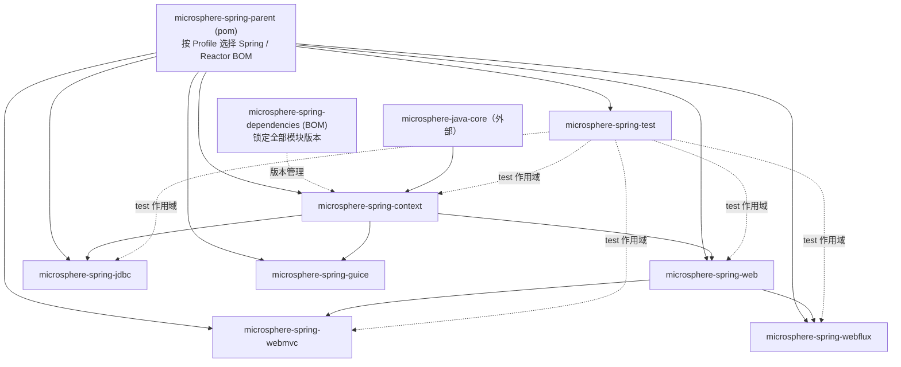

# 开发者文档（Developer Guide）

[← 文档总索引](../../zh/README.md) · [English](../README.md) · **简体中文** ·
[用户文档](../../user-guide/zh/README.md)

开发者文档说明 `microsphere-spring` **是如何构建起来的**：每个模块的架构设计、每一处扩展点背后的源码实现、
库所依赖的设计模式，以及非直观运行期流程的 Mermaid 流程图。文档只针对两个已发布分支 ——
`release`（记为 **current**，版本线 0.2.x）与 `release-1.x`（记为 **1.x**，版本线 0.1.x）。

| 版本线 | 分支 | 目录 | Java | 基线 |
|---|---|---|---|---|
| 0.2.x | `release` | [`current/`](../current/zh/README.md) | 17 | Spring Framework 6.0.x – 7.0.x，`jakarta.*` |
| 0.1.x | `release-1.x` | [`1.x/`](../1.x/zh/README.md) | 8 | Spring Framework 4.3.x – 5.3.x，`javax.*` |

## 模块依赖关系图

Reactor 内部模块之间的 compile 作用域依赖（所有模块都继承 `microsphere-spring-parent`，
`microsphere-spring-dependencies` 则是统一锁定版本的 BOM；除 `microsphere-spring-guice` 之外，
有测试的模块都以 **test** 作用域引入 `microsphere-spring-test`，因此它是叶子节点，在 reactor 排序中较晚构建）：

### current — 0.2.x



### 1.x — 0.1.x

```mermaid
flowchart TD
  P["microsphere-spring-parent (pom)"]
  D["microsphere-spring-dependencies (BOM)"]
  X["microsphere-spring-compatible<br/>（仅 1.x；不在 BOM 中；跳过 deploy）"]
  C["microsphere-spring-context"]
  W["microsphere-spring-web"]
  M["microsphere-spring-webmvc"]
  F["microsphere-spring-webflux"]
  J["microsphere-spring-jdbc"]
  G["microsphere-spring-guice"]
  T["microsphere-spring-test"]
  CORE["microsphere-java-core（外部）"]

  CORE --> C
  P --> C
  D -.版本管理.-> C
  X -.可选；spring-framework-4.3 / 5.x Profile.-> C
  C --> W
  W --> M
  W --> F
  C --> J
  C --> G
  T -.test 作用域.-> C
  T -.test 作用域.-> W
  T -.test 作用域.-> M
  T -.test 作用域.-> F
  T -.test 作用域.-> J
```

箭头方向表示“被依赖”：箭头尾部是被依赖方，箭头头部是声明该依赖的模块。`webmvc` 与 `webflux` 之间没有任何依赖：两者都建立在传输无关的 `web` 内核之上，
而 `web` 又建立在 `context` 之上。正是这种分层让 Servlet 应用与响应式应用能够共用同一套端点元数据模型。

## 模块文档

### current — 0.2.x（[`current/`](../current/zh/README.md)）

| 模块 | English | 简体中文 |
|---|---|---|
| 构建：parent | [parent.md](../current/parent.md) | [中文](../current/zh/parent.md) |
| 构建：dependencies（BOM） | [dependencies.md](../current/dependencies.md) | [中文](../current/zh/dependencies.md) |
| `microsphere-spring-context` | [context.md](../current/context.md) | [中文](../current/zh/context.md) |
| `microsphere-spring-web` | [web.md](../current/web.md) | [中文](../current/zh/web.md) |
| `microsphere-spring-webmvc` | [webmvc.md](../current/webmvc.md) | [中文](../current/zh/webmvc.md) |
| `microsphere-spring-webflux` | [webflux.md](../current/webflux.md) | [中文](../current/zh/webflux.md) |
| `microsphere-spring-jdbc` | [jdbc.md](../current/jdbc.md) | [中文](../current/zh/jdbc.md) |
| `microsphere-spring-guice` | [guice.md](../current/guice.md) | [中文](../current/zh/guice.md) |
| `microsphere-spring-test` | [test.md](../current/test.md) | [中文](../current/zh/test.md) |

### 1.x — 0.1.x（[`1.x/`](../1.x/zh/README.md)）

| 模块 | English | 简体中文 |
|---|---|---|
| 构建：parent | [parent.md](../1.x/parent.md) | [中文](../1.x/zh/parent.md) |
| 构建：dependencies（BOM） | [dependencies.md](../1.x/dependencies.md) | [中文](../1.x/zh/dependencies.md) |
| `microsphere-spring-context` | [context.md](../1.x/context.md) | [中文](../1.x/zh/context.md) |
| `microsphere-spring-web` | [web.md](../1.x/web.md) | [中文](../1.x/zh/web.md) |
| `microsphere-spring-webmvc` | [webmvc.md](../1.x/webmvc.md) | [中文](../1.x/zh/webmvc.md) |
| `microsphere-spring-webflux` | [webflux.md](../1.x/webflux.md) | [中文](../1.x/zh/webflux.md) |
| `microsphere-spring-jdbc` | [jdbc.md](../1.x/jdbc.md) | [中文](../1.x/zh/jdbc.md) |
| `microsphere-spring-guice` | [guice.md](../1.x/guice.md) | [中文](../1.x/zh/guice.md) |
| `microsphere-spring-test` | [test.md](../1.x/test.md) | [中文](../1.x/zh/test.md) |
| `microsphere-spring-compatible`（仅 1.x） | [compatible.md](../1.x/compatible.md) | [中文](../1.x/zh/compatible.md) |

## 每篇开发者文档包含的内容

1. **模块身份与 reactor 位置** —— 模块自身的依赖图，以及哪些依赖是 `optional` / `provided`、哪些是 compile。
2. **包结构地图** —— 每个包及其职责。
3. **架构分层** —— 用 Mermaid 图展示入口、所使用的 Spring 扩展点
   （`ApplicationContextInitializer`、`BeanFactoryPostProcessor`、`BeanPostProcessor`、
   `ImportBeanDefinitionRegistrar`、`SmartLifecycle`、`ApplicationListener`、`ServletContainerInitializer`）
   以及它们装配出的运行期服务。
4. **源码分析** —— 真实的类、契约与装配关系，并给出仓库相对路径引用。
5. **流程图** —— 复杂流程的 Mermaid 图：启动期收集、请求拦截链、属性源解析、缓存解析、连接池包装、内嵌容器启动。
6. **设计模式** —— 每个类实现的模式，以及库选择该模式的原因。
7. **扩展点** —— 每一项 SPI、它的发现方式（`spring.factories`、`META-INF/services`、`@Import`、Bean 检索）与调用时机。
8. **构建与验证** —— 影响该模块的 Maven Profile，以及如何运行它的测试。
9. **注意点** —— 经代码核实的差异，包括声明却从未读取的属性，以及 0.1.x 与 0.2.x 两条版本线之间的区别。

## 跨模块架构要点

- **一切按需开启。** 没有任何模块依靠 classpath 扫描自动生效；每个特性族都由 `@Enable*` 注解显式开启，
  并由其 `ImportBeanDefinitionRegistrar` 完成装配。
- **组件发现可插拔。** `BeanSource` 决定扩展组件的查找来源：`BEAN_FACTORY`、`SPRING_FACTORIES`
  （`META-INF/spring.factories`）与 `JAVA_SERVICE_PROVIDER`（`META-INF/services`）。
- **Spring 版本是构建期选择，而非运行期分支。** `microsphere-spring-parent` 中的 `spring-framework-*`
  Profile 切换导入的 Spring 与 Reactor BOM；模块 pom 再补充该 Profile 所需的额外依赖
  （在 1.x 上，`microsphere-spring-compatible` 正是由此进入依赖树）。
- **0.1.x 是面向 Java 8 与 `javax.*` 的维护线。** 其源码只能通过 `git show origin/release-1.x:<path>` 读取，
  文档中凡属 1.x 专属的代码片段都会明确标注。
