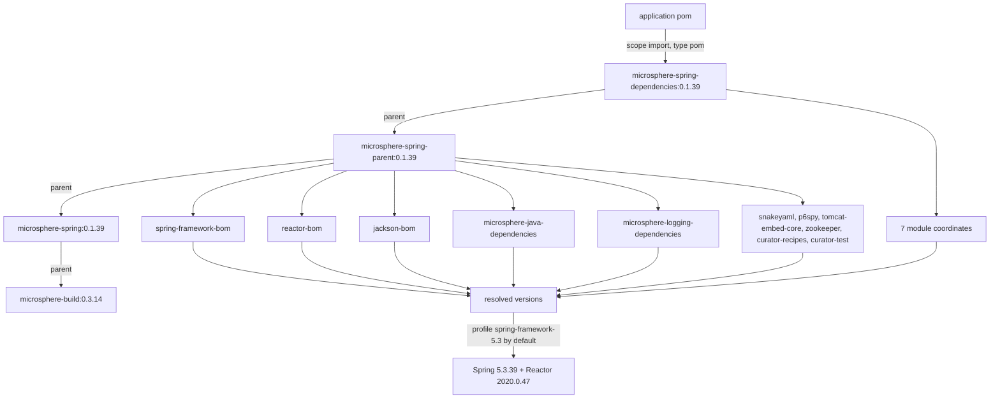

# microsphere-spring-dependencies · 1.x (0.1.x)

[← User guide overview](./README.md) · [简体中文](./zh/dependencies.md) · [Developer guide](../../developer-guide/1.x/dependencies.md)

`microsphere-spring-dependencies` is the BOM applications import on the 0.1.x line. It is a
`pom`-packaging child of `microsphere-spring-parent`, so importing it also brings the parent chain's
`dependencyManagement` (Spring, Reactor, Jackson, Microsphere Java/Logging, SnakeYAML, P6Spy, Tomcat,
ZooKeeper, Curator). See [parent.md](./parent.md) for the profile matrix behind those versions.

## 1. Version information

| Item | Value |
|---|---|
| Branch | `release-1.x` (0.1.x line) |
| Version line | `0.1.x` |
| `${revision}` in `pom.xml` | `0.1.40-SNAPSHOT` |
| Published version (latest tag) | `0.1.39` |
| Coordinates | `io.github.microsphere-projects:microsphere-spring-dependencies:${revision}` |
| Packaging | `pom` |
| Its own `<parent>` | `io.github.microsphere-projects:microsphere-spring-parent:${revision}` |
| Upstream build parent | `io.github.microsphere-projects:microsphere-build:0.3.14` |
| Java baseline | 8 (inherited; the branch declares no `java.version`) |
| License | Apache License, Version 2.0 |

The released `0.1.39` BOM pom keeps its `<parent>` reference and `${...}` placeholders (verified in
the published pom), so importing it also resolves `microsphere-spring-parent:0.1.39` and
`microsphere-spring:0.1.39`. Only the module coordinates inside the BOM are flattened to a concrete
version.

## 2. Artifacts managed directly by the BOM

Exactly seven entries, all `io.github.microsphere-projects`, all `${revision}`
(`0.1.39` as published):

| Artifact | Packaging | Notes |
|---|---|---|
| `microsphere-spring-context` | jar | base module |
| `microsphere-spring-guice` | jar | Guice bridge |
| `microsphere-spring-jdbc` | jar | P6Spy / DataSource support |
| `microsphere-spring-web` | jar | transport-neutral web kernel |
| `microsphere-spring-webmvc` | jar | servlet / Spring MVC adapters |
| `microsphere-spring-webflux` | jar | reactive adapters |
| `microsphere-spring-test` | jar | test support |

`microsphere-spring-compatible` is **not** in this list even though the module exists in the reactor
— it is `maven-deploy-plugin`-skipped and is only pulled in internally by `microsphere-spring-context`
under the `spring-framework-4.3` / `spring-framework-5.0` profiles. You cannot depend on it from
Maven Central.

## 3. Artifacts managed through the parent's `dependencyManagement`

| Entry in `microsphere-spring-parent` | Type | How it reaches your build |
|---|---|---|
| `com.fasterxml.jackson:jackson-bom` | `pom`, `import` | all `com.fasterxml.jackson.*` artifacts |
| `org.yaml:snakeyaml` | jar | direct managed version |
| `p6spy:p6spy` | jar | direct managed version |
| `org.apache.tomcat.embed:tomcat-embed-core` | jar | direct managed version (`9.0.119`) |
| `org.apache.zookeeper:zookeeper` | jar | direct managed version |
| `org.apache.curator:curator-recipes` | jar | managed, excludes `zookeeper` |
| `org.apache.curator:curator-test` | jar | managed, excludes `zookeeper` |
| `org.springframework:spring-framework-bom` | `pom`, `import` | every `org.springframework:*` artifact used here |
| `io.projectreactor:reactor-bom` | `pom`, `import` | `reactor-core`, and the `Bismuth-SR17` / `Californium-SR23` / `Dysprosium-SR25` / `2020.0.47` releases |
| `io.github.microsphere-projects:microsphere-java-dependencies` | `pom`, `import` | `microsphere-java-core`, `microsphere-java-annotations`, `microsphere-jdk-tools`, `microsphere-java-test`, `microsphere-annotation-test`, `microsphere-lang-model`, `microsphere-annotation-processor` |
| `io.github.microsphere-projects:microsphere-logging-dependencies` | `pom`, `import` | `microsphere-logback`, `microsphere-logging-test`, `microsphere-java-logging`, `microsphere-logging-commons`, `microsphere-log4j`, `microsphere-log4j2` |

Unlike 0.2.x, there is **no** `jakarta.platform:jakarta.jakartaee-bom` import here. The last two rows'
artifact lists were read from the published upstream BOM poms, not from this repository;
`javax.servlet-api`, `javax.annotation-api`, `junit`, `h2` and `sqlite-jdbc` versions also come from
that chain and are not declared in this repository.

## 4. Version-pinning properties

| Property key | Value | Pinned artifact(s) |
|---|---|---|
| `microsphere-java.version` | `0.3.19` | `microsphere-java-dependencies` (BOM) |
| `microsphere-logging.version` | `0.2.2` | `microsphere-logging-dependencies` (BOM) |
| `jackson.version` | `2.22.2` | `jackson-bom` (BOM) |
| `snakeyaml.version` | `2.6` | `org.yaml:snakeyaml` |
| `p6spy.version` | `3.9.1` | `p6spy:p6spy` |
| `tomcat.version` | `9.0.119` | `org.apache.tomcat.embed:tomcat-embed-core` |
| `zookeeper.version` | `3.9.5` | `org.apache.zookeeper:zookeeper` |
| `curator.version` | `5.9.0` | `curator-recipes`, `curator-test` |
| `spring-framework.version` | `5.3.39` by default (`4.3.30.RELEASE` / `5.0.20.RELEASE` / `5.1.20.RELEASE` / `5.2.25.RELEASE` via profiles) | `spring-framework-bom` (BOM) |
| `reactor.version` | `2020.0.47` by default (`Bismuth-SR17` / `Californium-SR23` / `Dysprosium-SR25`) | `reactor-bom` (BOM) |
| `revision` (root pom) | `0.1.40-SNAPSHOT` | every module coordinate in section 2 |
| `guice.version` | `7.0.0` | **not** here — declared inside `microsphere-spring-guice/pom.xml` |

## 5. Using the BOM

```xml
<project>
    <properties>
        <microsphere-spring.version>0.1.39</microsphere-spring.version>
    </properties>

    <dependencyManagement>
        <dependencies>
            <dependency>
                <groupId>io.github.microsphere-projects</groupId>
                <artifactId>microsphere-spring-dependencies</artifactId>
                <version>${microsphere-spring.version}</version>
                <type>pom</type>
                <scope>import</scope>
            </dependency>
        </dependencies>
    </dependencyManagement>

    <dependencies>
        <dependency>
            <groupId>io.github.microsphere-projects</groupId>
            <artifactId>microsphere-spring-context</artifactId>
        </dependency>
        <dependency>
            <groupId>io.github.microsphere-projects</groupId>
            <artifactId>microsphere-spring-webmvc</artifactId>
        </dependency>
        <dependency>
            <groupId>io.github.microsphere-projects</groupId>
            <artifactId>microsphere-spring-test</artifactId>
            <scope>test</scope>
        </dependency>
    </dependencies>
</project>
```

`<type>pom</type>` and `<scope>import</scope>` are both required; omitting either turns the entry into
a plain managed POM dependency and no versions get pulled in. The modules chain into each other
(`webmvc` → `web` → `context`, `jdbc` → `context`, `guice` → `context`), so declaring one of the
higher modules adds the lower ones transitively.

## 6. Dependency posture

Managed does not mean transmitted. These are the real scopes on this line:

| You must supply | Because the module declares it | Feature that needs it |
|---|---|---|
| `org.springframework:*` (any 4.3.x–5.3.x) | `optional` in every module | the whole library |
| `com.fasterxml.jackson.core:jackson-annotations`, `jackson-databind` | `optional` (context, web, webmvc, webflux, test) | JSON property sources, endpoint JSON |
| `org.yaml:snakeyaml` | `optional` (context) | YAML property sources |
| `p6spy:p6spy` | `optional` (jdbc) | `@EnableP6DataSource` |
| `com.google.inject:guice` `7.0.0` | `optional` (guice), version not in the BOM, needs Java 11+ | `@EnableGuice` |
| `javax.servlet:javax.servlet-api` | `optional` (web, test) / `provided` (webmvc) | servlet stack — container usually provides it |
| `javax.annotation:javax.annotation-api` | `optional` (context) but `compile` (test module) | annotation references |
| `org.apache.tomcat.embed:tomcat-embed-core` `9.0.119` | `optional` (test), `test` scope (webmvc) | embedded Tomcat tests |
| `org.apache.zookeeper:zookeeper`, `curator-recipes`, `curator-test` | `optional` (test) | embedded ZooKeeper test support |
| `com.google.code.findbugs:jsr305` | `optional` (web) | annotation references |
| `junit:junit`, `junit-jupiter`, `mockito-core`, `sqlite-jdbc`, `h2`, `jsonassert` | `optional` (test) | JUnit 4 and JUnit 5 runners, embedded DBs, assertions |

Not optional — you get them transitively: `microsphere-java-core` (from `context`, the only mandatory
external dependency of the runtime modules) and, for `microsphere-spring-test` only,
`microsphere-java-test`, `microsphere-logging-test`, `microsphere-logback` and
`javax.annotation:javax.annotation-api`.

## 7. Not managed by this BOM

- `com.google.inject:guice` — version comes from `guice.version` inside the Guice module pom.
- `microsphere-spring-parent`, `microsphere-spring-dependencies` (POM artifacts) and
  `microsphere-spring-compatible` (never deployed).
- Spring Boot, Spring Data, application servers: this line manages Spring Framework and Reactor only.
- Build-plugin versions (`maven-compiler-plugin` `3.15.0`, …) live in `microsphere-build`, not here.

## 8. BOM import chain



## 9. Upgrade notes (0.1.x → 0.2.x)

| Topic | 0.1.x | 0.2.x |
|---|---|---|
| BOM body | seven module entries, `compatible` excluded | same seven entries |
| Jakarta EE BOM | not imported; `tomcat-embed-core:9.0.119` pinned | `jakarta.jakartaee-bom:11.0.0` imported, Tomcat pin dropped |
| Servlet coordinates | `javax.servlet:javax.servlet-api` | `jakarta.servlet:jakarta.servlet-api` |
| Default managed Spring | `5.3.39` / Reactor `2020.0.47` | `7.0.9` / Reactor `2025.0.7` |
| Java baseline of the managed set | 8 | 17 |
| `jackson` / `snakeyaml` / `zookeeper` | `2.22.2` / `2.6` / `3.9.5` | `2.22.3` / `2.7` / `3.9.6` (working tree; released `0.2.39` still carries `2.22.2` / `2.6` / `3.9.5`) |
| `microsphere-java.version` | `0.3.19` | `0.3.19` (unchanged) |

The BOM coordinates and the seven artifact names are identical, so switching lines is a version
change in your import — but it forces `javax.*` → `jakarta.*` source edits, Spring 6.0+, and Java 17,
and `microsphere-spring-compatible` disappears with no replacement.

## Related documents

[context.md](./context.md) · [web.md](./web.md) · [test.md](./test.md) ·
[compatible.md](./compatible.md) · [parent.md](./parent.md) ·
[current line dependencies guide](../current/dependencies.md)
