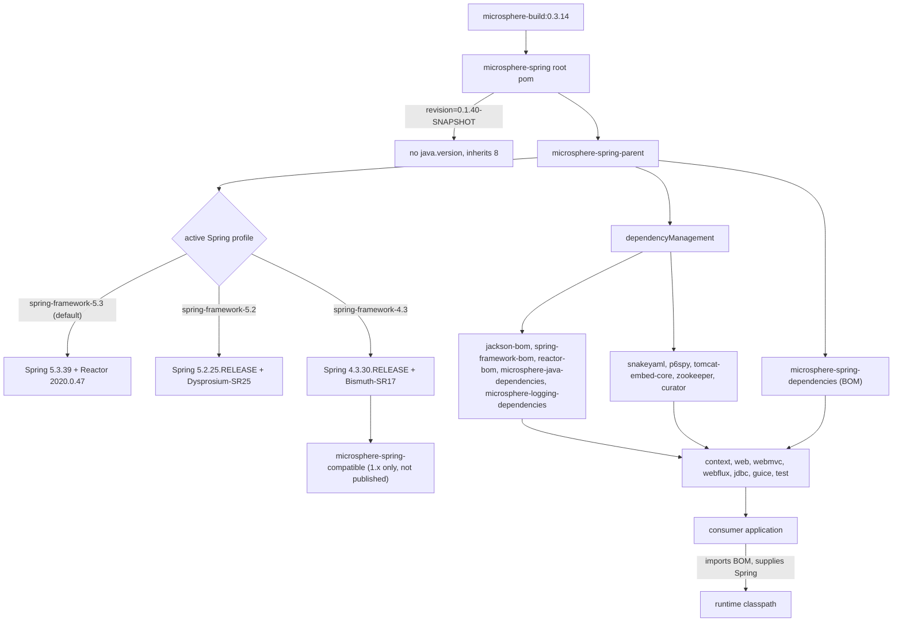

# microsphere-spring-parent · 1.x (0.1.x)

[← User guide overview](./README.md) · [简体中文](./zh/parent.md) · [Developer guide](../../developer-guide/1.x/parent.md)

`microsphere-spring-parent` (`io.github.microsphere-projects:microsphere-spring-parent`, packaging
`pom`) is the `<parent>` of every code module on the maintenance line that targets Spring Framework
4.3 – 5.3 and Java 8. It owns the third-party version pins and the Spring profile matrix;
`microsphere-spring-dependencies` (its child) is the BOM applications import. Build internals live in
the Developer Guide, linked above.

## 1. Version information

| Item | Value |
|---|---|
| Branch | `release-1.x` (0.1.x line) |
| Version line | `0.1.x` |
| `${revision}` in `pom.xml` | `0.1.40-SNAPSHOT` |
| Published version (latest tag) | `0.1.39` |
| Reactor root artifact | `io.github.microsphere-projects:microsphere-spring:0.1.40-SNAPSHOT` |
| Upstream build parent | `io.github.microsphere-projects:microsphere-build:0.3.14` |
| Java baseline | 8 — inherited, not declared: the branch root pom has no `java.version` property, and `microsphere-build` defaults `<java.version>8</java.version>` |
| Servlet namespace | `javax.servlet.*` (no Jakarta EE BOM on this line) |
| License | Apache License, Version 2.0 |
| Coordinates of this page's artifact | `io.github.microsphere-projects:microsphere-spring-parent:${revision}` |
| `<modules>` in the root pom | 10 entries: parent, dependencies, **compatible**, context, jdbc, web, webmvc, webflux, guice, test |

## 2. What the parent pins, and how inheritance changes resolved versions

Module poms declare dependencies **without versions**; Maven fills them in when it builds the
effective model: module → `microsphere-spring-parent` → root `microsphere-spring` →
`microsphere-build`. The parent's `dependencyManagement` (plus the BOMs it imports) supplies those
versions; the profiles in section 3 supply `${spring-framework.version}` and `${reactor.version}`.

| Property key | Value (0.1.x) | Where it is used |
|---|---|---|
| `microsphere-java.version` | `0.3.19` | imports `microsphere-java-dependencies` (BOM) |
| `microsphere-logging.version` | `0.2.2` | imports `microsphere-logging-dependencies` (BOM) |
| `jackson.version` | `2.22.2` | imports `com.fasterxml.jackson:jackson-bom` |
| `snakeyaml.version` | `2.6` | manages `org.yaml:snakeyaml` directly |
| `p6spy.version` | `3.9.1` | manages `p6spy:p6spy` directly |
| `tomcat.version` | `9.0.119` | manages `org.apache.tomcat.embed:tomcat-embed-core` directly |
| `zookeeper.version` | `3.9.5` | manages `org.apache.zookeeper:zookeeper` |
| `curator.version` | `5.9.0` | manages `curator-recipes` / `curator-test` (both exclude `zookeeper`) |
| `spring-framework.version` | profile-driven, default `5.3.39` | imports `spring-framework-bom` |
| `reactor.version` | profile-driven, default `2020.0.47` | imports `io.projectreactor:reactor-bom` |

There is **no** `jakartaee.version` property here; `javax.servlet-api`, `javax.annotation-api`,
`junit`, `h2` and `sqlite-jdbc` versions are not declared in this repository either — they resolve
through the imported `microsphere-java-dependencies:0.3.19` chain. `guice.version` (`7.0.0`) is
declared inside `microsphere-spring-guice/pom.xml`, not in the parent.

## 3. Supported Spring Framework range

`microsphere-spring-parent/pom.xml` declares five profiles:

| Profile id | `spring-framework.version` | `reactor.version` | Notes |
|---|---|---|---|
| `spring-framework-4.3` | `4.3.30.RELEASE` | `Bismuth-SR17` | regression-tested in CI |
| `spring-framework-5.0` | `5.0.20.RELEASE` | `Bismuth-SR17` | regression-tested in CI |
| `spring-framework-5.1` | `5.1.20.RELEASE` | `Californium-SR23` | regression-tested in CI |
| `spring-framework-5.2` | `5.2.25.RELEASE` | `Dysprosium-SR25` | regression-tested in CI |
| `spring-framework-5.3` | `5.3.39` | `2020.0.47` | **`<activeByDefault>true</activeByDefault>`** |

Supported range: **Spring Framework 4.3.x – 5.3.x on Java 8+**. The two oldest profiles change the
dependency graph as well as the versions: `microsphere-spring-context` adds
`microsphere-spring-compatible` (optional) under `spring-framework-4.3` and `spring-framework-5.0`,
and adds `spring-context-indexer` (optional) under `spring-framework-5.0` … `5.3`. Two caveats you
can read off the poms: `microsphere-spring-compatible` is never deployed
(`maven-deploy-plugin` `<skip>true</skip>`) and is absent from the BOM, and Guice is pinned to
`7.0.0` — a Java 11+ artifact — while this line targets Java 8.

## 4. Bringing your own Spring version

- Every Spring dependency in the code modules is `optional`, so nothing is transmitted: the Spring
  version in your application is the one that runs.
- The published parent and BOM poms keep the profile block and the `${spring-framework.version}` /
  `${reactor.version}` placeholders (verified in the released `0.1.39` poms), so the imported chain
  defaults to Spring `5.3.39` / Reactor `2020.0.47`.
- A profile of an imported BOM is not part of your reactor: `-P spring-framework-5.1` in your
  application build does **not** re-point this BOM, and overriding `<spring-framework.version>` in
  your own properties is not reliable (the property is interpolated inside the BOM's model).
- Dependable mechanism: declare your own `spring-framework-bom` **before** the Microsphere BOM —
  Maven keeps the first managed entry for a given `groupId:artifactId`.

```xml
<dependencyManagement>
    <dependencies>
        <dependency>
            <groupId>org.springframework</groupId>
            <artifactId>spring-framework-bom</artifactId>
            <version>5.3.39</version>
            <type>pom</type>
            <scope>import</scope>
        </dependency>
        <dependency>
            <groupId>io.github.microsphere-projects</groupId>
            <artifactId>microsphere-spring-dependencies</artifactId>
            <version>0.1.39</version>
            <type>pom</type>
            <scope>import</scope>
        </dependency>
    </dependencies>
</dependencyManagement>
```

Verify with `mvn dependency:tree -Dincludes=org.springframework`. The first-declaration-wins rule is
Maven behaviour, not an assertion made by these poms.

## 5. Depending on the library

Import the BOM, then add modules without versions (full list in [dependencies.md](./dependencies.md)):

```xml
<dependencyManagement>
    <dependencies>
        <dependency>
            <groupId>io.github.microsphere-projects</groupId>
            <artifactId>microsphere-spring-dependencies</artifactId>
            <version>0.1.39</version>
            <type>pom</type>
            <scope>import</scope>
        </dependency>
    </dependencies>
</dependencyManagement>

<dependencies>
    <dependency>
        <groupId>io.github.microsphere-projects</groupId>
        <artifactId>microsphere-spring-context</artifactId>
    </dependency>
    <dependency>
        <groupId>io.github.microsphere-projects</groupId>
        <artifactId>microsphere-spring-webmvc</artifactId>
    </dependency>
    <dependency>
        <groupId>io.github.microsphere-projects</groupId>
        <artifactId>microsphere-spring-test</artifactId>
        <scope>test</scope>
    </dependency>
</dependencies>
```

## 6. Dependency posture

| Artifact | Declared by | Scope in our poms | Supplied by the application |
|---|---|---|---|
| `microsphere-java-core` | context | compile, versioned by parent | no — the one mandatory external dependency |
| `microsphere-java-test`, `microsphere-logging-test`, `microsphere-logback`, `javax.annotation:javax.annotation-api` | test | compile | no (mandatory for `microsphere-spring-test` only) |
| `org.springframework:spring-context` | context, web, webflux, jdbc, guice, test | optional | yes |
| `spring-context-support`, `spring-beans`, `spring-aop` | context | optional | yes |
| `spring-context-indexer` | context (profile `5.0`–`5.3` only), test | optional | only for annotation processing |
| `spring-web`, `spring-webmvc`, `spring-webflux`, `spring-test` | web, webmvc, webflux, test | optional | yes |
| `com.fasterxml.jackson.core:jackson-annotations`, `jackson-databind` | context, web, webmvc, webflux, test | optional | yes, if JSON features used |
| `org.yaml:snakeyaml` | context | optional | yes, for YAML property sources |
| `javax.servlet:javax.servlet-api` | web (optional), webmvc (provided), test (optional) | optional / provided | container or app; version managed upstream, not in this repo |
| `p6spy:p6spy` | jdbc | optional | yes, for `@EnableP6DataSource` |
| `com.google.inject:guice` `7.0.0` | guice | optional (`guice.version` is module-local) | yes |
| `org.apache.zookeeper:zookeeper`, `curator-recipes`, `curator-test` | test | optional | yes, for embedded ZooKeeper tests |
| `org.apache.tomcat.embed:tomcat-embed-core` `9.0.119` | webmvc (test), test (optional) | optional | yes, for embedded Tomcat tests |
| `com.google.code.findbugs:jsr305` | web, compatible | optional | yes, if referenced |
| `io.github.microsphere-projects:microsphere-annotation-processor` | context, webmvc, webflux, jdbc, test | optional | build-time only (absent from the `web` and `guice` poms on this line) |
| `junit:junit`, `junit-jupiter`, `mockito-core`, `sqlite-jdbc`, `h2`, `jsonassert` | test | optional | as needed |

## 7. Building the reactor against another Spring line

```bash
mvn clean test                                   # default profile: Spring 5.3.39 / Reactor 2020.0.47
mvn -P spring-framework-5.2 clean test           # Spring 5.2.25.RELEASE / Dysprosium-SR25
mvn -P spring-framework-5.1 clean verify         # Spring 5.1.20.RELEASE / Californium-SR23
mvn -P spring-framework-5.0 clean test           # Spring 5.0.20.RELEASE + microsphere-spring-compatible
mvn -P spring-framework-4.3 clean test           # Spring 4.3.30.RELEASE + microsphere-spring-compatible
mvn -Drevision=0.0.1-SNAPSHOT test               # CI-style version override
```

Activating a named profile deactivates the `activeByDefault` `5.3` profile (standard Maven
behaviour). CI (`.github/workflows/maven-build.yml` on `release-1.x`) runs the five profiles against
Temurin `8`, `11`, `17`, `21`, `25` with `--activate-profiles test,coverage,<profile>`. When you build
`microsphere-spring-test` on its own with `-P spring-framework-4.3`, that module's own profile
overrides `spring-framework.version` to `5.0.20.RELEASE` — it does not test real 4.3 there.

## 8. Upgrade notes (0.1.x → 0.2.x)

| Topic | 0.1.x (`release-1.x`) | 0.2.x (`release`) |
|---|---|---|
| Java baseline | 8 (inherited from `microsphere-build:0.3.14`) | 17 (`<java.version>17</java.version>` in the root pom) |
| Servlet API | `javax.servlet:javax.servlet-api` | `jakarta.servlet:jakarta.servlet-api` via `jakarta.jakartaee-bom:11.0.0` |
| Spring lines | `4.3.30.RELEASE` → `5.3.39`, default `5.3.39` | `6.0.23` → `7.0.9`, default `7.0.9` |
| Reactor BOM | `Bismuth-SR17` … `2020.0.47` | `2022.0.22` … `2025.0.7` |
| Extra module | `microsphere-spring-compatible` exists (1.x only; not deployed, not in the BOM) | does not exist |
| Main test framework | JUnit 4 (`junit:junit`) in context, web, jdbc, guice | JUnit 5 (`org.junit.jupiter:junit-jupiter`) everywhere |
| `microsphere-java.version` / `microsphere-logging.version` | `0.3.19` / `0.2.2` | `0.3.19` / `0.2.2` (unchanged) |
| Tomcat pin in the parent | `9.0.119` managed | not managed; resolved through the imported chain |

Staying on 0.1.x is the right choice for Spring 5.3 / `javax.servlet` / Java 8 deployments; moving to
0.2.x requires Spring 6.0+, a `javax.*` → `jakarta.*` source migration, and Java 17. The
`microsphere-spring-compatible` backfill has no equivalent on 0.2.x, because every supported 0.2.x
Spring line already provides the APIs it backfilled. That last sentence is an inference from the
module being absent from the 0.2.x pom — the pom does not state a reason.

## 9. How the versions resolve



## Related documents

[context.md](./context.md) · [web.md](./web.md) · [test.md](./test.md) ·
[compatible.md](./compatible.md) · [dependencies.md](./dependencies.md) ·
[current line parent guide](../current/parent.md)
