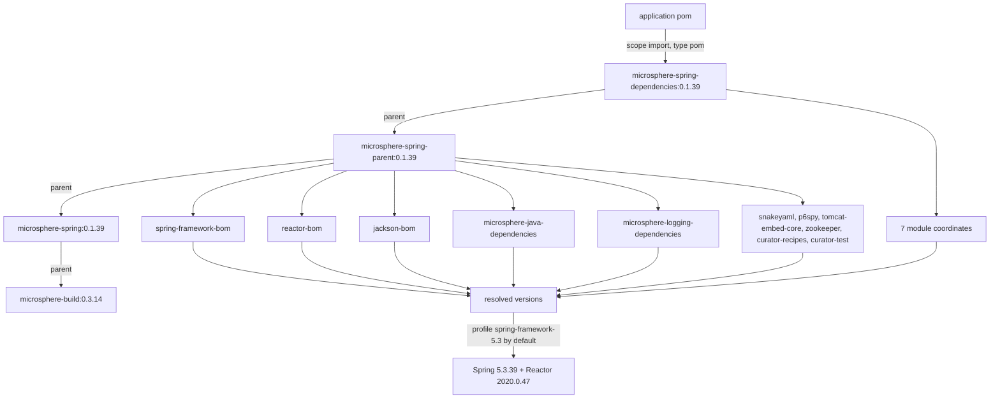

# microsphere-spring-dependencies · 1.x (0.1.x)

[← 用户文档总览](./README.md) · [English](../dependencies.md) · [开发者文档](../../../developer-guide/1.x/zh/dependencies.md)

`microsphere-spring-dependencies` 是 0.1.x 线上应用要导入的 BOM。它是 `microsphere-spring-parent` 的
`pom` 打包子模块，因此导入它会一并带来父链的 `dependencyManagement`（Spring、Reactor、Jackson、
Microsphere Java/Logging、SnakeYAML、P6Spy、Tomcat、ZooKeeper、Curator）。这些版本背后的 profile
矩阵见 [parent.md](./parent.md)。

## 1. 版本信息

| 项目 | 值 |
|---|---|
| 分支 | `release-1.x`（0.1.x 线） |
| 版本线 | `0.1.x` |
| `pom.xml` 中的 `${revision}` | `0.1.40-SNAPSHOT` |
| 已发布版本（最新 tag） | `0.1.39` |
| 坐标 | `io.github.microsphere-projects:microsphere-spring-dependencies:${revision}` |
| 打包 | `pom` |
| 自身的 `<parent>` | `io.github.microsphere-projects:microsphere-spring-parent:${revision}` |
| 上游构建父 POM | `io.github.microsphere-projects:microsphere-build:0.3.14` |
| Java 基线 | 8（继承而来；本分支未声明 `java.version`） |
| 许可证 | Apache License, Version 2.0 |

已发布的 `0.1.39` BOM POM 保留了 `<parent>` 引用与 `${...}` 占位符（已在发布 POM 中核实），因此导入它
同时会解析 `microsphere-spring-parent:0.1.39` 与 `microsphere-spring:0.1.39`。只有 BOM 内的模块坐标被
flatten 成具体版本。

## 2. BOM 直接管理的工件

正好七个条目，全部为 `io.github.microsphere-projects`，全部使用 `${revision}`（发布后为 `0.1.39`）：

| 工件 | 打包 | 说明 |
|---|---|---|
| `microsphere-spring-context` | jar | 基础模块 |
| `microsphere-spring-guice` | jar | Guice 桥接 |
| `microsphere-spring-jdbc` | jar | P6Spy / DataSource 支持 |
| `microsphere-spring-web` | jar | 与传输方式无关的 web 内核 |
| `microsphere-spring-webmvc` | jar | servlet / Spring MVC 适配 |
| `microsphere-spring-webflux` | jar | 响应式适配 |
| `microsphere-spring-test` | jar | 测试支持 |

`microsphere-spring-compatible` **不在**此清单中，尽管该模块存在于 reactor 里——它被
`maven-deploy-plugin` 跳过发布，只在 `spring-framework-4.3` / `spring-framework-5.0` profile 下由
`microsphere-spring-context` 内部引入。你无法从 Maven Central 依赖它。

## 3. 通过父 POM 的 `dependencyManagement` 管理的工件

| `microsphere-spring-parent` 中的条目 | 类型 | 如何进入你的构建 |
|---|---|---|
| `com.fasterxml.jackson:jackson-bom` | `pom`, `import` | 所有 `com.fasterxml.jackson.*` 工件 |
| `org.yaml:snakeyaml` | jar | 直接受管版本 |
| `p6spy:p6spy` | jar | 直接受管版本 |
| `org.apache.tomcat.embed:tomcat-embed-core` | jar | 直接受管版本（`9.0.119`） |
| `org.apache.zookeeper:zookeeper` | jar | 直接受管版本 |
| `org.apache.curator:curator-recipes` | jar | 受管，排除 `zookeeper` |
| `org.apache.curator:curator-test` | jar | 受管，排除 `zookeeper` |
| `org.springframework:spring-framework-bom` | `pom`, `import` | 此处使用的每个 `org.springframework:*` 工件 |
| `io.projectreactor:reactor-bom` | `pom`, `import` | `reactor-core`，以及 `Bismuth-SR17` / `Californium-SR23` / `Dysprosium-SR25` / `2020.0.47` 各发布版 |
| `io.github.microsphere-projects:microsphere-java-dependencies` | `pom`, `import` | `microsphere-java-core`、`microsphere-java-annotations`、`microsphere-jdk-tools`、`microsphere-java-test`、`microsphere-annotation-test`、`microsphere-lang-model`、`microsphere-annotation-processor` |
| `io.github.microsphere-projects:microsphere-logging-dependencies` | `pom`, `import` | `microsphere-logback`、`microsphere-logging-test`、`microsphere-java-logging`、`microsphere-logging-commons`、`microsphere-log4j`、`microsphere-log4j2` |

与 0.2.x 不同，这里**没有** `jakarta.platform:jakarta.jakartaee-bom` 导入。最后两行的工件清单取自发布
到中央仓库的上游 BOM POM，而非本仓库；`javax.servlet-api`、`javax.annotation-api`、`junit`、`h2`、
`sqlite-jdbc` 的版本同样来自那条链，本仓库中并未声明。

## 4. 版本锁定属性

| 属性键 | 值 | 锁定的工件 |
|---|---|---|
| `microsphere-java.version` | `0.3.19` | `microsphere-java-dependencies`（BOM） |
| `microsphere-logging.version` | `0.2.2` | `microsphere-logging-dependencies`（BOM） |
| `jackson.version` | `2.22.2` | `jackson-bom`（BOM） |
| `snakeyaml.version` | `2.6` | `org.yaml:snakeyaml` |
| `p6spy.version` | `3.9.1` | `p6spy:p6spy` |
| `tomcat.version` | `9.0.119` | `org.apache.tomcat.embed:tomcat-embed-core` |
| `zookeeper.version` | `3.9.5` | `org.apache.zookeeper:zookeeper` |
| `curator.version` | `5.9.0` | `curator-recipes`、`curator-test` |
| `spring-framework.version` | 默认 `5.3.39`（`4.3.30.RELEASE` / `5.0.20.RELEASE` / `5.1.20.RELEASE` / `5.2.25.RELEASE` 由 profile 提供） | `spring-framework-bom`（BOM） |
| `reactor.version` | 默认 `2020.0.47`（`Bismuth-SR17` / `Californium-SR23` / `Dysprosium-SR25`） | `reactor-bom`（BOM） |
| `revision`（根 POM） | `0.1.40-SNAPSHOT` | 第 2 节的每个模块坐标 |
| `guice.version` | `7.0.0` | **不在**本处——声明于 `microsphere-spring-guice/pom.xml` |

## 5. 使用 BOM

```xml
<project>
    <properties>
        <microsphere-spring.version>0.1.39</microsphere-spring.version>
    </properties>

    <dependencyManagement>
        <dependencies>
            <dependency>
                <groupId>io.github.microsphere-projects</groupId>
                <artifactId>microsphere-spring-dependencies</artifactId>
                <version>${microsphere-spring.version}</version>
                <type>pom</type>
                <scope>import</scope>
            </dependency>
        </dependencies>
    </dependencyManagement>

    <dependencies>
        <dependency>
            <groupId>io.github.microsphere-projects</groupId>
            <artifactId>microsphere-spring-context</artifactId>
        </dependency>
        <dependency>
            <groupId>io.github.microsphere-projects</groupId>
            <artifactId>microsphere-spring-webmvc</artifactId>
        </dependency>
        <dependency>
            <groupId>io.github.microsphere-projects</groupId>
            <artifactId>microsphere-spring-test</artifactId>
            <scope>test</scope>
        </dependency>
    </dependencies>
</project>
```

`<type>pom</type>` 与 `<scope>import</scope>` 缺一不可；漏掉任一项，该条目就只是一个普通的受管 POM
依赖，不会引入任何版本。模块之间自有链路（`webmvc` → `web` → `context`、`jdbc` → `context`、
`guice` → `context`），因此声明上层模块就会传递带入下层模块。

## 6. 依赖姿态

受管不等于传递。本线的真实 scope 如下：

| 需由你提供 | 因为模块这样声明 | 需要它的特性 |
|---|---|---|
| `org.springframework:*`（任意 4.3.x–5.3.x） | 所有模块中为 `optional` | 整个库 |
| `com.fasterxml.jackson.core:jackson-annotations`、`jackson-databind` | `optional`（context, web, webmvc, webflux, test） | JSON 属性源、端点 JSON |
| `org.yaml:snakeyaml` | `optional`（context） | YAML 属性源 |
| `p6spy:p6spy` | `optional`（jdbc） | `@EnableP6DataSource` |
| `com.google.inject:guice` `7.0.0` | `optional`（guice），版本不在 BOM 中，且需要 Java 11+ | `@EnableGuice` |
| `javax.servlet:javax.servlet-api` | `optional`（web, test）/ `provided`（webmvc） | servlet 技术栈——通常由容器提供 |
| `javax.annotation:javax.annotation-api` | context 中 `optional`，test 模块中为 `compile` | 注解引用 |
| `org.apache.tomcat.embed:tomcat-embed-core` `9.0.119` | `optional`（test），webmvc 中为 `test` scope | 内嵌 Tomcat 测试 |
| `org.apache.zookeeper:zookeeper`、`curator-recipes`、`curator-test` | `optional`（test） | 内嵌 ZooKeeper 测试支持 |
| `com.google.code.findbugs:jsr305` | `optional`（web） | 注解引用 |
| `junit:junit`、`junit-jupiter`、`mockito-core`、`sqlite-jdbc`、`h2`、`jsonassert` | `optional`（test） | JUnit 4 与 JUnit 5 runner、内嵌库、断言 |

非 optional——你会传递获得：`microsphere-java-core`（来自 `context`，是运行期模块唯一必需的外部依赖），
以及仅属于 `microsphere-spring-test` 的 `microsphere-java-test`、`microsphere-logging-test`、
`microsphere-logback`、`javax.annotation:javax.annotation-api`。

## 7. 本 BOM 不管理的内容

- `com.google.inject:guice`——版本取自 Guice 模块 POM 内的 `guice.version`。
- `microsphere-spring-parent`、`microsphere-spring-dependencies`（POM 工件）以及
  `microsphere-spring-compatible`（从不 deploy）。
- Spring Boot、Spring Data、应用服务器：本线只管理 Spring Framework 与 Reactor。
- 构建插件版本（`maven-compiler-plugin` `3.15.0` 等）位于 `microsphere-build`，不在这里。

## 8. BOM 导入链



## 9. 升级说明（0.1.x → 0.2.x）

| 主题 | 0.1.x | 0.2.x |
|---|---|---|
| BOM 本体 | 七个模块条目，不含 `compatible` | 同样七个条目 |
| Jakarta EE BOM | 未导入；改为锁定 `tomcat-embed-core:9.0.119` | 导入 `jakarta.jakartaee-bom:11.0.0`，取消 Tomcat 锁定 |
| Servlet 坐标 | `javax.servlet:javax.servlet-api` | `jakarta.servlet:jakarta.servlet-api` |
| 默认受管 Spring | `5.3.39` / Reactor `2020.0.47` | `7.0.9` / Reactor `2025.0.7` |
| 受管集合的 Java 基线 | 8 | 17 |
| `jackson` / `snakeyaml` / `zookeeper` | `2.22.2` / `2.6` / `3.9.5` | `2.22.3` / `2.7` / `3.9.6`（工作区；已发布的 `0.2.39` 仍为 `2.22.2` / `2.6` / `3.9.5`） |
| `microsphere-java.version` | `0.3.19` | `0.3.19`（未变） |

BOM 坐标与七个工件名完全一致，因此切换版本线只需改动导入的版本号——但它强制要求 `javax.*` →
`jakarta.*` 的源码替换、Spring 6.0+ 以及 Java 17，且 `microsphere-spring-compatible` 会消失且没有替代物。

## 相关文档

[context.md](./context.md) · [web.md](./web.md) · [test.md](./test.md) ·
[compatible.md](./compatible.md) · [parent.md](./parent.md) ·
[0.2.x dependencies 文档](../../current/zh/dependencies.md)
