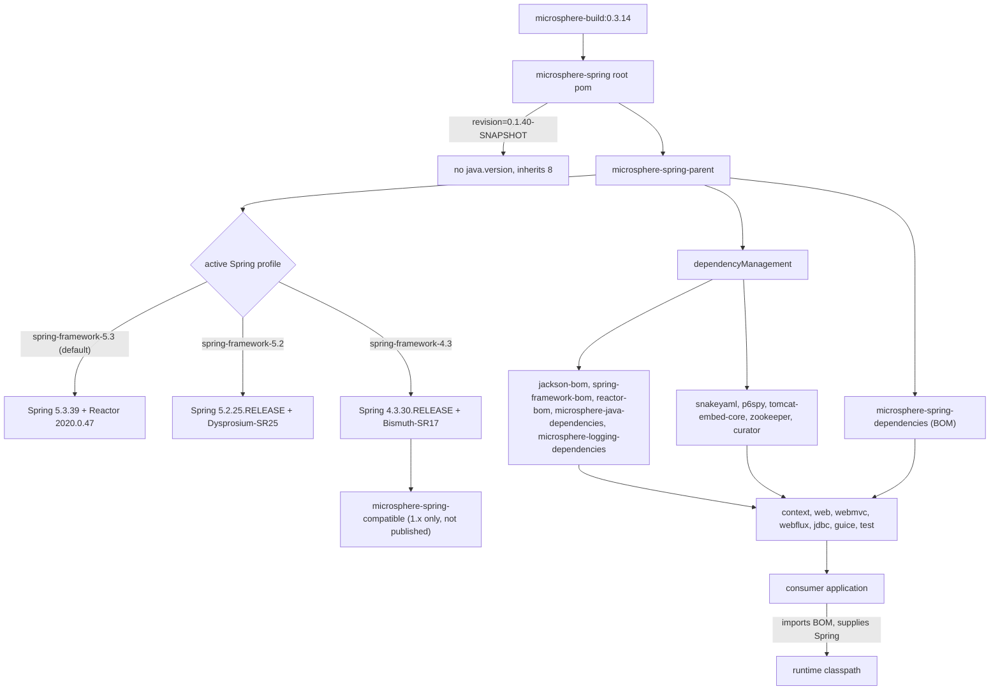

# microsphere-spring-parent · 1.x (0.1.x)

[← 用户文档总览](./README.md) · [English](../parent.md) · [开发者文档](../../../developer-guide/1.x/zh/parent.md)

`microsphere-spring-parent`（`io.github.microsphere-projects:microsphere-spring-parent`，打包类型
`pom`）是这条面向 Spring Framework 4.3 – 5.3 与 Java 8 的维护线中所有代码模块的 `<parent>`。它负责
第三方版本锁定与 Spring profile 矩阵；它的子模块 `microsphere-spring-dependencies` 才是应用导入的
BOM。构建内部机制位于上文链接的开发者文档。

## 1. 版本信息

| 项目 | 值 |
|---|---|
| 分支 | `release-1.x`（0.1.x 线） |
| 版本线 | `0.1.x` |
| `pom.xml` 中的 `${revision}` | `0.1.40-SNAPSHOT` |
| 已发布版本（最新 tag） | `0.1.39` |
| reactor 根坐标 | `io.github.microsphere-projects:microsphere-spring:0.1.40-SNAPSHOT` |
| 上游构建父 POM | `io.github.microsphere-projects:microsphere-build:0.3.14` |
| Java 基线 | 8——继承而来、并非显式声明：本分支根 POM 没有 `java.version` 属性，而 `microsphere-build` 默认 `<java.version>8</java.version>` |
| Servlet 命名空间 | `javax.servlet.*`（本线没有 Jakarta EE BOM） |
| 许可证 | Apache License, Version 2.0 |
| 本页工件坐标 | `io.github.microsphere-projects:microsphere-spring-parent:${revision}` |
| 根 POM 的 `<modules>` | 10 项：parent、dependencies、**compatible**、context、jdbc、web、webmvc、webflux、guice、test |

## 2. 父 POM 锁定了什么，继承如何改变解析出的版本

各模块 POM 声明依赖时**不写版本**；只有 Maven 构建 effective model 时才会填充：模块 →
`microsphere-spring-parent` → 根 `microsphere-spring` → `microsphere-build`。提供版本的是父 POM 的
`dependencyManagement`（含它导入的各个 BOM）；第 3 节的 profile 提供
`${spring-framework.version}` 与 `${reactor.version}`。

| 属性键 | 值（0.1.x） | 使用位置 |
|---|---|---|
| `microsphere-java.version` | `0.3.19` | 导入 `microsphere-java-dependencies`（BOM） |
| `microsphere-logging.version` | `0.2.2` | 导入 `microsphere-logging-dependencies`（BOM） |
| `jackson.version` | `2.22.2` | 导入 `com.fasterxml.jackson:jackson-bom` |
| `snakeyaml.version` | `2.6` | 直接管理 `org.yaml:snakeyaml` |
| `p6spy.version` | `3.9.1` | 直接管理 `p6spy:p6spy` |
| `tomcat.version` | `9.0.119` | 直接管理 `org.apache.tomcat.embed:tomcat-embed-core` |
| `zookeeper.version` | `3.9.5` | 管理 `org.apache.zookeeper:zookeeper` |
| `curator.version` | `5.9.0` | 管理 `curator-recipes` / `curator-test`（两者都排除 `zookeeper`） |
| `spring-framework.version` | 由 profile 决定，默认 `5.3.39` | 导入 `spring-framework-bom` |
| `reactor.version` | 由 profile 决定，默认 `2020.0.47` | 导入 `io.projectreactor:reactor-bom` |

这里**没有** `jakartaee.version` 属性；`javax.servlet-api`、`javax.annotation-api`、`junit`、`h2`、
`sqlite-jdbc` 的版本同样未在本仓库声明——它们经由导入的 `microsphere-java-dependencies:0.3.19` 链解析。
`guice.version`（`7.0.0`）声明在 `microsphere-spring-guice/pom.xml` 内，不在父 POM。

## 3. 受支持的 Spring Framework 范围

`microsphere-spring-parent/pom.xml` 声明了五个 profile：

| Profile id | `spring-framework.version` | `reactor.version` | 说明 |
|---|---|---|---|
| `spring-framework-4.3` | `4.3.30.RELEASE` | `Bismuth-SR17` | CI 回归验证 |
| `spring-framework-5.0` | `5.0.20.RELEASE` | `Bismuth-SR17` | CI 回归验证 |
| `spring-framework-5.1` | `5.1.20.RELEASE` | `Californium-SR23` | CI 回归验证 |
| `spring-framework-5.2` | `5.2.25.RELEASE` | `Dysprosium-SR25` | CI 回归验证 |
| `spring-framework-5.3` | `5.3.39` | `2020.0.47` | **`<activeByDefault>true</activeByDefault>`** |

支持范围：**Spring Framework 4.3.x – 5.3.x，Java 8+**。最旧的两个 profile 除版本外还会改变依赖图：
`microsphere-spring-context` 在 `spring-framework-4.3` 与 `spring-framework-5.0` 下追加
`microsphere-spring-compatible`（optional），并在 `spring-framework-5.0` … `5.3` 下追加
`spring-context-indexer`（optional）。从 POM 可直接读出的两个注意点：`microsphere-spring-compatible`
从不 deploy（`maven-deploy-plugin` 配置了 `<skip>true</skip>`）且不在 BOM 中；Guice 锁定 `7.0.0`——
一个 Java 11+ 的工件——而本线以 Java 8 为目标。

## 4. 应用自带 Spring 版本时

- 代码模块中每个 Spring 依赖都是 `optional`，因此不会传递任何 Spring jar：运行的就是你应用自己的
  Spring 版本。
- 发布出去的 parent 与 BOM POM 保留了 profile 块以及 `${spring-framework.version}` /
  `${reactor.version}` 占位符（已在已发布的 `0.1.39` POM 中核实），所以导入链默认解析到
  Spring `5.3.39` / Reactor `2020.0.47`。
- 被导入 BOM 的 profile 不属于你的 reactor：在应用构建里执行 `-P spring-framework-5.1` **不会**改变本
  BOM 的解析结果；在自己 properties 里覆盖 `<spring-framework.version>` 也不可靠（该属性在 BOM 自身
  模型内插值）。
- 可靠的机制：把你的 `spring-framework-bom` **先于** Microsphere BOM 声明——Maven 对同一
  `groupId:artifactId` 只保留第一个受管条目。

```xml
<dependencyManagement>
    <dependencies>
        <dependency>
            <groupId>org.springframework</groupId>
            <artifactId>spring-framework-bom</artifactId>
            <version>5.3.39</version>
            <type>pom</type>
            <scope>import</scope>
        </dependency>
        <dependency>
            <groupId>io.github.microsphere-projects</groupId>
            <artifactId>microsphere-spring-dependencies</artifactId>
            <version>0.1.39</version>
            <type>pom</type>
            <scope>import</scope>
        </dependency>
    </dependencies>
</dependencyManagement>
```

用 `mvn dependency:tree -Dincludes=org.springframework` 校验。“先声明者胜出”是 Maven 行为，
并非这些 POM 所做的声明。

## 5. 如何依赖本库

先导入 BOM，再按需引入模块（完整清单见 [dependencies.md](./dependencies.md)）：

```xml
<dependencyManagement>
    <dependencies>
        <dependency>
            <groupId>io.github.microsphere-projects</groupId>
            <artifactId>microsphere-spring-dependencies</artifactId>
            <version>0.1.39</version>
            <type>pom</type>
            <scope>import</scope>
        </dependency>
    </dependencies>
</dependencyManagement>

<dependencies>
    <dependency>
        <groupId>io.github.microsphere-projects</groupId>
        <artifactId>microsphere-spring-context</artifactId>
    </dependency>
    <dependency>
        <groupId>io.github.microsphere-projects</groupId>
        <artifactId>microsphere-spring-webmvc</artifactId>
    </dependency>
    <dependency>
        <groupId>io.github.microsphere-projects</groupId>
        <artifactId>microsphere-spring-test</artifactId>
        <scope>test</scope>
    </dependency>
</dependencies>
```

## 6. 依赖姿态

| 工件 | 声明模块 | 本库 POM 中的 scope | 需由应用提供 |
|---|---|---|---|
| `microsphere-java-core` | context | compile，版本由父 POM 管理 | 否——唯一必需的外部依赖 |
| `microsphere-java-test`、`microsphere-logging-test`、`microsphere-logback`、`javax.annotation:javax.annotation-api` | test | compile | 否（仅 `microsphere-spring-test` 必需） |
| `org.springframework:spring-context` | context, web, webflux, jdbc, guice, test | optional | 是 |
| `spring-context-support`、`spring-beans`、`spring-aop` | context | optional | 是 |
| `spring-context-indexer` | context（仅 profile `5.0`–`5.3`）、test | optional | 仅注解处理阶段 |
| `spring-web`、`spring-webmvc`、`spring-webflux`、`spring-test` | web, webmvc, webflux, test | optional | 是 |
| `com.fasterxml.jackson.core:jackson-annotations`、`jackson-databind` | context, web, webmvc, webflux, test | optional | 使用 JSON 特性时是 |
| `org.yaml:snakeyaml` | context | optional | YAML 属性源时是 |
| `javax.servlet:javax.servlet-api` | web（optional）、webmvc（provided）、test（optional） | optional / provided | 容器或应用；版本由上游管理，本仓库未声明 |
| `p6spy:p6spy` | jdbc | optional | 使用 `@EnableP6DataSource` 时是 |
| `com.google.inject:guice` `7.0.0` | guice | optional（`guice.version` 为模块内属性） | 是 |
| `org.apache.zookeeper:zookeeper`、`curator-recipes`、`curator-test` | test | optional | 内嵌 ZooKeeper 测试时是 |
| `org.apache.tomcat.embed:tomcat-embed-core` `9.0.119` | webmvc（test）、test（optional） | optional | 内嵌 Tomcat 测试时是 |
| `com.google.code.findbugs:jsr305` | web、compatible | optional | 被引用时是 |
| `io.github.microsphere-projects:microsphere-annotation-processor` | context、webmvc、webflux、jdbc、test | optional | 仅构建期（本线的 `web` 与 `guice` POM 中没有它） |
| `junit:junit`、`junit-jupiter`、`mockito-core`、`sqlite-jdbc`、`h2`、`jsonassert` | test | optional | 按需 |

## 7. 用其他 Spring 线构建本 reactor

```bash
mvn clean test                                   # 默认 profile：Spring 5.3.39 / Reactor 2020.0.47
mvn -P spring-framework-5.2 clean test           # Spring 5.2.25.RELEASE / Dysprosium-SR25
mvn -P spring-framework-5.1 clean verify         # Spring 5.1.20.RELEASE / Californium-SR23
mvn -P spring-framework-5.0 clean test           # Spring 5.0.20.RELEASE + microsphere-spring-compatible
mvn -P spring-framework-4.3 clean test           # Spring 4.3.30.RELEASE + microsphere-spring-compatible
mvn -Drevision=0.0.1-SNAPSHOT test               # CI 风格的版本覆盖
```

显式激活任一具名 profile 会使 `activeByDefault` 的 `5.3` profile 失效（标准 Maven 行为）。CI
（`release-1.x` 上的 `.github/workflows/maven-build.yml`）在 Temurin `8`、`11`、`17`、`21`、`25` 上跑
五个 profile，参数为 `--activate-profiles test,coverage,<profile>`。单独构建
`microsphere-spring-test` 并使用 `-P spring-framework-4.3` 时，该模块自身的 profile 会把
`spring-framework.version` 覆盖为 `5.0.20.RELEASE`——在该处并没有测试真正的 4.3。

## 8. 升级说明（0.1.x → 0.2.x）

| 主题 | 0.1.x（`release-1.x`） | 0.2.x（`release`） |
|---|---|---|
| Java 基线 | 8（继承自 `microsphere-build:0.3.14`） | 17（根 POM 中 `<java.version>17</java.version>`） |
| Servlet API | `javax.servlet:javax.servlet-api` | `jakarta.servlet:jakarta.servlet-api`，经 `jakarta.jakartaee-bom:11.0.0` |
| Spring 线 | `4.3.30.RELEASE` → `5.3.39`，默认 `5.3.39` | `6.0.23` → `7.0.9`，默认 `7.0.9` |
| Reactor BOM | `Bismuth-SR17` … `2020.0.47` | `2022.0.22` … `2025.0.7` |
| 额外模块 | 存在 `microsphere-spring-compatible`（仅 1.x；不 deploy、不在 BOM 中） | 不存在 |
| 主测试框架 | context、web、jdbc、guice 用 JUnit 4（`junit:junit`） | 全部使用 JUnit 5（`org.junit.jupiter:junit-jupiter`） |
| `microsphere-java.version` / `microsphere-logging.version` | `0.3.19` / `0.2.2` | `0.3.19` / `0.2.2`（未变） |
| 父 POM 中的 Tomcat 锁定 | 受管 `9.0.119` | 不再受管，经由导入链解析 |

仍停留在 Spring 5.3 / `javax.servlet` / Java 8 的部署应继续使用 0.1.x；转向 0.2.x 需要 Spring 6.0+、
一次 `javax.*` → `jakarta.*` 的源码迁移，以及 Java 17。`microsphere-spring-compatible` 这类回填模块在
0.2.x 没有对应物，因为 0.2.x 支持的每一条 Spring 线都已自带它所回填的 API。最后一句是由“该模块在
0.2.x 的 POM 中不存在”作出的推断——POM 本身并未说明原因。

## 9. 版本如何解析



## 相关文档

[context.md](./context.md) · [web.md](./web.md) · [test.md](./test.md) ·
[compatible.md](./compatible.md) · [dependencies.md](./dependencies.md)
